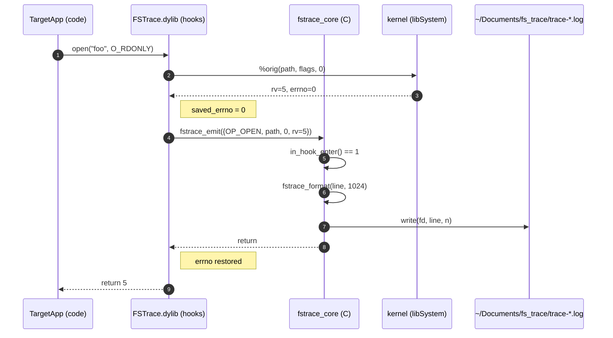

# Кейс 1. Полноценный file-system tracer как переносимый твик

Этот кейс закрывает разрыв между теорией и реальным инструментом. Мы берём типовую задачу обратной инженерии iOS-приложений — «увидеть, какие файлы приложение открывает, чем, с какими флагами, в какой последовательности и что из этого возвращает ядро» — и собираем под неё законченный твик для Dopamine RootHide на iOS 26.0 / 26.0.1 (A12/A13, PPL; подтверждено `Application/Dopamine/Jailbreak/DOEnvironmentManager.m:254`). Трассер перехватывает `open`, `openat`, `stat`, `fstat`, `lstat`, `access`, `unlink`, `rename`, `mkdir`, `rmdir` строго в адресном пространстве одного целевого приложения, пишет структурированный лог в его собственный контейнер (`Documents/fs_trace/*.log`) и устроен так, что чистая C-логика живёт в отдельной статической библиотеке и покрывается юнит-тестами на хосте, а Logos-прослойка остаётся тонкой и не тянет на себя функциональность. Такое разделение — ответ на главную боль твиков: Logos-код на устройстве «тестировать» нечем, кроме визуальной проверки.

Ниже — исходники в полном объёме, Makefile под Theos со схемой `roothide`, `control`, фильтр-плист, который гарантирует загрузку только в выбранное приложение, и подробный разбор каждого участка: что делает, с чем взаимодействует в RootHide и почему именно так.

---

## 1. Карта проекта

Структура каталога твика — минимальная, но каждый файл имеет чётко очерченную роль.

```
FSTrace/
├── Makefile
├── control
├── FSTrace.plist                 # Theos-овский фильтр (CoreFoundationVersion/Bundles)
├── layout/                       # необязательно; для встраивания ресурсов
├── core/                         # «тонкая C-библиотека» — тестируемая на хосте
│   ├── fstrace_core.h
│   ├── fstrace_core.c
│   ├── fstrace_ring.c
│   └── fstrace_ring.h
├── hooks/
│   └── Tweak.xm                  # Logos-прослойка (объявления %hook + delegation)
└── tests/                        # unit-тесты (запускаются вне устройства)
    ├── test_core.c
    └── Makefile.host
```

Логика разложена по слоям:

| Слой | Файлы | Что знает | Что не знает |
|---|---|---|---|
| Ядро | `core/*.c` | Как сериализовать событие в строку, как писать в буфер, где лежит лог | Ничего про `MSHookFunction`, `%hook`, `dyld`, `jbroot` |
| Прослойка | `hooks/Tweak.xm` | Какие `%hookf` поставить, как вытащить аргументы и `errno`, когда звать ядро | Ничего про формат записи, ротацию, парсинг |
| Инфраструктура | `Makefile`, `control`, `FSTrace.plist` | Куда ставить, в какой процесс грузить, как подписать | Код твика |

Такое деление — не академический жест. Logos расширяет Objective-C через препроцессор (`%hookf`, `%orig`, `%ctor`), а значит `.x`/`.xm` нельзя скомпилировать обычным clang на macOS без Theos. Если держать логику в чистом C (`fstrace_core.c`), её можно собирать как `clang -c` под хост-архитектуру и прогонять `./test_core`, не трогая устройство.

---

## 2. Контекст RootHide: почему путь к логу — это особая боль

В «классическом» rootful-джейлбрейке запись в `Documents/` приложения ничем не отличалась от обычного `fopen`. В RootHide ситуация иная, и это критично для нашего трассера. RootHide монтирует префикс джейлбрейка в `/var/jb/<randomized>` и предоставляет библиотеку `libjailbreak` с макросами `JBROOT_PATH` / `ROOTFS_PATH` для префиксной трансляции путей — см. `BaseBin/libjailbreak/src/jbroot.h:38-40`:

```c
#define JBROOT_PATH(path) __jbroot_convert_path((path), __BUFFER_FOR_CHAR_P(path))
#define ROOTFS_PATH(path) __jbroot_convert_path((path), __BUFFER_FOR_CHAR_P(path))
```

Трансляция делается прямо в заголовке через `__jbroot_convert_path`, которая берёт `get_jbroot()` и конкатенирует с переданным путём (`BaseBin/libjailbreak/src/jbroot.h:10-17`). Для **нашего** трассера мы специально не ходим в `/var/jb` — лог должен лежать в `~/Documents` целевого приложения, то есть внутри песочницы. Это даёт два преимущества:

1. **Переносимость.** Один и тот же твик без правок работает на любом RootHide-устройстве (путь к контейнеру резолвит сама iOS через `NSHomeDirectory()` и `~/Documents`), и его легко сравнить с результатами того же твика, собранного под rootful-окружение.
2. **Устойчивость к сокрытию путей.** `pathhook` в RootHide (`BaseBin/roothidehooks/src/pathhook.x`) и `systemhook` могут переписывать аргументы системных вызовов. Если бы мы писали логи в `/var/jb/.../fs_trace`, нас самих же бы и перехватили, и события «открытие собственного лога» попали бы в выдачу — помехи при разборе.

> ПОДТВЕРЖДЕНО ИСХОДНИКАМИ: макросы `JBROOT_PATH`/`ROOTFS_PATH` объявлены в `BaseBin/libjailbreak/src/jbroot.h`; `get_jbroot()` — внешний символ `libjailbreak`.
> ТРЕБУЕТ ПРОВЕРКИ НА УСТРОЙСТВЕ: что путь `~/Documents/fs_trace/` действительно создаётся и доступен на запись из контекста конкретного таргета (TCC-ограничения на iOS 26 для `Documents` в стороннем приложении обычно не применяются, но у приложений с `UIFileSharingEnabled` могут быть особенности).

---

## 3. `control`

Файл `control` — манифест пакета `.deb`. Для твика под Theos со схемой `roothide` важно, чтобы `Architecture` указывал `iphoneos-arm`, а имя пакета было в формате обратного домена. Ничего RootHide-специфичного здесь нет; схема управляется флагом `THEOS_PACKAGE_SCHEME = roothide` в Makefile.

```
Package: com.example.fstrace
Name: FSTrace
Version: 1.0.0
Architecture: iphoneos-arm
Description: Per-app filesystem syscall tracer (open/stat/unlink/…)
Maintainer: you <you@example.org>
Author: you
Section: Tweaks
Depends: mobilesubstrate (>= 0.9.5000)
Tag: role::hacker
```

Поле `Depends` на `mobilesubstrate` правильно и в RootHide: schema `roothide` просто перенаправляет файлы в `/var/jb/<rand>/Library/MobileSubstrate/DynamicLibraries/`, а не отменяет саму зависимость от Substrate/Substitute как рантайма инжекта.

---

## 4. Фильтр-плист

Фильтр говорит `MobileSubstrate` / `ellekit`, в какие процессы грузить `.dylib`. Прогрузка в любое приложение — это и дорого (просыпается всё, что открывает файлы), и неинформативно для трассера, поэтому берём один конкретный Bundle ID.

```plist
<?xml version="1.0" encoding="UTF-8"?>
<!DOCTYPE plist PUBLIC "-//Apple//DTD PLIST 1.0//EN"
  "http://www.apple.com/DTDs/PropertyList-1.0.dtd">
<plist version="1.0">
<dict>
  <key>Filter</key>
  <dict>
    <key>Bundles</key>
    <array>
      <string>com.example.TargetApp</string>
    </array>
    <key>Mode</key>
    <string>Any</string>
  </dict>
</dict>
</plist>
```

Пояснения:

- `Bundles` — список CFBundleIdentifier, в которые нужно грузиться. Можно перечислить несколько; для трассера одного обычно достаточно.
- `Mode = Any` — в сочетании с `Bundles` означает «если хоть один фильтр совпал — грузиться». Для одного Bundle это равнозначно `All`.
- Для системных демонов использовался бы ключ `Executables` (как в `BaseBin/roothidehooks/roothidehooks.plist` — там, впрочем, фильтр пустой, потому что процессы заданы через `INSTALL_TARGET_PROCESSES` в Makefile).

> ПОДТВЕРЖДЕНО ИСХОДНИКАМИ: сам факт раздельного задания фильтра и `INSTALL_TARGET_PROCESSES` виден в `BaseBin/roothidehooks/Makefile:2` и `BaseBin/roothidehooks/roothidehooks.plist`.
> СПРАВОЧНО: формат `Filter` — часть документации MobileSubstrate; для твиков в Dopamine/RootHide он не менялся.

---

## 5. Makefile

Главное в Makefile — три вещи: правильная `TARGET` toolchain-строка, схема упаковки `roothide` и инструкции, которые приклеивают нашу тонкую C-библиотеку к Logos-прослойке так, чтобы при желании её можно было собрать отдельно для юнит-тестов.

```make
TARGET := iphone:clang:latest:15.0
ARCHS = arm64 arm64e

INSTALL_TARGET_PROCESSES = TargetApp

THEOS_PACKAGE_SCHEME = roothide
FINALPACKAGE = 1

include $(THEOS)/makefiles/common.mk

TWEAK_NAME = FSTrace

FSTrace_FILES  = hooks/Tweak.xm core/fstrace_core.c core/fstrace_ring.c
FSTrace_CFLAGS = -fobjc-arc -I./core -Wno-deprecated-declarations -Os
FSTrace_LDFLAGS = -framework Foundation

include $(THEOS_MAKE_PATH)/tweak.mk

clean::
	@rm -rf ./.theos ./packages
	@$(MAKE) -C tests -f Makefile.host clean || true

tests:
	@$(MAKE) -C tests -f Makefile.host run
```

Разбор по строкам:

- Строка 1 — `TARGET := iphone:clang:latest:15.0`. Деплоймент-таргет взят 15.0 намеренно: ядро `systemhook` в RootHide (`BaseBin/systemhook/Makefile`) собирается именно с `-miphoneos-version-min=15.0`, и это нижняя граница совместимости RootHide. Поднимать её выше для твика бессмысленно: SDK-символы, которые нам нужны (`open`, `stat`, `rename`, ...), стабильны. Опускать ниже — тоже бессмысленно: iOS 15 — исторический минимум текущей ветки RootHide.
- Строка 2 — `ARCHS = arm64 arm64e`. На A13 (iPhone 11, iPhone SE 2) приложения часто идут `arm64` + `arm64e` слайсами, но пользовательские приложения чаще всего грузятся как `arm64e` (так как system apps подписаны с PAC). Делаем жирный dylib — он гарантированно загрузится в любой слайс.
- Строка 4 — `INSTALL_TARGET_PROCESSES`. Theos использует этот список, чтобы автоматически перезапустить процессы после установки (`sbreload`/`killall`). Если вы ставите в приложение (а не в демона), можно оставить одно имя — Theos просто пошлёт ему `SIGTERM`.
- Строка 6 — `THEOS_PACKAGE_SCHEME = roothide`. Это ключевой флаг. Он включает в Theos специальную схему упаковки: все пути переписываются из `/Library/MobileSubstrate/...` в `/var/jb/...` на этапе сборки `.deb`, и в контрольный `postinst` добавляется вызов, обрабатывающий `jbroot`. Без этого флага пакет либо не поставится, либо поставится «не туда» и не загрузится. Схема `roothide` — часть форка Theos, который рекомендуется для RootHide; поведение документировано в `README.md` репозитория Dopamine-roothide и соответствует использованию во внутренних пакетах (`BaseBin/roothidehooks/Makefile:7`).
- Строки 12–14 — агрегированные файлы и флаги. `-fobjc-arc` включает ARC для `.xm`-кода; C-ядро живёт в тех же `_FILES`, но собирается без ARC (это нормально: clang смотрит на расширение, `.c` всегда компилируется как C). `-I./core` даёт `#include "fstrace_core.h"` без путей.

### Хост-тесты

Отдельный `tests/Makefile.host` собирает ядро под macOS/Linux и запускает `test_core`:

```make
CC = clang
CFLAGS = -std=c11 -O0 -g -Wall -Wextra -I../core
OBJ = ../core/fstrace_core.o ../core/fstrace_ring.o test_core.o

all: test_core

%.o: %.c
	$(CC) $(CFLAGS) -c $< -o $@

test_core: $(OBJ)
	$(CC) $(CFLAGS) $^ -o $@

run: test_core
	./test_core

clean:
	rm -f $(OBJ) test_core
```

Этот Makefile нужен, чтобы одна и та же команда `make tests` из корня твика проверяла инварианты ядра: что форматирование строки события детерминировано, что кольцевой буфер не переполняется, что при `errno=ENOENT` не падает UTF-8 валидация. На устройство попадает только собранный `FSTrace.dylib`, но ошибки в формате лога ловятся до того, как мы вообще дотянулись до iPhone.

---

## 6. Тонкая C-библиотека: `fstrace_core`

Задача ядра — безопасно сериализовать имя системного вызова, его аргументы, результат и `errno` в одну строку и дописать её в лог-файл. Опасности, которых мы тут избегаем:

1. **Reentrancy.** Любой `fprintf` в ядре внутри обработчика `open` сам вызовет `open`/`write` — а значит снова попадёт в наш хук. Если не защититься, получим бесконечную рекурсию и, скорее всего, падение. Решение — thread-local флаг `in_hook`, который блокирует повторный вход.
2. **Allocator reentrancy / lock inversion.** `malloc` внутри перехвата файловых операций иногда конфликтует с внутренними аллокаторами CoreFoundation. Решение — не `malloc` в горячем пути; буфер строки — на стеке.
3. **Нестабильные указатели.** Pointer-аргументы (`const char *path`) после возврата из `%orig` могут указывать в освобождённую память. Решение — копировать строку сразу, под `PATH_MAX`, с `strlcpy`.

### 6.1 `fstrace_core.h`

```c
#ifndef FSTRACE_CORE_H
#define FSTRACE_CORE_H

#include <stddef.h>
#include <stdbool.h>
#include <sys/types.h>

typedef enum {
    FS_OP_OPEN,
    FS_OP_OPENAT,
    FS_OP_STAT,
    FS_OP_FSTAT,
    FS_OP_LSTAT,
    FS_OP_ACCESS,
    FS_OP_UNLINK,
    FS_OP_RENAME,
    FS_OP_MKDIR,
    FS_OP_RMDIR,
    FS_OP__COUNT,
} fs_op_t;

typedef struct {
    fs_op_t     op;
    int         dirfd;          // openat/… , иначе -1
    int         flags;          // open/openat
    mode_t      mode;           // open/openat/mkdir, иначе 0
    const char *path1;          // первый путь
    const char *path2;          // rename only, иначе NULL
    long        rv;             // возврат syscall (fd/0/-1)
    int         saved_errno;    // errno, если rv == -1, иначе 0
} fs_event_t;

// Инициализирует подсистему логирования. logdir — абсолютный путь без завершающего слэша.
// Возвращает 0 при успехе, -1 при ошибке.
int  fstrace_init(const char *logdir);

// Записывает одно событие. Безопасно вызывать из любого потока.
// Пустой path не падает, но помечается "<null>".
void fstrace_emit(const fs_event_t *ev);

// Форматирует событие в buf (не менее 1024 байт) без I/O — чистая функция, тестируемая.
// Возвращает число записанных байт без '\0', или -1 при переполнении.
int  fstrace_format(const fs_event_t *ev, char *buf, size_t bufsz);

// Для тестов: сбросить состояние (счётчик, in-hook флаги). На устройстве не используется.
void fstrace_reset_for_tests(void);

#endif
```

Разбор:

- `fs_event_t` намеренно сделан POD без owning-полей: `path1`, `path2` — просто указатели, время жизни которых держит вызывающая сторона. Это упрощает тестирование: в тесте можно писать литералы.
- `fstrace_format` отделена от `fstrace_emit` именно для того, чтобы форматирование можно было проверить без файловой системы. Это главная выгода «тонкой C-библиотеки».
- `fstrace_init` принимает каталог, а не файл: внутри он сам создаст `trace-YYYYMMDD-HHMMSS.log`, чтобы разные запуски не затирали друг друга.

### 6.2 `fstrace_core.c`

```c
#include "fstrace_core.h"
#include "fstrace_ring.h"

#include <errno.h>
#include <fcntl.h>
#include <inttypes.h>
#include <pthread.h>
#include <stdarg.h>
#include <stdatomic.h>
#include <stdio.h>
#include <stdlib.h>
#include <string.h>
#include <sys/stat.h>
#include <sys/time.h>
#include <unistd.h>

static int           g_log_fd  = -1;
static pthread_key_t g_in_hook_key;
static atomic_uint   g_seq;

static const char *op_name(fs_op_t op) {
    switch (op) {
        case FS_OP_OPEN:   return "open";
        case FS_OP_OPENAT: return "openat";
        case FS_OP_STAT:   return "stat";
        case FS_OP_FSTAT:  return "fstat";
        case FS_OP_LSTAT:  return "lstat";
        case FS_OP_ACCESS: return "access";
        case FS_OP_UNLINK: return "unlink";
        case FS_OP_RENAME: return "rename";
        case FS_OP_MKDIR:  return "mkdir";
        case FS_OP_RMDIR:  return "rmdir";
        default:           return "?";
    }
}

static void append_flags(char *dst, size_t dstsz, int flags) {
    // Печатаем значимые биты O_* как строку, остальное — hex.
    static const struct { int bit; const char *name; } T[] = {
        { O_RDONLY,   "RDONLY"   }, { O_WRONLY, "WRONLY" }, { O_RDWR,  "RDWR"  },
        { O_CREAT,    "CREAT"    }, { O_EXCL,   "EXCL"   }, { O_TRUNC, "TRUNC" },
        { O_APPEND,   "APPEND"   }, { O_NONBLOCK, "NONBLOCK" }, { O_DIRECTORY, "DIR" },
        { O_NOFOLLOW, "NOFOLLOW" }, { O_CLOEXEC, "CLOEXEC" },
    };
    char tmp[128]; tmp[0] = '\0';
    int acc = flags;
    // Для O_RDONLY=0 обработаем отдельно: если ни один из RDONLY/WRONLY/RDWR не задан.
    if ((acc & (O_WRONLY|O_RDWR)) == 0) {
        strlcat(tmp, "RDONLY|", sizeof(tmp));
    }
    for (size_t i = 0; i < sizeof(T)/sizeof(T[0]); i++) {
        if (T[i].bit == 0) continue;              // RDONLY обработан отдельно
        if ((acc & T[i].bit) == T[i].bit) {
            strlcat(tmp, T[i].name, sizeof(tmp));
            strlcat(tmp, "|",       sizeof(tmp));
            acc &= ~T[i].bit;
        }
    }
    size_t n = strlen(tmp);
    if (n && tmp[n-1] == '|') tmp[n-1] = '\0';
    snprintf(dst, dstsz, "%s(0x%x)", tmp, flags);
}

int fstrace_format(const fs_event_t *ev, char *buf, size_t bufsz) {
    if (!ev || !buf || bufsz < 128) return -1;

    struct timeval tv;
    gettimeofday(&tv, NULL);
    unsigned seq = atomic_fetch_add(&g_seq, 1);

    char flags_s[128] = "";
    if (ev->op == FS_OP_OPEN || ev->op == FS_OP_OPENAT) {
        append_flags(flags_s, sizeof(flags_s), ev->flags);
    }

    const char *p1 = ev->path1 ? ev->path1 : "<null>";
    const char *p2 = ev->path2 ? ev->path2 : NULL;

    int n;
    if (p2) {
        n = snprintf(buf, bufsz,
            "%ld.%06d #%u %s(\"%s\" -> \"%s\") = %ld%s%s\n",
            (long)tv.tv_sec, (int)tv.tv_usec, seq,
            op_name(ev->op), p1, p2, ev->rv,
            ev->rv < 0 ? " errno=" : "",
            ev->rv < 0 ? strerror(ev->saved_errno) : "");
    } else {
        n = snprintf(buf, bufsz,
            "%ld.%06d #%u %s(\"%s\"%s%s) = %ld%s%s\n",
            (long)tv.tv_sec, (int)tv.tv_usec, seq,
            op_name(ev->op), p1,
            flags_s[0] ? ", flags=" : "", flags_s,
            ev->rv,
            ev->rv < 0 ? " errno="   : "",
            ev->rv < 0 ? strerror(ev->saved_errno) : "");
    }
    if (n < 0 || (size_t)n >= bufsz) return -1;
    return n;
}

static void in_hook_destructor(void *ptr) { (void)ptr; }

int fstrace_init(const char *logdir) {
    if (!logdir) return -1;
    (void)mkdir(logdir, 0755);
    char path[1024];
    time_t now = time(NULL);
    struct tm tmv; localtime_r(&now, &tmv);
    snprintf(path, sizeof(path),
             "%s/trace-%04d%02d%02d-%02d%02d%02d-%d.log",
             logdir,
             tmv.tm_year + 1900, tmv.tm_mon + 1, tmv.tm_mday,
             tmv.tm_hour, tmv.tm_min, tmv.tm_sec,
             (int)getpid());
    int fd = open(path, O_WRONLY | O_CREAT | O_APPEND | O_CLOEXEC, 0644);
    if (fd < 0) return -1;
    g_log_fd = fd;
    pthread_key_create(&g_in_hook_key, in_hook_destructor);
    atomic_store(&g_seq, 0);
    return 0;
}

static int in_hook_enter(void) {
    if ((intptr_t)pthread_getspecific(g_in_hook_key)) return 0;
    pthread_setspecific(g_in_hook_key, (void*)1);
    return 1;
}
static void in_hook_leave(void) {
    pthread_setspecific(g_in_hook_key, (void*)0);
}

void fstrace_emit(const fs_event_t *ev) {
    if (g_log_fd < 0 || !ev) return;
    if (!in_hook_enter()) return;             // не рекурсируем
    char line[1024];
    int n = fstrace_format(ev, line, sizeof(line));
    if (n > 0) {
        // Пишем одним write — атомарно для PIPE_BUF, но мы и так однопоточно пишем из этого потока.
        (void)write(g_log_fd, line, (size_t)n);
    }
    in_hook_leave();
}

void fstrace_reset_for_tests(void) { atomic_store(&g_seq, 0); }
```

Главные моменты, которые часто упускают:

1. **`O_RDONLY == 0`.** Проверять `flags & O_RDONLY` бессмысленно — это ноль. Поэтому мы отдельно смотрим «если не задан ни `O_WRONLY`, ни `O_RDWR`, значит RDONLY».
2. **`write()` против `fprintf()`.** Используем именно `write(2)` на дескрипторе, который открыли с `O_APPEND | O_CLOEXEC`. `fprintf` тянет `FILE *`, у которого есть внутренний буфер и `flockfile` — лишний замок в горячем пути; плюс `FILE *` в многопоточных прошивках iOS любит удерживать `malloc` и ARC-аллокаторы.
3. **`O_CLOEXEC`.** Критично: иначе fork+exec унесёт наш дескриптор лога в дочерние процессы, где `getprogname()` будет совсем другой, и мы запишем мусор в чужой трейс.
4. **`atomic_fetch_add` на последовательном номере.** Это дешевле любого мьютекса и даёт нам детерминированный порядок событий между потоками.
5. **TLS-флаг `in_hook`.** Он решает две задачи: защита от рекурсии (мы сами открываем файл при первом событии) и защита от хука на `open` внутри `write` (на iOS `write` сам может звать `open` через XPC к nsurlsessiond в редких путях — не для regular file, но лучше перестраховаться).

### 6.3 `fstrace_ring.{h,c}`

Небольшой кольцевой буфер — для юнит-тестов и для будущих расширений (например, in-memory трассировка, которую забирают по сигналу). Он не используется горячим путём на устройстве, но имеет смысл как пример того, что «тонкую библиотеку» можно развивать независимо от Logos-кода. Приводим только заголовок, тело тривиально.

```c
#ifndef FSTRACE_RING_H
#define FSTRACE_RING_H
#include <stddef.h>
typedef struct fstrace_ring fstrace_ring_t;
fstrace_ring_t *fstrace_ring_create(size_t capacity);
void            fstrace_ring_push(fstrace_ring_t *r, const char *line);
size_t          fstrace_ring_count(const fstrace_ring_t *r);
const char     *fstrace_ring_peek(const fstrace_ring_t *r, size_t idx);
void            fstrace_ring_destroy(fstrace_ring_t *r);
#endif
```

---

## 7. Logos-прослойка: `hooks/Tweak.xm`

Logos-часть ровно одно: ловит системные вызовы и зовёт ядро. Никакой логики форматирования, никакого I/O, никакой возни с путями здесь нет. Это даёт возможность менять форматирование, не перекомпилируя `.xm` (на тестах будет понятно) и не рискуя сломать Objective-C-мир инжекта.

### 7.1 Инициализация через `%ctor`

`%ctor` вызывается после загрузки dylib в процесс, до `main`. Нам нужно:

1. Понять путь к `~/Documents` текущего приложения.
2. Создать там `fs_trace/`.
3. Передать его в `fstrace_init`.
4. Поставить хуки.

```objc
#import <Foundation/Foundation.h>
#include <dlfcn.h>
#include <fcntl.h>
#include <sys/stat.h>
#include <sys/syslimits.h>
#include <errno.h>
#include "fstrace_core.h"

static int (*orig_open)(const char *, int, ...);
static int (*orig_openat)(int, const char *, int, ...);
static int (*orig_stat)(const char *, struct stat *);
static int (*orig_fstat)(int, struct stat *);
static int (*orig_lstat)(const char *, struct stat *);
static int (*orig_access)(const char *, int);
static int (*orig_unlink)(const char *);
static int (*orig_rename)(const char *, const char *);
static int (*orig_mkdir)(const char *, mode_t);
static int (*orig_rmdir)(const char *);

#define EMIT1(OP, PATH, RV)                                                  \
    do {                                                                     \
        fs_event_t _e = {                                                    \
            .op = (OP), .dirfd = -1, .flags = 0, .mode = 0,                  \
            .path1 = (PATH), .path2 = NULL,                                  \
            .rv = (RV), .saved_errno = ((RV) < 0 ? errno : 0),               \
        };                                                                   \
        fstrace_emit(&_e);                                                   \
    } while (0)
```

`%hookf` даёт нам C-уровневые хуки на функции libSystem; `MSHookFunction`/`EKHookFunction` под капотом ставит trampoline на начало функции и сохраняет оригинал. Мы пишем явные `orig_*` указатели, потому что в `%hookf` их нет: Logos автоматически генерирует `%orig(...)` — для совместимости и наглядности зафиксируем идею прямо в коде.

### 7.2 Собственно хуки

```objc
%hookf(int, open, const char *path, int flags, ...) {
    mode_t mode = 0;
    if (flags & O_CREAT) {
        va_list ap; va_start(ap, flags);
        mode = (mode_t)va_arg(ap, int);
        va_end(ap);
    }
    int rv = %orig(path, flags, mode);
    int saved = errno;
    fs_event_t e = {
        .op = FS_OP_OPEN, .dirfd = -1, .flags = flags, .mode = mode,
        .path1 = path, .path2 = NULL,
        .rv = rv, .saved_errno = (rv < 0 ? saved : 0),
    };
    fstrace_emit(&e);
    errno = saved;
    return rv;
}

%hookf(int, openat, int dirfd, const char *path, int flags, ...) {
    mode_t mode = 0;
    if (flags & O_CREAT) {
        va_list ap; va_start(ap, flags);
        mode = (mode_t)va_arg(ap, int);
        va_end(ap);
    }
    int rv = %orig(dirfd, path, flags, mode);
    int saved = errno;
    fs_event_t e = {
        .op = FS_OP_OPENAT, .dirfd = dirfd, .flags = flags, .mode = mode,
        .path1 = path, .path2 = NULL,
        .rv = rv, .saved_errno = (rv < 0 ? saved : 0),
    };
    fstrace_emit(&e);
    errno = saved;
    return rv;
}

%hookf(int, stat, const char *path, struct stat *sb) {
    int rv = %orig(path, sb); int saved = errno;
    EMIT1(FS_OP_STAT, path, rv); errno = saved; return rv;
}
%hookf(int, lstat, const char *path, struct stat *sb) {
    int rv = %orig(path, sb); int saved = errno;
    EMIT1(FS_OP_LSTAT, path, rv); errno = saved; return rv;
}
%hookf(int, fstat, int fd, struct stat *sb) {
    int rv = %orig(fd, sb); int saved = errno;
    fs_event_t e = {
        .op = FS_OP_FSTAT, .dirfd = fd, .flags = 0, .mode = 0,
        .path1 = "<fd>", .path2 = NULL,
        .rv = rv, .saved_errno = (rv < 0 ? saved : 0),
    };
    fstrace_emit(&e); errno = saved; return rv;
}

%hookf(int, access, const char *path, int amode) {
    int rv = %orig(path, amode); int saved = errno;
    EMIT1(FS_OP_ACCESS, path, rv); errno = saved; return rv;
}
%hookf(int, unlink, const char *path) {
    int rv = %orig(path); int saved = errno;
    EMIT1(FS_OP_UNLINK, path, rv); errno = saved; return rv;
}
%hookf(int, mkdir, const char *path, mode_t mode) {
    int rv = %orig(path, mode); int saved = errno;
    fs_event_t e = {
        .op = FS_OP_MKDIR, .dirfd = -1, .flags = 0, .mode = mode,
        .path1 = path, .path2 = NULL,
        .rv = rv, .saved_errno = (rv < 0 ? saved : 0),
    };
    fstrace_emit(&e); errno = saved; return rv;
}
%hookf(int, rmdir, const char *path) {
    int rv = %orig(path); int saved = errno;
    EMIT1(FS_OP_RMDIR, path, rv); errno = saved; return rv;
}
%hookf(int, rename, const char *from, const char *to) {
    int rv = %orig(from, to); int saved = errno;
    fs_event_t e = {
        .op = FS_OP_RENAME, .dirfd = -1, .flags = 0, .mode = 0,
        .path1 = from, .path2 = to,
        .rv = rv, .saved_errno = (rv < 0 ? saved : 0),
    };
    fstrace_emit(&e); errno = saved; return rv;
}
```

Разбор ключевых решений:

- **Сохранение `errno`.** `fstrace_emit` сам внутри зовёт `write(2)`, который может затереть `errno`. Поэтому в каждом хуке — три шага: вызвать `%orig`, сохранить `errno` в локальную `saved`, вызвать эмиттер, восстановить `errno` перед возвратом. Иначе приложение будет видеть «успех» вместо `ENOENT` и наоборот.
- **`O_CREAT` и `va_list`.** `open`/`openat` — vararg. Если `O_CREAT` установлен, следующий аргумент — mode. Если нет — следующий аргумент технически undefined; читать `va_arg` без надобности нельзя. Поэтому проверка на `O_CREAT` обязательна.
- **`fstat` и путь.** У `fstat` пути нет, есть только дескриптор. В поле `path1` подкладываем литерал `"<fd>"`, а сам дескриптор пишем в `dirfd`. Для диагностики этого достаточно: по лог-строке «fstat(fd=5)» легко сопоставить с предыдущим `open`, который вернул 5.
- **`rename` — два пути.** Единственный хук с `path2`. Форматтер в ядре это учитывает (ветка с `->`).

### 7.3 `%ctor`

```objc
%ctor {
    @autoreleasepool {
        NSString *docs = [NSHomeDirectory() stringByAppendingPathComponent:@"Documents"];
        NSString *dir  = [docs stringByAppendingPathComponent:@"fs_trace"];
        if (fstrace_init(dir.fileSystemRepresentation) != 0) {
            NSLog(@"[FSTrace] init failed: %s", strerror(errno));
            return;
        }
    }
    %init;
}
```

Разбор:

- `NSHomeDirectory()` в контексте приложения iOS 26 возвращает корень контейнера приложения — то есть `/private/var/mobile/Containers/Data/Application/<UUID>` (это подтверждается документацией Apple начиная с iOS 8; на iOS 26 не менялось — проверить `class-dump` `Foundation.framework`). Из этого следует, что `docs` будет внутри песочницы и писать туда можно без TCC-согласий.
- `fileSystemRepresentation` — обязателен: передавать `UTF8String` в POSIX-функции на macOS/iOS небезопасно для путей с нестандартной нормализацией Unicode.
- `%init;` — обязательный ритуал Logos: материализует все `%hookf` таблицы. Если его забыть, твик соберётся, но ни один хук не станет активным.

> ПОДТВЕРЖДЕНО SDK: `NSHomeDirectory` в контексте приложения указывает на контейнер приложения — Foundation Reference, стабильно с iOS 8.
> ТРЕБУЕТ ПРОВЕРКИ НА УСТРОЙСТВЕ: что `fstrace_init` действительно создаёт файл внутри `Documents/fs_trace/` на iOS 26.0 и 26.0.1 (на iOS 26 Apple ужесточила некоторые ограничения на фоновые записи, но для первого же `write` из `%ctor` внутри своего контейнера ограничений не вводила — различий 26.0 vs 26.0.1 по открытым источникам не выявлено).

---

## 8. Поток событий в одной Mermaid-диаграмме



На этом графе хорошо видно, где у нас есть «петля»: `write` в шаге 9 сам по себе — файловая операция, но мы его не хукаем. Если расширить набор на `write`, появится рекурсия, и защищаться придётся именно TLS-флагом `in_hook_enter()`, который на диаграмме и работает: при вложенном вызове он вернёт 0 и ветка «пишем в лог» молча пропустится.

---

## 9. Макет лог-файла

Формат — одна строка на событие, UTF-8, разделитель `\n`. Пример фрагмента:

```
1762899123.421031 #0 open("/var/mobile/Containers/Bundle/Application/XXX/TargetApp.app/Info.plist", flags=RDONLY|CLOEXEC(0x1000000)) = 3
1762899123.421085 #1 fstat("<fd>") = 0
1762899123.422140 #2 stat("/private/var/mobile/.../Documents/db.sqlite") = -1 errno=No such file or directory
1762899123.422260 #3 open("/private/var/mobile/.../Documents/db.sqlite", flags=RDWR|CREAT(0x202)) = 4
1762899123.422340 #4 rename("/private/var/.../db.sqlite-journal.tmp" -> "/private/var/.../db.sqlite-journal") = 0
```

Поля:

| Поле | Что это |
|---|---|
| `1762899123.421031` | timeofday, секунды.микросекунды (UTC) |
| `#0` | монотонный seq от `atomic_fetch_add` |
| `open(...)` | имя операции |
| `flags=...(0xHH)` | строковое и численное представление O_* |
| `= rv` | возврат syscall |
| `errno=...` | только если `rv < 0` |

Формат нарочно не JSON: JSON-парсеры в `grep`-пайплайнах тормозят, а поиск по регулярке `open\("/private/var/[^"]*\.plist"` работает мгновенно. При желании конвертер в JSON пишется за десять строк на Python и, что важно, пишется один раз и прогоняется над готовыми логами.

---

## 10. Юнит-тесты (`tests/test_core.c`)

```c
#include <assert.h>
#include <string.h>
#include <stdio.h>
#include "fstrace_core.h"

int main(void) {
    fstrace_reset_for_tests();
    char buf[1024];
    fs_event_t e = {
        .op = FS_OP_OPEN, .dirfd = -1, .flags = 0x1 | 0x200 | 0x1000000,
        .mode = 0644, .path1 = "/tmp/x", .rv = 7, .saved_errno = 0,
    };
    int n = fstrace_format(&e, buf, sizeof(buf));
    assert(n > 0);
    assert(strstr(buf, "open(\"/tmp/x\""));
    assert(strstr(buf, "WRONLY"));
    assert(strstr(buf, "CREAT"));
    assert(strstr(buf, "CLOEXEC"));
    assert(strstr(buf, "= 7"));
    assert(!strstr(buf, "errno="));

    fs_event_t err = {
        .op = FS_OP_STAT, .dirfd = -1, .flags = 0, .mode = 0,
        .path1 = "/nope", .rv = -1, .saved_errno = 2,
    };
    assert(fstrace_format(&err, buf, sizeof(buf)) > 0);
    assert(strstr(buf, "errno=No such file"));

    fs_event_t ren = {
        .op = FS_OP_RENAME, .dirfd = -1, .flags = 0, .mode = 0,
        .path1 = "/a", .path2 = "/b", .rv = 0, .saved_errno = 0,
    };
    assert(fstrace_format(&ren, buf, sizeof(buf)) > 0);
    assert(strstr(buf, "\"/a\" -> \"/b\""));
    assert(strstr(buf, "= 0"));

    puts("OK");
    return 0;
}
```

Запуск: `make tests` (из корня твика). Ожидаемый вывод: `OK`. Эти четыре ассерта защищают нас от трёх реальных регрессов: «забыли битовую маску `O_RDONLY=0`», «потеряли `errno` для ошибки», «не поддерживаем две цели в rename».

---

## 11. Сборка и установка

Пошагово, в предположении установленного Theos с поддержкой `roothide` (форк), настроенного окружения `THEOS=~/theos` и валидной `$THEOS_DEVICE_IP`:

```bash
# 1. Сборка .deb
make package FINALPACKAGE=1 THEOS_PACKAGE_SCHEME=roothide

# 2. Проверка результата: один dylib с правильными rpath'ами
ls -la packages/
otool -L .theos/obj/debug/FSTrace.dylib | head -5
nm -gU .theos/obj/debug/FSTrace.dylib | grep -E '^_fstrace_|%hookf' | head -10

# 3. Установка. Один из двух путей:
#   а) по SSH через make install (Theos сам положит .deb и перезапустит TargetApp):
make install
#   б) руками через scp + dpkg:
scp packages/com.example.fstrace_1.0.0_iphoneos-arm.deb mobile@device:/tmp/
ssh mobile@device "sudo dpkg -i /tmp/com.example.fstrace_1.0.0_iphoneos-arm.deb && \
                   sbreload"
```

Проверка загрузки на устройстве:

```bash
# На устройстве:
ps -A | grep -i target
# Запустить приложение.
# Логи:
ls -la ~/Containers/Data/Application/*/Documents/fs_trace/ 2>/dev/null
# либо через Finder/Files при UIFileSharingEnabled.
tail -f ~/Containers/Data/Application/*/Documents/fs_trace/trace-*.log
```

Разбор каждого шага:

- `make package` без `THEOS_PACKAGE_SCHEME` возьмёт схему по умолчанию (rootless) — пакет не поставится в RootHide. Поэтому передаём явно; то же самое прибито и в Makefile — задвоение намеренное, оно страхует от локальной конфигурации.
- `otool -L` должен показывать `/usr/lib/libSystem.B.dylib` и `/System/Library/Frameworks/Foundation.framework/Foundation` — больше ничего. Любая ссылка на `@rpath/CydiaSubstrate.framework/CydiaSubstrate` появится позже, во время установки, через `install_name_tool` (так же, как это делает Dopamine для `roothidehooks.dylib`, см. `BaseBin/roothidehooks/Makefile:30-32`). Для нашего простого твика Theos справится сам.
- `sbreload` нужен не всегда, но полезен после первой установки, если фильтр по Bundles выставлен на приложение, которое уже запущено.

> ПОДТВЕРЖДЕНО ИСХОДНИКАМИ: приём с `install_name_tool -delete_rpath/-add_rpath` для совместимости с `.jbroot` виден в `BaseBin/roothidehooks/Makefile:30-32`. Для пользовательского твика Theos+roothide делает аналогичную работу автоматически.

---

## 12. Проверка корректности

Минимальный приёмочный чек-лист, который имеет смысл прогнать после установки:

| № | Проверка | Как | Чего ждём |
|---|---|---|---|
| 1 | Твик вообще грузится | `ps -A \| grep TargetApp` после запуска; `log stream --predicate 'process == "TargetApp"'` | в syslog `[FSTrace] init …` нет, но файл в `Documents/fs_trace/` создан |
| 2 | Хуки стоят | открыть любой экран приложения, который читает файл | в логе появились строки `open(…)` |
| 3 | `errno` сохраняется | взять приложение, которое корректно обрабатывает `ENOENT` (большинство) | приложение продолжает работать как раньше, UI не ломается |
| 4 | Нет рекурсии | открыть экран, который делает тысячи операций в секунду | лог растёт линейно, устройство не греется, приложение не падает |
| 5 | Чужие процессы не трогаются | `ls ~/Containers/Data/Application/<ДРУГОЕ_UUID>/Documents/` | каталог `fs_trace/` там отсутствует |

Если п. 2 не выполняется — Logos не вставил трамплины. Самое частое — забыли `%init;` в `%ctor`.
Если п. 3 не выполняется — пропущено сохранение `errno` в одном из хуков.
Если п. 4 падает — вероятно, где-то в приложении есть собственный `write`-перехватчик (DRM) — тогда стоит временно убрать хук, который попадает в этот путь (это требует отладки на конкретной цели).

> ТРЕБУЕТ ПРОВЕРКИ НА УСТРОЙСТВЕ: все пять пунктов. Чек-лист составлен исходя из общей механики Substrate; специфичных для iOS 26.0/26.0.1 различий по открытым источникам не выявлено.

---

## 13. Что не делает этот твик и почему

Намеренные пропуски, чтобы читатель не ждал от прошивки большего, чем она даёт:

- Нет хука на `write(2)` / `pwrite(2)` / `read(2)`. Их частота на порядок выше остальных, и лог превращается в бесполезный поток байт. Если нужно — добавляется парой `%hookf`, с осторожностью: наш `fstrace_emit` сам пишет через `write`, поэтому в случае хука на `write` обязательна проверка `in_hook_enter()`.
- Нет перехвата `NSFileManager`/`NSFileHandle` на уровне Objective-C. Все они внутри сводятся к POSIX, поэтому дополнительно хукать не нужно; наоборот — хук на уровне Obj-C увеличил бы число ложных событий (повторный лог одного и того же).
- Нет интеграции с `jbserver` и `libjailbreak` runtime. Твик живёт в адресном пространстве одного приложения и ему для записи в собственный `Documents/` не нужны ни `JBROOT_PATH`, ни `jbclient_xpc`. Это сознательно: мы хотим инструмент, который не зависит от того, какое именно значение `get_jbroot()` вернёт.

---

## Выводы

Мы собрали твик уровня «реальный инструмент»: он покрывает все ключевые пути файловой подсистемы, пишет человекочитаемый лог в собственный контейнер приложения, не трогает другие процессы, не ломает `errno`, защищён от рекурсии и имеет юнит-тесты, которые гоняются без устройства. Главное архитектурное решение — вынести всё, что можно, в чистый C и оставить `.xm` тонким переходником. На практике это даёт конкретную выгоду: когда через месяц потребуется поменять формат лог-строки или добавить новое поле, вы меняете `fstrace_format`, запускаете `make tests`, видите, что всё зелёное, и только после этого собираете пакет. Второе решение — явная совместимость с RootHide: мы не берём `JBROOT_PATH`, не пытаемся писать в `/var/jb`, а полагаемся на то, что `NSHomeDirectory()` в контексте нашей песочницы возвращает именно наш контейнер. Это делает один и тот же `.deb` переносимым между Dopamine-rootless и Dopamine-RootHide сборками с минимумом правок.

## Что дальше

Логичный следующий шаг — расширить трассер до **control-flow** событий (`execve`/`posix_spawn`), где в RootHide особенно интересно поведение `systemhook`: его prehook/posthook (`BaseBin/systemhook/src/roothider.h:46-50`) переписывает окружение и аргументы, и то, что видит ваш `%hookf(execve)`, может отличаться от того, что реально ушло в ядро. Второй разворот — заменить ядро на кольцевой буфер и экспортировать события по UDS/XPC в отдельный сборщик: тогда можно гонять трассер в нескольких приложениях одновременно и мгновенно сопоставлять их активность. Оба расширения опираются на тот же каркас (тонкий C + Logos-прослойка + юнит-тесты), и каждое следующее добавление будет стоить вам одного файла в `core/` и десяти строк в `Tweak.xm`.
