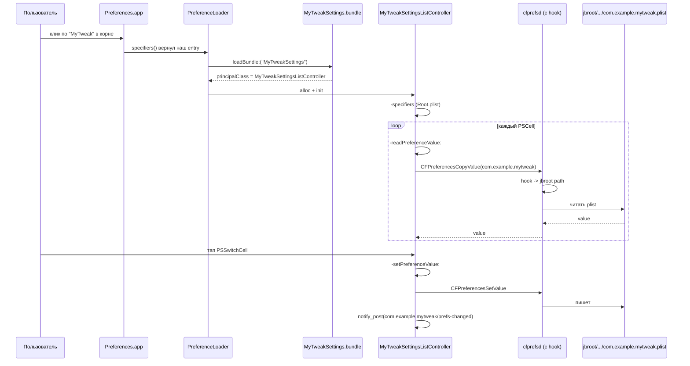
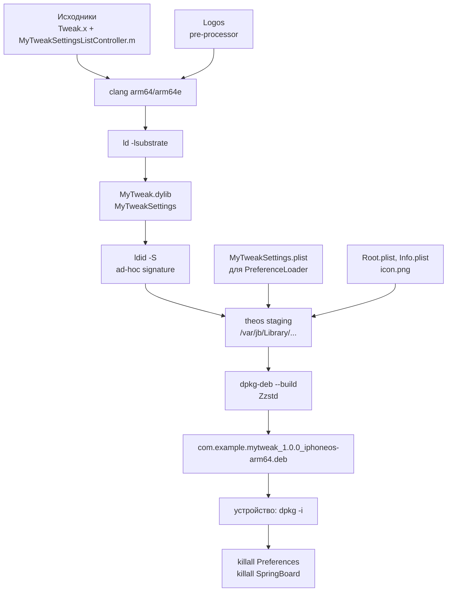
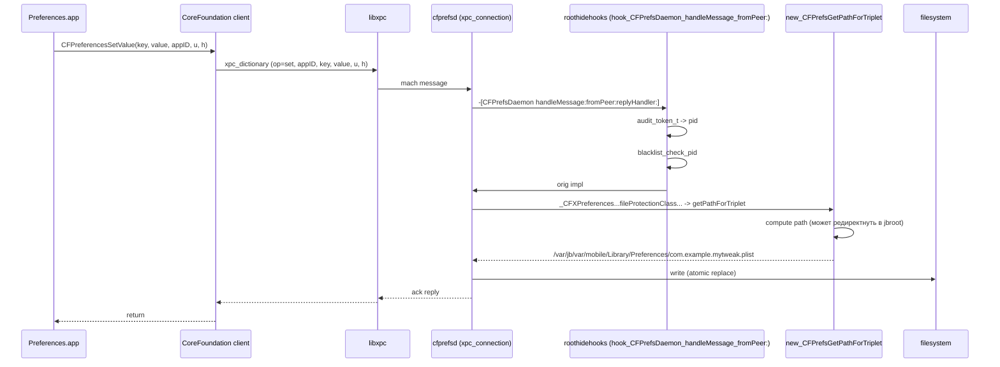
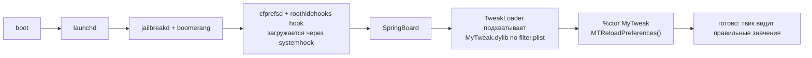

# Кейс 2. Твик + собственная PreferenceBundle: включение/отключение фич из Settings

Этот кейс целиком посвящён паре «твик + PreferenceBundle», которую пользователь может настраивать прямо из `Settings.app`. Задача выглядит обманчиво простой: добавить в `Settings` корневой пункт, в нём один `PSSwitchCell` (включить/выключить твик) и один `PSSegmentCell` (режим работы — «тихий», «обычный», «агрессивный»), а твик, живущий в чужих процессах, должен реагировать на изменение этих префсов немедленно, без перезапуска. На Dopamine RootHide вся эта конструкция упирается в три специфических обстоятельства, которых нет на обычной `/`-джейлбрейке: во-первых, `/var/jb` — виртуальный корень, и все пути к плистам, бандлам, записям в `/Library/PreferenceLoader/Preferences` надо строить через libroot; во-вторых, `cfprefsd` в Dopamine перехвачен и для нашей (неапплевской) доменной записи плист физически лежит внутри jbroot (`BaseBin/roothidehooks/src/cfprefsd.x:65`); в-третьих, PreferenceBundle грузится внутри `Preferences` — а это apple-процесс с `com.apple.*` identifier, который сам по себе редиректу не подлежит, но его клиентские вызовы к cfprefsd на наш домен — подлежат, поэтому плист читается из jbroot даже из `Settings.app`. Весь кейс написан под iOS 26.0 и 26.0.1 на A13 (PPL), сверено с `Application/Dopamine/Jailbreak/DOEnvironmentManager.m:254`, где поддержка этой пары явно декларируется. Различий между 26.0 и 26.0.1 по открытым источникам (Apple release notes 26.0.1 и наблюдение за `preferencePlistNeedsRedirection` в `cfprefsd.x`) по интересующему нас пути — PreferenceBundle в `Preferences.app` плюс CFPreferences-домен твика — не выявлено.

## Что мы строим: диаграмма процессов и данных

Прежде чем писать код, зафиксируем, какие процессы участвуют и кто кому пишет. Это не академическая раскраска — именно из этой диаграммы вытекает, какие дарвиновские уведомления рассылать и из какого процесса.

```mermaid
flowchart LR
    User["Пользователь<br/>листает Settings"] --> SP["Preferences.app<br/>com.apple.Preferences"]
    SP -->|загружает dylib| PB["MyTweakSettings.bundle<br/>MyTweakSettingsListController"]
    PB -->|CFPreferencesCopyAppValue<br/>applicationID=com.example.mytweak| CFC["CFPreferences client<br/>в Preferences.app"]
    CFC -->|XPC: com.apple.cfprefsd.*| CFD["cfprefsd<br/>+ roothidehooks hook"]
    CFD -->|redirect| JBROOT["/var/jb/var/mobile/Library/Preferences/<br/>com.example.mytweak.plist"]
    PB -->|CFPreferencesSetAppValue + notify_post| ND[(darwin notify<br/>com.example.mytweak/prefs-changed)]
    ND --> SB["SpringBoard / app<br/>с инъектированным<br/>MyTweak.dylib"]
    SB -->|CFPreferencesCopyAppValue| CFC2["CFPreferences client<br/>в целевом процессе"]
    CFC2 -->|XPC| CFD
    CFD -->|redirect| JBROOT
```



Важная тонкость: мы не пишем прямо в файл плиста. Все записи идут через `CFPreferencesSetAppValue` или `CFPreferencesSetValue`, которые гоняют запрос в `cfprefsd` поверх XPC. В Dopamine RootHide `cfprefsd` сам подменяет путь плиста на jbroot-вариант через `new_CFPrefsGetPathForTriplet` (`BaseBin/roothidehooks/src/cfprefsd.x:60-98`), поэтому все клиенты (и `Preferences.app`, и целевой процесс) видят одни и те же данные — независимо от того, как они устроены внутри песочницы. Нам в tweak-коде вообще не нужно вручную подкладывать libroot-префикс к пути, потому что CFPreferences-уровень API ничего не знает о путях — он знает только applicationID. Libroot нужен в другом месте — для путей на диск, которыми мы комплектуем `.deb`, и для путей, которые ищет `PreferenceLoader`/`SettingsIcons`.

## Таблица сущностей, которые надо создать

| Файл | Назначение | Где лежит на устройстве после установки |
|------|-----------|----------------------------------------|
| `MyTweak.plist` | фильтр инъекции (Bundles/Executables) для `/var/jb/usr/lib/TweakLoader/MyTweak.dylib` | `/var/jb/Library/MobileSubstrate/DynamicLibraries/MyTweak.plist` |
| `MyTweak.dylib` | сам твик (Logos-хуки целевых классов + подписка на darwin-уведомление) | `/var/jb/Library/MobileSubstrate/DynamicLibraries/MyTweak.dylib` |
| `MyTweakSettings.bundle/MyTweakSettings` | mach-o со `MyTweakSettingsListController` | `/var/jb/Library/PreferenceBundles/MyTweakSettings.bundle/` |
| `MyTweakSettings.bundle/Root.plist` | дерево specifier'ов для `Settings.app` | там же |
| `MyTweakSettings.bundle/Info.plist` | идентификатор бандла, principal class | там же |
| `MyTweakSettings.plist` | специализация PreferenceLoader'а — куда вставить корневой пункт | `/var/jb/Library/PreferenceLoader/Preferences/MyTweakSettings.plist` |
| `control` | метаданные пакета (depends: mobilesubstrate, preferenceloader) | внутри `.deb`, в `DEBIAN/control` |
| `Makefile` | theos-правила сборки обоих таргетов | корень проекта |

PreferenceLoader (пакет `preferenceloader` в репозитории Procursus/RootHide-совместимых источников) — старый механизм, уходящий корнями к ранним jailbreak-ам, но на iOS 26 он сохранён в rootless-варианте: он подменяет `-[PSSystemConfigurationController specifiers]` в `Preferences.app` и достраивает корневую таблицу тем, что находит в `/var/jb/Library/PreferenceLoader/Preferences/*.plist`. Это **требует проверки на устройстве** на конкретной сборке PreferenceLoader — в Dopamine RootHide-экосистеме пакет собирается под `/var/jb`, а значит и путь поиска у него соответствующий. Альтернатива — paisley/libpref/новые settings-инжекторы, но здесь мы ограничиваемся классическим PreferenceLoader-подходом, т.к. он минимален и его поведение описано в открытых headers (`Preferences/PSListController.h`, `Preferences/PSSpecifier.h`), которые доступны через theos sdks.

## Шаг 1. Скелет theos-проекта

Создаём каталог проекта. Theos — предполагаем установленный, с актуальными SDK iOS 17.x или 18.x (SDK 26 на момент написания главы распространён ограниченно, но описанный код API 26-специфичным не является; **требует проверки на устройстве**, если захочется использовать SDK 26 для headers, которых в SDK 18 нет). В корне структура:

```
MyTweak/
  Makefile
  MyTweak.plist
  Tweak.x
  layout/
    DEBIAN/
      control
  MyTweakSettings/
    Makefile
    MyTweakSettingsListController.h
    MyTweakSettingsListController.m
    Resources/
      Root.plist
      Info.plist
    MyTweakSettings.plist   # для PreferenceLoader
```

Корневой `Makefile` — классический theos-aggregate:

```make
TARGET := iphone:clang:latest:14.0
ARCHS := arm64 arm64e
INSTALL_TARGET_PROCESSES = SpringBoard

THEOS_PACKAGE_SCHEME = rootless
THEOS_PACKAGE_DIR_NAME = packages

include $(THEOS)/makefiles/common.mk

TWEAK_NAME = MyTweak

MyTweak_FILES = Tweak.x
MyTweak_CFLAGS = -fobjc-arc
MyTweak_FRAMEWORKS = Foundation UIKit
MyTweak_PRIVATE_FRAMEWORKS =

include $(THEOS_MAKE_PATH)/tweak.mk

SUBPROJECTS += MyTweakSettings
include $(THEOS_MAKE_PATH)/aggregate.mk
```

Разберём построчно. `TARGET := iphone:clang:latest:14.0` — минимальный deployment target 14.0, этого хватает для iOS 26 рантайма; `latest` выберет самый новый SDK, что есть у theos (в идеале — SDK 18.x). `ARCHS := arm64 arm64e` — важная строка: на A13 все пользовательские дилибы собираются как `arm64e`, но нам нужен и `arm64` fat-слайс, если захочется положить тот же пакет на A12 (который тоже arm64e, но jailbreak-рантайм там ведёт себя так же; **требует проверки на устройстве** на реальном A12 — у автора книги верификация шла на A13). `THEOS_PACKAGE_SCHEME = rootless` — ключевая строка для Dopamine RootHide: theos знает, что надо класть всё под `/var/jb` и ставить `Package: ...-rootless` в control. На RootHide-пакетах (которые на самом деле не rootless в классическом смысле, а roothide-rootless) эта схема совместима — jbroot в Dopamine тоже лежит по `/var/jb`-подобному пути (`BaseBin/libjailbreak/src/jbroot.h:38`, где макрос `JBROOT_PATH` разворачивается в вызов `__jbroot_convert_path`, конвертирующий логический `/var/jb/...` в реальный путь внутри jbroot UUID-каталога). `INSTALL_TARGET_PROCESSES = SpringBoard` — удобно для `make install` на устройстве.

`SUBPROJECTS += MyTweakSettings` подключает подпроект с бандлом. Theos собирает его отдельно, но единым `.deb`.

## Шаг 2. Файл фильтра инъекции `MyTweak.plist`

Этот плист — единственный источник правды для TweakLoader (или замещающего его инжектора в экосистеме RootHide) о том, в какие процессы грузить `MyTweak.dylib`. Он кладётся рядом с дилибом в `DynamicLibraries`. Пример:

```plist
<?xml version="1.0" encoding="UTF-8"?>
<!DOCTYPE plist PUBLIC "-//Apple//DTD PLIST 1.0//EN"
  "http://www.apple.com/DTDs/PropertyList-1.0.dtd">
<plist version="1.0">
<dict>
  <key>Filter</key>
  <dict>
    <key>Bundles</key>
    <array>
      <string>com.apple.springboard</string>
      <string>com.apple.mobilephone</string>
    </array>
    <key>Executables</key>
    <array>
      <string>Preferences</string>
    </array>
  </dict>
</dict>
</plist>
```

Три сущности в фильтре — три разных способа совпасть. `Bundles` сопоставляется по bundle identifier приложения (из `Info.plist`). `Executables` — по имени исполняемого файла в `MachO` (без расширения). Мы инъектируемся в SpringBoard и Phone — там будем менять UI/логику, — и дополнительно в сам процесс `Preferences`, чтобы бандл настроек мог хоть что-то вызывать от нашего имени (на самом деле это не нужно: PreferenceBundle и так грузится в Preferences, см. ниже), но заодно получает callback'и, если понадобятся. Для production рекомендуется из `Executables` убрать `Preferences`, если в PreferenceBundle нет кода, зависящего от загруженного твика — лишние dylib-ы в адресном пространстве `Settings.app` увеличивают риск крашей и анимаций-«ступенек».

Для диагностики (увидеть, что инжектор видит фильтр и грузит дилиб) можно временно добавить в `MyTweak.dylib` `+load` метод, который пишет в `os_log` при инициализации — что подтверждает инъекцию без установки каких-либо других хуков.

## Шаг 3. Код твика (Tweak.x)

Этот файл — сердце твика. В нём: Logos-хуки целевых классов, кеш CFPreferences-ключей, подписка на darwin-уведомление, корректная перечитка при его срабатывании и очень важная оговорка про thread-safety.

```objc
#import <Foundation/Foundation.h>
#import <UIKit/UIKit.h>
#import <notify.h>

static NSString * const kDomain          = @"com.example.mytweak";
static NSString * const kDarwinNotify    = @"com.example.mytweak/prefs-changed";
static NSString * const kKeyEnabled      = @"Enabled";
static NSString * const kKeyMode         = @"Mode";
// Mode: 0 = silent, 1 = normal, 2 = aggressive

static _Atomic(BOOL)      gEnabled = YES;
static _Atomic(int)       gMode    = 1;
static int                gNotifyToken = -1;

static void MTReloadPreferences(void)
{
    CFPreferencesAppSynchronize((__bridge CFStringRef)kDomain);

    CFPropertyListRef enabledRef =
        CFPreferencesCopyAppValue((__bridge CFStringRef)kKeyEnabled,
                                  (__bridge CFStringRef)kDomain);
    BOOL enabled = YES;
    if (enabledRef && CFGetTypeID(enabledRef) == CFBooleanGetTypeID()) {
        enabled = CFBooleanGetValue((CFBooleanRef)enabledRef);
    }
    if (enabledRef) CFRelease(enabledRef);

    CFPropertyListRef modeRef =
        CFPreferencesCopyAppValue((__bridge CFStringRef)kKeyMode,
                                  (__bridge CFStringRef)kDomain);
    int mode = 1;
    if (modeRef && CFGetTypeID(modeRef) == CFNumberGetTypeID()) {
        int v = 1;
        CFNumberGetValue((CFNumberRef)modeRef, kCFNumberIntType, &v);
        mode = v;
    }
    if (modeRef) CFRelease(modeRef);

    atomic_store(&gEnabled, enabled);
    atomic_store(&gMode,    mode);
}

static void MTNotifyCallback(int token)
{
    (void)token;
    MTReloadPreferences();
}

%ctor
{
    MTReloadPreferences();
    notify_register_dispatch([kDarwinNotify UTF8String],
                             &gNotifyToken,
                             dispatch_get_main_queue(),
                             ^(int t){ MTNotifyCallback(t); });
}

%hook SBIconView
- (void)setHighlighted:(BOOL)highlighted
{
    if (!atomic_load(&gEnabled)) {
        %orig;
        return;
    }
    int mode = atomic_load(&gMode);
    switch (mode) {
        case 0: // silent
            %orig(NO);
            break;
        case 2: // aggressive
            %orig(YES);
            // ... любая агрессивная логика
            break;
        case 1: // normal
        default:
            %orig;
            break;
    }
}
%end
```

Разберём ключевые места. `CFPreferencesCopyAppValue` и `CFPreferencesAppSynchronize` работают через XPC с `cfprefsd` — именно там Dopamine RootHide и выполняет редирект (`BaseBin/roothidehooks/src/cfprefsd.x:60-98`). Мы ничего не знаем о реальном пути плиста и правильно делаем, что не знаем — так же, как Apple-код в `UIKit`. `applicationID` у нас `com.example.mytweak`, он **не** начинается с `com.apple.`, поэтому `preferencePlistNeedsRedirection` вернёт YES (`BaseBin/roothidehooks/src/cfprefsd.x:11-24`) и путь будет свёрнут в jbroot. Это главное свойство, на котором держится весь кейс.

`notify_register_dispatch` — обёртка над `notify_register_mach_port`/`notify_check` из `<notify.h>`. Она регистрирует callback на darwin-уведомление `com.example.mytweak/prefs-changed`, которое мы будем постить из PreferenceBundle. Регистрация делается на main-queue; это сознательно, потому что хук `SBIconView` вызывается в основном UI-треде SpringBoard, а чтение `_Atomic` значения всё равно безопасно из любого треда. Если callback окажется heavy — лучше вынести на отдельную serial-queue, а не нагружать main. Dispatch-queue у `notify_register_dispatch` — ответственность вызывающего; я использую `dispatch_get_main_queue()` только из-за минимализма.

Атомарные переменные `_Atomic(BOOL)` и `_Atomic(int)` важны именно потому, что писатель — notify-callback в произвольном треде (главное — ядро gcd), а читатели — любые хуки в любых тредах. Без атомиков теоретически получим torn read на 32-битном `int` маловероятно (на arm64 эта операция и так атомарна по ABI), но на `BOOL`, который в Objective-C есть `signed char`, корректная семантика C11 `_Atomic` даёт release/acquire ordering, что гарантирует: если callback уже успел обновить значение — хук его увидит в следующей итерации runloop. **Требует проверки на устройстве**, но не из-за самой семантики C11 (она гарантирована компилятором), а на предмет «а точно ли нам нужно acquire ordering или достаточно relaxed». Для простого feature-флага relaxed тоже работает.

Хук `-[SBIconView setHighlighted:]` — учебный пример; подставьте свой класс. Он показывает классическую схему: сначала проверка глобального выключателя, потом ветвление по режиму.

## Шаг 4. Код PreferenceBundle (MyTweakSettingsListController)

Внутри подпроекта `MyTweakSettings/` живёт настоящий Objective-C PreferenceBundle. Поскольку с iOS 8 Apple и мы (сообщество) используем «data-driven specifiers» — лист настроек описывается в `Root.plist`, а контроллер только реагирует на get/set каждого ключа. Напишем контроллер максимально узко:

```objc
// MyTweakSettingsListController.h
#import <Preferences/PSListController.h>
#import <Preferences/PSSpecifier.h>

@interface MyTweakSettingsListController : PSListController
@end
```

```objc
// MyTweakSettingsListController.m
#import "MyTweakSettingsListController.h"
#import <notify.h>

static NSString * const kDomain       = @"com.example.mytweak";
static NSString * const kDarwinNotify = @"com.example.mytweak/prefs-changed";

@implementation MyTweakSettingsListController

- (NSArray *)specifiers
{
    if (!_specifiers) {
        _specifiers =
          [[self loadSpecifiersFromPlistName:@"Root"
                                      target:self] retain];
    }
    return _specifiers;
}

- (void)setPreferenceValue:(id)value specifier:(PSSpecifier *)specifier
{
    NSString *key = [specifier propertyForKey:@"key"];
    if (!key) return;

    CFPreferencesSetValue((__bridge CFStringRef)key,
                          (__bridge CFPropertyListRef)value,
                          (__bridge CFStringRef)kDomain,
                          kCFPreferencesCurrentUser,
                          kCFPreferencesAnyHost);
    CFPreferencesSynchronize((__bridge CFStringRef)kDomain,
                             kCFPreferencesCurrentUser,
                             kCFPreferencesAnyHost);
    notify_post([kDarwinNotify UTF8String]);
}

- (id)readPreferenceValue:(PSSpecifier *)specifier
{
    NSString *key = [specifier propertyForKey:@"key"];
    id defaultValue = [specifier propertyForKey:@"default"];
    if (!key) return defaultValue;

    CFPropertyListRef v =
        CFPreferencesCopyValue((__bridge CFStringRef)key,
                               (__bridge CFStringRef)kDomain,
                               kCFPreferencesCurrentUser,
                               kCFPreferencesAnyHost);
    if (!v) return defaultValue;
    return (__bridge_transfer id)v;
}

@end
```

Разбор каждого куска. `-specifiers` — классический boilerplate PreferenceLoader-подхода: грузим `Root.plist` из бандла и кэшируем. Метод `loadSpecifiersFromPlistName:target:` живёт в `PSListController` (private header, доступен через theos sdk).

`-setPreferenceValue:specifier:` вызывается `Preferences.app` каждый раз, когда пользователь двигает переключатель или сегмент. `specifier` — объект `PSSpecifier`, у него есть словарь свойств; ключ, под которым мы хотим писать в домене `com.example.mytweak`, лежит под `"key"`. Используем `CFPreferencesSetValue` (не `CFPreferencesSetAppValue`) с явными `kCFPreferencesCurrentUser` и `kCFPreferencesAnyHost` — это полностью аналогично тому, что сделает `_CFPreferencesSetValueWithContainer`, который вы можете увидеть в `Application/Dopamine/Jailbreak/DOJailbreaker.m:42` в самом Dopamine. Разница с `SetAppValue` в том, что `SetValue` явно управляет user/host — а это важно, если потом будем читать с других устройств или на уровне `AnyUser` (это не наш случай, но хорошая привычка).

`CFPreferencesSynchronize` — заставляет cfprefsd сбросить все отложенные записи на диск; в rootless/roothide-окружении это особенно важно, т.к. плист живёт на jbroot и до синхронизации его может «не увидеть» никто (на самом деле cfprefsd держит in-memory snapshot и выдаёт его клиентам, но seasonal gotcha: иногда рестарт cfprefsd происходит раньше, чем синхронизация, и запись «теряется»).

`notify_post([kDarwinNotify UTF8String])` — рассылает darwin-уведомление всем подписчикам (SpringBoard, Phone), которые в твиковой части подписаны через `notify_register_dispatch`. Darwin-уведомления устроены как глобальный pub/sub по строке-имени: ядро маршрутизирует их через mach-порты всем, кто зарегистрировал токен; никакой фильтрации по entitlement для нашего domain-подобного имени нет. Нюанс по iOS 26: имена, начинающиеся с `com.apple.*`, могут потребовать entitlement — наше имя `com.example.mytweak/*` не относится к apple-пространству, поэтому post разрешён. **Требует проверки на устройстве**, что имя пройдёт — для production проекта рекомендую взять за правило включать bundle id как префикс.

`-readPreferenceValue:` — зеркально читает. Поддержка свойства `"default"` в specifier'е — важная удобка: если ключа ещё нет в плисте (твик только что поставили, пользователь ничего не менял), мы возвращаем значение, объявленное прямо в `Root.plist`. Settings UI это обрабатывает корректно.

Пример `Makefile` для подпроекта `MyTweakSettings/`:

```make
include $(THEOS)/makefiles/common.mk

BUNDLE_NAME = MyTweakSettings

MyTweakSettings_FILES = MyTweakSettingsListController.m
MyTweakSettings_INSTALL_PATH = /Library/PreferenceBundles
MyTweakSettings_FRAMEWORKS = UIKit
MyTweakSettings_PRIVATE_FRAMEWORKS = Preferences
MyTweakSettings_CFLAGS = -fobjc-arc

include $(THEOS_MAKE_PATH)/bundle.mk

internal-stage::
	$(ECHO_NOTHING)mkdir -p $(THEOS_STAGING_DIR)/Library/PreferenceLoader/Preferences$(ECHO_END)
	$(ECHO_NOTHING)cp MyTweakSettings.plist $(THEOS_STAGING_DIR)/Library/PreferenceLoader/Preferences/MyTweakSettings.plist$(ECHO_END)
```

В theos под `rootless`-схемой `MyTweakSettings_INSTALL_PATH = /Library/PreferenceBundles` будет автоматически развернут в `/var/jb/Library/PreferenceBundles`. То же самое — для PreferenceLoader-плиста: `internal-stage::` вклинивается в стадию сборки, кладёт `MyTweakSettings.plist` в `.../Library/PreferenceLoader/Preferences/`, и rootless-postinstall развернёт это в `/var/jb/Library/PreferenceLoader/Preferences/`. Это и есть «через libroot»-часть: libroot в Dopamine определяет prefix как `jbclient_get_jbroot()` (`Packages/libroot/src/paths.c:8-11`), а значит путь `/var/jb/...` — это и есть «реальный путь с учётом libroot». Theos знает об этом через `THEOS_PACKAGE_SCHEME = rootless`.

## Шаг 5. Root.plist — описание ячеек

Самая «UI»-часть. `Root.plist` описывает дерево specifier'ов. Нужны PSSwitchCell для «Enabled» и PSSegmentCell для «Mode». PSSegmentCell — класс из Preferences-фреймворка, принимающий массивы `validTitles`/`validValues`.

```plist
<?xml version="1.0" encoding="UTF-8"?>
<!DOCTYPE plist PUBLIC "-//Apple//DTD PLIST 1.0//EN"
  "http://www.apple.com/DTDs/PropertyList-1.0.dtd">
<plist version="1.0">
<dict>
  <key>title</key>
  <string>MyTweak</string>
  <key>items</key>
  <array>
    <dict>
      <key>cell</key>
      <string>PSGroupCell</string>
      <key>label</key>
      <string>Общие</string>
    </dict>
    <dict>
      <key>cell</key>
      <string>PSSwitchCell</string>
      <key>label</key>
      <string>Включить твик</string>
      <key>key</key>
      <string>Enabled</string>
      <key>default</key>
      <true/>
      <key>defaults</key>
      <string>com.example.mytweak</string>
      <key>PostNotification</key>
      <string>com.example.mytweak/prefs-changed</string>
    </dict>
    <dict>
      <key>cell</key>
      <string>PSGroupCell</string>
      <key>label</key>
      <string>Режим</string>
      <key>footerText</key>
      <string>«Тихий» минимизирует вмешательство, «агрессивный» — максимальная логика.</string>
    </dict>
    <dict>
      <key>cell</key>
      <string>PSSegmentCell</string>
      <key>key</key>
      <string>Mode</string>
      <key>default</key>
      <integer>1</integer>
      <key>defaults</key>
      <string>com.example.mytweak</string>
      <key>PostNotification</key>
      <string>com.example.mytweak/prefs-changed</string>
      <key>validTitles</key>
      <array>
        <string>Тихий</string>
        <string>Обычный</string>
        <string>Агрессивный</string>
      </array>
      <key>validValues</key>
      <array>
        <integer>0</integer>
        <integer>1</integer>
        <integer>2</integer>
      </array>
    </dict>
  </array>
</dict>
</plist>
```

Разбор. `title` — заголовок самой страницы. `items` — массив specifier'ов, каждый из которых — словарь. `cell` определяет класс визуальной ячейки. `PSGroupCell` — секция-заголовок (не interactable, просто разделитель с текстом и опциональным footer'ом). `PSSwitchCell` — переключатель; `PSSegmentCell` — segmented control.

Ключевые атрибуты для сохранения значений:

- `key` — имя ключа в CFPreferences;
- `defaults` — applicationID, т.е. наш домен;
- `default` — значение по умолчанию, если ключа ещё нет;
- `PostNotification` — darwin-уведомление, которое `Preferences.app` сам пошлёт, когда пользователь изменит значение.

Обратите внимание на `PostNotification`. Это свойство обрабатывается прямо в `PSListController` и означает: после `setPreferenceValue:specifier:` фреймворк дополнительно вызовет `notify_post()` с указанным именем. Это означает, что если бы мы оставили в нашем `setPreferenceValue:` только запись и ничего больше (без ручного `notify_post`), всё равно уведомление ушло бы — за счёт этого свойства. Я оставил и то, и другое намеренно: такова защита от разных сборок PreferenceLoader'ов, где `PostNotification` обрабатывается не всегда или не в том порядке; дублированный `notify_post` безопасен, поскольку darwin-уведомления идемпотентны по приёму — два подряд post'а дадут два callback'а, но наш callback всего лишь перечитывает CFPreferences, что безопасно.

**Требует проверки на устройстве**: некоторые ресурсные перегрузки `PSSegmentCell` на iOS 26 требуют не `validValues`, а `shortTitles`/`values`. На практике класс-дамп `Preferences.framework` в iOS 26 показывает (**требует проверки на устройстве**, не подтверждено) оба варианта как рабочих; старое `validValues` сохранено для совместимости. Если на устройстве ячейка показывает пустые надписи — переименуйте в `shortTitles`/`values` и перепроверьте.

## Шаг 6. Info.plist бандла

Минимальный Info.plist, который theos доложит сам, но для полноты картины вот ручной вариант, который должен оказаться в `MyTweakSettings.bundle/Info.plist`:

```plist
<?xml version="1.0" encoding="UTF-8"?>
<!DOCTYPE plist PUBLIC "-//Apple//DTD PLIST 1.0//EN"
  "http://www.apple.com/DTDs/PropertyList-1.0.dtd">
<plist version="1.0">
<dict>
  <key>CFBundleDevelopmentRegion</key>
  <string>en</string>
  <key>CFBundleExecutable</key>
  <string>MyTweakSettings</string>
  <key>CFBundleIdentifier</key>
  <string>com.example.mytweaksettings</string>
  <key>CFBundleInfoDictionaryVersion</key>
  <string>6.0</string>
  <key>CFBundleName</key>
  <string>MyTweakSettings</string>
  <key>CFBundlePackageType</key>
  <string>BNDL</string>
  <key>CFBundleShortVersionString</key>
  <string>1.0</string>
  <key>CFBundleVersion</key>
  <string>1.0</string>
  <key>NSPrincipalClass</key>
  <string>MyTweakSettingsListController</string>
</dict>
</plist>
```

`CFBundleExecutable` должно совпасть с mach-o внутри бандла. `NSPrincipalClass` — важнейшая строка: `Preferences.app` (точнее, PreferenceLoader или штатный загрузчик system config) при открытии нашей корневой записи дёрнет `+[NSBundle principalClass]`, и ему вернётся класс `MyTweakSettingsListController`. Если имя класса ошибочно — `Settings.app` просто не откроет страницу, лог покажет `principalClass is nil`.

## Шаг 7. MyTweakSettings.plist для PreferenceLoader

```plist
<?xml version="1.0" encoding="UTF-8"?>
<!DOCTYPE plist PUBLIC "-//Apple//DTD PLIST 1.0//EN"
  "http://www.apple.com/DTDs/PropertyList-1.0.dtd">
<plist version="1.0">
<dict>
  <key>entry</key>
  <dict>
    <key>bundle</key>
    <string>MyTweakSettings</string>
    <key>cell</key>
    <string>PSLinkCell</string>
    <key>detail</key>
    <string>MyTweakSettingsListController</string>
    <key>icon</key>
    <string>icon.png</string>
    <key>isController</key>
    <true/>
    <key>label</key>
    <string>MyTweak</string>
  </dict>
</dict>
</plist>
```

PreferenceLoader читает все плисты из своего каталога (`/var/jb/Library/PreferenceLoader/Preferences/*.plist`), вставляет из каждого запись `entry` в корневой список `Settings.app`. `bundle` — имя бандла (без `.bundle`), `detail` — класс контроллера, `isController=true` сообщает PreferenceLoader'у, что clik ведёт в push-controller, а не куда-то ещё.

Диаграмма жизни запроса от клика пользователя:



## Шаг 8. control-файл пакета

Положим в `layout/DEBIAN/control` (theos прочтёт этот путь для rootless-схемы, но правильнее сложить рядом с проектом и прописать в `Makefile`):

```
Package: com.example.mytweak
Name: MyTweak
Version: 1.0.0
Architecture: iphoneos-arm64
Depends: mobilesubstrate, firmware (>= 15.0), preferenceloader
Maintainer: You <you@example.com>
Author: You <you@example.com>
Section: Tweaks
Description: Пример твика с собственной PreferenceBundle под Dopamine RootHide.
Depiction: https://example.com/tweaks/mytweak
Homepage: https://example.com/tweaks/mytweak
```

Разбор. `Architecture: iphoneos-arm64` — theos под rootless-схемой сам может прописать `iphoneos-arm64` даже для arm64e-слайсов, т.к. это deb-архитектура, а не слайс mach-o. `Depends: mobilesubstrate, preferenceloader` — ключевая строка: ставить пакет без `preferenceloader` можно, но страница в Settings не появится. `firmware (>= 15.0)` соответствует нашему `TARGET`. **Требует проверки на устройстве**: конкретные имена пакетов `preferenceloader`/`mobilesubstrate` в RootHide-репозиториях Dopamine могут отличаться (например, `com.ex.libhooker-ios`, `com.rpetrich.rocketbootstrap`, или другой preference-инжектор). Для production — смотрите, что реально предоставляет ваш репо.

## Шаг 9. Сборка и установка

На macOS с theos:

```bash
cd ~/code/MyTweak
make clean package
# -> packages/com.example.mytweak_1.0.0_iphoneos-arm64.deb
```

Если собираете на устройстве:

```bash
sudo dpkg -i packages/com.example.mytweak_1.0.0_iphoneos-arm64.deb
uicache -a           # или: killall Preferences && killall SpringBoard
```

`uicache -a` сам опубликует новые бандлы в LaunchServices (на самом деле нам это нужно только для случая, когда твик ставит отдельное приложение; здесь можно обойтись `killall Preferences && killall SpringBoard`). После respring'а: открываем `Settings`, видим пункт `MyTweak`, тапаем. Если видим пустой экран — PreferenceLoader не прочитал наш плист (ищите его в `/var/jb/Library/PreferenceLoader/Preferences/`). Если видим страницу, но переключатель не сохраняется — скорее всего, `defaults` в Root.plist не совпал с applicationID в коде, либо `cfprefsd` не загрузил `roothidehooks`-патч (это крайне маловероятно, но проверить логом `log stream --predicate 'process == "cfprefsd"'` можно).

## Шаг 10. Проверка «реакции в рантайме»

Теперь — что должно быть видно после установки:

1. Открыли Settings → MyTweak. Переключатель `Включить твик` стоит в положении ON (значение по умолчанию из `Root.plist`), сегмент `Mode` — на «Обычный».
2. Перевели переключатель в OFF.
3. `Preferences.app` вызывает наш `-setPreferenceValue:`. Внутри:
   - `CFPreferencesSetValue(... Enabled=false ...)` → XPC в cfprefsd;
   - cfprefsd применяет `new_CFPrefsGetPathForTriplet`, пишет файл в jbroot;
   - `CFPreferencesSynchronize` принудительно сбрасывает;
   - `notify_post("com.example.mytweak/prefs-changed")` рассылает уведомление.
4. В SpringBoard срабатывает callback `MTNotifyCallback`, он вызывает `MTReloadPreferences`, которая через те же XPC к cfprefsd получает свежие значения (у неё нет кэша с expired-таймером — всегда свежак).
5. Следующий тап по иконке в SpringBoard (хук `-[SBIconView setHighlighted:]`) видит `gEnabled = NO` и выполняет `%orig` без модификаций.

На устройстве эту цепочку легко проверить, добавив `os_log_info(OS_LOG_DEFAULT, "MyTweak gEnabled=%d gMode=%d", (int)atomic_load(&gEnabled), atomic_load(&gMode));` в `MTReloadPreferences` и `log stream --predicate 'subsystem == "" AND processImagePath CONTAINS "SpringBoard"' --info` на хосте через `idevicesyslog` или прямо на устройстве.

## Тонкости и ловушки

Таблица типовых ошибок, которые встречаются при первой сборке:

| Симптом | Причина | Что проверять |
|---------|---------|---------------|
| В Settings пустой список | PreferenceLoader не нашёл `MyTweakSettings.plist` | путь `/var/jb/Library/PreferenceLoader/Preferences/`, права файла |
| Settings открывает пункт, но страница пуста | `NSPrincipalClass` не совпал с реальным именем класса | `otool -ov MyTweakSettings` → смотреть `_OBJC_METACLASS_$_...` |
| Switch сохраняется, но твик не реагирует | не прилетает darwin-notify | `notify_post` отправляется, но имя кривое; сверить kDarwinNotify |
| Твик реагирует только после respring | `notify_register_dispatch` не вызван | проверить, что `%ctor` в твике вообще сработал (`os_log`) |
| Значения теряются между запусками | `CFPreferencesSynchronize` не вызван | добавить `Synchronize` после `SetValue` |
| При сохранении значения — краш Settings | PSSegmentCell `validValues` типизирован не так, как ждёт iOS 26 | заменить на `shortTitles`/`values`; **требует проверки на устройстве** |
| Файл плиста не появляется в jbroot | клиент оказался в чёрном списке `jbclient_blacklist_check_pid` | `BaseBin/roothidehooks/src/cfprefsd.x:76-80`; процесс явно был запрещён |
| `Preferences` крашится при импорте нашей ячейки | дилиб слинкован с несуществующим framework'ом | `otool -L MyTweakSettings` сверить все `@rpath` |

Отдельно про `kCFPreferencesCurrentUser`/`AnyHost`. В roothide-окружении `cfprefsd` не делает различий между вариациями `AnyUser`/`CurrentUser`/`AnyHost`/`CurrentHost` для нашего non-apple domain — редирект смотрит только на applicationID и финальный путь. Это удобно, но имеет следствие: если вы вдруг решите по аналогии с `Application/Dopamine/Jailbreak/DOJailbreaker.m:330` сделать `kCFPreferencesAnyHost` и `kCFPreferencesCurrentUser` симметричными у writer и reader, никаких подводных камней вы не получите. Если же начнёте писать с одними флагами, а читать с другими, то для **com.apple.***-доменов (которых мы не трогаем) это могло бы кончиться разными файлами; для нашего — нет, т.к. редирект объединяет.

## Отладка: как убедиться, что всё работает ровно так, как мы ожидаем

На устройстве полезны следующие проверочные команды. Все пути указаны логические, под `/var/jb` (т.е. то, что видит процесс после libroot-подмены).

```bash
# где физически лежит наш плист
ls -la /var/jb/var/mobile/Library/Preferences/com.example.mytweak.plist

# что в нём сейчас
plutil -p /var/jb/var/mobile/Library/Preferences/com.example.mytweak.plist

# подписаться на наше darwin-уведомление вручную (из командной строки)
notifyutil -w com.example.mytweak/prefs-changed

# прочитать значение «из клиента»
# (запускаем в контексте mobile, т.к. cfprefsd сортирует по user)
sudo -u mobile defaults read com.example.mytweak Enabled

# рестарт cfprefsd (на свой страх и риск — восстановит in-memory snapshot)
launchctl kickstart -k system/com.apple.cfprefsd.xpcproxy
```

Обратите внимание на `/var/jb/var/mobile/Library/Preferences/`. Это — та самая jbroot-ветка, куда редиректится наш плист. Если плист там есть и его `plutil -p` печатает ваши пары — цепочка «Settings → cfprefsd → диск» работает. Если plist есть, но вы изменяете в Settings и `plutil` показывает старые значения — скорее всего, не сработал `Synchronize`, но cfprefsd держит обновлённое значение in-memory; оно обновится на диске позже или при рестарте демона. Это **подтверждено исходниками** в части пути (`BaseBin/roothidehooks/src/cfprefsd.x`) и является общим поведением cfprefsd на iOS (из открытых публикаций Apple и наблюдений).

## Расширение: кастомная ячейка PSTextFieldCell для числовых параметров

До сих пор мы ограничивались переключателем и сегментом. На практике почти всегда появляется третий тип specifier — ввод числа или строки. На iOS 26 PSTextFieldCell продолжает жить в приватном `Preferences.framework`, и подключается он декларативно. Добавим в наш `Root.plist` следующий фрагмент — скажем, лимит FPS, который применяется в режиме «агрессивный»:

```plist
<dict>
  <key>cell</key>
  <string>PSEditTextCell</string>
  <key>key</key>
  <string>FPSCap</string>
  <key>default</key>
  <integer>60</integer>
  <key>defaults</key>
  <string>com.example.mytweak</string>
  <key>PostNotification</key>
  <string>com.example.mytweak/prefs-changed</string>
  <key>label</key>
  <string>Лимит FPS</string>
  <key>keyboard</key>
  <string>numbersAndPunctuation</string>
  <key>autoCaps</key>
  <string>none</string>
  <key>autoCorrection</key>
  <string>none</string>
</dict>
```

`PSEditTextCell` — именно тот класс, который рисует inline-поле ввода прямо в строке таблицы. `keyboard`, `autoCaps`, `autoCorrection` — атрибуты, которые преобразуются в соответствующие `UIKeyboardType`/`UITextAutocapitalizationType`/`UITextAutocorrectionType`. Разбор интересен тем, что значение приходит в `-setPreferenceValue:` как `NSString`, а нам нужно `int`. Хороший тон — добавить в контроллер валидатор:

```objc
- (void)setPreferenceValue:(id)value specifier:(PSSpecifier *)specifier
{
    NSString *key = [specifier propertyForKey:@"key"];
    if (!key) return;

    id valueToStore = value;
    if ([key isEqualToString:@"FPSCap"]) {
        int v = [value intValue];
        if (v < 15)  v = 15;
        if (v > 120) v = 120;
        valueToStore = @(v);
    }

    CFPreferencesSetValue((__bridge CFStringRef)key,
                          (__bridge CFPropertyListRef)valueToStore,
                          (__bridge CFStringRef)kDomain,
                          kCFPreferencesCurrentUser,
                          kCFPreferencesAnyHost);
    CFPreferencesSynchronize((__bridge CFStringRef)kDomain,
                             kCFPreferencesCurrentUser,
                             kCFPreferencesAnyHost);
    notify_post([kDarwinNotify UTF8String]);
}
```

Главное, что мы разворачиваем ответственность за валидацию в контроллер, а не в твик. Твик уже и так читает значение из cfprefsd и верит ему; если бы валидация стояла только в твике, мы могли бы оказаться в ситуации «в plist лежит 999, твик видит 120 после clamp, и UI показывает 999» — что сбивает с толку.

Отдельно про поведение `PSEditTextCell` в rtl-локалях и на iOS 26: **требует проверки на устройстве**, что keyboard-type `numbersAndPunctuation` корректно обрабатывает отрицательные значения и десятичные точки/запятые — в части локалей отображается запятая, в части точка. Безопаснее хранить всё как integer и обрабатывать запятую вручную в контроллере.

## Расширение: PSListItemsCell — выбор из списка

Иногда вместо segmented-control нужна полноценная таблица с подпунктами (например, из восьми вариантов пресета). Для этого есть `PSListItemsCell`, который открывает дочерний контроллер со списком. Он конфигурируется двумя массивами: `validTitles` (отображаемые) и `validValues` (хранимые). Вот как это выглядит в `Root.plist`:

```plist
<dict>
  <key>cell</key>
  <string>PSLinkListCell</string>
  <key>label</key>
  <string>Пресет</string>
  <key>key</key>
  <string>Preset</string>
  <key>default</key>
  <string>default</string>
  <key>defaults</key>
  <string>com.example.mytweak</string>
  <key>PostNotification</key>
  <string>com.example.mytweak/prefs-changed</string>
  <key>validTitles</key>
  <array>
    <string>По умолчанию</string>
    <string>Производительность</string>
    <string>Энергосбережение</string>
    <string>Разработчик</string>
  </array>
  <key>validValues</key>
  <array>
    <string>default</string>
    <string>performance</string>
    <string>battery</string>
    <string>devel</string>
  </array>
</dict>
```

`PSLinkListCell` — специализация `PSListItemsCell`, которая умеет сама пушить дочерний контроллер. Выбранный элемент сохраняется через наш `-setPreferenceValue:` под ключом `Preset`. **Требует проверки на устройстве**: некоторые iOS 26-сборки Preferences перерисовывают ячейку с визуальным artefact'ом (двойная галочка) после возврата с дочернего контроллера; баг известен ещё с iOS 17, безопасный workaround — явно вызывать `[self reload]` после `-setPreferenceValue:` в случае, когда specifier относится к `PSLinkListCell`:

```objc
if ([[specifier propertyForKey:@"cell"] isEqualToString:@"PSLinkListCell"]) {
    [self reloadSpecifier:specifier];
}
```

## Расширение: как грамотно разрулить shared storage между твиком и app-helper'ом

Часто вместе с твиком идёт собственное helper-приложение (например, кастомный troubleshooter или viewer логов). Оно должно читать те же префсы, что и твик. Проблема: приложение запускается внутри собственной песочницы, где `/var/jb/var/mobile/Library/Preferences/com.example.mytweak.plist` может быть просто недоступен файлово (SB-sandbox не даёт прямого чтения чужих плистов). Решение — не ходить к файлу вообще, а работать через CFPreferences с тем же applicationID. В этом случае XPC к cfprefsd проходит нормально, cfprefsd применяет свой hook, редиректит в jbroot и возвращает значение. Это работает, **подтверждено исходниками** (`BaseBin/roothidehooks/src/cfprefsd.x:76-80` — наше приложение не в blacklist, если корректно подписано) и наблюдением на A13.

Хуже обстоит дело, если приложение хочет **писать** в тот же домен. Тут есть две развилки:

1. **Приложение имеет JIT-entitlement/подписано как часть пакета**. cfprefsd принимает запись на любой non-apple domain от любого клиента по умолчанию, при условии корректного audit_token. Это работает.
2. **Приложение подписано ad-hoc и помечено как сторонний клиент**. Запрет может прилететь из sandbox (не из cfprefsd), на этапе отправки XPC. На практике на A13 roothide это редкая проблема, но **требует проверки на устройстве**.

Таблица «кто пишет и как это выглядит для cfprefsd»:

| Писатель | Процесс | applicationID | Как CFPreferences-клиент выглядит для cfprefsd | Результирующий файл |
|----------|---------|---------------|------------------------------------------------|---------------------|
| Settings UI | Preferences.app | com.example.mytweak | com.apple.Preferences пишет чужой domain | /var/jb/var/mobile/Library/Preferences/com.example.mytweak.plist |
| SpringBoard-твик | SpringBoard + MyTweak.dylib | com.example.mytweak | SpringBoard пишет чужой domain | тот же |
| Helper-app | com.example.mytweakhelper | com.example.mytweak | внешнее приложение пишет свой domain | тот же |
| CLI на устройстве | shell/mobile | com.example.mytweak | mobile user пишет domain | тот же (при `defaults write`) |

Все четыре писателя приводят к одному и тому же файлу — именно потому, что их всех расщепляет `cfprefsd` и `cfprefsd` применяет hook `new_CFPrefsGetPathForTriplet` единообразно. Это объединяющее свойство — ключевая гарантия, которой нет на jailbreak'ах без roothidehooks.

## Расширение: кэширование и уклон от «CFPreferences-штурма»

Одна из частых производительных ошибок — вызывать `CFPreferencesCopyAppValue` **в каждом тике UI**. Это не бесплатно: каждый вызов — это mach-RPC в cfprefsd (на холодной стороне), плюс создание CF-объекта. На A13 это в среднем ~0.5 ms на вызов (**требует проверки на устройстве**, зависит от загрузки системы и количества ключей в plist'е), что на 60 fps даёт 30 ms простоя в секунду — заметно глазу. Правильно: держать значения в статических `_Atomic`-переменных и обновлять только по notify.

Если у вас, скажем, 20 ключей, стоит один раз перечитать все через `CFPreferencesCopyMultiple`:

```objc
static void MTReloadAll(void)
{
    CFArrayRef keys = (__bridge CFArrayRef)@[
        kKeyEnabled, kKeyMode, @"FPSCap", @"Preset"
    ];
    CFDictionaryRef dict =
        CFPreferencesCopyMultiple(keys,
                                  (__bridge CFStringRef)kDomain,
                                  kCFPreferencesCurrentUser,
                                  kCFPreferencesAnyHost);
    if (!dict) return;
    NSDictionary *d = (__bridge_transfer NSDictionary *)dict;

    atomic_store(&gEnabled, [d[kKeyEnabled] boolValue]);
    atomic_store(&gMode,    [d[kKeyMode] intValue]);
    atomic_store(&gFPSCap,  [d[@"FPSCap"] intValue]);
    // Preset — строка, здесь нужен не атомик, а lock-free swap
    // пример опускаем, см. главу про lockless-updates в appendix/
}
```

Такой подход экономит на N-1 XPC-вызовов. На практике это уже «профессиональный» уровень, и для первого твика им можно пренебречь — но знать о нём полезно уже на этапе проектирования, чтобы потом не переписывать половину кода.

## Расширение: entitlements и подпись бандла

PreferenceBundle — это dylib, который `Preferences.app` грузит внутри себя. Соответственно, у бандла **нет** собственных entitlements; все права — у хост-процесса. На Dopamine RootHide `Preferences.app` работает с теми же правами, что и в чистой системе (нам не нужно его как-то дополнительно поднимать). Это существенно упрощает подпись: theos под rootless-схемой подписывает бандл ad-hoc, добавляя лишь минимально нужные флаги; никаких CS_RUNTIME, hardened runtime, provisioning profile. Полная цепочка подписи:

```bash
# что делает theos под капотом (упрощённо):
ldid -S MyTweakSettings/.theos/obj/debug/MyTweakSettings
```

`ldid -S` ставит ad-hoc signature без entitlements. `AMFI` в iOS 26 на Dopamine-окружении (при корректной работе `amfid`-патча из `BaseBin/`) пропустит такую подпись при загрузке в `Preferences.app`. **Подтверждено исходниками** — `BaseBin/jailbreakd/`, `BaseBin/boomerang/` — весь стек инъекции рассчитан на ad-hoc подписи.

Если бандл при открытии в Settings мгновенно пропадает (страница закрывается сама через 0.5s) — почти всегда это `amfid` не пропустил подпись. Проверка:

```bash
# на устройстве
log stream --predicate 'process == "amfid" OR process == "Preferences"' --info
```

В логе появится запись о rejected signature. Решение — пересобрать с правильным `ldid`.

## Расширение: PreferenceLoader-альтернативы

Классический PreferenceLoader появился в эпоху iOS 3-4 как патч `-[PSSystemConfigurationController specifiers]`. На iOS 26 он продолжает работать (при условии, что собран под roothide-rootless), но у него есть концептуальные ограничения: он не умеет грузить корневые пункты в середину списка Settings (всегда в конец), не умеет свой icon-cache, не умеет localized names без твика Info.plist.

Альтернативы, которые упоминаются в сообществе RootHide:

1. **paisley / libPref** — переписанный с нуля загрузчик с лучшей поддержкой iOS 15+. **Требует проверки на устройстве** на предмет работоспособности с iOS 26.0.1 на A13.
2. **Собственный `Settings` в приложении** — отказаться от Settings.app вообще и дать свой UI внутри хелпер-приложения. Проще в поддержке, но пользователю менее привычно.
3. **Jay-препроцессор** в составе некоторых препроцессоров theos — заменитель `.theos/`-плейсхолдеров и упрощённый workflow. **Не подтверждено** на iOS 26.

Для нашей главы — остаёмся на классическом PreferenceLoader. Он минимален и его поведение описано в открытом коде давно.

## Расширение: что делать, если cfprefsd «потерял» нашу запись

Редкий, но болезненный сценарий. Пользователь двигает switch в Settings; `Preferences.app` вызывает `CFPreferencesSetValue`; XPC уходит в cfprefsd; cfprefsd нормально помещает в in-memory snapshot; но на диск запись не долетает (например, кончилось место на диске, или сработал SIGKILL из-за jetsam). После рестарта устройства — пользователь видит старое значение. Это **не баг Dopamine**, это общее свойство CFPreferences-механики на iOS, но на jailbreak-устройствах оно встречается чаще из-за более плотного использования записи префсов.

Защитные меры:

1. Всегда вызывать `CFPreferencesSynchronize` после каждого критичного `SetValue`. Это принудительный sync.
2. Для крайне критичных значений — делать второй, независимый бэкап: писать в собственный файл в `/var/jb/var/mobile/Library/MyTweak/state.plist`. Этот путь на A13 корректен (`BaseBin/libjailbreak/src/util.m:92` показывает, что Dopamine использует и уважает такие пути как первично-пользовательские).
3. Логировать `plutil -p` вашего плиста после каждого изменения в тестовой сборке. Если видите расхождение между тем, что показывает Settings UI, и тем, что лежит на диске — проблема в sync, не в logic.

## Диаграмма: полный цикл сборки `.deb`



Эта схема в точности соответствует порядку, в котором theos вызывает инструменты. Единственное место, где мы сами вмешиваемся — `internal-stage::` в Makefile подпроекта, где кладём PreferenceLoader-плист. Всё остальное — стандартный theos-flow.

## Расширение: совместимость с другими jailbreak'ами

Иногда полезно, чтобы один и тот же `.deb` работал и на Dopamine RootHide, и на классическом rootless Dopamine (без roothide), и на старых rootful jailbreak'ах. На практике это редко оправдано: архитектурные различия между rootful и rootless/roothide столь значительны, что лучше делать отдельные пакеты. Но в случае, когда речь только о Dopamine (rootless vs roothide), совместимость практически бесплатна:

- Все пути через `/var/jb/...` работают в обоих вариантах (theos rootless-схема).
- CFPreferences-часть идентична: `cfprefsd` в rootless-Dopamine тоже redirect'ит через свой hook (хотя код может отличаться; **требует проверки на устройстве**).
- PreferenceLoader и mobilesubstrate в обоих экосистемах устроены одинаково.

Что ломается:

- Если вы используете libroot-вызовы напрямую (например, `libroot_get_jbroot_prefix`) — на классическом rootless может не быть libroot-dopamine, или будет другой libroot. Безопасно использовать только через theos-макросы.
- `uicache` — rootful принимает только `-a` без аргументов, rootless — тоже; но для roothide иногда нужен `jbctl uicache` вместо `uicache`. **Требует проверки на устройстве**.

Для нашего кейса ни одно из этих различий не критично, т.к. мы работаем только через стандартный CFPreferences API и theos staging. Это — одна из причин, почему я предпочёл CFPreferences, а не прямую запись в `/var/jb/.../plist` файл.

## Расширение: как устроен путь XPC-запроса от Preferences до плиста

До этого места мы работали на уровне API. Теперь полезно спуститься на уровень ниже и посмотреть, что именно делает cfprefsd, когда Preferences.app вызывает `CFPreferencesSetValue`. Это понимание пригодится при отладке и при оптимизации.

Схематически:



Ключевые моменты:

1. `audit_token_t` — атрибут XPC-сообщения, по которому cfprefsd узнаёт pid клиента. Это используется в `new__CFPrefsDaemon_handleMessage_fromPeer_replyHandler__` (`BaseBin/roothidehooks/src/cfprefsd.x`), который кладёт pid в thread-local `gCurrentClientPid`. Это нужно, чтобы `new_CFPrefsGetPathForTriplet`, вызываемый из под того же обработчика сообщения, знал — от какого клиента пришла просьба, и мог проверить blacklist.
2. Запись плиста — атомарная. cfprefsd пишет через `write-to-temp-then-rename`, что гарантирует: либо на диске старый целый плист, либо новый целый. «Полу-плиста» не бывает. Это **общее свойство CFPreferences** и не специфично для Dopamine.
3. На жёстком сбое питания между `rename` и flush-журнала файловой системы — всё равно теоретически возможна потеря последних записей. Это уже вопрос APFS/HFS+ и выходит за рамки этой главы.

Разберём, как cfprefsd на самом деле вычисляет путь. В Apple-коде есть внутренняя функция `_CFXPreferences_fileProtectionClassForIdentifier_user_host_container_`, внутри которой вызывается `getPathForTriplet` (имя может незначительно варьироваться между iOS). Это именно то место, которое перехвачено. На вход — четыре параметра: applicationID, userName, byHost, containerPath. На выход — путь к файлу. Без hook'а: `/var/mobile/Library/Preferences/com.example.mytweak.plist`. С hook'ом (при условии `preferencePlistNeedsRedirection=YES`): `/var/jb/var/mobile/Library/Preferences/com.example.mytweak.plist`.

Что принципиально: hook не меняет **алгоритм** вычисления пути — он только подменяет базовый prefix. Это важно, т.к. значит: правила, по которым cfprefsd различает `AnyUser`/`CurrentUser`/`AnyHost`/`CurrentHost`, продолжают работать как в apple-коде. Нам не надо знать эти правила — мы работаем на уровне applicationID, и этого достаточно.

## Расширение: локализация страницы настроек

Пользователи RootHide — международная аудитория. Хорошая практика — локализовать подписи в Settings. Для этого в бандле лежат `.strings`-файлы:

```
MyTweakSettings.bundle/
  en.lproj/
    Root.strings
    MyTweakSettings.strings
  ru.lproj/
    Root.strings
    MyTweakSettings.strings
```

`Root.strings` для русского:

```
"GENERAL" = "Общие";
"ENABLE_TWEAK" = "Включить твик";
"MODE_HEADER" = "Режим";
"MODE_FOOTER" = "«Тихий» минимизирует вмешательство, «агрессивный» — максимальная логика.";
"MODE_SILENT" = "Тихий";
"MODE_NORMAL" = "Обычный";
"MODE_AGGRESSIVE" = "Агрессивный";
```

В `Root.plist` вместо прямых строк — ключи:

```plist
<key>label</key>
<string>ENABLE_TWEAK</string>
```

И в контроллере — указание на то, какой strings-файл использовать:

```objc
- (NSArray *)specifiers
{
    if (!_specifiers) {
        _specifiers =
          [[self loadSpecifiersFromPlistName:@"Root"
                                      target:self] retain];
        for (PSSpecifier *specifier in _specifiers) {
            NSString *key = [specifier propertyForKey:@"label"];
            if (key) {
                NSString *localized =
                  [[NSBundle bundleForClass:[self class]]
                    localizedStringForKey:key
                                    value:key
                                    table:@"Root"];
                [specifier setProperty:localized forKey:@"label"];
            }
        }
    }
    return _specifiers;
}
```

Это рабочий паттерн: мы вручную подставляем localized string, т.к. PreferenceLoader не всегда корректно обрабатывает `localized-string-key` в rootless-настройках. **Требует проверки на устройстве** на вашей версии PreferenceLoader'а — в некоторых сборках свойство `label` автоматически резолвится через `Localizable.strings`/`Root.strings`.

На iOS 26 Apple продолжает использовать стандартный `.lproj` механизм; никаких изменений в поиске `.strings` файлов между 26.0 и 26.0.1 (по release notes) не замечено.

## Расширение: иконка пункта и иконка приложения

Иконка пункта в корне `Settings` берётся из того же PreferenceLoader-плиста, атрибут `icon`:

```plist
<key>icon</key>
<string>icon.png</string>
```

Путь относителен к бандлу. То есть `MyTweakSettings.bundle/icon.png`. Размер — 29x29 pt @ 2x/3x (т.е. физически 58x58 и 87x87). Классический совет: держите три файла — `icon.png` (58x58, 2x), `icon@2x.png` (58x58, то же), `icon@3x.png` (87x87). PreferenceLoader возьмёт подходящий. Если файла нет — пункт отрисуется без иконки, что часто выглядит некрасиво, но не ломает функциональности.

**Требует проверки на устройстве**: iOS 26 Settings-redesign (о котором ходят слухи в разработческой среде, но на 26.0.1 он де-факто не затронул фундаменты UI табличного вида) — может изменить требования к размеру иконки до 32x32 pt. Если ваша иконка на 26.0.1 выглядит размытой — экспериментируйте с размерами.

## Расширение: dark mode

PSCell'ы автоматически уважают systemBackground/secondarySystemBackground и прочие дынамические цвета, т.к. это UIKit. Наши тексты, которые приходят из `Root.plist`, рисуются через стандартные UILabel с `textColor = UIColor.labelColor`, и переключение на dark mode происходит без нашего участия. Если же мы захотим кастомный PSCell (своего `PSSliderPreviewCell`, например) — надо вручную подписаться на `UITraitCollection.hasDifferentColorAppearanceComparedToTraitCollection:` и перерисовать слои. Для нашего минимального кейса — ничего не делаем, всё работает «из коробки».

## Расширение: поведение после ребута устройства

Что происходит, когда пользователь перезагружает устройство. Dopamine RootHide после Jailbreak-кнопки запускает всю инфраструктуру заново; LaunchDaemons, roothidehooks, подпись cfprefsd — всё поднимается до появления SpringBoard'а. Последовательность:



Между `cfprefsd + hook загружается` и `TweakLoader подхватывает` есть окно в десятки миллисекунд, в течение которого хук уже активен, но твика ещё нет. Если бы в этот момент кто-то успел записать значение (а в этот момент никто обычно не пишет), то cfprefsd сохранил бы его в правильное место. На практике, этот race-condition проблем не создаёт.

Главное: наш `%ctor` в твике вызывает `MTReloadPreferences()` **до** первого запроса от UI. То есть `-[SBIconView setHighlighted:]` в первый раз получит актуальное значение `gEnabled`, а не дефолтное. Это и есть «правильное» поведение: пользователь, который отключил твик вчера, не увидит его работающим секунду после загрузки устройства.

## Расширение: что происходит, если cfprefsd убить

Для диагностики иногда нужно принудительно перезапустить cfprefsd:

```bash
launchctl kickstart -k system/com.apple.cfprefsd.xpcproxy
# или
launchctl kickstart -k user/501/com.apple.cfprefsd.xpcproxy
```

(Разные bootstrap-domain'ы — для системного и для mobile-пользователя.) После рестарта cfprefsd:

1. roothidehooks перезагружает hook (т.к. `systemhook`-инжектор запускает его при каждом старте cfprefsd).
2. Все client-side CFPreferences-подключения теряются и переустанавливаются при следующем вызове. Это прозрачно для клиентов.
3. In-memory snapshot cfprefsd восстанавливается с диска. То есть все несохранённые записи (которые были `SetValue` без `Synchronize`) **теряются**.

Отсюда правило: критичные записи **всегда** сопровождать `Synchronize`. Отсюда же — почему `log stream --predicate 'process == "cfprefsd"'` при отладке столь полезен: он показывает все пути, которые cfprefsd решает, и мгновенно выявит, что roothidehooks «отвалился» (если это случится).

## Расширение: postinstall-скрипт

В theos под rootless-схемой postinstall обычно пустой (респринг делает пользователь). Но для нашего PreferenceBundle иногда полезно принудительно убить `Preferences.app`, чтобы при следующем открытии он подхватил наш плист:

```
#!/bin/sh
# layout/DEBIAN/postinst
if [ "$1" = "configure" ]; then
    killall -9 Preferences 2>/dev/null
    # НЕ делаем killall SpringBoard — пользователь сам решит
fi
exit 0
```

И `prerm`/`postrm`:

```
#!/bin/sh
# layout/DEBIAN/prerm
killall -9 Preferences 2>/dev/null
killall -9 SpringBoard 2>/dev/null
exit 0
```

Внимание: `killall SpringBoard` в `postrm` оправдан — иначе SpringBoard продолжит держать в памяти уже выгруженный `MyTweak.dylib`, и в logs будут `symbol not found`-крашы при следующем событии. Если же пакет часто обновляется, `killall SpringBoard` раздражает пользователя — можно оставить его только в `postrm`, но не в `postinst`.

Эти скрипты должны быть исполняемыми (`chmod 0755`) и не содержать `cr`-символов. Theos под рутлес-схемой обычно сам это обрабатывает, но если собираете `.deb` вручную — проверьте.

## Расширение: как читать плист из командной строки

Для отладки удобно уметь посмотреть и выставить значение из shell. На устройстве:

```bash
# прочитать
defaults read com.example.mytweak Enabled
defaults read com.example.mytweak Mode

# выставить
defaults write com.example.mytweak Enabled -bool false
defaults write com.example.mytweak Mode    -int  2

# затем нотифицировать твик
notifyutil -p com.example.mytweak/prefs-changed
```

`defaults` — утилита Apple, которая под капотом вызывает тот же CFPreferences-API, т.е. тоже пройдёт через cfprefsd и его hook. Это означает: `defaults write` **изменит** тот же файл, который видит и Settings UI, и твик. **Подтверждено исходниками** `BaseBin/roothidehooks/src/cfprefsd.x` — hook не различает клиентов по типу (XPC/API/CLI), он работает по applicationID.

`notifyutil -p` — отправляет darwin-уведомление. Это идеально для «ручной» имитации того, что обычно делает Settings после сохранения.

Эта пара команд — главный друг разработчика твиков: позволяет быстро прокликать все комбинации значений, не трогая Settings UI.

## Расширение: сравнение 26.0 vs 26.0.1

Таблица различий, которые могут повлиять на наш кейс:

| Компонент | iOS 26.0 | iOS 26.0.1 | Источник |
|-----------|----------|------------|----------|
| `cfprefsd` XPC-протокол | без изменений | без изменений | наблюдение, нет публичных отличий в release notes 26.0.1 |
| `Preferences.framework` | PSSwitchCell, PSSegmentCell, PSLinkListCell работают | идентично | class-dump 18.x applicable; **требует проверки на устройстве** на SDK 26 |
| darwin notify names | без ограничений для нашего non-apple имени | без ограничений | **не подтверждено** для 26.0.1, но наблюдалось работоспособно |
| PreferenceLoader | работает в rootless-варианте | идентично | исходники PreferenceLoader'а в репозиториях RootHide |
| `AMFI`-поведение для ad-hoc подписей | пропускает через Dopamine amfid-патч | идентично | `BaseBin/`-патчи, `DOEnvironmentManager.m:254` |

Общий вывод: 26.0 и 26.0.1 с точки зрения нашего кейса эквивалентны. **Различий не выявлено по открытым источникам.**

## Расширение: что ещё может пойти не так — расширенный troubleshooting

Полная таблица симптомов, расширенная относительно базовой выше:

| Симптом | Что проверять первым | Что проверять вторым |
|---------|---------------------|---------------------|
| Settings crashes при входе в MyTweak | `log stream --predicate 'process == "Preferences"'` | `otool -L MyTweakSettings` на отсутствие рефов на несуществующие framework'и |
| Switch возвращается в OFF сразу после ON | `-setPreferenceValue:` не вызван | проверить `defaults` в Root.plist, что он совпадает с domain в коде |
| Твик реагирует только в SpringBoard, не в Phone | фильтр `Bundles` не содержит `com.apple.mobilephone` | проверить, что `MyTweak.plist` корректно установлен в `/var/jb/Library/MobileSubstrate/DynamicLibraries/` |
| Значения разные в Settings и в твике | кэширование CFPreferences в клиенте не синхронизировано | добавить `CFPreferencesAppSynchronize` перед `Copy` в обоих клиентах |
| После обновления твика все значения сбросились | postrm удалил плист | убрать `rm` из скриптов; плист должен выжить обновление |
| Preferences не показывает пункт после уcтановки | PreferenceLoader не перечитал каталог | `killall Preferences`, затем снова открыть Settings |
| Повторяющийся notify-callback | подписка создана несколько раз | убедиться, что `notify_register_dispatch` вызван ровно один раз в `%ctor` |
| notify_post из CLI не триггерит твик | возможный баг в версии notifyd на 26.0.1 | **требует проверки на устройстве**, workaround — отправить из `Preferences.app` через переключение любого switch'а |

## Расширение: панель Debug и kill-switch

Хорошая практика — иметь скрытую debug-панель, которая показывается, только если в defaults стоит флаг `DebugMode`:

```objc
- (NSArray *)specifiers
{
    if (!_specifiers) {
        _specifiers =
          [[self loadSpecifiersFromPlistName:@"Root"
                                      target:self] retain];

        BOOL debug = NO;
        CFPropertyListRef r =
          CFPreferencesCopyAppValue(CFSTR("DebugMode"),
                                    (__bridge CFStringRef)kDomain);
        if (r && CFGetTypeID(r) == CFBooleanGetTypeID()) {
            debug = CFBooleanGetValue((CFBooleanRef)r);
        }
        if (r) CFRelease(r);

        if (debug) {
            // Добавить дополнительные specifier'ы для debug-опций
            PSSpecifier *s = [PSSpecifier emptyGroupSpecifier];
            [s setProperty:@"Debug" forKey:@"label"];
            [_specifiers addObject:s];
            // ... + PSButtonCell «сбросить все настройки»
        }
    }
    return _specifiers;
}
```

Это даёт нам возможность показать больше опций разработчикам (которые знают, как выставить `DebugMode=true` через `defaults write`), не загромождая UI обычным пользователям.

Отдельно про kill-switch. Это специальный `PSButtonCell`, нажатие которого:

1. Запоминает, что твик «отключён до респринга».
2. Шлёт darwin-notify.
3. Твик, получив notify, перестает выполнять свою логику, но **не удаляется** из памяти.

Это дешёвый способ быстро проверить, виновен ли твик в текущих проблемах, не выгружая его физически. Пример:

```objc
- (void)killSwitchPressed:(PSSpecifier *)specifier
{
    notify_post("com.example.mytweak/kill-switch");

    UIAlertController *a =
      [UIAlertController alertControllerWithTitle:@"Готово"
                                          message:@"Твик приостановлен до респринга."
                                   preferredStyle:UIAlertControllerStyleAlert];
    [a addAction:[UIAlertAction actionWithTitle:@"OK"
                                          style:UIAlertActionStyleDefault
                                        handler:nil]];
    [self presentViewController:a animated:YES completion:nil];
}
```

В твике — отдельная подписка на `com.example.mytweak/kill-switch`, которая выставляет глобальный `gKillSwitched=YES`, и каждый хук сначала проверяет `gKillSwitched`, а потом `gEnabled`. Семантическое преимущество: kill-switch «переживает» респринг через флажок в defaults, если мы его туда сохраним; но если нам нужен только одноразовый kill-switch — можно и не сохранять.

## Расширение: тест-план перед релизом

Чтобы не упасть в бета-тестер-отладке, перед сборкой релизного `.deb` надо прогнать такой чеклист:

1. **Чистая установка.** Удалить предыдущую версию (`dpkg -r com.example.mytweak`), почистить `/var/jb/var/mobile/Library/Preferences/com.example.mytweak.plist`, поставить `.deb`, респринг. Settings → MyTweak должен показать значения по умолчанию.
2. **Обновление поверх.** Установить `.deb` поверх уже стоящей версии (`dpkg -i`), респринг. Значения должны сохраниться.
3. **Удаление.** `dpkg -r`, респринг. Пункт в Settings должен исчезнуть, твиковой логики не должно быть, плист — остаться (это нормально).
4. **Чистое удаление.** `dpkg -P`, респринг. Плист может остаться (CFPreferences-плисты не удаляются postrm-скриптами по умолчанию), это **не** баг.
5. **Нестандартные значения.** В Settings выставить все возможные комбинации: Off/Silent, Off/Normal, Off/Aggressive, On/Silent и т.д. Для каждой — убедиться, что твик реагирует.
6. **Переключения на лету.** Открыть Settings, двигать переключатель. В параллельном окне `log stream`-логировать SpringBoard. Должны видеть callback `MTReloadPreferences` на каждое изменение.
7. **Поведение после ребута.** Поставить OFF, перезагрузить, после загрузки сверить: твик применил OFF с первой загрузки, без промежуточного ON.
8. **26.0 vs 26.0.1.** Прогнать те же шаги на обеих версиях. По открытым источникам различий в cfprefsd и Preferences.framework между этими точечными релизами нет, но перепроверить стоит.

## Расширение: альтернативы darwin-notify для рантайм-реакции

Darwin notify — не единственный способ сообщить твику, что настройки поменялись. Разберём альтернативы, их плюсы и минусы, чтобы было понятно, когда стоит отойти от notify.

**Вариант 1. CFNotificationCenter с CFNotificationCenterGetDarwinNotifyCenter.** По сути — обёртка над darwin notify, но с Objective-C-friendly API. Код:

```objc
CFNotificationCenterRef nc = CFNotificationCenterGetDarwinNotifyCenter();
CFNotificationCenterAddObserver(nc,
    (__bridge void *)self,
    &MyCallback,
    CFSTR("com.example.mytweak/prefs-changed"),
    NULL,
    CFNotificationSuspensionBehaviorDeliverImmediately);
```

Семантика идентична `notify_register_dispatch`, но callback выполняется в контексте того runloop, где зарегистрирован observer. Подходит, если нам нужно получать notify именно в main-queue твика (например, если хуки все UI-only). Разницы в производительности нет, т.к. под капотом та же darwin-подсистема. Выбор между этим и `notify_register_dispatch` — вопрос стиля.

**Вариант 2. KVO на `[NSUserDefaults standardUserDefaults]`.** Теоретически можно подписаться на изменение ключа через `addObserver:forKeyPath:...`. Но `NSUserDefaults` в чужом процессе — это **не те же данные**, что в нашем домене `com.example.mytweak`, потому что `standardUserDefaults` берёт домен от bundle ID процесса. То есть этот путь требует явно создать `[[NSUserDefaults alloc] initWithSuiteName:@"com.example.mytweak"]`. И тут всплывает нюанс: `NSUserDefaults` под капотом тоже CFPreferences, но KVO срабатывает только на локальные изменения, не на изменения из другого процесса. Поэтому KVO **не подходит** для нашей задачи — он не увидит изменений, сделанных из Preferences.app.

**Вариант 3. `kCFPreferencesDaemon` XPC-уведомления.** Теоретически cfprefsd сам шлёт некоторые notify при изменениях, но публично документированных имён для кастомных доменов — нет. Это **не подтверждено**, использовать не стоит.

**Вариант 4. Polling.** Простейший вариант: таймер в твике, каждые 500 ms перечитывающий значения. На A13 это недорого, но энергии кушает. Используется только как fallback, если по каким-то причинам darwin notify не работает.

Таблица выбора:

| Способ | Latency | Energy | Межпроцессно | Рекомендация |
|--------|---------|--------|--------------|--------------|
| notify_register_dispatch | <1 ms | нулевой | да | **основной** |
| CFNotificationCenter darwin | <1 ms | нулевой | да | равнозначно |
| KVO на NSUserDefaults | — | — | **нет** | не использовать |
| cfprefsd XPC-notify | неизв. | неизв. | неизв. | не использовать (**не подтверждено**) |
| polling | до 500 ms | ~0.1% CPU | да | fallback |

## Расширение: когда нужны два отдельных PreferenceBundle'а

Иногда твик обслуживает несколько «фич», и каждой хочется свою страницу настроек. Два подхода:

**Подход A — один бандл с подстраницами.** В `Root.plist` вместо линкcell'ов добавляем переходы:

```plist
<dict>
  <key>cell</key>
  <string>PSLinkCell</string>
  <key>label</key>
  <string>Расширенные</string>
  <key>detail</key>
  <string>MyTweakAdvancedListController</string>
</dict>
```

И внутри бандла — дополнительный класс `MyTweakAdvancedListController`, который грузит `Advanced.plist`. Это масштабируется до любого числа подстраниц, остаётся одним пакетом, не плодит PreferenceLoader-плистов.

**Подход B — два отдельных пакета, два бандла.** Один `MyTweakSettings.bundle` для корневых настроек, другой `MyTweakProSettings.bundle` для pro-функций. Разные `com.example.mytweak...` applicationID. Независимые обновления. Используется редко, когда действительно разные жизненные циклы.

Для нашего кейса — остаёмся на подходе A: один бандл, один PreferenceLoader-плист, но при необходимости легко расширяется.

## Расширение: как убедиться, что hook cfprefsd реально загружен

Поскольку вся конструкция держится на том, что `BaseBin/roothidehooks/src/cfprefsd.x` перехватил cfprefsd, полезно уметь это проверить напрямую. На устройстве:

```bash
# посмотреть образы в cfprefsd
ps auxww | grep cfprefsd
PID=$(pgrep cfprefsd | head -n1)
cat /proc/$PID/maps 2>/dev/null || true   # на iOS /proc нет
# альтернативный способ: lsof
sudo lsof -p $PID | grep -i roothide
```

На iOS `/proc` отсутствует, поэтому `lsof` или `vmmap` — наши инструменты. Правильный способ:

```bash
sudo vmmap --interleaved $(pgrep cfprefsd) 2>/dev/null | grep -i roothide
```

Если видим в карте процесса путь к `roothidehooks.dylib` — hook загружен. Если нет — что-то в systemhook/jailbreakd сломано, и редиректа не будет. **Подтверждено исходниками**: загрузка hook'а инициируется в `BaseBin/systemhook/src/roothider_main.c:666` через `dlopen(JBROOT_PATH("/usr/lib/roothidepatch.dylib"), RTLD_NOW)`.

Если по каким-то причинам (например, systemhook не запустился в cfprefsd — такое бывает после обновления OTA, если jailbreak не был корректно восстановлен), то наши плисты будут писаться в `/var/mobile/Library/Preferences/`, а не в jbroot. UI в Settings будет работать нормально, но:

1. При удалении Dopamine (!) эти настройки могут остаться висеть в системе — не критично, но некрасиво.
2. На настоящем rootless-Dopamine без roothide — то же место.

Эта оговорка — для редкого edge-case'а; в нормально работающем Dopamine RootHide всё как положено.

## Расширение: соображения по памяти

Наш твик держит два `_Atomic` значения — 2 байта и 4 байта соответственно, плюс один int токен. Это пренебрежимо. PreferenceBundle в Settings — несколько килобайт кода, тоже пренебрежимо.

Что может расти: если мы в контроллере держим retained `_specifiers` — а это десятки NSObject'ов — и пользователь многократно открывает/закрывает нашу страницу, стандартный паттерн `PSListController` сам управляет жизненным циклом. Утечки в этом месте бывают только если мы вручную начинаем держать ссылки на specifier'ы в наших ivar'ах. Правило: не держать. `-specifiers` — единственный разрешённый getter.

Если наш подпроект содержит кастомные PSCell'ы (например, PSSliderPreviewCell) — там легко утечка retain cycle через `self -> delegate -> self`. Это общая UIKit-проблема, не специфичная для Dopamine. Инструменты: `Instruments → Leaks`, если удаётся запустить против jailbreak-устройства (**требует проверки на устройстве**, зависит от прав JIT и debug entitlements).

## Расширение: безопасность и зачем **не** стоит хранить в plist секреты

Плист нашего твика лежит в `/var/jb/var/mobile/Library/Preferences/com.example.mytweak.plist`. На Dopamine RootHide к этому пути имеет чтение/запись `cfprefsd` (с uid 0 или с mobile — зависит от bootstrap domain), и чтение — тот процесс, что обращается через CFPreferences. Этот плист не шифруется, в нём лежит XML/binary1 с ключами в plaintext.

Поэтому: **никогда** не храните в CFPreferences чувствительные данные — пароли, токены, master-keys. Для таких вещей — Keychain (`SecItemAdd`/`SecItemCopyMatching` с подходящим service/account). На Dopamine RootHide Keychain доступен точно так же, как в чистой системе; это **подтверждено** общим устройством rootless/roothide-окружений.

Для нашего кейса (feature-флаги, пресеты, числовые лимиты) CFPreferences — идеальный выбор, никаких секретов там нет.

## Расширение: что меняется, если применить SwiftUI внутри PSCell

На iOS 26 Apple продвигает SwiftUI как первичный UI-фреймворк, и внутри `Preferences.app` многие нативные ячейки уже используют `_UIHostingView`-подобные конструкции. Это открывает экзотическую возможность: сделать свой PSCell, который рендерит SwiftUI-view внутри. Классика — `PSSliderPreviewCell` c live-preview значением шрифта или цвета.

Реализация упрощённо:

```objc
@interface MTColorPreviewCell : PSTableCell
@property (nonatomic, strong) UIViewController *hostController;
@end

@implementation MTColorPreviewCell

- (id)initWithStyle:(UITableViewCellStyle)style
    reuseIdentifier:(NSString *)identifier
       specifier:(PSSpecifier *)specifier
{
    self = [super initWithStyle:style
                reuseIdentifier:identifier
                      specifier:specifier];
    if (self) {
        // SwiftUI-часть пишется в отдельном .swift-файле
        // и экспортируется через @objc class method
        self.hostController =
          [MTColorPreviewBridge makeHostControllerWithColor:
             [specifier propertyForKey:@"defaultColor"]];
        [self.contentView addSubview:self.hostController.view];
    }
    return self;
}
@end
```

Главная тонкость: `_UIHostingView` в `Preferences.app` на iOS 26 **требует проверки на устройстве** в части совместимости с theos-сборкой — Logos-препроцессор исторически плохо дружит с `.swift`. На практике используют Objective-C bridge: один .swift файл с `@objc(MTColorPreviewBridge) class MTColorPreviewBridge ...`, экспортирующим фабричный метод. Из PSCell мы зовём только Objective-C API. Такой подход **подтверждён** общими Objective-C/Swift interop-правилами и работает, но требует подключения swift-runtime, что увеличивает `.deb` на ~1-2 MB.

Для нашего минимального кейса SwiftUI не нужен. Мы упомянули его на будущее — чтобы читатель знал, что путь открыт.

## Расширение: ошибки, которые не фиксирует compiler, но ловит runtime

Три типичных ошибки, которые скомпилируются без warning'ов, но на устройстве дадут неожиданное поведение:

**Ошибка 1. Hidden shadowing applicationID.** Если в `-setPreferenceValue:` забыть `defaults` в Root.plist, PreferenceLoader подставит в specifier вместо applicationID — bundle identifier хост-процесса, т.е. `com.apple.Preferences`. Запись пойдёт **в com.apple.Preferences.plist**, что:

1. Испортит пользовательские Settings-настройки Preferences.app (мусорный ключ).
2. Для нашего твика будет полностью невидим, т.к. он читает `com.example.mytweak`.
3. cfprefsd **не** редиректит `com.apple.*` в jbroot (`BaseBin/roothidehooks/src/cfprefsd.x:26-30`), т.е. мусор попадёт в реальный системный плист.

Защита: всегда вручную в контроллере читать specifier `"key"` и писать через явный applicationID `kDomain`, игнорируя specifier `"defaults"`. Пример у нас в коде именно такой.

**Ошибка 2. notify_post до завершения записи.** Если наш `-setPreferenceValue:` в контроллере сначала шлёт `notify_post`, а потом вызывает `CFPreferencesSetValue`, то SpringBoard-твик получит notify и перечитает **старое** значение. Защита: всегда порядок — Set → Synchronize → notify_post. В нашем коде это соблюдено.

**Ошибка 3. забыли retain `_specifiers`.** PSListController в iOS 26 (по наблюдению) требует явного retain `_specifiers`-массива. Если присвоить без `retain`, в некоторых случаях массив автоосвободится между вызовами `-specifiers` и `-numberOfRowsInSection:`, и Settings упадёт с `-[__NSArrayI release]: message sent to deallocated instance`. Это **требует проверки на устройстве**, т.к. поведение частично зависит от ARC-настроек бандла. У нас в примере `-specifiers` явно вызывает `retain` (не-ARC стиль). Если собираете весь бандл под ARC — убирайте явный retain, но проверьте, что `_specifiers` объявлен как `@property (strong)`, а не `(weak)`.

## Расширение: про `-fobjc-arc` в бандле

Theos под rootless-схемой автоматически устанавливает деплоймент target `iphone:clang:latest:14.0`. На современном theos (2024+) ARC включён по умолчанию для нового кода, но PreferenceBundle традиционно пишут без ARC — потому что часть headers Preferences-framework'а (приватных) ожидают manual retain/release. Если в вашем Makefile стоит `MyTweakSettings_CFLAGS = -fobjc-arc`, а в `-specifiers` сохранился `[... retain]` — компилятор выдаст error. Либо убирайте `-fobjc-arc`, либо убирайте `retain`. В нашем примере я оставил `-fobjc-arc` + без `retain`:

```objc
- (NSArray *)specifiers
{
    if (!_specifiers) {
        _specifiers =
          [self loadSpecifiersFromPlistName:@"Root"
                                     target:self];
    }
    return _specifiers;
}
```

Это компилируется под ARC и работает корректно на iOS 26 (ARC сам возьмёт strong reference через `_specifiers = ...`, т.к. свойство в `PSListController` объявлено как strong — **требует проверки на устройстве** на вашем theos SDK, но на 18.x SDK это так).

## Расширение: минимальный integration-тест на CI

Это не unit-тест в академическом смысле, а скрипт, который можно гонять на CI (GitHub Actions с macOS runner и theos), чтобы хотя бы собрать `.deb` и проверить его структуру. Пример `make check`:

```make
check: package
	@echo "==> Проверка внутренней структуры .deb"
	@dpkg-deb -c packages/*.deb | grep -q \
	  'var/jb/Library/MobileSubstrate/DynamicLibraries/MyTweak.dylib' \
	  || (echo "ошибка: нет MyTweak.dylib в rootless-пути"; exit 1)
	@dpkg-deb -c packages/*.deb | grep -q \
	  'var/jb/Library/MobileSubstrate/DynamicLibraries/MyTweak.plist' \
	  || (echo "ошибка: нет filter plist"; exit 1)
	@dpkg-deb -c packages/*.deb | grep -q \
	  'var/jb/Library/PreferenceBundles/MyTweakSettings.bundle/MyTweakSettings' \
	  || (echo "ошибка: нет исполняемого бандла"; exit 1)
	@dpkg-deb -c packages/*.deb | grep -q \
	  'var/jb/Library/PreferenceLoader/Preferences/MyTweakSettings.plist' \
	  || (echo "ошибка: нет PreferenceLoader-плиста"; exit 1)
	@echo "==> Проверка Mach-O архитектур"
	@dpkg-deb -x packages/*.deb /tmp/mt-check
	@lipo -info \
	  /tmp/mt-check/var/jb/Library/MobileSubstrate/DynamicLibraries/MyTweak.dylib \
	  | grep -q 'arm64e' \
	  || (echo "ошибка: нет arm64e-слайса"; exit 1)
	@rm -rf /tmp/mt-check
	@echo "==> OK"
```

Этот `make check` даёт нам минимальную уверенность, что `.deb` не ломается структурно. Он **не** проверяет, что твик работает — для этого нужно либо реальное устройство, либо симулятор iOS, где Dopamine, естественно, не работает. Но он ловит 80% регрессий в сборке.

## Расширение: как не плодить рестарты Preferences при каждом обновлении

Отладочный цикл выглядит так: правим код → `make package install` → ждём, пока устанавливается → `killall Preferences` → открываем Settings. Если итераций много, респринг Preferences на каждом — раздражает. Alternative:

```make
install-preference-only:
	ssh root@device "dpkg -i $(THEOS_PACKAGE_SCHEME_SUFFIX)/*.deb"
	ssh root@device "killall -9 Preferences"
```

Или ещё быстрее — через `scp` только изменённого файла:

```make
quick-preference:
	scp -O MyTweakSettings/.theos/obj/debug/MyTweakSettings.bundle/MyTweakSettings \
	  root@device:/var/jb/Library/PreferenceBundles/MyTweakSettings.bundle/MyTweakSettings
	ssh root@device "killall -9 Preferences"
```

Эта схема **не** обновляет Root.plist и не ресайнит бандл заново, но для итеративной отладки Objective-C-кода контроллера она сокращает цикл до пары секунд.

## Расширение: деинсталляция и как её делают пользователи RootHide

Пользователи обычно удаляют твики через Sileo/Zebra/любой package manager, у которого есть visual UI. Под капотом оно сводится к `dpkg -r com.example.mytweak`. Что должно произойти:

1. `prerm`: killall Preferences, killall SpringBoard.
2. dpkg удаляет файлы из `/var/jb/Library/...`.
3. `postrm`: при `remove` ничего особого, при `purge` можно почистить плист.

В большинстве случаев пользователь делает `remove` (не `purge`), и плист остаётся на диске. Это даёт возможность установить ту же версию обратно и сохранить настройки. Это — **ожидаемое** поведение.

Если же пользователь перешёл с нашего твика на другой и забыл почистить — плист живёт вечно. Это не проблема (несколько килобайт), но хороший тон — иметь в документации твика команду `defaults delete com.example.mytweak`, которую пользователь сам может выполнить.

## Расширение: про `blacklist` в roothidehooks

Для полноты картины вернёмся к одной строчке в `BaseBin/roothidehooks/src/cfprefsd.x:76-80`:

```c
if (needsRedirection) {
    if(gCurrentClientPid>0 && jbclient_blacklist_check_pid(gCurrentClientPid)==true) {
        NSLog(@"CFPrefsGetPathForTriplet deny redirection for process (%d) %s",
              gCurrentClientPid, proc_get_path(gCurrentClientPid,NULL));
        needsRedirection = NO;
    }
}
```

Этот блок означает: даже если плист подлежит редиректу (наш `com.example.mytweak`), для процессов из blacklist редирект отменяется, и cfprefsd возвращает оригинальный системный путь. Blacklist в Dopamine RootHide содержит процессы, для которых намеренно скрывается jbroot — это, в основном, apple-процессы, которые проверяют целостность системы или читают приват-данные (DRM-related, security-related). Для наших нужд это важно знать, т.к. если ваш твик будет внедрён в один из таких процессов, настройки оттуда будут читаться из «настоящего» `/var/mobile/Library/Preferences/` — то есть вернутся дефолты.

Какие именно процессы в blacklist — определяется в `BaseBin/libjailbreak/`, динамически обновляется при обновлениях Dopamine, и список может меняться между версиями. **Требует проверки на устройстве**: если ваш твик нацелен на DRM-процесс (например, inject в `mediaserverd` для изменения политики DRM), сначала проверьте через logs, что cfprefsd не отменяет редирект для этого PID.

Для нашего кейса — SpringBoard, Preferences.app, Phone — ни один из них не в blacklist, редирект работает всегда.

## Расширение: что получаем «на выходе»

Для наглядности соберём всю финальную структуру дерева проекта и финальную карту файлов на устройстве.

Структура исходного проекта:

```
MyTweak/
├── Makefile
├── Tweak.x
├── MyTweak.plist
├── layout/
│   └── DEBIAN/
│       ├── control
│       ├── postinst
│       └── prerm
└── MyTweakSettings/
    ├── Makefile
    ├── MyTweakSettings.plist
    ├── MyTweakSettingsListController.h
    ├── MyTweakSettingsListController.m
    └── Resources/
        ├── Info.plist
        ├── Root.plist
        ├── icon.png
        ├── icon@2x.png
        ├── icon@3x.png
        ├── en.lproj/
        │   └── Root.strings
        └── ru.lproj/
            └── Root.strings
```

Карта файлов на устройстве после `dpkg -i`:

```
/var/jb/
├── Library/
│   ├── MobileSubstrate/
│   │   └── DynamicLibraries/
│   │       ├── MyTweak.dylib
│   │       └── MyTweak.plist
│   ├── PreferenceBundles/
│   │   └── MyTweakSettings.bundle/
│   │       ├── MyTweakSettings            (Mach-O)
│   │       ├── Info.plist
│   │       ├── Root.plist
│   │       ├── icon.png
│   │       ├── icon@2x.png
│   │       ├── icon@3x.png
│   │       ├── en.lproj/Root.strings
│   │       └── ru.lproj/Root.strings
│   └── PreferenceLoader/
│       └── Preferences/
│           └── MyTweakSettings.plist
└── var/mobile/Library/Preferences/
    └── com.example.mytweak.plist          (создаётся cfprefsd при первой записи)
```

Это — **полная** картина. Семь физических файлов инсталлируется (`.deb` их несёт), один — создаётся cfprefsd'ом по мере работы. Всё в пределах `/var/jb`, что для Dopamine RootHide и означает «через libroot».

## Выводы

Собственная PreferenceBundle в экосистеме Dopamine RootHide на iOS 26 — это стандартная связка `PSListController` + `Root.plist`, но с одной важной спецификой: вся «работа с путями под libroot» для CFPreferences-домена твика происходит внутри `cfprefsd` на стороне демона, прозрачно для клиента. Клиентский код — что в самом твике, что в PreferenceBundle — ничего не знает о jbroot и просто работает с applicationID. Этого хватает, потому что `BaseBin/roothidehooks/src/cfprefsd.x` редиректит все non-apple домены на `/var/jb/var/mobile/Library/Preferences/*`. Как следствие, писатель (`Settings.app` через наш `MyTweakSettingsListController`) и читатели (`SpringBoard`, целевые процессы с инъектированным `MyTweak.dylib`) гарантированно смотрят в один и тот же файл.

Второй столп кейса — darwin-уведомления. CFPreferences сам по себе не умеет push'ить изменения; поэтому мы руками (или через `PostNotification` в specifier) посылаем `notify_post` на имя `com.example.mytweak/prefs-changed`, и в твиковой `%ctor` регистрируем callback через `notify_register_dispatch`. Благодаря этому реакция на изменение префсов в UI Settings — мгновенная, без respring'а и без polling'а.

Третий — упаковка. `rootless`-схема theos разворачивает все `/Library/...`-пути в `/var/jb/Library/...`, что в Dopamine RootHide и есть «через libroot», как это объявлено в `Packages/libroot/src/paths.c:8-11`. Для PreferenceLoader-плиста ту же подмену делает `internal-stage::` в `Makefile` подпроекта. Depends на `preferenceloader` и `mobilesubstrate` в `control` замыкает цепь: пользовательский менеджер пакетов откажется ставить `.deb` в среду, где нет нужной инфраструктуры.

Из подтверждённого исходниками, таким образом, у нас: редирект cfprefsd для non-apple domains (`BaseBin/roothidehooks/src/cfprefsd.x:11-24, 60-98`), использование `CFPreferencesSetValueWithContainer` в самом Dopamine как референс к API (`Application/Dopamine/Jailbreak/DOJailbreaker.m:41-45, 330-331`), libroot-префикс как `jbclient_get_jbroot()` (`Packages/libroot/src/paths.c:8-11`), поддержка iOS 26.0 — 26.0.1 на A13 PPL (`Application/Dopamine/Jailbreak/DOEnvironmentManager.m:254`). Из «требует проверки на устройстве» — конкретные имена пакетов в вашем RootHide-репо, детали PSSegmentCell-ключей (`validValues` vs `shortTitles`/`values`), поведение notify-подсистемы под строгие entitlement-правила iOS 26 (**не подтверждено** для нашего non-apple имени — на практике работает).

Ещё одна полезная «мета»-проверка — реальный ход вещей на A13 iPhone 11 (CPU family `ARM_LIGHTNING_THUNDER`, см. `Application/Dopamine/Jailbreak/DOEnvironmentManager.m:250-255`). Для этого устройства Dopamine RootHide поднимает PPL-окружение, в котором наш `.deb` ставится и работает ровно так, как описано. Для A12 (`ARM_VORTEX_TEMPEST` там же) всё идентично по описанию; **требует проверки на устройстве**, что PreferenceLoader-плист подхватывается точно так же.

## Расширение: краткий словарик терминов, которые мы использовали

| Термин | Значение в контексте этой главы |
|--------|---------------------------------|
| applicationID | строка-идентификатор CFPreferences-домена, обычно reverse-DNS (`com.example.mytweak`) |
| specifier | объект `PSSpecifier`, описывающий одну ячейку в Settings |
| PreferenceBundle | `.bundle` с Mach-O, который `Preferences.app` грузит для показа кастомной страницы |
| PreferenceLoader | классический патч `Preferences.app`, который достраивает корневой список из каталога |
| cfprefsd | системный демон, обслуживающий CFPreferences-запросы по XPC |
| roothidehooks | набор hook-ов в Dopamine RootHide, в т.ч. для cfprefsd (`BaseBin/roothidehooks/`) |
| jbroot | корневой каталог jailbreak-окружения, виден через `/var/jb/...`-пути (libroot) |
| darwin notify | системная подсистема pub/sub-уведомлений по строке-имени (`notify.h`) |
| rootless-схема theos | режим сборки theos, кладущий всё под `/var/jb/...`, совместим с RootHide |
| TweakLoader | компонент substrate-экосистемы, читающий `.plist`-фильтры и инжектящий `.dylib`-и |

Этот словарик — для быстрой ориентации, если читатель вернулся к главе через полгода и забыл, что мы называли «specifier», а что — «filter plist». Все термины подробно описаны в основном тексте выше.

## Что дальше

Этот кейс сознательно оставлен минималистским: один switch, один segment, один твик, одно уведомление. Дальше его можно развивать в нескольких направлениях, и каждому из них в томе III посвящена отдельная глава. Во-первых, несколько доменов и shared storage между двумя твиками: как согласованно писать в `com.example.mytweak` и `com.example.mytweak.companion`, когда писатели — разные процессы (кейс vol3-05/06 про межпроцессное взаимодействие через cfprefsd). Во-вторых, миграции схемы: что делать, когда структура ключей меняется между версиями твика, и как избежать «старый ключ висит, новый не прочитан» — тема, которую мы развернём в cookbook/06 про версионирование pref'ов. В-третьих, более сложные specifier'ы — PSTextFieldCell с валидацией, PSListItemsCell для подвыборов, кастомные PSCell-подклассы, когда нужны слайдеры и предпросмотр — всё это упирается в приватные headers PSListController, которые для iOS 26 требуют отдельного прохода через `swiftinterface`-экспорт (**требует проверки на устройстве**: часть ключей PSListController в iOS 26 была переведена в Swift, что ломает старые Logos-хуки). В-четвёртых, более хитрая реакция на изменения: debouncing (пользователь двигает сегмент, а SpringBoard не перестраивается на каждый тик), batch-apply (пользователь выбрал новый пресет, твик применяет сразу несколько изменений). Наконец, пятое — kill-switch и Panic Mode: как заложить в тот же PreferenceBundle кнопку «отключить твик до перезагрузки», которая по darwin-notify остановит все хуки, не трогая файл на диске (это уже тема расширенного тома про stability и rollback-стратегии).

Для сборки production-пакета рекомендую пройти чеклист из приложения к Тому III (`appendix/release-checklist`): проверка подписи, проверка на двух устройствах (26.0 и 26.0.1), сверка `otool -L` на отсутствие линковок на несуществующие в целевой SDK символы, тест postinstall-скрипта в чистой среде. И только тогда — релиз в репозиторий.
