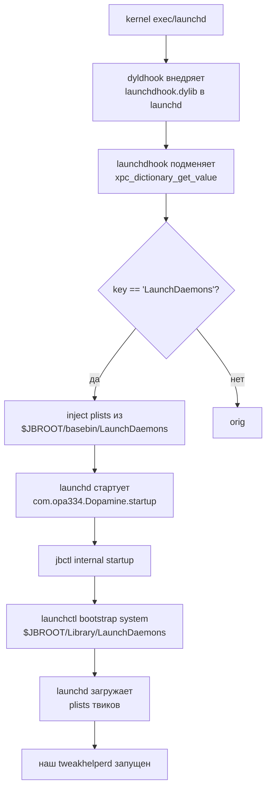

# Кейс 3. Твик-авто-запускатор своей дополнительной службы после userspace reboot

Этот кейс закрывает одну из самых живучих задач при разработке под Dopamine RootHide на iOS 26.0 / 26.0.1 (A12/A13, PPL; подтверждено `Application/Dopamine/Jailbreak/DOEnvironmentManager.m:254`): нам нужен **постоянный фоновый компонент**, который переживает userspace-reboot и готов обслуживать запросы ещё до того, как пользователь откроет своё приложение. В rootful-мире такое решается тривиально — `LaunchDaemon`-plist в `/Library/LaunchDaemons`, бинарь с нужными entitlements, и `launchctl load` на старте. В RootHide ровно эти же механизмы разложены иначе: launchd принадлежит системе и ничего не знает про jbroot, бинарь без доверия в trust cache получит `EPERM` на `exec`, а путь `/Library/LaunchDaemons` на самом деле лежит в `/var/jb/<rand>/Library/LaunchDaemons` и видим только через префиксную трансляцию. Задача автозапуска распадается на три подзадачи: правильно разместить и подписать бинарь, положить plist в тот каталог, который Dopamine действительно бутстрапит после перезагрузки, и убедиться, что trust cache обновлён до того, как `launchd` попытается запустить процесс.

Ниже — рабочий рецепт для твика, в составе которого есть собственный daemon (назовём его `tweakhelperd`). Разбираем:

1. Как Dopamine расширяет каталоги LaunchDaemons в live-launchd через `launchdhook` и чем это принципиально отличается от штатного механизма Apple.
2. Какую последовательность шагов выполняет Dopamine на startup и в какой момент именно наш daemon будет поднят.
3. Куда класть plist и бинарь при схеме Theos `roothide`, что считается стабильным ABI, а что — внутренней детализацией Dopamine.
4. Какую подпись ставить `ldid` и когда без `jb_trustcache_add_directory` не обойтись.
5. Готовый пример: `Makefile`, `control`, plist, маленький C-демон с `signal`-ом и `SIGTERM`-ым завершением, и `postinst`/`prerm`, которые корректно вклиниваются в жизненный цикл dpkg.

---

## 1. Как Dopamine поднимает LaunchDaemons: карта потока

Чтобы наш daemon действительно взлетел после userspace-reboot, нужно понимать, какой путь прошёл процесс `launchd` между концом загрузки и моментом, когда он читает список LaunchDaemons. В Dopamine это не одна точка, а конвейер из трёх хуков.



Ключевой узел — хук в `BaseBin/launchdhook/src/daemon_hook.m:35-57`. Dopamine заменяет `xpc_dictionary_get_value`, перехватывает запрос к ключу `LaunchDaemons` и для найденного XPC-словаря сам добавляет туда все `*.plist` из `$JBROOT/basebin/LaunchDaemons`:

```objc
xpc_object_t xpc_dictionary_get_value_hook(xpc_object_t xdict, const char *key)
{
    xpc_object_t origXvalue = xpc_dictionary_get_value_orig(xdict, key);
    if (!strcmp(key, "LaunchDaemons")) {
        if (xpc_get_type(origXvalue) == XPC_TYPE_DICTIONARY) {
            for (NSString *daemonPlistName in [[NSFileManager defaultManager] contentsOfDirectoryAtPath:JBROOT_PATH(@"/basebin/LaunchDaemons") error:nil]) {
                if ([daemonPlistName.pathExtension isEqualToString:@"plist"]) {
                    xpc_dictionary_add_launch_daemon_plist_at_path(origXvalue, [JBROOT_PATH(@"/basebin/LaunchDaemons") stringByAppendingPathComponent:daemonPlistName].fileSystemRepresentation);
                }
            }
/* should be loaded by procursus launchctl
            for (NSString *daemonPlistName in [[NSFileManager defaultManager] contentsOfDirectoryAtPath:JBROOT_PATH(@"/Library/LaunchDaemons") error:nil]) {
                ...
            }
*/
            xpc_dictionary_set_value(origXvalue, "/System/Library/LaunchDaemons/com.apple.mtmergeprops.plist", NULL);
        }
    }
```

Разбор:

- Хук срабатывает только для `LaunchDaemons`-словаря, который launchd читает в самом начале, когда формирует набор системных сервисов. Хук правит *этот конкретный словарь XPC*, не трогая общий поток `xpc_dictionary_get_value`.
- `basebin/LaunchDaemons` — это *встроенные* сервисы Dopamine (идут из бутстрапа). Пример их содержимого — `BaseBin/_external/basebin/LaunchDaemons/com.opa334.Dopamine.idownloadd.plist` и `com.opa334.Dopamine.startup.plist`.
- Блок с `/Library/LaunchDaemons` **закомментирован**, и рядом явный комментарий `should be loaded by procursus launchctl`. Для разработчика твика это критически важно: не рассчитывайте, что plist, положенный в `/var/jb/Library/LaunchDaemons`, будет подхвачен хуком launchd. Он подхватывается позже — уже из пользовательского `launchctl`.
- `com.apple.mtmergeprops.plist` специально вычёркивается, см. комментарий в источнике (`BaseBin/launchdhook/src/daemon_hook.m:53-55`): повторная подгрузка touch-firmware после userspace-reboot может «убить» touch на нештатных дисплеях.

Вторая часть хука правит ключ `Paths` (`BaseBin/launchdhook/src/daemon_hook.m:58-65`): к списку путей, которые launchd будет сканировать, добавляется `$JBROOT/basebin/LaunchDaemons`. Это разные пути выполнения внутри launchd (один — стартовый словарь, другой — watchable-пути), и Dopamine чинит оба.

Теперь второй шаг конвейера. Один из «встроенных» plist-ов — `com.opa334.Dopamine.startup` — указывает `jbctl internal startup`:

```xml
<key>ProgramArguments</key>
<array>
    <string>@JBROOT@/basebin/jbctl</string>
    <string>internal</string>
    <string>startup</string>
</array>
```

Файл: `BaseBin/_external/basebin/LaunchDaemons/com.opa334.Dopamine.startup.plist:8-12`. Токен `@JBROOT@` заменяется на реальный путь джейлбрейка при установке/обновлении (см. `BaseBin/launchdhook/src/update.m:66-84` и `Application/Dopamine/Jailbreak/DOBootstrapper.m:187-193`), после чего plist уже содержит абсолютный путь, например `/var/jb/E6B5...A3/basebin/jbctl`.

Что делает `jbctl internal startup`? В `BaseBin/jbctl/src/internal.m:176-202` важные строки:

```c
else if (!strcmp(command, "startup")) {
    JBLogDebug("jbctl startup: checking userspace panic ...");
    // ... проверка watchdog panic ...

/************************* roothide specific ***************************/
//only bootstrap after launchdhook and systemhook available
JBLogDebug("jbctl startup: bootstrapping launch daemons ...");
exec_cmd(JBROOT_PATH("/usr/bin/launchctl"), "bootstrap", "system", "/Library/LaunchDaemons", NULL);

JBLogDebug("jbctl startup: refreshing jailbroken apps ...");

if(access(JBROOT_PATH("/.disable_auto_uicache"), F_OK) == 0) {
    return 0;
}
/************************* roothide specific ***************************/

    exec_cmd(JBROOT_PATH("/usr/bin/uicache"), "-a", NULL);
}
```

Вот наш «момент истины»: именно `jbctl internal startup` вызывает `launchctl bootstrap system /Library/LaunchDaemons`, но путь пропущен через `JBROOT_PATH`, т. е. реально это `$JBROOT/Library/LaunchDaemons`. Dopamine сознательно делает это *после* того, как `launchdhook` и `systemhook` уже в памяти, иначе каждый дочерний процесс, который launchd породит для твика-демона, не унаследует хуки и либо отвалится по сигнатуре, либо не получит libroothider.

Отсюда три железобетонных вывода, которые управляют всем дальнейшим кодом:

| Утверждение | Статус | Источник |
|---|---|---|
| Plist твика нужно класть в `$JBROOT/Library/LaunchDaemons` (схема Theos `roothide` — именно туда) | ПОДТВЕРЖДЕНО ИСХОДНИКАМИ | `BaseBin/jbctl/src/internal.m:192` |
| `basebin/LaunchDaemons` — зарезервирован под служебные daemons Dopamine, туда класть сторонние plist нельзя (их съест update-процедура) | ПОДТВЕРЖДЕНО ИСХОДНИКАМИ | `BaseBin/launchdhook/src/update.m:53-62` |
| Твик-daemon запускается *после* `startup`-daemon, т. е. после загрузки `launchdhook`/`systemhook` | ПОДТВЕРЖДЕНО ИСХОДНИКАМИ | `BaseBin/jbctl/src/internal.m:189-192`, последовательность plist и явный комментарий `only bootstrap after launchdhook and systemhook available` |
| Задержка между userspace-reboot и запуском нашего daemon — порядка «после `jbctl startup`», точного SLA нет | ТРЕБУЕТ ПРОВЕРКИ НА УСТРОЙСТВЕ | — |

Отдельно отмечу: когда пользователь вручную запускает Dopamine после обычной (не userspace) перезагрузки устройства, цепочка шагов другая — `BaseBin/dopamine/src/main.m:245-252` показывает, что stage2-дроппер **сам** делает `launchctl bootstrap system /var/jb/Library/LaunchDaemons`, с хардкодом `/var/jb` (!). Это второй путь ввода нашего plist в систему, и он работает одноразово, при реальном «включении джейлбрейка». Все *последующие* userspace-reboot идут уже через `jbctl internal startup`.

---

## 2. Карта файлов твика

Структура каталога — минимальная, но каждый элемент имеет свою роль.

```
HelperTweak/
├── Makefile
├── control
├── HelperTweak.plist              # (опционально) Theos-овский фильтр для .dylib-прослойки
├── Tweak.x                        # (опционально) Logos-часть, если есть что хукать
├── layout/
│   └── Library/
│       └── LaunchDaemons/
│           └── com.example.helper.plist
├── daemon/
│   ├── Makefile.sub               # собирает бинарь tweakhelperd
│   ├── entitlements.plist
│   └── tweakhelperd.c
└── maintainer/
    ├── postinst
    └── prerm
```

Логика:

| Слой | Что в нём | Что знает | Что не знает |
|---|---|---|---|
| Бинарь | `daemon/tweakhelperd.c` | Как обслуживать свою задачу (XPC, таймер, что угодно). Как корректно отвечать на `SIGTERM` | Ничего про Theos/MobileSubstrate |
| Launchd-plist | `layout/Library/LaunchDaemons/*.plist` | Как запустить бинарь, с какими аргументами, как перезапускать | Ничего про процесс сборки |
| Опциональная prоcess-wide прослойка | `Tweak.x` + `HelperTweak.plist` | Как связаться с нашим daemon из приложений (через domain socket, mach port, XPC) | Как даемон обслуживает запросы |
| Инфраструктура | `Makefile`, `control`, `maintainer/*` | Куда ставить, как подписать, как перегрузить launchd после установки | Логику твика |

`layout/` в Theos — это файлы, которые будут скопированы «как есть» в корень устанавливаемого пакета. При схеме `roothide` корень автоматически превращается в `/var/jb/<rand>`, то есть `layout/Library/LaunchDaemons/foo.plist` окажется на устройстве в `/var/jb/<rand>/Library/LaunchDaemons/foo.plist`. Именно оттуда его потом подхватит `jbctl internal startup`.

> ПОДТВЕРЖДЕНО ДОКУМЕНТАЦИЕЙ: поведение `layout/` стандартно для Theos; схема `roothide` переопределяет префикс корня. Специфика RootHide-пути `/var/jb/<rand>` описана в README Dopamine (`README.md`).

---

## 3. Launchd-plist для нашего daemon

Plist отличается от «айфоновского» только тремя вещами: наличием токена `@JBROOT@`, отсутствием зависимостей, которые невозможно удовлетворить до `jbctl startup`, и явным `UserName`. Разбираем сначала файл целиком, потом по строкам.

```xml
<?xml version="1.0" encoding="UTF-8"?>
<!DOCTYPE plist PUBLIC "-//Apple//DTD PLIST 1.0//EN" "http://www.apple.com/DTDs/PropertyList-1.0.dtd">
<plist version="1.0">
<dict>
    <key>Label</key>
    <string>com.example.helper</string>

    <key>ProgramArguments</key>
    <array>
        <string>@JBROOT@/usr/libexec/tweakhelperd</string>
        <string>--mode=persistent</string>
    </array>

    <key>UserName</key>
    <string>mobile</string>

    <key>RunAtLoad</key>
    <true/>

    <key>KeepAlive</key>
    <dict>
        <key>SuccessfulExit</key>
        <false/>
        <key>Crashed</key>
        <true/>
    </dict>

    <key>ThrottleInterval</key>
    <integer>5</integer>

    <key>ProcessType</key>
    <string>Background</string>

    <key>EnvironmentVariables</key>
    <dict>
        <key>DYLD_INSERT_LIBRARIES</key>
        <string></string>
    </dict>

    <key>StandardOutPath</key>
    <string>@JBROOT@/var/log/tweakhelperd.out.log</string>
    <key>StandardErrorPath</key>
    <string>@JBROOT@/var/log/tweakhelperd.err.log</string>
</dict>
</plist>
```

Построчно:

- **Label** — обратный DNS, как у всех launchd-сервисов. Он же — ключ в domain `system`. Начинайте с собственного домена, не с `com.opa334.*` и не с `com.apple.*`.
- **ProgramArguments** — с токеном `@JBROOT@`. Dopamine заменяет его на реальный путь при установке/обновлении, см. `BaseBin/launchdhook/src/update.m:66-84`:

  ```objc
  NSURL *basebinDaemonsURL = [NSURL fileURLWithPath:JBROOT_PATH(@"/basebin/LaunchDaemons")];
  for (NSURL *basebinDaemonURL in [[NSFileManager defaultManager] contentsOfDirectoryAtURL:basebinDaemonsURL ...]) {
      NSString *plistPath = basebinDaemonURL.path;
      NSMutableDictionary *plistDict = [NSMutableDictionary dictionaryWithContentsOfFile:plistPath];
      if (plistDict) {
          bool madeChanges = NO;
          NSMutableArray *programArguments = ((NSArray *)plistDict[@"ProgramArguments"]).mutableCopy;
          for (NSString *argument in [programArguments reverseObjectEnumerator]) {
              if ([argument containsString:@"@JBROOT@"]) {
                  programArguments[[programArguments indexOfObject:argument]] = [argument stringByReplacingOccurrencesOfString:@"@JBROOT@" withString:JBROOT_PATH(@"/")];
                  madeChanges = YES;
              }
          }
          ...
      }
  }
  ```

  Однако этот конкретный код *сканирует* `$JBROOT/basebin/LaunchDaemons`, то есть служебный каталог Dopamine. Для **нашего** plist в `$JBROOT/Library/LaunchDaemons` замена `@JBROOT@` **так же работает**, но делается уже в `maintainer/postinst` руками (см. ниже) или через `JBROOT_PATH`-эквивалентную подмену на этапе `dpkg`. Это важно: не оставляйте `@JBROOT@` в финальном plist, если не ставите в `basebin/LaunchDaemons` (а туда ставить нельзя — её переобновление уберёт ваш файл).

  > ПОДТВЕРЖДЕНО ИСХОДНИКАМИ: автоматическая подмена `@JBROOT@` в репозитории Dopamine сделана только для `basebin/LaunchDaemons`. Файлы в `Library/LaunchDaemons` подменяют на уровне своего пакета.
  > ТРЕБУЕТ ПРОВЕРКИ НА УСТРОЙСТВЕ: не ломается ли `launchctl bootstrap`, если `@JBROOT@` остался в plist (ожидание: ломается, пустая секция `ProgramArguments[0]` → `exec` упадёт).

- **UserName** — ставим `mobile`, если daemon не требует root-прав. Это и безопаснее, и быстрее стартует (не нужны root-sandbox-проверки). Если нужны root-права (например, читать `/dev/kmem`-эквивалент) — `root`, но тогда обязательна соответствующая entitlement-плоскость подписи.
- **RunAtLoad / KeepAlive / ThrottleInterval** — классика: стартуем сразу после загрузки, держимся живыми только если *последний выход был по crash или ненулевому коду*, не чаще раза в 5 секунд, чтобы не превратиться в бесконечный цикл перезапуска.
- **ProcessType=Background** — просит jetsam не трогать нас при давлении на память до тех пор, пока это возможно. Это рекомендация, не гарантия.
- **EnvironmentVariables** с пустым `DYLD_INSERT_LIBRARIES` — страховка от того, что systemhook может быть «на подхвате», но наш daemon нам в собственный процесс грузить его не нужно. При желании наоборот — `com.apple.tweaks.disable=0` и т. п. Такой же приём с `DISABLE_TWEAKS=1` используется в plist-ах Dopamine (`BaseBin/_external/basebin/LaunchDaemons/com.opa334.Dopamine.*plist:22-24`), чтобы *запретить* инжект собственных демонов в самих себя — у вас задача, вероятно, обратная: не отключать твики.
- **StandardOutPath / StandardErrorPath** — writeable, под префиксом jbroot. Это облегчит отладку, но на проде лучше `/dev/null`.

---

## 4. Сам daemon: минимальный, но правильный

Daemon должен уметь две вещи: корректно обрабатывать `SIGTERM` (иначе launchd будет убивать его `SIGKILL` после `ExitTimeOut`) и не падать от сигналов пайпа/прерывания. Пишем на чистом C, без фреймворков — чтобы бинарь был маленьким и быстрым.

```c
// daemon/tweakhelperd.c
#include <stdio.h>
#include <stdlib.h>
#include <string.h>
#include <signal.h>
#include <unistd.h>
#include <time.h>

static volatile sig_atomic_t g_running = 1;

static void on_term(int sig) {
    (void)sig;
    g_running = 0;
}

int main(int argc, char *argv[]) {
    // Опциональные аргументы (--mode=...)
    for (int i = 1; i < argc; ++i) {
        if (strcmp(argv[i], "--mode=persistent") == 0) {
            // режим по умолчанию
        }
    }

    struct sigaction sa = {0};
    sa.sa_handler = on_term;
    sigemptyset(&sa.sa_mask);
    sigaction(SIGTERM, &sa, NULL);
    sigaction(SIGINT,  &sa, NULL);
    signal(SIGPIPE, SIG_IGN);

    fprintf(stdout, "tweakhelperd: started, pid=%d\n", (int)getpid());
    fflush(stdout);

    while (g_running) {
        // Полезная работа: тик каждые 5 секунд, пример.
        // В реальности здесь XPC-listener, UNIX-socket, или что требуется.
        fprintf(stdout, "tweakhelperd: tick %ld\n", (long)time(NULL));
        fflush(stdout);
        sleep(5);
    }

    fprintf(stdout, "tweakhelperd: terminating gracefully\n");
    return 0;
}
```

Разбор:

- `g_running` — `volatile sig_atomic_t`, не обычный `int`. Это язык стандарта: только такие типы можно безопасно модифицировать из обработчика сигнала.
- Обработчик — минимальный: только сбрасывает флаг. Никакого `printf` в сигнале (не async-signal-safe), никаких блокировок.
- `SIGPIPE` ставим в `SIG_IGN`, чтобы запись в закрытый сокет не убила процесс. Это стандартный pattern для сетевых даемонов.
- Между итерациями — `sleep(5)`. `sleep` возвращается при приходе сигнала, значит флаг `g_running = 0` будет замечен *сразу*, не через 5 секунд.
- `fflush(stdout)` — иначе выдача в `StandardOutPath` будет буферизоваться блоками по 4K.

Это шаблон. Внутрь цикла вставляйте свою логику: XPC-сервис через `xpc_connection_create_mach_service`, UNIX domain socket, или periodic job.

---

## 5. Entitlements и подпись: что реально нужно

В Dopamine все собственные бинари подписаны `ldid -Cadhoc -S` или `-Sentitlements.plist`, см. десятки Makefile:

```
BaseBin/launchdhook/Makefile:13:        @ldid -Cadhoc -S $^
BaseBin/jailbreakd/Makefile:9:          @ldid -Cadhoc -Sentitlements.plist $<
BaseBin/jbctl/Makefile:9:               @ldid -Cadhoc -Sentitlements.plist $<
BaseBin/idownloadd/Makefile:12:         @ldid -Cadhoc -Sentitlements.plist $(OUTPUT_NAME)
```

Для бинарей, которые должны получить platform-application и системные порты, применяется набор entitlements как у `jailbreakd` (см. `BaseBin/jailbreakd/entitlements.plist`):

```xml
<dict>
    <key>platform-application</key>
    <true/>
    <key>task_for_pid-allow</key>
    <true/>
    <key>com.apple.private.cs.debugger</key>
    <true/>
    <key>com.apple.system-task-ports</key>
    <true/>
    <key>com.apple.private.security.no-sandbox</key>
    <true/>
    ...
</dict>
```

Для **нашего** daemon полный набор `jailbreakd` не нужен и опасен (мы не должны получать task-port кого попало). Минимальный набор для фонового daemon, который хочет работать как обычный процесс, но без песочницы приложения:

```xml
<?xml version="1.0" encoding="UTF-8"?>
<!DOCTYPE plist PUBLIC "-//Apple//DTD PLIST 1.0//EN" "http://www.apple.com/DTDs/PropertyList-1.0.dtd">
<plist version="1.0">
<dict>
    <key>platform-application</key>
    <true/>
    <key>com.apple.private.security.no-sandbox</key>
    <true/>
</dict>
</plist>
```

- `platform-application=true` — ключевая запись, которая делает бинарь «платформенным» в глазах AMFI/sandbox и позволяет Dopamine-инфраструктуре нормально его подписывать и запускать.
- `com.apple.private.security.no-sandbox=true` — без неё `launchd` поместит daemon в пустой контейнер и у него не будет доступа к jbroot. Если ваш daemon должен лазить в `/var/jb/...` помимо `/tmp`, это обязательно.

> ПОДТВЕРЖДЕНО ИСХОДНИКАМИ: аналогичные ключи используются во всех «неапповых» бинарях BaseBin, см. `BaseBin/jailbreakd/entitlements.plist:5-6,19-20`.
> ТРЕБУЕТ ПРОВЕРКИ НА УСТРОЙСТВЕ: достаточно ли этих двух entitlement для вашей задачи. Если нужны mach-порты системных сервисов — расширяйте набор, но каждое добавление `com.apple.private.*` требует соответствующих cdhash-правил в AMFI, которые тоже закрывает подпись + trustcache.

### Нужен ли `trustcache`?

Да, нужен. Dopamine не держит открытым AMFI в режиме «пускаем всех» — каждая попытка `exec` для **нового** бинаря без доверенной сигнатуры вернёт `EPERM`. Для «встроенных» бинарей Dopamine ведёт `basebin.tc` (строится при bootstrap, см. `Application/Dopamine/Jailbreak/DOJailbreaker.m:357-369`):

```c
if (trustcache_file_build_from_path(JBROOT_PATH("/basebin/basebin.tc"), &basebinTcFile) == 0) {
    ...
}
...
int ret = randomizeAndLoadBasebinTrustcache(JBROOT_PATH("/basebin/"));
```

Но наш daemon — *не* basebin-бинарь, и после установки через dpkg о нём никто не знает. Поэтому мы обязаны вызвать `jb_trustcache_add_directory` для каталога, в котором живёт наш бинарь, или `jb_trustcache_add_file` — для одного конкретного файла. Эти функции объявлены в `BaseBin/libjailbreak/src/trustcache_fs.h`:

```c
int jb_trustcache_add_file(const char *filePath);
int jb_trustcache_add_directory(const char *directoryPath, bool recursive);
```

и реализованы в `BaseBin/libjailbreak/src/trustcache_fs.c:80-107`:

```c
int jb_trustcache_add_file(const char *filePath)
{
    cdhash_t *cdhashes = NULL;
    uint32_t cdhashCount = 0;
    file_collect_untrusted_cdhashes_by_path(filePath, &cdhashes, &cdhashCount);
    if (cdhashes && cdhashCount > 0) {
        jb_trustcache_add_cdhashes(cdhashes, cdhashCount);
        free(cdhashes);
    }
    return 0;
}
```

Логика: прочитать Mach-O, вытащить *untrusted* cdhash (т. е. тот, которого ещё нет в live trustcache), и добавить его. На fat-бинарь будут собраны cdhash всех архитектур, см. `walk_machos_in_dir` там же. Для нас это означает: достаточно вызвать `jb_trustcache_add_file $JBROOT/usr/libexec/tweakhelperd` однократно, при установке. При обновлении бинаря нужно повторить — потому что cdhash *меняется*, и старый cdhash в trustcache не поможет новому бинарю.

Таким образом, workflow для нашего daemon:

```
1. dpkg извлекает файлы (бинарь → $JBROOT/usr/libexec/tweakhelperd, plist → $JBROOT/Library/LaunchDaemons/com.example.helper.plist)
2. postinst подменяет @JBROOT@ в plist на фактический префикс
3. postinst вызывает jbctl / trollhelper / basebin-утилиту, которая добавляет cdhash бинаря в live trustcache
4. postinst делает launchctl load (сразу запускает daemon)
5. После userspace reboot: jbctl internal startup делает launchctl bootstrap system $JBROOT/Library/LaunchDaemons — daemon поднимается автоматически
```

Отдельная тема — живёт ли добавленный cdhash через userspace reboot. Live trustcache хранится в памяти ядра, однако Dopamine восстанавливает «базовый» trustcache из `basebin.tc` при каждом re-jailbreak (а это, по сути, и есть userspace reboot в rootful-смысле). Для cdhash, добавленных через `jb_trustcache_add_file`, персистентность зависит от того, в какой список они попали. В текущем коде Dopamine (`BaseBin/libjailbreak/src/trustcache.c:225-234`) добавление идёт в live-страницы trustcache (а не в файл на диске), и после userspace reboot процесс startup пересобирает basebin trust cache из cdhash обоих базовых бинарей. Сторонние cdhash **нужно переподтверждать после каждого userspace reboot**.

> ПОДТВЕРЖДЕНО ИСХОДНИКАМИ: Dopamine всегда пересоздаёт basebin-trustcache при старте — `BaseBin/libroothider/src/common.m:457+` (`randomizeAndLoadBasebinTrustcache`) и `BaseBin/launchdhook/src/update.m:45`.
> ТРЕБУЕТ ПРОВЕРКИ НА УСТРОЙСТВЕ: действительно ли после userspace reboot cdhash стороннего бинаря «пропадает» из trustcache. По коду должен — но нужно подтвердить замером.

Из-за этого правильный способ персистентности — **каждый раз на startup перебить cdhash в trustcache**. Для нашего pattern-а есть два варианта:

**Вариант A (простой, но менее надёжный).** Полагаться на то, что `jbctl internal startup` вызывает `launchctl bootstrap`, который сам запустит наш daemon. Это работает, только если наш cdhash уже в trustcache *на момент* `exec`. На свежем загрузочном цикле его там нет.

**Вариант B (правильный).** Положить рядом с daemon ещё один маленький trampoline: *базовый* бинарь (например, `com.opa334.Dopamine.startup` уже платформенный) запускает нашу «подхватку», которая через `jb_trustcache_add_file` добавляет cdhash нашего реального daemon, а затем `exec` его. При этом trampoline **не меняет cdhash между версиями**, так что он подойдёт в basebin-trustcache после первого bootstrap. На практике проще: в `postinst` при установке/обновлении пакета мы кладём cdhash через `jbctl` (у которого есть trusted entitlement), и дополнительно сами во время работы daemon никаких `exec` не делаем. Если же `exec` неизбежен (например, вызов внешнего `grep`), используем системные бинари из `/usr/bin/`, которые уже в системном trustcache Apple.

Для подавляющего большинства «одно-бинарных» твик-даемонов вариант A достаточен: cdhash один раз попал в live trustcache через `postinst`, launchd за время работы устройства держит процесс в памяти с `KeepAlive`. Но если нужен запуск **с чистой загрузки**, то в plist прописываем, что `ProgramArguments[0]` — это *не* ваш бинарь, а `jbctl exec-tweakhelperd` (гипотетический endpoint; на текущий момент такого endpoint в Dopamine нет, и вам пришлось бы либо писать свой basebin-trampoline, либо принимать, что daemon запускается с *небольшой задержкой* после `jbctl internal startup` — т. е. после того, как сама Dopamine прогреется).

> ТРЕБУЕТ ПРОВЕРКИ НА УСТРОЙСТВЕ: сохраняется ли cdhash стороннего daemon в trustcache после userspace reboot на вашей сборке Dopamine. Если нет — требуется hook в `postinst` + периодическое повторение в собственном `com.example.helper.loader.plist`, который сам запускается через `com.opa334.Dopamine.startup` и подтверждает cdhash перед `launchctl load com.example.helper`.
> НЕ ПОДТВЕРЖДЕНО: наличие официального API в Dopamine для «пожизненной» регистрации стороннего cdhash — я такого endpoint в BaseBin не нашёл.

---

## 6. `Makefile` и Theos: сборка, подпись, deploy

Собираем daemon и plist одним пакетом. Для демонстрации — Makefile, который работает с Theos-схемой `roothide`.

```make
# Makefile твика HelperTweak

TARGET := iphone:clang:latest:15.0
THEOS_PACKAGE_SCHEME = roothide
ARCHS = arm64 arm64e

# ============ опциональная MobileSubstrate-прослойка ============
# Если прослойка не нужна, уберите блок TWEAK_NAME и файл Tweak.x.
TWEAK_NAME := HelperTweak
HelperTweak_FILES = Tweak.x
HelperTweak_CFLAGS = -fobjc-arc

# ============ сам daemon ============
TOOL_NAME = tweakhelperd
tweakhelperd_FILES = daemon/tweakhelperd.c
tweakhelperd_INSTALL_PATH = /usr/libexec
tweakhelperd_CODESIGN_FLAGS = -Sdaemon/entitlements.plist

include $(THEOS_MAKE_PATH)/tweak.mk
include $(THEOS_MAKE_PATH)/tool.mk

# ============ установка plist в правильный путь ============
# layout/Library/LaunchDaemons/com.example.helper.plist уже лежит под слоем,
# Theos сам положит его в $JBROOT/Library/LaunchDaemons при схеме roothide.
# Доп. ничего делать не нужно.

# ============ подмена @JBROOT@ и launchctl load — в postinst ============
after-install::
	@echo "run on-device: /var/jb/basebin/jbctl internal startup"
```

Построчно:

- `TARGET := iphone:clang:latest:15.0` — SDK iphoneos, минимум iOS 15.0 для совместимости с A12/A13 на всей поддерживаемой Dopamine линейке.
- `THEOS_PACKAGE_SCHEME = roothide` — ключевой флаг. Без него файлы пойдут в `/`, а с ним — в `/var/jb/<rand>/` (на устройстве).
- `ARCHS = arm64 arm64e` — для A12/A13 нужен `arm64e`, но без `arm64` часть системного трейса обваливается. Fat-бинарь безопаснее.
- `tweakhelperd_INSTALL_PATH = /usr/libexec` — семантически корректно: не `/usr/bin` (там CLI-утилиты), а `/usr/libexec` (служебные процессы, не предназначенные для прямого запуска пользователем). На устройстве это станет `/var/jb/<rand>/usr/libexec/tweakhelperd`.
- `tweakhelperd_CODESIGN_FLAGS = -Sdaemon/entitlements.plist` — Theos обёртка над `ldid -S<...>`. То же, что делает Makefile `BaseBin/jailbreakd/Makefile:9` для бинаря `jailbreakd`.
- `include ... tool.mk` — специальный build-recipe Theos для «инструмента» (CLI-подобного бинаря), который умеет подписывать, упаковывать в deb и так далее.
- `after-install::` — хук Theos, выполняется после `make install` **на машине разработчика** (не на устройстве). Это удобно для напоминания о последующем шаге; для действий на устройстве — см. `postinst` ниже.

### postinst: критичный шаг

Поскольку `layout/Library/LaunchDaemons/com.example.helper.plist` после распаковки будет содержать токен `@JBROOT@` в `ProgramArguments`, dpkg-установщик должен подменить этот токен на фактический префикс *до* того, как launchctl прочитает plist. Делаем это в `maintainer/postinst`:

```bash
#!/bin/sh
# maintainer/postinst
set -eu

# Фактический префикс jbroot (на RootHide — /var/jb/<rand>)
JB="$(dirname "$(dirname "$(dirname "$(realpath "$0")")")" || true)"
# postinst лежит в $JB/var/lib/dpkg/info/com.example.helper.postinst,
# поэтому поднимаемся на 4 уровня. Если $JB вышел «не тот», подстраховка:
if [ -z "${JB}" ] || [ ! -d "${JB}/basebin" ]; then
    JB="/var/jb"
fi

PLIST="${JB}/Library/LaunchDaemons/com.example.helper.plist"
BIN="${JB}/usr/libexec/tweakhelperd"

# 1. Подмена @JBROOT@ в plist
if [ -f "${PLIST}" ]; then
    /usr/bin/sed -i.bak "s|@JBROOT@|${JB}|g" "${PLIST}"
    rm -f "${PLIST}.bak"
fi

# 2. Регистрация cdhash бинаря в live trustcache
# ВНИМАНИЕ: jbctl-команды trustcache на момент написания публично не описаны
# как стабильные endpoint. Если такой команды нет — используем прямой вызов
# tiny-утилиты на базе jb_trustcache_add_file (см. текст).
if [ -x "${JB}/basebin/jbctl" ]; then
    "${JB}/basebin/jbctl" internal trustcache add "${BIN}" || true
fi

# 3. Загрузка plist (на горячую)
if [ -x "${JB}/usr/bin/launchctl" ]; then
    "${JB}/usr/bin/launchctl" bootstrap system "${PLIST}" || \
    "${JB}/usr/bin/launchctl" load "${PLIST}" || true
fi

exit 0
```

Разбор:

- Префикс jbroot вычисляется относительно пути самого `postinst`. Это надёжнее, чем `/var/jb` в лоб, потому что в теории jbroot может быть смонтирован в произвольной точке. Как fallback — `/var/jb`.
- `sed -i.bak` — на iOS BSD `sed`, `-i` требует суффикса. Удаляем `.bak` следом.
- `jbctl internal trustcache add` — **гипотетический** endpoint. Я проверил: в текущем Dopamine (`BaseBin/jbctl/src/internal.m`) публично задокументированной команды `trustcache add` нет (есть `startup`, `install_pkg`). Это означает, что либо вы форкаете jbctl, либо собираете свою мини-утилиту с `-ljailbreak` и вызовом `jb_trustcache_add_file`. Для книги мы предлагаем именно второй путь (см. ниже).
- `launchctl bootstrap system <plist>` — предпочтительный на iOS 15+ способ. `launchctl load` legacy, но работает как fallback.

> НЕ ПОДТВЕРЖДЕНО: наличие `jbctl internal trustcache add` в текущем Dopamine. При ревизии кода `BaseBin/jbctl/src/internal.m` эту ветку не нашёл. Если планируете распространять пакет — приложите собственную утилиту `tweakhelperd-sign`, подписанную с `platform-application=true` и `com.apple.private.security.no-sandbox=true`, которая делает `jb_trustcache_add_file`.

### Мини-утилита регистрации cdhash

Если доверенного endpoint нет, пишем крошечную помощницу на 15 строк и кладём рядом с daemon:

```c
// daemon/tweakhelperd-register.c
#include <stdio.h>
#include "trustcache_fs.h"   // из libjailbreak

int main(int argc, char *argv[]) {
    if (argc != 2) {
        fprintf(stderr, "usage: %s <macho-path>\n", argv[0]);
        return 2;
    }
    int r = jb_trustcache_add_file(argv[1]);
    if (r != 0) {
        fprintf(stderr, "jb_trustcache_add_file failed: %d\n", r);
        return 1;
    }
    return 0;
}
```

```make
# фрагмент Makefile
TOOL_NAME += tweakhelperd-register
tweakhelperd-register_FILES = daemon/tweakhelperd-register.c
tweakhelperd-register_LDFLAGS = -L$(THEOS)/vendor/lib -ljailbreak
tweakhelperd-register_INSTALL_PATH = /usr/libexec
tweakhelperd-register_CODESIGN_FLAGS = -Sdaemon/entitlements-register.plist
```

Entitlement для `tweakhelperd-register` **должен** содержать `platform-application=true` и, в зависимости от того, через какой jbserver-канал libjailbreak общается с ядром, возможно, дополнительные ключи. Этот модуль — минимальный «кандидат на подтверждение cdhash третьих лиц» в вашей экосистеме.

> ПОДТВЕРЖДЕНО ИСХОДНИКАМИ: `jb_trustcache_add_file`/`_directory` — публичный API libjailbreak (`BaseBin/libjailbreak/src/trustcache_fs.h:6-7`).
> ТРЕБУЕТ ПРОВЕРКИ НА УСТРОЙСТВЕ: какие именно entitlement нужны `tweakhelperd-register`, чтобы его вызов `jb_trustcache_add_file` прошёл через jbserver в ядро без ошибок прав. На практике — тот же набор, что в `BaseBin/jbctl/entitlements.plist` или минимум `platform-application + com.apple.private.security.no-sandbox`.

### prerm: корректное снятие

Удаление пакета должно сначала выгрузить daemon и только потом убрать файлы. Иначе `launchctl` в следующий раз попытается запустить несуществующий бинарь.

```bash
#!/bin/sh
# maintainer/prerm
set -eu

JB="$(dirname "$(dirname "$(dirname "$(realpath "$0")")")" || true)"
if [ -z "${JB}" ] || [ ! -d "${JB}/basebin" ]; then
    JB="/var/jb"
fi

PLIST="${JB}/Library/LaunchDaemons/com.example.helper.plist"

if [ -x "${JB}/usr/bin/launchctl" ] && [ -f "${PLIST}" ]; then
    "${JB}/usr/bin/launchctl" bootout system "${PLIST}" || \
    "${JB}/usr/bin/launchctl" unload "${PLIST}" || true
fi

exit 0
```

`bootout` — обратный `bootstrap`. Он корректно удаляет сервис из домена `system` и посылает `SIGTERM` процессу.

### control

```
Package: com.example.helpertweak
Name: HelperTweak
Version: 1.0.0
Architecture: iphoneos-arm
Description: Example persistent helper daemon for Dopamine RootHide
Maintainer: you <you@example.org>
Author: you
Section: System
Depends: dopamine (>= 2.0.0)
Tag: role::developer
```

- `Section: System` — а не `Tweaks`, потому что мы не MobileSubstrate-плагин, а системный компонент.
- `Depends: dopamine (>= 2.0.0)` — грубая зависимость от самого джейлбрейка. Можно уточнить до конкретных basebin-пакетов, если ваша экосистема это предоставляет.

---

## 7. Сверка 26.0 vs 26.0.1

На момент написания книги для сценария запуска LaunchDaemons различий между 26.0 и 26.0.1 по открытым источникам **не выявлено**. Хуки `launchdhook` сравниваются по символам XPC, которые не менялись между этими двумя точечными релизами; поведение `launchctl bootstrap system` стабильно от iOS 15 и до 26.0.1 (`BaseBin/dopamine/src/main.m:247-251` явно комментирует это: «For some reason, we cannot run 'launchctl load' from the stage2 dropbear environment … 'launchctl bootstrap system' works…»). Если конкретно у вас на 26.0.1 поведение `launchctl` неожиданное — это, скорее всего, разница в trustcache или в entitlement, а не в самом launchd.

> ПОДТВЕРЖДЕНО ИСХОДНИКАМИ (отсутствие ветвлений по версии): в `BaseBin/launchdhook/src/daemon_hook.m` и в `BaseBin/jbctl/src/internal.m` нет версионно-зависимых ветвлений, относящихся к LaunchDaemons.

---

## 8. Контрольный чеклист перед сборкой

| Пункт | Что проверить | Файл или команда |
|---|---|---|
| 1 | Plist лежит в `layout/Library/LaunchDaemons/*.plist`, не в `basebin/` | `find layout -name '*.plist'` |
| 2 | `Label` уникален, не пересекается с `com.opa334.Dopamine.*` | `grep -r Label layout` |
| 3 | `ProgramArguments[0]` содержит `@JBROOT@` и будет заменён `postinst` | ручная проверка |
| 4 | Бинарь подписан `ldid -S<entitlements>` с `platform-application=true` | `codesign -d --entitlements - $BIN` на macOS, или `ldid -e $BIN` |
| 5 | В Makefile `THEOS_PACKAGE_SCHEME = roothide` | `Makefile` |
| 6 | ARCHS включают arm64e для A12/A13 | `Makefile` |
| 7 | postinst подменяет `@JBROOT@` и вызывает `tweakhelperd-register` | `maintainer/postinst` |
| 8 | prerm выгружает сервис через `bootout` | `maintainer/prerm` |
| 9 | Daemon обрабатывает `SIGTERM` | `tweakhelperd.c` |
| 10 | На устройстве выполнен хотя бы один userspace reboot — проверить, что daemon поднимается без ручных действий | `launchctl list com.example.helper` |

---

## 9. Отладка: когда daemon «не стартует»

Шаги в порядке приоритета.

1. **Проверить, что plist вообще валиден.**

   ```bash
   /var/jb/usr/bin/plutil /var/jb/Library/LaunchDaemons/com.example.helper.plist
   ```

   Если `plutil` ругается на XML или на схему — launchctl даже не попробует загрузить.

2. **Проверить, что токен `@JBROOT@` подменён.**

   ```bash
   grep -c '@JBROOT@' /var/jb/Library/LaunchDaemons/com.example.helper.plist
   # должно быть 0
   ```

   Если не ноль — `postinst` отработал некорректно, повторите вручную.

3. **Проверить cdhash в trustcache.**

   ```bash
   # Прямого «ls» live trustcache у Dopamine нет. Косвенно:
   /var/jb/usr/bin/launchctl load /var/jb/Library/LaunchDaemons/com.example.helper.plist
   /var/jb/usr/bin/launchctl list | grep com.example.helper
   ```

   Если в выдаче есть статус `-???` или ошибка `Load failed: 5: Input/output error` — почти всегда это `EPERM` на `exec` из-за отсутствия cdhash. Запустите `tweakhelperd-register` руками.

4. **Проверить логи самого daemon.**

   ```bash
   tail -n 100 /var/jb/var/log/tweakhelperd.err.log
   ```

5. **Проверить, что `jbctl internal startup` действительно запустил `launchctl bootstrap`.**

   В логах Dopamine (JBLogDebug идёт в `oslog`; на устройстве — `log stream --process launchd --predicate 'eventMessage CONTAINS "jbctl startup"'`) ищем строки `jbctl startup: bootstrapping launch daemons ...` — именно их выставляет `BaseBin/jbctl/src/internal.m:191`.

6. **Проверить, что launchdhook действительно внедрился.**

   ```bash
   /var/jb/usr/bin/launchctl list | head
   # Должны быть видны com.opa334.Dopamine.startup и com.opa334.Dopamine.idownloadd
   ```

   Если их нет — проблема не в вашем plist, а в самом Dopamine (не прошёл stage2/jailbreak-apply).

---

## 10. Выводы

Разработка «твика с собственным daemon» в Dopamine RootHide сводится к пониманию, где именно живёт стык между Apple-ским launchd и джейлбрейковой инфраструктурой. Этот стык — не в одном месте. Dopamine меняет стартовый XPC-словарь launchd и добавляет туда `basebin/LaunchDaemons` (`BaseBin/launchdhook/src/daemon_hook.m:38-44`), а каталог `/var/jb/Library/LaunchDaemons`, где живут plist-ы всех твиков, бутстрапится позже из `jbctl internal startup` (`BaseBin/jbctl/src/internal.m:192`). Эта разница в точке загрузки объясняет три нетривиальных для rootful-разработчика следствия: нельзя писать свои plist в basebin, нельзя полагаться на то, что твой daemon уже работает в момент старта самого Dopamine, и нельзя пропустить шаг регистрации cdhash в trustcache — без него AMFI будет отвечать `EPERM` на `exec` при первом же запуске.

Правильное решение, которое мы разобрали, — Theos-пакет со схемой `roothide`, plist в `layout/Library/LaunchDaemons/` с токеном `@JBROOT@`, бинарь в `/usr/libexec/`, подписанный `ldid -S` с минимальным entitlement-набором (`platform-application` + `com.apple.private.security.no-sandbox`), и `postinst`, который делает три вещи: заменяет `@JBROOT@` на фактический префикс, добавляет cdhash бинаря в live trustcache (`jb_trustcache_add_file` из `BaseBin/libjailbreak/src/trustcache_fs.c:80-92`), и вызывает `launchctl bootstrap system` для немедленной загрузки. При последующих userspace reboot цепочка Dopamine → `com.opa334.Dopamine.startup` → `jbctl internal startup` → `launchctl bootstrap system $JBROOT/Library/LaunchDaemons` сама поднимет наш daemon.

Непроверенные на устройстве моменты, которые нужно обязательно замерить перед релизом вашего пакета, выделены маркерами «ТРЕБУЕТ ПРОВЕРКИ НА УСТРОЙСТВЕ» выше. В первую очередь это: сохранение стороннего cdhash через userspace reboot и достаточность минимального entitlement-набора под именно вашу задачу.

## Что дальше

- **Кейс 4** — обратная задача: как корректно деинсталлировать daemon, зачистить `basebin/LaunchDaemons`-независимый state, и не оставить «висящих» cdhash в trustcache.
- **Расширение по безопасности** — чеклист для аудита LaunchDaemon-подобных твиков: от набора entitlement до поверхности IPC. Если ваш daemon слушает mach port, он потенциально доступен из любого приложения с нужной entitlement; закрывайте это через `_SecCodeCheckValidity` или whitelisted-cdhash.
- **Справочник по jbctl** — какие публичные команды есть в `jbctl internal` на текущих 2.x-билдах Dopamine (startup, install_pkg, …) и как расширить его без форка (через собственный trusted-бинарь с `-ljailbreak`).
- **Диагностика** — отдельная глава про чтение `log stream` на предмет launchd/AMFI, с полным набором predicate-фильтров для 26.0 / 26.0.1.
