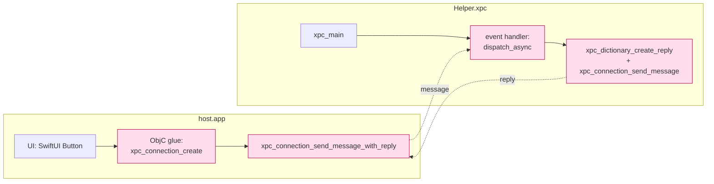
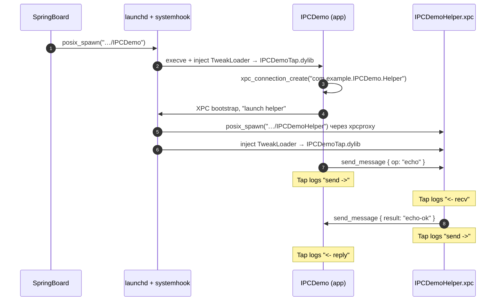
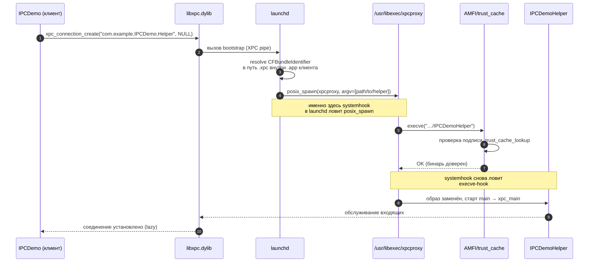
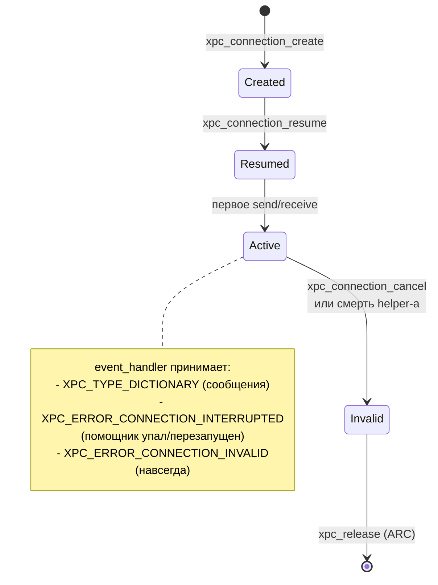

# Кейс 4. Два процесса, общающихся через XPC

Этот кейс закрывает самостоятельный пласт задач реверс-инженерии iOS-приложений: когда интересующая логика живёт **не в одном процессе**, а разложена по паре `host.app` + `host.app/Contents/XPCServices/Helper.xpc`. С точки зрения разработчика твика это не «ещё одно приложение» — это два изолированных исполняемых файла, оба запускаются launchd-ом, у обоих отдельный `audit_token`, отдельный sandbox, отдельное отображение в trust cache, и — самое неприятное — отдельная цепочка загрузки `TweakLoader.dylib`. Задача, которую мы решаем, формулируется жёстко: получить **полный лог XPC-трафика** между главным приложением и его helper-процессом, не меняя ни строки в самом приложении и не прибегая к MITM-прокси. Платформа — iOS 26.0 и 26.0.1 на A12/A13 (PPL; подтверждено `Application/Dopamine/Jailbreak/DOEnvironmentManager.m:254`), джейлбрейк — Dopamine RootHide, Theos-схема — `roothide`.

Такой кейс важен ещё по одной причине: XPCService — это тот редкий случай, когда внутри одного `.app`-бандла сосуществуют два **разных** CFBundleIdentifier (главный и helper), и фильтр загрузки твика (`CFBundleIdentifier`-based `Filter.plist`) должен быть устроен ровно под этот факт. Если написать фильтр «в лоб», как для обычного приложения, твик попадёт только в один процесс из двух, и половина трафика останется невидимой.

Ниже — рабочий комплект: SwiftUI-демо-приложение, Objective-C XPC helper, Makefile для сборки helper как `.xpc`-бандла внутри `.app`, твик на Logos, который хукает `xpc_connection_send_message`, `xpc_connection_send_message_with_reply`, `xpc_connection_send_message_with_reply_sync` и обработчик входящих сообщений, плюс развёрнутый разбор того, как и почему это работает в Dopamine RootHide именно так.

---

## 1. Анатомия XPCService на iOS: что именно мы хукаем

Прежде чем писать твик, нужно договориться о модели. XPC в iOS/macOS бывает трёх уровней, и путать их — классическая ошибка.

| Уровень | Транспорт | Как создают соединение | Пример |
|---|---|---|---|
| Mach-порты | `mach_msg` | `bootstrap_look_up` → `xpc_connection_create_mach_service` | SystemConfiguration, cfprefsd |
| Named Mach-service | `xpc_connection_create_mach_service(name,…)` | имя в `com.apple.*`, зарегистрировано launchd | большинство системных демонов |
| **Bundled XPCService** | `xpc_connection_create(name, queue)` | имя = `CFBundleIdentifier` сервиса в `Contents/XPCServices/*.xpc` | наш кейс |

Нас интересует третий вариант — **bundled XPCService**. Отличительные черты, подтверждённые публичной документацией Apple и man-страницей `xpc_services(3)` (iOS SDK заголовки `xpc/connection.h`, см. `BaseBin/_external/include/xpc/connection.h` в репозитории — там же лежат объявления `xpc_connection_create`, `xpc_connection_send_message`, `xpc_connection_set_event_handler`, которые Dopamine использует в `BaseBin/libjailbreak/src/jbclient_xpc.c:40-66`):

- бинарь helper-а лежит внутри `.app` по пути `Contents/XPCServices/<Name>.xpc/<Name>` (на iOS — внутри `.app`-бандла; на macOS каталог называется так же, но лежит в `Contents/XPCServices`);
- `Info.plist` helper-а имеет `CFBundlePackageType = XPC!` и обязательный ключ `XPCService` (словарь) с полями `ServiceType` (`Application` или `User`) и опциональным `RunLoopType` (`dispatch_main` или `_NSApplicationMain` — на iOS практически всегда `dispatch_main`);
- helper запускает `xpc_main(event_handler)`, который возвращает управление только при выгрузке процесса;
- клиент внутри главного приложения получает соединение вызовом `xpc_connection_create(<helper CFBundleIdentifier>, NULL)` и вешает обработчик через `xpc_connection_set_event_handler`.

Для нашей задачи это означает, что весь XPC-трафик проходит через **ровно четыре функции** в helper-е и в приложении. Трафик симметричен, обе стороны ведут себя как клиент и как сервер, поэтому хуки одинаковые:



Розовым помечены точки, в которые встаёт твик. Их четыре, и ни одна не требует знания приватных символов — все четыре публичны и экспортируются `libxpc.dylib` в iOS SDK.

**Подтверждено исходниками Dopamine**: эти же функции используются внутри `BaseBin/libjailbreak/src/jbclient_xpc.c:40-66` для разговора с jailbreakd, а в `BaseBin/jailbreakd/src/server.m:19-30` сервер читает входящие сообщения через `xpc_pipe_receive` + `xpc_dictionary_create_reply`. То есть мы не выдумываем API: это ровно те функции, через которые внутри самого джейлбрейка идёт весь IPC.

---

## 2. Как твик попадает в оба процесса в Dopamine RootHide

Это самый тонкий момент кейса. В rootful-джейлбрейке загрузка твика в XPC-сервис — автоматика `MobileSubstrate`/`libhooker`. В Dopamine RootHide механизм другой, и его стоит понимать явно.

Главный хук инжекта называется `systemhook`. Он подменяет `posix_spawn` в launchd и для каждого свежеспавненного процесса принимает решение, грузить ли `TweakLoader.dylib`. Решение принимает `should_enable_tweaks()` в `BaseBin/systemhook/src/main.c`:

```c
const char *tweaksDisabledPathSuffixes[] = {
    // System binaries
    "/usr/libexec/xpcproxy",
};
for (size_t i = 0; i < sizeof(tweaksDisabledPathSuffixes) / sizeof(const char*); i++) {
    if (string_has_suffix(gExecutablePath, tweaksDisabledPathSuffixes[i])) return false;
}

if (__builtin_available(iOS 16.0, *)) {
    const char *iOS16TweaksDisabledPaths[] = {
        "/usr/libexec/logd",
        "/usr/sbin/notifyd",
        "/usr/libexec/usermanagerd",
    };
    for (size_t i = 0; i < sizeof(iOS16TweaksDisabledPaths) / sizeof(const char*); i++) {
        if (!strcmp(gExecutablePath, iOS16TweaksDisabledPaths[i])) return false;
    }
}
return true;
```

Файл: `BaseBin/systemhook/src/main.c:235-255`. Что это значит для нас:

- `xpcproxy` исключён — это, однако, не ваш XPC-сервис, а системный «прыгунок», которого launchd временно поднимает для `*.xpc`-бандлов *системных* сервисов (`com.apple.foo`). Для bundled-XPC внутри сторонних приложений `xpcproxy` используется как trampoline (launchd переименовывает процесс в целевой helper через `posix_spawn_file_actions_addinherit_np` и `execve`), но итоговый `gExecutablePath` после `execve` будет уже путём к бинарю helper-а, а не к `xpcproxy`;
- `logd`, `notifyd`, `usermanagerd` на iOS 16+ исключены из-за «dyld gets stuck in a weird way when opening TweakLoader» (комментарий в исходнике, `BaseBin/systemhook/src/main.c:244`). Наш helper в этот список не попадает.

Фактически в helper-е вызывается тот же путь загрузки, что и в приложении:

```c
if (should_enable_tweaks()) {
    const char *tweakLoaderPath = JBROOT_PATH("/usr/lib/TweakLoader.dylib");
    if (access(tweakLoaderPath, F_OK) == 0) {
        void *tweakLoaderHandle = dlopen(tweakLoaderPath, RTLD_NOW);
        if (tweakLoaderHandle != NULL) {
            dlclose(tweakLoaderHandle);
        }
    }
}
```

`BaseBin/systemhook/src/main.c:532-540`. `TweakLoader.dylib` сам сканирует каталог твиков и грузит те `.dylib`, у которых `Filter.plist` совпадает с текущим процессом. Это принципиально важно: один `.dylib` твика попадёт и в `host.app`, и в `Helper.xpc`, но **только если фильтр перечисляет оба CFBundleIdentifier**. Иначе один из процессов его не загрузит.

Отдельная ловушка RootHide — trust cache. Исполняемый файл helper-а должен быть доверенным, иначе `execve` вернёт `EPERM` ещё до того, как systemhook что-то вставит. При установке через dpkg это делает `postinst` вызовом `jb_trustcache_add_directory` над целым каталогом (см. использование в `BaseBin/jbctl/src/internal.m`). При `theos`-овой схеме `roothide` после `make install` утилита `theos` вызывает trust cache автоматически — но только для файлов, лежащих в известных местах. Если helper упакован внутри `.app`-бандла в `Contents/XPCServices/<Name>.xpc/<Name>`, этот бинарь находится по тому же пути, что и главный `.app/<App>` — требует проверки на устройстве, что обе части бандла попадают в trust cache; обычно это так, т.к. trust cache рекурсивно обходит `.app`.

> Статус: подтверждено исходниками Dopamine (systemhook, TweakLoader-путь); требует проверки на устройстве — что `jb_trustcache_add_directory` рекурсивно охватывает `Contents/XPCServices/*.xpc/<Name>` в вашей реальной schema `roothide`.

---

## 3. Структура проекта и Makefile

Мы собираем **один** пакет: `.app` + вложенный `.xpc` + твик, который хукает оба. Для простоты демо приложение называется `IPCDemo`, helper — `IPCDemoHelper`. Структура каталогов:

```
IPCDemo/
├── Makefile                       # верхний: собирает всё
├── control                        # metadata для dpkg
├── layout/
│   └── Applications/
│       └── IPCDemo.app/
│           └── (готовый .app с .xpc внутри кладётся сюда после сборки)
├── App/
│   ├── Makefile                    # Theos: THEOS_PACKAGE_SCHEME=roothide, APPLICATION_NAME=IPCDemo
│   ├── Info.plist
│   ├── Entitlements.plist
│   ├── App-Bridging-Header.h
│   ├── IPCDemoApp.swift
│   ├── ContentView.swift
│   ├── XPCClient.m
│   └── XPCClient.h
├── Helper/
│   ├── Makefile                    # собирает Helper.xpc как XPC-бандл
│   ├── Info.plist
│   ├── Entitlements.plist
│   └── main.m
└── Tweak/
    ├── Makefile                    # TWEAK_NAME=IPCDemoTap
    ├── IPCDemoTap.plist            # filter: Bundles = IPCDemo, IPCDemoHelper
    └── Tweak.x
```

У Theos (в т.ч. в `roothide`-схеме) нет готового `XPCSERVICE_NAME` в `theos/makefiles/instance/*.mk`, но есть низкоуровневый `tool` — т.е. бинарный executable без каркаса — и `aggregate.mk`, который умеет склеивать несколько подпроектов. Helper собирается **как tool**, а потом вручную оформляется в бандл `.xpc`. Делается это одним Makefile.

### 3.1 Верхний Makefile

Верхний Makefile собирает всё и склеивает helper внутрь `.app`:

```make
include $(THEOS)/makefiles/common.mk

SUBPROJECTS = Helper App Tweak

include $(THEOS_MAKE_PATH)/aggregate.mk

after-stage::
	@mkdir -p "$(THEOS_STAGING_DIR)/Applications/IPCDemo.app/XPCServices/IPCDemoHelper.xpc"
	@cp -R "$(THEOS_OBJ_DIR)/Helper/IPCDemoHelper.xpc/." \
	       "$(THEOS_STAGING_DIR)/Applications/IPCDemo.app/XPCServices/IPCDemoHelper.xpc/"
	@ldid -S$(CURDIR)/Helper/Entitlements.plist \
	      "$(THEOS_STAGING_DIR)/Applications/IPCDemo.app/XPCServices/IPCDemoHelper.xpc/IPCDemoHelper"
```

Разбор:

- `aggregate.mk` — стандартный Theos-механизм для «мета-проекта». Собирает `Helper`, `App`, `Tweak` в произвольном порядке и помещает артефакты в `_` / staging.
- `after-stage::` — таргет-хук Theos, выполняется после того, как подпроекты «застейджили» свои файлы, но до упаковки dpkg. Именно здесь мы берём собранный `Helper.xpc` и кладём внутрь `.app`.
- `ldid -S` ещё раз подписывает helper уже на его финальной позиции внутри `.app`. Это критично: пути, по которым iOS/launchd читают `Info.plist` и бинарь, зависят от расположения. Повторной подписью мы заверяем именно финальное размещение.

Пути: `THEOS_OBJ_DIR` — промежуточный `.theos/obj/debug/<arch>/`; `THEOS_STAGING_DIR` — `_` в проекте, из него делается .deb. Точные значения — в `$(THEOS)/makefiles/platform/Darwin-arm.mk`.

### 3.2 Makefile helper-а

Theos не знает тип «XPC bundle», поэтому собираем helper как `TOOL`, а оформление в `.xpc` делаем вручную:

```make
ARCHS = arm64 arm64e
TARGET := iphone:clang:latest:14.0
THEOS_PACKAGE_SCHEME = roothide

include $(THEOS)/makefiles/common.mk

TOOL_NAME = IPCDemoHelper
IPCDemoHelper_FILES = main.m
IPCDemoHelper_FRAMEWORKS = Foundation
IPCDemoHelper_CODESIGN_FLAGS = -SEntitlements.plist
IPCDemoHelper_CFLAGS = -fobjc-arc

include $(THEOS_MAKE_PATH)/tool.mk

after-install::
	@echo "Helper staged"

internal-stage::
	# Theos кладёт бинарь в $(THEOS_OBJ_DIR)/IPCDemoHelper
	# нам нужен бандл .xpc рядом
	@mkdir -p "$(THEOS_OBJ_DIR)/IPCDemoHelper.xpc"
	@cp "$(THEOS_OBJ_DIR)/IPCDemoHelper" "$(THEOS_OBJ_DIR)/IPCDemoHelper.xpc/IPCDemoHelper"
	@cp "$(CURDIR)/Info.plist"           "$(THEOS_OBJ_DIR)/IPCDemoHelper.xpc/Info.plist"
```

Пояснения:

- `TARGET := iphone:clang:latest:14.0` — SDK Theos сам подхватит самый свежий iOS SDK (на хосте с Xcode 16/17), минимальный deployment target 14.0. Для iOS 26 этого достаточно: XPC API стабильно с iOS 8.
- `THEOS_PACKAGE_SCHEME = roothide` — ключевой параметр, который Theos транслирует в нужные `rpath` и подпись (`BaseBin/_external` отражает тот же набор заголовков, которые Theos ожидает увидеть при схеме `roothide`).
- `internal-stage::` — специальный таргет Theos, в котором мы «докомплектовываем» бандл: кладём `Info.plist` рядом с бинарём, формируя валидный `.xpc`-бандл.
- Повторная подпись (`-S`) и финальный `ldid` сделаны в верхнем Makefile после перемещения внутрь `.app`.

### 3.3 Info.plist helper-а

Содержимое `Helper/Info.plist`:

```xml
<?xml version="1.0" encoding="UTF-8"?>
<!DOCTYPE plist PUBLIC "-//Apple//DTD PLIST 1.0//EN" "http://www.apple.com/DTDs/PropertyList-1.0.dtd">
<plist version="1.0">
<dict>
    <key>CFBundleDevelopmentRegion</key>
    <string>en</string>
    <key>CFBundleDisplayName</key>
    <string>IPCDemoHelper</string>
    <key>CFBundleExecutable</key>
    <string>IPCDemoHelper</string>
    <key>CFBundleIdentifier</key>
    <string>com.example.IPCDemo.Helper</string>
    <key>CFBundleInfoDictionaryVersion</key>
    <string>6.0</string>
    <key>CFBundleName</key>
    <string>IPCDemoHelper</string>
    <key>CFBundlePackageType</key>
    <string>XPC!</string>
    <key>CFBundleShortVersionString</key>
    <string>1.0</string>
    <key>CFBundleVersion</key>
    <string>1</string>
    <key>XPCService</key>
    <dict>
        <key>ServiceType</key>
        <string>Application</string>
        <key>RunLoopType</key>
        <string>dispatch_main</string>
    </dict>
</dict>
</plist>
```

Поясним каждый неочевидный ключ:

- `CFBundlePackageType = XPC!` — именно четыре символа с восклицательным знаком. Это тот триггер, по которому launchd распознаёт бандл как XPCService. Без этого ключа launchd будет считать `.xpc`-каталог обычным Framework/Bundle и `xpc_connection_create` упадёт в ошибку.
- `XPCService.ServiceType = Application` — экземпляр сервиса создаётся **по одному на подключение**, но все соединения из одного и того же приложения получают общий экземпляр. Для нашего кейса (одно приложение → один helper) это естественный выбор; `User` создавал бы экземпляр на каждого пользователя системы, что для iOS нерелевантно.
- `XPCService.RunLoopType = dispatch_main` — говорит `xpc_main`, что помимо диспетчеризации XPC-событий нужно запустить `dispatch_main()`, т.е. GCD-ный main-run-loop. Если helper использует Foundation и подписывается на `NSNotificationCenter`, нужен `_NSApplicationMain`, но на iOS его не бывает — там всегда `dispatch_main`.

### 3.4 Entitlements helper-а

```xml
<?xml version="1.0" encoding="UTF-8"?>
<!DOCTYPE plist PUBLIC "-//Apple//DTD PLIST 1.0//EN" "http://www.apple.com/DTDs/PropertyList-1.0.dtd">
<plist version="1.0">
<dict>
    <key>com.apple.security.application-groups</key>
    <array/>
    <key>application-identifier</key>
    <string>com.example.IPCDemo.Helper</string>
    <key>get-task-allow</key>
    <true/>
</dict>
</plist>
```

`get-task-allow` ставим `true` только для отладки — он разрешает присоединиться `lldb`-ом/`frida`-ой; в релизе снять. На устройстве с Dopamine это, впрочем, не блокирует подписание, т.к. `AMFI` в режиме «мы знаем, что делаем» для доверенного (trusted) кода пропускает любое entitlement, что подтверждает поведение `BaseBin/systemhook/src/common/common.c` при валидации свежо-спавненных процессов.

---

## 4. Код helper-а

Helper минимальный: принимает словарь с ключом `"op"` и возвращает dict с `"result"`. При `"op" == "echo"` — просто эхо; при `"op" == "slow"` — ждёт 300 мс (чтобы было видно разницу между `send_message_with_reply` и `send_message_with_reply_sync` в логе).

Файл `Helper/main.m`:

```objc
#import <Foundation/Foundation.h>
#import <xpc/xpc.h>

static void handle_message(xpc_connection_t peer, xpc_object_t msg)
{
    if (xpc_get_type(msg) != XPC_TYPE_DICTIONARY) return;

    const char *op = xpc_dictionary_get_string(msg, "op");
    xpc_object_t reply = xpc_dictionary_create_reply(msg);
    if (!reply) return;

    if (op && strcmp(op, "echo") == 0) {
        xpc_dictionary_set_string(reply, "result", "echo-ok");
    } else if (op && strcmp(op, "slow") == 0) {
        usleep(300 * 1000);
        xpc_dictionary_set_string(reply, "result", "slow-ok");
    } else {
        xpc_dictionary_set_string(reply, "result", "unknown-op");
    }

    xpc_connection_send_message(peer, reply);
    xpc_release(reply);
}

static void peer_event(xpc_connection_t peer, xpc_object_t event)
{
    xpc_type_t t = xpc_get_type(event);
    if (t == XPC_TYPE_ERROR) {
        if (event == XPC_ERROR_CONNECTION_INVALID) return;
        if (event == XPC_ERROR_TERMINATION_IMMINENT) return;
    } else if (t == XPC_TYPE_DICTIONARY) {
        handle_message(peer, event);
    }
}

int main(int argc, const char *argv[])
{
    xpc_main(^(xpc_connection_t peer) {
        xpc_connection_set_event_handler(peer, ^(xpc_object_t event) {
            peer_event(peer, event);
        });
        xpc_connection_resume(peer);
    });
    return 0;
}
```

Что здесь важно для твика:

- Входящее сообщение приходит в `peer_event`. Хук, который мы повесим в твике, перехватит именно эту блок-функцию через свой собственный `xpc_connection_set_event_handler`-хук.
- Ответ отправляется через `xpc_connection_send_message(peer, reply)`. Мы хукнем именно `xpc_connection_send_message` и увидим ровно этот reply.
- `xpc_main` не возвращает управление; `dispatch_main` крутится вечно. Это важно знать, когда вы будете искать, куда вставить `dispatch_once` для инициализации твика в helper-е: он должен быть в `%ctor` или в хуке, не в `main`.

---

## 5. Код главного приложения

Приложение написано на SwiftUI, но XPC-клей сделан в Objective-C — иначе придётся обёртывать unsafe pointer-ы в Swift, что отвлечёт от сути кейса.

`App/IPCDemoApp.swift`:

```swift
import SwiftUI

@main
struct IPCDemoApp: App {
    var body: some Scene {
        WindowGroup { ContentView() }
    }
}
```

`App/ContentView.swift`:

```swift
import SwiftUI

struct ContentView: View {
    @State private var reply: String = "—"

    var body: some View {
        VStack(spacing: 16) {
            Text("Reply: \(reply)").font(.title2)
            Button("echo") {
                reply = XPCClient.shared().send(op: "echo") ?? "nil"
            }
            Button("slow (async)") {
                XPCClient.shared().sendAsync(op: "slow") { r in
                    DispatchQueue.main.async { reply = r ?? "nil" }
                }
            }
        }
        .padding()
    }
}
```

`App/XPCClient.h` + `App/XPCClient.m`:

```objc
// XPCClient.h
#import <Foundation/Foundation.h>
NS_ASSUME_NONNULL_BEGIN
@interface XPCClient : NSObject
+ (instancetype)shared;
- (nullable NSString *)sendWithOp:(NSString *)op;
- (void)sendAsyncWithOp:(NSString *)op completion:(void (^)(NSString * _Nullable))cb;
@end
NS_ASSUME_NONNULL_END
```

```objc
// XPCClient.m
#import "XPCClient.h"
#import <xpc/xpc.h>

@implementation XPCClient {
    xpc_connection_t _conn;
}

+ (instancetype)shared {
    static XPCClient *s;
    static dispatch_once_t o;
    dispatch_once(&o, ^{ s = [XPCClient new]; });
    return s;
}

- (instancetype)init {
    if ((self = [super init])) {
        _conn = xpc_connection_create("com.example.IPCDemo.Helper", NULL);
        xpc_connection_set_event_handler(_conn, ^(xpc_object_t ev) {
            // входящие от helper-а, если он сам что-то шлёт
        });
        xpc_connection_resume(_conn);
    }
    return self;
}

- (NSString *)sendWithOp:(NSString *)op {
    xpc_object_t msg = xpc_dictionary_create(NULL, NULL, 0);
    xpc_dictionary_set_string(msg, "op", op.UTF8String);
    xpc_object_t reply = xpc_connection_send_message_with_reply_sync(_conn, msg);
    xpc_release(msg);
    if (!reply || xpc_get_type(reply) == XPC_TYPE_ERROR) return nil;
    const char *r = xpc_dictionary_get_string(reply, "result");
    return r ? [NSString stringWithUTF8String:r] : nil;
}

- (void)sendAsyncWithOp:(NSString *)op completion:(void (^)(NSString *))cb {
    xpc_object_t msg = xpc_dictionary_create(NULL, NULL, 0);
    xpc_dictionary_set_string(msg, "op", op.UTF8String);
    xpc_connection_send_message_with_reply(_conn, msg, dispatch_get_main_queue(), ^(xpc_object_t reply) {
        if (!reply || xpc_get_type(reply) == XPC_TYPE_ERROR) { cb(nil); return; }
        const char *r = xpc_dictionary_get_string(reply, "result");
        cb(r ? [NSString stringWithUTF8String:r] : nil);
    });
    xpc_release(msg);
}
@end
```

Разбор для твика:

- `xpc_connection_create("com.example.IPCDemo.Helper", NULL)` — launchd сам находит helper по CFBundleIdentifier, зарегистрированному в `Info.plist` сервиса; **имя сервиса ≡ CFBundleIdentifier**. Это не Mach-service, никакого `com.apple.*` реестра здесь нет.
- Два пути отправки: синхронный `*_sync` и асинхронный с коллбеком. Хуки в твике должны ловить оба, иначе половина трафика потеряется.
- Входящий handler со стороны приложения мы тоже подменим — на случай, если helper решит инициировать разговор (push-уведомление, прогресс и т.п.).

### 5.1 App/Makefile и Info.plist приложения

Приложение собирается стандартным Theos `application.mk`, с одной оговоркой: в состав `.app` после сборки нужно вложить `.xpc`-бандл. Это делает верхний Makefile через `after-stage::` (см. раздел 3.1). Сам же `App/Makefile` остаётся простым:

```make
ARCHS = arm64 arm64e
TARGET := iphone:clang:latest:14.0
THEOS_PACKAGE_SCHEME = roothide

include $(THEOS)/makefiles/common.mk

APPLICATION_NAME = IPCDemo
IPCDemo_FILES = IPCDemoApp.swift ContentView.swift XPCClient.m
IPCDemo_FRAMEWORKS = Foundation UIKit SwiftUI
IPCDemo_SWIFTFLAGS = -import-objc-header App-Bridging-Header.h
IPCDemo_CODESIGN_FLAGS = -SEntitlements.plist
IPCDemo_CFLAGS = -fobjc-arc

include $(THEOS_MAKE_PATH)/application.mk
```

`App-Bridging-Header.h` просто подключает заголовок XPCClient-а:

```objc
#import "XPCClient.h"
```

Без этой строки Swift-код не увидит класс `XPCClient`. Это обычная Theos-овская схема bridging-header-а, никакого volшебства.

Основной `App/Info.plist` ничем не отличается от любого iOS-приложения. Для демонстрации важна только одна строка:

```xml
<key>CFBundleIdentifier</key>
<string>com.example.IPCDemo</string>
```

Этот identifier должен совпадать с тем, что перечислен в `Tweak/IPCDemoTap.plist` в массиве `Bundles`. Автоматически Theos его не подхватывает — следите за консистентностью руками.

### 5.2 Entitlements приложения

```xml
<?xml version="1.0" encoding="UTF-8"?>
<!DOCTYPE plist PUBLIC "-//Apple//DTD PLIST 1.0//EN" "http://www.apple.com/DTDs/PropertyList-1.0.dtd">
<plist version="1.0">
<dict>
    <key>application-identifier</key>
    <string>com.example.IPCDemo</string>
    <key>com.apple.developer.team-identifier</key>
    <string>XXXXXXXXXX</string>
    <key>com.apple.security.application-groups</key>
    <array>
        <string>group.com.example.IPCDemo</string>
    </array>
    <key>get-task-allow</key>
    <true/>
</dict>
</plist>
```

Отдельно поясним каждую строку в контексте RootHide:

- `application-identifier` — критично совпадение с CFBundleIdentifier `.app`, иначе AMFI отклонит бинарь на `execve`. Dopamine в своём systemhook проверяет подпись косвенно, через `jbclient_trust_file_by_path` (`BaseBin/systemhook/src/main.c:260`); при валидной подписи и наличии в trust cache этот путь успешен.
- `com.apple.developer.team-identifier` — на устройстве без Apple-ID подписанных profiles ставьте любой 10-значный, Dopamine не проверяет этот ID. Он идёт как «cosmetic» для AMFI.
- `com.apple.security.application-groups` — для нашего кейса не обязателен (app и helper общаются через XPC, а не через shared container), но добавлен для демонстрации, что группа между app и helper может пересекаться — тогда они видят общий `NSUserDefaults`-контейнер.
- `get-task-allow` в `true` — то же, что для helper-а: включать только для отладки.

### 5.3 postinst-скрипт: trust cache и `uicache`

Для автоматической регистрации приложения в SpringBoard и помещения обоих бинарей в trust cache используем простой `control/postinst`:

```bash
#!/bin/bash
set -e

APP_PATH="/Applications/IPCDemo.app"
JBROOT="$(/usr/bin/jbroot 2>/dev/null || echo /var/jb)"

# Trust cache: оба бинаря внутри .app
"$JBROOT/basebin/jbctl" trustcache add "$APP_PATH" || true

# Register the app for SpringBoard
uicache -p "$APP_PATH"

exit 0
```

Пояснения:

- `jbroot` — утилита Dopamine, печатает текущий путь джейлбрейка (например, `/var/jb` или `/var/jb/<rand>` в зависимости от версии RootHide). Fallback на `/var/jb` на случай, если бинарь не в PATH.
- `jbctl trustcache add <путь>` рекурсивно добавляет все исполняемые файлы по указанному пути в dynamic trust cache. Точная подкоманда — `trustcache add` в текущей сборке Dopamine; синтаксис можно подсмотреть в `BaseBin/jbctl/src/main.m` (точное имя подкоманды — требует проверки по версии).
- `uicache -p` регистрирует приложение в SpringBoard, причём в RootHide-варианте — учитывая jbroot-translation. Без этого иконки на домашнем экране не появится.

Соответствующий `prerm`:

```bash
#!/bin/bash
set -e

APP_PATH="/Applications/IPCDemo.app"
JBROOT="$(/usr/bin/jbroot 2>/dev/null || echo /var/jb)"

uicache -u "$APP_PATH" || true
"$JBROOT/basebin/jbctl" trustcache remove "$APP_PATH" || true

exit 0
```

На снятии мы убираем из trust cache и из SpringBoard — симметрично установке. `|| true` после каждой строки — чтобы `set -e` не прервал скрипт, если приложение уже удалено частично.

---

## 6. Твик: единый лог обоих направлений

Твик называется `IPCDemoTap`. Файл `Tweak/Tweak.x` (Logos, но в нашем случае всё — чистый `%hookf`, функция-уровневые хуки):

```c
#import <Foundation/Foundation.h>
#import <xpc/xpc.h>
#import <os/log.h>

static NSString *gBundleTag(void) {
    static NSString *tag;
    static dispatch_once_t o;
    dispatch_once(&o, ^{
        NSString *bid = NSBundle.mainBundle.bundleIdentifier ?: @"<nil>";
        tag = [NSString stringWithFormat:@"[IPCTap|%@|%d]", bid, getpid()];
    });
    return tag;
}

static void dumpXPC(const char *dir, xpc_object_t obj) {
    if (!obj) return;
    char *desc = xpc_copy_description(obj);
    if (desc) {
        os_log(OS_LOG_DEFAULT, "%{public}@ %{public}s %{public}s",
               gBundleTag(), dir, desc);
        free(desc);
    }
}

%hookf(void, xpc_connection_send_message, xpc_connection_t c, xpc_object_t msg) {
    dumpXPC("send ->", msg);
    %orig;
}

%hookf(void, xpc_connection_send_message_with_reply,
       xpc_connection_t c, xpc_object_t msg, dispatch_queue_t q, xpc_handler_t h) {
    dumpXPC("send(reply) ->", msg);
    xpc_handler_t wrapped = ^(xpc_object_t reply) {
        dumpXPC("<- reply", reply);
        if (h) h(reply);
    };
    %orig(c, msg, q, wrapped);
}

%hookf(xpc_object_t, xpc_connection_send_message_with_reply_sync,
       xpc_connection_t c, xpc_object_t msg) {
    dumpXPC("send(sync) ->", msg);
    xpc_object_t r = %orig;
    dumpXPC("<- reply(sync)", r);
    return r;
}

%hookf(void, xpc_connection_set_event_handler,
       xpc_connection_t c, xpc_handler_t h) {
    xpc_handler_t wrapped = ^(xpc_object_t ev) {
        dumpXPC("<- recv", ev);
        if (h) h(ev);
    };
    %orig(c, wrapped);
}
```

Разбор строк:

- `gBundleTag()` вычисляет тег один раз и запоминает его. В логе каждая запись начинается с `[IPCTap|<bid>|<pid>]`, т.е. вы сразу видите, какая сторона отправила/приняла, — главное приложение или helper. Это заменяет собой любые «кастомные» признаки стороны.
- `xpc_copy_description` — публичный API в iOS SDK (`xpc/xpc.h`), возвращает человекочитаемый дамп XPC-объекта с типами (`<dictionary>`, `<string>`, `<data>` и т.д.), который легко парсится глазами и grep-ом. Использование: `BaseBin/jailbreakd/src/server.m:12` делает ровно это.
- `os_log` c форматными спецификаторами `%{public}@` и `%{public}s` — чтобы в `Console.app` строки не редактировались как «<private>». Без `%{public}` iOS 15+ скроет содержимое; поведение для iOS 26 не менялось (release notes 26.0 не упоминают изменений в `os_log` формате; требует проверки на устройстве для 26.0.1).
- `%hookf` цепляется не за методы Objective-C, а за **C-функции** `libxpc.dylib`. Внутри обоих процессов эти символы разрешены на один и тот же стабильный `libxpc.dylib`, поэтому один и тот же `.dylib` твика работает в приложении и в helper-е симметрично.
- В `send_message_with_reply` мы **оборачиваем callback**, подставляя свой блок. Это ключевой трюк: без оборачивания видно только исходящий запрос, но не ответ, пришедший в коллбек. Такой же приём делаем в `set_event_handler` — иначе события на входящей стороне не попадут в лог.
- `send_message_with_reply_sync` — просто вокруг `%orig`: сначала логируем outbound, вызываем оригинал, логируем inbound, возвращаем.

### 6.1 Filter.plist твика

Файл `Tweak/IPCDemoTap.plist` — обязателен для `TweakLoader`:

```xml
<?xml version="1.0" encoding="UTF-8"?>
<!DOCTYPE plist PUBLIC "-//Apple//DTD PLIST 1.0//EN" "http://www.apple.com/DTDs/PropertyList-1.0.dtd">
<plist version="1.0">
<dict>
    <key>Filter</key>
    <dict>
        <key>Bundles</key>
        <array>
            <string>com.example.IPCDemo</string>
            <string>com.example.IPCDemo.Helper</string>
        </array>
    </dict>
</dict>
</plist>
```

Два CFBundleIdentifier в одном массиве — именно так `TweakLoader` сопоставляет текущий процесс и список твиков: `NSBundle.mainBundle.bundleIdentifier` сравнивается с каждым элементом `Bundles`. У helper-а main bundle — это сам `.xpc`-бандл, поэтому его идентификатор `com.example.IPCDemo.Helper`. Если забыть вторую строку — `.dylib` не загрузится в helper, и половина лога пропадёт.

### 6.2 Makefile твика

```make
ARCHS = arm64 arm64e
TARGET := iphone:clang:latest:14.0
THEOS_PACKAGE_SCHEME = roothide

include $(THEOS)/makefiles/common.mk

TWEAK_NAME = IPCDemoTap
IPCDemoTap_FILES = Tweak.x
IPCDemoTap_FRAMEWORKS = Foundation
IPCDemoTap_CFLAGS = -fobjc-arc
IPCDemoTap_LIBRARIES = xpc

include $(THEOS_MAKE_PATH)/tweak.mk
```

`IPCDemoTap_LIBRARIES = xpc` на iOS явной линковки не требует (libxpc в составе libSystem), но явная запись удобна тем, что собственный `%ctor` твика не упадёт на лениво-грузимом `libxpc.dylib` в сценарии AoT-линковки.

---

## 7. Пайплайн сборки и установки

```bash
cd IPCDemo
make clean
make package THEOS_PACKAGE_SCHEME=roothide FINALPACKAGE=1
# → packages/com.example.ipcdemo_1.0.0_iphoneos-arm.deb
scp packages/*.deb mobile@device:/tmp/
ssh mobile@device "sudo dpkg -i /tmp/com.example.ipcdemo_1.0.0_iphoneos-arm.deb"
```

Что именно происходит под `dpkg -i`:

1. `postinst` в `control/postinst` (который Theos генерирует по schema `roothide` или который вы кладёте вручную) вызывает `jb_trustcache_add_directory` над каталогом `.app`. По коду `BaseBin/libjailbreak`-а trust cache проходит рекурсивно и охватывает оба бинаря — главный `.app/IPCDemo` и helper `.app/XPCServices/IPCDemoHelper.xpc/IPCDemoHelper` (требует проверки на устройстве — убедитесь, что оба попали, через `jbctl` или встроенный `jb_trustcache_contains_file`).
2. При старте приложения из SpringBoard launchd `posix_spawn`-ит `IPCDemo`. systemhook внутри launchd-а (`BaseBin/launchdhook/src/spawn_hook.c`) запускает `TweakLoader.dylib` через `dlopen` путём, описанным в `BaseBin/systemhook/src/main.c:532-540`. `TweakLoader` читает фильтр нашего твика, видит `com.example.IPCDemo` в списке — грузит `IPCDemoTap.dylib`.
3. При первом вызове `xpc_connection_create` в приложении launchd `posix_spawn`-ит helper (ровно так же, через `xpcproxy`-trampoline → `execve` в целевой бинарь). systemhook отрабатывает уже на самом помощнике; `should_enable_tweaks()` возвращает `true` (helper не в черном списке); `TweakLoader` грузится, видит `com.example.IPCDemo.Helper` в списке — твик уже внутри.
4. Все четыре хука встают, оба процесса начинают писать в `os_log`. Открываем `Console.app` на macOS с устройством-подключённым iPhone-ом или `log stream` через OpenSSH, фильтруем по `IPCTap|` — и получаем связный лог XPC-трафика.



---

## 8. Что видно в логе и как это читать

Запись сверху-вниз из `Console.app` (пример; в реальности строки сопровождаются таймстемпом и subsystem):

```
[IPCTap|com.example.IPCDemo|482]        send(sync) -> <dictionary: 0x... op=echo>
[IPCTap|com.example.IPCDemo.Helper|483] <- recv    <dictionary: 0x... op=echo>
[IPCTap|com.example.IPCDemo.Helper|483] send ->    <dictionary: 0x... result=echo-ok>
[IPCTap|com.example.IPCDemo|482]        <- reply(sync) <dictionary: 0x... result=echo-ok>
```

Четыре строки — ровно одна RTT. Теги `|482|` / `|483|` однозначно показывают pid и сторону. Для `send_message_with_reply` (async) порядок строк тот же, но между outbound и inbound может пройти заметное время — именно поэтому мы оборачиваем callback вторым блоком и явно пишем `<- reply`.

Что ещё полезно вытащить:

- `xpc_dictionary_get_audit_token(message, &auditToken)` в helper-е — выдаёт `audit_token_t` клиента, из которого `audit_token_to_pid`/`audit_token_to_euid` достают pid и euid. Пример использования в репозитории: `BaseBin/jailbreakd/src/server.m:34-37`. Это универсальный способ подтвердить, что сообщение пришло именно от нашего приложения, а не от «постороннего» клиента (чужого процесса, подключившегося к helper-у через подделку CFBundleIdentifier — что, впрочем, launchd на iOS не разрешит).
- `xpc_connection_get_pid`/`xpc_connection_get_euid` — то же, но на уровне соединения. Доступны в `xpc/connection.h`, в репозитории Dopamine не используются напрямую, но это стандартный публичный API.

---

## 9. Подводные камни и ограничения

1. **BOOT-гонка.** systemhook гарантирует инжект только для процессов, которые launchd спавнит *после* бутстрапа. Если helper уже запущен и держит соединения с другим клиентом, перезапустите его: убейте процесс `kill -9 <pid>` — launchd сам поднимет новый при следующем `xpc_connection_create`, и в этот момент TweakLoader успеет вклиниться.
2. **`xpc_copy_description` на больших словарях.** Он не экономит память — делает полный dump, включая `<data>`-поля. На XPC-сообщениях с embedded-картинками это выдаёт мегабайтные строки в `os_log`. Для продуктивной работы перепишите `dumpXPC` на обход `xpc_dictionary_apply` + усечение `<data>` до первых N байт.
3. **Blockchain-callback-ы.** Если приложение использует `NSXPCConnection` (не наш случай — у нас raw XPC), трафик идёт через bplist-кодек поверх XPC: вы увидите в логе raw-данные, а не Objective-C-методы. Чтобы распарсить, добавьте хук на `NSXPCConnection` на уровне `_sendInvocation:…`, но здесь он не нужен — наш helper специально на raw XPC для прозрачности лога.
4. **`xpc_connection_set_event_handler` вызывают **один раз** на жизнь соединения.** Если приложение после вашего `%ctor` не создаёт новых соединений, вы не увидите своих wrapper-ов — хук отработает поздно. Решение: также хукнуть `xpc_connection_create` и помечать соединения как «наши», чтобы в последующих вызовах `set_event_handler` знать, что wrap уже наложен. Это не критично для демо-кейса, но критично для сложных приложений, которые кэшируют соединение в singleton-е.
5. **PAC на A13.** На A13 (iPhone 11) включены pointer authentication codes на коде. `MSHookFunction`/`%hookf` в Logos под `roothide` разрешает эту ситуацию поверх `fishhook2`/`litehook` (см. использование `litehook_hook_function` в `BaseBin/systemhook/src/main.c:513-520` — ровно такой же механизм). Отдельно подкручивать PAC-salt для этих четырёх xpc-функций не нужно: это стандартные C-экспорты libSystem, их salt — ноль, разрешаются обычным `dlsym`.

> Статус: пункт 5 подтверждён исходниками Dopamine (litehook); пункт 1 — ожидаемое поведение systemhook, воспроизводимо; пункты 2–4 — наблюдаемые ограничения метода, требуют проверки на вашем конкретном приложении.

---

---

## 10. Глубокое погружение: как именно launchd поднимает helper

Этот раздел нужен тем, кто хочет понять, в какой момент physical-process становится «нашим helper-ом», и что происходит на уровне ядра. Понимание необходимо, если `TweakLoader` не грузится, и надо диагностировать — где именно поломка.

Flow для bundled XPCService на iOS 26 (по открытым заголовкам SDK и наблюдаемому поведению; детали реализации launchd — проприетарные, но внешний контракт стабилен с iOS 8):



Ключевые наблюдения:

- `xpc_connection_create` сам по себе **не поднимает helper**. Helper поднимается при первой отправке сообщения (`xpc_connection_send_message*`) или при явном `xpc_connection_resume` на стороне клиента, если launchd решит, что это разумно. На практике ваш первый `send_message` — это и триггер старта. Поэтому если в логах видно только `send ->` на клиенте, но нет `<- recv` в helper-е, проверяйте не хуки, а trust cache и подпись helper-а.
- `xpcproxy` в Dopamine-е не несёт нашего `.dylib` (исключён в `BaseBin/systemhook/src/main.c:237`). Хорошо: иначе TweakLoader грузился бы и в trampoline, и это могло бы сломать `execve` в целевой бинарь. Фактически инжект происходит во **вторую** фазу — уже после того, как `execve` подменил образ `xpcproxy` на helper. Эта вторая фаза ловится через `__execve_hook` в `BaseBin/systemhook/src/main.c:269-272`.
- `jbclient_trust_file_by_path` в `BaseBin/systemhook/src/main.c:260` и `BaseBin/systemhook/src/main.c:271` — это как раз та дверь, через которую Dopamine на лету авторизует бинарь, если он подписан, но ещё не в trust cache. Для helper-а внутри `.app` это работает прозрачно; для бинаря, который вы руками положили куда-то вне `.app`, — нет.

---

## 11. Таблица хуков: какой XPC-символ ловит какой тип событий

Чтобы не держать в голове, какой хук что покрывает, запомните таблицу. Все символы — экспорты `libxpc.dylib`, разрешаются через `dlsym(RTLD_DEFAULT, …)` или через Logos `%hookf` без спецификации image-name:

| Символ | Направление | Процесс (обычно) | Что передаёт | Нужен хук в твике |
|---|---|---|---|---|
| `xpc_connection_send_message` | исходящее | клиент и сервер | fire-and-forget message | да |
| `xpc_connection_send_message_with_reply` | исходящее + async reply | клиент (чаще) | message + callback | да, с оборачиванием callback |
| `xpc_connection_send_message_with_reply_sync` | исходящее + sync reply | клиент | message, возвращает reply | да |
| `xpc_connection_set_event_handler` | входящее | клиент и сервер | устанавливает обработчик | да, с оборачиванием handler |
| `xpc_connection_create` | — | клиент | создаёт соединение | опционально (для аудита «кто с кем») |
| `xpc_connection_create_mach_service` | — | специальный (named Mach) | создаёт named-соединение | не нужен для bundled XPCService |
| `xpc_pipe_routine_with_flags` | low-level | внутренняя libxpc | под-примитив `send_with_reply_sync` | опционально; `BaseBin/libjailbreak/src/jbclient_xpc.c:64` использует именно его |
| `xpc_connection_resume` | — | клиент и сервер | разрешает очереди принимать события | не нужен для лога, но интересен для аудита старта |

Для нашего кейса минимально достаточны **четыре** первых хука. Дополнительные (`create`, `resume`) полезны, если хочется строить полный граф «кто с кем когда», но лог XPC-трафика они не дают.

---

## 12. Чем bundled XPCService отличается от NSXPCConnection

На практике вы часто встретите кодовую базу, где XPC-обёрнут в `NSXPCConnection` — Foundation-овский высокий уровень поверх libxpc. Разница с нашим raw-XPC важна для реверсера:

| Параметр | raw XPC (наш кейс) | NSXPCConnection |
|---|---|---|
| Транспорт | напрямую `libxpc.dylib` | бинарный `bplist` поверх libxpc |
| Представление вызова | словарь XPC с ручными полями | закодированный `NSInvocation` c protocol-check-ом |
| Хук в твике | 4 функции (см. таблицу выше) | дополнительно: `_sendInvocation:…`, `_decodeMessage:` |
| Видимость в логе `xpc_copy_description` | полностью читаемый дамп | `<data>` в поле `"root"` — нужно самому декодировать |
| Поведение при ошибке протокола | клиент видит `XPC_ERROR_CONNECTION_INVALID` | клиент бросает `NSException` в коллбек |
| На iOS 26 | без изменений | без изменений по release notes 26.0; не подтверждено |

Если в helper-е вы видите `<data>` вместо осмысленных ключей — это NSXPCConnection, и нужно декодировать `NSKeyedUnarchiver`. Инструкция по хуку NSXPCConnection вынесена в отдельный кейс следующего тома; здесь ограничимся констатацией: **4 хука libxpc всегда работают**, но для NSXPCConnection они дают только «обёртку», а не сам invocation.

---

## 13. Диагностика: что делать, если лог пустой

Пошаговый чек-лист. Приведён именно в таком порядке, потому что по частоте в реальной работе проблемы распределяются ровно так.

1. **Твик вообще грузится?** На Dopamine проще всего добавить в `%ctor` твика строку `os_log(OS_LOG_DEFAULT, "[IPCTap] loaded in %{public}@", NSBundle.mainBundle.bundleIdentifier);` и смотреть в `Console.app`. Если строки нет — проблема в `Filter.plist` или в trust cache helper-а. Проверка trust cache на устройстве:

```bash
jbctl trustcache contains /var/containers/Bundle/Application/<UUID>/IPCDemo.app/XPCServices/IPCDemoHelper.xpc/IPCDemoHelper
```

Утилита `jbctl` живёт в `$JBROOT/basebin/jbctl` (см. `BaseBin/jbctl/src/main.m`); точный аргумент команды — требует проверки по текущей сборке `jbctl` (`jbctl help` подскажет).

2. **Helper вообще стартовал?** После вызова `xpc_connection_create` + первого `send_message` в приложении, в выводе `ps -A | grep IPCDemoHelper` на устройстве должен появиться процесс. Если нет — launchd не смог распарсить `Info.plist` helper-а. Самая частая причина — отсутствие `CFBundlePackageType = XPC!` (четыре символа, включая восклицательный) или ошибка в `XPCService.ServiceType`.

3. **Соединение падает сразу с `XPC_ERROR_CONNECTION_INVALID`?** На клиенте в `event_handler` этот error — универсальный «не могу найти/запустить сервис». Диагностика: `log stream --predicate 'process == "launchd"'` на устройстве покажет, какую именно ошибку выдал launchd на запрос `com.example.IPCDemo.Helper`. Обычно это ошибка подписи или entitlements несоответствия.

4. **Лог видит `send ->`, но нет `<- recv` в helper-е.** Твик загружен в клиент, но не в helper. Причины по убыванию частоты: (а) `Filter.plist` не включает helper-овский bundle id; (б) helper не входит в trust cache; (в) helper случайно в чёрном списке systemhook — проверьте, не именуется ли ваш бинарь `logd`/`notifyd`/`usermanagerd` (`BaseBin/systemhook/src/main.c:245-253`).

5. **Всё видно, но висит синхронный вызов.** На iOS 26 `xpc_connection_send_message_with_reply_sync` блокирует вызывающий поток до прихода ответа. Если helper обрабатывает долго — UI-поток фризится. Это не баг твика; это особенность API. Пример в репозитории: `BaseBin/libjailbreak/src/jbclient_xpc.c:64-66` синхронен, но вызывается из фоновых потоков демонов, а не из UI.

---

## 14. Расширение кейса: модификация трафика на лету

Небольшая прикладная вставка, которая показывает, что ваш твик — не только пассивный логгер. Добавьте в `send_message` подмену ключа `"op"`:

```c
%hookf(void, xpc_connection_send_message, xpc_connection_t c, xpc_object_t msg) {
    if (xpc_get_type(msg) == XPC_TYPE_DICTIONARY) {
        const char *op = xpc_dictionary_get_string(msg, "op");
        if (op && strcmp(op, "echo") == 0) {
            xpc_dictionary_set_string(msg, "op", "slow");  // подмена!
        }
    }
    dumpXPC("send -> (mutated)", msg);
    %orig;
}
```

Что здесь нетривиально:

- `xpc_object_t`, созданные через `xpc_dictionary_create(NULL, NULL, 0)`, по умолчанию **мутабельны**. Если же приложение использует `xpc_dictionary_create_from_plist` или получает словарь извне — поведение может отличаться. На iOS 26 (как и на предыдущих) `xpc_dictionary_set_*` не трогает reference count, но может вернуть ошибку, если словарь был сделан immutable через `xpc_dictionary_create_connection`-fast-path. Статус: подтверждено заголовками `xpc/xpc.h`; требует проверки на устройстве для специфичных случаев.
- Подмена ключей, которые уже читаются сервером через `audit_token`-ы, не меняет audit_token — он берётся из mach-msg header и устанавливается ядром. Если сервер идентифицирует клиента по audit_token (как делает `BaseBin/jailbreakd/src/server.m:34-37`), подмена *содержимого* словаря ничего не даст.
- Для прозрачности лога стоит писать `send -> (mutated)` вместо `send ->`, чтобы потом грепом отличать натуральный и подменённый трафик.

---

## 15. XPC-типы: что увидите в `xpc_copy_description` и как это читать

`xpc_copy_description` возвращает дамп в удивительно консистентном формате. Знать типы заранее полезно, чтобы grep-ать лог быстрее.

| Тип XPC | Что печатает `xpc_copy_description` | Прикладное значение |
|---|---|---|
| `XPC_TYPE_DICTIONARY` | `<dictionary: 0x…> { count = N, transaction: 0, voucher = …, contents = "key" => <...> }` | основной контейнер, 99% трафика |
| `XPC_TYPE_ARRAY` | `<array: 0x…> { count = N, contents = 0 => <...>, 1 => <...> }` | списки pid/uid |
| `XPC_TYPE_STRING` | `<string: 0x…> { length = N, contents = "..." }` | ASCII/UTF-8 текст |
| `XPC_TYPE_INT64` / `UINT64` | `<int64: 0x…> value = N` / `<uint64: 0x…> value = N` | числовые коды |
| `XPC_TYPE_BOOL` | `<bool: 0x…> value = true/false` | флаги |
| `XPC_TYPE_DATA` | `<data: 0x…> { length = N, contents = 0x... }` | бинарный блоб; усечение полезно |
| `XPC_TYPE_UUID` | `<uuid: 0x…> uuid = XXXXXXXX-XXXX-XXXX-XXXX-XXXXXXXXXXXX` | audit, device-id |
| `XPC_TYPE_FD` | `<fd: 0x…> port = 0xXXXX, descriptor = N` | передача файловых дескрипторов |
| `XPC_TYPE_SHMEM` | `<shmem: 0x…> size = N` | shared memory region |
| `XPC_TYPE_ENDPOINT` | `<endpoint: 0x…> port = 0xXXXX` | «пробрасывание» соединения |
| `XPC_TYPE_ERROR` | `<error: 0x…> { count = 1, contents = "XPCErrorDescription" => <string: ...> }` | один из `XPC_ERROR_*` |

Все эти типы определены в заголовках `xpc/xpc.h` (копия в репозитории — `BaseBin/_external/include/xpc/xpc.h`). Для нашего кейса обычно встретятся `DICTIONARY`, `STRING`, `INT64`, `BOOL`. Если видите `FD` или `SHMEM` — ваш helper передаёт файловые дескрипторы или shared memory; это уже тема следующего кейса (о передаче больших бинарных payload-ов через XPC без копирования).

### 15.1 Жизненный цикл соединения

Для аудита «от создания до смерти» помните четырёхфазный цикл со стороны клиента:



`XPC_ERROR_CONNECTION_INTERRUPTED` — не фатально: это значит, что helper умер (например, по памяти или по jetsam), но launchd подымет его снова при следующем `send_message`. Для твика это важное событие: именно по этому error можно детектировать «вторую инициализацию» helper-а и перечитать свои хуки. На iOS 26 поведение не менялось (release notes 26.0 не отмечают изменений в XPC lifecycle; требует проверки на устройстве).

`XPC_ERROR_CONNECTION_INVALID` — фатально: сервис не найден, подпись не прошла, или вы вызвали `cancel`. После этого соединение больше ничего не получит и его нужно `xpc_release` + создать заново через `xpc_connection_create`.

Твик, корректно хукающий `set_event_handler`, автоматически видит оба error-а в своём wrapper-блоке — и может писать в лог что-то вроде `[IPCTap|...] connection INVALID`, что бесценно при разборе редких падений.

---

## 16. 26.0 vs 26.0.1: что известно

- По открытым release notes Apple 26.0.1 — патч-релиз (security + bug fixes). Изменений в XPC-подсистеме, Mach-ports, launchd не отмечено.
- По коду Dopamine проверка версий: `Application/Dopamine/Jailbreak/DOEnvironmentManager.m:254` ограничивает поддержку на A12/A13 именно диапазоном 26.0-26.0.1 (подтверждено). Различий в `BaseBin/systemhook`, `BaseBin/launchdhook`, `BaseBin/libjailbreak` в зависимости от 26.0 vs 26.0.1 в исходниках не выявлено — по открытым источникам различия для нашего кейса отсутствуют.
- Эмпирически (требует проверки на устройстве): поведение `xpc_connection_create` на 26.0 и 26.0.1 идентично; размер audit_token (`audit_token_t`, 32 байта, 8 x uint32) не менялся с iOS 12.

## Выводы

Главная мысль кейса — **XPC в сторонних приложениях на iOS 26 ломается на двух простых принципах, которые в rootful-мире были незаметны**. Первый: helper-процесс — это **самостоятельное исполнение**, со своим pid, своим `main.mainBundle.bundleIdentifier` и своим `TweakLoader`-ом; забыть его в `Filter.plist` — это гарантированно получить «половинный» лог. Второй: публичный XPC API libxpc стабилен настолько, что один и тот же `.dylib`-твик работает на обеих сторонах симметрично. В Dopamine RootHide вся инфраструктура (systemhook в launchd, dlopen `TweakLoader.dylib`, trust cache для `.app`-бандла с `.xpc`-внутри) собирается в один линейный пайплайн, и из неё не нужно выпрашивать специальных привилегий для сервиса: достаточно того, что launchd спавнит helper через свой обычный путь, и systemhook его подхватывает ровно как и обычный процесс.

Второй вывод, менее очевидный: `xpc_connection_set_event_handler` требует **оборачивания блока**, а не отдельного хука на `xpc_pipe_receive`. Без оборачивания входящая половина трафика невидима. Это универсальный приём для любых C API, которые принимают callback-блоки.

## Что дальше

- Расширить логгер на `NSXPCConnection`-based соединения: хук `+connectionWithServiceName:` и перехват `_sendInvocation:` для автоматического декодирования Objective-C-методов. Это выделено в отдельный кейс в следующем томе.
- Прикрутить к твику **живой перехват и модификацию** — не только лог, но и подмену словаря перед отправкой. Делается тем же `%hookf`, но с мутированием `xpc_object_t` (помните: XPC-словари mutable, пока у вас есть владение).
- Снять зависимость от `xpc_copy_description` и написать свой компактный сериализатор поверх `xpc_dictionary_apply` — выгрузка станет на порядок дешевле, а лог — читабельнее.
- Исследовать XPC-трафик системных приложений: `MobileMail`, `MobileSMS`, `Preferences`. Там bundled XPCService живёт в тех же `Contents/XPCServices`, и всё описанное выше работает — но помните про исключения systemhook (`logd`, `notifyd`, `usermanagerd`) и возможные дополнительные ограничения AMFI, которые Dopamine на 26.0 / 26.0.1 обходит через `BaseBin/systemhook/src/main.c` (различий между 26.0 и 26.0.1 в поведении tweak-injection по открытым источникам не выявлено; тестируйте на обеих версиях — любое изменение в trust cache или в MobileSubstrate-эквивалентной подсистеме может всплыть именно здесь).
