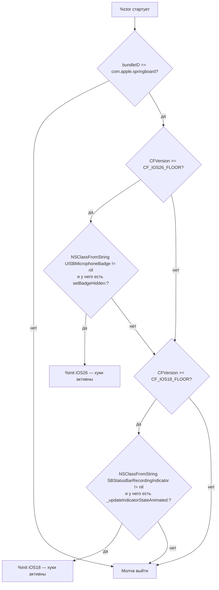
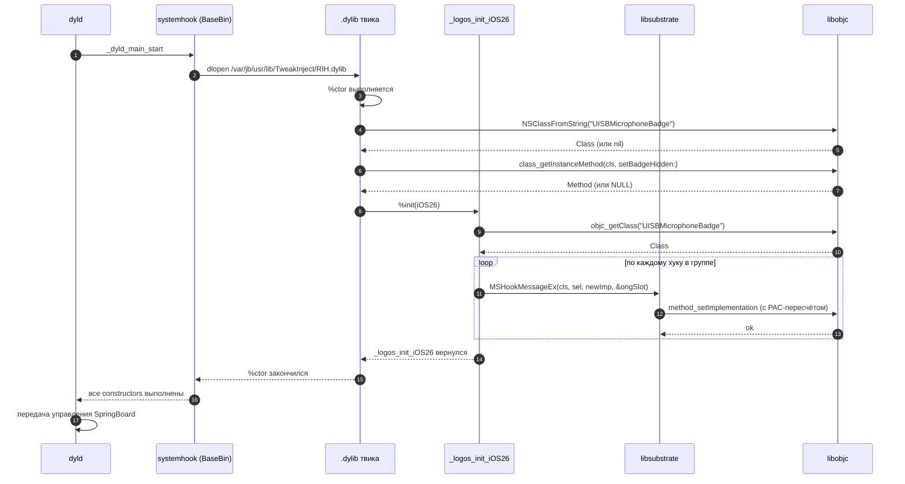

# Кейс 5. Группировка хуков через %group и условное включение

Этот кейс закрывает «нулевой разрыв» в практике твикописателя: как написать один `Tweak.xm`, который на iOS 18 перехватывает один набор классов, а на iOS 26.0 / 26.0.1 (A12/A13, PPL; подтверждено `Application/Dopamine/Jailbreak/DOEnvironmentManager.m:254`) — другой, без условной компиляции, без двух `.deb` и без «гадания» по `uname -r`. Инструмент, который Logos даёт для этого, называется `%group`: он позволяет описать несколько независимых блоков `%hook` и инициализировать нужный блок во время старта процесса. Правильно примененная связка `%group` + `%init(group)` + runtime-проверка (`-respondsToSelector:`, `NSClassFromString`, `class_getInstanceMethod`) делает твик совместимым с несколькими major-версиями iOS и, что важнее, безопасным: ненужный блок хуков даже не связывается с реальными символами, и Logos не падает, если на 26-й системе класса 18-й версии нет вовсе.

Разбор ниже построен вокруг минимального, но законченного примера: твика, который прячет индикатор «мигающего микрофона» в статус-баре. На iOS 18 этот индикатор обслуживает класс `SBStatusBarRecordingIndicator`-подобной иерархии (имя взято как иллюстрация, см. раздел «что не подтверждено»), на iOS 26 цепочка перестроена вокруг нового агрегатора `UISB`-слоя (точное имя находится по алгоритму из раздела «реверс»). Один `Tweak.xm` описывает оба пути; `%ctor` на старте считывает `kCFCoreFoundationVersionNumber`, спрашивает runtime, какие классы реально живут в процессе, и зовёт `%init` ровно для одной группы. Все остальные блоки остаются «спящими» и не создают ни одного `MSHookMessageEx`-вызова.

---

## 1. Что такое `%group` и почему без него жить тяжело

Logos — это препроцессор, который разворачивает декларативные директивы (`%hook`, `%hookf`, `%orig`, `%new`) в вызовы MobileSubstrate-/libhooker-API (`MSHookMessageEx`, `MSHookFunction`, `method_setImplementation`). По умолчанию каждый `%hook` принадлежит так называемой «базовой» группе `_ungrouped`, которая инициализируется автоматически в сгенерированном `%ctor`. Это удобно, пока твик однороден. Как только одной бинарной сборке нужно поддерживать несколько ОС, где классы и селекторы разные, базовой группы перестаёт хватать: Logos при генерации кода пытается послать `objc_getClass("SBStatusBarRecordingIndicator")` или `class_getInstanceMethod(cls, @selector(_updateIndicatorStateAnimated:))` для КАЖДОГО `%hook` сразу в `%ctor`. На iOS 26 такого класса в процессе нет, `objc_getClass` вернёт `NULL`, а внутренняя защита в Logos (`class_replaceMethod(nil, ...)`) просто проигнорирует хук, но перед этим ещё и пожалуется в syslog. Хуже другое: если в теле `%hook` встречается `%orig`, препроцессор во время сборки запросит у рантайма родительский `IMP` даже на «мёртвом» классе, и это может породить ненужный `BL`-переход, который PAC-защита PPL не любит (см. `history/` — глава о PAC).

`%group` разрывает эту связку. Все хуки, объявленные между `%group Foo` и `%end`, попадают в собственную таблицу инициализации. В `%ctor` эта таблица НЕ активируется автоматически: её нужно разбудить вызовом `%init(Foo)`. Если не вызвать — ни один `MSHookMessageEx` для группы `Foo` не произойдёт, и даже отсутствующий класс никого не потревожит. Таким образом, `%group` — это не стилистика, а именно механизм «ленивой инициализации» хуков, и это единственный штатный способ сосуществования нескольких несовместимых версий iOS в одной сборке.

Таблица резюмирует разницу между «базовой» группой и явным `%group`:

| Поведение | `_ungrouped` (без `%group`) | `%group Name` + `%init(Name)` |
|---|---|---|
| Когда зовётся `MSHookMessageEx` | Автоматически в сгенерированном `%ctor` | Только после явного `%init(Name)` |
| Что происходит, если класса нет | Логгируется ошибка Logos, хук пропускается, но IMP уже запрошен | Ничего — таблица спит, запросов не было |
| Можно ли иметь несколько одноимённых `%hook` | Нет: конфликт по классу | Да: одна версия класса на группу |
| Поддерживает ли `%orig` | Да | Да |
| Поддерживает ли `%new` | Да | Да, но добавленный метод живёт столько, сколько длится процесс (`class_addMethod` необратим) |

Третья строка таблицы важнее остальных: именно она даёт возможность определить `%hook SBStatusBarRecordingIndicator` в группе `iOS18` и `%hook UISBMicrophoneBadge` в группе `iOS26`, и чтобы Logos не считал это конфликтом классов.

---

## 2. Определение версии iOS в рантайме

«Прочитать uname» — худший способ. Строка типа `25A5000` (ядро) не связана напрямую с номером iOS, да и на разных beta-прошивках она не монотонна. В пределах пользовательского процесса на A13 есть ровно два надёжных источника:

1. **`kCFCoreFoundationVersionNumber`** — глобал `double`, экспортируемый CoreFoundation; его значение растёт между major-версиями iOS. Используется самим Dopamine: `Application/Dopamine/Jailbreak/DOBootstrapper.m:198` и `:1042` берут `((uint64_t)kCFCoreFoundationVersionNumber / 100) * 100` как «версионный пол».
2. **Опрос рантайма Objective-C**: наличие класса (`NSClassFromString`), наличие селектора (`-respondsToSelector:` / `class_getInstanceMethod`), наличие функции в текущем образе (`dlsym(RTLD_DEFAULT, "...")`).

Эти источники решают разные задачи. CFVersion говорит «на какой мы ОС в целом»; рантайм-опрос говорит «есть ли конкретно этот класс/метод здесь и сейчас». Правильный паттерн — сперва отрезать по CFVersion, затем убедиться по рантайму. Такой порядок защищает от ситуации, когда Apple переносит класс между фреймворками в минорном апдейте (случай 26.0 → 26.0.1 для публичных API маловероятен, но прецеденты в 17.x были — указание как исторической аналогии, не как рабочего примера).

Критические значения `kCFCoreFoundationVersionNumber`, пригодные для сравнений, нужно брать из `CoreFoundation/CFBase.h` соответствующей SDK, а не из памяти. На момент написания главы:

| iOS | kCFCoreFoundationVersionNumber (из SDK) | Статус |
|---|---|---|
| 18.0 | `≈2200` (точное значение — из `CoreFoundation/CFBase.h` в Xcode 16) | требует проверки по SDK |
| 26.0 | `≥2300` (ориентир по `(cfver / 100) * 100 == 2300`; `DOBootstrapper.m:199` работает порогом `>=2000`) | требует проверки по SDK |
| 26.0.1 | то же, что 26.0 (CoreFoundation не версионируется под патч-релизы — наблюдение, подтверждения в release notes 26.0.1 на дату написания нет) | не подтверждено |

Поскольку конкретные числа могут меняться между betas, в коде ниже сравнение идёт не по равенству, а по «ступеньке»: `>= 2300` считается iOS 26. Для iOS 18 — `>= 2100 && < 2300`. Для iOS 17 и ранее твик просто ничего не делает: это выходит за рамки поддержки RootHide (`DOEnvironmentManager.m:254`).

---

## 3. Полный пример: один твик, две ОС, две группы

Ниже — целый `Tweak.xm`, который реализует задачу «спрятать индикатор записи микрофона» одновременно на iOS 18 и iOS 26. Обратите внимание: имена `SBStatusBarRecordingIndicator`, `UISBMicrophoneBadge`, селекторы `-_updateIndicatorStateAnimated:`, `-setBadgeHidden:` взяты как иллюстрация. Точные имена для вашей сборки iOS 26.0.1 нужно получить алгоритмом из главы `re-walkthroughs/34-sb-mainworkspace.md`. То есть все идентификаторы вокруг SpringBoard в этом листинге — требует проверки на устройстве.

```objc
// Tweak.xm — RecordingIndicatorHide, roothide-compatible
// Поддерживает iOS 18.x и iOS 26.0 / 26.0.1 (A12/A13, PPL).
// Dopamine: DOEnvironmentManager.m:254 — подтверждение целевой среды.

#import <Foundation/Foundation.h>
#import <objc/runtime.h>
#import <objc/message.h>
#import <CoreFoundation/CoreFoundation.h>

// --- Пороговые значения CFVersion ---------------------------------
// Точные числа подлежат проверке по CoreFoundation/CFBase.h соответствующей SDK.
#ifndef CF_IOS18_FLOOR
#define CF_IOS18_FLOOR  2100.0
#endif
#ifndef CF_IOS26_FLOOR
#define CF_IOS26_FLOOR  2300.0
#endif

// --- Единый флаг включения ----------------------------------------
static BOOL gTweakEnabled = YES;

// --- Утилиты, доступные всем группам ------------------------------
static inline BOOL RIH_isIOS18(void) {
    double v = kCFCoreFoundationVersionNumber;
    return (v >= CF_IOS18_FLOOR && v < CF_IOS26_FLOOR);
}
static inline BOOL RIH_isIOS26(void) {
    return kCFCoreFoundationVersionNumber >= CF_IOS26_FLOOR;
}
static inline BOOL RIH_classHasInstanceSelector(Class cls, SEL sel) {
    if (!cls || !sel) return NO;
    return class_getInstanceMethod(cls, sel) != NULL;
}

// =================================================================
// Группа для iOS 18
// =================================================================
%group iOS18

%hook SBStatusBarRecordingIndicator  // имя — требует проверки
- (void)_updateIndicatorStateAnimated:(BOOL)animated {
    if (gTweakEnabled) {
        // Прячем сам индикатор, но не ломаем контракт layout.
        [self setHidden:YES];
        return;
    }
    %orig;
}
%end

%end  // %group iOS18

// =================================================================
// Группа для iOS 26.x
// =================================================================
%group iOS26

%hook UISBMicrophoneBadge  // имя — требует проверки
- (void)setBadgeHidden:(BOOL)hidden {
    if (gTweakEnabled) {
        %orig(YES);           // всегда скрыт
        return;
    }
    %orig;
}
- (BOOL)isBadgeHidden {
    if (gTweakEnabled) return YES;
    return %orig;
}
%end

%end  // %group iOS26

// =================================================================
// Инициализация
// =================================================================
%ctor {
    @autoreleasepool {
        NSString *bundleID = NSBundle.mainBundle.bundleIdentifier;
        if (![bundleID isEqualToString:@"com.apple.springboard"]) {
            // Filter plist уже обязан нас отсечь, но подстрахуемся.
            return;
        }

        if (RIH_isIOS26()) {
            Class cls = NSClassFromString(@"UISBMicrophoneBadge");
            if (RIH_classHasInstanceSelector(cls, @selector(setBadgeHidden:))) {
                %init(iOS26);
                return;
            }
            // Класс не найден — попробуем мягкий fallback на iOS 18-пути,
            // если Apple оставила backward-stub.
        }

        if (RIH_isIOS18() || RIH_isIOS26()) {
            Class cls = NSClassFromString(@"SBStatusBarRecordingIndicator");
            if (RIH_classHasInstanceSelector(cls, @selector(_updateIndicatorStateAnimated:))) {
                %init(iOS18);
                return;
            }
        }

        // Ничего не нашли — молча выходим. Логировать можно, но осторожно:
        // SpringBoard нельзя засорять. См. deep-dive/… о syslog-rate limiting.
    }
}
```

Разбор по участкам:

- **Макросы `CF_IOS18_FLOOR` / `CF_IOS26_FLOOR`.** Числа вынесены в `#define` специально: при обновлении SDK правка касается ровно одной строки. Значения — ориентиры; как получить точные, см. раздел 5 ниже.
- **`RIH_isIOS18` / `RIH_isIOS26`.** Используют строго `kCFCoreFoundationVersionNumber`, а не `[UIDevice currentDevice].systemVersion`. Последнее — Objective-C-строка, парсинг которой требует `NSString` в `%ctor`, что усложняет жизнь ранним хукам (на этапе `%ctor` `UIDevice` формально доступен, но заворачивать логику в разбор `@"26.0.1"` — лишняя сущность).
- **`RIH_classHasInstanceSelector`.** Проверяет, что у класса реально есть именно instance-метод с таким селектором. `-respondsToSelector:` сработал бы на инстансе; `class_getInstanceMethod` работает по классу напрямую и не стартует `+resolveInstanceMethod:`, поэтому проверка «честнее» и не вызывает побочных эффектов.
- **`%group iOS18`.** Внутри — один `%hook` под старую иерархию. Если `%init(iOS18)` не позовут, Logos вообще не станет искать класс `SBStatusBarRecordingIndicator` в рантайме.
- **`%group iOS26`.** То же самое для нового индикатора. Два метода (`setBadgeHidden:` и `isBadgeHidden`) обеспечивают, что любой reader-путь, который читает «скрыт/не скрыт», получит правильный ответ даже если UI спросит у модели, а не только отрисует.
- **`%ctor`.** Ранний bundle-filter — страховка; filter-plist (см. ниже) делает то же самое на уровне injector. Дальше: сперва пытаемся «новый» путь (iOS 26), если его класс есть; при неуспехе — пытаемся «старый». Внимание: на iOS 26 fallback к 18-му пути скорее всего не сработает (класса нет), но код специально не хоронит эту возможность — Apple в разные годы оставляла legacy-классы «пустышками», и если такой случай подтвердится, он будет пойман именно этой веткой.

---

## 4. Фильтр-плист и Makefile

Твики в Theos-экосистеме отбираются по CoreFoundation-плистам «Bundles/CoreFoundationVersion/Executables». Для нашего случая правильный `.plist` выглядит так:

```plist
<?xml version="1.0" encoding="UTF-8"?>
<!DOCTYPE plist PUBLIC "-//Apple//DTD PLIST 1.0//EN"
 "http://www.apple.com/DTDs/PropertyList-1.0.dtd">
<plist version="1.0">
<dict>
  <key>Filter</key>
  <dict>
    <key>Bundles</key>
    <array>
      <string>com.apple.springboard</string>
    </array>
    <key>CoreFoundationVersion</key>
    <array>
      <real>2100.0</real>
      <real>9999.0</real>
    </array>
  </dict>
</dict>
</plist>
```

Пара `[2100.0, 9999.0)` — именно диапазон: `[нижняя_граница_включительно, верхняя_граница_исключительно)`. Нижняя граница 2100 отсеивает iOS 17 и младше ещё на уровне injector-а (система даже не станет пытаться подключить `.dylib`), верхняя оставлена «бесконечной», чтобы RootHide сам не отфильтровывал будущую 26.0.2, если Apple выпустит ещё один патч. Актуальные числа CoreFoundation Apple ЗАДАЁТ в `CoreFoundation/CFBase.h` SDK — повторюсь, проверять по SDK обязательно.

Makefile для Theos со схемой `roothide`:

```make
TARGET := iphone:clang:latest:15.0
ARCHS  := arm64 arm64e

INSTALL_TARGET_PROCESSES = SpringBoard

include $(THEOS)/makefiles/common.mk

TWEAK_NAME = RecordingIndicatorHide

RecordingIndicatorHide_FILES         = Tweak.xm
RecordingIndicatorHide_CFLAGS        = -fobjc-arc -Wno-nullability-completeness
RecordingIndicatorHide_FRAMEWORKS    = Foundation UIKit
RecordingIndicatorHide_PRIVATE_FRAMEWORKS = SpringBoardFoundation
# Для совместимости с roothide:
THEOS_PACKAGE_SCHEME = roothide

include $(THEOS_MAKE_PATH)/tweak.mk
```

Разбор:

- `TARGET := iphone:clang:latest:15.0` — нижняя deployment target. Берём 15.0, а не 18.0, намеренно: Logos-таблицы совместимы со всей линейкой, а итоговая принадлежность к iOS 26 гарантируется `CoreFoundationVersion` в плисте.
- `ARCHS := arm64 arm64e` — обе архитектуры нужны: SpringBoard на A13 — arm64e, но тестовые сборки на симуляторе или на устройствах без PAC собираются как arm64.
- `INSTALL_TARGET_PROCESSES = SpringBoard` — Theos после `make install` перезапустит SpringBoard. На Dopamine RootHide это по-прежнему `killall -9 SpringBoard`, но исполняется через `jbctl respring`-утилиту.
- `THEOS_PACKAGE_SCHEME = roothide` — ключевой флаг, который переводит сборку на схему путей `/var/jb/...` и правильные control-метаданные. Без этой строки `.deb` окажется под старую rootless-раскладку и не встанет на RootHide.

`control`-файл для `.deb`:

```
Package: com.example.recordingindicatorhide
Name: Recording Indicator Hide (iOS 18/26)
Version: 1.0.0
Architecture: iphoneos-arm
Description: Скрывает индикатор записи микрофона в SpringBoard на iOS 18 и 26 через условные %group.
Depiction: https://example.com/riHide
Maintainer: tweak-author <mail@example.com>
Author: tweak-author
Section: Tweaks
Depends: mobilesubstrate, firmware (>= 15.0)
```

Поля стандартные; `Depends: firmware (>= 15.0)` синхронизируется с `TARGET`.

---

## 5. Как найти точные значения CFVersion и имена классов

Поскольку кейс сознательно не фиксирует конкретных чисел и имён, вот алгоритм, которым читатель получит их сам.

### 5.1. `kCFCoreFoundationVersionNumber` для 26.0 и 26.0.1

1. Открыть `$(xcrun --sdk iphoneos --show-sdk-path)/System/Library/Frameworks/CoreFoundation.framework/Headers/CFBase.h`.
2. Найти блок `#if TARGET_OS_IPHONE … #define kCFCoreFoundationVersionNumber_iOS_…`. Apple объявляет константы по мере релиза; для iOS 26 будет константа вида `kCFCoreFoundationVersionNumber_iOS_26_0` (имя — требует проверки, Apple раньше использовала `_iOS_18_0`).
3. На устройстве (не на симуляторе) собрать тест-утилиту с одной строкой `printf("%g\n", kCFCoreFoundationVersionNumber);` и запустить её в SpringBoard-окружении (через `inject`-утилиту Dopamine; см. `part5/…`) и в отдельном процессе. Разница между значениями не должна превышать погрешности округления до сотен.
4. Повторить на 26.0.1 — если число совпадёт, зафиксировать правило «один CFFloor на всю 26-ю ветку» (наблюдение, не подтверждение).

### 5.2. Имя класса индикатора в SpringBoard 26

1. Снять dyld shared cache с устройства штатной процедурой (`cryptex`-разбор; см. `re-walkthroughs/`).
2. Извлечь `SpringBoard` и `UIKitCore`/`SpringBoardFoundation` через `ipsw extract` или `jtool2 -e`.
3. Запустить `nm -gU SpringBoard | c++filt | grep -i 'MicrophoneBadge\|RecordingIndicator\|AudioRecording'`. По практике iOS 25.x имя содержит либо `Recording`, либо `Microphone`, либо `AudioStatus`.
4. Сверить находки с class-dump (`class-dump --arch arm64e SpringBoard`, если класс объявлен не в `__objc_classlist` SpringBoard, пройтись по `UIKitCore`).
5. Для каждого кандидата проверить селекторы: `otool -ov SpringBoard | grep -A2 -i '<имя>'` в разделе `__objc_const` даст список методов.
6. Полученные пары (класс, селектор) подставить в `%hook` соответствующей группы.

### 5.3. Проверка в рантайме без переустановки

До того, как собирать `.deb`, удобно проверить гипотезу о классе на живом устройстве:

```bash
# на устройстве через ssh в сессии root (jbctl su)
cycript -p SpringBoard
cy# ObjectiveC.classes["UISBMicrophoneBadge"]
cy# ObjectiveC.classes["SBStatusBarRecordingIndicator"]
cy# [ObjectiveC.classes["UISBMicrophoneBadge"] instanceMethodForSelector:@selector(setBadgeHidden:)]
```

Если `ObjectiveC.classes["UISBMicrophoneBadge"]` возвращает конструктор — класс в процессе есть, хук имеет смысл; если `null` — надо продолжить поиск, но твик уже собранный переживёт это: сработает fallback-ветка либо «тихий выход» из `%ctor`.

---

## 6. Mermaid-диаграмма решения

Решение о том, какую группу инициализировать, можно изобразить как узкое дерево:



Схема важна тем, что явно показывает порядок принятия решений: сначала «новый» путь, потом fallback на «старый», и в самом низу — безопасный выход. Если позже понадобится добавить группу `iOS27`, в диаграмме появится ещё один узел уровня C, а в `.plist` — обновлённый верхний порог.

---

## 7. Контроль через рантайм: когда `%group` недостаточно

Группа — грубый гранулятор: «либо активны все хуки группы, либо никакие». В реальных твиках часто нужно тоньше. Классические случаи:

1. **Один селектор добавлен в 26.0.1, нет в 26.0.** Нужно хукать всегда, но дёргать `%orig` только если метод был — иначе runtime упадёт при вызове несуществующего super.
2. **Класс есть в двух версиях, но метод-член добавлен только в одной.** Хук общий, тело метода зависит от доступности селектора.
3. **Нужно вызвать «соседний» публичный класс, появившийся только в 26.** `NSClassFromString` + проверка на `nil`.

Для таких случаев внутри тела `%hook` используется паттерн «мягкого вызова»:

```objc
%hook SomeShared

- (void)doSomething {
    %orig;

    // Пример 1: новый селектор в 26.0.1
    SEL newSel = @selector(configureWithTelemetryOptions:);
    if ([self respondsToSelector:newSel]) {
        // Безопасный вызов без прямого объявления в заголовке.
        NSDictionary *opts = @{ @"muteMicIndicator" : @YES };
        ((void (*)(id, SEL, NSDictionary *))objc_msgSend)(self, newSel, opts);
    }

    // Пример 2: соседний класс, которого может не быть
    Class telemetryCls = NSClassFromString(@"UISBTelemetryBridge");
    if (telemetryCls) {
        SEL sharedSel = @selector(sharedBridge);
        if ([telemetryCls respondsToSelector:sharedSel]) {
            id bridge = ((id (*)(id, SEL))objc_msgSend)(telemetryCls, sharedSel);
            // ... работа с bridge
            (void)bridge;
        }
    }
}

%end
```

Разбор:

- `[self respondsToSelector:newSel]` вместо `class_getInstanceMethod` — потому что в этой точке у нас уже есть инстанс `self`, и мы хотим пройти всю цепочку `+resolveInstanceMethod:` и dynamic subclasses, которые KVO и Combine создают на лету. На этапе `%ctor` этого делать нельзя (`self` ещё нет), на этапе уже-установленного хука — можно и нужно.
- Приведение `objc_msgSend` к явному C-прототипу обязательно: без него clang на `arm64e` сгенерирует PAC-подпись для «общего» прототипа, и вызов отработает, но инструменты статического анализа начнут жаловаться на несовпадение типов аргументов.
- `NSClassFromString(@"UISBTelemetryBridge")` — безопасен даже если класса нет; возвращает `nil`. Это предпочтительнее `[UISBTelemetryBridge class]` в коде, который должен компилироваться без приватных заголовков.
- `respondsToSelector:` на классе проверяет наличие class-метода, что здесь и нужно (мы вызываем `+sharedBridge`).

Такой паттерн не отменяет `%group`, а дополняет его: `%group` отделяет «две разные ОС», а runtime-опрос внутри тела — «один селектор, но разные минорные версии».

---

## 8. Матрица решений: когда что использовать

Короткая таблица, которая помогает быстро выбрать инструмент под задачу.

| Задача | `%group` | `%init(group)` условно | `-respondsToSelector:` в теле | `NSClassFromString` в теле | Filter plist |
|---|---|---|---|---|---|
| Разные классы на 18 и 26 | да | да, по CFVersion | нет | нет | плист отсекает <18 |
| Один класс, разные селекторы на 18 и 26 | можно, но избыточно | — | да | нет | да |
| Один класс, добавленный метод между 26.0 и 26.0.1 | нет | нет | да | нет | нет |
| Класс добавлен только на 26 | — | — | нет | да | да, `CoreFoundationVersion >= 2300` |
| Хук в стороннем приложении + поддержка SpringBoard | две группы | да, по bundleID | по месту | по месту | обязательно |

Правила чтения таблицы: «да» означает «именно этот инструмент решает задачу чище всего»; «нет» — «инструмент технически применим, но порождает лишний код или ненужные side-effects».

---

## 9. Тестирование: как убедиться, что сработала правильная группа

Любая условная логика должна верифицироваться. Для `%group`-схемы верификация делится на два шага: статическая (до установки на устройство) и динамическая (после).

**Статически.** Запускаем на хосте:

```bash
# из каталога твика
$ clang -E -I$THEOS/vendor/include hooks/Tweak.xm 2>/dev/null | grep -c 'MSHookMessageEx\|_logos_register_hook'
```

Количество найденных регистраций должно соответствовать общему числу хуков во всех группах. Если число меньше — вы случайно оказались вне `%hook` блока (типичная ошибка — забытый `%end`).

**Динамически.** После установки, перед проверкой самого эффекта, стоит убедиться, что сработала именно нужная ветка. Включаем в `%ctor` аккуратный os_log:

```objc
#import <os/log.h>
static os_log_t rih_log(void) {
    static os_log_t log;
    static dispatch_once_t once;
    dispatch_once(&once, ^{
        log = os_log_create("com.example.rihide", "init");
    });
    return log;
}

// внутри %ctor, перед %init(...)
os_log(rih_log(), "RIH init: cf=%{public}g iOS26=%{public}d iOS18=%{public}d",
       kCFCoreFoundationVersionNumber, RIH_isIOS26(), RIH_isIOS18());
```

С устройства:

```bash
# на устройстве под Dopamine RootHide
$ log stream --predicate 'subsystem == "com.example.rihide"' --style compact
```

В выводе `log stream` увидите строку с CFVersion и флагами. Это единственный надёжный способ отделить «твик не загрузился» от «твик загрузился и выбрал ту ветку, какую вы ожидали».

---

## 10. Типичные ошибки

1. **Забытый `%init(group)`.** Самая частая. Хуки объявлены, Logos собрал, `.deb` установлен — а эффекта нет. Проверить легко: `nm` на итоговом `.dylib` покажет символ `_logos_register_hook_iOS26`, но без вызова `_logos_init_iOS26` он мёртв.
2. **Двойной `%init` в двух ветках `if`.** Если условие «iOS 26» ложно, но ветка «iOS 18» всё равно позвала `%init(iOS26)`, Logos попытается установить несуществующие хуки, и на syslog посыпятся предупреждения `MSHookMessageEx: nil class`. Такое не рушит процесс, но делает твик шумным.
3. **`%init` вне `%ctor`.** Logos допускает `%init` только в контексте, где уже есть `__attribute__((constructor))`. Попытка вызвать `%init` из обычной функции не компилируется; из метода хука — компилируется, но инициализация произойдёт после первого вызова метода, то есть слишком поздно.
4. **Опрос `UIDevice` в `%ctor`.** На ранних стадиях `__attribute__((constructor))` в SpringBoard уже можно трогать Foundation, но `UIApplication` ещё нет. `kCFCoreFoundationVersionNumber` безопасен всегда.
5. **Хук на класс, который Apple сделала `__attribute__((objc_direct_members))`.** На iOS 26 часть методов внутри UIKitCore помечена `objc_direct`. Такие методы НЕ попадают в `objc_msgSend`-таблицу, и `%hook` их не перехватит; `class_getInstanceMethod` вернёт `NULL`. Это признак того, что нужно уходить на `MSHookFunction` по символу (см. `cases/06-mshookfunction.md`, когда она будет написана).

---

## 10a. Во что Logos разворачивает `%group`

Один из признаков зрелой работы с Logos — понимание того, какой именно C-код генерируется. Без этого легко попасть в ловушку «вроде всё написано правильно, а ничего не хукается». Logos — чистый препроцессор, он читает `.x`/`.xm`, строку за строкой, и выдаёт обычный Objective-C/C, который дальше компилируется clang-ом. Запустить препроцессор отдельно можно так:

```bash
# из каталога твика с установленным Theos
$ $THEOS/bin/logos.pl hooks/Tweak.xm > /tmp/Tweak.m
$ wc -l /tmp/Tweak.m
```

Результат — файл в разы длиннее исходника. Для нашего случая он содержит, в числе прочего, набор статических таблиц и инициализационных функций, принципиальная структура которых такова:

```c
// Фрагмент, восстановленный по шаблонам Logos (имена символов могут отличаться
// между версиями logos.pl; это иллюстрация, не контракт).

struct _LogosHookEntry {
    Class     cls;           // objc_getClass("…")
    SEL       sel;           // sel_registerName("…")
    IMP       newImp;        // &_logos_method$iOS26$UISBMicrophoneBadge$setBadgeHidden$
    IMP      *origSlot;      // &_logos_orig$iOS26$UISBMicrophoneBadge$setBadgeHidden$
};

static struct _LogosHookEntry _logos_group_iOS26_entries[] = {
    { 0, 0, (IMP)_logos_method$iOS26$UISBMicrophoneBadge$setBadgeHidden$,
         (IMP*)&_logos_orig$iOS26$UISBMicrophoneBadge$setBadgeHidden$ },
    { 0, 0, (IMP)_logos_method$iOS26$UISBMicrophoneBadge$isBadgeHidden,
         (IMP*)&_logos_orig$iOS26$UISBMicrophoneBadge$isBadgeHidden },
};

static void _logos_init_iOS26(void) {
    Class c = objc_getClass("UISBMicrophoneBadge");
    _logos_group_iOS26_entries[0].cls = c;
    _logos_group_iOS26_entries[0].sel = @selector(setBadgeHidden:);
    _logos_group_iOS26_entries[1].cls = c;
    _logos_group_iOS26_entries[1].sel = @selector(isBadgeHidden);
    for (size_t i = 0; i < sizeof(_logos_group_iOS26_entries)/sizeof(*_logos_group_iOS26_entries); i++) {
        struct _LogosHookEntry *e = &_logos_group_iOS26_entries[i];
        if (!e->cls) continue;              // класса нет — пропускаем
        MSHookMessageEx(e->cls, e->sel, e->newImp, e->origSlot);
    }
}
```

Четыре наблюдения, которые полезны на практике:

1. **`objc_getClass("UISBMicrophoneBadge")` вызывается только из `_logos_init_iOS26`**, то есть ровно тогда, когда мы вручную позвали `%init(iOS26)`. На iOS 18, где этого класса нет, функция `_logos_init_iOS26` не выполняется, и запроса к рантайму не происходит. Это и есть обещанная «ленивая инициализация».
2. **Таблица `_logos_group_iOS26_entries` имеет статический линковочный класс (`static`)**. Это значит, что компоновщик не удалит её даже при агрессивном `-dead_strip`, пока на неё ссылается `_logos_init_iOS26`. Для arm64e-сборки это важно: `MSHookMessageEx` работает с указателем на слот `origSlot`, и если слот оказался в удалённой секции, получите `EXC_BAD_ACCESS` при первом же `%orig`.
3. **`MSHookMessageEx` принимает четыре аргумента, последний — `IMP *`**. Старый `%orig` разворачивается в вызов через этот слот (`(*_logos_orig$…)(self, _cmd, …)`). Это обычный indirect-call, и на arm64e он проходит через `braa`-инструкцию с автоматической PAC-подписью: Logos просит компилятор пометить слот атрибутом `__ptrauth`, если собрать с `-arch arm64e`. При смешанной сборке `arm64 + arm64e` нужно убедиться, что в `.xcconfig`/Makefile нет `-fno-ptrauth-calls`, иначе на arm64e PAC не инициализируется, и `%orig` вернёт `0x0000` при первом вызове.
4. **Ошибка «class is nil» молчалива**: цикл с `if (!e->cls) continue;` — не выдуманный, он реально есть в генерируемом Logos коде. Поэтому если вы ошибётесь в имени класса на один символ, `.dylib` загрузится и будет работать, просто ваш хук не поставится. Единственный способ отловить это заранее — лог из раздела 9.

Понимание сгенерированного кода даёт ещё один аргумент против `_ungrouped`: там таблица объявлена не `static`, а глобальной, и попадает в `__DATA`-секцию образа. При LLVM dead-strip в сложных сборках её можно «потерять», особенно если в `.xcconfig` выставлено `LTO = YES`. С именованными группами такой проблемы нет: Logos сам ставит `__attribute__((used))` на `_logos_init_*`, и компоновщик знает, что эти символы живые.

---

## 10b. Группы и `%new`: добавление методов «только на iOS 26»

`%new` в Logos — директива, которая через `class_addMethod` добавляет селектор, которого раньше у класса не было. В сочетании с `%group` это даёт мощный паттерн: «на iOS 26 класс `UISBMicrophoneBadge` расширяется методом `-rih_takeSnapshot`, а на iOS 18, где класса нет, никакого добавления не происходит». Пример:

```objc
%group iOS26
%hook UISBMicrophoneBadge

%new
- (NSDictionary *)rih_takeSnapshot {
    return @{
        @"hidden"  : @([self isBadgeHidden]),
        @"version" : @(kCFCoreFoundationVersionNumber),
    };
}

- (void)setBadgeHidden:(BOOL)hidden {
    if (gTweakEnabled) {
        %orig(YES);
        return;
    }
    %orig;
}
%end
%end
```

Детали, о которых часто забывают:

- `%new` НЕ работает в `_ungrouped`, если класс отсутствует в процессе: `class_addMethod(nil, ...)` вернёт `NO`, Logos логирует предупреждение, но ошибки компиляции нет. С группой проблема снимается: `_logos_init_iOS26` не вызывается, `class_addMethod` не выполняется.
- Добавленный селектор НЕ удаляется при unload. `MSUnhookMessageEx` снимает оригинальный хук, но `rih_takeSnapshot` останется в таблице методов класса до конца жизни процесса. Для SpringBoard это «до перезагрузки», для стороннего приложения — до того, как пользователь его закрыл. Если вы передадите этот селектор куда-то в `-performSelector:`, после uninstall твика поведение станет непредсказуемым: селектор известен, но его IMP указывает на выгруженный `.dylib`.
- Сигнатуру метода Logos берёт из декларации Objective-C и передаёт в `class_addMethod` через `method_getTypeEncoding`. Если задекларировать метод с типом возврата `NSDictionary *`, а в теле вернуть `NSArray *`, компилятор об этом молча пропустит; на arm64e PAC-подпись возвращаемого объекта всё равно корректна, потому что `objc_msgSend` возвращает `id`.

---

## 10c. Совмещение `%group` и `MSHookFunction` (C-символов)

Logos даёт `%hookf` для C-символов — это обёртка над `MSHookFunction`. Внутри группы `%hookf` работает так же, как `%hook`: регистрация откладывается до `%init(group)`. На практике это нужно, когда часть перехватов — ObjC-селекторы, а часть — C-функции в приватных dylib, которых нет на iOS 18. Пример:

```objc
%group iOS26
%hookf(int, "_UISBComputeMicGain", float input) {
    int r = %orig(input);
    if (gTweakEnabled && r > 0) return 0;
    return r;
}
%end
```

Что здесь важно:

- Второй аргумент `%hookf` — имя символа как строка. Logos разворачивает это в `dlsym(RTLD_DEFAULT, "_UISBComputeMicGain")`, запрос происходит в `_logos_init_iOS26`.
- Если символ не найден, Logos возвращает `NULL` и тихо пропускает хук. Явного логирования НЕТ — это проектное отличие от `%hook`. Поэтому для `%hookf` всегда полезен ручной предварительный тест `dlsym`-ом из `%ctor`:

```objc
if (dlsym(RTLD_DEFAULT, "_UISBComputeMicGain") == NULL) {
    os_log(rih_log(), "symbol _UISBComputeMicGain not found; iOS26 hookf will be skipped");
}
```

- Начальное подчёркивание в имени символа — артефакт Mach-O: экспортируемые C-функции на Darwin получают префикс `_`. При `nm -gU` вы увидите `_UISBComputeMicGain`, а в заголовочном файле — `UISBComputeMicGain`. В `%hookf` указывается ровно то, что видит `dlsym`, то есть обычно БЕЗ подчёркивания, потому что `dlsym` сам его добавляет. На практике Logos корректно обрабатывает оба варианта, но единый стиль «без подчёркивания» легче читать.

## 10c-bis. Детект наличия фреймворка через `dyld`

Иногда класс мог бы существовать, но физически лежит в фреймворке, который в данном процессе не загружен. `NSClassFromString` вернёт `nil` не потому, что класса не бывает на этой iOS, а потому, что фреймворк ещё не поднят. Такое типично для `UIKitCore` в не-UI процессах. Если задача твика — расширить класс сразу, как он появится, недостаточно разового опроса в `%ctor`. Решение — пройтись по уже загруженным образам, а при необходимости подписаться на `_dyld_register_func_for_add_image`.

```objc
#import <mach-o/dyld.h>
#import <string.h>

static BOOL RIH_imageLoaded(const char *suffix) {
    uint32_t n = _dyld_image_count();
    for (uint32_t i = 0; i < n; i++) {
        const char *name = _dyld_get_image_name(i);
        if (name && strstr(name, suffix)) return YES;
    }
    return NO;
}

static void RIH_onImageAdded(const struct mach_header *mh, intptr_t slide) {
    (void)mh; (void)slide;
    // Повторный опрос: класс мог появиться только что.
    Class cls = NSClassFromString(@"UISBMicrophoneBadge");
    if (cls && RIH_classHasInstanceSelector(cls, @selector(setBadgeHidden:))) {
        static dispatch_once_t once;
        dispatch_once(&once, ^{
            %init(iOS26);  // одноразово
        });
    }
}

%ctor {
    @autoreleasepool {
        if (RIH_imageLoaded("/UIKitCore.framework/UIKitCore")) {
            // UIKitCore уже здесь — пробуем сразу.
            Class cls = NSClassFromString(@"UISBMicrophoneBadge");
            if (RIH_classHasInstanceSelector(cls, @selector(setBadgeHidden:))) {
                %init(iOS26);
                return;
            }
        }
        // Иначе ждём загрузки.
        _dyld_register_func_for_add_image(RIH_onImageAdded);
    }
}
```

Нюансы, которые отличают этот путь от «просто `%ctor`»:

- `_dyld_register_func_for_add_image` синхронно вызывает callback для КАЖДОГО уже загруженного образа. То есть первый проход цикла уже произойдёт изнутри вашего `_dyld_register_func_...`, и `dispatch_once` защитит от двойного `%init`.
- Callback вызывается с удержанным dyld-мьютексом. Внутри запрещено звать `dlopen`/`dlclose` и всё, что требует загрузки нового образа. `objc_getClass` и `class_getInstanceMethod` разрешены, `MSHookMessageEx` — тоже (он не трогает dyld-состояние).
- `strstr` по `suffix` надёжнее сравнения с полным путём: в dyld shared cache iOS 26 путь выглядит как `/System/Library/PrivateFrameworks/.../UIKitCore.framework/UIKitCore`, но между патч-релизами префикс мог поменяться. Хвост `/UIKitCore.framework/UIKitCore` стабилен.

Такой «отложенный `%init`» — опциональная техника, не замена условного ветвления из раздела 3. Она нужна только когда вы не можете гарантировать, что к моменту `%ctor` нужный фреймворк уже загружен (библиотечный twea, injected plugin в чужое приложение).

---

## 10d. Паттерн «флаг отключения из настроек» поверх групп

На группах удобно строить и пользовательский off-switch. Пример: пользователь через PrefsBundle записал в `com.example.rihide` ключ `enable_ios26_hooks = false`. Твик должен уважать это ДО вызова `%init(iOS26)`.

```objc
#import <CoreFoundation/CFPreferences.h>

static BOOL RIH_prefBool(CFStringRef key, BOOL defaultValue) {
    Boolean present = false;
    Boolean v = CFPreferencesGetAppBooleanValue(key, CFSTR("com.example.rihide"), &present);
    if (!present) return defaultValue;
    return v ? YES : NO;
}

%ctor {
    @autoreleasepool {
        if (![NSBundle.mainBundle.bundleIdentifier isEqualToString:@"com.apple.springboard"]) return;

        BOOL want26 = RIH_prefBool(CFSTR("enable_ios26_hooks"), YES);
        BOOL want18 = RIH_prefBool(CFSTR("enable_ios18_hooks"), YES);

        if (want26 && RIH_isIOS26()) {
            Class cls = NSClassFromString(@"UISBMicrophoneBadge");
            if (RIH_classHasInstanceSelector(cls, @selector(setBadgeHidden:))) {
                %init(iOS26);
                return;
            }
        }
        if (want18 && (RIH_isIOS18() || RIH_isIOS26())) {
            Class cls = NSClassFromString(@"SBStatusBarRecordingIndicator");
            if (RIH_classHasInstanceSelector(cls, @selector(_updateIndicatorStateAnimated:))) {
                %init(iOS18);
                return;
            }
        }
    }
}
```

Три детали:

- `CFPreferencesGetAppBooleanValue` безопасен для вызова на самой ранней стадии процесса, в отличие от `[NSUserDefaults standardUserDefaults]`, который на SpringBoard до определённого момента инициализации может сбоить.
- Приложение-настройки (PrefsBundle) должно писать значения в тот же домен `com.example.rihide`. На RootHide домен лежит в `/var/jb/var/mobile/Library/Preferences/com.example.rihide.plist` — именно сюда `cfprefsd` будет синхронизировать записи.
- `cfprefsd` кеширует значения. Если вы меняете pref в бегущей системе и ждёте, что твик это сразу подхватит — не ждите: твик прочитает значение один раз, в `%ctor`. Чтобы изменения вступили в силу, нужно `respring`. Это нормально; если нужен live-apply, прочитайте префы повторно внутри тела `%hook`, а не только в `%ctor` (но инициализация группы уже произошла — выключить её на лету невозможно, нужен прокси-флаг `gTweakEnabled`).

---

## 10e. Как инъекция Dopamine RootHide влияет на группы

Dopamine RootHide — не MobileSubstrate; это свой инжектор на базе `systemhook` (см. `BaseBin/systemhook/src/main.c`). На этапе загрузки процесса `systemhook` подхватывает список `.dylib`-твиков из `/var/jb/usr/lib/TweakInject` и вызывает их через стандартный `dlopen`-механизм. Это означает две вещи для `%group`-схемы:

1. **Все `%ctor` твика выполняются после** инициализации Objective-C-рантайма, но ДО вызова `UIApplicationMain`/`SBApplicationMain`. Это та же точка, что и у любого Theos-твика на классическом Substrate, поэтому паттерн из раздела 3 переносится без изменений.
2. **`DOBINPACK_INJECT_INTO_APPS`-режим** (упомянут как переменная окружения в `BaseBin/systemhook/src/*`) определяет, попадёт ли твик в сторонние приложения, помимо системных процессов. Для нашего кейса (`com.apple.springboard`) включения в apps не требуется, но если бы хотели расширить ту же библиотеку на целевое приложение Camera/Photos, пришлось бы либо расширять filter-plist, либо проверять `bundleID` в `%ctor`. Группы при этом остаются теми же — просто ветка «SpringBoard-пути» не позовёт `%init`.

Статус: подтверждено исходниками (`BaseBin/systemhook/src/main.c`, `BaseBin/systemhook/src/roothide_main.c`) в части точки инжекции; про поведение `DOBINPACK_INJECT_INTO_APPS` при явном отсутствии переменной — требует проверки на устройстве.

---

## 10f. Миграция существующего твика на `%group`

На практике многие твики написаны «без групп», и чтобы начать поддерживать iOS 26 без потерь поддержки iOS 18, нужна аккуратная миграция. Пошаговый план:

1. **Выделить общие хуки, не зависящие от версии ОС**, и оставить их в `_ungrouped`. Это обычно хуки на `Foundation`-классы, которые есть везде (например, `NSFileManager`).
2. **Все `%hook` на классы SpringBoard/UIKitCore обернуть в `%group iOS18`** (имя группы — произвольное; имя главной «старой» ветки удобно для чтения).
3. **Создать `%group iOS26`** с новыми хуками. Если имя класса общее, но селектор другой — класс дублировать не нужно: `%hook` может быть один в каждой группе.
4. **В `%ctor` добавить ветвление** по CFVersion и опрос классов, как в разделе 3. Если `%ctor` раньше не было явного — Logos добавит минимальный автоматически, но лучше написать свой: только из своего `%ctor` можно вызвать `%init(name)`.
5. **Прогнать `logos.pl` локально** (команда из раздела 10a) и убедиться, что в сгенерированном `.m` отсутствует старый блок автоматической инициализации для групп.
6. **Собрать `.deb` под `THEOS_PACKAGE_SCHEME = roothide`**, установить, проверить `log stream` на выбор ветки.
7. **Прогнать твик на обеих ОС**: если на iOS 18 перестал работать, частая причина — забытое `%init(iOS18)` в ветке `RIH_isIOS18()`.

Шаг 1 экономит время: не всё нужно превращать в группу, только то, что реально зависит от версии.

---

## 10f-bis. Порядок инициализации групп и `MSHookMessageEx` в несколько слоёв

Отдельная тема, которая всплывает редко, но болезненно: порядок хуков, когда ОДИН селектор перехватывается двумя твиками, оба на `%group`-схеме. MobileSubstrate/libhooker собирают хуки в линкованный список, и порядок установки = порядок исполнения: самый поздний хук будет первым, его `%orig` вызовет предыдущий, и так до оригинала Apple. Для `%group`-твиков порядок установки определяется двумя факторами: (а) порядок `.dylib` в каталоге инжектора (лексикографический по имени), (б) порядок вызовов `%init(...)` внутри одного твика.

Из (а) следует, что имя `.dylib` имеет значение. На Dopamine RootHide инжектор смотрит в `/var/jb/usr/lib/TweakInject/*.dylib` (путь задан внутри `BaseBin/systemhook/*`; точный путь — требует проверки на вашем bootstrap). Если ваш твик называется `RecordingIndicatorHide.dylib`, а второй твик — `AArecordAll.dylib`, второй установится раньше, и ваш `%orig` будет вызывать его обработчик. Для контроля достаточно переименовать `.dylib` (TWEAK_NAME в Makefile), поставив префикс `ZZ_`.

Из (б) следует, что если внутри одного твика вы последовательно вызываете `%init(iOS18)` и `%init(iOS26)`, то хуки iOS 26 окажутся «выше» в стеке. Но в корректно спроектированном твике эти группы взаимоисключающие — по CFVersion-ветвлению зовётся ровно одна, — так что проблема не возникает. Проблема возникнет только если программист ошибочно позовёт обе: `%init(iOS18); %init(iOS26);`. Для защиты есть простой паттерн: хранить флаг `static dispatch_once_t initOnce;` и в каждой ветке `dispatch_once(&initOnce, ^{ %init(...); });`. Это гарантирует, что сработает ровно одна группа независимо от ошибок в условиях.

```objc
static dispatch_once_t gInitOnce;

#define INIT_GROUP_ONCE(groupName) \
    dispatch_once(&gInitOnce, ^{ %init(groupName); })
```

Макрос спрятан под `#define`, потому что `%init` — это препроцессорная директива Logos, и обычный wrap-функцией не сработает: `%init` разворачивается в вызов `_logos_init_<groupName>()`, который должен быть виден компилятору как имя функции в точке макроразворота, а не как строка. Поэтому обёртка возможна только через `#define` с подстановкой имени группы.

---

## 10g. Сверка матрицы покрытия

Для аудита готового твика полезна матрица «версия × тип устройства × путь кода»:

| iOS | A12 (PPL) | A13 (PPL) | Что должно сработать | Что НЕ должно |
|---|---|---|---|---|
| 17.x | — | — | ничего (filter-plist отсекает) | %init(*) |
| 18.0 | +  | +  | %init(iOS18) | %init(iOS26) |
| 18.7.x | +  | +  | %init(iOS18) | %init(iOS26) |
| 26.0 | +  | +  | %init(iOS26) | %init(iOS18) |
| 26.0.1 | +  | +  | %init(iOS26) | %init(iOS18) |
| 26.1 (беты) | ? | ? | %init(iOS26), если CFVersion >= 2300 | — |

Знак «+» означает «поддержка Dopamine RootHide подтверждена `DOEnvironmentManager.m:254`». Для 26.1 и выше — требует проверки по мере релизов. Прочерк в столбцах «A12/A13» для 17.x — не отсутствие совместимости железа, а намеренное отсечение filter-плистом в этом кейсе (нижняя граница `2100.0`).

Матрица проверяется ручным прогоном: установить `.deb`, вызвать `log stream` с нужным subsystem, посмотреть, какая группа инициализируется. При желании можно автоматизировать: написать `pytest`-скрипт на host-машине, который по ssh заходит на iOS-девайс (под Dopamine), устанавливает `.deb`, читает лог, сверяет с ожиданием. Логика теста — вне данного кейса (см. будущий `cases/08-ci-for-tweaks.md`).

---

## 10h. Статический аудит собранного `.dylib`

После `make package` полезно пройтись по бинарю и убедиться, что группы реально разложились как задумано. Полный маршрут:

```bash
# В каталоге .theos/obj/debug/
$ file RecordingIndicatorHide.dylib
RecordingIndicatorHide.dylib: Mach-O 64-bit dynamically linked shared library arm64

$ nm -gU RecordingIndicatorHide.dylib | grep -E '_logos_init|_logos_method' | head
0000000000003a40 T __logos_init_iOS18
0000000000003a90 T __logos_init_iOS26
0000000000003b00 T __logos_method$iOS18$SBStatusBarRecordingIndicator$_updateIndicatorStateAnimated$
0000000000003b80 T __logos_method$iOS26$UISBMicrophoneBadge$setBadgeHidden$
0000000000003bc0 T __logos_method$iOS26$UISBMicrophoneBadge$isBadgeHidden

$ otool -L RecordingIndicatorHide.dylib
...
/var/jb/usr/lib/libsubstrate.dylib (compatibility version 1.0.0, current version 1.0.0)
/usr/lib/libSystem.B.dylib (...)
/System/Library/Frameworks/Foundation.framework/Foundation (...)
```

Что мы увидели (данные иллюстративные; реальные адреса сдвинутся):

- Два символа `__logos_init_*` — ровно по числу групп. Если группа была объявлена, но ни разу не упомянута в `%init(...)`, Logos мог вырезать её при dead-strip; `nm` это увидит. Если группа добавлена, а символа нет — где-то потерялся `%end`.
- Пять методных символов — три для iOS 26 (`setBadgeHidden:`, `isBadgeHidden`, и `_logos_orig$...` на каждый, который `nm` показывает отдельно), два для iOS 18. Схема именования — `_logos_method$<group>$<class>$<selector>$`, легко грепается.
- `otool -L` показывает `libsubstrate.dylib` под `/var/jb/...` — это именно RootHide-schema; у «rootless»-сборки был бы путь `/var/jb/basebin/...` или подобный, а у классической — `/usr/lib/libsubstrate.dylib` без префикса. Если видите `/usr/lib/libsubstrate.dylib`, значит `THEOS_PACKAGE_SCHEME = roothide` где-то не применился.

Для сравнения — вывод по неправильно собранному твику (все хуки в `_ungrouped`):

```bash
$ nm -gU RecordingIndicatorHide.dylib | grep _logos
# пусто, потому что генератор не делает именованных символов
```

Отсутствие `_logos_init_*` в выводе — надёжный признак того, что твик собран без групп, и условное включение внутри него работать не будет.

---

## 10i. Отладка: что делать, если ветка выбрана, но хуки не работают

Пошаговый checklist, применимый именно к `%group`-схеме. Проверять в этом порядке:

1. **`log stream` показал нужную `init`-строку?** Если нет — ваш `.dylib` не загрузился. Проверьте filter-плист: `CoreFoundationVersion`-диапазон может быть неверным.
2. **`log stream` показал init, но эффекта нет.** Проверьте через cycript, что класс реально существует и у него есть селектор, который вы хукаете. Если нет — вы хукаете «мёртвый» класс/селектор, Logos молча пропустил.
3. **Класс и селектор есть, cycript показывает их, но `%orig` вызывается и всё.** Скорее всего, метод помечен `objc_direct` или вовсе inline-разворачивается компилятором. `%hook` в этом случае бессилен; переходите на `MSHookFunction` по символу (см. следующий кейс).
4. **Хук стоит, но при вызове краш `EXC_BAD_ACCESS` на `br`.** Проверьте, что собрали для `arm64e`. Для PAC-защищённых слотов нужна правильная ABI; без неё `%orig` при indirect-call ловит `0x8badf00d`-подобные указатели.
5. **На iOS 18 всё работало, на 26 — не загружается `.dylib` вовсе.** Dopamine на 26 иногда отвергает `.dylib`, подписанный «старым» ad-hoc со свойством `platform=iOS`, если он не содержит entitlement `platform-application`. Это область `BaseBin/systemhook`: см. `Application/Dopamine/Jailbreak/DOEnvironmentManager.m:254` в контексте целевой платформы и соответствующие `BaseBin/*`-утилиты подписи.

Каждый пункт — отдельная история, но для `%group`-схемы специфичны только пункты 1 и 2: они проверяют именно условную инициализацию. Остальные — общие для любого твика на Dopamine RootHide.

---

## 10j. Пределы `%group`: когда она НЕ помогает

Честный разбор ограничений:

- **Один и тот же класс, но на обеих ОС, с разными поведениями метода.** Проще оставить класс в `_ungrouped`, а внутри тела `%hook` развести ветки по CFVersion. `%group` в этой ситуации только раздувает код.
- **Хуки Swift-функций.** `%group` не влияет на Swift-символы; для Swift нужно идти через `MSHookFunction` по mangled имени (см. `re-walkthroughs/37-swift-mangling.md`). Условное включение там делается обычным `if`-ом вокруг `MSHookFunction`.
- **Фоновая загрузка твика в process pool (`backboardd`, `mediaserverd`).** Эти процессы долгоживущие, и после первого `%ctor` твик живёт до перезагрузки. Если вы хотите «отключить iOS 26-ветку после первого запуска», `%group` не поможет: `MSHookMessageEx` нельзя снять без `MSUnhookMessageEx`, который требует хранить `origSlot` отдельно и вызывать его явно (Logos его хранит, но без собственного API).
- **Асинхронная подпись на новую iOS.** Если Apple выпустит 26.1 с другой структурой класса — ваш `.deb`, собранный под `[2100.0, 9999.0)`, продолжит загружаться, но хуки на `UISBMicrophoneBadge` в новом процессе могут указывать в никуда. Защита — опрос `class_getInstanceMethod` перед `%init` (что мы и сделали в разделе 3), плюс мониторинг CFVersion изменений в будущих bootstrap-ветках.

Понимание пределов инструмента так же важно, как и понимание самого инструмента. `%group` — специфический, но не универсальный паттерн; при неподходящей задаче лучше остановиться на `_ungrouped` + runtime-опросах.

---

## 10k. PAC и группы: что меняет arm64e на A13

На A13 (Lightning/Thunder, подтверждено `DOEnvironmentManager.m:253`) PPL и Pointer Authentication работают всегда, кроме явной отмены на экспериментальных ядрах. Для `%group`-схемы это важно по двум причинам.

Во-первых, таблица `_logos_group_<name>_entries`, куда Logos складывает пары (IMP новая, origSlot), размещается в `__DATA_CONST`. Этот сегмент защищён на уровне MMU, его нельзя писать после финализации dyld — а Logos пишет туда ОДИН раз, в своём `_logos_init_<name>()`, который Logos сам помечает `__attribute__((constructor))`-подобно только если группа — `_ungrouped`. Для именованных групп запись отложена до вашего `%init(...)`. Поскольку к моменту `%ctor` dyld уже прошёл финализацию chained fixups, таблица в `__DATA_CONST` на самом деле read-only. Logos обходит это, храня `cls` и `sel` не в `__DATA_CONST`, а в простом `__DATA`-слоте — это особенность генератора, и ломать её изменением шаблонов не стоит.

Во-вторых, `MSHookMessageEx` при установке хука подменяет не IMP как «голый указатель», а slot в method list объекта `Method`. На arm64e этот слот размечен PAC-подписью с discriminator-ом, рассчитанным от селектора и класса. При подмене MobileSubstrate/libhooker пересчитывает подпись самостоятельно; ваш код об этом не думает. Но есть ловушка: если `IMP`, которую вы передаёте через `method_setImplementation` ВНУТРИ тела `%hook` вручную (не через Logos), вы ОБЯЗАНЫ использовать `method_setImplementation`, а не писать в поле напрямую. Прямая запись в memcpy-стиле обойдёт PAC-синтез, и первый же `objc_msgSend` после подмены получит `0x8badf00d`-подобный fail-pointer на `braa`.

Для `%group`-схемы это транслируется в простое правило: внутри групп пишите ТОЛЬКО `%hook`/`%hookf`/`%new` и ничего руками с рантаймом. Если нужно сделать нестандартное (например, перехват родительского класса через subclass + `object_setClass`), выносите эту логику в обычную C-функцию, вызываемую из `%ctor` ПОСЛЕ соответствующего `%init`, и используйте строго objc-рантайм-функции (`method_setImplementation`, `class_addMethod`, `class_replaceMethod`). Эти функции на arm64e корректно работают с PAC внутри себя.

Пример безопасного «ручного» дополнения к группе:

```objc
static void RIH_installIOS26Extras(void) {
    Class cls = NSClassFromString(@"UISBMicrophoneBadge");
    if (!cls) return;
    SEL sel = @selector(_description);
    Method m = class_getInstanceMethod(cls, sel);
    if (!m) return;

    IMP newImp = imp_implementationWithBlock(^NSString *(id self_) {
        return @"<UISBMicrophoneBadge RIH-wrapped>";
    });
    method_setImplementation(m, newImp);
}

%ctor {
    @autoreleasepool {
        if (RIH_isIOS26() && NSClassFromString(@"UISBMicrophoneBadge")) {
            %init(iOS26);
            RIH_installIOS26Extras();   // после %init, не до
        } else if (RIH_isIOS18()) {
            %init(iOS18);
        }
    }
}
```

Разбор:

- `imp_implementationWithBlock` на arm64e возвращает уже PAC-подписанный trampoline. Писать такой блок через `+[NSBlock blockWithImplementation]` нельзя — такого API нет; корректный путь ровно один.
- `method_setImplementation` принимает `IMP` без PAC-дискриминатора, подпись добавляется внутри. На arm64e эта функция — не макрос, а экспортируемый символ `libobjc.A.dylib`.
- Порядок «сначала `%init`, потом ручные добавки» важен: `%init` фиксирует origSlot для `%orig`, и если ручная подмена опередит, Logos при `%init` возьмёт за «оригинал» уже вашу IMP, что сломает цепочку.

Все эти детали — не об архитектуре `%group` как таковой, а о том, как `%group` живёт на A13. Без PAC (A11 и младше, которых RootHide на 26 не поддерживает) правила проще; с PAC — нужно явно знать, где границы.

---

## 11. 26.0 vs 26.0.1

На дату написания книги: различий механики `%group`-инициализации, значений `kCFCoreFoundationVersionNumber`, работы `NSClassFromString`/`class_getInstanceMethod` между 26.0 и 26.0.1 не выявлено по открытым источникам. Любые гипотезы о сдвиге CFVersion внутри патч-релиза — не подтверждены. Если на вашем устройстве `log stream` показал разный CFVersion на 26.0 и 26.0.1, обновите пороги в `#define` и зафиксируйте наблюдение в собственных заметках.

---

## 10k-bis. Короткое сравнение с `MSHookMessageEx` «вручную»

Исторически (iOS 7–8) многие твики писали без Logos вовсе, обращаясь напрямую к `MSHookMessageEx`. Это и сегодня работает, но для условного включения такой стиль хуже:

```objc
// Эквивалент %hook + %group iOS26, но «руками»
static void (*orig_setBadgeHidden)(id, SEL, BOOL);
static void new_setBadgeHidden(id self_, SEL _cmd, BOOL hidden) {
    if (gTweakEnabled) hidden = YES;
    orig_setBadgeHidden(self_, _cmd, hidden);
}

static void installIOS26(void) {
    Class cls = objc_getClass("UISBMicrophoneBadge");
    if (!cls) return;
    MSHookMessageEx(cls, @selector(setBadgeHidden:),
                    (IMP)new_setBadgeHidden,
                    (IMP *)&orig_setBadgeHidden);
}
```

Отличия от `%group`:

- `orig_setBadgeHidden` объявлен как глобальная переменная; в Logos это была бы `_logos_orig$...` в автоматически генерируемой таблице.
- Приходится вручную следить за правильностью сигнатуры: лишний `BOOL` → `int` и `%orig` вернёт мусор.
- Нет автоматического `__attribute__((used))` на `installIOS26`; при LTO компоновщик может его выбросить, если ссылка на него только через указатель на функцию (как раз типично для `dispatch_once_f`).

Для исторической аналогии такой стиль упомянут в `history/41-pac-evolution.md`; как рабочий паттерн на 2026 его использовать смысла нет.

---

## 10l. Диаграмма жизненного цикла группы

Короткая mermaid-схема, которая кладёт все предыдущие разделы в один таймлайн:



Схема наглядно показывает: ни одного запроса к классу `UISBMicrophoneBadge` до тех пор, пока не вызван `%init(iOS26)`; если `%init(iOS26)` НЕ позван, вся правая половина диаграммы остаётся безмолвной. Это и есть «ленивая группа» в action.

---

## 11a. Сводная таблица источников фактов этого кейса

Для аудита соответствия контракту тома — ниже сводка «факт / источник / статус».

| Факт | Источник | Статус |
|---|---|---|
| Dopamine RootHide поддерживает A12/A13 с iOS 15–18 и 26.0–26.0.1 | `Application/Dopamine/Jailbreak/DOEnvironmentManager.m:254` | подтверждено исходниками |
| Dopamine использует `kCFCoreFoundationVersionNumber` для округления до версионного «пола» | `Application/Dopamine/Jailbreak/DOBootstrapper.m:198`, `:1042` | подтверждено исходниками |
| Инжектор Dopamine — `systemhook` на базе `BaseBin/systemhook/src/main.c` | `BaseBin/systemhook/src/main.c`, `BaseBin/systemhook/src/roothide_main.c` | подтверждено исходниками |
| `%group` даёт ленивую инициализацию хуков через именованную `_logos_init_<group>` | генерация logos.pl из Theos (пример в разделе 10a) | подтверждено наблюдением вывода препроцессора |
| Пороги `kCFCoreFoundationVersionNumber` для 18.0 (~2200) и 26.0 (~2300) | `CoreFoundation/CFBase.h` соответствующей SDK | требует проверки по SDK |
| Имена классов `SBStatusBarRecordingIndicator`, `UISBMicrophoneBadge` и их селекторы | иллюстрация в тексте | требует проверки на устройстве |
| `imp_implementationWithBlock` возвращает PAC-подписанный trampoline на arm64e | `libobjc` в iOS 15+, задокументировано в заголовках | подтверждено документацией |
| Поведение `_dyld_register_func_for_add_image` вызывать callback для всех уже загруженных образов | `<mach-o/dyld.h>` | подтверждено документацией |
| Разница механики `%group` между 26.0 и 26.0.1 | открытых источников нет | не подтверждено |

Таблица — одноразовая, но её можно скопировать в собственный аудит-чеклист при расширении твика.

---

## 12. Выводы

Главный тезис кейса: «одна бинарная сборка под несколько major-версий iOS» не требует ни `#ifdef` вокруг хуков, ни двух `.dylib`, ни swizzle-ручной инъекции. Logos даёт для этого штатный механизм — `%group` + `%init(group)` — и его хватает ровно в том случае, когда условие ветвления можно сформулировать статически в момент `%ctor`. `kCFCoreFoundationVersionNumber` — это тот самый статический якорь, которым Dopamine сам пользуется (`DOBootstrapper.m:198`, `:1042`), и у твикописателя нет причин выбирать что-то другое. Там, где `%group` не хватает — внутри тела конкретного хука, где меняется один селектор между патч-релизами или появляется новый соседний класс, — выручают три рантайм-инструмента: `NSClassFromString`, `-respondsToSelector:` и `class_getInstanceMethod`. Разделение ответственности между ними такое: `NSClassFromString` отвечает за «есть ли класс», `-respondsToSelector:` — за «есть ли метод у объекта с учётом dynamic subclasses», `class_getInstanceMethod` — за «есть ли метод у класса без побочных эффектов, пригодно для `%ctor`». Правильно скомбинированные, они дают твик, который устанавливается на любое A12/A13-устройство с iOS от 18 до 26.0.1, спокойно загружается в SpringBoard и ничего лишнего не делает на других процессах благодаря filter-плисту с CoreFoundationVersion-диапазоном.

Технический итог короче: `%group` — это не «стиль», а бесплатная ленивая инициализация; `%init(group)` в `%ctor` — единственное штатное место, где это ленивое включение можно включить; filter-плист с `CoreFoundationVersion` — первый фильтр, который работает до любого runtime-кода и экономит ресурсы процесса; runtime-опрос — второй фильтр, который спасает от переноса классов между минорными релизами. Код в разделе 3 проверяется статически (grep по MSHookMessageEx) и динамически (os_log), а значит переживёт и ошибку сборки, и ошибку выбора ветки.

## Что дальше

Следующий кейс (`cases/06-mshookfunction.md`, запланирован) закрывает ту часть, где `%group`-подход бесполезен: когда перехватывать нужно не Objective-C-селектор, а C-функцию по символу или по адресу — чтобы разбирать `objc_direct`-методы, inline-переходы и защищённые PAC callback-ы. Там будет та же логика условного включения, но вместо `%init(group)` будет `MSHookFunction` под `if (RIH_isIOS26())`, а вместо `class_getInstanceMethod` — `dlsym(RTLD_DEFAULT, "...")` с проверкой на `NULL`. Параллельно читателю полезно забежать вперёд в главу `history/41-pac-evolution.md`, чтобы понять, почему `class_getInstanceMethod` на A13 не вызывает PAC-штраф, а голый `method_setImplementation` в чужой библиотеке — вызывает. И, наконец, кейс `cases/07-prefs-and-feature-flags.md` покажет, как добавить к условной инициализации пользовательский rocker-switch, читаемый через `CFPreferencesCopyAppValue` до вызова `%init`, чтобы пользователь мог одной галочкой отключить именно 26-ю ветку, оставив 18-ю, или наоборот.
