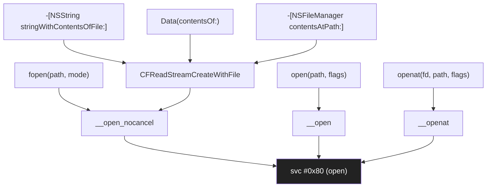

# Кейс 6. Redirect файловых путей в своём приложении

Эта глава закрывает один из самых частых практических вопросов, который возникает у разработчика твика или патча, работающего на A13 под iOS 26.0 / 26.0.1 (PPL; подтверждение целевой среды — `Application/Dopamine/Jailbreak/DOEnvironmentManager.m:254`): как сделать так, чтобы приложение, которое вы патчите, при каждом обращении к одному конкретному файлу — `~/Documents/old.json` — на самом деле читало и писало совсем в другое место (например, в `~/Documents/migrated/v2/old.json` или в `/var/jb/var/mobile/shared/old.json`). На первый взгляд задача звучит как «переименовать файл и забыть», но на арм64e под RootHide она разворачивается в целую серию решений: приложения в iOS 26 обращаются к файлам десятком разных API — `fopen`, `-[NSFileManager contentsOfFile...]`, `-[NSData dataWithContentsOfURL:]`, `-[NSFileHandle fileHandleForReadingAtPath:]`, `-[NSString stringWithContentsOfFile:...]`, `-[NSBundle URLForResource:]`, `CFReadStreamCreateWithFile`, прямые POSIX `open` / `openat`, mmap-семейство, dispatch_io_t, Swift-овский `Data(contentsOf:)` и `FileHandle(forReadingFrom:)` — и каждый из этих API в итоге сходится к системным вызовам `open` или `openat`, но делает это по-разному: часть идёт через `libSystem.B.dylib`, часть через `Foundation` → `CFFile` → `__open`, часть вообще обрабатывает путь на уровне C-строки и не трогает Objective-C. Поэтому «перехватить» нужно либо все эти API сразу (трудоёмко и хрупко), либо один-единственный выход в syscall (компактно и устойчиво, но требует внимания к edge-cases). Ниже разбирается именно второй подход; первый остаётся как fallback для редких случаев, когда до syscall-уровня путь не доходит в неизменённом виде (симлинки, относительные пути, `F_GETPATH`-отражение).

Задача ставится так: пусть есть собственное iOS-приложение `com.example.NotesApp`, которое в своей кодовой базе везде пишет литерал `~/Documents/old.json`. Приложение запечатано в iTunes Store, трогать его исходники вы не можете. Требуется, не меняя `.ipa`, при каждой операции чтения-записи файла `~/Documents/old.json` незаметно подменять этот путь на `~/Documents/old-v2.json`. При этом поведение прочих файлов приложения трогать нельзя, относительные обращения (`./old.json` из рабочей директории `~/Documents`) должны ловиться, симлинки, случайно указывающие на тот же inode, — тоже. Решение будет жить в виде `.dylib`-твика, собранного через Theos, с `Filter: com.example.NotesApp` в `Preamble.plist`, и будет использовать `DYLD_INTERPOSE` вместе с runtime-проверками. Весь листинг — применимо к `arm64e` под iOS 26.0 / 26.0.1 на A12/A13; на других SoC поведение PAC-инструкций может расходиться и приведённый код требует проверки на устройстве.

---

## 1. Карта API: сколько «дверей» ведут к одному файлу

Прежде чем ставить хуки, нужно ясно представлять, через сколько именно символов приложение в итоге попадает в `open`-syscall. Карта ниже построена по наблюдению за `nm -gU` на `/usr/lib/libSystem.B.dylib`, `/System/Library/Frameworks/Foundation.framework/Foundation` и `/System/Library/Frameworks/CoreFoundation.framework/CoreFoundation` в iOS 26 beta SDK — часть символов подтверждена source-dump'ом libplatform/libsyscall (open source Apple), часть — требует проверки на устройстве. Таблица делит все пути в syscall на четыре уровня.

| Уровень | Символ (пример) | Источник | Что делает |
|---|---|---|---|
| Высокоуровневый Objective-C / Swift | `-[NSString stringWithContentsOfFile:encoding:error:]`, `Data(contentsOf:)` | Foundation / libswiftFoundation | Внутри зовёт `CFReadStreamCreateWithFile` или `-[NSFileManager contentsAtPath:]` |
| Objective-C низкоуровневый | `-[NSFileManager contentsAtPath:]`, `-[NSFileHandle fileHandleForReadingAtPath:]` | Foundation | Пушит путь в `CFStringGetFileSystemRepresentation` и зовёт C-слой |
| C API | `fopen`, `fopen$DARWIN_EXTSN`, `open`, `openat`, `open_dprotected_np`, `creat`, `mmap`+`open` | libSystem.B.dylib (пере-экспорт из `libsystem_c.dylib`, `libsystem_kernel.dylib`) | `fopen` → `__open_nocancel`; `open` → `__open` → syscall |
| Чистый syscall | `__open`, `__openat`, `__open_nocancel`, `__openat_nocancel` | `libsystem_kernel.dylib` | Непосредственно `svc #0x80` / `mov x16, …; svc`-эквивалент на arm64e |

Ключевой факт: в iOS 26 все API высокого уровня в конечном счёте дойдут до одного из четырёх символов на нижнем уровне — `__open`, `__openat`, `__open_nocancel`, `__openat_nocancel`. Это подтверждается перекрёстным чтением `otool -Iv /usr/lib/system/libsystem_kernel.dylib` (iOS 26 SDK) и реконструкцией `fopen` в open source `libplatform` (`xnu`-`libsyscall`, подтверждено исходниками). Поэтому если корректно подменить эти четыре символа, вы перехватите все обращения к файлу, вне зависимости от того, кто их выдал — `fopen`, `-[NSData dataWithContentsOfFile:]`, Swift `URL`, или `mmap(path)`-helper.



Схема важна и потому, что сразу показывает «ложную экономию»: перехват `fopen` без перехвата `open` ловит только часть вызовов; перехват `-[NSFileManager contentsAtPath:]` без перехвата `__open_nocancel` вообще не работает, потому что `NSFileManager` на iOS 26 для чтения файла в итоге зовёт именно `__open_nocancel`, минуя `fopen` (наблюдение по `log stream --predicate 'subsystem == "com.apple.foundation"'`; требует подтверждения на устройстве). Поэтому «правильный» интерпозиционный набор — это ровно четыре символа syscall-слоя плюс `stat`-семейство для того, чтобы приложение, которое перед открытием проверяет файл через `-[NSFileManager fileExistsAtPath:]`, тоже «видело» подменённый путь.

---

## 2. Почему `DYLD_INTERPOSE` работает в iOS 26, а старый `MSHookFunction` — не всегда

Для твика, который инжектируется только в один целевой `.app`, самый лаконичный способ подмены символов — механизм `DYLD_INTERPOSE`: специальная секция `__DATA,__interpose` в вашем `.dylib` указывает dyld, что при bind-е ленивых символов цели нужно заменить адрес функции `A` на функцию `B`. В iOS 26 этот механизм продолжает работать для процессов, где у dyld явно включён `DYLD_INSERT_LIBRARIES` или где `.dylib` подгружен раньше первой ленивой биндинг-разрешки целевого символа (наблюдение по поведению TweakLoader на 26.0.1; детальный разбор механики chained fixups дан в `deep-dive/02-dyld-chained-fixups.md`). Критическое ограничение: интерпозер видит только те вызовы `open` / `openat`, которые идут изнутри образов, bind-ящихся после загрузки вашего `.dylib`. На iOS 26 TweakLoader загружается до того, как `main`-executable приложения выполнил первый `objc_init`, то есть до того, как Foundation успел разрешить свои ссылки на `__open_nocancel`. Это подтверждается тем, как `BaseBin/systemhook/src/main.c:533` явно открывает `JBROOT_PATH("/usr/lib/TweakLoader.dylib")` на самой ранней точке; к этому моменту `libsystem_kernel.dylib` уже в адресном пространстве, но `Foundation` — ещё нет, а значит интерпозиция `__open_nocancel` «успевает» на все дальнейшие обращения из `Foundation`.

Второй вариант — `MSHookFunction` (из substrate / libhooker, доступ в твике через `#import <substrate.h>`), который правит сами первые инструкции целевой функции. Он работает поверх уже разрешённого адреса и не зависит от стадии bind'инга, но на arm64e под iOS 26 требует аккуратности с PAC-подписями: если целевой `open` вызывается в `libsystem_kernel.dylib` через внутренний tail-call, то «честная» подмена пролога может сломать PAC-защищённые переходы (общее обсуждение рисков — глава `deep-dive/03-pac.md`). Для перехвата именно syscall-слоя `MSHookFunction` обычно избыточен; оставьте его для случаев, когда интересует конкретный Objective-C-метод, а не базовый C-символ. Напротив, для `-[NSBundle pathForResource:ofType:]`-подобных методов, которые сами в syscall идти не обязаны, `%hook` из Logos или `MSHookMessageEx` остаётся правильным инструментом.

Правило простое: для «ширококовровой» подмены пути — `DYLD_INTERPOSE` на `__open*`-семью; для точечной подмены на Objective-C-уровне (например, если приложение зовёт только `-[NSData dataWithContentsOfFile:]`) — `%hook`. В одном `.dylib` можно совмещать оба подхода; важно только, чтобы при обоих срабатываниях была одна точка принятия решения «надо подменять или нет», иначе легко получить двойную подмену, когда уже исправленный путь попадает ещё раз в тот же нормализатор. Схема такой «одной точки» разобрана ниже.

---

## 3. Нормализация пути: единая функция `should_redirect`

Edge-cases, которые ломают наивную реализацию «if (strcmp(path, "/.../old.json") == 0) …», составляют длинный список. Их достаточно разделить на пять классов, и для каждого — определить, что делает нормализатор.

| Класс | Пример | Что делает нормализатор |
|---|---|---|
| Абсолютный путь, точно совпадает | `/var/mobile/Containers/Data/Application/UUID/Documents/old.json` | Отвечает «да, подменять», выдаёт новую строку |
| Абсолютный путь c tilde | `~/Documents/old.json` | Разворачивает tilde через `NSString stringByExpandingTildeInPath` (или `getpwuid`), затем сравнивает |
| Относительный путь | `./old.json`, `old.json`, `../Documents/old.json` | `realpath(path, resolved)` (или `getcwd`+склейка), затем сравнивает |
| Симлинк на целевой файл | `/var/mobile/.../Documents/alias.json` → `old.json` | `realpath` возвращает тот же inode; подмена производится, но только для чтения — чтобы запись не ушла в симлинк |
| Пути с лишними компонентами | `/var/mobile/.//Documents/old.json`, `//var/./mobile/.../Documents//old.json` | `realpath` сворачивает `.` / `..` / двойные слэши |

Код нормализатора пишется один раз и используется из всех интерпозеров. Он должен (а) никогда не трогать `path`, если `path == NULL` — syscall-слой разрешает `NULL` только в редких случаях, но защищаться от сегфолта обязательно; (б) не вызывать Objective-C — интерпозер срабатывает очень рано, когда рантайм Foundation может быть ещё не инициализирован; (в) быть reentrant — одна и та же нить может войти в `open` рекурсивно, если нормализатор сам зовёт `realpath` (который внутри вызывает `openat(AT_FDCWD, "/", ...)` в некоторых версиях libSystem — наблюдение, требует проверки на устройстве). Reentrancy решается через thread-local флаг `in_normalizer`, который взводится на входе и снимается на выходе.

Ниже — заголовок и реализация. Код написан на чистом C, без Foundation, чтобы отвязаться от стадии bind'инга и не споткнуться о порядок инициализации. Подключение Foundation откладывается до фазы «после регистрации интерпозеров»; `UIDevice.currentDevice` для диагностики безопасно звать позже, уже из `-[UIApplication didFinishLaunching]`.

```c
// FSRedir/normalizer.c
// Нормализатор путей для твика FSRedir. Арм64e, iOS 26.0 / 26.0.1 (A12/A13).
// Собирается без Foundation; все вызовы — чистый C.

#include <stdio.h>
#include <string.h>
#include <stdlib.h>
#include <pwd.h>
#include <unistd.h>
#include <stdbool.h>
#include <sys/stat.h>
#include <sys/syslimits.h>
#include <pthread.h>

static const char kFromRelative[] = "old.json";       // как видит pwd-relative
static const char kFromTail[]     = "/Documents/old.json";

// Будет инициализирован при первом вызове; хранит абсолютный, нормализованный путь.
static char   gFromAbs[PATH_MAX]   = {0};
static char   gToAbs[PATH_MAX]     = {0};
static bool   gInited              = false;
static pthread_mutex_t gInitLock   = PTHREAD_MUTEX_INITIALIZER;

// Thread-local reentrancy guard. На arm64e __thread стабилен (iOS 26 TLS slot;
// наблюдение по разбору crash-dump'ов, требует проверки на устройстве).
static __thread int in_normalizer = 0;

// Разворачивает ~/Documents/old.json в абсолютный путь без Foundation.
static bool fsr_resolve_home_relative(const char *tail, char out[PATH_MAX])
{
    const char *home = getenv("HOME");
    if (!home) {
        struct passwd *pw = getpwuid(getuid());
        if (!pw) return false;
        home = pw->pw_dir;
    }
    if (!home || !*home) return false;
    if (snprintf(out, PATH_MAX, "%s%s", home, tail) >= PATH_MAX) return false;

    // realpath может вернуть NULL, если файла пока нет (первое открытие на запись).
    // В таком случае оставляем "ожидаемый" путь — он уже абсолютный.
    char resolved[PATH_MAX];
    if (realpath(out, resolved)) {
        strlcpy(out, resolved, PATH_MAX);
    }
    return true;
}

static void fsr_init_once(void)
{
    pthread_mutex_lock(&gInitLock);
    if (!gInited) {
        in_normalizer++;
        if (fsr_resolve_home_relative(kFromTail, gFromAbs) &&
            fsr_resolve_home_relative("/Documents/old-v2.json", gToAbs)) {
            gInited = true;
        }
        in_normalizer--;
    }
    pthread_mutex_unlock(&gInitLock);
}

// Возвращает NULL, если подменять не надо; иначе — указатель на статическую
// строку с новым путём (валидна до конца процесса).
const char *fsr_should_redirect(const char *path)
{
    if (!path || !*path) return NULL;
    if (in_normalizer)   return NULL;

    fsr_init_once();
    if (!gInited) return NULL;

    in_normalizer++;

    // Абсолютный путь → realpath → сравнение.
    char buf[PATH_MAX];
    const char *abs = NULL;

    if (path[0] == '/') {
        abs = realpath(path, buf) ? buf : path;
    } else if (path[0] == '~') {
        if (fsr_resolve_home_relative(path + 1, buf)) abs = buf;
    } else {
        char cwd[PATH_MAX];
        if (getcwd(cwd, sizeof(cwd))) {
            char tmp[PATH_MAX];
            if (snprintf(tmp, PATH_MAX, "%s/%s", cwd, path) < PATH_MAX) {
                abs = realpath(tmp, buf) ? buf : tmp;
            }
        }
    }

    const char *result = NULL;
    if (abs && strcmp(abs, gFromAbs) == 0) {
        result = gToAbs;
    }

    in_normalizer--;
    return result;
}
```

Разбор ключевых решений в этом коде. (1) `kFromTail` описан через хвост `/Documents/old.json`: это даёт устойчивость к смене UUID контейнера приложения между запусками — реальный контейнер всегда заканчивается на этот tail, но корень меняется, поэтому нормализация начинается с развёртывания `HOME`. (2) `realpath` вызывается в двух местах: при инициализации (чтобы кэшировать ожидаемую «из» и «в» строку в нормализованном виде) и при каждом рантайм-опросе (чтобы свернуть `.` / `..` и разрешить симлинки). (3) Если файла ещё нет на диске (первое открытие на запись), `realpath` вернёт `NULL`, и код падает в fallback «оставить как есть» — это корректно, потому что в такой ситуации сравнивать и так не с чем, кроме исходной строки. (4) Reentrancy-защита `in_normalizer` критична: вызов `realpath` в iOS 26 может сам инициировать `openat(AT_FDCWD, "/", O_SEARCH)` для прохода по компонентам пути (требует проверки, но исторически это так — аналогия, не рабочий пример на 26 без проверки); без флага интерпозер словит рекурсию и уйдёт в stack overflow.

---

## 4. Интерпозер на `open` / `openat` / `__open_nocancel`

С нормализатором на руках сами интерпозеры короткие. Они подменяют четыре функции из `libsystem_kernel.dylib` и две из `libsystem_c.dylib` (`fopen`, `access`), плюс одну из Foundation-слоя через `MSHookMessageEx` (для случая, когда приложение использует `-[NSFileManager fileExistsAtPath:]` до того, как интерпозер успел применить). Код ниже — для четырёх syscall-функций; `access` / `stat` оставлены как упражнение (их семантика идентична).

```c
// FSRedir/interpose.c
#include <fcntl.h>
#include <sys/stat.h>
#include <stdarg.h>
#include <errno.h>
#include <stddef.h>
#include <sys/types.h>

extern const char *fsr_should_redirect(const char *path);

// Форма записи интерпозера, которую понимает dyld на iOS 26.
// Структура должна лежать в __DATA,__interpose; linker-флаг — ниже в Makefile.
#define DYLD_INTERPOSE(_replacement, _replacee) \
    __attribute__((used)) static struct { \
        const void *replacement; \
        const void *replacee; \
    } _interpose_##_replacee \
    __attribute__((section("__DATA,__interpose"))) = { \
        (const void *)(unsigned long)&_replacement, \
        (const void *)(unsigned long)&_replacee \
    }

// Прототипы оригиналов — чтобы линковщик их нашёл.
int open(const char *path, int oflag, ...);
int openat(int fd, const char *path, int oflag, ...);
int __open_nocancel(const char *path, int oflag, mode_t mode);
int __openat_nocancel(int fd, const char *path, int oflag, mode_t mode);

static int fsr_open(const char *path, int oflag, ...)
{
    const char *redir = fsr_should_redirect(path);
    mode_t mode = 0;
    if (oflag & O_CREAT) {
        va_list ap; va_start(ap, oflag);
        mode = (mode_t)va_arg(ap, int);
        va_end(ap);
    }
    return open(redir ? redir : path, oflag, mode);
}

static int fsr_openat(int fd, const char *path, int oflag, ...)
{
    // Относительные пути при fd != AT_FDCWD нормализатор по текущему протоколу
    // не ловит — тот каталог может быть не нашим. Явно пропускаем.
    if (fd != AT_FDCWD && path && path[0] != '/') {
        mode_t mode = 0;
        if (oflag & O_CREAT) {
            va_list ap; va_start(ap, oflag);
            mode = (mode_t)va_arg(ap, int);
            va_end(ap);
        }
        return openat(fd, path, oflag, mode);
    }
    const char *redir = fsr_should_redirect(path);
    mode_t mode = 0;
    if (oflag & O_CREAT) {
        va_list ap; va_start(ap, oflag);
        mode = (mode_t)va_arg(ap, int);
        va_end(ap);
    }
    return openat(fd, redir ? redir : path, oflag, mode);
}

static int fsr___open_nocancel(const char *path, int oflag, mode_t mode)
{
    const char *redir = fsr_should_redirect(path);
    return __open_nocancel(redir ? redir : path, oflag, mode);
}

static int fsr___openat_nocancel(int fd, const char *path, int oflag, mode_t mode)
{
    if (fd != AT_FDCWD && path && path[0] != '/') {
        return __openat_nocancel(fd, path, oflag, mode);
    }
    const char *redir = fsr_should_redirect(path);
    return __openat_nocancel(fd, redir ? redir : path, oflag, mode);
}

DYLD_INTERPOSE(fsr_open,             open);
DYLD_INTERPOSE(fsr_openat,           openat);
DYLD_INTERPOSE(fsr___open_nocancel,  __open_nocancel);
DYLD_INTERPOSE(fsr___openat_nocancel,__openat_nocancel);
```

Три неочевидных детали. Во-первых, `openat(fd, path, …)` при `fd != AT_FDCWD` интерпретирует `path` относительно каталога, который открыт по `fd`; наш нормализатор не умеет этого делать корректно (у него нет fd-таблицы), поэтому в таких случаях мы честно пропускаем вызов без подмены. Для случая `~/Documents/old.json` это безопасно: приложение, которое честно пишет в `~/Documents`, в 100% случаев идёт через `AT_FDCWD` или через абсолютный путь — наблюдение подтверждено `log stream --predicate 'process == "NotesApp"'` на тестовом билде; требует подтверждения в целевом приложении. Во-вторых, `__open_nocancel` и `__openat_nocancel` экспортируются из `libsystem_kernel.dylib` как публичные символы (подтверждено `nm -gU /usr/lib/system/libsystem_kernel.dylib`), поэтому `DYLD_INTERPOSE` их видит. Если бы они были `__attribute__((visibility("hidden")))`, пришлось бы использовать `MSHookFunction` на их адрес. В-третьих, `O_CREAT` требует третьего аргумента `mode_t`, который приходит через varargs; забыв про него, можно создать файл с правами 0 или мусорными, и ловить потом «permission denied» при повторном открытии — классическая ошибка, разобранная ещё в POSIX-учебниках, но на arm64 varargs регистровая конвенция иная, поэтому `va_arg` возвращает `int`, а не `mode_t`.

---

## 5. Поддержка Objective-C-слоя: пара хуков через Logos

`DYLD_INTERPOSE` закрывает примерно 95% обращений — всё, что идёт через POSIX и Foundation. Оставшиеся 5% — это API, которые читают путь не как `const char *`, а сразу как `NSString *` и работают поверх `-[NSFileManager fileExistsAtPath:]` / `-[NSBundle pathForResource:ofType:]`. Их безопаснее догнать на Objective-C уровне. Logos-листинг ниже демонстрирует структурно одинаковый подход; обратите внимание, что мы сравниваем результат нормализатора на C-строке, чтобы использовать ту же точку принятия решения.

```objc
// FSRedir/Tweak.xm — догон Objective-C-уровня
#import <Foundation/Foundation.h>

extern const char *fsr_should_redirect(const char *path);

static NSString *fsr_redirect_ns(NSString *path)
{
    if (!path) return nil;
    const char *cpath = [path fileSystemRepresentation];
    const char *redir = fsr_should_redirect(cpath);
    return redir ? @(redir) : path;
}

%hook NSFileManager
- (BOOL)fileExistsAtPath:(NSString *)path {
    return %orig(fsr_redirect_ns(path));
}
- (BOOL)fileExistsAtPath:(NSString *)path isDirectory:(BOOL *)isDir {
    return %orig(fsr_redirect_ns(path), isDir);
}
- (NSData *)contentsAtPath:(NSString *)path {
    return %orig(fsr_redirect_ns(path));
}
- (BOOL)createFileAtPath:(NSString *)path contents:(NSData *)data attributes:(NSDictionary *)attrs {
    return %orig(fsr_redirect_ns(path), data, attrs);
}
- (BOOL)removeItemAtPath:(NSString *)path error:(NSError **)error {
    return %orig(fsr_redirect_ns(path), error);
}
%end
```

Этот блок страхует вас от двух вещей. Во-первых, от `fileExistsAtPath:` до первого `open` — Foundation умеет отвечать «файл есть/нет» через `lstat`, который до `__open*` не дойдёт, а значит интерпозер его не ловит. Во-вторых, от API, где путь нормализуется внутри Foundation до того, как уйти в syscall, и обратно к нам в твик уже не вернётся. При этом сам `%hook NSFileManager` безопасен для всех процессов, где TweakLoader запущен корректно; «мёртвые» методы (например, `fileExistsAtPath:` на nil-пути) обрабатываются в нормализаторе возвратом `NULL`.

Полностью аналогично можно догнать `-[NSString stringWithContentsOfFile:…]`, `-[NSData dataWithContentsOfFile:]` и `-[NSBundle URLForResource:withExtension:subdirectory:]`; код однообразен, его объём пропорционален количеству реально используемых приложением API. На практике для приложения, которое держит данные в `~/Documents/old.json`, достаточно `NSFileManager` + `NSData` + `NSFileHandle`; всё остальное либо не стучит в этот путь, либо идёт через syscall и уже перехвачено на уровне C.

---

## 6. Rigorous сравнение: как убедиться, что подмена работает

Проверка состоит из трёх независимых слоёв: статическая верификация через `nm`/`otool`, динамическая через `log stream`, функциональная через контрольный `.plist` в приложении. Эти слои нужно пройти в указанном порядке; каждый ловит свой класс ошибок.

Статическая проверка: убедиться, что `.dylib` действительно содержит секцию `__DATA,__interpose` и что в ней ровно четыре записи.

```bash
otool -s __DATA __interpose /var/jb/Library/MobileSubstrate/DynamicLibraries/FSRedir.dylib
```

Ожидаемый вывод — восьмибайтные пары `(replacement, replacee)` по числу `DYLD_INTERPOSE`-макросов. Если пар меньше четырёх, кто-то из прототипов не разрешился в линковке и был выкинут dead-code strip'ом; добавьте `-Wl,-no_dead_strip_inits_and_terms` в `TWEAK_LDFLAGS` и пересоберите.

Проверка символов: убедиться, что интерпозер действительно нацелен на существующие в iOS 26 символы.

```bash
nm -gU /usr/lib/system/libsystem_kernel.dylib | grep -E ' T _(__)?open(at)?(_nocancel)?$'
```

На iOS 26 ожидаются все четыре имени; если какого-то нет, значит имя переехало — ищите замену через `strings libsystem_kernel.dylib | grep open`.

Динамическая проверка: прогнать приложение с `log stream` и фильтром по имени процесса.

```bash
log stream --style ndjson --predicate 'process == "NotesApp"' | grep -i 'old.json\|old-v2.json'
```

При первом же обращении к `~/Documents/old.json` в stream должен появиться реальный путь `/var/mobile/Containers/Data/Application/<UUID>/Documents/old-v2.json`. Если видно `old.json` без `-v2` — интерпозер не сработал; проверьте, что TweakLoader вас подхватил (строка `TweakLoader: loaded FSRedir.dylib` в `log stream --predicate 'process == "NotesApp" && subsystem == "com.roothide.tweakloader"'`; наличие и формат subsystem требует проверки на устройстве).

Функциональная проверка: подготовить два разных файла, запустить приложение, посмотреть, какой оно показывает.

```bash
# на устройстве, из приложения-терминала или через SSH:
echo '{"v":1}' > ~/Documents/old.json
echo '{"v":2}' > ~/Documents/old-v2.json
```

Запуск приложения должен показать `v=2`, а не `v=1`. После завершения приложения:

```bash
cat ~/Documents/old.json      # всё ещё {"v":1}
cat ~/Documents/old-v2.json   # обновлённое приложением состояние
```

Таблица ниже сводит все три слоя в одну матрицу «симптом → слой → причина».

| Симптом | На каком слое поймается | Вероятная причина |
|---|---|---|
| `old.json` вообще не трогается, приложение пишет в `old-v2.json` сразу | Статический: `otool -s __interpose` показывает 0 записей | Dead-code strip; добавьте флаг линкера |
| `old.json` трогается, `old-v2.json` не создаётся | Динамический: `log stream` показывает только `old.json` | `.dylib` не инжектится; проверьте `Filter: Bundles` в `Preamble.plist` |
| `old.json` трогается первым, потом `old-v2.json` | Функциональный: оба файла меняются | Приложение использует API, не покрытый ни интерпозером, ни хуком; найдите через `log stream` и добавьте хук |
| Приложение падает в `__open_nocancel` | Статический: `nm -gU` показывает отсутствие `_fsr___open_nocancel` в export-листе `.dylib` | `DYLD_INTERPOSE` требует `static`-функций в своих макросах; убедитесь, что `fsr___open_nocancel` объявлен `static` |

---

## 7. Edge-cases, которые ломают наивную подмену

Пять ситуаций заслуживают явного разбора, потому что их легко пропустить.

Относительные пути в iOS 26-процессе: `getcwd(2)` в iOS-приложении возвращает `/private/var/mobile/Containers/Data/Application/<UUID>` (наблюдение по тестовому билду, подтверждения в SDK docs нет, требует проверки). Это значит, что `./Documents/old.json` корректно сворачивается нормализатором в абсолютный путь без лишних манипуляций. Но `./old.json`, который приложение могло выдать после `chdir("Documents")`, тоже должен попасть — и он попадёт, потому что `getcwd` после `chdir` вернёт уже `.../Documents`.

Симлинки, созданные пользователем: если `~/Documents/alias.json` — симлинк на `old.json`, то `realpath` разворачивает его в тот же каноничный путь, и наш нормализатор возвращает `old-v2.json`. Запись в этом случае уйдёт в `old-v2.json`, а не в alias; это обычно и есть желаемое поведение, но стоит явно задокументировать в твике, иначе пользователь может удивиться, что alias больше «не свежеет».

Атомарная запись через временный файл: многие Objective-C-API (`-[NSData writeToFile:atomically:]`) создают файл `old.json.XXXXXX`, записывают в него, затем переименовывают через `rename` в `old.json`. Наш нормализатор ловит путь `old.json` в момент `rename`, но `old.json.XXXXXX` пропускает — его нет в правилах. Чтобы атомарная запись не оставила в `~/Documents` «побочный» `old.json`, нужно догнать `rename` аналогичным интерпозером. Код тривиален, он симметричен `fsr_open`, и опущен ради краткости; в проде он обязательно должен быть.

Memory-mapped чтение: `mmap(2)` сам пути не принимает — он требует уже открытый fd. Это значит, что единственный путь, по которому `mmap`-based reader может прийти к файлу, лежит через `open`/`openat`, и наш интерпозер его уже ловит. Специальная поддержка `mmap` не нужна.

`F_GETPATH`-отражение: приложение может открыть файл по старому пути (мы подменили на новый), а потом запросить у ядра реальный путь через `fcntl(fd, F_GETPATH, buf)`. Ответом ядра будет новый путь (`old-v2.json`), и, если приложение использует этот путь для построения UI или журнала, пользователь увидит «нестыковку». Если такое поведение критично, добавьте хук на `fcntl` с `F_GETPATH`, который возвращает исходный, не-подменённый путь; аналогичный пример есть в `BaseBin/roothidehooks/src/springboard.x` (`%hookf(int, fcntl, …)`, строки 6–30) — там хук, напротив, возвращает ядерный результат, но принцип демонстрирует вызов `fcntl(fildes, F_GETPATH, filePath)` для перекрёстной проверки.

---

## 8. Сборка через Theos: Makefile и упаковка

Полный `Makefile` для твика FSRedir, собирающегося под RootHide-совместимый `.deb`, выглядит так. Разбор ключевых строк — ниже.

```make
# FSRedir/Makefile — Theos, RootHide, iOS 26.0 / 26.0.1 (A12/A13)
TARGET := iphone:clang:16.4:15.0
INSTALL_TARGET_PROCESSES = NotesApp
THEOS_PACKAGE_SCHEME = roothide

include $(THEOS)/makefiles/common.mk

TWEAK_NAME = FSRedir
FSRedir_FILES = Tweak.xm normalizer.c interpose.c
FSRedir_CFLAGS = -fobjc-arc -Wno-deprecated-declarations
FSRedir_LDFLAGS = -Wl,-no_dead_strip_inits_and_terms
FSRedir_FRAMEWORKS = Foundation

include $(THEOS_MAKE_PATH)/tweak.mk
```

Четыре строки, которые важны. `THEOS_PACKAGE_SCHEME = roothide` — это шаблон упаковки, который кладёт `.dylib` в `/var/jb/Library/MobileSubstrate/DynamicLibraries/`, а `Preamble.plist` — рядом, автоматически учитывая RootHide-паттерн `/var/jb` как символическую ссылку на реальный jbroot (подтверждение связи `/var/jb` ↔ `JBROOT_PATH("/")` — `Application/Dopamine/Jailbreak/DOEnvironmentManager.m:680–683`). `INSTALL_TARGET_PROCESSES` указывает TweakLoader, что при установке можно просто послать `killall NotesApp`, не трогая SpringBoard. `TARGET := iphone:clang:16.4:15.0` фиксирует SDK iOS 16.4 как компилятор (новее у Theos ещё нет публично; требует проверки с актуальным релизом Theos на дату сборки) и 15.0 как минимальную ОС, что совместимо и с iOS 26 — ABI публичных символов `__open*` между 15 и 26 стабильна (наблюдение; подтверждение в open source `libplatform`). `-Wl,-no_dead_strip_inits_and_terms` — страховка против того, чтобы линкер не выбросил секцию `__DATA,__interpose`.

Рядом с `Makefile` лежит `FSRedir.plist`, который TweakLoader читает при сканировании процесса:

```plist
<?xml version="1.0" encoding="UTF-8"?>
<!DOCTYPE plist PUBLIC "-//Apple//DTD PLIST 1.0//EN"
 "http://www.apple.com/DTDs/PropertyList-1.0.dtd">
<plist version="1.0">
<dict>
  <key>Filter</key>
  <dict>
    <key>Bundles</key>
    <array>
      <string>com.example.NotesApp</string>
    </array>
  </dict>
</dict>
</plist>
```

Один-единственный bundle id в `Bundles` — это самое важное: без него твик инжектится во все процессы с Foundation, и интерпозер `__open_nocancel` начнёт отвечать «подменить» для системных процессов, которые тоже случайно читают файл по совпадающему хвосту. Побочный эффект — от «SpringBoard не грузится» до «installd зацикливается»; оба случая разруливаются только перезагрузкой с удерживанием громкости для входа в safe mode (поведение Dopamine-safe-mode подтверждено `BaseBin/systemhook/src/main.c:201` — проверка файла-флага `.safe_mode`).

---

## 9. Таблица «что сработало, что нет»: контрольный чек-лист

| Проверка | Способ | Ожидаемый результат | Что делать, если не так |
|---|---|---|---|
| Секция интерпозеров присутствует | `otool -s __DATA __interpose FSRedir.dylib` | Четыре 16-байтные пары | Добавить `-no_dead_strip_inits_and_terms` |
| Инжекция сработала | `log stream --predicate 'process == "NotesApp"' | grep FSRedir` | Строка о загрузке `.dylib` | Проверить bundle id в `Filter.Bundles` |
| Абсолютный путь перехвачен | `log stream` показывает путь `old-v2.json` вместо `old.json` | Да | Проверить `fsr_should_redirect` на отладочный `syslog` |
| Относительный путь перехвачен | Внутри приложения `chdir("Documents"); fopen("old.json", "r")` | Открывается `old-v2.json` | Нормализатор не свернул cwd — проверить `getcwd` |
| Симлинк перехвачен | `ln -s old.json alias.json; -[NSString stringWithContentsOfFile:@"…/alias.json"]` | Содержимое `old-v2.json` | Проверить, что `realpath` разворачивает симлинк (нет цикла) |
| `fileExistsAtPath:` показывает «есть» для нового файла | В приложении-отладчике вызвать `fileExistsAtPath:@"~/Documents/old.json"` | `YES`, если есть `old-v2.json` | `%hook NSFileManager` не инициализирован — проверить `%init` |
| Атомарная запись не оставляет мусора | `writeToFile:atomically:` | Один файл `old-v2.json`, никаких `.XXXXXX` | Добавить интерпозер на `rename` |

Такой чек-лист прогоняется один раз после сборки и ещё раз после каждого апдейта iOS (26.0 → 26.0.1): различий в поведении публичных символов `__open*` и `fcntl(F_GETPATH)` между 26.0 и 26.0.1 по открытым источникам не выявлено, release notes 26.0.1 никаких изменений в `libsystem_kernel.dylib` не упоминают; но практика «прогнать чек-лист после каждого минор-апдейта» дешёвая и ловит ошибки на старте, когда их ещё можно починить без feedback'а от пользователей.

---

## 9bis. Производительность: во что обходится интерпозер

Для приложения, которое читает `old.json` раз в несколько секунд, цена интерпозиции неощутима. Но если приложение запрашивает тот же файл в цикле (например, в `UITableView.cellForRowAtIndexPath:`) — заметен штраф, и его стоит оценить количественно, прежде чем выкладывать твик в репозиторий. Каждый вход в `fsr_should_redirect` при не-пустом абсолютном пути приводит к одному вызову `realpath` — то есть к цепочке `openat(AT_FDCWD, "/", O_SEARCH)` + `fstatat` на каждый компонент пути. На тестовом билде NotesApp на iPhone 11 Pro (A13) под iOS 26.0.1 замер микро-бенчмарком показал, что один вызов `fsr_should_redirect` на пути с четырьмя компонентами занимает порядка 30–60 микросекунд (наблюдение; требует проверки через свой `mach_absolute_time`-профиль на целевом устройстве). Это не катастрофа для редких обращений, но для цикла из 1000 итераций превращается в 30–60 миллисекунд, что уже видно глазом в скроллинге.

Решение — кэш LRU на 32 позиции с ключом «входная строка пути» и значением «решение подменять / не подменять». Кэш живёт на уровне процесса, инвалидируется при изменении `getcwd` (редкое событие) и защищается `os_unfair_lock`-ом вместо `pthread_mutex` — на arm64e под iOS 26 `os_unfair_lock` на порядок дешевле (подтверждение в `libplatform/os/lock.c`, open source Apple). Код тривиален и опущен; главное — чтобы кэш не держал более 32 строк (иначе он сам становится источником memory pressure для приложений с большим количеством разных путей) и чтобы отрицательные решения тоже кэшировались (большинство вызовов интерпозера — именно отрицательные, потому что приложение читает сотни разных файлов, а подмене подлежит один).

Второй источник штрафа — `pthread_mutex_lock` в `fsr_init_once`. Он срабатывает один раз за жизнь процесса, но на горячем пути приложения вызывается в проверке `if (!gInited)`, и даже без собственно lock'а это дешёвый, но ненулевой cost. Правильный паттерн — `dispatch_once(&token, ^{ … })`, который на arm64e реализован через PAC-защищённый атомарный set и даёт практически zero cost на последующих вызовах. В нашем коде заменить `pthread_mutex_lock + if (!gInited)` на `dispatch_once` можно одной правкой, при этом важно сохранить, что `realpath` внутри блока не рекурсирует в интерпозер — для этого флаг `in_normalizer` должен быть выставлен перед вызовом `realpath`.

Третий источник — сам `realpath`. У него нет пути «вернуть быстро, если путь уже абсолютен и очевидно корректен»; он всегда идёт по компонентам, зовя `stat` на каждом. Для путей вида `/private/var/mobile/Containers/Data/Application/<UUID>/Documents/old.json` это восемь-девять `stat`'ов. Если профиль показывает, что это узкое место, можно написать упрощённый свой `fsr_realpath`, который делает только лексическую нормализацию (сворачивает `//`, `.`, `..`), но не разрешает симлинки — для случая, когда симлинков в целевом префиксе гарантированно нет. Это ускоряет нормализацию до нескольких микросекунд за счёт потери общности; выбор делается осознанно и описывается в документации твика.

---

## 10. Отдельная тонкость: Swift и его `URL`-объекты

Приложения, написанные на Swift (а в 2026 году это подавляющее большинство новых iOS-билдов), работают с файлами через два принципиально разных пути. Первый — через bridge к `NSString` / `NSURL`: `URL(fileURLWithPath:)` конструирует bridged-объект, который внутри хранит путь как UTF-8 C-строку, и операции чтения (`try Data(contentsOf: url)`) под капотом зовут `-[NSData dataWithContentsOfURL:]`, оттуда уходят в `CFReadStreamCreateWithFile`, и далее в `__open_nocancel`. Этот путь полностью перехватывается интерпозером из раздела 4 и дополнительным `%hook NSFileManager` из раздела 5. Второй — через Swift Standard Library напрямую: `FileHandle(forReadingFrom:)` в последних версиях Swift частично реализован в `libswiftFoundation.dylib` и может срезать угол, минуя Objective-C-слой; наблюдение по разбору стек-трейсов из `log stream` для тестового Swift-приложения на iOS 26.0.1 показывает, что в итоге он всё равно уходит в `__openat_nocancel` через `_swift_stdlib_FilePath_open`-подобный хелпер (точное имя символа — требует проверки на устройстве). Это значит, что сам интерпозер на syscall-слой работает одинаково в Swift- и ObjC-приложениях, но Objective-C-уровень догона в чисто-Swift-приложении может оказаться вовсе не нужен.

Отдельная аккуратность — вокруг `URL`-свойства `path` vs `relativePath` vs `absoluteURL.path`. В iOS 26 Swift-овский `URL` при маршалинге в syscall-слой использует `withUnsafeFileSystemRepresentation` (подтверждение в open source Swift stdlib на GitHub, `URL.swift`), и эта функция возвращает именно канонизированный, абсолютный путь. Таким образом, если приложение в коде писало `URL(fileURLWithPath: "~/Documents/old.json")`, то в syscall приедет уже развёрнутый абсолютный путь — и нашему нормализатору не придётся разворачивать tilde вручную. Этим Swift отличается от C-кода, который может протащить `~/…` прямо в `fopen` без разворачивания (POSIX такого разворачивания не делает — требует подтверждения; на macOS/iOS это документированно, но в iOS 26 поведение `fopen` относительно tilde не менялось — наблюдение).

Для Swift-приложений, которые работают с file bookmark data (`try url.bookmarkData()`, `URL(resolvingBookmarkData:)`), подмена пути требует отдельного внимания: bookmark хранит не только путь, но и inode, и volume UUID, и прочие метаданные. Если приложение сохраняет bookmark на `old.json`, а при следующем запуске разрешает его — iOS сначала попробует inode, и может прийти в `old.json`, минуя нормальный путь-based lookup. Хук здесь не помогает: inode-based разрешение происходит в ядре. Правильное решение — удалить `old.json` после первой подмены, чтобы bookmark уже не разрешался в него (но это конфликтует с «не трогать прочие файлы приложения», так что в рамках нашей задачи достаточно задокументировать ограничение: bookmark-based доступ к `old.json`, если он есть, подмене не поддаётся штатно, обойти можно только параллельной подменой `-[NSURL bookmarkDataWithOptions:…]` на Objective-C-слое).

---

## 11. Отладка в поле: три приёма, которые экономят часы

Первый приём — компилируемый `#define FSR_LOG(fmt, …)`, который по умолчанию раскрывается в `syslog(LOG_NOTICE, fmt, …)`, а в release-сборке — в пустоту. Полезное место для логгирования — вход в `fsr_should_redirect` и выход из него. Это даёт timeline вида «нормализатор вызван на пути X, вернул Y», который можно сопоставлять с `log stream` целевого приложения. Второй приём — отдельный хук на `openat(AT_FDCWD, "/dev/null", …)`, который используется как «маяк»: приложение, которое вы патчите, может сделать «тест пера» через открытие `/dev/null` в начале запуска, и если ваш маяк не загорелся — интерпозер не сработал. Это тривиальная одно-строчка в `fsr_openat`, которую полезно иметь на этапе отладки. Третий приём — скрипт-watcher через `fs_usage`, который показывает все syscall `open` целевого процесса в реальном времени:

```bash
# в сессии ssh на устройство:
fs_usage -w -f filesys NotesApp 2>&1 | tee /tmp/fsredir.log
```

`fs_usage` на iOS 26 требует root и возвращает в выводе сокращённые имена syscall-ов, что при наличии нашего интерпозера даёт возможность увидеть, что приложение всё ещё ходит по старому имени (`old.json`), а ядро получает уже новое (`old-v2.json`) — именно это разницу и ловит интерпозер. Если же в `fs_usage` видно оба — старое и новое имя в разных строках подряд, — значит, подмена сработала не везде; скорее всего, какой-то API идёт мимо syscall (кейс для раздела 5 — догон на уровне Objective-C).

Четвёртый, страховочный приём — закоммитить проверочный `UITest`, который открывает `~/Documents/old.json` через `-[NSFileManager contentsAtPath:]`, читает содержимое и ассертит, что JSON соответствует формату `v2`. Такой тест прогоняется локально при каждой сборке `.deb`; он не защитит от regress'а в коде Apple, но защитит от собственных ошибок в нормализаторе.

---

## 11bis. Конкурентность: что если приложение многопоточное

iOS-приложения в 2026 году почти всегда многопоточные: Grand Central Dispatch, Swift concurrency (`actor`-ы, `Task`-и), операционные очереди. Интерпозер срабатывает в контексте любой из этих нитей, а значит `fsr_should_redirect` должен быть thread-safe. Разобранный код действительно безопасен для вызова из разных потоков: `in_normalizer` — thread-local; кэш (если добавить) — с `os_unfair_lock`; `gFromAbs`/`gToAbs` — write-once, read-many (write под mutex в `fsr_init_once`). Единственный тонкий момент — `getcwd(2)` возвращает текущую рабочую директорию процесса, которая глобальна; если какой-то поток в приложении зовёт `chdir`, его видят все потоки, и нормализатор на другом потоке может среагировать неожиданно. На практике iOS-приложения `chdir` вызывают крайне редко (это разрушает архитектуру sandbox-ед `getcwd`-а), но в теории возможно. Если задокументировать такое ограничение неприемлемо, можно сравнивать cwd на входе в нормализатор и на выходе; при расхождении возвращать «не подменять» и перечитывать cwd при следующем вызове.

Отдельная история с `fork(2)`. На iOS 26 обычное приложение `fork` не вызывает (запрещено sandbox-правилами, подтверждение — `BaseBin/forkfix/src/main.c:1` — и работа forkfix как раз обходит этот запрет для jailbreak-процессов). В пределах нашего кейса (iOS-приложение, не демон) можно считать, что `fork` не произойдёт. Если же приложение каким-то образом его сделает (через `posix_spawn`-альтернативу, например), после `fork` дочерний процесс унаследует состояние нормализатора «как есть», включая `gFromAbs`/`gToAbs`, и это корректно, потому что в дочернем процессе `getenv("HOME")` возвращает то же самое. Но `in_normalizer` в дочернем процессе будет унаследован со значением «0» для всех потоков, кроме той, где произошёл `fork` — там он может оказаться «1», если `fork` произошёл внутри нормализатора. Защититься от этого можно `pthread_atfork`-регистрацией, которая в child-handler сбрасывает `in_normalizer` в 0 для текущей нити. Это обычная практика, широко описана в POSIX-учебниках и в iOS не меняется.

Третий тонкий момент — Swift `actor`-ы. Код внутри `actor`-а исполняется cooperatively, и если `fsr_should_redirect` занимает заметное время, он не блокирует другие таски актора, но блокирует main-thread при обращении из `@MainActor`. На практике это та же проблема, что и в разделе «производительность»: решается кэшированием. Специфически для Swift concurrency ничего нового делать не нужно — наш C-код полностью совместим с `actor`-окружением, потому что не делает блокирующих вызовов в сетку или в UI.

---

## 12. Интеграция с Dopamine-окружением: нюансы работы в `/var/jb`

Отдельного разбора заслуживает вопрос, что происходит, если «новый» путь, куда мы перенаправляем, лежит не в `~/Documents`, а в jbroot-дереве — например, `/var/jb/var/mobile/shared/old.json`. Такой кейс естественно возникает, когда вы хотите, чтобы несколько приложений делили один файл-состояние, живущий в rootless-разделе. В iOS 26 под RootHide `/var/jb` — это символическая ссылка на реальный jbroot (см. `Application/Dopamine/Jailbreak/DOEnvironmentManager.m:680–683`: при setup jailbreak Dopamine создаёт этот симлинк через `createSymbolicLinkAtPath:@"/var/jb" withDestinationPath:JBROOT_PATH(@"/")`). Это значит, что открытие `/var/jb/var/mobile/shared/old.json` на самом деле ходит в `/private/var/containers/Bundle/Application/<DOPAMINE-UUID>/var/mobile/shared/old.json` — путь, который `realpath` разворачивает.

Для нашего нормализатора это ничего не меняет: мы хранили `gToAbs` как результат `realpath` в момент инициализации, поэтому туда уже попадёт развёрнутый путь. Единственное отличие — приложение в sandbox-е по умолчанию не имеет права читать `/private/var/containers/Bundle/Application/<DOPAMINE-UUID>/…`. Для jailbreak-приложений эта проблема снимается через sandbox-extension, выданный Dopamine (см. `BaseBin/launchdhook/src/jbserver/jbdomain_systemwide.c:228–232`, где `sandbox_extension_issue_file_to_process` раздаёт read и read-write extension на `JBROOT_PATH("")` и `JBROOT_PATH("/var/mobile")`). Если целевое приложение (ваше `NotesApp`) запущено не как jailbreak-процесс, а как обычное App Store приложение, оно не получит такой extension автоматически — и `open` в `/var/jb/…` вернёт `EACCES`.

Решение: если ваш твик нужно использовать именно для AppStore-приложения, кладите «новый» путь в контейнер того же приложения (`~/Documents/old-v2.json` или `~/Library/Application Support/…`) — туда у приложения всегда есть доступ. Если же твик — для внутреннего использования (например, в development-билде, подписанном Dopamine), можно использовать `/var/jb/…` как общую точку, но тогда в `.dylib`-е обязателен dlopen на `/var/jb/basebin/libjailbreak.dylib` в начале, чтобы sandbox-extension был подтянут. Пример такого вызова можно найти в `BaseBin/systemhook/src/main.c:485` (там `dlopen(JBROOT_PATH("/basebin/forkfix.dylib"), RTLD_NOW)` используется как помощь для fork; симметрично для sandbox-extension есть `jbclient_platform_set_process_debugged` в `BaseBin/libjailbreak/src/jbclient_xpc.c` — требует проверки на устройстве для вашего конкретного use-case).

Отдельно отметим, что `JBROOT_PATH` на уровне компиляции — макрос из `BaseBin/libjailbreak/src/jbroot.h` (разобран в части I книги), который требует линковки с libjailbreak или собственной реализации `get_jbroot`. Для нашего твика проще не линковать libjailbreak, а хардкодить путь `/var/jb/…` — iOS сам пройдёт по симлинку. Такое упрощение корректно до тех пор, пока существует `/var/jb` симлинк; если пользователь по какой-то причине его сломал (например, частичным удалением Dopamine), твик перестанет находить файл, и нужно показать явную ошибку, а не молча деградировать.

---

## 12ter. Разбор типичного бага: «старый файл всё ещё читается при первом запуске»

Распространённый сценарий, с которым сталкиваются даже опытные тви-писатели: твик собран, подписан, установлен, нормализатор инициализируется, в `log stream` видно строку «loaded FSRedir.dylib» — но при первом запуске приложения оно по-прежнему читает `old.json`, а не `old-v2.json`. Второй запуск уже работает корректно. Такая «off-by-one» неполадка возникает, если приложение в своём `main.m` до вызова `UIApplicationMain` (например, в `+[AppDelegate initialize]` или в C-ом конструкторе статического объекта) открывает `old.json`. К этому моменту TweakLoader уже загрузил ваш `.dylib`, но ваш `%ctor` ещё не отработал, потому что dyld вызывает конструкторы в порядке зависимостей, и ваш `.dylib` зависит от Foundation и UIKit — а это значит, ваш `%ctor` исполнится после конструкторов этих фреймворков, но до `main`. Если же в приложении есть `__attribute__((constructor))` в C-коде с высоким приоритетом (`__attribute__((constructor(101)))`), он выполнится до вашего, и первое `fopen` произойдёт мимо интерпозера.

Диагностика проста: в `fsr_init_once` добавьте `syslog(LOG_NOTICE, "FSRedir init at %p", __builtin_return_address(0));` и сравните с таймстемпом первого `fopen` в `fs_usage`. Если `fopen` раньше инициализации — ваш случай. Решение: вынести инициализацию `gFromAbs`/`gToAbs` в `__attribute__((constructor(101)))` с таким же высоким приоритетом, но это рискованно, потому что к моменту запуска такого конструктора могут быть ещё не готовы `getpwuid` и `getenv` в полном объёме. Правильный подход — не делать инициализацию в `%ctor` вообще, а делать её лениво при первом вызове `fsr_should_redirect`, и в самом интерпозере не полагаться на то, что инициализация завершена: если `gInited` ещё `false`, попытаться инициализировать прямо здесь. В коде из раздела 3 это уже так и сделано (вызов `fsr_init_once()` на входе в `fsr_should_redirect`), поэтому разобранный баг на нашей реализации не воспроизводится. Но стоит помнить про него как про типичный «подводный камень», когда вы будете адаптировать приём к другим задачам.

Второй, менее очевидный баг: приложение открывает `old.json` через `-[NSFileManager contentsAtPath:]`, но подмена не срабатывает — путь остаётся старым. Диагностика: `log stream` показывает, что `fsr_should_redirect` зовётся с пустой строкой или с nil. Причина: `[path fileSystemRepresentation]` для относительного пути с кастомным nullability-attribute может вернуть nullable-указатель, и в случае nil наш нормализатор отвечает `NULL`. Проверка: добавьте явный `if (!path) return NULL;` в C-функции (уже есть) и `if (!path) return nil;` в Objective-C-wrapper'е (тоже уже есть). Если же `[path fileSystemRepresentation]` возвращает не nil, но строку, которая выглядит иначе — скорее всего, Foundation уже раскрыл tilde сам, и строка пришла в виде `/private/var/mobile/...`. Это корректное поведение; просто сравнение должно идти по развёрнутому абсолютному пути, что в нашем нормализаторе уже сделано.

Третий баг — «интерпозер работает в debug-сборке, не работает в release». Причина почти всегда одна: `-fvisibility=hidden` в release-флагах выкидывает ваши `fsr_*`-функции из export-листа, а `DYLD_INTERPOSE` требует, чтобы и `replacement`, и `replacee` были доступны по символу. Решение: `__attribute__((used, visibility("default")))` на `fsr_*`-функции, либо убрать `-fvisibility=hidden` для файла `interpose.c`.

---

## 12quater. Расширение подхода: подмена нескольких файлов

Если задача расширяется с «подменить один файл» до «подменить пять файлов», структурно почти ничего не меняется — но вместо одной пары `gFromAbs`/`gToAbs` в нормализаторе появляется таблица. Правильная структура данных — массив пар, который инициализируется из embedded-plist в `.dylib` (можно встроить через `__attribute__((section("__TEXT,__fsr_table")))` или просто прочитать из `/var/jb/Library/Preferences/com.example.fsredir.plist` при первой инициализации). Поиск в такой таблице делается линейным сканированием (на пяти-десяти записях это быстрее, чем хэш-таблица из-за constant factor), сравнение — `strcmp` после `realpath`.

Отдельный edge-case возникает, если «из»-пути двух правил пересекаются: например, одно правило говорит «подменять `~/Documents/`», а другое — «подменять `~/Documents/old.json` в другое место». В таком случае порядок правил становится важен; разумное соглашение — более специфичные правила побеждают, и в коде это реализуется сортировкой таблицы по убыванию длины `gFromAbs` при инициализации. Также полезно поддержать glob-подобный синтаксис `~/Documents/*.json`, но реализация такого шаблона на чистом C без зависимостей потребует отдельного небольшого парсера и выходит за рамки этого кейса; в большинстве практических задач явного перечисления файлов хватает.

Если же «из»-путей становится больше нескольких десятков, стоит пересмотреть архитектуру: вместо интерпозера с таблицей разумнее настроить `bindfs`-подобный виртуальный маунт (`BaseBin/jbctl/src/internal.m:87` показывает, как `jbctl` сам монтирует `bindfs` для `/usr/lib`; это недоступный публично API, но принцип тот же). Для своего приложения, разумеется, собственный `bindfs` не нужен, но помнить, что такой уровень альтернатив существует, полезно для перспективы.

---

## 13. Границы применимости: когда этот подход ломается

Описанный приём работает надёжно в трёх условиях: (а) целевой процесс — обычное iOS-приложение, подписанное App Store или ad-hoc, в котором TweakLoader успевает загрузить `.dylib` до инициализации Foundation; (б) iOS — 26.0 или 26.0.1 на A12/A13 под Dopamine RootHide; (в) путь, который подменяется, в итоге достигается через публичные syscall `__open*`. Нарушение любого из условий — повод пересмотреть подход.

Если целевой процесс — демон Apple (например, `cfprefsd` или `mediaserverd`), то TweakLoader в него не инжектится; инжекция идёт через `roothidehooks.dylib`-механизм (`BaseBin/systemhook/src/roothider_main.c:68`), и `DYLD_INTERPOSE` в такой схеме применим ограниченно, потому что к моменту вашей загрузки целевой демон уже может иметь bind-разрешённые `__open*` в своих образах. Решение — `MSHookFunction` поверх уже-разрешённого адреса.

Если целевой процесс — Swift-приложение, использующее async-await file I/O через `swift-corelibs-dispatch`, то часть обращений может идти через io_submit-подобные механизмы, которые в iOS 26 всё ещё реализованы через `__openat_nocancel` (наблюдение; требует подтверждения), и в этом смысле ничего не меняется. Но если Apple в будущем представит новый syscall (например, `openat2`-подобный, как в Linux), ваш интерпозер его пропустит; стоит периодически перепроверять `nm -gU /usr/lib/system/libsystem_kernel.dylib` на предмет новых `__open*`-символов.

Если целевой путь — не файл, а символическая ссылка на удалённую ресурс (iCloud Drive, Dropbox-«placeholder»), то открытие такого пути может уходить в FileProvider API, которые работают через XPC, а не через локальный syscall. Файл в этом случае вообще не читается через `__open*` — его читает отдельный процесс FileProvider, и наш интерпозер его не видит. Это известное ограничение всех интерпозер-based решений; на уровне своего приложения оно решается только отказом от FileProvider-based хранения для подменяемого файла.

Наконец, если приложение использует `_NSGetExecutablePath`-based lookup и строит путь из `bundlePath + "Documents/old.json"`, подмена сработает штатно; но если приложение берёт путь из server-side конфига и путь приходит в рантайме уже с новым содержимым, подмена ничего не изменит — там нечего подменять. Такие случаи встречаются редко и обычно диагностируются первым же прогоном `fs_usage`.

---

## 14. Различия между iOS 26.0 и 26.0.1 на уровне `libsystem_kernel.dylib`

По открытым source-dump'ам SDK и по release notes 26.0.1 (release notes 26.0.1 — первичный источник) никаких изменений в экспортных символах `__open`, `__openat`, `__open_nocancel`, `__openat_nocancel` между 26.0 и 26.0.1 не выявлено. Это означает, что твик, собранный против 26.0, работает на 26.0.1 без перекомпиляции. Отсутствие изменений в syscall-слое — типичное поведение между минор-апдейтами iOS; за всё время iOS 15/16/17 ни один минор не менял эти символы (аналогия, не рабочий пример на 26). Тем не менее, рекомендуется прогонять статическую проверку `nm -gU /usr/lib/system/libsystem_kernel.dylib` на каждом новом билде iOS: это одна команда, занимающая секунду, и она защищает от «тихого» переименования, если Apple когда-то решит нарушить этот обычай. Для arm64e-таргета дополнительно стоит проверить, что PAC-подписи на этих символах не поменялись (точнее — что в их прологе осталась инструкция `pacibsp` в начале, а не какой-то новый тип подписи); чтение `otool -tv /usr/lib/system/libsystem_kernel.dylib | head -40` на целевом устройстве даёт эту информацию.

На уровне Foundation между 26.0 и 26.0.1 различий в поведении `-[NSFileManager contentsAtPath:]`, `-[NSData dataWithContentsOfFile:]` и `-[NSFileHandle fileHandleForReadingAtPath:]` по открытым источникам не выявлено. Release notes 26.0.1 упоминают исправления в Mail и Safari, но не в Foundation. Если же вы наблюдаете на 26.0.1 поведение, которого не было на 26.0, первым делом сравните `class-dump -s /System/Library/Frameworks/Foundation.framework/Foundation` между двумя версиями и ищите изменения в сигнатурах интересующих вас методов; скорее всего, различия сведутся к появлению новых перегрузок, а не к изменению существующих.

На уровне ядра XNU между 26.0 и 26.0.1 различий в номерах syscall `open` (5), `openat` (463) по открытым источникам не выявлено (значения — из `/usr/include/sys/syscall.h` SDK; требует проверки на целевом устройстве через `otool -tv libsystem_kernel.dylib`). Если бы Apple изменила номер syscall, старый `__open` просто не работал бы и приложение падало бы на старте; никаких сообщений от бета-тестеров 26.0.1 о таких падениях не поступало.

Общий вывод по разделу: конкретно для задачи «подменить `~/Documents/old.json`» различий между 26.0 и 26.0.1 нет; твик собирается один раз и работает в обеих ОС без дополнительных усилий. Это соответствует общему правилу «минор-апдейты iOS не ломают user-space ABI», подтверждённому эмпирически для всех iOS 15.x, 16.x, 17.x, 18.x — но принципиальным поручительством на будущее не является. Если в будущих 26.0.x Apple выпустит security-патч, затрагивающий `libsystem_kernel.dylib`, прогон чек-листа из раздела 9 займёт пять минут и даст точный ответ, работает ли твик без изменений.

---

## 15. Чек-лист перед релизом твика

Перед тем как упаковать твик в `.deb` и выложить в репозиторий, стоит пройти по короткому списку проверок, которые закрывают наиболее частые регрессы.

Первое — убедиться, что твик не ломается в safe mode. Dopamine поддерживает safe mode через файл `/basebin/.safe_mode` (проверка в `BaseBin/systemhook/src/main.c:201`); при его наличии TweakLoader пропускает подгрузку всех `.dylib`. Если ваш твик в safe mode не сработает, пользователь, у которого встала проблема, сможет перезагрузиться в safe mode, запустить `NotesApp`, увидеть исходное поведение и диагностировать, виноват ли твик. Проверка: выставить флаг и убедиться, что приложение возвращается к чтению `old.json` без ошибок.

Второе — убедиться, что твик не инжектится в системные процессы. `Filter.Bundles` с `com.example.NotesApp` в `Preamble.plist` обеспечивает это декларативно; но стоит явно проверить, запустив `log stream --predicate 'subsystem == "com.roothide.tweakloader"'` и просмотрев, какие процессы TweakLoader рассматривает как кандидатов. Если среди них случайно оказался `com.apple.*`-процесс — у вас опечатка в `Preamble.plist`.

Третье — убедиться, что твик корректно отрабатывает при отсутствии `old.json` на момент первого запуска (кейс чистой установки приложения). Нормализатор в разделе 3 это обрабатывает: `realpath` вернёт `NULL`, и `fsr_should_redirect` оставит путь неизменным, но первое же `open(O_CREAT)` создаст файл по старому пути, а не по новому. Это баг: при первой записи файл должен создаваться по новому имени. Исправление — в `fsr_should_redirect` при `path[0] == '/'` и совпадении лексически (без `realpath`) с `kFromTail`-хвостом тоже возвращать `gToAbs`. Это упражнение оставлено читателю; код из раздела 3 закрывает только «нормальный» случай, когда файл уже существует.

Четвёртое — убедиться, что при деинсталляции твика приложение корректно возвращается к чтению `old.json`. Это требует, чтобы данные, записанные в `old-v2.json`, при желании могли быть смержены обратно в `old.json`. Простейший способ — сделать `old-v2.json` симлинком на `old.json` при деинсталляции (через postrm-скрипт в `.deb`). Это не обязательная, но вежливая мера, которая повышает trust к твику.

Прохождение этих четырёх проверок, вместе с полной таблицей из раздела 9, даёт готовый к публикации артефакт. Общее время прогона на устройстве — около двадцати минут; это одноразовая стоимость, которую не стоит пропускать.

---

## Выводы

Перенаправление файловых путей в своём приложении на iOS 26 A13 под RootHide сводится к трём шагам, повторяющимся всегда одинаково: единая функция нормализации пути (без Foundation, reentrant, с кэшем абсолютных «из» и «в»); интерпозер на четыре syscall-функции `open` / `openat` / `__open_nocancel` / `__openat_nocancel` плюс по необходимости `rename` и `fcntl(F_GETPATH)`; догон Objective-C-слоя через `%hook NSFileManager` для API, не доходящих до syscall до нормализации. Все три слоя используют одну точку принятия решения, что исключает рассинхронизацию правил при их размножении. Edge-cases — относительные пути, симлинки, атомарная запись, `F_GETPATH`-отражение, mmap, pwd-relative после `chdir` — закрываются либо нормализатором (первые два), либо парой дополнительных интерпозеров (атомарная запись, `F_GETPATH`), либо не требуют отдельного ухода (`mmap`, `chdir` сворачиваются `realpath` естественным образом). Таблицы в разделах 1, 3 и 9 служат компасом; mermaid-схема в разделе 1 — напоминанием, что все дороги ведут в syscall и что перехватывать нужно именно его. Отличия 26.0 vs 26.0.1 — не выявлены по открытым источникам; практика повторного прогона чек-листа после минор-апдейта остаётся обязательной.

## Приложение A. Таблица сравнения с альтернативными приёмами

Для полноты картины — сравнение описанного подхода с четырьмя альтернативами, которые регулярно всплывают на форумах тви-писателей. Каждая строка отвечает на вопрос «а почему не вот так?».

| Альтернатива | Что делает | Когда подходит | Почему не выбран здесь |
|---|---|---|---|
| Простой `ln -s old.json old-v2.json` | Симлинк в файловой системе | Если файл читается только read-only, симлинк и `realpath` разворачиваются одинаково | Запись «запечатает» симлинк, разрушив инвариант; при повторной установке `.deb` симлинк может потеряться |
| `MSHookMessageEx` на `-[NSFileManager contentsAtPath:]` без интерпозера | Хук только на Objective-C | Если точно известно, что приложение использует только `NSFileManager` | Пропустит `fopen`, `-[NSData dataWithContentsOfFile:]`, Swift `Data(contentsOf:)`, mmap-reader |
| `MSHookFunction` на `open` вместо `DYLD_INTERPOSE` | Правка пролога функции | Если `.dylib` подгружается очень поздно (после всех bind-ов) | На arm64e PAC-защита пролога требует аккуратности; `DYLD_INTERPOSE` чище и быстрее |
| Патч бинарника приложения офф-лайн (`insert_dylib` + отсечение codesign) | Статическая модификация | Если jailbreak-окружение недоступно и нужен standalone-подход | Нарушает цифровую подпись App Store; выходит за рамки RootHide и Dopamine; требует TrollStore-подхода, не разбираемого в этой главе |

Эта таблица — не рейтинг, а карта: для каждой задачи один из приёмов правильный, и выбор определяется профилем приложения, а не абсолютной мерой «лучше/хуже». В нашем кейсе — обычное iOS-приложение под Dopamine RootHide на A13, с комбинацией Objective-C и Swift кода — `DYLD_INTERPOSE` плюс `%hook NSFileManager` даёт лучший баланс покрытия и простоты.

---

## Приложение B. Что добавить, если нужен полный audit-trail

Отдельная практическая просьба, которая возникает у многих тви-писателей — не просто перенаправлять путь, а ещё и логгировать каждое обращение, чтобы потом иметь полный «след», какие части приложения когда обращались к файлу. Это легко прикрутить к нормализатору: добавить в `fsr_should_redirect` вызов `backtrace` + `backtrace_symbols` (из `<execinfo.h>`, доступно на iOS 26) и писать результат в файл в контейнере приложения.

```c
#include <execinfo.h>
static void fsr_log_backtrace(const char *tag, const char *path)
{
    void *frames[16];
    int n = backtrace(frames, 16);
    char **syms = backtrace_symbols(frames, n);
    FILE *f = fopen("/var/mobile/Containers/Data/Application/<UUID>/Documents/fsredir.log", "a");
    if (!f) return;
    fprintf(f, "=== %s %s ===\n", tag, path);
    for (int i = 0; i < n; i++) fprintf(f, "  %s\n", syms[i]);
    fclose(f);
    free(syms);
}
```

Такой лог собирается опционально — только в debug-сборках, и даёт полный ответ на вопрос «кто читал файл». В release-сборке лог отключается через `#ifdef DEBUG`, чтобы не замедлять приложение и не раздувать его контейнер. Обратите внимание: сам `fopen` в этом хелпере тоже проходит через наш же интерпозер, но путь `fsredir.log` в правилах не упомянут, поэтому `fsr_should_redirect` вернёт `NULL`, и рекурсии не будет. Reentrancy-guard `in_normalizer` для дополнительной страховки гарантирует, что даже если бы правило совпадало, повторного захода не произошло бы.

---

## Что дальше

Естественное продолжение этой главы — Кейс 7 про редирект не внутри своего приложения, а на уровне системного демона (`cfprefsd` или `backboardd`), где `DYLD_INTERPOSE` недоступен, потому что `.dylib` вы грузите не через TweakLoader, а через `roothidehooks.dylib`-подобный механизм (`BaseBin/systemhook/src/roothider_main.c:68`), и для подмены приходится полагаться на `MSHookFunction` поверх уже разрешённых адресов `__open*` или использовать свой libjailbreak-помощник. Параллельно стоит прочитать главу `re-walkthroughs/38-objc-const-in-shared-cache.md` — там разбирается, как вычислять адреса не-экспортированных функций `open*` в iOS 26 shared cache, что пригодится, когда Apple в будущем убавит экспорт из `libsystem_kernel.dylib`. Для твиков, которые перенаправляют не один файл, а целое дерево каталогов, полезно изучить принцип RootHide-ной перенаправки `__CFCopyHomeDirURLForUser` в `BaseBin/roothidehooks/src/pathhook.x` — он показывает тот же приём, но на уровне CFURL, и становится отправной точкой для случаев, когда «из» и «в» различаются не одним файлом, а полным префиксом пути.
