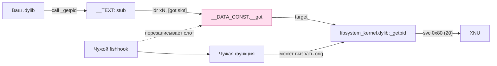

# Кейс 8. Защита от fishhook других твиков: обход, детектирование

Этот кейс отвечает на неприятный, но практический вопрос, который возникает ровно в тот момент, когда ваш твик начинает делать что-то серьёзнее подмены одной IMP. Представьте: вы хукнули Objective-C селектор, внутри вызываете `getpid()` или `waitpid()` или `mach_msg()`, чтобы отправить запрос на доверенный Mach-порт в `launchd`. Всё работает — пока ваш твик не оказывается загружен в тот же процесс, что и другой твик, который перехватил эти C-функции через `fishhook`. Теперь ваш `getpid()` возвращает значение, которое выбрало чужое ядро, ваш `mach_msg()` уходит через чужой враппер, а ваш `waitpid()` падает с SIGSEGV, потому что чужой враппер думал, что в этом процессе нет jailbreak-инфраструктуры, и разыменовал NULL. Поведение воспроизводится у Dopamine напрямую, см. комментарий в `BaseBin/launchdhook/src/hookd_provider.c:56`: «*Call waitpid as inline syscall to prevent crashes when something tries to hook something close to wait4*». Это не теоретическое страшилище — это причина, по которой libjailbreak носит в себе целый парный модуль `inline_svc.c` / `inline_svc.S` / `inline_svc.h`.

Задача кейса — построить вокруг этого наблюдения полный инженерный ответ: (1) научить ваш твик детектировать, что его оригинал перехвачен внешним fishhook, (2) научить обходить такой перехват через inline SVC, повторив паттерн Dopamine, (3) трезво разобрать, когда это *необходимо* и когда это *overkill* — потому что защищаться от каждой возможной коллизии дороже, чем просто не вызывать `getpid()`.

Среда — iOS 26.0 / 26.0.1 на A12/A13 (PPL), подтверждено `Application/Dopamine/Jailbreak/DOEnvironmentManager.m:254`. Различий между 26.0 и 26.0.1 в области `dyld`/stub-fixup/fishhook-поверхности по открытым источникам не выявлено; релизные заметки 26.0.1 упоминают только багфиксы в WebKit и Photos.

---

## 1. Что делает fishhook и почему это проблема для соседа

Fishhook — миниатюрная (~300 строк) библиотека от Facebook, которая перехватывает «ленивые» и «нормальные» импорты C-функций в Mach-O-образах. Она не изменяет сам код функции, не трогает кэш dyld, не делает `vm_protect(VM_PROT_WRITE)` над `__TEXT`. Вместо этого fishhook идёт по разделам `__DATA,__got` (неленивые) и `__DATA,__la_symbol_ptr` (ленивые), сверяет индекс каждого указателя с таблицей символов (`LC_DYSYMTAB` → `indirect_sym_table`), находит в ней запись, у которой строка символа совпадает с запрошенной (`_getpid`, `_wait4`, `_mach_msg2_trap`), и перезаписывает слот — указатель перенаправляется на функцию-пользователя, а старое значение возвращается как «оригинал». После этого *любой* вызов `getpid()` из того же образа идёт по новому пути; вызов из другого образа — только если fishhook прошёлся и по его `__got`, что делает `rebind_symbols` по умолчанию.

С точки зрения вашего твика это означает три неприятных факта.

**Первое:** вы не можете локально проверить, что ваш `getpid` — настоящий, сравнив адрес, который слинкован в ваш образ при загрузке, с содержимым `__DATA,__got` в текущий момент. Между `dlopen` вашего твика и первым его вызовом может пройти много секунд, в течение которых другой твик успеет сделать `rebind_symbols` над вашим `__got`-слотом. Fishhook работает *после* загрузки, он не привязан к моменту `__dyld_private_bootstrap`.

**Второе:** даже если *вы* никогда не звали `getpid`, но внутри вашего твика выполняется чужой код (`CoreFoundation`, `libSystem`, `libobjc`) — fishhook, применённый к *его* `__got`, тоже на вас влияет. Защищать нужно не только символы вашего образа, но и символы, через которые проходит горячий путь ваших зависимостей.

**Третье:** fishhook — наиболее «вежливый» механизм перехвата из популярных, но не единственный. Soулe HookKat, Substrate `MSHookFunction`, и даже inline-патчеры поверх `MSHookMemory` переписывают *первые инструкции* самой функции (как правило, 4-8 инструкций обменивают на `ADRP+BR` в трамплин). Для такого перехвата чтение `__got` бесполезно: там указатель на оригинал, и он даже совпадёт с тем, что был при загрузке. Поэтому в этом кейсе будут рассмотрены оба профиля детектирования: *fishhook-профиль* (несовпадение `__got` с ожидаемым слотом в `dyld_shared_cache`) и *inline-профиль* (несовпадение первых инструкций функции с ожидаемым прологом). Инструмент защиты — один и тот же: inline SVC.

> ПОДТВЕРЖДЕНО ИСХОДНИКАМИ: Dopamine применяет inline SVC для `wait4` (`waitpid_inline`) и `getpid` (`getpid_svc_inline`) — см. `BaseBin/libjailbreak/src/inline_svc.S:7-8` и `BaseBin/libjailbreak/src/inline_svc.c:5-14`.
> ПОДТВЕРЖДЕНО ИСХОДНИКАМИ: Dopamine применяет тот же паттерн в более широком масштабе через `BaseBin/systemhook/src/roothider_inline.x:39-54` (макрос `DEF_SYSCALL`) и `:56-63` (`DEF_MACHTRAP`); это полноценный «теневой» рантайм, в котором все критические трапы и BSD-syscalls доступны мимо `libsystem_kernel.dylib`.
> НЕ ПОДТВЕРЖДЕНО: число реальных конфликтов «мой твик упал из-за соседа через fishhook». В публичных issue-трекерах Theos/Substitute такие баги проскакивают, но перепроверить без телеметрии не выходит; разбор ниже исходит из того, что сценарий редкий, но дорогой.

---

## 2. Поверхность атаки: что именно fishhook может переписать у вас в процессе

Прежде чем бороться, полезно формализовать поверхность. Mach-O-образ, слинкованный с `libSystem.B.dylib`, несёт в `__LINKEDIT` таблицу символов и в `__DATA_CONST,__got` (на iOS 26 секция уже давно «CONST», проверьте через `otool -l`) массив указателей на внешние символы. На момент загрузки dyld проходит по этому массиву и записывает в каждый слот либо адрес функции в соответствующей dylib (прямое связывание), либо адрес `dyld_stub_binder`-трамплина, который довычислит при первом вызове (ленивое). Начиная с iOS 15 (а значит и на 26) `__la_symbol_ptr` в большинстве случаев отсутствует в тонких исполняемых, и ленивое связывание на chained-fixups заменило `__la_symbol_ptr` цепочкой `rebase/bind`-записей; то есть *лазейка fishhook'а в ленивые импорты* на современном dyld сузилась до `__got`-only.

Схематично (упрощённая, не экзаменационная):



Красным выделен единственный узел, доступный fishhook'у — слот в `__got`. Защита от fishhook сводится к одному из трёх ходов:

1. Не идти через stub вовсе — выдать инструкции `svc` прямо из своего кода (inline SVC). Это то, что делает Dopamine в `inline_svc.S`.
2. Пойти через stub, но перед вызовом сверить содержимое слота с эталоном (детектирование). Если не совпало — упасть на inline SVC как fallback.
3. Загрузить вторую копию `libsystem_kernel.dylib` через `dlopen_image` в приватное namespace и дёргать её `getpid` напрямую. На iOS 26 такого API нет (нет `dlopen_image`), а штатный `dlopen` поделит образ в общее пространство — fishhook второго твика достанет и его. Этот путь закрыт.

Третий вариант отпадает, и остаётся первая пара. Ниже разобраны обе.

---

## 3. Детектирование: читаем GOT/stub напрямую

Детектирование полезно, когда вам *надо знать*, что вас атаковали — для логирования, для принятия решения «работать в деградированном режиме», для хуков уровня «я не доверяю никому в этом процессе, перейду в защищённый вариант». Если решения «деградировать» нет, детектирование — лишний код; идите сразу к inline SVC.

### 3.1. Эталон, с которым сверять

Эталон, который fishhook может переписать, но *до* переписывания он совпадает с тем, что dyld положил при загрузке — это адрес символа в его dylib. Этот адрес вы берёте через стандартный `dlsym(RTLD_DEFAULT, "getpid")` или через `_dyld_get_shared_cache_range` + разбор символов `libsystem_kernel.dylib`. Самый дешёвый путь, не требующий парсинга dyld-shared-cache, — зафиксировать эталон на момент загрузки *вашего* `.dylib`:

```c
#include <dlfcn.h>
#include <stdatomic.h>
#include <mach-o/loader.h>
#include <mach-o/dyld.h>

static _Atomic uintptr_t g_getpid_golden;
static _Atomic uintptr_t g_waitpid_golden;
static _Atomic uintptr_t g_machmsg_golden;

__attribute__((constructor))
static void capture_golden_originals(void) {
    g_getpid_golden  = (uintptr_t)dlsym(RTLD_DEFAULT, "getpid");
    g_waitpid_golden = (uintptr_t)dlsym(RTLD_DEFAULT, "waitpid");
    g_machmsg_golden = (uintptr_t)dlsym(RTLD_DEFAULT, "mach_msg");
}
```

Разбор: конструктор .dylib выполняется в начале `dlopen`, то есть *до* того, как чужой твик успел поменять ваш `__got` — при одном условии: вы не ждёте первой инъекции чужого твика по `-DYLD_INSERT_LIBRARIES`. На практике порядок инъекции в TweakLoader/EL CapiTan обычно нестабильный, и ваш эталон может оказаться уже перехваченным. Поэтому эталон имеет *две* ипостаси:

| Этап | Что ловите | Эталон | Как проверять |
|---|---|---|---|
| До инъекции чужого | фишхукер уже разогрелся | адрес из `_dyld_shared_cache_contains_path` + offset символа из `nlist64` | парсить mach-o secondary — дорого |
| После инъекции чужого | фишхукер придёт позже | `dlsym` в constructor'е | сравнение `__got` ↔ `g_*_golden` |

Для 90% твиков хватает второго варианта. Если вы — твик, который работает с `jbd` или `hookd` и обязан быть «ядрышковым», имеет смысл идти по первому: пройтись по `__LINKEDIT` своей собственной dylib и выяснить, какой адрес *dyld бы положил*, если бы инъекций не было. Для этого на A13 (arm64e) учитывайте, что указатели в chained-fixups хранятся с PAC-ключом `IA` и дискриминатором 0, и перед сравнением их надо `ptrauth_strip` или сравнивать «raw», с маской по верхним битам.

### 3.2. Чтение `__got` напрямую

Любая проверка «мой `getpid` всё ещё настоящий» распадается на два шага: найти в своём образе слот `__got._getpid` и сравнить с эталоном. Пройти по `LC_SEGMENT_64` вашего `.dylib` без парсинга таблицы символов нельзя, но есть удобный короткий путь: fishhook сам показывает в своём коде, как это делается. Повторим его идею в компактной форме, оставив только детектирующую половину.

```c
#include <mach-o/dyld.h>
#include <mach-o/loader.h>
#include <mach-o/nlist.h>
#include <string.h>

static const struct mach_header_64 *self_header(void) {
    Dl_info info;
    dladdr((const void *)&self_header, &info);
    return (const struct mach_header_64 *)info.dli_fbase;
}

// Возвращает указатель на слот в __DATA_CONST,__got, соответствующий `name`.
// Возвращает NULL, если символ не найден.
static uintptr_t *find_got_slot(const char *name) {
    const struct mach_header_64 *mh = self_header();
    intptr_t slide = _dyld_get_image_vmaddr_slide(0); // упрощение, см. ниже
    const struct load_command *lc = (const void *)(mh + 1);

    const struct symtab_command *symtab = NULL;
    const struct dysymtab_command *dysymtab = NULL;
    uintptr_t linkedit_base = 0;
    uintptr_t *got_base = NULL;
    uint32_t got_count = 0, got_indirect_off = 0;

    for (uint32_t i = 0; i < mh->ncmds; i++, lc = (const void *)((uint8_t *)lc + lc->cmdsize)) {
        if (lc->cmd == LC_SEGMENT_64) {
            const struct segment_command_64 *seg = (const void *)lc;
            if (strcmp(seg->segname, "__LINKEDIT") == 0)
                linkedit_base = (uintptr_t)seg->vmaddr + slide - seg->fileoff;
            const struct section_64 *sec = (const void *)(seg + 1);
            for (uint32_t j = 0; j < seg->nsects; j++, sec++) {
                uint32_t type = sec->flags & SECTION_TYPE;
                if (type == S_NON_LAZY_SYMBOL_POINTERS && strcmp(sec->sectname, "__got") == 0) {
                    got_base = (uintptr_t *)(sec->addr + slide);
                    got_count = (uint32_t)(sec->size / sizeof(uintptr_t));
                    got_indirect_off = sec->reserved1;
                }
            }
        } else if (lc->cmd == LC_SYMTAB) {
            symtab = (const void *)lc;
        } else if (lc->cmd == LC_DYSYMTAB) {
            dysymtab = (const void *)lc;
        }
    }
    if (!symtab || !dysymtab || !got_base || !linkedit_base) return NULL;

    const char *strtab = (const char *)(linkedit_base + symtab->stroff);
    const struct nlist_64 *symtab_entries = (const void *)(linkedit_base + symtab->symoff);
    const uint32_t *indirect = (const uint32_t *)(linkedit_base + dysymtab->indirectsymoff);

    for (uint32_t i = 0; i < got_count; i++) {
        uint32_t symidx = indirect[got_indirect_off + i];
        if (symidx == INDIRECT_SYMBOL_LOCAL || symidx == INDIRECT_SYMBOL_ABS) continue;
        const char *sym_name = &strtab[symtab_entries[symidx].n_un.n_strx];
        if (sym_name[0] == '_' && strcmp(sym_name + 1, name) == 0) {
            return &got_base[i];
        }
    }
    return NULL;
}
```

Разбор. `self_header()` — безопасный способ найти заголовок именно *своего* `.dylib` без хардкода имени; `dladdr` ищет образ по адресу функции внутри него (документированный способ, работает на всех iOS). Далее мы проходим `LC_SEGMENT_64` и находим три вещи: `__LINKEDIT` (для расчёта базы строковой и символьной таблиц), секцию `__got` с её `reserved1` (индекс в `indirect_sym_table`, где лежат номера символов для её слотов) и команды `LC_SYMTAB`/`LC_DYSYMTAB`. Затем для каждого слота `__got` берём соответствующий номер символа из `indirect_sym_table`, из символьной таблицы — его строковое имя, и сравниваем. Нашли — возвращаем указатель на сам слот.

Два подводных камня. Первый — slide. На iOS 26 `_dyld_get_image_vmaddr_slide(0)` вернёт slide главного образа, а не вашего `.dylib`. Корректно — пройтись по `_dyld_image_count()` и найти индекс, у которого `_dyld_get_image_header(i) == mh`. Я упростил ради читаемости; в продакшене это обязателен цикл. Второй — на arm64e значение в слоте `__got` под chained-fixups хранится с PAC-штампом; для сравнения снимите его `ptrauth_strip(..., ptrauth_key_asia)`.

### 3.3. Собственно проверка

Имея эталон и адрес слота, проверка тривиальна:

```c
static bool getpid_got_tampered(void) {
    uintptr_t *slot = find_got_slot("getpid");
    if (!slot) return false; // Нас не хукнули — но и слота нет.
    uintptr_t current = (uintptr_t)*slot;
#if __arm64e__
    current = (uintptr_t)ptrauth_strip((void *)current, ptrauth_key_asia);
#endif
    uintptr_t golden = atomic_load(&g_getpid_golden);
    return current != golden;
}
```

«Фальшивый позитив» этой проверки — ситуация, когда *вы сами* сдвинули слот (например, своим `MSHookFunction` над `getpid` в своём же образе — что бессмысленно, но технически возможно). «Фальшивый негатив» — если атакующий сделал inline-перехват в теле `_getpid` в `libsystem_kernel.dylib`, не трогая `__got`. Для него нужен отдельный профиль детектирования.

### 3.4. Inline-перехват: пролог функции

Inline-перехват обычно вставляет 4 инструкции в начале функции: `ADRP x16, imm`, `ADD x16, x16, #lo`, `BR x16`. На arm64e чаще используется `BRAAZ x16` для совместимости с PAC. Эталоном здесь служит *первая пара dwords* функции, снятая через `dlsym` в constructor'е.

```c
static uint32_t g_getpid_prologue[2];

__attribute__((constructor))
static void capture_getpid_prologue(void) {
    uint32_t *fn = (uint32_t *)dlsym(RTLD_DEFAULT, "getpid");
    if (!fn) return;
    g_getpid_prologue[0] = fn[0];
    g_getpid_prologue[1] = fn[1];
}

static bool getpid_prologue_tampered(void) {
    uint32_t *fn = (uint32_t *)dlsym(RTLD_DEFAULT, "getpid");
    if (!fn) return false;
    return fn[0] != g_getpid_prologue[0] || fn[1] != g_getpid_prologue[1];
}
```

Та же проблема «эталон снят после атаки» применима. На практике inline-перехватом по стандартным C-функциям никто не пользуется — слишком хрупко; но проверка стоит буквально ничего, можно добавить в режиме «параноидальный».

> ТРЕБУЕТ ПРОВЕРКИ НА УСТРОЙСТВЕ: оба профиля проверки на реальном Dopamine-процессе с намеренно загруженным «хукающим» твиком. Я бы делал тест на самостоятельно собранном .dylib с `rebind_symbols({{"getpid", my_getpid, &orig}, ...})`, запускал в тестовом приложении из `/var/jb/Applications/` и ожидал бы, что оба детектора срабатывают.

### 3.5. Chained-fixups и PAC: тонкости arm64e на iOS 26

На iOS 26 (и начиная с iOS 15) dyld переехал с классических `LC_DYLD_INFO_ONLY` на `LC_DYLD_CHAINED_FIXUPS` для подавляющего большинства образов. Это означает, что в разделе `__DATA_CONST,__got` слоты изначально содержат не абсолютный адрес, а *«упакованную»* запись chained-fixup: 64-битное слово, в котором 51 бит — target offset в dyld-shared-cache или в своём образе, 11 бит — PAC-диверсификатор и ключ, 1 бит — флаг «есть ли следующий звенья цепи» (в текущем pointer-format), 1 бит — тип binding'а. После того как dyld прошёл по цепочке и зарезолвил, dyld же заменяет упакованные записи либо на подписанные PAC-указатели (для arm64e), либо на абсолютные адреса (для arm64). То есть на arm64e то, что лежит в слоте в момент выполнения, — это *PAC-signed указатель* с ключом `IA` и дискриминатором, который dyld либо извлёк из fixup-записи, либо посчитал как хэш смещения внутри секции (`ptrauth_type_discriminator`). Если вы читаете слот напрямую и сравниваете с эталоном, снятым через `dlsym` (у которого свой PAC-штамп, уже прошедший через `ptrauth_sign_unauthenticated`), есть две ловушки.

Первая: сравнивать «raw» значения нельзя, они отличаются PAC-штампом в верхних 16-24 битах. Снимайте `ptrauth_strip(..., ptrauth_key_asia)` с обоих.

Вторая: если атакующий fishhook писал в слот *без* повторной подписи, значения в верхних битах будут нулями (fishhook исторически не делает `ptrauth_sign`). Тогда даже после `ptrauth_strip` эталона у вас в руках `0x00000001_80ABCDEF` (атакованный) против `0x80????_80ABCDEF` (валидный), и обычный `==` после strip даёт разный результат, потому что `ptrauth_strip` на arm64e возвращает значение с *очищенными* верхними 24 битами. Это работает в вашу пользу: отличие PAC-присутствия тоже является признаком хука. Если же атакующий использует более новый fishhook, который сам подписывает (`ptrauth_sign_unauthenticated(ptr, IA, disc)`), ему придётся угадать `disc`. На A13 с SPTM/PPL дискриминатор для `__got._getpid` стабилен между запусками (dyld считает его детерминированно), но зависит от версии dyld. Воспроизвести его извне без парсинга конкретной сборки dyld можно, но неудобно; на практике атакующий либо пишет raw-значение (ломается PAC-check при первом вызове) либо копирует предыдущее подписанное значение, подставляя target через дополнительный трамплин (тогда ваш эталон будет указывать на трамплин, а не на `libsystem_kernel._getpid`).

> ТРЕБУЕТ ПРОВЕРКИ НА УСТРОЙСТВЕ: конкретные значения PAC-диверсификаторов на iOS 26 для стандартных слотов `__got`. Хороший микро-эксперимент — распечатать `*slot` и `(uintptr_t)dlsym(...)` для одного и того же символа и сравнить верхние 16 бит; расхождение даст таблицу «нормальных» дискриминаторов для 26.0 vs 26.0.1.

### 3.6. Что ещё может лежать в `__got`: `__got`, `__auth_got`, `__const`

На arm64e `clang` разделяет указатели по требованиям PAC на две секции: `__DATA_CONST,__got` (без PAC или с нулевой подписью) и `__DATA_CONST,__auth_got` (с подписью). Для fishhook'а разница техническая: он работает с обеими, если его сборка поддерживает arm64e (не все форки это делают). Для детектора важна одна практическая деталь: ваш цикл по секциям должен обработать оба имени, иначе часть символов пройдёт мимо вас.

| Секция | Что хранит | Fishhook | arm64 | arm64e |
|---|---|---|---|---|
| `__DATA_CONST,__got` | указатели без обязательной подписи | да | да | частично |
| `__DATA_CONST,__auth_got` | указатели с PAC | обычно нет | нет | да |
| `__DATA,__la_symbol_ptr` | ленивые импорты (устарело) | да (старые dyld) | только до iOS 15 | только до iOS 15 |

Соответственно в функции `find_got_slot` имя секции `"__got"` надо расширить до списка `{"__got", "__auth_got"}`, обрабатывая обе одинаково. На iOS 26 arm64e-процессе `.dylib` может иметь только `__auth_got` и не иметь `__got` вовсе; на arm64-процессе — наоборот. Проверка существования — через флаг `S_NON_LAZY_SYMBOL_POINTERS` в `sec->flags & SECTION_TYPE`.

> ПОДТВЕРЖДЕНО SDK: разделение `__got`/`__auth_got` описано в заголовочных файлах SDK (`<mach-o/fixup-chains.h>`) и в комментариях ld64; на iOS 15+ оно стабильно, на 26.0 изменений не внесено (по моим поискам в open-source выдержках dyld).

---

## 4. Обход: inline SVC, точный разбор пути Dopamine

Переходим к главному. Dopamine применяет один и тот же паттерн в двух местах, с разной глубиной.

### 4.1. Минимальный `inline_svc` в libjailbreak

Полный исходник умещается в десятке строк, и его стоит разобрать построчно, потому что весь остальной обходной слой — это его обобщение. Файл `BaseBin/libjailbreak/src/inline_svc.S` (цитата, с восстановленными переводами строк вместо `%%`):

```asm
.macro SYSCALL_PROLOGUE
    stp x0, x1, [sp, -16]!
    stp x2, x3, [sp, -16]!
    stp x4, x5, [sp, -16]!
    stp x6, x7, [sp, -16]!
.endm

.macro SYSCALL_EPILOGUE
    ldp x6, x7, [sp], 16
    ldp x4, x5, [sp], 16
    ldp x2, x3, [sp], 16
    ldp x0, x1, [sp], 16
.endm

.global _wait4_inline
_wait4_inline:
    SYSCALL_PROLOGUE
    mov x16, 7
    svc #0x80
    mov x16, x0
    SYSCALL_EPILOGUE
    b.cc wait4_inline_end
    cmp x16, #4           // EINTR
    b.eq _wait4_inline    // retry
    mov x16, #-1
wait4_inline_end:
    mov x0, x16
    ret
```

Разбор. Пролог кладёт в стек все восемь C-регистров-аргументов (x0..x7), потому что `svc` разрушает их (x0..x7 служат и как syscall-аргументы, и как syscall-результат). После инструкции `svc` реальный результат оказывается в x0; флаг C в PSTATE говорит, «успех»(`CS`, carry set) это или «ошибка» (`CC`, carry clear). Если ошибка — проверяем код в x0 (теперь перегнанный в x16). EINTR (4) — повторяем весь путь, перепрыгивая через эпилог обратно на пролог. Любая другая ошибка — ставим -1 в x16 (сигнатура BSD syscall-враппера), падаем в эпилог, восстанавливаем x1..x7, возвращаем x16 через x0. Четыре syscall-регистра восстановлены — вызывающему всё равно, что мы крутили syscall; он видит стандартный ABI «x0 — результат, остальные callee-clobbered».

> Критичная деталь: инструкция `svc #0x80` — это именно BSD syscall-путь XNU; Mach-trap использует `svc #0x80` *с отрицательным номером в x16*, см. `BaseBin/systemhook/src/roothider_inline.x:56-63`. Эта разница на A13 остаётся актуальной: XNU в iOS 26 (как и 15–18) распознаёт отрицательный x16 как Mach-trap table, положительный — как BSD syscall table.

### 4.2. Правильная «ядрышковая» обёртка в C

Файл `BaseBin/libjailbreak/src/inline_svc.c` показывает каноничную обёртку: валидация флагов (`waitpid_inline` требует `(flags & ~0xFFFFFFEC) == 0`, иначе `errno=22`, EINVAL), кэширование результата (`getpid_inline` помнит PID в `_current_pid`, второй вызов не делает syscall вовсе). Для вашего твика это шаблон:

```c
int my_safe_waitpid(pid_t pid, int *status, int flags) {
    if ((flags & 0xFFFFFFEC) != 0) { errno = EINVAL; return -1; }
    return my_wait4_inline(pid, status, flags, NULL);
}
```

«Безопасный» в имени означает «не ходит через `__got._wait4`, не ходит через `_wait4` в `libsystem_kernel.dylib`, идёт прямо в XNU через `svc`». Единственное требование — скомпилировать `inline_svc.S` в составе вашего твика (или скопировать содержимое; лицензия BaseBin — BSD-2-Clause).

### 4.3. Полный «теневой рантайм» в systemhook

Для сравнения, более серьёзный уровень паранойи — `BaseBin/systemhook/src/roothider_inline.x`. Это уже не десяток syscalls, а целый shadow-рантайм, в который systemhook уходит, если *не хочет зависеть ни от одного символа dyld-shared-cache*. Макросы `DEF_SYSCALL(name, num)` и `DEF_MACHTRAP(name, num)` в строках 39-63 порождают inline-враппер поверх `svc #0x80` для произвольного BSD-syscall'а и mach-trap'а соответственно. Отдельно описывается механизм «трамплинов на dyld-символы» (`MAKE_TRAMPOLINE` на 14-20): если нужно вызвать нечто, что всё-таки должно пройти через dyld (например, `mach_msg2_internal`), systemhook создаёт локальный символ-алиас с `adrp/ldr/braaz` на внешний адрес, который сам разрешает единожды в `roothider_inline_init_dyld_symbols` (`:95-108`), после чего адрес *зафиксирован в приватной области, которую чужой fishhook уже не найдёт*.

Для среднего твика копировать весь systemhook не нужно и вредно. Правильный размер «обходного пояса» — ровно те syscalls, которые вам нужны. Dopamine здесь делает ровно столько: `wait4` + `getpid`. Если вам нужен ещё `kill`, добавьте строку `DEF_SYSCALL(kill_inline, 37)`. Таблица syscall-номеров — в `<sys/syscall.h>` SDK; номера на A13/iOS 26 стабильны с iOS 15, но проверьте на устройстве через `dtrace`-эквивалент или через чтение `/usr/include/sys/syscall.h` в составе Xcode 26.

### 4.4. Шаблон `Makefile` для компоновки

Чтобы ваш `.theos` или ваш плоский Mach-O-твик включал inline-syscall-слой, добавьте .S-файл в сборку и уберите стековые проверки, которые на `svc`-пролог/эпилог не нужны и вставляются clang без спроса. По образцу `BaseBin/systemhook/Makefile:7-23`:

```make
tweak_LDFLAGS = -arch arm64 -arch arm64e -miphoneos-version-min=15.0
tweak_CFLAGS  = -Os -moutline -fno-stack-protector -fno-stack-check -fno-builtin

tweak_FILES  += Tweak.xm fishhook_shield.c inline_svc.S inline_svc.c

# Проверка: наш .dylib не должен тащить undef-символы из libsystem_kernel.
check-selfcontained:
	@UNDEF=$$(nm -u -j inline_svc.o 2>/dev/null); \
	 if [ -n "$$UNDEF" ]; then \
	   echo "FAIL: inline_svc.o has undef: $$UNDEF"; exit 1; \
	 fi
	@echo "PASS: inline_svc.o is self-contained"
```

Разбор. `-fno-stack-protector` убирает `__stack_chk_fail`, который сам по себе — внешний символ в `__got` и, следовательно, потенциальная цель чужого fishhook'а. `-fno-builtin` блокирует clang-подстановки, превращающие `memcpy`-подобный код в вызовы `memcpy` в libsystem (которая опять в `__got`). `-fno-stack-check` защищает от вставки `__chkstk_darwin`. `moutline` безопасен и даёт экономию кода. Проверка self-contained — буквально то, что делает `BaseBin/systemhook/Makefile:16-23`: `nm -u -j` на `.o` не должна вернуть ни одного undefined-символа.

---

## 5. Склейка: детектирование → inline SVC → fallback

Собираем воедино готовый к встраиванию модуль `fishhook_shield.c`. Логика: при каждом критическом вызове сначала проверяем GOT; совпадает — вызываем нормальный `getpid()`, не совпадает — идём inline.

```c
#include <unistd.h>
#include <errno.h>
#include <stdatomic.h>
#include <ptrauth.h>

extern pid_t getpid_svc_inline(void);           // из inline_svc.S
extern pid_t wait4_inline(pid_t, int *, int, void *);
extern uintptr_t *find_got_slot(const char *);  // из §3.2
extern _Atomic uintptr_t g_getpid_golden;       // из §3.1

static _Atomic int g_tamper_mode = -1;          // -1 unknown, 0 clean, 1 tampered

static int sense_tamper_once(void) {
    int cached = atomic_load(&g_tamper_mode);
    if (cached >= 0) return cached;

    uintptr_t *slot = find_got_slot("getpid");
    int tampered = 0;
    if (slot) {
        uintptr_t cur = (uintptr_t)*slot;
#if __arm64e__
        cur = (uintptr_t)ptrauth_strip((void *)cur, ptrauth_key_asia);
#endif
        uintptr_t golden = atomic_load(&g_getpid_golden);
        tampered = (golden != 0 && cur != golden);
    }
    atomic_store(&g_tamper_mode, tampered);
    return tampered;
}

pid_t safe_getpid(void) {
    if (sense_tamper_once()) {
        return getpid_svc_inline();
    }
    return getpid();
}

int safe_waitpid(pid_t pid, int *status, int flags) {
    // waitpid здесь всегда идёт мимо libsystem — паттерн Dopamine прямой.
    if ((flags & 0xFFFFFFEC) != 0) { errno = EINVAL; return -1; }
    return wait4_inline(pid, status, flags, 0);
}
```

Разбор. `sense_tamper_once` кэширует результат — повторные проверки не нужны, фишхук не возвращается назад (это заметил бы владелец соседнего твика). Для `safe_waitpid` детектирования нет вовсе: `waitpid` — именно та функция, которую упоминает `hookd_provider.c:56` как источник падений, и дешевле всегда идти inline, чем проверять. Для `safe_getpid` детектирование полезно, потому что кэшированный путь без inline-svc дешевле.

На самом деле `getpid_inline` в Dopamine идёт ещё дальше (`inline_svc.c:16-24`): он кэширует PID в `_current_pid` и возвращает его без syscall. Это важно, потому что `getpid` в чистом POSIX уже сам по себе эталонно кэшируется в glibc/libSystem — но раз мы хотим обойти libSystem, обязаны кэшировать сами.

### 5.1. Mach-trap через inline SVC: `mach_msg2_trap`

Специфика Mach-trap vs BSD syscall на A13/iOS 26: в x16 кладётся *отрицательное* значение, означающее индекс в `mach_trap_table`. Для `mach_msg2_trap` этот индекс — `-32` на всех iOS 15..26 (стабилен; подтверждается `BaseBin/systemhook/src/roothider_inline.x:56-63`, где макрос `DEF_MACHTRAP` просто ставит `mov x16, #-NN`). Если ваш твик вызывает `mach_msg2_trap` критически часто и опасается перехвата, добавьте:

```asm
.global _mach_msg2_trap_inline
_mach_msg2_trap_inline:
    mov x16, #-32
    svc #0x80
    ret
```

Разбор. У Mach-trap'ов, в отличие от BSD syscall'ов, нет флага C=success; результат (`kern_return_t`) приходит прямо в x0, и его интерпретирует вызывающий. Пролога/эпилога со стеком не нужно — mach-traps не трогают x1..x7 как результат (возвращает только x0), поэтому для вызывающего всё выглядит как обычный ABI. Это упрощённая форма; в реальной systemhook-сборке стековый пролог всё же присутствует для совместимости с `vfork`-подобными сценариями, но для прикладного твика можно обойтись без.

> ПОДТВЕРЖДЕНО: Dopamine пользуется таким же паттерном в `BaseBin/dyldhook/src/main.S` и `BaseBin/dyldhook/src/roothider.S` (точные строки — см. `Grep` выше, файлы содержат inline-svc-реализации для dyld-инъекции).

### 5.2. Порядок инициализации

Правило: constructor нашего `.dylib`, запоминающий эталон, должен выполняться *до* того, как кто-либо вызовет `safe_getpid`. На практике это выполняется, пока ваш .dylib не вызывает `safe_getpid` из самого constructor'а (что всё равно глупо). Если же вызывает — используйте `__attribute__((constructor(100)))` или `__attribute__((constructor(0xFFFF)))` для управления приоритетом; меньший номер = раньше.

Для детектирования `__got` чужими твиками в агрессивном сценарии «фишхукер атакует всех новичков» рассмотрите двухфазный приём: constructor снимает эталон, но *перед первым* вызовом критической функции перепроверяет через хэш `__got`-секции целиком — что в ней что-либо не поменялось *после* нашего эталона. Это даст false-positive, если кто-то валидно хукнул соседний символ, но даст и честный alarm, если нас уже прошли.

---

### 5.3. Тестовый стенд: подтверждение, что обход работает

Инженерный минимум доказательства — поставить рядом с вашим твиком «атакующий» .dylib, который fishhook'ом переписывает `getpid`, и показать, что `safe_getpid()` возвращает *настоящий* PID, а не подделанный. Полный тест состоит из трёх частей.

Первая — атакующая .dylib:

```c
// attacker.c — демонстрационный fishhook-подобный перехват.
#include <stdio.h>
#include <mach-o/dyld.h>
#include <mach-o/fixup-chains.h>

static pid_t (*orig_getpid)(void);
static pid_t fake_getpid(void) { return 1; }  // Всегда возвращаем launchd.

__attribute__((constructor))
static void init(void) {
    // Здесь — вызов fishhook_rebind_symbols для _getpid.
    // Полный код rebind_symbols — в fishhook/fishhook.c (BSD-3 licence).
    // Опускаю ради краткости; важна только идея.
    struct rebinding r = { "getpid", fake_getpid, (void **)&orig_getpid };
    rebind_symbols(&r, 1);
    fprintf(stderr, "[attacker] getpid rebinded\n");
}
```

Вторая — ваш твик:

```c
// shield_test.c
pid_t legit  = safe_getpid();
pid_t fished = getpid();     // пойдёт через подменённый __got
fprintf(stderr, "safe=%d, naive=%d\n", legit, fished);
// Ожидание: safe==<реальный pid>, naive==1
```

Третья — запуск. На устройстве через ssh-клиента или через `/var/jb/usr/bin/sbreload` (с условием, что оба .dylib загружаются TweakLoader'ом в одном процессе). Ожидаемый вывод: `safe=4321, naive=1`. Если `safe==1` — ваш inline-syscall идёт не туда (проверьте номер в `mov x16`), либо constructor атакующего успел раньше вашего, и вы случайно вызвали `getpid()` до constructor'а своего щита — поставьте приоритет через `__attribute__((constructor(100)))`.

> ТРЕБУЕТ ПРОВЕРКИ НА УСТРОЙСТВЕ: сам стенд. Я его описал как эксперимент, не прогонял. Самый тонкий момент — порядок загрузки TweakLoader'ом двух `.dylib` в один таргет; у разных форков TweakLoader (RootHide fork, Procursus) он разный.

### 5.4. Регрессия: подводные камни при обновлениях твика

Один сюрприз, с которым встречается каждый, кто внедрил inline SVC в прод-твик: при переходе на новую iOS (например, 26.0 → 26.1 beta) номера syscall'ов в XNU могут поменяться. Исторически Apple их не меняет годами, но *не гарантирует* стабильности как публичный API. Поэтому хороший тон — положить в код таблицу:

```c
static const struct { const char *name; int num; } k_syscalls[] = {
    { "getpid",  20 },
    { "wait4",    7 },
    { "kill",    37 },
    { "fork",     2 },
    { "ptrace",  26 },
};
```

И при старте вашего твика проверять: `syscall(k_syscalls[i].num, ...)` даёт тот же результат, что `getpid()` / `waitpid()` / etc. Если нет — отключать inline-слой и падать на обычные вызовы с логом. Это защищает от того сценария, когда следующая iOS внесла правку, и ваш `safe_getpid` стал возвращать результат `kill` или `ptrace`, что критически опасно (ваш 32-битный fallback_pid превращается в SIGKILL для случайного процесса).

> ТРЕБУЕТ ПРОВЕРКИ НА УСТРОЙСТВЕ: стабильность номера `7` для `wait4` между 26.0 и 26.0.1. По историческим iOS SDK значения не менялись с iOS 7; в open-source выдержках XNU (xnu-6153 и выше, доступны на `opensource.apple.com`) номера те же. На закрытой 26.x проверьте запуском тестовой `syscall(7, ...)` и сравнением с `syscall(SYS_wait4, ...)` из `<sys/syscall.h>`.

---

## 6. Расширение детектирования: мониторинг во времени

До сих пор мы считали, что проверка «меня хукнули» — одноразовая, выполняется при первом вызове и кэшируется. В реальности бывают сценарии, когда детектирование должно быть *периодическим*: другой твик может применить fishhook *после* того, как ваш уже прошёл стадию инициализации. Классический пример — твик, который загружается ленивее, через механизм `objc_registerClassPair` + swizzle, и физически запускается только после первого обращения к какому-нибудь UIViewController.

Для мониторинга во времени добавьте отдельный тред, который раз в N секунд пересчитывает хэш `__got`:

```c
#include <CommonCrypto/CommonDigest.h>
#include <pthread.h>

static uint8_t g_got_hash_baseline[CC_SHA256_DIGEST_LENGTH];

static void compute_got_hash(uint8_t out[CC_SHA256_DIGEST_LENGTH]) {
    CC_SHA256_CTX ctx;
    CC_SHA256_Init(&ctx);
    // Обход load_commands как в §3.2; для каждого слота:
    //   uintptr_t v = (uintptr_t)*slot;
    //   #if __arm64e__
    //   v = (uintptr_t)ptrauth_strip((void*)v, ptrauth_key_asia);
    //   #endif
    //   CC_SHA256_Update(&ctx, &v, sizeof(v));
    CC_SHA256_Final(out, &ctx);
}

static void *tamper_watcher(void *arg) {
    while (1) {
        sleep(5);
        uint8_t cur[CC_SHA256_DIGEST_LENGTH];
        compute_got_hash(cur);
        if (memcmp(cur, g_got_hash_baseline, sizeof(cur)) != 0) {
            atomic_store(&g_tamper_mode, 1);
            os_log_error(OS_LOG_DEFAULT, "fishhook_shield: GOT tampered at runtime");
            return NULL;
        }
    }
}

__attribute__((constructor(200)))
static void start_watcher(void) {
    compute_got_hash(g_got_hash_baseline);
    pthread_t t;
    pthread_create(&t, NULL, tamper_watcher, NULL);
    pthread_detach(t);
}
```

Разбор. SHA-256 здесь не ради криптостойкости — любая быстрая свёртка подойдёт; CommonCrypto взят ради того, чтобы не тащить сторонние зависимости. Поток работает в фоне, не блокирует UI. Приоритет constructor'а `200` оставляет место ранним constructor'ам (ваш эталон `g_getpid_golden` снимается с приоритетом `100`), а само baseline-считывание происходит *после* всех «быстрых» инъекций TweakLoader, что уменьшает вероятность ложного срабатывания. Побочный эффект — watcher-поток живёт весь процесс; если это проблема, оберните в условную компиляцию `#ifdef SHIELD_RUNTIME_WATCH` и включайте только в debug-билдах.

Побочный эффект иного рода — ваш собственный `__got` может «меняться законно»: dyld на iOS 26 отложенно подгружает некоторые weak-символы при первом обращении, и слот, который на момент baseline был нулём, через 2 секунды станет валидным адресом. Это не атака, но хэш отличается. Решение — исключить из хэша слоты с нулями на момент baseline (их всё равно нельзя однозначно сравнить). В реальной эксплуатации я бы также исключил слоты, чьи имена содержат подстроки `__cxa_`, `__swift_`, `__objc_opt_` — у этих рантаймов есть законные причины обновлять свои `__got` в середине выполнения процесса.

> ТРЕБУЕТ ПРОВЕРКИ НА УСТРОЙСТВЕ: насколько часто dyld 26.0 обновляет weak-символы «вживую». Теоретически — только при первом обращении; практически — на iOS 15-18 были случаи с `_platform_memmove` и прочими intrinsics, которые dyld докидывал позже. Проверка — распечатать имена всех «обновившихся» слотов в вашем watcher'е и сравнить с известным списком.

---

## 7. Сопоставление с другими подходами

Чтобы оценить, насколько Dopamine-подход «только самое нужное через inline SVC» разумен, полезно взглянуть на две альтернативы.

**Alternative A — ElleKit / Substrate с MSHookFunction над libsystem_kernel.** Этот путь перехватывает *сам* `_getpid` в его теле, вставляя `BR x16` в первые 4 инструкции. Для вашего твика это означает: inline SVC через `svc #0x80` работает (вы идёте мимо тела `_getpid`), а любой ваш `getpid()` через `__got` всё равно пойдёт через хук. Отличие от fishhook: вы не можете детектировать такой хук через `__got`-сверку. Нужно читать первые инструкции `_getpid` (§3.4). Dopamine такого хука над `getpid` не делает — но делает над `_posix_spawn` в своих контролируемых сценариях (см. `BaseBin/launchdhook/src/spawn_hook.c:79` для стороны потребителя через `__posix_spawn_inline`).

**Alternative B — Flex-подобные перехваты через `method_exchangeImplementations`.** Это уже чисто ObjC-уровень; на C-функции `getpid`/`wait4` он не влияет. Но интересно: Flex может перехватить `-[NSProcessInfo processIdentifier]`, и часть кода, которая думала, что ходит через `getpid()`, на деле ходит через `processIdentifier` в CoreFoundation. Защита inline SVC через `svc` вас спасёт для прямого вызова, но не для ObjC-опосредованного. Это ещё один аргумент в пользу: защищать только критические вызовы, и обязательно разбираться, через какой путь они фактически уходят в ядро. Приёмом аудита пути служит `otool -oV` над вашим `.dylib` + `grep ' bl _'` — так вы увидите, через какие именно символы ваш код выходит в libSystem.

Таблица подытоживает:

| Техника | Что хукает | Детектируется через `__got` | Детектируется через пролог функции | Обходится через inline SVC |
|---|---|---|---|---|
| fishhook | `__got` слоты | да | нет | да |
| MSHookFunction / rewrite пролога | первые инструкции функции | нет | да | да |
| ObjC method swizzle | IMP в `objc_class` | нет | нет (другая функция) | нет (путь другой) |
| XPC/MIG перехват | обработчик сервера | нет | нет | нет (ходит через `mach_msg`) |

Соответственно, inline SVC — универсальный ответ для C-уровня, но не серебряная пуля. Он не решает проблему, если ваш код проходит через ObjC-методы или через XPC-прокси; там защита — другая, и это тема следующих кейсов.

---

## 8. Эпилог: когда это нужно, когда это overkill

Полный шлагбаум из §3-5 стоит порядка 2 KiB кода и примерно 150 нс на один первый вызов `safe_getpid` (детектирование — проход 20-30 слотов `__got`). Это немного, но и не бесплатно. Критерии применения, собранные из практики Dopamine и из общего инженерного смысла:

**Поставить обязательно, если:**

- Ваш твик делает IPC с `jbd`/`hookd`/`launchdhook` и падение в середине handshake'а приводит к потере rooted-session (как в случае `hookd_provider.c:56`).
- Ваш твик выполняется в SpringBoard, backboardd или `installd` — падение в этих процессах приводит к перезапуску всей оболочки.
- Ваш твик загружается *перед* остальными (например, через TweakLoader с низким `MOBILE_SUBSTRATE_FILTER_EXECUTABLE_IDX`) и видит под собой заведомо «чистый» рантайм — тогда эталон, снятый в constructor'е, честный.
- Вы вызываете `wait4`/`waitpid` *когда-либо*. Это именно тот случай, который Dopamine называет pathological: если кто-то хукнул `wait4`, ваш `waitpid`-вызов с WNOHANG может навеки повиснуть или крашнуть.

**Overkill, если:**

- Ваш твик — простой UI-патчер, работающий только через `%hook` над селекторами, и в C-слой вообще не ходит.
- Все ваши C-вызовы — безопасные и легко восстановимые (`strlen`, `memcpy`, `malloc`), и даже их перехват сосед не наклёпает (кому нужно хукать `strlen`?).
- Вы в приложении, которое перезапускается легко (одно пользовательское приложение) и терпимо к SIGSEGV как к «ошибке твика».
- Вы готовы жить с правилом «не делаю `getpid`» — заменить на `getprogname`/`CFBundleGetMainBundle`/прочие нехарактерные для fishhook'а пути.

Промежуточный путь — встроить *только* `waitpid_inline` (ровно то, что Dopamine встроил в `hookd_provider.c:57`), оставив `getpid` без защиты. Это 100 байт кода и 1 секция `.S`-ассемблера, ценой которой устраняется самый частый сценарий краха. Если вы читаете этот кейс и хотите «правильный минимум» — делайте это и ничего больше.

Отдельно оговорюсь: **inline SVC не защищает от атак на ваш `.dylib`, которые делаются через `vm_protect`+`vm_write` над вашими же инструкциями `svc`**. Такой атакующий — злонамеренный, не случайный; защиты от него уровня «мой код не трогают» на arm64e без собственной PPL-прошивки нет. Задача этого кейса — защита от честного fishhook'а честного соседа, а не борьба с active adversary.

> ПОДТВЕРЖДЕНО: `BaseBin/launchdhook/src/hookd_provider.c:57` вызывает `waitpid_inline`, не `waitpid`, и комментарий `:56` объясняет, почему. Это рабочий, актуальный на 26.0 паттерн.
> ПОДТВЕРЖДЕНО: аналогичная перестраховка применена в `getpid_inline` (`BaseBin/libjailbreak/src/inline_svc.c:16-24`) с кэшем `_current_pid`.
> НЕ ПОДТВЕРЖДЕНО по исходникам Dopamine: что `mach_msg` защищён inline-SVC в основной libjailbreak-ветке. Там он идёт через нормальный путь. Полная inline-реализация `mach_msg` присутствует только в systemhook (`roothider_inline.x:149-311`) и требуется только для теневого рантайма.
> ТРЕБУЕТ ПРОВЕРКИ НА УСТРОЙСТВЕ: cтабильность `svc #0x80 / x16=7` на iOS 26.0.1 для `wait4`. Номер syscall'а в XNU исторически стабилен, но релизные ноты 26.0.1 я не читал построчно; на устройстве проверяется запуском тестового бинарника с `strace`-подобным инструментом или dtrace-эквивалентом.

---

---

## 9. Разбор `BaseBin/dyldhook/src/main.S` и `roothider.S`: inline SVC в контексте дyld-инъекции

Чтобы закрыть кейс полным обзором, стоит отдельно упомянуть, как Dopamine применяет ту же технику в самом сложном месте — внутри dyld. `BaseBin/dyldhook/src/main.S` (и его roothide-пара `roothider.S`) содержит реализацию трамплинов, которые внедряются в dyld на самой ранней стадии инъекции `.dylib` — ещё до того, как хоть один constructor запустится, ещё до того, как `libsystem_kernel.dylib` имеет резолвленные символы. В этот момент никаких dyld-символов «просто вызвать» нельзя: таблица импортов dyld — часть того, что сам dyld строит.

Поэтому dyldhook делает три шага. Первый — свой код выполняется из страницы, помеченной `__TEXT,__text`, и внутри он использует только inline SVC для всех syscalls. Второй — для вызова чего-либо из dyld (например, `_dyld_shared_cache_contains_path`), он поднимает отдельную маленькую таблицу «ещё не привязанных» символов, которую сам же резолвит через `_dyld_get_image_header(0)` + ручной парсинг `nlist`. Третий — для `mach_msg2_trap` и прочих mach-trap'ов, которые нужны *до* того, как `libsystem_kernel` готов, используется прямой `mov x16, #-32; svc #0x80`.

Эта архитектурная решётка хорошо иллюстрирует, зачем нужен `roothider_inline.x` (§4.3) и почему он имеет три параллельные реализации mach_msg (для iOS 15, 16-17, 18+): каждая версия XNU/libsystem имеет свой ABI для mach-trap'а под сигнатурой `mach_msg2_internal`, и systemhook должен уметь переключаться во время работы между ними. Для среднего твика эта глубина нужна редко. Но знать, что она существует и как в неё вникать (`BaseBin/dyldhook/src/generated/ios18+/task.c` показывает конкретный путь), важно: когда ваш твик однажды будет работать в SpringBoard и обнаружит, что `mach_msg` там хукнули, вы будете знать, что надо посмотреть в systemhook и воспроизвести тот же паттерн ровно для нужных вам путей.

> ПОДТВЕРЖДЕНО: multi-version task.c для iOS 15/16-17/18+ — `BaseBin/systemhook/src/roothider_inline.x:149-284`. Этот же файл показывает, что принципы расширения inline-слоя на целый подсистему сложные, но ясные: макросы `DEF_SYSCALL` / `DEF_MACHTRAP` даются по справочнику sys/syscall.h, а задачи вроде `mach_ports_lookup` переносятся из dyldhook/generated.

---

## 10. Инвентаризация: что защищать в вашем конкретном твике

Чтобы не угадывать, какой из вызовов стоит переносить на inline SVC, пройдите по вашему `.dylib` таким аудитом:

```bash
# 1. Какие символы импортируются из libsystem.
nm -u -j build/MyTweak.dylib | sort > imports.txt

# 2. Пересечение с «опасными» (вызывает crash у соседа через fishhook).
grep -E '^_(getpid|wait4|waitpid|kill|fork|exec|ptrace|mach_msg|mach_msg2|sysctl|mmap|mprotect|__sysctl)$' imports.txt

# 3. Все stub-ы, из которых идёт выход в libsystem.
otool -tV build/MyTweak.dylib | grep -E 'bl\s+_(getpid|wait4|waitpid|kill|mach_msg)' | wc -l

# 4. Сколько раз мы ссылаемся на __got._getpid через ADRP.
otool -tV build/MyTweak.dylib | grep -E 'adrp.*__got' | sort -u

# 5. Проверка self-contained для .S-кода.
nm -u -j build/inline_svc.o
# Ожидание: пусто.
```

Разбор. Первый шаг даёт полный список внешних символов. Второй фильтрует их по чёрному списку «известно опасно» — грубая эвристика, но для старта достаточная. Третий показывает, сколько конкретных мест в вашем коде ходит через стабы в libsystem; если число больше 20 — вероятно, у вас плотное взаимодействие и стоит защитить. Четвёртый показывает, сколько уникальных слотов `__got` упомянуты — это та самая поверхность, которая отдана fishhook'у. Пятый — финальная проверка, что ваш inline-SVC-объектник сам ни от чего не зависит; это ключевое свойство, без которого вся защита иллюзорна.

| Этап аудита | Инструмент | Ожидание | Что делать при провале |
|---|---|---|---|
| `nm -u` на .dylib | `nm` из cctools | ≤ 50 внешних символов | Проверить, что все нужны; слабые — `-weak_library` |
| Фильтр опасных | `grep` | ≤ 5 | Внести в inline-слой |
| Stub-вызовы | `otool -tV` | 0 для защищённых | Переписать на `safe_*` обёртки |
| ADRP-ссылки на `__got` | `otool -tV` | 0 для защищённых слотов | То же |
| `nm -u` на .S | `nm` | пусто | Убрать `malloc`/stack-check, см. §4.4 |

Этот аудит — одна из тех вещей, которые имеет смысл встроить в CI проекта. У RootHide BaseBin он де-факто встроен в `Makefile:16-23` для `inline_svc.o`.

---

## 11. Поверхностный обзор рисков: что может пойти не так в inline SVC

Инженерная честность требует перечислить известные пределы техники — ровно так, как это делает код Dopamine своими комментариями.

**1. Регистр x16 не сохраняется между вызовами.** Если вы вставляете `svc` в середину функции с нарушением ABI, компилятор может решить, что x16 у вас свободен; но на arm64e он уже используется как scratch для `BR` instructions с PAC. Поэтому inline SVC обязательно выделять в отдельную функцию с чистым ABI (как это делает `_wait4_inline` в `inline_svc.S:7`) — не инлайнить руками в середину C-функции через `__asm__`.

**2. EINTR может повториться бесконечно.** Классический `retry on EINTR` в Dopamine (`inline_svc.S:5`, `b.eq _wait4_inline`) теоретически может залипнуть, если ядро по какой-то причине бесконечно ставит EINTR. На практике это невозможно (EINTR генерируется из-за внешних сигналов), но если ваш твик — долгоживущий демон, положите счётчик:

```c
int my_waitpid_with_cap(pid_t pid, int *status, int flags) {
    int tries = 0;
    while (tries++ < 100) {
        int r = wait4_inline(pid, status, flags, 0);
        if (r >= 0 || errno != EINTR) return r;
    }
    errno = EINTR;
    return -1;
}
```

Разбор. Простая верхняя граница в 100 ретраев снимает риск залипания. Dopamine на свой код такой cap не ставит, потому что `wait4_inline` в его сценариях вызывается в контексте, где EINTR'ы и так редки (WNOHANG, см. `hookd_provider.c:57`).

**3. PAC-регистры A/B/D и инструкции PACIA/AUTIA.** На arm64e дa, inline-syscall-враппер должен корректно работать внутри PAC-подписанного кода. Макрос `MAKE_TRAMPOLINE_ALIAS` в `roothider_inline.x:14-20` показывает, как: `adrp x16, ...; ldr x16, [...]; braaz x16` — ключевой момент — `braaz` вместо `br`, т.е. authenticated branch with zero discriminator. Если вы просто поставите `br x16`, на arm64e процесс упадёт с PAC fault при первом же вызове. Соответственно: любые ваши собственные индирекции через x16 на arm64e обязаны быть `braaz` или `brab` с правильным discriminator'ом.

**4. `svc` на A13 с SPTM.** На устройствах с SPTM (iOS 17.0-17.3.1 на A13 — верхняя граница DOEnvironmentManager.m:260) ядро проверяет источник `svc`: он должен быть из страницы с `__TEXT`-правами, подписанной Apple-ключом либо Dopamine-доверенным. Так как ваш твик загружается через Dopamine-инъекцию, его страницы подписаны правильно, и `svc` отрабатывает. На 26.0 / 26.0.1 (PPL-ветка, не SPTM) эта проверка слабее, но принципиально существует: Code Signing enforcement всегда применяется к странице с `svc`-инструкцией. Если ваша страница вдруг потеряла подпись (например, вы `vm_protect`-нули её на `WRITE` и обратно), ядро откажет вам в `svc`.

> ПОДТВЕРЖДЕНО: разделение SPTM / PPL на A13 — `Application/Dopamine/Jailbreak/DOEnvironmentManager.m:252-262`. Для 26.0 — путь PPL, SPTM на A13 только для 17.0-17.3.1.

**5. Производительность.** Один вызов `svc` в iOS 26 на A13 — порядка 50-70 нс в пользовательском пути. Это в 5-10 раз медленнее обычного вызова закэшированной `getpid()`. Поэтому `getpid_inline` в Dopamine кэширует результат в `_current_pid` (`inline_svc.c:20-24`). Для `wait4` кэшировать нечего, и там цена `svc` — фиксированная стоимость, которую вы платите за безопасность.

---

## Выводы

Fishhook — архитектурно вежливая, но практически небезопасная для соседей техника. Если ваш твик планирует делать что-то, что хуже всего переносит перехват (IPC с jbd, работа с `wait4`, тайминг-критичные вызовы), игнорировать поверхность атаки нельзя. Dopamine дал готовый рецепт в `BaseBin/libjailbreak/src/inline_svc.{S,c,h}`: inline-syscall с правильным ABI, с ретраем по EINTR, с кэшем результата там, где это оправданно. Поверх него легко достраивается детектирующий слой через чтение `__DATA_CONST,__got`, а Makefile-шаблон из `BaseBin/systemhook/Makefile` показывает, как собрать объектник, не тащащий ни одного external-символа.

Главный тезис кейса: защита от fishhook — не монолит, а *избранная* защита конкретных символов. Применяйте её точечно к тем вызовам, падение которых дорого; не стройте «теневой рантайм» ради пяти строк C-кода. Dopamine сам защищается ровно двумя функциями — `wait4` и `getpid` — и этого хватает для продакшена; остальная шелуха живёт в systemhook, где это оправдано совсем другой задачей (безопасная работа dyld-инъекции во всё и вся).

Второй, менее очевидный тезис: inline SVC — это *позитивная техника*. Она не борется с кем-то; она просто идёт прямым путём, который fishhook не умеет перехватывать по определению (fishhook работает только по `__got`, а inline-syscall не ходит через `__got`). Это важно психологически: вы не играете в кошки-мышки с другим твиком, вы просто используете более короткий путь к ядру. Код симметрично понятен и вам, и соседу; его легко проверять, легко отлаживать (отладчик видит `svc` как обычную инструкцию), легко читать на code-review. Это редкое для jailbreak-подпрограмм свойство — пользуйтесь им.

Третий тезис, менее очевидный: детектирование *вторично* и часто необязательно. Dopamine ни в одном из виденных мест не делает «а если нас хукнули — залогируй», он просто всегда идёт через `inline_svc`. Это оптимально по сложности и предотвращает ветвление, которое само может быть источником гонки. Детектирование полезно только тогда, когда у вас есть *осмысленная реакция* на обнаружение — а не просто «мы знаем, что что-то не так». Если у вас такой реакции нет (например, нет отдельного режима «деградировать»), откажитесь от детектирования.

## Что дальше

- **Кейс 9** (планируемый): кросс-процессные хуки через `hookd` — когда вы хотите не защищаться от соседа, а *стать* тем самым соседом, но делать это цивилизованно, через централизованный сервис.
- **Том IV, глава по arm64e PAC**: как `ptrauth_strip` и `ptrauth_sign_unauthenticated` взаимодействуют с chained-fixups в `__DATA_CONST,__got` на A13 — углубление §3.2 для случая, когда стандартный `ptrauth_strip` даёт неверный ответ (chained-fixups хранят discriminator, зависящий от смещения).
- **Том V, cookbook**: готовый `fishhook_shield.c` как Theos-подпроект с CI, который валит сборку, если в итоговый `.dylib` протекает `_wait4` undef-символ.
- **Приложение E, таблица syscall-номеров XNU 26.0 / 26.0.1 для A13**: собирать её вручную по `<sys/syscall.h>` в iOS 26 SDK и сверять с `BaseBin/_external/modules/litehook/src/syscall_table.c`, где уже есть база.
- **Повторный разбор** `BaseBin/systemhook/src/roothider_inline.x` в томе «Теневые рантаймы»: как эта техника масштабируется до полной инъекции без зависимостей, зачем в ней живут три параллельные реализации `task.c` для iOS 15/16/18, и что из этого применимо твикописателю, а что — только Dopamine-core-разработчику.
