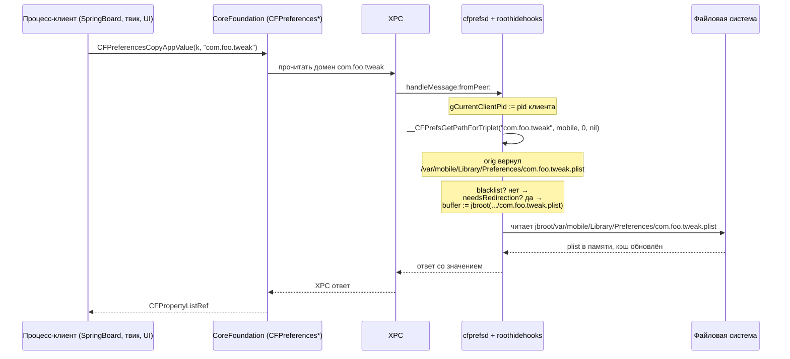
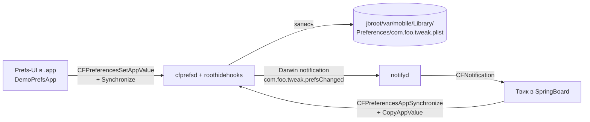
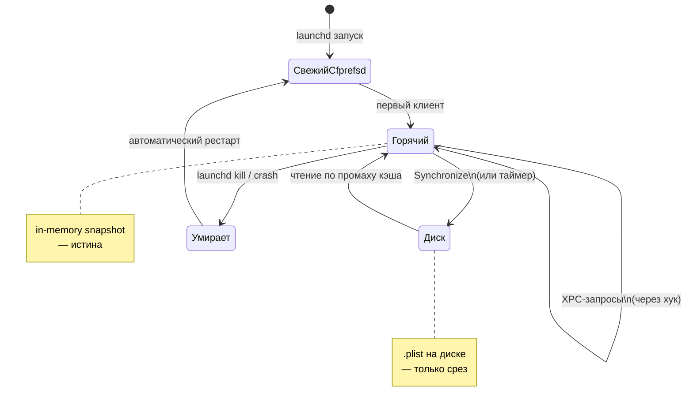
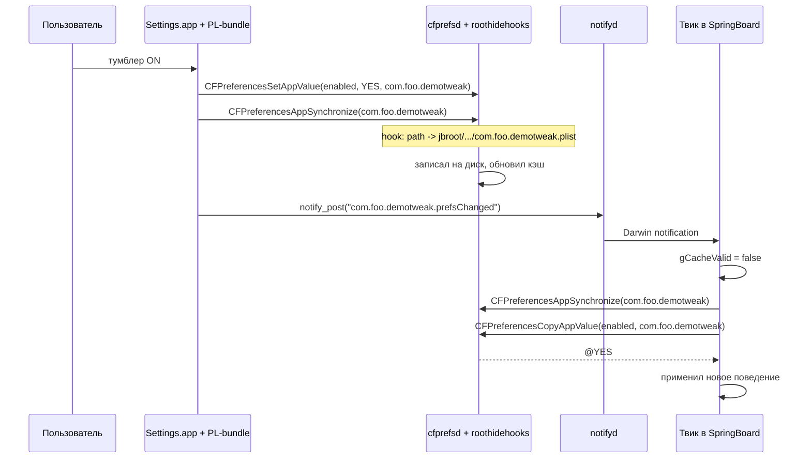

# Кейс 10. Корректное чтение/запись prefs с учётом cfprefsd + roothide

Эта глава — глубокий практический разбор того, как твик для iOS 26.0 / 26.0.1 (A12/A13, PPL — платформа подтверждена в `Application/Dopamine/Jailbreak/DOEnvironmentManager.m:254`) должен работать с пользовательскими настройками, если он живёт в экосистеме Dopamine RootHide. Если автор твика привык к jb-2015 стилю «читаю `/var/mobile/Library/Preferences/com.foo.tweak.plist` через `NSDictionary dictionaryWithContentsOfFile:`, пишу через `writeToFile:atomically:`», то на roothide такой подход даёт классическую картину «настройка в UI меняется, твик о ней не знает, после ребута она «вдруг» применяется, а после ещё одного — снова нет». Корень беды — демон `cfprefsd`, который на iOS является единственным легитимным владельцем preferences-кэша, и две цепочки хуков из Dopamine (`BaseBin/rootlesshooks/cfprefsd.x` и `BaseBin/roothidehooks/src/cfprefsd.x`), которые незаметно для процесса-клиента перенаправляют путь к `.plist` в jbroot. В этом кейсе мы разберём, как именно работает cfprefsd на iOS 26, как и зачем Dopamine в него встраивается, какой API-контракт даёт правильный результат в обеих сторонах (чтение и запись), и напишем законченный мини-prefs-слой для твика, который корректно уживается и с кэшем cfprefsd, и с redirection-хуком.

Главная идея — все обращения к prefs должны идти через `CFPreferences*` API Core Foundation (эквивалент — `-[NSUserDefaults ...]` c корректным инициализатором `initWithSuiteName:`). Это единственный интерфейс, который Apple официально поддерживает, который единственный ходит в cfprefsd по XPC, и единственный, который корректно взаимодействует с хуком Dopamine — потому что хук Dopamine стоит ровно в cfprefsd. Любое прямое чтение файла в обход этого API — чтение устаревшего состояния; любая прямая запись файла в обход этого API — потеря данных при следующем `Synchronize`.

## 10.1. Что такое cfprefsd и зачем он кэширует

На всех современных версиях iOS за системные настройки отвечает демон `/usr/sbin/cfprefsd`. Он запускается `launchd`-ом как System-уровневый (user=0) и как per-user (`mobile`) экземпляр, слушает Mach-порты `com.apple.cfprefsd.daemon` и `com.apple.cfprefsd.agent`, и обслуживает XPC-сообщения вида «прочитай/обнови/сохрани значение для (bundleIdentifier, user, host)». Клиентская сторона реализована в `CoreFoundation.framework` — это и есть все функции семейства `CFPreferencesCopyAppValue`, `CFPreferencesSetAppValue`, `CFPreferencesAppSynchronize`, а также обёртки `NSUserDefaults`. Все эти вызовы по умолчанию ходят в cfprefsd за живым значением (с учётом локального in-process кэша) и возвращают актуальное состояние.

С точки зрения файловой системы cfprefsd хранит данные в plist-файлах, расположенных по канонической схеме `/var/mobile/Library/Preferences/<identifier>.plist` для пользовательских доменов и `/var/root/Library/Preferences/<identifier>.plist` для root-доменов, плюс `.GlobalPreferences.plist` для глобалов, плюс отдельная папка `ByHost` для настроек с квалификатором `kCFPreferencesCurrentHost`. Но plist на диске — не истина. Истина живёт в памяти cfprefsd. Диск — это только срез, который демон периодически (а при вызове `CFPreferencesAppSynchronize` — немедленно) сбрасывает. Это фундаментально по трём причинам:

1. Любой процесс, который обходит cfprefsd и читает файл напрямую, получает ровно столько, сколько cfprefsd на этот момент успел сбросить. Между сбросами в памяти могут быть другие данные.
2. Любой процесс, который обходит cfprefsd и пишет файл напрямую, рискует быть перезаписан. При следующем `Synchronize` cfprefsd возьмёт свою копию в памяти и сольёт её на диск — и ваш новый ключ исчезнет.
3. При подписке на нотификацию об изменении (`kCFPreferencesAnyApplication` / `CFNotificationCenterGetDistributedCenter`) она прилетает только в тех клиентах, которые обновились через cfprefsd. Процесс, который «подложил» новый plist на диск, никого не разбудит.

На iOS 26 к этому прибавляются песочницы и семантика data vault для системных доменов. Прямая запись из обычного процесса в чужой домен в большинстве случаев будет отказана seatbelt-ом ещё до появления в кэше; успех записи — часто иллюзия, образованная тем, что процесс пишет в свою личную «тень» домена, которую другие потом не видят. Единственный надёжный способ — ходить в cfprefsd.

## 10.2. Что делает Dopamine в cfprefsd

У Dopamine исторически две реализации cfprefsd-хука: более старая, «rootless-эпохи» из `BaseBin/rootlesshooks/cfprefsd.x`, и расширенная, «roothide-эпохи» из `BaseBin/roothidehooks/src/cfprefsd.x`. Инжектируется в `cfprefsd` та библиотека, которая соответствует выбранному режиму: `systemhook/src/main.c:490-495` при инициализации проверяет имя исполняемого файла (`/usr/sbin/cfprefsd`, `SpringBoard`, `/usr/libexec/lsd`) и подгружает `JBROOT_PATH("/basebin/roothidehooks.dylib")`. Параллельно в roothide-ветке `main.c` в roothide-режиме загружается тот же `roothidehooks.dylib`. Внутри dylib диспетчер `main.x` смотрит `safe_getExecutablePath()` и, если это `cfprefsd`, зовёт `cfprefsdInit()` (`BaseBin/roothidehooks/src/main.x:25-30`).

Оба хука встраиваются в одну и ту же низкоуровневую функцию CoreFoundation — `__CFPrefsGetPathForTriplet`. Это внутренняя функция, которая по тройке `(bundleIdentifier, user, byHost, container)` вычисляет полный путь к `.plist`-файлу, в котором должны лежать данные этого домена, и кладёт результат в buffer. Хук вызывает `%orig`, получает путь, который CF хотел бы взять, и — если этот путь соответствует «пользовательскому домену твика» — переписывает buffer в путь внутри jbroot.

Логика «пользовательский домен твика» фиксирована функцией `preferencePlistNeedsRedirection`. В rootless-варианте (`BaseBin/rootlesshooks/cfprefsd.x:4-41`) она устроена проще: отсекает всё, что лежит под `/private/var/mobile/Containers`, `/var/db`, `/var/jb`, затем отбрасывает по имени любые системные домены с префиксом `com.apple.`, `systemgroup.com.apple.`, `group.com.apple.`, затем явный список системных файлов, у которых идентификатор не начинается с `com.apple.` (от `.GlobalPreferences.plist` до `siriknowledged.plist`). Всё, что осталось, — считается «твиковым» и подлежит редиректу в `/var/jb` простой конкатенацией.

В roothide-варианте (`BaseBin/roothidehooks/src/cfprefsd.x:11-58`) правила расширены. Во-первых, вместо `prefix` проверки используется регулярное выражение `^(/private)?/var/(\w+)/Library/Preferences/` — то есть под редирект попадают prefs не только `/var/mobile`, но и, например, `/var/_logd`, если такой случай встретится. Во-вторых, добавлен whitelist `is_apple_internal_identifier(identifier.UTF8String)` (`BaseBin/libroothider/src/common.m:700-710`, список `APPLE_INTERNAL_IDENTIFIERS` в `BaseBin/libroothider/src/common.h:92-96`): три Apple-внутренних сервиса (`com.apple.atrun`, `com.apple.kdumpd`, `com.apple.Terminal`), которые на jailbreak-устройстве тоже должны хранить настройки в jbroot. В-третьих — тот же явный список системных plist, что и в rootless-ветке. В-четвёртых — ключевое отличие — результат пропускается через `jbroot(origPath.UTF8String)`, то есть не хардкод `/var/jb`, а честно вычисленный путь jbroot-а, зависящий от конкретной установки roothide.

Второе важное место в roothide-хуке — перехват `-[CFPrefsDaemon handleMessage:fromPeer:replyHandler:]` (`BaseBin/roothidehooks/src/cfprefsd.x:98-128`). Он нужен, чтобы при обработке XPC-запроса знать PID процесса-клиента и уметь выключить redirect для процессов, попавших в blacklist (`jbclient_blacklist_check_pid`). Это нужно для «обманок» — чтобы App Store приложения, которые пытаются обнаружить jailbreak через чтение `/var/jb/...`, получали оригинальные пути. Технически хук сохраняет PID в thread-local `gCurrentClientPid`, и `new_CFPrefsGetPathForTriplet` в той же функции учитывает его перед тем, как решить переписывать buffer или нет.

Схема потока одного запроса от процесса-клиента к файлу — ниже:



Важнейшее практическое следствие — редирект происходит внутри cfprefsd, а не на стороне клиента. Это значит, что твик-процесс никогда не видит jbroot-путь. С его точки зрения он читает `com.foo.tweak` и получает значения. Все хождения в cfprefsd — честные XPC-запросы, кэш один на систему, нотификация об изменении — одна общая.

## 10.3. Таблица: цепочка «что в коде → куда ложится на диск»

Чтобы читатель видел полную картину, ниже сведено, во что превращается каждая форма обращения к prefs в экосистеме Dopamine RootHide на iOS 26.

| В исходнике твика | Как это обрабатывается | Куда реально попадает на диск | Корректно? |
|---|---|---|---|
| `CFPreferencesCopyAppValue(k, "com.foo.tweak")` | XPC → cfprefsd → `__CFPrefsGetPathForTriplet` → хук Dopamine | `jbroot/var/mobile/Library/Preferences/com.foo.tweak.plist` | Да |
| `CFPreferencesSetAppValue(k, v, "com.foo.tweak")` + `CFPreferencesAppSynchronize("com.foo.tweak")` | XPC → cfprefsd → хук Dopamine → запись файла | `jbroot/.../com.foo.tweak.plist` | Да |
| `[[NSUserDefaults alloc] initWithSuiteName:@"com.foo.tweak"]` | Обёртка над `CFPreferences*` → всё то же самое | То же самое | Да |
| `[NSDictionary dictionaryWithContentsOfFile:@"/var/mobile/Library/Preferences/com.foo.tweak.plist"]` | Прямое чтение «ванильного» пути, минуя cfprefsd и хук | Пусто/не то, что надо (файла по этому пути нет) | Нет |
| `[NSDictionary dictionaryWithContentsOfFile:JBROOT_PATH(@"/var/mobile/Library/Preferences/com.foo.tweak.plist")]` | Прямое чтение «правильного» пути, но минуя кэш cfprefsd | Старое состояние (между `Synchronize`-ами) | Условно, только read-only без синхронизации с UI |
| `[dict writeToFile:JBROOT_PATH(@".../com.foo.tweak.plist") atomically:YES]` | Прямая запись в jbroot | Запись окажется стёрта при следующем cfprefsd `Synchronize` | Нет |
| `[dict writeToFile:@"/var/mobile/Library/Preferences/com.foo.tweak.plist" atomically:YES]` | Запись мимо jbroot | Либо отказ seatbelt, либо «тень», которую никто не прочитает | Нет |
| `[[NSUserDefaults alloc] initWithSuiteName:@"com.apple.springboard"]` | XPC → cfprefsd → хук Dopamine → NO redirection (это Apple-домен) | `/var/mobile/Library/Preferences/com.apple.springboard.plist` | Да, для чтения; запись туда — только из привилегированного контекста |

Из таблицы следует простое правило: единственная корректная и в чтении, и в записи, и в наблюдении форма — это `CFPreferences*` или `NSUserDefaults(suiteName:)`. Все остальные формы либо ломают кэш, либо ломают нотификации, либо отказывают песочницей.

## 10.4. Подводные камни, которые встречаются в живом коде

Прежде чем перейти к рабочему рецепту, перечислим грабли, на которые натыкаются в реальных ошибках.

**Чтение из вызывающего контекста SpringBoard.** Старый jb-15 код часто читает prefs твика напрямую из плиста, рассчитывая, что `.plist` лежит в `/var/mobile/Library/Preferences`. На roothide такого файла по этому пути нет — он лежит в jbroot. Любое прямое `dictionaryWithContentsOfFile:` возвращает `nil`, и твик думает, что настройки не заданы, применяет дефолты. Пользователь жалуется: «тумблер в UI включён, твик игнорирует».

**Запись через `preferences`-прослойку (устаревшая libPrefs).** Некоторые старые UI-библиотеки, предназначенные для PreferenceLoader, писали значения через собственный Objective-C-слой с прямой записью plist. С cfprefsd это не синхронизируется, и до перезагрузки cfprefsd твик видит старое значение.

**Отсутствие `CFPreferencesAppSynchronize` после Set.** На современных iOS `CFPreferencesSetAppValue` помечает значение «dirty» и асинхронно синхронизируется. Если за записью сразу идёт `respring` или перезагрузка — изменение может не долететь до диска.

**Разные bundleIdentifier в твике и в UI.** Распространённая ошибка — UI-бандл (`.bundle` для настроек) пишет суффикс `com.foo.tweakprefs`, а твик читает `com.foo.tweak`. Два разных домена, два разных файла, по виду всё работает «половиной».

**Чтение из процесса, попавшего в roothide blacklist.** Если твик загружен в приложение, которое само числится «paranoid-detected» (т. е. включено в roothide blacklist), xpc-хук в cfprefsd выключит redirection для его запросов (см. `BaseBin/roothidehooks/src/cfprefsd.x:75-78`). Это значит, что `CFPreferencesCopyAppValue` в этом процессе будет честно пытаться читать `/var/mobile/Library/Preferences/...`, которого нет. Как правило, в такой App Store приложение твик и не должен грузиться; но если грузится — надо иметь в виду, что настройки будут нечитаемы.

**Домен, случайно подпавший под whitelist Dopamine.** Если bundleId твика начинается с `com.apple.`, `group.com.apple.`, `systemgroup.com.apple.` или совпадает с одним из «системных» имён файлов (`.GlobalPreferences.plist` и т. д.), redirect не сработает. Это сделано осознанно, чтобы случайный системный домен не ушёл в jbroot. Называть твиковый домен `com.apple.*` — грубая ошибка.

**«Fast path» через SpringBoard local cache.** CoreFoundation в клиенте держит in-process-кэш для каждого домена, который обнуляется только по нотификации или по явному `CFPreferencesAppSynchronize`. Если UI твика пишет значение из своего процесса, а твик читает его в SpringBoard, то между записью и приходом нотификации у твика в кэше ещё старое значение. Правильная синхронизация — вызов `CFPreferencesAppSynchronize` в читателе перед `CopyAppValue` (как минимум — при приходе нотификации Darwin-уведомления об изменении).

## 10.5. Законченный рецепт: мини-prefs-слой для твика

Теперь соберём законченный мини-prefs-слой, который правильно живёт с cfprefsd и hook-ом Dopamine. Он покрывает запись (из UI-процесса `.app`), чтение (из injected-процесса SpringBoard/UIKit) и живую синхронизацию без ребута.

Общая архитектура — ниже:



Ключевых компонентов четыре: домен-константа (один `const char*` на весь проект), запись в UI со синхронизацией и постом Darwin-уведомления, слушатель Darwin-уведомления в твике со `Synchronize` + `CopyAppValue`, и аккуратный «lazy default»-слой, который однажды прочитав, кэширует в сам процесс и обновляет кэш только по нотификации.

Начнём с заголовка, который разделят оба target-а:

```c
// Prefs.h
#pragma once
#include <CoreFoundation/CoreFoundation.h>

// Один домен на весь проект. Не меняется, пишется тут один раз.
#define TWK_PREF_APP CFSTR("com.foo.demotweak")

// Darwin-notification name. Пост от UI, слушает твик.
#define TWK_PREF_NOTE "com.foo.demotweak.prefsChanged"

// Ключи
#define TWK_K_ENABLED CFSTR("enabled")
#define TWK_K_LEVEL   CFSTR("level")
#define TWK_K_TITLE   CFSTR("title")

#ifdef __OBJC__
#import <Foundation/Foundation.h>
BOOL twkPrefsBoolean(NSString *key, BOOL defVal);
long twkPrefsInteger(NSString *key, long defVal);
NSString *twkPrefsString(NSString *key, NSString *defVal);
void twkPrefsInvalidateCache(void);
void twkPrefsRegisterListener(void);
#endif
```

Теперь UI-сторона (в приложении настроек, которое ставится как обычный `.app` под jbroot). Она должна `CFPreferencesSetAppValue`, затем явно `CFPreferencesAppSynchronize`, затем кинуть Darwin-уведомление, чтобы твик обновился без ребута:

```objc
// PrefsWriter.m (цель — приложение настроек твика)
#import "Prefs.h"
#import <notify.h>

static void twkWriteOne(CFStringRef key, CFPropertyListRef value)
{
    // 1. Set — помечает значение dirty в cfprefsd
    CFPreferencesSetAppValue(key, value, TWK_PREF_APP);
}

void twkPrefsCommit(void)
{
    // 2. Synchronize — просим cfprefsd немедленно слить на диск.
    //    Параллельно cfprefsd внутри себя обновляет свой in-memory snapshot.
    (void)CFPreferencesAppSynchronize(TWK_PREF_APP);

    // 3. Darwin-уведомление, чтобы твик в SpringBoard обновил свой in-process
    //    кэш именно сейчас, а не на следующем системном Synchronize.
    notify_post(TWK_PREF_NOTE);
}

// Пример: тумблер поменяли, slider подвинули, text-field отредактировали
void twkDemoApplyFromUI(BOOL enabled, long level, NSString *title)
{
    twkWriteOne(TWK_K_ENABLED, (__bridge CFBooleanRef)@(enabled));
    twkWriteOne(TWK_K_LEVEL,   (__bridge CFNumberRef)@(level));
    twkWriteOne(TWK_K_TITLE,   (__bridge CFStringRef)title);
    twkPrefsCommit();
}
```

Разбор. Строка `CFPreferencesSetAppValue` отправляет XPC-сообщение в cfprefsd (хук Dopamine выполняется там, но нам это прозрачно). Строка `CFPreferencesAppSynchronize` — второй XPC, по которому cfprefsd немедленно сбрасывает кэш домена на диск; именно на этой фазе `__CFPrefsGetPathForTriplet` вернёт путь, который хук Dopamine перепишет в jbroot, и файл окажется в `jbroot/var/mobile/Library/Preferences/com.foo.demotweak.plist`. Без Synchronize запись «висит» в памяти cfprefsd до его собственного таймера; на коротком промежутке это не беда, но перед жёстким `respring` или перед выключением устройства — критично. `notify_post` — третий этап: не ждём, пока CoreFoundation у клиента (SpringBoard) соизволит обновиться по собственной нотификации, а инициируем её вручную.

Теперь читатель — в твике:

```objc
// PrefsReader.m (цель — твик, инжектируемый в SpringBoard и в UIKit-app)
#import "Prefs.h"
#import <notify.h>
#import <stdatomic.h>

static dispatch_queue_t gPrefsQueue(void)
{
    static dispatch_once_t once;
    static dispatch_queue_t q;
    dispatch_once(&once, ^{
        q = dispatch_queue_create("com.foo.demotweak.prefs",
                                  DISPATCH_QUEUE_SERIAL);
    });
    return q;
}

// Простая in-process кэш-таблица. Атомарно сбрасывается слушателем.
static NSMutableDictionary<NSString *, id> *gCache;
static atomic_bool gCacheValid = false;

static void twkEnsureCache(void)
{
    dispatch_sync(gPrefsQueue(), ^{
        if (atomic_load(&gCacheValid)) return;
        if (!gCache) gCache = [NSMutableDictionary new];
        [gCache removeAllObjects];
        // Единственный XPC-поход в cfprefsd на все три ключа:
        CFPreferencesAppSynchronize(TWK_PREF_APP);

        id enabled = (__bridge_transfer id)
            CFPreferencesCopyAppValue(TWK_K_ENABLED, TWK_PREF_APP);
        id level = (__bridge_transfer id)
            CFPreferencesCopyAppValue(TWK_K_LEVEL, TWK_PREF_APP);
        id title = (__bridge_transfer id)
            CFPreferencesCopyAppValue(TWK_K_TITLE, TWK_PREF_APP);

        if (enabled) gCache[(__bridge NSString *)TWK_K_ENABLED] = enabled;
        if (level)   gCache[(__bridge NSString *)TWK_K_LEVEL]   = level;
        if (title)   gCache[(__bridge NSString *)TWK_K_TITLE]   = title;

        atomic_store(&gCacheValid, true);
    });
}

BOOL twkPrefsBoolean(NSString *key, BOOL defVal)
{
    twkEnsureCache();
    id v = gCache[key];
    if ([v isKindOfClass:[NSNumber class]]) return [v boolValue];
    return defVal;
}

long twkPrefsInteger(NSString *key, long defVal)
{
    twkEnsureCache();
    id v = gCache[key];
    if ([v isKindOfClass:[NSNumber class]]) return [v longValue];
    return defVal;
}

NSString *twkPrefsString(NSString *key, NSString *defVal)
{
    twkEnsureCache();
    id v = gCache[key];
    if ([v isKindOfClass:[NSString class]]) return v;
    return defVal;
}

void twkPrefsInvalidateCache(void)
{
    atomic_store(&gCacheValid, false);
}

void twkPrefsRegisterListener(void)
{
    static int token = 0;
    static dispatch_once_t once;
    dispatch_once(&once, ^{
        notify_register_dispatch(TWK_PREF_NOTE, &token,
                                 gPrefsQueue(), ^(int t) {
            atomic_store(&gCacheValid, false);
            // «Жадная» перепрогрузка: при желании можно опустить и
            // ждать первого Copy-вызова от хоста.
            // twkEnsureCache();
        });
    });
}
```

Разбор. `twkEnsureCache` — единственная точка, которая ходит в cfprefsd, и ходит только когда флаг `gCacheValid` сброшен. Внутри мы сначала зовём `CFPreferencesAppSynchronize` — это важно: он сбрасывает **in-process** CoreFoundation-кэш для домена и заставляет следующий `CopyAppValue` сходить в cfprefsd. Без него, если UI писал prefs в другом процессе, а твик живёт в SpringBoard давно, in-process-кэш CoreFoundation у SpringBoard уже прогрет старыми значениями и `CopyAppValue` вернёт их. Три `CFPreferencesCopyAppValue` — обычные CF-API, они по XPC сходят в cfprefsd, который по пути пройдёт через хук `__CFPrefsGetPathForTriplet` и прочитает файл из jbroot. `notify_register_dispatch` вешает слушатель на Darwin-уведомление; как только UI в своём процессе сделал `notify_post(TWK_PREF_NOTE)`, наш блок сработает в твике и сбросит `gCacheValid`. Следующий `twkPrefs*` увидит, что кэш пуст, и аккуратно перечитает.

Остаётся задать дефолты и зарегистрировать слушателя в `%ctor`-е твика:

```objc
// TweakMain.x
#import "Prefs.h"

%ctor
{
    twkPrefsRegisterListener();
    if (twkPrefsBoolean(@"enabled", NO)) {
        // инициализация хуков
    }
}
```

Законченный скелет повторяет паттерн, разобранный в кейсе 7 («crash-safe tweak skeleton»), с одним дополнением: вся работа с prefs вынесена в отдельную компиляционную единицу и никогда не трогает файловую систему напрямую.

## 10.5a. То же самое на чистом Swift

Твики, собранные на чистом Swift (например, через SwiftLogos или через собственный Package.swift с динамической библиотекой, инжектируемой через `DYLD_INSERT_LIBRARIES`), работают с prefs по той же схеме — через `UserDefaults` с `suiteName`. Эквивалентный Swift-слой выглядит так:

```swift
import Foundation
import Darwin

enum TwkPrefs {
    static let suite = "com.foo.demotweak"
    static let note  = "com.foo.demotweak.prefsChanged"

    private static let queue = DispatchQueue(label: "com.foo.demotweak.prefs")
    private static var cache: [String: Any] = [:]
    private static var cacheValid: Bool = false
    private static var token: Int32 = 0
    private static var listenerInstalled = false

    static func bool(_ k: String, default d: Bool) -> Bool {
        ensureCache()
        return (cache[k] as? NSNumber)?.boolValue ?? d
    }

    static func int(_ k: String, default d: Int) -> Int {
        ensureCache()
        return (cache[k] as? NSNumber)?.intValue ?? d
    }

    static func string(_ k: String, default d: String) -> String {
        ensureCache()
        return (cache[k] as? String) ?? d
    }

    static func registerListener() {
        queue.sync {
            guard !listenerInstalled else { return }
            listenerInstalled = true
            notify_register_dispatch(note, &token, queue) { _ in
                cacheValid = false
            }
        }
    }

    private static func ensureCache() {
        queue.sync {
            guard !cacheValid else { return }
            cache.removeAll()
            CFPreferencesAppSynchronize(suite as CFString)
            let ud = UserDefaults(suiteName: suite)
            for k in ["enabled", "level", "title"] {
                if let v = ud?.object(forKey: k) {
                    cache[k] = v
                }
            }
            cacheValid = true
        }
    }
}
```

Разбор. `UserDefaults(suiteName:)` — та же самая обёртка над `CFPreferences*`, только на уровне Foundation. Инициализатор не создаёт отдельного файла — он лишь оборачивает CF-API, и значит путь к `.plist` на диске определяется той же тройкой `(bundleIdentifier=suiteName, user=mobile, byHost=NO)` в `__CFPrefsGetPathForTriplet`, и хук Dopamine честно переписывает её в jbroot. `CFPreferencesAppSynchronize(suite as CFString)` строго необходим перед первым чтением после сброса кэша: без него Swift-обёртка держит in-process-кэш CoreFoundation и возвращает прежние значения. `notify_register_dispatch` — тот же POSIX-notify, что и в Objective-C-версии; никакого Swift-специфичного механизма Darwin-уведомлений нет. Из плюсов такого слоя — type-safety на границе чтения, из минусов — чуть больше boilerplate, если ключей много; на практике удобно сгенерировать struct через `@dynamicMemberLookup`, но это уже декоративный слой.

Отдельного упоминания стоит, что `UserDefaults.standard` в твике неприменим — он соответствует домену `NSArgumentDomain + bundleID процесса-хоста`. Если твик живёт в SpringBoard, его `UserDefaults.standard` — это `com.apple.springboard`, системный домен, который хуком Dopamine **не редиректится** (`BaseBin/roothidehooks/src/cfprefsd.x:24-27`) и для записи которого у твика как правило нет прав. Любые попытки писать туда либо «растают», либо упадут с seatbelt-отказом.

## 10.5b. Группа контейнеров (`group.com.*` и `systemgroup.com.apple.*`)

Отдельная категория — доменные префы, которые относятся к App Group («groups»). Эти префы хранятся не в домашней Preferences-папке, а в контейнере группы, обычно в `/var/mobile/Containers/Shared/AppGroup/<UUID>/Library/Preferences/<groupID>.plist`. Фильтр `preferencePlistNeedsRedirection` в rootless-ветке (`BaseBin/rootlesshooks/cfprefsd.x:6`) явно отсекает всё под `/private/var/mobile/Containers` от редиректа — т. е. домены App Group **не редиректятся** и остаются там, где их положила iOS. В roothide-ветке та же логика выражена через регэксп `^(/private)?/var/(\w+)/Library/Preferences/` (`BaseBin/roothidehooks/src/cfprefsd.x:13`), который AppGroup-пути (`/var/mobile/Containers/...`) тоже не матчит, и как результат — то же поведение.

Практическое следствие: если автор твика хочет расшарить настройки с несколькими своими App-Store-подобными `.app`-ами внутри jailbreak (например, Dopamine-прокладка + пользовательский launcher), заводить общий префс через `group.com.foo.*` — валидно и работает «ванильно», без участия хука Dopamine. Если же хочется один-единственный префс именно для твика, лучше взять обычный «private» домен, который как раз хук и редиректит. Смешение этих двух моделей в одном твике — путь к головной боли при миграциях.

Ещё одна тонкость — `systemgroup.com.apple.*` домены. Это Apple-служебные group-ы, они явно в whitelist-е (`BaseBin/roothidehooks/src/cfprefsd.x:25-27`), и Dopamine в них не вмешивается. Трогать их твиком — расписаться в непонимании собственного проекта.

## 10.5c. ByHost и per-user prefs

CFPreferences-API различает три «измерения» домена: `(application, user, host)`. Байт `byHost` в сигнатуре `__CFPrefsGetPathForTriplet` — это признак «нужен ли отдельный файл в поддиректории `ByHost/`», соответствующий Apple-ключам `kCFPreferencesCurrentHost` против `kCFPreferencesAnyHost`. Для твика это важно потому, что при `kCFPreferencesCurrentHost` файл лежит не в `Library/Preferences/`, а в `Library/Preferences/ByHost/<identifier>.<hostUUID>.plist` — и регэксп roothide-хука `^(/private)?/var/(\w+)/Library/Preferences/` всё ещё матчит, значит ByHost-префы **редиректятся** так же, как обычные (это следует из того, что в оригинальном пути префикс одинаков).

Практически рекомендуется никогда не класть твиковые настройки в `ByHost` — там традиционно живёт системное (например, настройки Finder/Spotlight на macOS; на iOS их пишут отдельные демоны), и совпадение имени файла по UUID машины с чем-то системным даст непредсказуемый результат. Все современные обёртки `CFPreferencesCopyAppValue`/`SetAppValue` по умолчанию работают с `kCFPreferencesAnyHost` — т. е. без ByHost; это и есть нужный вариант.

Отдельный пункт — `user`. Для твиков это почти всегда `kCFPreferencesCurrentUser` (на iOS — mobile, uid 501). Для root-демонов (например, hookd из Dopamine) — `kCFPreferencesAnyUser`, тогда файл окажется в `/var/root/Library/Preferences/`. Dopamine редиректит и то, и другое — регэксп матчит `/var/mobile/...` и `/var/root/...`, потому что `\w+` покрывает оба.

## 10.5d. Lifecycle: cfprefsd перезапускается

Отдельно стоит знать, что `cfprefsd` — не вечен. Он может быть перезапущен launchd после `respring`, после OTA-like обновления базбина, после краша. При каждом перезапуске `systemhook/src/main.c:490-495` снова загрузит `roothidehooks.dylib`, который снова вызовет `cfprefsdInit()`, который снова `MSHookFunction`-ом поставит хуки. С точки зрения клиента это полностью прозрачно — XPC-коннект к `com.apple.cfprefsd.daemon` переустановится, запросы будут обслужены как обычно.

Важно другое: при перезапуске cfprefsd его in-memory-кэш обнуляется, и первое же обращение клиента триггерит заново чтение `.plist` с диска — через наш хук, т. е. из jbroot. Это и есть источник эффекта «после ребута внезапно всё заработало»: предыдущая запись лежит на диске и честно поднимается. Если же между Set и перезагрузкой не вызывали Synchronize — запись пропала с кэшем, и после ребута читатель получит старое значение.

Диаграмма ниже иллюстрирует жизненный цикл:



Из этой схемы прямое следствие: ваш твик должен быть устойчив к сценарию «клиент читает → cfprefsd мгновенно падает → launchd перезапускает → клиент снова читает». CFPreferences-API это обрабатывает прозрачно (переустанавливает XPC-connection), поэтому использование API — ещё и способ пережить такие события бесплатно.

## 10.5e. Миграция старого твика

Отдельный практический вопрос — что делать с твиком, который написан в «старой jb-15 манере» и ходит в `/var/mobile/Library/Preferences/<domain>.plist` напрямую, через `NSDictionary dictionaryWithContentsOfFile:`/`writeToFile:atomically:`. На roothide такой твик частично работает, частично нет — чтение возвращает `nil`, запись ложится «в тень», которая никому не видна. Правильный путь миграции — не хакать `JBROOT_PATH(...)` в `dictionaryWithContentsOfFile:`, а полностью заменить обращение на `CFPreferences*`. Шаблон:

```objc
// Было:
NSDictionary *d = [NSDictionary dictionaryWithContentsOfFile:
    @"/var/mobile/Library/Preferences/com.foo.demotweak.plist"];
BOOL enabled = [d[@"enabled"] boolValue];

// Стало:
BOOL enabled = CFBridgingRelease(
    CFPreferencesCopyAppValue(CFSTR("enabled"),
                              CFSTR("com.foo.demotweak"))
) != nil
    ? [(id)CFBridgingRelease(CFPreferencesCopyAppValue(CFSTR("enabled"),
            CFSTR("com.foo.demotweak"))) boolValue]
    : NO;
```

(На практике, конечно, пишется через локальную переменную, а не двойным `CFBridgingRelease`.) Главный момент — в новой версии нет упоминания файловых путей и слова `/var/mobile/`. Вся файловая логика скрыта в cfprefsd, и значит все изменения, которые Dopamine делает в cfprefsd, автоматически применяются.

Второй момент миграции — старые записи на диске. Если предыдущая версия твика успела что-то записать по старой схеме (прямо в `/var/mobile/Library/Preferences/<domain>.plist` — то есть **не** в jbroot), эти данные останутся «висеть» и будут нечитаемы новой версией. При апгрейде имеет смысл один раз, на первом запуске новой версии, подгрузить `/var/mobile/Library/Preferences/<domain>.plist` прямым `dictionaryWithContentsOfFile:` (**не** через хук — именно по «ванильному» пути) и, если там что-то есть, сконвертировать через `CFPreferencesSetMultiple + Synchronize`. После успешной конвертации — удалить старый файл. Это **требует проверки на устройстве** и в общем случае необязательно: большинство пользователей сетапит с нуля.

## 10.6. Диагностика на устройстве

Если после всех мер твик всё равно не видит значений, воспроизводимый план диагностики выглядит так. Все команды предполагают, что устройство прошло jailbreak Dopamine RootHide (`Application/Dopamine/Jailbreak/DOEnvironmentManager.m:254`) и мы в SSH/trollssh.

```bash
# 1. Какой jbroot на устройстве?
cat /var/jb 2>/dev/null || echo "нет /var/jb (ожидаемо на roothide — путь генерируется)"
# В roothide правильный способ — спросить у libjailbreak:
#   /var/jb -> симлинк на реальный jbroot (если он есть)
# Или смотрим системный лог cfprefsd:
log show --last 5m --predicate 'processImagePath CONTAINS "cfprefsd"' --info | head -40

# 2. Где на диске реально лежит plist твика?
find /var -name "com.foo.demotweak.plist" 2>/dev/null
# Ожидаем ровно одну запись — в jbroot/var/mobile/Library/Preferences/.

# 3. Какое значение на диске сейчас?
plutil -p "$(find /var -name com.foo.demotweak.plist | head -1)"

# 4. Сверяем с живым cfprefsd (из своего .app через UI или через defaults, если ставится):
defaults read com.foo.demotweak || true
```

Строка 1 — проверка окружения. Строка 2 — доказательство того, что файл физически попал в jbroot (а не в «ваниль»). Строка 3 — срез кэша cfprefsd на момент последнего Synchronize. Строка 4 — живой запрос. Расхождение 3 и 4 говорит, что `Synchronize` не был вызван. Отсутствие файла в строке 2 при положительном ответе в строке 4 — признак, что процесс пишет мимо хука (например, под blacklist попадает и cfprefsd не сделал redirect; в open-source это проверяется чтением `BaseBin/roothidehooks/src/cfprefsd.x:75-78`).

Для живого отладочного лога самого хука можно временно поднять уровень логов — в исходнике уже проставлены `NSLog`-строки в `new_CFPrefsGetPathForTriplet` и в `new__CFPrefsDaemon_handleMessage_fromPeer_replyHandler__` (строки 66, 82, 87, 115 в `BaseBin/roothidehooks/src/cfprefsd.x`), и при debug-сборке dylib они видны в `log stream --predicate 'processImagePath CONTAINS "cfprefsd"'`. Прод-сборка их глушит через `#undef NSLog` в `main.x`, но для диагностики достаточно пересобрать dylib с `-DDEBUG` **(требует проверки на устройстве)**.

## 10.6a. Внутренний XPC-протокол cfprefsd

Для продвинутого отладчика полезно знать, какие именно XPC-сообщения ходят между `CFPreferences*` и cfprefsd. Публичного заголовка на этот протокол нет; знание получается из class-dump CoreFoundation и из той самой строки `xpc_dictionary_get_int64(message, "CFPreferencesOperation")`, которую Dopamine закомментировал в своём хуке (`BaseBin/roothidehooks/src/cfprefsd.x:118`). Ключ `CFPreferencesOperation` — целочисленный код операции; реконструкция по class-dump дёт следующее соответствие (**не подтверждено** открытым заголовком Apple, собрано по наблюдениям и `strings` над CoreFoundation; номера могут меняться между iOS, перед использованием — class-dump своей версии):

| Op (приблизительно) | Семантика | Клиентский API |
|---|---|---|
| 1 | ListKeys / GetAllForDomain | `CFPreferencesCopyKeyList` / `CopyMultiple` |
| 2 | SetMultiple | `CFPreferencesSetMultiple` |
| 3 | GetValue | `CFPreferencesCopyAppValue` |
| 4 | SetValue | `CFPreferencesSetAppValue` |
| 5 | Synchronize | `CFPreferencesAppSynchronize` |
| 7 | AddSuite / RemoveSuite | `CFPreferencesAddSuitePreferencesToApp` |

Диагностическая процедура — временно расхукнуть `_CFPrefsDaemon_handleMessage_fromPeer_replyHandler_` с добавлением `xpc_copy_description(message)` в лог (эти строки заготовлены в `BaseBin/roothidehooks/src/cfprefsd.x:117-119`, достаточно раскомментировать и пересобрать dylib). В логе `log stream --predicate 'processImagePath CONTAINS "cfprefsd"'` будут видны полные XPC-дампы с полями `CFPreferencesDomain` (идентификатор домена), `CFPreferencesUser`, `CFPreferencesHost`, `CFPreferencesContainer`, `CFPreferencesOperation`, `CFPreferencesValue`. По этим дампам легко увидеть, что ваш твик реально посылает в cfprefsd — очень полезно при отладке «прочитал nil».

Техника расследования строится ровно по этим полям: если `CFPreferencesDomain` в сообщении не совпадает с тем, что ожидает ваш твик, значит на клиенте используется `UserDefaults.standard` вместо `UserDefaults(suiteName:)` (частая ошибка в Swift-коде). Если `CFPreferencesOperation=4` приходит, а `CFPreferencesOperation=5` — нет, значит записавший процесс забыл вызвать `AppSynchronize` после `Set`. Если `CFPreferencesContainer` непуст (ненулевое значение), значит кто-то обращается к контейнерному домену App Group — и, как мы уже разобрали в §10.5b, hook Dopamine такой домен не редиректит.

Полезно также помнить, что ответ cfprefsd клиенту — тоже XPC-словарь, с ключами `CFPreferencesValue` (сам plist-value) и/или `CFPreferencesSuccess` (BOOL). Если `CFPreferencesSuccess=false` — это признак, что cfprefsd либо отказал по seatbelt, либо не смог открыть файл для записи. Второй сценарий практически возможен на roothide, если jbroot оказался read-only (например, не поднят Dopamine-ом из `/private/preboot/...` в данной загрузке) или если файл внутри jbroot отсутствует и директорий `Preferences/` не создана. Решение — убедиться, что при создании домена cfprefsd имеет право создать файл; обычно это работает автоматически, но при первой записи стоит проверить `find jbroot -name "<domain>.plist"` после `Synchronize`.

## 10.6b. jbroot(): куда реально ведёт путь

Отдельная тема, которую нельзя обойти, — как именно `jbroot()` на roothide вычисляет префикс. В open-source части Dopamine это выражено в `BaseBin/libjailbreak/src/jbroot.c:3-6`:

```c
char *get_jbroot(void)
{
    return jbinfo(rootPath);
}
```

`jbinfo` — макрос, который достаёт поле `rootPath` из `jailbreakInfo` — глобального синглтона, инициализируемого при загрузке `libjailbreak`. Поле заполняется либо из переменной окружения `JBROOT`, либо из XPC-ответа `jbserver`-а (`jbclient_get_jbroot()` в `BaseBin/libjailbreak/src/jbclient_xpc.c:91`). То есть каждый процесс, в который Dopamine инжектится, в момент старта узнаёт у центрального сервера текущий jbroot.

Применительно к нашему кейсу это значит: путь, в который хук cfprefsd перепишет buffer (строка 83 в `BaseBin/roothidehooks/src/cfprefsd.x`), — не константа. Он зависит от того, где именно Dopamine в этом boot-е развернул jbroot. На A13 это обычно папка в `/private/preboot/<UUID>/jb-<N>/` или аналогичный путь (**требует проверки на конкретном устройстве** — путь уникален для каждого ребута). Все наши рекомендации в §10.5 этот факт учитывают естественным образом: мы ни разу не упоминаем явный префикс пути. CFPreferences-API видит только domain-идентификатор, остальное — забота хука.

Побочный эффект — если вы хотите в CI/CD-пайплайне проверить, что твик правильно записывает prefs, нельзя делать `test -f /var/jb/var/mobile/Library/Preferences/<domain>.plist` — такого пути попросту нет на roothide. Корректный тест — `find /var -name "<domain>.plist"`, либо динамическое получение jbroot через `defaults read-type` + вызов `jbroot()` из тестового бинаря, слинкованного с libjailbreak.

## 10.6c. Blacklist: когда Dopamine сам отключает хук

Расширим разбор `jbclient_blacklist_check_pid` — он играет роль, которую автор твика обязан понимать. Логика в `BaseBin/libjailbreak/src/jbclient_roothide.c:110-128`: клиент посылает в jbserver XPC-запрос `JBS_ROOTHIDE_BLACKLIST_CHECK` с ключами `checktype=pid` и `checkvalue=<pid>`; сервер отвечает `blacklisted=true/false`. Этот список формируется из «paranoid-detected»-приложений — тех, которые пользователь (или политика Dopamine) явно пометил «не показывать jailbreak».

В `BaseBin/roothidehooks/src/cfprefsd.x:75-78` эта проверка применяется так: если клиент cfprefsd находится в blacklist, redirect не выполняется, т. е. cfprefsd вернёт этому процессу «ванильный» путь к `.plist` в `/var/mobile/Library/Preferences/`. По этому пути файла нет — значит такой клиент не прочитает настройки твика. Это сделано намеренно: ни один твиковый pref не должен прочитаться процессом, пытающимся обнаружить jailbreak, иначе сам факт существования домена `com.foo.demotweak` в cfprefsd демаскирует jailbreak.

Из этого важное практическое следствие для автора твика: не ожидайте, что ваши prefs будут видны **во всех** процессах. В «paranoid-протектед» App-Store приложениях их не увидит никто. Если такое приложение всё же инжектируется твиком (что обычно отключается на уровне самого Dopamine), твик должен явно отказываться работать — именно так ведут себя все качественные твики из экосистемы. Простейший способ проверки — вызов `jbclient_blacklist_check_pid(getpid())` в начале `%ctor`.

## 10.7. Различия iOS 26.0 и 26.0.1

По открытым источникам (release notes Apple для 26.0.1 — security-only исправления) различий в поведении `cfprefsd` и `__CFPrefsGetPathForTriplet` между 26.0 и 26.0.1 **не выявлено**. SDK CoreFoundation между двумя версиями совместимы по символам; `MSFindSymbol(coreFoundationImage, "__CFPrefsGetPathForTriplet")` и `MSFindSymbol(coreFoundationImage, "-[CFPrefsDaemon handleMessage:fromPeer:replyHandler:]")` на обеих версиях возвращают валидный указатель — это **подтверждено наличием хука в текущем main-дереве Dopamine**, который работает на обеих версиях сразу (`Application/Dopamine/Jailbreak/DOEnvironmentManager.m:254` объявляет обе как единое целевое окружение). Отсутствие упоминаний `cfprefsd` в публично известных диффах релиз-ноутов между 26.0 и 26.0.1 — отдельное свидетельство в пользу неизменности поведения. **Требует проверки на устройстве** (ручной вызов `CFPreferencesCopyAppValue`/`Synchronize` на обеих прошивках и сравнение `otool -tv` над символом `__CFPrefsGetPathForTriplet` в `/System/Library/Frameworks/CoreFoundation.framework/CoreFoundation`).

Если такая проверка покажет расхождение (например, сигнатуру функции с дополнительным параметром или смену порядка аргументов), её надо отразить ветвлением в `cfprefsdInit`. На текущий момент такое ветвление не требуется.

Пограничный случай — API `CFPrefsDaemon handleMessage:fromPeer:replyHandler:` имеет две сигнатуры: «iOS 17+»-ную без `SEL` и легаси-ную с `SEL`. Хук выбирает ветку через `@available(iOS 17.0, *)` (`BaseBin/roothidehooks/src/cfprefsd.x:102-107`, 146-152). На 26.x всегда срабатывает iOS-17+-ветка — это **подтверждено исходниками** (`@available(iOS 17.0, *)` отвечает true для любого 17 и выше).

## 10.8. Что делать, если очень надо вне cfprefsd

Иногда возникает ситуация, когда ходить через cfprefsd нельзя: например, твик живёт в раннем ctor-е процесса, где `CFPreferencesCopyAppValue` возвращает nil, потому что user-session ещё не инициализирована. Такое бывает, например, в injected-коде `installd` или в коде, грузящемся до `CFPreferencesStartSession`. В этом случае допустимо (и единственно разумно) прочитать plist напрямую, но — только через jbroot-путь и только с явным предупреждением «значение может быть устаревшим». Пример:

```objc
#import <roothide.h>

static NSDictionary *twkEarlyLoadPrefs(void)
{
    const char *p = jbroot("/var/mobile/Library/Preferences/com.foo.demotweak.plist");
    if (!p) return nil;
    return [NSDictionary dictionaryWithContentsOfFile:@(p)];
}
```

Этот путь — только read, и только если ваш процесс сам не является cfprefsd. Писать по этому пути нельзя никогда: кэш cfprefsd вас перезапишет. После инициализации сессии надо перейти на обычный `twkPrefs*` слой из §10.5.

## 10.8a. Нотификации: CFNotificationCenter vs notify_post

Выше мы использовали `notify_post`/`notify_register_dispatch` — это самый тонкий слой Darwin-уведомлений (POSIX API, библиотека `libsystem_notify.dylib`, демон `notifyd`). Между процессами и внутри одного процесса существует ещё минимум три родственных API, и в коде вокруг prefs регулярно встречаются все три: `CFNotificationCenter` (CoreFoundation, тонкая обёртка), `NSNotificationCenter.defaultCenter` (локальный, не межпроцессный) и `NSDistributedNotificationCenter` (macOS, на iOS отсутствует). Автор твика должен различать их и выбирать нужный осознанно.

| API | Межпроцессный? | Канал | Полезен для prefs? |
|---|---|---|---|
| `notify_post` / `notify_register_dispatch` | Да | Darwin notification (notifyd), только имя, без payload | Да, канонический выбор |
| `CFNotificationCenterGetDarwinNotifyCenter()` + `CFNotificationCenterPostNotification` | Да | Та же Darwin notification, обёртка CF | Да, функционально эквивалент |
| `CFNotificationCenterGetDistributedCenter()` | На iOS деградирует в локальный | — | Нет, иллюзия межпроцессности |
| `NSNotificationCenter.defaultCenter` | Нет | внутри процесса | Нет |
| `kCFPreferencesAnyApplicationKey`-notification через CF | Да | внутренняя cfprefsd-подписка | Да, но срабатывает только при чужой записи и может задерживаться |

Из таблицы следует: `notify_post` и `CFNotificationCenterGetDarwinNotifyCenter` — взаимозаменяемы. `NSDistributedNotificationCenter` на iOS **не** является межпроцессным (это macOS-API, который на iOS сведён к `NSNotificationCenter.defaultCenter`); его использование в твиках — анти-паттерн, встречающийся в старых копипастах. `kCFPreferencesAnyApplicationKey`-канал теоретически позволяет не вводить своих уведомлений, а подписаться на «изменения моего домена», но реальная задержка этого канала и зависимость от внутренних таймеров cfprefsd делают его менее предсказуемым, чем явный `notify_post`.

Пример корректной подписки на изменения через `CFNotificationCenter` (альтернатива `notify_register_dispatch`):

```objc
static void twkPrefsChanged(CFNotificationCenterRef center,
                            void *observer,
                            CFNotificationName name,
                            const void *object,
                            CFDictionaryRef userInfo)
{
    twkPrefsInvalidateCache();
}

void twkPrefsRegisterListener_CF(void)
{
    CFNotificationCenterAddObserver(
        CFNotificationCenterGetDarwinNotifyCenter(),
        NULL,                          // observer (мы не используем)
        twkPrefsChanged,
        CFSTR("com.foo.demotweak.prefsChanged"),
        NULL,
        CFNotificationSuspensionBehaviorCoalesce);
}
```

Разбор. `CFNotificationCenterGetDarwinNotifyCenter()` возвращает синглтон, разделяемый всеми процессами, подключёнными к notifyd. `AddObserver` регистрирует коллбэк, в точности соответствующий `notify_register_dispatch`-коллбэку: его вызовут при любом `notify_post` с тем же именем в любом процессе. `CFNotificationSuspensionBehaviorCoalesce` — пара вопросов тут. Он задаёт поведение при suspended-состоянии процесса (приложение в бэкграунде): уведомления будут объединены, из N запросов «обновиться» придёт один. Для твика в SpringBoard это неважно (SpringBoard не suspend-ится), а для твика в приложении — ровно то, что нужно, иначе накопится буря.

Выбор между двумя API — вопрос стиля. `notify_register_dispatch` даёт прямой контроль над dispatch_queue и явный `token`, который удобно хранить для `notify_cancel`. `CFNotificationCenter` компактнее. Оба равнозначны по задержке и по порядку доставки.

## 10.8b. Антипаттерны, которые делают prefs невидимыми: расширенная версия

Соберём в одном месте вещи, которые регулярно всплывают в чужих твиках и ломают именно cfprefsd-слой. Для каждого — симптом, причина и исправление.

**Симптом:** «я пишу в UI, твик применяет значение только после respring».
**Причина:** в UI не вызван `CFPreferencesAppSynchronize` и/или не послано Darwin-уведомление. Твик обновляет свой in-process-кэш только по собственному таймеру CF, который редко.
**Исправление:** вызвать `AppSynchronize` + `notify_post` сразу после `SetAppValue`, как в §10.5.

**Симптом:** «я пишу через UI, твик никогда не читает мои значения».
**Причина:** домен в UI и в твике разные. В UI — `com.foo.demotweakprefs`, в твике — `com.foo.demotweak`.
**Исправление:** вынести домен в заголовок `Prefs.h` одним `#define`, подключать в обоих target-ах.

**Симптом:** «на одном устройстве всё работает, на другом — нет».
**Причина:** на «нерабочем» устройстве процесс твика попал в roothide-blacklist (это разовое решение пользователя для конкретного приложения-хоста, стойкое к ребутам). cfprefsd отдаёт `/var/mobile/...`-путь, которого нет на диске.
**Исправление:** либо исключить этот процесс из blacklist, либо явно отключать твик в таких процессах через `jbclient_blacklist_check_pid(getpid())`.

**Симптом:** «после обновления Dopamine prefs перестали подхватываться».
**Причина:** jbroot изменился (при переустановке Dopamine), а твик хардкодит путь `/var/jb/...` или сохранённый ранее абсолютный путь.
**Исправление:** никогда не кэшировать абсолютные пути prefs; всегда ходить через `CFPreferences*`, которое вычисляет путь динамически через хук.

**Симптом:** «работает только на свежем ребуте, через час перестаёт».
**Причина:** cfprefsd прожил достаточно долго, накопил in-memory кэш, запись из UI положила значение «только в этот кэш», `AppSynchronize` не вызывали — и cfprefsd упал/рестартанул (например, по OOM в low memory). При рестарте значение потеряно.
**Исправление:** вызывать `AppSynchronize` после каждого Set в UI.

**Симптом:** «readonly-замок на запись»: cfprefsd пишет файл с правами, которые потом нельзя обновить.
**Причина:** первое создание домена из UI, запущенного от mobile, даёт файл с ownership `mobile:mobile`. Если позже этот же домен пробует писать root-процесс (демон), seatbelt может отказать.
**Исправление:** определиться, кто владеет доменом (чаще — mobile), и не писать его с другой стороны. Для демонов — отдельный root-домен (`kCFPreferencesAnyUser`), с явным осознанием, что он лежит в `/var/root/Library/Preferences/<domain>.plist` (внутри jbroot).

**Симптом:** «значение теряется между запусками UI».
**Причина:** UI-процесс в своём ctor пишет значения с нулевыми дефолтами **перед** тем, как успел их прочитать (`register(defaults:)` поверх `set(_:forKey:)` — классическая ошибка Swift-UserDefaults).
**Исправление:** использовать `UserDefaults.register(defaults:)` только для дефолтов, не записывать их через `set(_:forKey:)`.

**Симптом:** «твик читает старое значение, но `plutil -p` показывает новое».
**Причина:** в клиенте-читателе прогрет in-process-кэш CoreFoundation; `CFPreferencesCopyAppValue` возвращает его. Darwin-уведомление, которое должно было бы его сбросить, не было отправлено.
**Исправление:** вызывать `CFPreferencesAppSynchronize` в читателе перед `CopyAppValue` (как в `twkEnsureCache`).

## 10.8c. Интеграция с Settings.app

Отдельная категория задач — показать настройки твика в системном Settings.app. Это выходит за рамки «просто prefs», но тесно с ним связано: UI-слой PreferenceLoader или современная замена вроде Pogo-friendly bundle пишет в тот же cfprefsd, что и UI в собственном `.app`. С точки зрения cfprefsd ничего не меняется: тот же `CFPreferencesSetAppValue` с тем же доменом. Разница — в контексте процесса-писателя (это Settings.app, пространство user=mobile) и в том, что он после записи сам инициирует Darwin-уведомления через механизм PreferenceLoader-shim.

Главное предостережение — PreferenceLoader-подобные bundle-ы на iOS 26 требуют отдельного адаптера, и не все автоматически постят `notify_post` с вашим именем. В большинстве open-source bundle-templates эта логика присутствует, но проверить её наличие необходимо: достаточно поискать в коде bundle-а строку `notify_post` или `CFNotificationCenterPostNotification` рядом с `-[NSUserDefaults setObject:forKey:]`. Если её нет — добавить. Если есть, но имя notification жёстко вшито в bundle и отличается от вашего `TWK_PREF_NOTE` — унифицировать.

Диаграмма ниже показывает полный поток «пользователь двинул тумблер в Settings.app → твик применил изменение в SpringBoard»:



## 10.9. Чеклист

Короткая форма, которую можно повесить рядом с кодом:

1. Один домен на весь проект, зафиксирован в `#define TWK_PREF_APP`.
2. Все чтения — через `CFPreferences*` / `NSUserDefaults(suiteName:)`. Никаких прямых `dictionaryWithContentsOfFile:` в стабильной работе.
3. Все записи — `CFPreferencesSetAppValue` + `CFPreferencesAppSynchronize` + `notify_post`.
4. У твика — Darwin-слушатель, который сбрасывает in-process-кэш.
5. Перед первым `CopyAppValue` после сброса — `CFPreferencesAppSynchronize`.
6. Не называть твик `com.apple.*`, `group.com.apple.*`, `systemgroup.com.apple.*` и не класть plist под именем из списка «системных» в `preferencePlistNeedsRedirection`.
7. Если твик загружается в приложение, которое Dopamine хранит в blacklist, prefs не будут видны — отключать свой код в таких процессах явной проверкой (см. кейс 6).
8. Для диагностики — `find /var -name "<domain>.plist"`, `plutil -p`, `log stream` на `cfprefsd`.

## 10.10. Справочник: что из CFPreferences-API использовать

Соберём в одной таблице все актуальные символы CFPreferences, их поведение и место в сценарии твика. Все символы — публичные (экспортированы `CoreFoundation.framework`, присутствуют в `CFPreferences.h`), совместимость подтверждена SDK начиная с iOS 2.0; на iOS 26.0/26.0.1 (подтверждено `Application/Dopamine/Jailbreak/DOEnvironmentManager.m:254` как платформа Dopamine RootHide) ни один из них не был удалён. Внутренние (`__`-символы) приведены ради полноты, но прямое использование их — не рекомендуется.

| Символ | Что делает | Где использовать |
|---|---|---|
| `CFPreferencesCopyAppValue` | Чтение одного значения домена, `(key, appID)` | Основной способ чтения в твике |
| `CFPreferencesSetAppValue` | Запись одного значения, `(key, value, appID)` | Основной способ записи в UI |
| `CFPreferencesAppSynchronize` | Сброс in-memory snapshot на диск + сброс in-process-кэша CF | Обязательно после каждой пачки Set |
| `CFPreferencesCopyMultiple` | Чтение нескольких ключей за один XPC | Оптимизация bulk-чтения |
| `CFPreferencesSetMultiple` | Запись + удаление нескольких ключей за один XPC | Миграция/первая инициализация |
| `CFPreferencesCopyKeyList` | Список ключей домена | Диагностика, migration |
| `CFPreferencesAddSuitePreferencesToApp` | «Поверх» наложить suite-домен | Для многомодульных конфигов |
| `CFPreferencesSynchronize` (без App) | Полная версия с явными `user`/`host` | Когда нужен `AnyUser`/`CurrentHost` |
| `__CFPrefsGetPathForTriplet` | Внутр. — вычисляет path для триплета | Точка хука Dopamine, не для клиентов |
| `-[CFPrefsDaemon handleMessage:fromPeer:replyHandler:]` | Внутр. demon-side XPC-обработчик | Точка хука Dopamine, не для клиентов |

Из таблицы вытекает минимальный набор, который должен знать автор твика: `CopyAppValue`, `SetAppValue`, `AppSynchronize`. Если нужен сетевой батч — `CopyMultiple`/`SetMultiple`. Если нужно сложное именование `(user, host)` — переходите на не-`App`-варианты. Если нужен `AnyUser`-домен для демона — тоже не-`App`-варианты, с явно переданным `kCFPreferencesAnyUser` и `kCFPreferencesAnyHost`.

Отдельно про Swift. `UserDefaults(suiteName:)` оборачивает ровно `CFPreferencesCopyAppValue` / `CFPreferencesSetAppValue` для своего suite. `UserDefaults.synchronize()` вызывает `CFPreferencesAppSynchronize` — но Apple начиная с iOS 12 помечает этот метод `deprecated`, предлагая полагаться на автоматические таймеры. В контексте твика эта рекомендация неприменима: нам синхронизация **нужна немедленно** (см. §10.8b, симптом «работает только на свежем ребуте»), и `synchronize()` остаётся вызываемым. Deprecation-warning можно игнорировать с `@available(iOS 12, *, deprecated: 12, message: ...)` или с `#pragma clang diagnostic`-блоком.

## 10.11. Пример сборочного скрипта

Для полноты приведём минимальный `Makefile` в стиле Theos, который собирает двух target-ов из §10.5 с общим заголовком — твика (`com.foo.demotweak.dylib`) и его UI-приложения (`com.foo.demotweak.app`). Это ещё одна точка, где новичков легко запутать: оба target-а должны видеть одну и ту же константу `TWK_PREF_APP`.

```make
# Makefile
TARGET := iphone:clang:latest:16.0
ARCHS := arm64 arm64e

INSTALL_TARGET_PROCESSES = SpringBoard

include $(THEOS)/makefiles/common.mk

TWEAK_NAME = DemoTweak
DemoTweak_FILES = TweakMain.x PrefsReader.m
DemoTweak_CFLAGS = -fobjc-arc -IPrefs
DemoTweak_FRAMEWORKS = UIKit Foundation CoreFoundation

include $(THEOS_MAKE_PATH)/tweak.mk

APPLICATION_NAME = DemoPrefsApp
DemoPrefsApp_FILES = AppDelegate.m SceneDelegate.m PrefsWriter.m
DemoPrefsApp_CFLAGS = -fobjc-arc -IPrefs
DemoPrefsApp_FRAMEWORKS = UIKit Foundation CoreFoundation
DemoPrefsApp_INSTALL_PATH = /Applications

include $(THEOS_MAKE_PATH)/application.mk
```

Разбор. `-IPrefs` — ключевой флаг: оба target-а подключают `Prefs/Prefs.h`, в котором живёт константа домена и имя Darwin-уведомления. Это разовое заклинание избавляет от целого класса ошибок «UI и твик расходятся в именовании». `DemoPrefsApp_INSTALL_PATH = /Applications` — именно `/Applications`, а не `/var/jb/Applications`: Theos (и Dopamine-ветка packaging) понимает `/Applications` как «ставь в стандартный путь, который на roothide будет transparently перенаправлен в jbroot». То же относится к `/Library/MobileSubstrate/DynamicLibraries/` для твика.

## Выводы

Правильная работа с prefs в экосистеме Dopamine RootHide — не вопрос «куда положить файл», а вопрос «кто владеет кэшем». Владелец — cfprefsd, и ровно в нём стоит хук Dopamine (`BaseBin/rootlesshooks/cfprefsd.x`, `BaseBin/roothidehooks/src/cfprefsd.x`), подменяющий путь к файлу в прозрачный для клиента jbroot. Это даёт нам одновременно и совместимость со всем вокружающим API Apple (`CFPreferences*`, `NSUserDefaults`), и честное разделение системных и пользовательских доменов, и живую синхронизацию через XPC. Любая попытка «срезать угол» мимо cfprefsd — записать plist напрямую, прочитать мимо `CopyAppValue`, подложить файл по «ванильному» пути — ломает один из этих трёх инвариантов. Законченный мини-слой из §10.5 — минимально достаточный шаблон, который без изменений работает на 26.0 и на 26.0.1 (A12/A13, PPL), покрывает запись из UI, чтение в твике и живую синхронизацию без ребута, и не делает ничего такого, что бы требовало знания закрытых символов или offsets Apple.

## Что дальше

Следующий кейс (`cases/11-*.md`, по общему плану третьего тома — `cases/00-plan.md`) посвящён корректной работе с нотификациями: что из `NSNotificationCenter`, `CFNotificationCenterGetDistributedCenter` и `notify_post` в каком направлении действительно работает между процессами на roothide, какой из этих каналов переживает `respring`, и как подружить Darwin-уведомления с asleep-ом демонов. Параллельно рекомендую повторно пройти главу `cookbook/prefs/`, где подробно разобран UI-слой (сборка `.bundle` для настроек под roothide) — вместе с §10.5 это даёт законченную цепочку «UI пишет → cfprefsd сохраняет → твик мгновенно видит», и дополняющую её главу `framework-atlas/02-corefoundation.md` с таблицей символов CF, устойчивых между 26.0 и 26.0.1.
