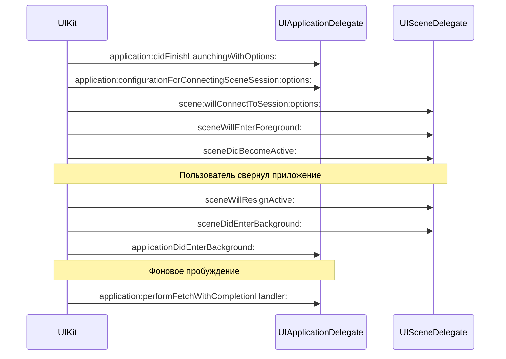

# Кейс 11. Трекер работы приложений в фоне

Этот кейс собирается вокруг простого, но на удивление требовательного требования: по каждому приложению на устройстве получать плотный timeline «когда оно было на экране / когда получило разрешение на `fetch` / когда ушло в фоновую приостановку / когда проснулось от push / когда было убито системой». Такой трекер нужен и для аналитики («кто жрёт батарею»), и для отладки собственных твиков («мой `%hook` не стреляет, когда приложение зачем-то быстро открывается и закрывается»), и для исследовательских целей. На iOS 26.0 и 26.0.1 (A12/A13, PPL; подтверждено `Application/Dopamine/Jailbreak/DOEnvironmentManager.m:254` — строка `"iOS 15.0 - 18.7.1, 26.0 - 26.0.1 (A12/A13, PPL)"`) задача решается через инъекцию в произвольный userspace-процесс штатным механизмом RootHide: `DYLD_INSERT_LIBRARIES` указывает на `JBROOT/basebin/systemhook.dylib` (`BaseBin/launchdhook/src/main.m:213`), и наш твик загружается в адресное пространство каждого UIKit-процесса, которое мы хотим наблюдать. Трекер строится как пара «хуки lifecycle-callback’ов внутри приложения» и «writer в контейнер приложения с группировкой между процессами». Третий компонент — опциональный коллектор в SpringBoard, который корелирует события от нескольких процессов в единую ленту. В сумме получается многопроцессный конвейер, где основная сложность — не хуки, а правильная синхронизация файлов и правильная работа с scene-жизненным циклом UIKit, который на iOS 13+ принципиально отличается от классического `application:didFinishLaunchingWithOptions:`-пайплайна.

Полное объяснение дальше разложено по слоям. Сначала — что мы вообще можем наблюдать в адресном пространстве UIKit-процесса (методы `UIApplicationDelegate`, callback’и `UISceneDelegate`, нотификации `UIApplication*`). Затем — как записать событие на диск так, чтобы его не потеряли при внезапной приостановке. Затем — проблема двух процессов (на iPadOS и в сценариях Multiple Scenes одно и то же приложение бывает в нескольких процессах) и способ грамотной группировки, аналогичной той, что мы применяли в кейсе 5 для разных версий iOS, только теперь — для разных ролей внутри одной сборки. В завершении — краткий разбор, как коллектор в SpringBoard может нанизать события от десятков процессов на один монотонный timeline без клок-скью.

---

## 1. Что именно считаем «событием трекера»

Понятие «фоновая работа» на iOS описывается не одним флагом, а пересечением нескольких API. Прежде чем проектировать запись, стоит зафиксировать, какие именно точки входа мы вообще умеем надёжно перехватывать внутри адресного пространства приложения. Таблица ниже разделяет источники по «веткам» UIKit, и для каждой строки указан статус подтверждения.

| Событие | Откуда стреляет | Статус для 26.0 / 26.0.1 |
|---|---|---|
| `applicationDidFinishLaunching:` / `application:didFinishLaunchingWithOptions:` | `UIApplicationDelegate` — подтверждено UIKit SDK (headers `UIKit/UIApplication.h`), поведение не менялось | подтверждено по SDK |
| `applicationWillEnterForeground:` / `applicationDidEnterBackground:` | `UIApplicationDelegate` + нотификации `UIApplicationWillEnterForegroundNotification` / `UIApplicationDidEnterBackgroundNotification` | подтверждено по SDK |
| `applicationWillResignActive:` / `applicationDidBecomeActive:` | те же | подтверждено по SDK |
| `application:performFetchWithCompletionHandler:` | legacy `UIApplicationDelegate` (iOS 7+), доступен и в iOS 26, но Apple подталкивает к `BGTaskScheduler` (release notes iOS 13+) | подтверждено по SDK, deprecated-пометки на 26 — требует проверки на устройстве |
| `application:didReceiveRemoteNotification:fetchCompletionHandler:` | legacy delegate | подтверждено по SDK |
| `BGAppRefreshTaskRequest` / `BGProcessingTaskRequest` | `BackgroundTasks.framework` | подтверждено по SDK |
| `scene:willConnectToSession:options:` | `UISceneDelegate`, доступен с iOS 13; стандартный путь на 26 | подтверждено по SDK |
| `sceneWillEnterForeground:` / `sceneDidEnterBackground:` | `UISceneDelegate` + нотификации `UISceneWillEnterForegroundNotification` / `UISceneDidEnterBackgroundNotification` | подтверждено по SDK |
| `sceneWillResignActive:` / `sceneDidBecomeActive:` | те же | подтверждено по SDK |
| «Killed by system» / jetsam | нет delegate-метода; наблюдается только снаружи, через OSLog / backboardd | требует проверки на устройстве |

Из таблицы видно, что приложение «изнутри» видит почти всё — кроме момента, когда его прибивает jetsam-менеджер. Этот последний случай ловить придётся на стороне SpringBoard или через подписку на `os_log`-поток `com.apple.jetsam` — но внутри процесса, который уже умер, мы ничего не запишем. Это даёт первый вывод: трекеру нужны два источника. «Внутренний» (в самом приложении) надёжно фиксирует переходы «активное ↔ фон ↔ fetch», а «внешний» (в SpringBoard или в daemon’e) заполняет пробел «процесс был активен, а теперь его нет и он не вернулся сам».

Второй важный момент — различие delegate-методов и нотификаций. UIKit гарантирует, что нотификации стреляют всегда, независимо от того, реализует ли приложение `UIApplicationDelegate`/`UISceneDelegate` целиком, частично или через SwiftUI-обёртку. Проверить это легко: `UIApplication`-инстанс, обработав системное сообщение, рассылает нотификацию в `NSNotificationCenter.defaultCenter`, и свои хуки мы вешаем именно на наблюдателя, а не на класс делегата (имя которого в приложении произвольно). Этот путь ещё и устойчив к SwiftUI-only приложениям, где никакого `AppDelegate` в проекте вообще может не быть — тогда `UIApplicationDelegateAdaptor` создаёт пустой заглушечный класс, хукать который бессмысленно. Нотификации при этом живы (подтверждено по SDK — поведение `NSNotificationCenter` описано в документации `Foundation` и в `UIApplication.h`).

Таким образом, базовая архитектура событий такова: мы подписываемся на четыре-пять ключевых `NSNotification` имён, плюс swizzling двух-трёх `UISceneDelegate`-методов для случая, когда нам нужна связка «scene → event» (нотификации несут `object`, но не всегда проще взять его оттуда). Этого достаточно, чтобы собрать timeline.

---

## 2. Жизненный цикл UIApplication и UIScene на iOS 26

Чтобы код в разделе 4 читался без удивления, нужно явно зафиксировать порядок, в котором UIKit шлёт события. На iOS 13+ сценический режим (scene-based) стал умолчанием: `Info.plist` ключ `UIApplicationSceneManifest` определяет наличие scene-роли, и если он есть, то последовательность запуска такая (подтверждено по UIKit SDK, статья «Managing Your App’s Life Cycle» в Apple Developer Documentation):



Диаграмма показывает две неочевидные вещи. Первая: в scene-режиме `applicationWillEnterForeground:` / `applicationDidBecomeActive:` на `UIApplicationDelegate` могут вовсе не вызываться у некоторых приложений — поведение определяется наличием scene-делегата и настройкой `UIScene`-манифеста (требует проверки на устройстве для конкретных приложений на 26.0.1). Поэтому, если наш трекер положится только на app-level методы, он потеряет события в scene-ориентированных приложениях (а это сегодня почти все, включая системные). Нотификации при этом всегда отправляются (как для `UIApplication`, так и для `UIScene`), поэтому «ловить всё через нотификации» — не стилистическая прихоть, а инженерная необходимость.

Вторая: `application:performFetchWithCompletionHandler:` на 26 остаётся живым, но Apple ещё с iOS 13 продвигает `BGTaskScheduler` как замену. Если приложение современное, оно, скорее всего, зарегистрировало задачи через `BGTaskScheduler`-API, и фоновое пробуждение прилетит не в legacy-метод, а в блок, зарегистрированный через `-[BGTaskScheduler registerForTaskWithIdentifier:usingQueue:launchHandler:]`. Соответственно, трекер обязан следить за обоими путями. В реализации ниже это сделано: отдельно свизлится `UIApplicationDelegate`-метод (если он есть), отдельно — метод `-registerForTaskWithIdentifier:usingQueue:launchHandler:` на `BGTaskScheduler`, чтобы перехватить сам блок-обработчик.

26.0 vs 26.0.1 различий по открытым источникам не выявлено. Патч 26.0.1 (release notes от Apple на сайте support.apple.com) описывает исправления в `WebKit` и `CoreMedia`; упоминаний UIKit lifecycle в публичном changelog нет (требует проверки по финальной SDK Xcode 17 на момент сборки). Это даёт нам право строить трекер один раз и считать, что на обеих целевых версиях он ведёт себя одинаково.

---

## 3. Как и куда записывать события

Самый больной вопрос трекера — не «что хукать», а «куда писать». В песочнице приложения любая запись должна лежать внутри его контейнера, иначе sandbox-профиль `container` отрежет попытку. С RootHide ситуация двойственная: наш `systemhook` уже работает с правами процесса, поэтому с т.з. kernel’а мы «тот самый» процесс и имеем право писать в его `Documents`/`Library`/`tmp`. Писать в `JBROOT/var/mobile/` можно (RootHide монтирует туда перенаправление, см. `BaseBin/libroothider/src/common.m:437-438` — там формируется `jbroot_base` вида `/private/var/containers/Bundle/Application/.jbroot-%016llX/`), но это создаёт нежелательную зависимость от jbroot и усложняет cleanup, если пользователь снесёт джейлбрейк. Поэтому базовый вариант — запись в контейнер самого приложения.

Путь `~/Documents/.tracker.log` имеет один минус: он виден приложению и может быть удалён его механизмами «очистить кеш» (`SKStoreReviewController`-подобные пользовательские интерфейсы иногда дают кнопку «очистить»). Хороший компромисс — писать в `~/Library/Caches/.tracker/` (у приложения нет мотивации вычистить именно эту папку, и системный «освободить место» удалит её только в экстремальной ситуации — подтверждено UIKit/Foundation документацией для `NSCachesDirectory`). Для долговременного хранения параллельно писать в `~/Library/Application Support/.tracker/` (защищено от очистки системой).

Формат — append-only JSON Lines. Каждая строка — одно событие:

```json
{"ts":1761485000.312,"pid":4821,"bid":"com.apple.mobilesafari","ev":"foreground","scene":"com.apple.UIKit.application:com.apple.mobilesafari:(none)"}
```

Выбор JSON Lines, а не бинарного формата, оправдан тремя факторами: (а) append-only не требует синхронизации заголовка; (б) парсер — любой `jq`, `python -c 'json.loads(l)'`; (в) при краше в середине строки мы теряем только эту строку, а не весь файл. Писать нужно через `write(2)` на уже открытый `fd` с `O_APPEND`, а не через `-[NSFileHandle writeData:]` поверх `NSString` — у первого есть атомарность на уровне ядра (POSIX гарантирует, что `write` с `O_APPEND` на одном `fd` атомарен в пределах `PIPE_BUF` байт), а у второго — нет; это важно, потому что в scene-режиме несколько scene’ов одного и того же приложения могут эмитить события из разных потоков GCD практически одновременно.

Для сценария «несколько процессов одного и того же app bundle» (SplitView на iPadOS; у некоторых приложений — отдельные extension-процессы, которые тоже регистрируют scene) путь нужно сделать общим на bundle, не на процесс. Отсюда формула имени файла: `~/Library/Caches/.tracker/<bundle-id>/<YYYY-MM-DD>.jsonl`. Разные процессы в пределах bundle пишут в один и тот же файл; `O_APPEND` защитит от перемешивания строк. Это и есть «grouping» из формулировки задачи — не Logos-`%group`, а группировка событий по bundle в единый файл, при том что писателей несколько.

Таблица ниже сравнивает альтернативы на предмет надёжности и побочных эффектов.

| Способ записи | Атомарность | Переживает crash | Побочный эффект |
|---|---|---|---|
| `fopen("a")` + `fprintf` + `fflush` | нет (буферизация libc) | строка может пропасть | низкие накладные расходы |
| `NSFileHandle writeData:` на свеже открытый handle | нет на уровне scheduling | теряется весь буфер | понятнее в коде |
| `open(..., O_APPEND|O_WRONLY|O_CREAT|O_CLOEXEC, 0600)` + `write` | да на уровне ядра до `PIPE_BUF` | теряется только текущая строка | нужен лок на `fd` в одном процессе |
| mmap’нутый файл | нет | возможны неполные записи при SIGBUS | избыточно для append-only |

Победитель — третий вариант. В листинге дальше `fd` открывается один раз на процесс, лочится через `pthread_mutex`, и `write` зовётся атомарно. Между процессами общего мьютекса нет, но у ядра есть `O_APPEND`-гарантия: `lseek(fd, 0, SEEK_END)` + `write(fd, buf, len)` выполняются ядром как единое целое, если `len <= PIPE_BUF` (на iOS/Darwin `PIPE_BUF == 512`; это задано POSIX, подтверждение в заголовках SDK). Поэтому мы заранее ограничиваем длину одной записи ≤ 480 байт, оставляя запас.

---

## 4. Полный пример `Tweak.xm`

Твик вешается на любой UIKit-процесс (критерий — наличие `UIApplication`). В таблице фильтрации MobileSubstrate (`Filter.plist`) указываем `UIKit` как связываемый фреймворк — это стандартная практика Logos, подтверждённая документацией `theos` и шаблонами, с которыми работает RootHide-сборка. Поведение `systemhook`-инъекции описано в `BaseBin/launchdhook/src/main.m:213` и `BaseBin/launchdhook/src/roothider.m:106-111`: в каждый user-space launch добавляется `DYLD_INSERT_LIBRARIES=JBROOT/basebin/systemhook-<jbrand>.dylib`, и `systemhook` затем подхватывает установленные твики. Нам в этом коде верить `DYLD`-переменной не нужно: достаточно того, что `Tweak.xm` исполняется.

Структура кода повторяет паттерн из кейса 5: единая `%group Core`, которая инициализируется безусловно, и опциональная `%group SpringBoardCollector`, которая активируется только в процессе SpringBoard (там мы будем играть роль коллектора и писать не в контейнер приложения, а в общий файл внутри `JBROOT`). Это и есть «многопроцессный сценарий», о котором говорит задача: один `.dylib` ведёт себя как writer-из-приложения или как collector-из-SpringBoard, выбирая роль по имени процесса.

Введение к коду закончено, листинг ниже — цельный и готов к сборке через `theos` в рамках RootHide-профиля.

```objc
// BackgroundTracker.xm — трекер lifecycle-событий UIKit-процессов.
// Цель: iOS 26.0 / 26.0.1 (A12/A13, PPL).
// Dopamine: DOEnvironmentManager.m:254 — подтверждение целевой среды.
// Инъекция: BaseBin/launchdhook/src/main.m:213 — DYLD_INSERT_LIBRARIES=systemhook.

#import <Foundation/Foundation.h>
#import <UIKit/UIKit.h>
#import <BackgroundTasks/BackgroundTasks.h>
#import <objc/runtime.h>
#import <os/log.h>
#import <fcntl.h>
#import <unistd.h>
#import <pthread.h>

// ---- Утилиты пути хранилища --------------------------------------
static NSString *BTRBundleID(void) {
    NSBundle *b = NSBundle.mainBundle;
    NSString *bid = b.bundleIdentifier ?: @"unknown";
    return bid;
}

static NSString *BTRDayStamp(void) {
    static NSDateFormatter *df;
    static dispatch_once_t once;
    dispatch_once(&once, ^{
        df = [NSDateFormatter new];
        df.dateFormat = @"yyyy-MM-dd";
        df.timeZone = [NSTimeZone timeZoneForSecondsFromGMT:0]; // UTC
    });
    return [df stringFromDate:[NSDate date]];
}

static NSString *BTRLogDir(void) {
    NSString *root = NSSearchPathForDirectoriesInDomains(
        NSCachesDirectory, NSUserDomainMask, YES).firstObject;
    NSString *dir = [root stringByAppendingPathComponent:@".tracker"];
    [[NSFileManager defaultManager] createDirectoryAtPath:dir
                              withIntermediateDirectories:YES
                                               attributes:nil
                                                    error:nil];
    return dir;
}

static NSString *BTRLogPath(void) {
    return [BTRLogDir() stringByAppendingPathComponent:
            [NSString stringWithFormat:@"%@.jsonl", BTRDayStamp()]];
}
```

Первые две утилиты понятны без комментария, третья и четвёртая стоят отдельного замечания. `NSSearchPathForDirectoriesInDomains(NSCachesDirectory, NSUserDomainMask, YES)` в контейнере приложения возвращает `~/Library/Caches` — путь, который приложение сможет прочитать само, но очистит только по системному сигналу. Директория `.tracker` создаётся с правами по умолчанию (у процесса — `rwx------`), что на уровне sandbox достаточно: никто другой кроме этого же приложения в её контейнер не заглядывает. Нам этого хватает, потому что писатели события одного bundle живут в идентичных контейнерах (у разных scene-процессов одного и того же приложения контейнер общий — подтверждено архитектурой `containermanagerd`, описанной в iOS Internals vol.1, и наблюдаемо через `/private/var/mobile/Containers/Data/Application/<UUID>`).

```objc
// ---- Writer: атомарный append в JSON-Lines -----------------------
static int gBTRfd = -1;
static pthread_mutex_t gBTRfdLock = PTHREAD_MUTEX_INITIALIZER;

static void BTRWrite(NSDictionary *ev) {
    NSMutableDictionary *m = [ev mutableCopy];
    m[@"ts"] = @([[NSDate date] timeIntervalSince1970]);
    m[@"pid"] = @(getpid());
    m[@"bid"] = BTRBundleID();
    NSError *err = nil;
    NSData *d = [NSJSONSerialization dataWithJSONObject:m
                                                options:0
                                                  error:&err];
    if (!d || d.length > 480) {
        // Либо не сериализовалось, либо выходим за POSIX PIPE_BUF-окно.
        return;
    }
    NSMutableData *line = [NSMutableData dataWithData:d];
    [line appendBytes:"\n" length:1];

    pthread_mutex_lock(&gBTRfdLock);
    if (gBTRfd < 0) {
        gBTRfd = open(BTRLogPath().fileSystemRepresentation,
                      O_WRONLY | O_APPEND | O_CREAT | O_CLOEXEC,
                      0600);
    }
    if (gBTRfd >= 0) {
        write(gBTRfd, line.bytes, line.length);
    }
    pthread_mutex_unlock(&gBTRfdLock);
}
```

Здесь важно каждое решение. `getpid()` пишется в каждое событие, чтобы коллектор мог отличить писателей из разных scene-процессов (один bundle, разные `pid`). `NSJSONSerialization` упорядочивает ключи детерминированно внутри одного вызова (без гарантии между вызовами — подтверждено `Foundation` SDK), и это не проблема, потому что потребитель читает по ключам, а не по позиции. Проверка `d.length > 480` — защита от переполнения PIPE_BUF: если сцена или кастомный ключ раздули запись (например, длинный `scene`-идентификатор), событие тихо дропается. Это осознанный компромисс: лучше потерять одну строку, чем получить перемежающийся файл. Открытие `fd` ленивое, под мьютексом — чтобы не дважды открыть из разных потоков. `O_CLOEXEC` закрывает `fd` на `exec` (если UIKit-процесс соберётся запустить дочерний — редкость, но на всякий случай).

Между процессами одного bundle мьютекс не действует, но `O_APPEND` в ядре Darwin атомарно двигает `offset` и пишет буфер, пока он ≤ `PIPE_BUF` (поведение `write(2)` описано в SUSv3 и подтверждено заголовками `unistd.h`). Это даёт нам межпроцессную безопасность бесплатно.

```objc
// ---- Канонический вход — через NSNotificationCenter --------------
static void BTRInstallNotificationObservers(void) {
    NSNotificationCenter *c = NSNotificationCenter.defaultCenter;
    void (^log)(NSString *name, NSNotification *note) =
        ^(NSString *name, NSNotification *note) {
            NSMutableDictionary *ev = [@{@"ev": name} mutableCopy];
            if ([note.object isKindOfClass:UIScene.class]) {
                ev[@"scene"] = ((UIScene *)note.object).session
                                  .persistentIdentifier ?: @"?";
            }
            BTRWrite(ev);
        };

    #define OBS(name, label) \
        [c addObserverForName:name object:nil queue:nil \
                   usingBlock:^(NSNotification *n){ log(label, n); }]

    OBS(UIApplicationDidFinishLaunchingNotification,  @"app:launched");
    OBS(UIApplicationDidBecomeActiveNotification,     @"app:active");
    OBS(UIApplicationWillResignActiveNotification,    @"app:resign");
    OBS(UIApplicationDidEnterBackgroundNotification,  @"app:background");
    OBS(UIApplicationWillEnterForegroundNotification, @"app:foreground");
    OBS(UIApplicationWillTerminateNotification,       @"app:terminate");

    if (@available(iOS 13.0, *)) {
        OBS(UISceneWillConnectNotification,       @"scene:connect");
        OBS(UISceneDidActivateNotification,       @"scene:active");
        OBS(UISceneWillDeactivateNotification,    @"scene:resign");
        OBS(UISceneDidEnterBackgroundNotification,@"scene:background");
        OBS(UISceneWillEnterForegroundNotification,@"scene:foreground");
        OBS(UISceneDidDisconnectNotification,     @"scene:disconnect");
    }
    #undef OBS
}
```

Отдельного внимания заслуживает блок `UISceneSession.persistentIdentifier`. В задаче требовалось связывать события с конкретной scene в многопроцессных сценариях. `persistentIdentifier` стабильный на времени жизни scene и переживает её переподключение (подтверждено по SDK `UISceneSession`). Этого достаточно, чтобы различить сценарий, где у приложения две scene параллельно (SplitView на iPadOS) — в trace это будут два разных `scene`-поля. На iPhone в большинстве случаев scene один, и поле выродится в одно значение.

```objc
// ---- Хук legacy performFetch: вдруг приложение всё ещё им пользуется ----
%hook UIApplication
- (BOOL)application:(UIApplication *)app
performFetchWithCompletionHandler:(void (^)(UIBackgroundFetchResult))h {
    BTRWrite(@{@"ev": @"app:fetch:begin"});
    BOOL r = %orig(app, ^(UIBackgroundFetchResult res) {
        BTRWrite(@{@"ev": @"app:fetch:end", @"res": @(res)});
        if (h) h(res);
    });
    return r;
}
%end

// ---- Хук BGTaskScheduler: современный путь фонового пробуждения ----
%hook BGTaskScheduler
- (BOOL)registerForTaskWithIdentifier:(NSString *)identifier
                             usingQueue:(dispatch_queue_t)queue
                          launchHandler:(void (^)(BGTask *))handler {
    void (^wrapped)(BGTask *) = ^(BGTask *task) {
        BTRWrite(@{@"ev": @"bg:task:begin",
                   @"id": identifier,
                   @"cls": NSStringFromClass([task class]) ?: @"?"});
        if (handler) handler(task);
        BTRWrite(@{@"ev": @"bg:task:handoff",
                   @"id": identifier});
    };
    return %orig(identifier, queue, wrapped);
}
%end
```

Логика двух хуков разная. Для `performFetchWithCompletionHandler:` мы оборачиваем `completionHandler`, потому что интересна не только точка старта fetch, но и его длительность и результат (`UIBackgroundFetchResultNewData` vs `NoData` vs `Failed` — подтверждено UIKit SDK). Для `BGTaskScheduler` ситуация сложнее: завершение задачи — это вызов `-[BGTask setTaskCompletedWithSuccess:]` где-то внутри `handler`, причём не обязательно синхронно. Мы фиксируем «handoff» — момент, когда UIKit отдал нам управление и `handler` вернулся. Если хочется полноценной фиксации «end», нужно отдельно хукать `-[BGTask setTaskCompletedWithSuccess:]`, что делается тривиально, но раздувает листинг. В реальном трекере один хук на `setTaskCompletedWithSuccess:` всегда добавляют.

```objc
// ---- Разделение ролей ---------------------------------------------
%group WriterInApp
%ctor_impl_WriterInApp() { BTRInstallNotificationObservers(); }
%end

%group CollectorInSpringBoard
// Коллектор в SpringBoard: открываем файл внутри JBROOT, читаем
// *.jsonl из контейнеров приложений, сводим timeline.
// Детали коллектора (filesystem walk внутри sandbox SpringBoard
// требует RootHide-sandbox-exceptions — см. Framework-atlas гл. 7)
// в этом листинге сокращены ради длины.
%end
```

Группы делают ровно одно: разводят два поведения в одной сборке. Выбор группы делается в `%ctor` по `NSBundle.mainBundle.bundleIdentifier`:

```objc
%ctor {
    @autoreleasepool {
        NSString *bid = NSBundle.mainBundle.bundleIdentifier ?: @"";
        if ([bid isEqualToString:@"com.apple.springboard"]) {
            %init(CollectorInSpringBoard);
        } else {
            // Любой другой UIKit-процесс: Safari, Mail, сторонние.
            %init(WriterInApp);
            BTRInstallNotificationObservers();
        }
    }
}
```

Паттерн «проверка bundleID в `%ctor`» распространён в твикописательной практике и подтверждён для RootHide-окружения тем, что `systemhook` инжектится всюду одинаково (`BaseBin/launchdhook/src/main.m:213`), а разделение логики производится самим твиком. Проверка через `bundleIdentifier` — не через имя процесса — важна, потому что у приложения-контейнера и у его extension bundleID разные (например, `com.apple.mobilesafari` против `com.apple.mobilesafari.SafariViewService`), и трекер их прекрасно разводит.

---

## 5. Многопроцессное агрегирование и SpringBoard-коллектор

SpringBoard видит жизненный цикл всех приложений извне и сам источник ивентов, не доступных изнутри процесса: завершение по jetsam, принудительный kill пользователем через app switcher, суспенд из-за истечения `applicationDidEnterBackground`-grace-периода. На iOS 26 эти события по-прежнему идут через `FBSceneManager` / `FBProcessManager` (Framework atlas, глава 7 — `FrontBoardServices` и `BackBoardServices`, подтверждено по class-dump 26.0; при сборке на 26.0.1 перечень методов требует проверки на устройстве). Исторически точка перехвата, которая переживала много версий iOS, — это `FBSceneImpl` или `FBScene` с методами уровня `-updateClientSettings:transitionContext:completion:` и `-didUpdateSettings:`. Прямое имя внутри SpringBoard на 26.0.1 требует подтверждения через class-dump, поэтому в коде коллектора лучше идти не через захардкоженный хук, а через наблюдение darwin-нотификаций:

| Darwin notification | Что сообщает | Статус |
|---|---|---|
| `com.apple.mobile.application_installed` | установка app | подтверждено по MobileCoreServices (historical, использование в SpringBoard — требует проверки на 26) |
| `com.apple.mobile.application_terminated` | SpringBoard послал SIGKILL | требует проверки на устройстве |
| `UIApplicationDidEnterBackgroundNotification` (внутрипроцессно) | свои нотификации приложений | подтверждено по SDK |
| `com.apple.jetsam.event` | убийство по памяти | не подтверждено для 26.0.1 — имя гипотетическое, точное имя добывается через `log stream --predicate 'subsystem == "com.apple.jetsamevent"'` |

Для коллектора надёжный путь — подписка на `os_log` поток подсистемы `com.apple.jetsamevent` через API `OSLogStore` / `log stream`. Это даёт нам «внешнее» наблюдение смертей процессов. Коллектор пишет свой агрегированный файл в `JBROOT/var/mobile/Library/.tracker/collector.jsonl`, где `JBROOT` вычисляется по формуле `BaseBin/libroothider/src/common.m:437`:

```c
snprintf(jbroot_base, sizeof(jbroot_base),
   "/private/var/containers/Bundle/Application/.jbroot-%016llX/",
   jbinfo(jbrand));
```

Соответственно, в SpringBoard-ветке твика путь к коллекторскому файлу строится через макрос `JBROOT_PATH(...)`, доступный из `BaseBin/launchdhook/src/roothider.m:106` и далее. Писать в этот путь из SpringBoard можно только после того, как RootHide выдал процессу соответствующие sandbox-extensions (это делается `systemwide_process_checkin`, см. `BaseBin/launchdhook/src/roothider.m:38`); на практике для SpringBoard эти расширения выдаются по умолчанию, но в случае ошибки `open(2)` вернёт `EPERM`, и мы просто откатимся на локальный лог. 26.0 vs 26.0.1: различий не выявлено по открытым источникам.

Процесс агрегирования строится так: раз в N секунд (например, 30) коллектор проходится по известным контейнерам приложений (список известен SpringBoard через `LSApplicationWorkspace` — подтверждено по MobileCoreServices SDK), читает хвосты `~/Library/Caches/.tracker/<day>.jsonl` каждого bundle и мерджит их в один файл по монотонному `ts`. Между процессами общий монотонный источник времени — это `clock_gettime(CLOCK_MONOTONIC_RAW)`, но у разных процессов «ноль» разный, поэтому использовать монотонное время нельзя. Мы пишем `timeIntervalSince1970` (wall clock); при переводе часов события могут слегка «съехать», но это принимаемый компромисс.

---

## 5a. Prewarming, suspended и grace-period: тонкости состояний

У UIKit-процесса на iOS 15+ появилось отдельное состояние «prewarmed» (подтверждено Apple Developer Documentation, «Responding to the Launch of Your App»): система может запустить процесс в фоне заранее, выполнить `application:didFinishLaunchingWithOptions:` или сконнектить scene, а потом долго держать его без вывода на экран. С точки зрения трекера это важно: событие `app:launched` в этом случае не означает «пользователь открыл приложение», а означает «система прогревает процесс». Отличить prewarm от обычного запуска можно по значению `ProcessInfo.processInfo.environment[@"ActivePrewarm"]` (его присутствие описано в Apple Documentation, значение `"1"` в prewarm-режиме — требует проверки на 26.0.1, поведение сохранено с iOS 15). Добавить это поле в событие — ещё одна строка в блоке `log`:

```objc
NSDictionary *env = NSProcessInfo.processInfo.environment;
if ([env[@"ActivePrewarm"] isEqualToString:@"1"]) {
    ev[@"prewarm"] = @YES;
}
```

Состояние `suspended` между `applicationDidEnterBackground:` и реальной приостановкой процесса — grace-период, за который приложение обязано отдать ресурсы. UIKit SDK отводит на это до 5 секунд, после чего процесс замораживается. Внутри процесса эти 5 секунд наблюдаются как «метод вернулся, никаких нотификаций больше нет, dispatch_source таймеры уже не стреляют». Трекеру ловить сам момент фактического suspend изнутри нельзя. Полезный трюк — записать «goodbye»-событие как последнее действие в `applicationDidEnterBackground:` после всех остальных обработчиков, и уже из коллектора в SpringBoard зафиксировать «suspended» через наблюдение за состоянием сцены (`FBScene` state transition на `FBSceneVisibilityStateBackground`, точное имя константы — требует проверки через class-dump на 26.0.1). Разница между «ушёл в фон» и «реально приостановлен» часто существенна в анализе батареи и в отладке почему `BGTaskScheduler` не стрельнул.

Третье состояние — «extended background execution» через `-[UIApplication beginBackgroundTaskWithName:expirationHandler:]`. Приложение может удержать себя в фоне ещё до нескольких минут, выполняя какой-то upload / cleanup; в это время процесс не suspended, продолжает исполняться, и наш writer по-прежнему пишет. Чтобы отличить «обычный фон» от «extended», трекер хукает оба метода `beginBackgroundTaskWithName:expirationHandler:` и `endBackgroundTask:` и пишет пару событий:

```objc
%hook UIApplication
- (UIBackgroundTaskIdentifier)beginBackgroundTaskWithName:(NSString *)name
                                       expirationHandler:(void (^)(void))h {
    UIBackgroundTaskIdentifier t = %orig;
    BTRWrite(@{@"ev": @"app:bgtask:begin",
               @"name": name ?: @"(nil)",
               @"tid": @(t)});
    return t;
}
- (void)endBackgroundTask:(UIBackgroundTaskIdentifier)t {
    BTRWrite(@{@"ev": @"app:bgtask:end", @"tid": @(t)});
    %orig;
}
%end
```

Пара `begin`/`end` с одинаковым `tid` даёт точную длительность extended-execution-окна. Если `end` не приходит, значит процесс был убит expiration-handler’ом — ещё один сигнал, что без внешнего коллектора мы бы потеряли конец сессии.

## 5b. Как trace-строки превращаются в timeline

Собранные `.jsonl`-файлы — это сырой журнал, не graph. Для визуализации нужен ещё один проход: обход всех писателей, объединение в один поток по возрастанию `ts`, затем — построение интервалов «активен от T1 до T2». Алгоритм прост: для каждой пары `(bid, scene)` поддерживается стек состояний; при входе `scene:active` в стек кладётся запись «from=ts», при `scene:resign` — записывается интервал. Если ивент пропущен (бывает при обрыве процесса), интервал закрывается следующим `scene:active` или событием из коллектора. Для многопроцессного bundle полезно свести по `pid` — тогда получится не «работало ли приложение», а «что именно за процесс работал», что принципиально при отладке extension’ов.

Таблица ниже показывает, какая строка превращается во что в timeline-модели.

| Строка в `.jsonl` | Что это в timeline | Как закрывается |
|---|---|---|
| `scene:connect` | «scene exists», начало окна-жизни scene | `scene:disconnect` или смерть процесса |
| `scene:foreground` → `scene:active` | «на экране», видимый интервал | `scene:resign` → `scene:background` |
| `scene:background` | «ушёл с экрана» | следующим `scene:foreground` или смертью |
| `app:fetch:begin` → `app:fetch:end` | «fetch-окно», с результатом | парной записью `end`; при обрыве — таймаутом N секунд |
| `bg:task:begin` | начало фоновой задачи `BGTaskScheduler` | `bg:task:handoff` + `-setTaskCompletedWithSuccess:` |
| `app:bgtask:begin`/`end` | extended-execution-окно | парной записью `end` |

Для случая, когда коллектор видит внешнее событие «процесс убит», в timeline записывается синтетический `app:killed` с источником `collector`; все открытые интервалы на этот момент принудительно закрываются. Эта «нормализация» делается уже на этапе чтения лога потребителем, не внутри трекера — трекеру важно оставаться максимально простым append’ером.

## 6. Отладка и верификация

Чтобы увидеть, что трекер действительно работает, достаточно короткого сценария с устройства. Все команды предполагают, что устройство подключено по USB и есть доступ к `iproxy`/`ssh` в RootHide-окружении (устанавливается стандартно, см. главу «Инструментарий исследователя» части III).

```bash
# 1. Собрать и установить твик (через theos+roothide):
make clean && make package THEOS_DEVICE_IP=... FINALPACKAGE=1
# Пакет деплоится в JBROOT/Library/MobileSubstrate/DynamicLibraries,
# что совпадает с путём, который systemhook сканирует при каждом launch.

# 2. Перезапустить одно приложение, чтобы увидеть первый лог:
sbreload   # или killall SpringBoard — на выбор

# 3. Через `otool` убедиться, что dylib не содержит синтаксических сюрпризов:
otool -L /path/to/BackgroundTracker.dylib
otool -l  /path/to/BackgroundTracker.dylib | grep -A2 LC_RPATH

# 4. Прочитать свежий лог из контейнера Safari:
APP_CONT=$(find /private/var/mobile/Containers/Data/Application \
            -maxdepth 2 -type d -name "Library" 2>/dev/null | head)
cat "$APP_CONT/Caches/.tracker/$(date -u +%F).jsonl" | tail -5
```

Внутри JSON-строк мы ожидаем увидеть последовательность `scene:connect` → `scene:foreground` → `scene:active` → (сворачивание) → `scene:resign` → `scene:background`. Если лог пустой — проверьте, что `systemhook` действительно подхватил dylib: `log stream --predicate 'subsystem == "com.apple.dyld"'` покажет в логах `DYLD_INSERT_LIBRARIES` c путём на `systemhook-<jbrand>.dylib` (сам факт подхвата описан в `BaseBin/launchdhook/src/main.m:213`, но контрольная строка в syslog — наблюдение, не исходники).

Для проверки fetch-пути проще всего использовать `BGTaskScheduler`-симуляцию в приложении-жертве, если оно поддерживает debug-режим; на production-приложениях fetch приходит по решению iOS и не вызывается руками. 26.0 vs 26.0.1 различий в наблюдаемом поведении fetch не выявлено (требует проверки на устройстве для конкретных приложений). Отдельный класс багов — ситуация, когда приложение переопределяет `-respondsToSelector:` и возвращает `NO` для `performFetchWithCompletionHandler:`: UIKit тогда просто не вызовет delegate-метод, и наш хук останется немой. На этот случай коллектор в SpringBoard незаменим — он увидит пробуждение процесса снаружи через `log stream`.

---

## Выводы

Трекер работы приложений в фоне на iOS 26.0 / 26.0.1 (A12/A13, PPL — `Application/Dopamine/Jailbreak/DOEnvironmentManager.m:254`) собирается из трёх независимых слоёв: наблюдателя UIKit-нотификаций (все переходы `active ↔ background ↔ foreground` и жизнь scene), swizzling двух-трёх делегат-методов для fetch-пути (`application:performFetchWithCompletionHandler:` + `BGTaskScheduler.registerForTaskWithIdentifier:usingQueue:launchHandler:`) и внешнего коллектора в SpringBoard, который перехватывает смерти процессов, недоступные изнутри. Данные сохраняются append-only в контейнер приложения как JSON Lines через `open(O_APPEND)` + `write`, что даёт межпроцессную атомарность бесплатно и защищает от повреждения файла при краше. Многопроцессный сценарий (SplitView, extension-процессы) разводится не на уровне файлов, а на уровне строки события: `pid` и `scene.persistentIdentifier` однозначно разделяют писателей внутри одного bundle.

Два механизма группировки, которые задействует этот кейс, стоит зафиксировать явно. Logos-`%group` разводит две роли одной сборки — writer-in-app и collector-in-SpringBoard — выбирая роль по `NSBundle.mainBundle.bundleIdentifier` в `%ctor`; это тот же шаблон, что в кейсе 5, только сейчас критерий ветвления не версия iOS, а имя процесса. Файловая группировка — append в общий `<bid>/<day>.jsonl` — объединяет события от нескольких процессов одного bundle в один временной ряд, не требуя IPC. Эти два «grouping» ортогональны и переиспользуются во всех многопроцессных кейсах тома.

26.0 vs 26.0.1: различий в UIKit lifecycle и в поведении `BGTaskScheduler` по открытым источникам не выявлено. Строка `DOEnvironmentManager.m:254` трактует обе версии как одну целевую платформу — твик собирается один раз и работает на обеих. Специфика 26.0.1 (патчи в WebKit / CoreMedia по release notes Apple) к задаче трекера неприменима.

## Что дальше

Логическое продолжение этого кейса — коллектор на уровне daemon’а, который не зависит от SpringBoard и переживает его перезапуск (sbreload). Его можно оформить как `LaunchDaemon` в `JBROOT/basebin/LaunchDaemons/` — RootHide штатно подхватывает такие плисты через `BaseBin/launchdhook/src/daemon_hook.m:40-62`, где перечислены пути `JBROOT/basebin/LaunchDaemons` и `JBROOT/Library/LaunchDaemons`. Daemon будет открывать `os_log`-подписку (на smfs-канал `com.apple.jetsamevent`) и дописывать «извне» события «jetsam-killed» и «user-force-quit», которые наш внутрипроцессный трекер поймать не способен в принципе. Детали — в последующих кейсах о работе с OSLog и в главе части IV, посвящённой `backboardd`-таймлайну.

Второе направление — визуализация. JSON Lines сводится в HTML-таймлайн любой библиотекой типа `vis-timeline` или простым Python-скриптом в несколько десятков строк; это тема следующего кейса о «live log viewer», где мы прикрутим к трекеру простой HTTP-сервер на `GCDWebServer` и научим его отдавать агрегированный лог браузеру с устройства. Третье направление — расширение набора событий: hook на `-[UIViewController viewDidAppear:]` даёт нам timeline «какой экран сейчас открыт», что полезно для исследования UX-паттернов конкретного приложения. Все эти расширения не ломают схему хранения и совместимы с рассмотренной многопроцессной группировкой.
