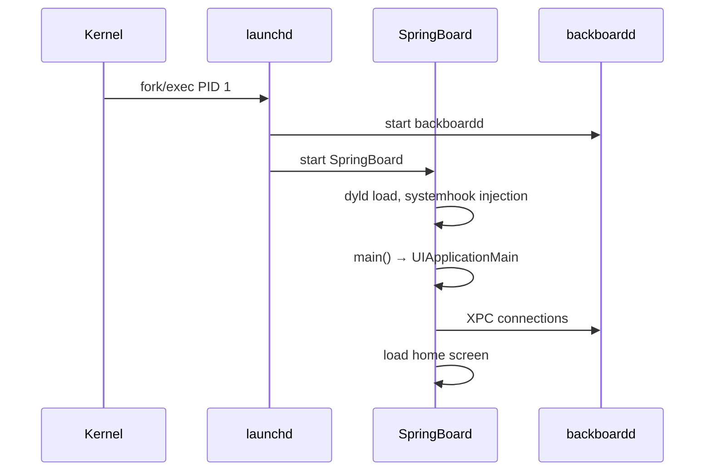

# Daemon: SpringBoard

Главный UI-процесс iOS. Для автора твика — самая часто-посещаемая цель.

## 1. Что это

- **Путь**: `/System/Library/CoreServices/SpringBoard.app/SpringBoard`
- **Bundle ID**: `com.apple.springboard`
- **Запуск**: launchd при каждом boot
- **Привилегии**: обычный daemon, но с особыми entitlements для UI управления

Он отвечает за: home screen, lock screen, status bar, Control Center, notifications UI, app switcher, folders, dock.

## 2. Главные frameworks, загруженные в SpringBoard

Через `otool -L` на бинарнике SpringBoard — обычно 100+ зависимостей. Ключевые:

| Framework | Назначение |
|---|---|
| `UIKit.framework` | Публичный UI |
| `SpringBoardFoundation.framework` | Private SB-уровень |
| `SpringBoardUIServices.framework` | UI сервисы |
| `SpringBoardHome.framework` | Home screen specifics |
| `FrontBoard.framework` | Жизненный цикл scenes |
| `BoardServices.framework` | Общая инфраструктура Board |
| `BulletinBoard.framework` | Уведомления |
| `ControlCenter.framework` | Control Center |
| `BackBoardServices.framework` | События ввода |

## 3. Жизненный цикл



SpringBoard запускается однажды и живёт до перезагрузки (или respring'а).

## 4. Хуки Dopamine в SpringBoard

Из `BaseBin/rootlesshooks/SpringBoard.x`:

- `XBSnapshotContainerIdentity.snapshotContainerPath` — путь snapshot приложений.
- `fcntl F_SETPROTECTIONCLASS` — обход для snapshot-файлов в jbroot.

Из `BaseBin/roothidehooks/src/springboard.x`:

- RootHide-specifics (точный список — в коде).

Для автора твика это значит: **ваш твик в SpringBoard окажется в цепочке** с хуками Dopamine. Не ломайте их.

## 5. Безопасные точки хука (public API)

```objc
%hook UIApplication

- (BOOL)canOpenURL:(NSURL *)url {
    BOOL r = %orig(url);
    os_log(gLog, "SpringBoard canOpenURL %{public}@ → %d", url, r);
    return r;
}

%end

%hook UIScreen

- (CGFloat)brightness {
    CGFloat b = %orig;
    // можно модифицировать для диагностики
    return b;
}

%end
```

Public API стабилен между minor версиями.

## 6. Опасные точки

- Private `SBF*` и `_SBU*` классы — переименуются между minor.
- `_UIStatusBar*` — то же.
- `BBD*`/`BBS*` (BulletinBoard) — то же.

Для них — probe (глава V.2).

## 7. Респринг и восстановление

```bash
ssh mobile@<ip>
killall -9 SpringBoard
# подождать 5-10 сек
```

SpringBoard перезапустится launchd'ом автоматически. Это **самый частый** troubleshooting шаг для tweak-разработчика.

Если респринг не помогает (loop):

- `touch /var/jb/basebin/.safe_mode` — выключает все tweak injection.
- Перезагрузка устройства.

## 8. Что подтверждено

- **Подтверждено**: `/System/Library/CoreServices/SpringBoard.app/` — standard path.
- **Подтверждено Dopamine**: хуки в `rootlesshooks/SpringBoard.x` и `roothidehooks/src/springboard.x`.
- **Требует проверки на устройстве**: конкретные frameworks на iOS 26 — `otool -L`.

## 9. См. также

- Глава II.1 — SpringBoard подсистема.
- Глава III.9 — rootlesshooks/roothidehooks.
- iOS 26 changes 3 — SpringBoard на 26.
- Глава IV.12 — SpringBoard tweak.
