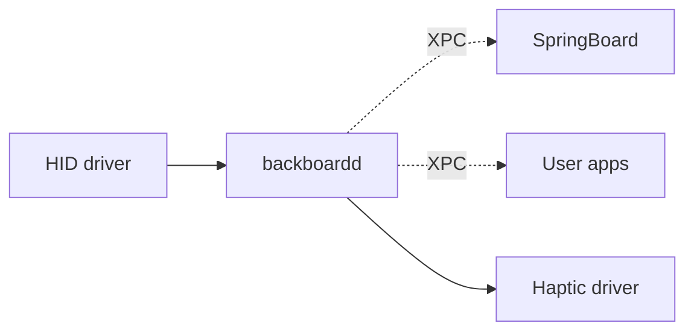

# Daemon: backboardd

Низкоуровневый companion SpringBoard: события ввода, haptics, окна, подсказки touch.

## 1. Что это

- **Путь**: `/usr/libexec/backboardd`
- **Bundle ID**: нет (это launchd daemon, не app)
- **Executable name**: `backboardd`
- **Запуск**: launchd при boot (`/System/Library/LaunchDaemons/com.apple.backboardd.plist`)
- **Привилегии**: root, с entitlements для HID, display, graphics

## 2. Что он делает

- Приём событий HID (touch, keys, buttons) → распределение по UI процессам.
- Haptic feedback — отправка команд в haptic driver.
- Управление окном рендеринга — передача снимков от процессов в compositor.
- Status bar внутренняя логика.
- Keyboard event dispatch.
- Window metadata (sizes, orientations).

Это критический процесс. Падение → полная остановка UI, пока launchd не поднимет снова.

## 3. С кем общается



- HID → backboardd → SpringBoard/apps (события).
- SpringBoard → backboardd (запросы).

## 4. Главные frameworks

- `BackBoardServices.framework` — public interface.
- `BackBoard.framework` — internal.
- `PrototypeTools.framework` — для feature flags.
- `IOKit`, `IOHIDFamily` — HID.
- `HAPIDeviceAccess` — haptic.

## 5. Хуки Dopamine

**Нет**. Dopamine не хукает backboardd (глава II.14).

Это даёт автору твика open ground, но:

- backboardd критичен для системы.
- Хуки на HID events — могут ломать всю навигацию.
- Haptics — реалтайм; задержка от хука = тремор.

Правило: **хукайте backboardd только если очень знаете, что делаете**.

## 6. Безопасные хуки

Через public `BackBoardServices`:

- `BKSHIDEventRef` — обёртка HID event, можно читать поля.
- `BKSDisplayLayoutMonitor` — изменения разметки экрана.

Это **public private** API (библиотека есть, headers недоступны публично; class-dump на устройстве нужен).

Опасные:

- `_BKProcess*` — внутренние представления процессов.
- `_BKEventSender` — отправка HID событий (злоупотребление — симуляция нажатий).

## 7. Simulate touch — не делайте

Теоретически через backboardd можно отправить искусственные touch events в UI. Для тестирования — это appealing. Но:

- **Public API** нет.
- **Private API** — нестабильно.
- **На iOS 26** Apple ужесточила.
- **Этически** — симуляция нажатий = автоматизация без consent = tracking tool.

Для legitimate test automation — используйте XCUITest (на симуляторе) или XCTest UI tests (на устройстве с trusted developer).

## 8. Haptic hooks

`BackBoardServices` имеет private API для haptic:

- `BKSHIDServicesCreateHIDEventWithHaptic` или подобное.
- Эти вызываются UIFeedbackGenerator / CoreHaptics из приложений.

Хукать на уровне `UIFeedbackGenerator` в своём приложении — безопасно. На уровне backboardd — опасно.

## 9. Отладка backboardd

```bash
ssh mobile@<ip>
ps -A | grep backboardd
# backboardd PID

log stream --process backboardd --device <udid>
```

Логи — лавина. Фильтруйте через `--predicate`.

## 10. Если backboardd сломался

Это очень редко, но:

- launchd его перезапустит.
- SpringBoard может zombie-crash от потери connections.
- Пользователь увидит чёрный экран на пару секунд, потом respring.

Если backboardd крэшит в loop — DFU restore. Нет другого пути.

## 11. Что подтверждено

- **Подтверждено**: `/usr/libexec/backboardd` — standard path.
- **Подтверждено Dopamine**: backboardd не хукается.
- **Требует проверки**: конкретные API в backboardd внутри — через class-dump на устройстве.

## 12. См. также

- Глава II.6 — UIKit и Scene (события приходят из backboardd).
- Daemon: SpringBoard — основной клиент backboardd.
- Атлас BackBoardServices (если будет написан).
