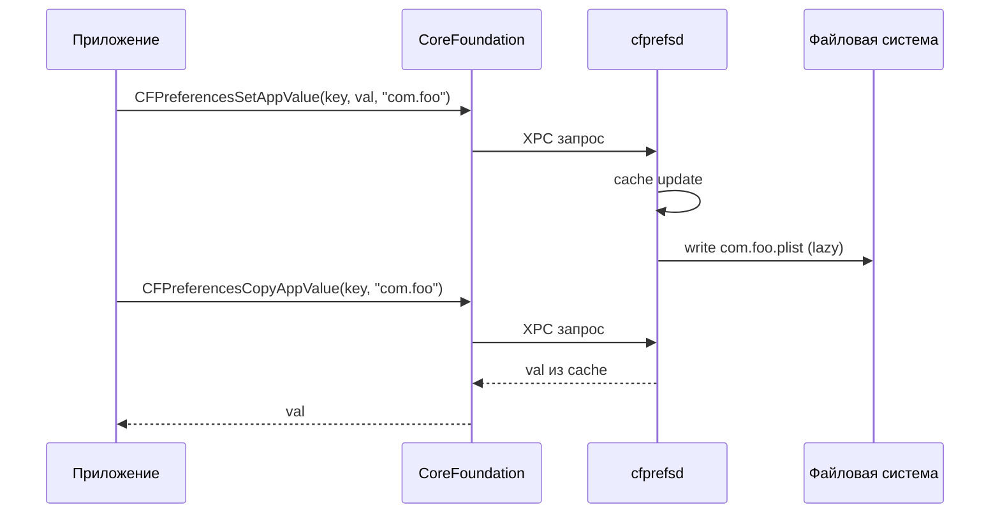

# Daemon: cfprefsd

Сервер preferences. Хранит и обслуживает все `.plist` настройки iOS.

## 1. Что это

- **Путь**: `/usr/sbin/cfprefsd`
- **Executable name**: `cfprefsd`
- **Запуск**: launchd (`/System/Library/LaunchDaemons/com.apple.cfprefsd.*.plist`)
- **Два варианта**: `cfprefsd.plist` (system-wide), `cfprefsd.xpc.daemon.plist` (user-wide)

iOS имеет **два** инстанса cfprefsd — один для system settings, один для mobile user. С точки зрения автора — unified.

## 2. Что он делает

- Принимает `CFPreferencesSetAppValue`/`CopyAppValue` вызовы приложений.
- Пишет в `.plist` файлы (lazy, batched).
- Отдаёт cached значения.
- Отправляет Darwin notifications при изменениях.
- Выполняет transactional updates.

Приложение **не** пишет напрямую в `.plist`. Пишет cfprefsd. Это важно: если вы `fopen` + write `.plist` сами — cfprefsd не узнает, cache разъёдется.

Правильно — всегда через `CFPreferences*` API.

## 3. Хуки Dopamine в cfprefsd

Это главная подсистема, которую Dopamine активно модифицирует.

Из `BaseBin/rootlesshooks/cfprefsd.x` (глава III.9):

- `_CFPrefsGetPathForTriplet` — перенаправляет не-apple preferences в rootless-пространство.
- Длинный whitelist system plists (не редиректятся).

Из `BaseBin/roothidehooks/src/cfprefsd.x`:

- RootHide-specifics для randomized jbroot.

**Для автора твика это невидимо** — вы пишете через `CFPreferences*`, Dopamine направляет куда надо. На устройстве `.plist` оказывается в правильном месте.

## 4. Как cfprefsd работает — упрощённо



## 5. Пути `.plist`

Для rootless + roothide:

- Apple preferences — `/var/mobile/Library/Preferences/com.apple.*.plist`.
- Не-apple preferences — redirect в `/var/jb/var/mobile/Library/Preferences/*.plist` (далее через libroot для RootHide).

Это редирект **cfprefsd делает сам** (глава III.9). Автор твика не трогает.

## 6. Диагностика

```bash
ssh mobile@<ip>

# Прочитать settings вашего пакета:
plutil -p /var/jb/var/mobile/Library/Preferences/com.example.yourtweak.plist

# Увидеть все preferences-related log:
log stream --process cfprefsd --device <udid>

# Увидеть кто пишет:
log stream --process cfprefsd --predicate 'eventMessage CONTAINS "com.example"'
```

## 7. Хуки в cfprefsd от третьих

**Опасно**. Если вы хукаете `_CFPrefsGetPathForTriplet` поверх Dopamine — произвольный результат. Dopamine сам уже хукает его.

Для своего твика:

- Если нужна подмена значений — **используйте `CFPreferences`** в своём приложении.
- Если нужна подмена путей — **нельзя**, Dopamine уже это делает.
- Если нужно наблюдение — хукайте `CFPreferences*` в приложении-клиенте, не в cfprefsd.

## 8. Darwin notifications

cfprefsd автоматически постит `com.apple.PreferencesController.changed` при изменениях. Это общая notification, не per-domain.

Для своего domain — вы сами постите:

```c
notify_post("com.example.yourtweak.preferences.changed");
```

Это **ваша** конвенция. Твики, использующие ваш domain, подписываются (глава IV.8).

## 9. Что подтверждено

- **Подтверждено исходниками**: `BaseBin/rootlesshooks/cfprefsd.x:44–65` — хук `_CFPrefsGetPathForTriplet`.
- **Подтверждено Apple docs**: `CFPreferences*` C API.
- **Подтверждено**: cfprefsd — XPC сервер; клиенты обращаются через `com.apple.cfprefsd.*` mach services.
- **Требует проверки**: конкретные Darwin notifications, которые cfprefsd постит для системы.

## 10. Выводы

Главный тезис: **cfprefsd — читайте/пишите через `CFPreferences*`, не напрямую в файлы**. Dopamine занимается perенаправлением; ваш код этого не касается.

## 11. См. также

- Глава II.7 — Settings и preferences.
- Глава III.9 — rootless/roothidehooks cfprefsd.
- Шпаргалка 3 — cfprefsd whitelist.
- Кейс 10 — cfprefsd-aware prefs.
