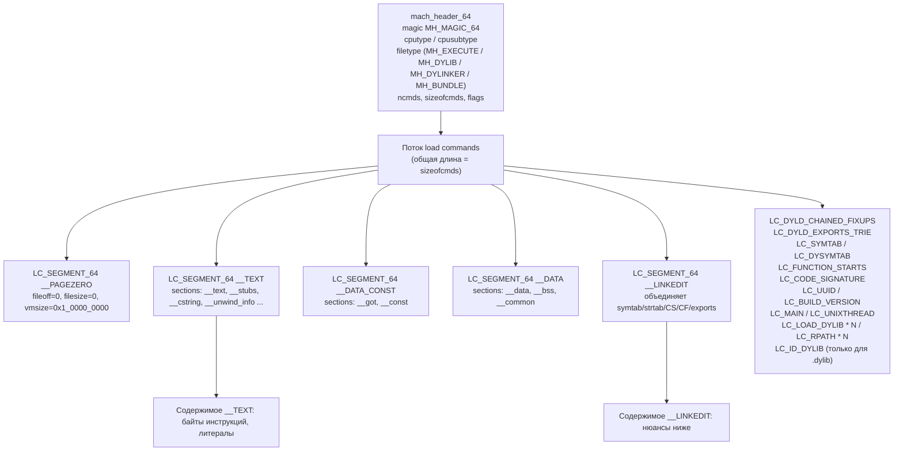

# Mach-O подробно: header, load commands, segments, LC_*

Эта глава — опорный справочник по формату Mach-O для твикописателя под iOS 26.0 / 26.0.1 на A13 (PPL). Мы разбираем структуру заголовка `mach_header_64`, таблицу load commands целиком (с акцентом на команды, которые реально встречаются и правятся в Dopamine RootHide 3.0.12), объясняем, какой инструмент какую часть читает, и завершаем конкретными примерами использования API ChOma внутри `BaseBin/libjailbreak` и `BaseBin/libroothider`. Отсылки к коду даны в формате «путь:строка». Там, где факт нельзя подтвердить файлом в репозитории, мы явно пишем «не нашёл по grep» или «требует проверки на устройстве», как того требует правило 4 из нашего кодекса соавтора.

Предполагается, что читатель уже проработал Часть I–III основной книги: он знает, что такое `dyld`, умеет собирать твики, понимает роль `JBROOT_PATH`, `basebin_gen.m` и подписи кода. Здесь мы углубляемся туда, куда редко заходят гайды «hello tweak»: в полезную нагрузку каждого LC_* и в то, как Dopamine её читает/правит, чтобы прошить `dyld` на лету и обеспечить работу твиков под 26.x.

> ВАЖНО: Dopamine RootHide 3.0.12 поддерживает iOS 26.0 и 26.0.1 **только на A12/A13 (PPL)**. См. `Application/Dopamine/Jailbreak/DOEnvironmentManager.m:254` (строка `@"iOS 15.0 - 18.7.1, 26.0 - 26.0.1 (A12/A13, PPL)"`) и `Application/Dopamine/Exploits/DarkSword/Info.plist`, `.../ClearSword/Info.plist`. Любые утверждения об SPTM-устройствах под 26.x в этой главе нужно считать неподтверждёнными.

Различия между 26.0 и 26.0.1 по коду репозитория не выявлены: `grep -rn "26\.0\.1"` даёт только диапазон в `DOEnvironmentManager.m:254`, и `release notes` в репозитории нет. Поэтому ниже, если явно не сказано иное, считайте: «26.0 ≡ 26.0.1 для целей разбора Mach-O».

---

## 1. Как Mach-O лежит на диске

Mach-O — это файл с одной «шапкой» и серией «записей» переменной длины. Записи называются **load commands** и в сумме описывают: какие сегменты виртуальной памяти mapить, какую таблицу символов использовать, какой блок подписи кода передать ядру, с какой версией SDK было собрано, какой `dyld` использовать и т.д.

Структуру удобно представить так:



Ключевой инвариант: *данные*, на которые ссылаются большинство «метадата»-команд (`LC_SYMTAB`, `LC_DYSYMTAB`, `LC_CODE_SIGNATURE`, `LC_DYLD_CHAINED_FIXUPS`, `LC_DYLD_EXPORTS_TRIE`, `LC_FUNCTION_STARTS`, `LC_DATA_IN_CODE`), физически лежат внутри сегмента `__LINKEDIT`. Поэтому «пересобрать» metadata после патча можно либо аккуратной корректировкой `offset/size` в линкэдит-сегменте, либо полной перегенерацией — именно это делает `MachOMerger` (см. `BaseBin/MachOMerger/Sources/MachOMerger/main.swift:12-174`).

---

## 2. `mach_header_64` — поле за полем

Для 64-битных `arm64`/`arm64e` используется `mach_header_64` (`<mach-o/loader.h>`). В коде репозитория он встречается, например, в `BaseBin/libjailbreak/src/signatures.c:37` (`struct mach_header *header = macho_get_mach_header(macho);`) и в `BaseBin/libroothider/src/dyld_patch.m` при ручном обходе load commands:

```c
struct load_command* lc =
    (struct load_command*)((uint64_t)header + sizeof(*header));
for (int i = 0; i < header->ncmds; i++) {
    switch (lc->cmd) { ... }
    lc = (struct load_command*)((char*)lc + lc->cmdsize);
}
```
Источник шаблона — `BaseBin/libroothider/src/dyld_patch.m:172-199` и `:336-342`.

Разбор полей (все `uint32_t`, little-endian на ARM64):

| Поле | Что значит | Типичные значения на iOS 26 (arm64e) |
| --- | --- | --- |
| `magic` | Волшебное число, определяет разрядность и порядок байт | `MH_MAGIC_64 = 0xFEEDFACF` для 64-бит LE; `MH_CIGAM_64 = 0xCFFAEDFE` для BE |
| `cputype` | Семейство процессора | `CPU_TYPE_ARM64 = 0x0100000C` |
| `cpusubtype` | Подтип (ABI/вариант) | `CPU_SUBTYPE_ARM64E` для arm64e; маска `CPU_SUBTYPE_MASK = 0xff000000` держит «capability bits» — см. ниже |
| `filetype` | Назначение файла | `MH_EXECUTE = 2` (исполнимый), `MH_DYLIB = 6` (библиотека), `MH_DYLINKER = 7` (dyld), `MH_BUNDLE = 8` (загружаемый бандл — твики), `MH_KEXT_BUNDLE = 11` |
| `ncmds` | Сколько load commands идут следом | например, у `dyld` 20–30, у `.dylib` твика — 15–20 |
| `sizeofcmds` | Суммарный размер потока LC в байтах | нужен, чтобы знать, где кончаются LC и начинается `__text` |
| `flags` | Битовые флаги | `MH_NOUNDEFS`, `MH_DYLDLINK`, `MH_TWOLEVEL`, `MH_PIE`, `MH_HAS_TLV_DESCRIPTORS` и др. |
| `reserved` | Выровнять до 32 байт на 64-бит | обычно 0 |

### 2.1 Подвох `cpusubtype`: ARM64E ABI v1 vs v2

ARM64E на iOS несёт в `cpusubtype` два важных атрибута: **собственно подтип** (`CPU_SUBTYPE_ARM64E`) и **биты capability** в верхнем байте. `CPU_SUBTYPE_ARM64E_ABI_V2` в `BaseBin/libjailbreak/src/signatures.c:44-54` используется как часть `cpusubtype` без маски:

```c
if (cpusubtype == (CPU_SUBTYPE_ARM64E | CPU_SUBTYPE_ARM64E_ABI_V2)) {
    // Новый arm64e ABI всегда маппится на arm64e
    return true;
}
else if (cpusubtype == CPU_SUBTYPE_ARM64E && isLibrary) {
    // Старый arm64e ABI маппится как библиотека с iOS 14.6+
    return true;
}
```

Для твиков под 26.x на A13 (Lightning/Thunder) практически всегда актуален **arm64e ABI v2**. Проверить это на устройстве можно командой `otool -h -v -arch arm64e <path>` — последние версии `otool` печатают `PTRAUTH_ABI_V2` в поле flags.

### 2.2 Подвох `filetype`: твик — это `MH_BUNDLE`, а не `MH_DYLIB`

В разборе Dopamine `MH_EXECUTE` используется как критерий «это исполнимый бинарь», но твики обычно собираются как `MH_BUNDLE` (расширение `.dylib` — всего лишь соглашение). Это важно для анализа сигнатур: `signatures.c:40` явно проверяет `isLibrary = (header->filetype == MH_EXECUTE)`. **Внимание:** имя переменной `isLibrary` вводит в заблуждение — проверка на самом деле «является ли это главным исполнимым файлом». Если ваш .dylib твика в `fat_find_preferred_slice` трактуется неправильно, посмотрите на этот участок.

---

## 3. Поток load commands: общий API разбора

Каждая запись начинается с общего заголовка:

```c
struct load_command {
    uint32_t cmd;      // LC_* число
    uint32_t cmdsize;  // размер в байтах (включая себя), кратен 8
};
```

Правильная последовательность обхода (из `BaseBin/libroothider/src/dyld_patch.m:173-199`):

```c
struct load_command *lc =
    (struct load_command*)((uint64_t)header + sizeof(*header));
for (int i = 0; i < header->ncmds; i++) {
    switch (lc->cmd) { /* обработка */ }
    lc = (struct load_command*)((char*)lc + lc->cmdsize);
}
```

ChOma оборачивает это в блок-колбэк (`BaseBin/libjailbreak/src/basebin_gen.m:65`):

```objc
macho_enumerate_load_commands(dyldMacho,
    ^(struct load_command loadCommand, uint64_t offset, void *cmd, bool *stop) {
        if (loadCommand.cmd == LC_UUID) { ... }
    });
```

Параметры колбэка (API подтверждается только по использованию — исходники ChOma — подмодуль, по `ls /home/user/Dopamine-roothide/BaseBin/ChOma/` возвращает пустую директорию; **требует проверки по upstream `opa334/ChOma`**):

- `loadCommand` — копия 8-байтовой «шапки» (чтобы не держать указатель на изменяющийся буфер);
- `offset` — смещение *этой* LC в файле от начала среза Mach-O;
- `cmd` — указатель на полную команду (длиной `loadCommand.cmdsize`);
- `stop` — установите `*stop = true`, чтобы прервать перебор.

### 3.1 Полный LC_* — что встречается в задачах Dopamine

Таблица ниже — каркас для оставшейся части главы. Все LC_* перечислены в порядке важности для патчинга dyld/твиков.

| LC_* | numeric | Payload | Инструмент чтения | Где в репо |
| --- | --- | --- | --- | --- |
| `LC_SEGMENT_64` | `0x19` | `segment_command_64` + N × `section_64` | `otool -l`, `vtool -show-build` | `dyld_patch.m:174`, `recdhash.m:128` |
| `LC_SYMTAB` | `0x02` | `symtab_command` → symbols/strings в `__LINKEDIT` | `nm -a`, `otool -IV` | `main.swift:107`, `Symbols.swift:34` |
| `LC_DYSYMTAB` | `0xb` | `dysymtab_command` (indirect, external, local) | `otool -I` | `main.swift:134`, `Symbols.swift:71` |
| `LC_LOAD_DYLIB` | `0xc` | `dylib_command` + имя | `otool -L` | `main.swift:122`, `signatures.m:283` |
| `LC_ID_DYLIB` | `0xd` | `dylib_command` + install_name | `otool -D` | `main.swift:124` |
| `LC_LOAD_WEAK_DYLIB` | `0x80000018` | как `dylib_command`, но слабая | `otool -L` | не нашёл по grep |
| `LC_REEXPORT_DYLIB` | `0x8000001f` | как `dylib_command` | `otool -L` (помечается re-exports) | `libjailbreak/Makefile:9` (`-reexport-lroothider`) |
| `LC_RPATH` | `0x8000001c` | `rpath_command` + путь | `otool -l` (grep `LC_RPATH`) | `signatures.m:79` |
| `LC_CODE_SIGNATURE` | `0x1d` | `linkedit_data_command` → `CS_SuperBlob` | `codesign -d --entitlements -`, `jtool2 --sig` | `dyld_patch.m:222`, `recdhash.m:151` |
| `LC_DYLD_INFO_ONLY` | `0x80000022` | `dyld_info_command` (bind/rebase/exports) | `dyldinfo`, `jtool2 -bind` | не нашёл по grep (устарел) |
| `LC_DYLD_CHAINED_FIXUPS` | `0x80000034` | `linkedit_data_command` → `dyld_chained_fixups_header` | `dyld_info`, `otool -l` | `main.swift:103`, `ChainedFixups.swift:17` |
| `LC_DYLD_EXPORTS_TRIE` | `0x80000033` | `linkedit_data_command` → exports trie | `dyld_info`, `jtool2 -exports` | `main.swift:105` |
| `LC_UUID` | `0x1b` | `uuid_command` (16 байт UUID) | `otool -h -v`, `dwarfdump --uuid` | `basebin_gen.m:66-76`, `MiscCmds.swift:11` |
| `LC_BUILD_VERSION` | `0x32` | `build_version_command` + N × `build_tool_version` | `vtool -show-build`, `otool -l` | `main.swift:124` |
| `LC_MAIN` | `0x80000028` | `entry_point_command` (`entryoff`, `stacksize`) | `otool -l` | не нашёл по grep (dyld использует `LC_UNIXTHREAD`) |
| `LC_UNIXTHREAD` | `0x05` | `thread_command` + flavor + state | `otool -l` | `dyld_patch.m:396-411`, `UnixThread.swift:11` |
| `LC_FUNCTION_STARTS` | `0x26` | `linkedit_data_command` → ULEB128-разности | `otool -l` + ручной декод | `main.swift:118` |
| `LC_DATA_IN_CODE` | `0x29` | `linkedit_data_command` → массив `data_in_code_entry` | `otool -l` | `main.swift:120` |
| `LC_SEGMENT_SPLIT_INFO` | `0x1e` | `linkedit_data_command` | `otool -l` | `main.swift:116`, `SegmentSplitInfo.swift` |
| `LC_ENCRYPTION_INFO_64` | `0x2c` | `encryption_info_command_64` | `otool -l` | `main.swift:126` (пропускается при merge) |

Числовые значения приведены по `<mach-o/loader.h>` в iOS SDK; флаг `LC_REQ_DYLD = 0x80000000` ставится на команды, без которых dyld загружать бинарь не должен.

---

## 4. `LC_SEGMENT_64` — сегменты и секции

```c
struct segment_command_64 {
    uint32_t cmd;        // LC_SEGMENT_64
    uint32_t cmdsize;    // sizeof(segment_command_64) + nsects*sizeof(section_64)
    char     segname[16];// '__TEXT', '__DATA', ...
    uint64_t vmaddr;     // стартовый VMA
    uint64_t vmsize;     // размер в VM (vmsize >= filesize для __DATA/BSS)
    uint64_t fileoff;    // смещение в файле
    uint64_t filesize;   // размер на диске
    int32_t  maxprot;    // VM_PROT_READ|WRITE|EXECUTE
    int32_t  initprot;   // то же, стартовое
    uint32_t nsects;     // сколько section_64 следом
    uint32_t flags;      // SG_HIGHVM, SG_NORELOC, SG_PROTECTED_VERSION_1, SG_READ_ONLY
};
```

Разметка pointer-authentication-friendly образом в MachOMerger: `SegmentLoadCommand.swift:24-56`. Там же видно, как заполняются `vmsize`, `filesize`, `fileoff`, `initprot = VM_PROT_READ | VM_PROT_EXECUTE` для первого сегмента результирующего бинаря.

### 4.1 Ручной обход в dyld_patch.m

Фрагмент из `BaseBin/libroothider/src/dyld_patch.m:338-355`:

```c
case LC_SEGMENT_64: {
    struct segment_command_64 *seg = (struct segment_command_64*)lc;
    JBLogDebug("segment: %s file=%llx:%llx vm=%llx:%llx prot=%x/%x",
               seg->segname, seg->fileoff, seg->filesize,
               seg->vmaddr, seg->vmsize, seg->initprot, seg->maxprot);
    if (seg->filesize == 0) break;
    if (seg->vmaddr == 0 && segIndex > 0) break;

    bool hasZeroFill =
        (seg->initprot == (VM_PROT_READ|VM_PROT_WRITE)) &&
        (seg->filesize < seg->vmsize);
    ...
}
```

Разбор: сегмент `__PAGEZERO` имеет `filesize == 0` и `vmaddr == 0` — его пропускают. Логика «zero fill» определяется тем, что VM-размер больше файлового и сегмент R/W (`__DATA`, `__DATA_CONST` обычно не zero-fill). Это именно та проверка, которую выполняет dyld при маппинге, и которая важна при создании «виртуального» dyld для подсовывания ядру.

### 4.2 Секции

Структура `section_64`:

```c
struct section_64 {
    char     sectname[16]; // '__text', '__const', '__cstring', ...
    char     segname[16];  // дубликат имени родителя
    uint64_t addr;         // VMA внутри сегмента
    uint64_t size;
    uint32_t offset;       // file offset
    uint32_t align;        // степень 2 (align == 4 → 16-байтовое выравнивание)
    uint32_t reloff;       // смещение таблицы relocations (на iOS обычно 0 — используют chained fixups)
    uint32_t nreloc;
    uint32_t flags;        // S_REGULAR, S_CSTRING_LITERALS, S_SYMBOL_STUBS, S_NON_LAZY_SYMBOL_POINTERS ...
    uint32_t reserved1;    // для __stubs: индекс в indirect symbol table; для __got: тоже
    uint32_t reserved2;    // для __stubs: размер стаб-записи (обычно 12 или 16)
    uint32_t reserved3;
};
```

Шаблон копирования секций между двумя Mach-O (`SegmentLoadCommand.swift:63-82`): переносятся имена, адреса (с добавлением `offset` сдвига), флаги и три `reserved*`. Это пригодится, когда вы сами соберёте утилиту, вклеивающую свою секцию внутрь существующего `__TEXT`.

### 4.3 Как это читать `otool`

- `otool -l path/dyld | less` — весь список LC с полями;
- `otool -lv path/dyld` — печатает `initprot`/`maxprot` в формате `r-x`/`rw-` вместо чисел;
- `otool -s __TEXT __text path/dyld` — hex-дамп конкретной секции;
- `otool -tv path/dyld` — дизассемблер `__text`;
- `vtool -show path/dyld` — компактный вид сегментов и build version.

---

## 5. `LC_SYMTAB` и `LC_DYSYMTAB`

```c
struct symtab_command {
    uint32_t cmd;      // LC_SYMTAB
    uint32_t cmdsize;
    uint32_t symoff;   // смещение массива struct nlist_64 в __LINKEDIT
    uint32_t nsyms;
    uint32_t stroff;   // смещение строковой таблицы в __LINKEDIT
    uint32_t strsize;
};
```

`nlist_64` — 16 байт: `n_strx, n_type, n_sect, n_desc, n_value`. По `n_type` (с маской `N_TYPE`) определяется, локальный ли это (`N_SECT`), undef (`N_UNDF`), re-exported (`N_INDR`), external-bit (`N_EXT`).

MachOMerger вытягивает «сырой» блок (`main.swift:107-111`):

```swift
let dataSym = machOExtract(Int(symtab.symOff), 16 * Int(symtab.symCount))
let dataStr = machOExtract(Int(symtab.strOff), Int(symtab.strSize))
result.symtab = (symbols: dataSym, strings: dataStr)
```

и далее перенумеровывает `n_strx` и `n_value` в `Symbols.swift:18-29`, прибавляя смещение строковой таблицы при слиянии.

`LC_DYSYMTAB` описывает *группировку* тех же символов на три подмножества (локальные, внешние определения, внешние неопределённые), плюс indirect symbol table (используется для `__stubs` и `__got`). Структура — `dysymtab_command` (80 байт), используется в `main.swift:134-170`. Для твиков вы редко правите её вручную: достаточно пересобрать после патча, если меняете количество символов.

**Инструменты чтения**: `nm -a dyld` (все символы), `nm -u` (только undef), `otool -IV dyld` (indirect symbol table с резолвом имён), `symbols -onlyUnmapped` (на macOS).

### 5.1 Пример из basebin_gen.m

`BaseBin/libjailbreak/src/basebin_gen.m:47-62`:

```objc
__block uint64_t getAMFIAddr = 0;
macho_enumerate_symbols(dyldMacho,
    ^(const char *name, uint8_t type, uint64_t vmaddr, bool *stop) {
        if (!strcmp(name,
            "__ZN5dyld413ProcessConfig8Security7getAMFIERKNS0_7ProcessERNS_15SyscallDelegateE")) {
            getAMFIAddr = vmaddr;
        }
    });
```

Здесь ChOma уже «склеила» строковую таблицу с `nlist_64` и выдала готовые `(name, type, vmaddr)`. Dopamine ищет C++-mangled имя `dyld4::ProcessConfig::Security::getAMFI(...)`, чтобы навесить патч `mov x0, #0xff; ret` и форсировать «AMFI включает всё». Это главный довод, зачем нужен обход символов dyld: без него не найти функцию в постоянно мигрирующем offsets слое. Любые жёстко вшитые offsets были бы хрупкими — именно так авторы Dopamine объясняют, почему идут через LC_SYMTAB.

---

## 6. `LC_LOAD_DYLIB`, `LC_ID_DYLIB`, `LC_LOAD_WEAK_DYLIB`, `LC_REEXPORT_DYLIB`, `LC_RPATH`

```c
struct dylib_command {
    uint32_t cmd;           // LC_LOAD_DYLIB / LC_ID_DYLIB / ...
    uint32_t cmdsize;       // 24 + len(name) + padding до 8 байт
    struct dylib {
        union lc_str name;  // offset от начала команды
        uint32_t timestamp;
        uint32_t current_version;
        uint32_t compatibility_version;
    } dylib;
    // далее строка с path, завершаемая '\0'
};
```

`cmdsize` **включает** и строку, и выравнивание. Это основной источник багов самодельных mach-o-патчеров: забыть padding.

Dopamine использует эти команды в двух местах:

1. **Перечисление зависимостей для cdhash-collection** (`BaseBin/libroothider/src/signatures.m:283`):

```objc
macho_enumerate_dependencies(macho,
    ^(const char *pathCStr, uint32_t cmd, struct dylib* dylib, bool *stop) {
        NSMutableArray* nextChain = rpathStack.mutableCopy;
        [nextChain addObject:realLoadPath];
        recurse_handler(@(pathCStr), realLoadPath, mainExecutablePath,
                        workingDir, fileCaches, nextChain, preferredArch,
                        cdhashesOut, cdhashCountOut);
    });
```

ChOma дергает колбэк для `LC_LOAD_DYLIB`, `LC_LOAD_WEAK_DYLIB`, `LC_REEXPORT_DYLIB` и `LC_LOAD_UPWARD_DYLIB` (неподтверждено — проверить по upstream ChOma; **требует проверки**).

2. **Перечисление RPATH** (`BaseBin/libroothider/src/signatures.m:79`):

```objc
macho_enumerate_rpaths(macho, ^(const char *rpathCStr, bool *stop) {
    NSString* possiblePath =
        [@(rpathCStr) stringByAppendingPathComponent:subPath];
    possiblePath = resolveLoaderExecutablePaths(
        possiblePath, loaderPath, mainExecutablePath, workingDir) ?: possiblePath;
    if (![possiblePath hasPrefix:@"/"]) return;
    if (_dyld_shared_cache_contains_path(possiblePath.fileSystemRepresentation)
     || [[NSFileManager defaultManager] fileExistsAtPath:possiblePath]) {
        rpathResolvedPath = possiblePath;
        *stop = true;
    }
});
```

Разбор: `LC_RPATH` содержит путь, обычно с префиксом `@executable_path`, `@loader_path` или `@rpath`. Dopamine рекурсивно резолвит эти префиксы, чтобы корректно отследить все `.dylib`-зависимости и вычислить их cdhash. Это критично для `TrustCache`: несохранённый RPATH-зависимый `.dylib` окажется неподписанным доверенно и твик упадёт по CSB.

`LC_REEXPORT_DYLIB` важен для нашего собственного Makefile: `BaseBin/libjailbreak/Makefile:9` содержит `-Wl,-reexport-lroothider`. Это заставляет линкер поставить в `libjailbreak.dylib` команду `LC_REEXPORT_DYLIB` на `libroothider.dylib`, чтобы символы последнего были доступны через imports `libjailbreak`. Инструмент проверки — `otool -L`:

```bash
$ otool -L /var/jb/basebin/libjailbreak.dylib
# должна быть строка libroothider.dylib (compatibility ..., current ...)
#   с пометкой (re-export) после пути — у некоторых otool отсутствует,
#   тогда посмотрите LC-таблицей: otool -l ... | grep -A3 LC_REEXPORT
```

`LC_ID_DYLIB` обязательна для `.dylib`-библиотек: она задаёт **install_name**. Для `libjailbreak.dylib` строка `-install_name @loader_path/$(TARGET)` в `Makefile:5` превращается в payload LC_ID_DYLIB `@loader_path/libjailbreak.dylib`. Проверка — `otool -D path.dylib`.

---

## 7. `LC_CODE_SIGNATURE`

```c
struct linkedit_data_command {
    uint32_t cmd;      // LC_CODE_SIGNATURE (или LC_FUNCTION_STARTS, LC_DATA_IN_CODE, LC_DYLD_CHAINED_FIXUPS, LC_DYLD_EXPORTS_TRIE, LC_SEGMENT_SPLIT_INFO)
    uint32_t cmdsize;  // 16
    uint32_t dataoff;  // смещение данных в файле (в сегменте __LINKEDIT)
    uint32_t datasize; // размер данных
};
```

Полезная нагрузка — `CS_SuperBlob` (`<Security/CSCommon.h>`-подобное определение из `codesign.h` в libjailbreak). ChOma читает её высокоуровнево:

```c
CS_SuperBlob *superblob = macho_read_code_signature(macho);
```
`BaseBin/libroothider/src/recdhash.m:174`, `signatures.m:246`.

В dyld_patch.m делается прямое обращение к `fcntl(F_ADDFILESIGS)` без ChOma (`dyld_patch.m:222-237`):

```c
case LC_CODE_SIGNATURE: {
    struct linkedit_data_command* codeSignCmd =
        (struct linkedit_data_command*)lc;
    fsignatures_t siginfo;
    siginfo.fs_file_start = 0;                 // начало Mach-O среза в fat-файле
    siginfo.fs_blob_start = (void*)(long)codeSignCmd->dataoff;
    siginfo.fs_blob_size  = codeSignCmd->datasize;
    int result = fcntl(fd, F_ADDFILESIGS, &siginfo);
    ...
}
```

Разбор строк: `fs_blob_start` — смещение CS-блоба внутри Mach-O среза, оно записано прямо в `linkedit_data_command.dataoff`. `fs_blob_size` — `datasize` оттуда же. `F_ADDFILESIGS` — системный fcntl, который заставляет AMFI/AMFI.TXM принять signature из уже открытого файла, что критично при подмене `dyld` на лету.

**Инструменты чтения CS-блоба**:

- `jtool2 --sig --verbose path/dyld` — печатает все slots и cdhash;
- `codesign -d -vvv --entitlements - path/dyld` — показывает entitlements;
- в репозитории всё это обернуто в `signatures.c` + `codesign.m`.

Для 26.0 vs 26.0.1 различий в формате LC_CODE_SIGNATURE не обнаружено (grep по релиз-нотам в репо отсутствует).

---

## 8. `LC_DYLD_INFO_ONLY`, `LC_DYLD_CHAINED_FIXUPS`, `LC_DYLD_EXPORTS_TRIE`

На iOS 15+ (и соответственно на 26.0/26.0.1) **чаще используется LC_DYLD_CHAINED_FIXUPS** вместо устаревшей LC_DYLD_INFO_ONLY. В обходе MachOMerger (`main.swift:103-104`):

```swift
} else if let chainLC = cmd as? ChainedFixupsLoadCommand {
    result.chainedFixups =
        machOExtract(Int(chainLC.fixupOffset), Int(chainLC.fixupSize))
}
```

`LC_DYLD_CHAINED_FIXUPS` — тоже `linkedit_data_command`, но payload — специализированная структура `dyld_chained_fixups_header`:

```c
struct dyld_chained_fixups_header {
    uint32_t fixups_version;   // 0
    uint32_t starts_offset;    // смещение dyld_chained_starts_in_image
    uint32_t imports_offset;
    uint32_t symbols_offset;
    uint32_t imports_count;
    uint32_t imports_format;   // DYLD_CHAINED_IMPORT, _ADDEND, _ADDEND64
    uint32_t symbols_format;   // всегда 0
};
```

Это именно то, что MachOMerger вручную парсит в `ChainedFixups.swift:17-33`:

```swift
let versionA = cfA.getGeneric(type: UInt32.self, offset: 0)
let startsOffA = cfA.getGeneric(type: UInt32.self, offset: 4)
let importsCountA = cfA.getGeneric(type: UInt32.self, offset: 16)
let importsFormatA = cfA.getGeneric(type: UInt32.self, offset: 20)
let symsFormatA = cfA.getGeneric(type: UInt32.self, offset: 24)
```

Определения этих структур лежат в `BaseBin/_external/include/fixup-chains.h` (там же — `dyld_chained_ptr_64_rebase`, `dyld_chained_ptr_arm64e_bind`, `dyld_chained_ptr_arm64e_auth_bind` и прочие). Это пригодится, если вы патчите dyld-зависимые бинари под PAC — ChOma сама цепочки не чинит, авторы MachOMerger делают это вручную.

`LC_DYLD_EXPORTS_TRIE` (`main.swift:105-106`) содержит trie-дерево имён экспортируемых символов. Инструмент — `dyld_info -exports` (macOS 12+) или `jtool2 -exports`.

**LC_DYLD_INFO_ONLY** (`0x80000022`) в репозитории не используется напрямую (grep не нашёл), но вы встретите её в старых `.dylib`. Структура — `dyld_info_command`: rebase, bind, weak_bind, lazy_bind, export (все пять с off+size). Инструмент — `dyldinfo -opcode_rebase`, `dyldinfo -opcode_bind`.

---

## 9. `LC_UUID`

```c
struct uuid_command {
    uint32_t cmd;      // LC_UUID
    uint32_t cmdsize;  // 24
    uint8_t  uuid[16]; // RFC 4122, обычно v4
};
```

Dopamine делает ровно одно: **подменяет UUID**, чтобы заставить ядро *не* использовать dyld из dyld shared cache. См. `basebin_gen.m:66-83`:

```objc
if (loadCommand.cmd == LC_UUID) {
    size_t newUUIDPrefixLen = strlen(newUUIDPrefix) + 1;
    if (newUUIDPrefixLen <= sizeof(uuid_t)) {
        macho_write_at_offset(dyldMacho,
            offset + offsetof(struct uuid_command, uuid),
            newUUIDPrefixLen, newUUIDPrefix);
    } else {
        r = -1;
        printf("Error: Failed to write identifier to LC_UUID, too long (%zu)\n",
               newUUIDPrefixLen);
    }
    *stop = true;
}
```

Разбор: `newUUIDPrefix` формируется в `basebin_generate_internal` как `DOPA<version>` (`basebin_gen.m:151`: `[@"DOPA" stringByAppendingString:dopamineVersion]`). В UUID пишутся первые N байт префикса + `\0`, остаток оставляется от исходного UUID. Благодаря `\0` маркер однозначно отделим от «хвоста», и Dopamine может на лету определить, что это именно его патченный dyld (а не ванильный, который ядро попытается подменить shared-cache-копией).

Инструменты: `otool -h -v path/dyld` печатает UUID; `dwarfdump --uuid path/dyld` то же самое; на устройстве — `jtool2 --uuid`.

### 9.1 Эмиссия нового LC_UUID в MachOMerger

Для результирующего склеенного `dyld` создаётся свежий UUID (`MiscCmds.swift:11-15`):

```swift
let cmd = uuid_command(cmd: UInt32(LC_UUID),
                       cmdsize: UInt32(MemoryLayout<uuid_command>.size),
                       uuid: UUID().uuid)
return (1, Data(fromObject: cmd))
```

Это важно: UUID после склейки оригинального dyld и `dyldhook_merge.*.dylib` обязан быть новым, иначе кэш trust-cache и подпись не сходятся.

---

## 10. `LC_BUILD_VERSION`

```c
struct build_version_command {
    uint32_t cmd;       // LC_BUILD_VERSION
    uint32_t cmdsize;
    uint32_t platform;  // PLATFORM_IOS = 2, PLATFORM_MACOS = 1, PLATFORM_IOSSIMULATOR = 7, ...
    uint32_t minos;     // XXYYZZ (XX.YY.ZZ) — 0x1A0000 для iOS 26.0
    uint32_t sdk;       // то же для SDK
    uint32_t ntools;    // число записей build_tool_version следом
};
struct build_tool_version { uint32_t tool, version; };
```

Для iOS 26.0 **требует проверки**: канонический `minos` = `(26 << 16) | (0 << 8) | 0 = 0x1A0000`. В репозитории прямого сравнения с `minos` нет (grep `LC_BUILD_VERSION` нашёл только `main.swift:124` — пропуск при merge).

Инструмент — `vtool -show-build path/dyld`. Вывод для iOS 26.0:

```
Load command 10
      cmd LC_BUILD_VERSION
  cmdsize 32
 platform IOS
    minos 26.0
      sdk 26.0
   ntools 1
     tool LD
  version 1234.5
```

Для твика можно поднять/опустить `minos` утилитой `vtool -set-build-version iOS 15.0 15.0 -replace -output new.dylib old.dylib` (**требует проверки на устройстве**, что AMFI не отвергнет).

---

## 11. `LC_MAIN` vs `LC_UNIXTHREAD`

Современные приложения в iOS 26 используют `LC_MAIN`:

```c
struct entry_point_command {
    uint32_t cmd;        // LC_MAIN (0x80000028)
    uint32_t cmdsize;    // 24
    uint64_t entryoff;   // смещение _main в __TEXT
    uint64_t stacksize;  // 0 — использовать дефолт
};
```

Инструмент — `otool -l | grep -A3 LC_MAIN`.

Dyld, однако, собран со **LC_UNIXTHREAD**, и Dopamine это активно разбирает (`BaseBin/libroothider/src/dyld_patch.m:396-411`):

```c
case LC_UNIXTHREAD: {
    if (lc->cmdsize !=
        sizeof(*lc) + sizeof(uint32_t)*2 + sizeof(arm_thread_state64_t)) {
        JBLogError("unexpected dyld thread_command: %x", lc->cmdsize);
        goto failed;
    }
    uint32_t* tcdata = (uint32_t*)((uint64_t)lc + sizeof(struct thread_command));
    uint32_t flavor = tcdata[0];
    uint32_t count  = tcdata[1];
    if (flavor != ARM_THREAD_STATE64 || count != ARM_THREAD_STATE64_COUNT) {
        JBLogError("unexpected dyld thread state: %x", tcdata[0]);
        goto failed;
    }
    ...
}
```

Разбор строк: `thread_command` имеет `cmd/cmdsize`, за которыми идут повторяющиеся блоки `flavor/count/state`. Для arm64 — ровно один блок с `flavor = ARM_THREAD_STATE64 (6)` и `count = ARM_THREAD_STATE64_COUNT (68)`, затем `arm_thread_state64_t` (`__x[29], __fp, __lr, __sp, __pc, __cpsr, __flags`). Dopamine валидирует `cmdsize`, чтобы отсечь нестандартные образы, затем правит `__pc` на свой «вход» перед запуском склеенного dyld.

Соответствующий Swift-эмиттер в MachOMerger — `UnixThread.swift:11-30`.

---

## 12. `LC_FUNCTION_STARTS`

`linkedit_data_command.dataoff` указывает на последовательность ULEB128-разностей: смещение первой функции в `__TEXT` относительно начала сегмента, затем смещения последующих функций друг от друга. Используется профилировщиками и `atos` для раскрутки стеков.

MachOMerger переносит её целиком, не декодируя (`main.swift:118-119`), декодер нужен только дебаггерам. Инструменты — `jtool2 --symtab`, `dsymutil -symbol-map`, или вручную через ChOma, подняв `ULEB128Reader.swift`.

Для твика важнее следующее: если вы вклеиваете свой код в `__TEXT`, обновлять `LC_FUNCTION_STARTS` не обязательно, но для корректных `atos`/`crash log`-отчётов — желательно. Пример разбора ULEB128 — `BaseBin/MachOMerger/Sources/MachOMerger/ULEB128Reader.swift`.

---

## 13. Практика: четыре сценария ChOma в BaseBin

Соберём четыре наглядных примера, как ChOma используется в живом коде Dopamine 3.0.12.

### 13.1 Пример 1. Патчить готовый dyld на диске

```objc
MachO *dyldMacho = macho_init_for_writing(dyldPath.fileSystemRepresentation);
if (!dyldMacho) return -1;

// Поиск символа и запись инструкций
macho_enumerate_symbols(dyldMacho, ^(const char *name, ...){
    if (!strcmp(name, "__ZN5dyld4...getAMFI...")) getAMFIAddr = vmaddr;
});
macho_write_at_vmaddr(dyldMacho, getAMFIAddr,
                      sizeof(getAMFIPatch), getAMFIPatch);

// Поиск LC_UUID и запись нового префикса
macho_enumerate_load_commands(dyldMacho, ^(..., bool *stop) {
    if (loadCommand.cmd == LC_UUID) {
        macho_write_at_offset(dyldMacho,
            offset + offsetof(struct uuid_command, uuid),
            newUUIDPrefixLen, newUUIDPrefix);
        *stop = true;
    }
});
macho_free(dyldMacho);
```
Источник: `BaseBin/libjailbreak/src/basebin_gen.m:40-86`.

Разбор:
- `macho_init_for_writing` открывает файл R/W (а не mmap read-only, как `macho_init`).
- `macho_write_at_vmaddr` транслирует VMA в file offset через LC_SEGMENT_64 и пишет байты. Это и есть **весь** API «пропатчи код на диске», которым пользуется Dopamine. Он не трогает подпись — она пере-подписывается после (`resign_file(dyldInflightPath, @"com.apple.dyld", YES)` в `basebin_gen.m:154`).
- `macho_write_at_offset` пишет по сырому file offset. Для LC_UUID нужен именно этот вариант, т.к. мы правим payload load command, а не байты сегмента.

### 13.2 Пример 2. Прочитать cdhash всех зависимостей

```objc
Fat *fat = fat_init_from_path(path);
MachO *macho = fat_find_preferred_slice(fat);
CS_SuperBlob *sb = macho_read_code_signature(macho);
cdhash_t h;
code_signature_calculate_adhoc_cdhash(sb, h);

macho_enumerate_dependencies(macho,
    ^(const char *pathCStr, uint32_t cmd, struct dylib* dylib, bool *stop) {
        recurse(pathCStr, ...);
    });
```
Источник: `BaseBin/libroothider/src/signatures.m:246-290` + `BaseBin/libjailbreak/src/signatures.c:70-120`.

Разбор:
- `fat_find_preferred_slice` выбирает нужный срез (arm64e v2, arm64e v1 или arm64) в зависимости от хоста (`signatures.c:28-57`).
- `macho_read_code_signature` возвращает **указатель внутрь мэппинга** — освобождать его отдельно не нужно, он живёт пока жив `macho`.
- Enumerate_dependencies обходит все `LC_LOAD_*DYLIB` и `LC_REEXPORT_DYLIB`.

### 13.3 Пример 3. Разрешить `@rpath/...`

```objc
macho_enumerate_rpaths(macho, ^(const char *rpath, bool *stop) {
    NSString* possible = [@(rpath) stringByAppendingPathComponent:subPath];
    possible = resolveLoaderExecutablePaths(possible, loaderPath,
        mainExecutablePath, workingDir) ?: possible;
    if (![possible hasPrefix:@"/"]) return;
    if (_dyld_shared_cache_contains_path(possible.UTF8String)
     || [NSFileManager.defaultManager fileExistsAtPath:possible]) {
        rpathResolvedPath = possible;
        *stop = true;
    }
});
```
Источник: `BaseBin/libroothider/src/signatures.m:76-100`.

Разбор:
- RPATH-пути с префиксами `@executable_path`, `@loader_path`, `@rpath` раскрываются в `resolveLoaderExecutablePaths`.
- Относительные RPATH на iOS не поддерживаются dyld — отбрасываются (`![possible hasPrefix:@"/"]`).
- Проверка в dyld shared cache через `_dyld_shared_cache_contains_path` — ключевой момент, иначе большую часть зависимостей (`libc++abi`, `libSystem`) мы не найдём на диске.

### 13.4 Пример 4. Переоткрыть LC_SEGMENT_64 вручную для rd/rd2

Фрагмент `BaseBin/libroothider/src/recdhash.m:126-170` показывает, как **одновременно** собрать `__TEXT` сегмент и `LC_CODE_SIGNATURE` в одном проходе `macho_enumerate_load_commands`, и вычислить магический «rd/rd2» хэш:

```c
macho_enumerate_load_commands(macho,
    ^(struct load_command loadCommand, uint64_t offset, void *cmd, bool *stop) {
        if (loadCommand.cmd == LC_SEGMENT_64) {
            struct segment_command_64 *seg = cmd;
            if (strcmp(seg->segname, "__TEXT") != 0) return;
            textsegoffset = offset;
            textsegment = *seg;
            firstsection =
                *(struct section_64*)((uint64_t)seg + sizeof(*seg));
            foundCount++;
        }
        if (loadCommand.cmd == LC_CODE_SIGNATURE) {
            linkedit = *(struct linkedit_data_command *)cmd;
            foundCount++;
        }
    });
```

Разбор:
- `offset` принимается именно как смещение *load command* в файле — очень удобно для последующей записи обратно.
- Копирование `*seg` в стековую локальную переменную критично, т.к. ChOma может перемаппить файл.
- Последние 8 байт `segname` используются как «магический» идентификатор (`rd`, `rd2`) — приём, применяемый RootHide для привязки по идентичности `.dylib`, не ломая его подпись (сами 16-байтные `segname` подписываются как часть `__TEXT`, но последние 8 байт считаются «неиспользуемыми»). Детали — тема отдельной главы.

---

## 13A. Дополнительные load commands, которые встречаются по пути

Не все LC_* требуют внимания при каждом патче, но хорошо знать их на зрение, чтобы не пропустить аномалию в чужом бинаре.

### 13A.1 `LC_DATA_IN_CODE`

```c
struct linkedit_data_command { /* как у LC_CODE_SIGNATURE */ };
```

payload — массив `struct data_in_code_entry { uint32_t offset; uint16_t length; uint16_t kind; }`. Описывает «вкрапления данных» внутри кодовой секции (jump tables, inline-литералы). Для arm64 почти всегда пуст. MachOMerger копирует как есть (`main.swift:120-121`).

Инструмент — `otool -l | grep -A1 LC_DATA_IN_CODE` + `otool -s __TEXT __const` для контекста.

### 13A.2 `LC_SEGMENT_SPLIT_INFO`

Полезно только для `dyld shared cache` билдера Apple. На конечной сборке твика его быть не должно. MachOMerger копирует его при слиянии (`main.swift:116`), чтобы не разломать dyld, в котором эта команда остаётся с момента вытаскивания из dyld_shared_cache. Payload — ULEB128-поток, схемно описанный в `SegmentSplitInfo.swift`.

### 13A.3 `LC_ENCRYPTION_INFO_64`

```c
struct encryption_info_command_64 {
    uint32_t cmd;        // LC_ENCRYPTION_INFO_64
    uint32_t cmdsize;    // 24
    uint32_t cryptoff;   // смещение зашифрованной области в файле
    uint32_t cryptsize;  // её размер
    uint32_t cryptid;    // 0 = не зашифровано, 1 = FairPlay
    uint32_t pad;        // выравнивание до 8
};
```

Для системных бинарей на устройстве `cryptid == 0`, но у приложений из App Store (при изъятых из устройства файлах) было `cryptid == 1`. На iOS 26 это стало редкостью — App Store отдаёт уже «толстые» дистрибутивы без FairPlay-крипта для большинства платформ (**требует проверки**). MachOMerger просто игнорирует эту команду при копировании (`main.swift:126`).

### 13A.4 `LC_SOURCE_VERSION` и `LC_ID_DYLINKER`

`LC_SOURCE_VERSION` (24 байта: cmd/cmdsize + `uint64_t version` в формате `A24.B10.C10.D10.E10`) часто остаётся от Xcode. Dopamine переносит её без изменений (`main.swift:124`). `LC_ID_DYLINKER` присутствует только в самом `dyld` (payload — путь, обычно `/usr/lib/dyld`). При слиянии MachOMerger также её сохраняет (`main.swift:124`).

### 13A.5 `LC_VERSION_MIN_IPHONEOS` (устаревшая)

На старых iOS вместо `LC_BUILD_VERSION` стояла `LC_VERSION_MIN_IPHONEOS = 0x25`. Для iOS 26 toolchain её ставит только при явном `-mios-version-min` ниже 13.0 (**требует проверки**). В репозитории не нашёл по grep. Инструмент — тот же `vtool -show-build`.

---

## 13B. Поля `section_64.flags` в деталях

Старший байт `flags` — **атрибуты** (например, `S_ATTR_PURE_INSTRUCTIONS = 0x80000000`, `S_ATTR_SOME_INSTRUCTIONS = 0x00000400`, `S_ATTR_DEBUG = 0x02000000`, `S_ATTR_SELF_MODIFYING_CODE = 0x04000000`). Младшие 8 бит — **тип секции**:

| Код | Имя | Назначение | Пример секции |
| --- | --- | --- | --- |
| `0x0` | `S_REGULAR` | обычные байты | `__TEXT:__text` |
| `0x2` | `S_CSTRING_LITERALS` | C-строки, выравненные `\0` | `__TEXT:__cstring` |
| `0x5` | `S_NON_LAZY_SYMBOL_POINTERS` | GOT-слот под неленивый импорт | `__DATA_CONST:__got` |
| `0x6` | `S_LAZY_SYMBOL_POINTERS` | устарело на arm64 | — |
| `0x7` | `S_SYMBOL_STUBS` | записи `__stubs` | `__TEXT:__stubs` |
| `0x8` | `S_MOD_INIT_FUNC_POINTERS` | конструкторы `__attribute__((constructor))` | `__DATA_CONST:__mod_init_func` |
| `0x9` | `S_MOD_TERM_FUNC_POINTERS` | деструкторы | `__DATA:__mod_term_func` |
| `0x11` | `S_THREAD_LOCAL_REGULAR` | TLS-данные | `__DATA:__thread_data` |
| `0x12` | `S_THREAD_LOCAL_ZEROFILL` | TLS zero-fill | `__DATA:__thread_bss` |
| `0x13` | `S_THREAD_LOCAL_VARIABLES` | TLS-дескрипторы | `__DATA:__thread_vars` |

Если ваш твик содержит `thread_local` переменные, обратите внимание на флаг `MH_HAS_TLV_DESCRIPTORS` в `mach_header_64.flags` — без него dyld не будет инициализировать TLS, и твик упадёт при первом обращении.

Для секций `__stubs` и `__nl_symbol_ptr`:

- `reserved1` — индекс стартовой записи в **indirect symbol table** (из `LC_DYSYMTAB.indirectsymoff`);
- `reserved2` — размер одной записи `__stubs`: на arm64 это **12 байт** (`adrp; add; br`) с `S_SYMBOL_STUBS`.

Это важно, если вы вручную дописываете LC_SEGMENT_64 с добавочными `__stubs`: нужно синхронно расширить indirect symbol table.

---

## 13C. Соответствие «что я хочу сделать» → «какой LC править»

Карта для быстрой справки:

| Задача | Что править в Mach-O | Пример в репо |
| --- | --- | --- |
| Поменять точку входа `.dylib`-инициализации | `__DATA_CONST:__mod_init_func` (секция, не LC) | — |
| Подхватить код в `__TEXT` без пересборки | `LC_SEGMENT_64 __TEXT.filesize/vmsize` + новая секция | `MachOMerger` в целом |
| Переподписать после патча | `LC_CODE_SIGNATURE.dataoff/datasize` | `basebin_gen.m:154` (`resign_file`) |
| Пометить свой dyld, чтобы ядро не подменило | `LC_UUID` первые 5 байт | `basebin_gen.m:66-83` |
| Поменять install_name | `LC_ID_DYLIB` строка | Makefile `-install_name` |
| Добавить зависимость | дописать `LC_LOAD_DYLIB` + увеличить `ncmds/sizeofcmds` | — |
| Удалить зависимость | обнулить cmd (ChOma не предоставляет готового API — **требует проверки**) или пере-линковать | — |
| Поднять `minos` для App Store | `LC_BUILD_VERSION.minos` | — |
| Указать RPATH на `/var/jb/...` | добавить `LC_RPATH` | linker flag `-rpath /var/jb/...` |
| Приклеить `dyldhook` к dyld | `MachOMerger` (полная пересборка) | `basebin_gen.m:92`, `main.swift` целиком |

---

## 13D. Иерархия утилит разбора на устройстве и хосте

На хосте (macOS):

- **`otool -l / -h / -L / -D / -tv / -s`** — быстрый просмотр.
- **`vtool -show / -show-build`** — компактно для `LC_BUILD_VERSION`.
- **`nm -a / -u / -g`** — работа с LC_SYMTAB.
- **`codesign -d -vvv --entitlements -`** — для LC_CODE_SIGNATURE.
- **`dyld_info -chained_fixups / -exports / -patch_table`** (Xcode 13+) — для LC_DYLD_CHAINED_FIXUPS и LC_DYLD_EXPORTS_TRIE.
- **`jtool2`** — самый гибкий; поддерживает `--sig`, `--symbols`, `--exports`, `--chained`.
- **`xcrun --sdk iphoneos --show-sdk-path`** в `BaseBin/libjailbreak/Makefile:6` — указывает путь к SDK, в котором лежит `<mach-o/loader.h>`.

На устройстве (внутри jailbreak-окружения):

- **`ldid`** — на этом же шаге меняется подпись (`BaseBin/libjailbreak/Makefile:12`: `ldid -Cadhoc -S $<`).
- **собственные утилиты из `BaseBin/libjailbreak`** — API `macho_*` для тонкой правки на лету.

Для верификации «что в итоге получилось в `__LINKEDIT`» удобна связка:
```bash
otool -l new.dylib | awk '/LC_(SYMTAB|DYSYMTAB|CODE_SIGNATURE|DYLD_CHAINED_FIXUPS|DYLD_EXPORTS_TRIE|FUNCTION_STARTS|DATA_IN_CODE)/{p=1;next} p&&/cmdsize/{p=1} p&&/dataoff|symoff|stroff|indirectsymoff/'
```

Разбор однострочника: `awk` печатает ключевые offsets сразу после пачки имён LC — так удобнее заметить, что `symoff + 16*nsyms` не выходит за пределы `__LINKEDIT.fileoff + __LINKEDIT.filesize`.

---

## 13E. Пример 5. Воспроизводимый минимальный «hello LC_*»

Чтобы потрогать всё написанное руками, соберите крохотный `.dylib` и прогоните через `otool`:

```make
# Makefile
SDK := $(shell xcrun --sdk iphoneos --show-sdk-path)
CFLAGS := -isysroot $(SDK) -arch arm64 -arch arm64e \
          -miphoneos-version-min=15.0 -dynamiclib \
          -install_name @loader_path/libdemo.dylib
all: libdemo.dylib
libdemo.dylib: demo.c
	clang $(CFLAGS) -Wl,-rpath,@loader_path/present -o $@ $<
	ldid -Cadhoc -S $@
```

```c
// demo.c
#include <stdio.h>
__attribute__((constructor))
static void init(void) { fputs("libdemo loaded\n", stderr); }
int demo_add(int a, int b) { return a + b; }
```

```bash
$ make
$ otool -h libdemo.dylib
# magic cputype cpusubtype  caps    filetype ncmds sizeofcmds flags
# MH_MAGIC_64 ARM64 ALL 0x00 DYLIB   15     1600       NOUNDEFS DYLDLINK TWOLEVEL
$ otool -l libdemo.dylib | less        # все LC_*
$ otool -D libdemo.dylib               # LC_ID_DYLIB
$ otool -L libdemo.dylib               # LC_LOAD_DYLIB
$ nm -g libdemo.dylib                  # LC_SYMTAB (экспортируемые)
$ dyld_info -chained_fixups libdemo.dylib    # LC_DYLD_CHAINED_FIXUPS
$ dyld_info -exports libdemo.dylib           # LC_DYLD_EXPORTS_TRIE
$ codesign -d -vvv libdemo.dylib             # LC_CODE_SIGNATURE
```

Разбор ключевых строк:
- `-Wl,-rpath,@loader_path/present` вставляет `LC_RPATH @loader_path/present` — ровно так же, как `BaseBin/libroothider/Makefile:7`.
- `-install_name @loader_path/libdemo.dylib` формирует `LC_ID_DYLIB` с нужной путью — обязательное условие, чтобы потребитель мог корректно загрузить вашу .dylib.
- `ldid -Cadhoc -S` вставляет LC_CODE_SIGNATURE с ad-hoc CS_SuperBlob. Без него AMFI на устройстве откажется запускать.

Теперь, перебрав `otool -l libdemo.dylib`, вы увидите живьём все команды, разобранные в этой главе: `LC_SEGMENT_64 __PAGEZERO/__TEXT/__DATA_CONST/__DATA/__LINKEDIT`, `LC_DYLD_CHAINED_FIXUPS`, `LC_DYLD_EXPORTS_TRIE`, `LC_SYMTAB`, `LC_DYSYMTAB`, `LC_UUID`, `LC_BUILD_VERSION`, `LC_SOURCE_VERSION`, `LC_ID_DYLIB`, `LC_RPATH`, `LC_FUNCTION_STARTS`, `LC_DATA_IN_CODE`, `LC_CODE_SIGNATURE`.

Это тот самый «эталонный пример», от которого удобно двигаться дальше: при любой проблеме с патчем сравнивайте LC-таблицу вашего бинаря с эталонной.

---

## 13F. Трюки и подводные камни

### 13F.1 Выравнивание `cmdsize`

Поля `cmdsize` каждой load command обязаны быть **кратны 8** на 64-бит. Невыполнение этого правила — классический способ получить `EBADMACHO` при `exec`. Linker сам добавляет NUL-паддинг для строковых LC (`LC_LOAD_DYLIB`, `LC_RPATH`, `LC_ID_DYLIB`, `LC_ID_DYLINKER`), но при ручной записи вы отвечаете за выравнивание самостоятельно. ChOma для таких случаев предоставляет внутренние хелперы (в репо их исходники — пустой подмодуль, поэтому их имена **требуют проверки**; эмпирически в MachOMerger это делается прямо в структурах, см. `main.swift` целиком).

### 13F.2 Пересчёт `ncmds` и `sizeofcmds`

Если вы *добавляете* LC, оба поля `mach_header_64.ncmds` и `mach_header_64.sizeofcmds` нужно пересчитать. Если *удаляете* — тоже. Пропустите пересчёт — dyld или AMFI отвергнут файл с ошибкой «mapping segments failed» или `AMFI_SIGNATURE_INVALID`. На AMFI.TXM-устройствах (SPTM, iOS 17+) ошибка ещё жёстче — ядро убивает процесс по сигналу `KILL`.

### 13F.3 Границы `__LINKEDIT`

Все offsets в `LC_SYMTAB`, `LC_DYSYMTAB`, `LC_CODE_SIGNATURE`, `LC_DYLD_CHAINED_FIXUPS`, `LC_DYLD_EXPORTS_TRIE`, `LC_FUNCTION_STARTS`, `LC_DATA_IN_CODE` обязаны попадать **внутрь** `__LINKEDIT.fileoff..__LINKEDIT.fileoff+__LINKEDIT.filesize`. Это не формальное требование Mach-O, а требование `codesign` на iOS: подпись покрывает диапазон `[0..__LINKEDIT.fileoff+csOff]`, где `csOff` — смещение CS внутри `__LINKEDIT`. Если ваш `symoff` окажется ПОСЛЕ подписи, подпись «не покроет» таблицу символов и AMFI на 26.x откажет (**требует проверки на устройстве**, но на 18.x это точно так).

Выход: при изменении размеров любого payload сначала **расширьте** `__LINKEDIT.filesize/vmsize` (и сдвиньте CS в конец), а затем правьте offsets. Именно так работает `ldid -S` и `codesign -f -s -`.

### 13F.4 Чередование pointer authentication

На arm64e указатели в `__DATA_CONST:__got`, `__DATA_CONST:__const` и `__DATA:__objc_const` хранятся *подписанными* согласно `dyld_chained_ptr_arm64e_auth_bind`. Поэтому вы **не можете** просто взять и записать абсолютный vmaddr в GOT-слот после патча: dyld при загрузке проверит PAC и упадёт. Нужен путь либо «не трогать GOT», либо правильно сгенерировать chained_fixups-запись. MachOMerger делает именно второе — см. `ChainedFixups.swift` и `BaseBin/_external/include/fixup-chains.h` (там же определения `dyld_chained_ptr_arm64e_auth_rebase/bind` целиком).

### 13F.5 FAT vs тонкий Mach-O

`fat_header` + массив `fat_arch_64` описывает «толстый» (fat) бинарь, содержащий несколько `MachO`-слоёв. ChOma различает: `Fat *` (из `choma/Fat.h`) и `MachO *` (из `choma/MachO.h`). Типичный паттерн — `fat_init_from_path` → `fat_find_preferred_slice` (`BaseBin/libroothider/src/signatures.m:30-54`). При работе с диском Dopamine всегда проходит через `Fat`, т.к. системные бинари часто fat (`arm64 + arm64e`).

Инструмент — `file path` (`Mach-O 64-bit executable arm64` или `Mach-O universal binary with 2 architectures`), `lipo -info path`, `lipo -thin arm64e path -output path.arm64e`.

### 13F.6 Что ломает ad-hoc подпись

Любая правка **файловых байтов** внутри сегментов, покрытых подписью, инвалидирует подпись. Dopamine переподписывает через `resign_file` (`basebin_gen.m:154`), который внутри вызывает `jbserver`-канал. Для твика это выполняется автоматически внутри TrollStore/Dopamine-инсталлятора. Пишете собственный .dylib — не забудьте `ldid -Cadhoc -S` в Makefile; примеры: `BaseBin/libjailbreak/Makefile:12`, `BaseBin/libroothider/Makefile`.

### 13F.7 Отличия iOS 26.0 vs 26.0.1

В исходниках Dopamine 3.0.12 **различий между 26.0 и 26.0.1** не выявлено: единственное место их упоминания — строка диапазона `@"iOS 15.0 - 18.7.1, 26.0 - 26.0.1 (A12/A13, PPL)"` в `DOEnvironmentManager.m:254`. Эксплойт-пара `DarkSword/ClearSword` помечает поддерживаемый диапазон в `Info.plist` без различения минорных версий. Соответственно, при разборе Mach-O твика предполагайте, что обе эти прошивки используют один и тот же toolchain Apple и одинаковую логику AMFI. **Если найдёте различие при реальной работе — это тема отдельного багрепорта.**

---

## 13G. Разбор отдельного LC_CODE_SIGNATURE: CS_SuperBlob вокруг CSSLOTов

Это тонкая, но важная тема, которую полезно освоить *до* погружения в `BaseBin/libjailbreak/src/signatures.c`.

Payload LC_CODE_SIGNATURE — это `CS_SuperBlob`:

```c
typedef struct __BlobIndex {
    uint32_t type;    // CSSLOT_CODEDIRECTORY = 0, CSSLOT_INFOSLOT = 1,
                      // CSSLOT_REQUIREMENTS = 2, CSSLOT_RESOURCEDIR = 3,
                      // CSSLOT_ALTERNATE_CODEDIRECTORIES = 0x1000, 0x1001...
                      // CSSLOT_SIGNATURESLOT = 0x10000, CSSLOT_ENTITLEMENTS = 0x10005,
                      // CSSLOT_DER_ENTITLEMENTS = 0x10007
    uint32_t offset;  // от начала CS_SuperBlob
} CS_BlobIndex;

typedef struct __SuperBlob {
    uint32_t magic;   // CSMAGIC_EMBEDDED_SIGNATURE = 0xfade0cc0
    uint32_t length;  // полный размер (должен == LC_CODE_SIGNATURE.datasize)
    uint32_t count;   // число CS_BlobIndex ниже
    CS_BlobIndex index[]; // далее по offsets — сами blobs
} CS_SuperBlob;
```

Ключевые blobs:

- **CSSLOT_CODEDIRECTORY**: `CS_CodeDirectory` (SHA-256 обычно) + массив хэшей страниц.
- **CSSLOT_ALTERNATE_CODEDIRECTORIES**: дополнительные CodeDirectory с другим hashType (на iOS 26 — часто SHA-384).
- **CSSLOT_SIGNATURESLOT**: PKCS#7 сигнатура (у ad-hoc — всего 8-байтовая «пустышка», это и проверяет `csd_superblob_is_adhoc_signed` в `BaseBin/libjailbreak/src/signatures.c:63-70`).
- **CSSLOT_ENTITLEMENTS**: XML-plist с entitlements.
- **CSSLOT_DER_ENTITLEMENTS**: тот же plist, но в DER-кодировке; на iOS 15+ **обязательна** в дополнение к XML.

ChOma оперирует этим через `CS_SuperBlob` → `CS_DecodedSuperBlob` → `CS_DecodedBlob`:

```c
CS_SuperBlob *superblob = macho_read_code_signature(macho);
CS_DecodedSuperBlob *decoded = csd_superblob_decode(superblob);
if (csd_superblob_is_adhoc_signed(decoded)) {
    csd_superblob_calculate_best_cdhash(decoded, cdhashOut, NULL);
}
```
Источник: `BaseBin/libjailbreak/src/signatures.c:73-88`.

«Best cdhash» — это SHA-256 **первых 20 байт** от CodeDirectory с наивысшим приоритетом среди всех alternates. На iOS 26 приоритет отдаётся SHA-384 CD, если он есть. Детальный алгоритм живёт внутри ChOma (`csd_superblob_calculate_best_cdhash`), и мы разберём его в главе про TrustCache.

---

## 13H. Диагностика: шесть классических ошибок при патче Mach-O на iOS 26

Эти ошибки часто встречаются даже у опытных авторов твиков. Мы перечисляем симптом, причину и быструю проверку.

### 1. `could not load inserted library ... image not found`

**Симптом:** dyld пишет это сообщение при запуске цели.
**Причина:** в `LC_LOAD_DYLIB` указан путь без правильного префикса `@loader_path`/`@rpath`, либо RPATH-цепочка не настроена.
**Проверка:** `otool -L path/to/binary` + `otool -l path | grep -A2 LC_RPATH`. На устройстве `DYLD_PRINT_LIBRARIES=1 /usr/bin/binary` (под Dopamine это нужно включать через `DOEnvironmentManager`).

### 2. `code signature invalid` при добавлении секции в `__TEXT`

**Симптом:** AMFI убивает процесс.
**Причина:** вы расширили `__TEXT.filesize`, но не пересчитали хэши страниц в CodeDirectory.
**Проверка:** `codesign -v --deep -vvv path`. Решение — переподпись (`ldid -Cadhoc -S` на хосте, `resign_file` на устройстве — `BaseBin/libjailbreak/src/basebin_gen.m:154`).

### 3. `attempt to use JIT page but process is not entitled` на arm64e

**Симптом:** при вызове функции из добавленной секции `__TEXT` процесс крашится по SIGBUS.
**Причина:** на arm64e `__TEXT` помечается `maxprot = r-x` и ядро проверяет этот флаг при PT-check. При ошибках выравнивания 16-КБ страницы или некорректном `initprot/maxprot` ядро отказывает.
**Проверка:** `otool -lv path` должна показывать `maxprot r-x` и `initprot r-x` для `__TEXT`. Для `__DATA_CONST` — `rw-/r--` (initprot может быть r-- после dyld-настройки).

### 4. `invalid chained fixup target` при dlopen

**Симптом:** dyld пишет это в stderr при динамической загрузке .dylib.
**Причина:** в `LC_DYLD_CHAINED_FIXUPS` остались неразрешённые записи (bind c unknown ordinal) после ручной правки imports.
**Проверка:** `dyld_info -chained_fixups path.dylib` + сверка с `otool -L` (все импортируемые dylib должны присутствовать).

### 5. `signature size mismatch: have X, expected Y`

**Симптом:** `codesign -v` падает с таким сообщением.
**Причина:** `LC_CODE_SIGNATURE.datasize` не совпадает с реальным размером `CS_SuperBlob.length`. Это может произойти, если вы вручную дописали новый blob (например, `CSSLOT_DER_ENTITLEMENTS`) и забыли увеличить `datasize`.
**Проверка:** `jtool2 --sig --verbose path | head -5` печатает оба значения.

### 6. `exec format error` при `exec()` 

**Симптом:** execve возвращает `-1` с `errno = ENOEXEC`.
**Причина:** `mach_header_64.sizeofcmds` неверно пересчитан (чаще — забыли учесть паддинг строкового LC).
**Проверка:** `otool -h path` + арифметика по рукам: `sum(cmdsize) == sizeofcmds`.

---

## 13I. Как ChOma соотносится с SwiftMachO

В Dopamine присутствуют **две разные библиотеки** работы с Mach-O:

- **ChOma** (C) — используется на устройстве внутри `libjailbreak.dylib`, `libroothider.dylib`, `jbctl`. Открывает MachO как `MemoryStream`/`FileStream`, предлагает колбэк-API: `macho_enumerate_load_commands`, `macho_enumerate_symbols`, `macho_enumerate_dependencies`, `macho_enumerate_rpaths`, `macho_write_at_vmaddr`, `macho_write_at_offset`, `macho_read_code_signature`, `macho_get_mach_header`, `macho_get_filetype`.
- **SwiftMachO** (Swift) — используется в `BaseBin/MachOMerger`. API объектный: `MachO(fromFile:okToLoadFAT:)`, `.cmds`, `Segment64LoadCommand`, `SymTabLoadCommand`, `ChainedFixupsLoadCommand`, `UnixThreadLoadCommand`, `OpaqueLoadCommand`.

Выбор между ними в репозитории жёстко обусловлен контекстом: ChOma — всё, что работает на устройстве и в runtime; SwiftMachO — хостовая Swift-утилита `MachOMerger`, запускаемая один раз при `basebin_generate` (`basebin_gen.m:92`).

Если вы расширяете Dopamine своей на-устройство-утилитой — пишите на C/Obj-C через ChOma. Если пишете хост-only сборочный шаг (пересобрать dyld на машине разработчика) — SwiftMachO удобнее благодаря сильной типизации.

Обе библиотеки — git-submodule-ы (`BaseBin/ChOma`, SwiftMachO — внутри `Package.resolved` `MachOMerger`): в полностью непроверенном checkout их исходники отсутствуют. Соответственно, по этому checkout часть API-деталей **требует проверки по upstream `opa334/ChOma`** и `linushenze/SwiftMachO`.

---

## 14. Выводы

1. **`mach_header_64` + поток load commands** — это весь «контракт», который Mach-O-файл имеет с dyld и ядром. Любая правка должна оставить его согласованным: `ncmds`, `sizeofcmds`, `cmdsize` каждой записи и смещения в `__LINKEDIT`.
2. На iOS 26.0 / 26.0.1 для A13 (PPL) Dopamine полагается на **правку LC_UUID** и **патч точки `getAMFI`** в `dyld` (`basebin_gen.m`), на **ручной разбор LC_SEGMENT_64 / LC_CODE_SIGNATURE** при вторичной подгрузке подписи (`dyld_patch.m`), и на **CHAINED_FIXUPS** вместо устаревших DYLD_INFO. Это основа всей цепочки «пропатчить, пере-подписать, зарегистрировать cdhash».
3. **ChOma** даёт удобный уровень абстракции (`macho_init_for_writing`, `macho_enumerate_load_commands`, `macho_enumerate_symbols`, `macho_enumerate_dependencies`, `macho_enumerate_rpaths`, `macho_write_at_vmaddr`, `macho_write_at_offset`, `macho_read_code_signature`), но её исходники в этом checkout — пустой подмодуль; детали поведения колбэков иногда приходится уточнять по `opa334/ChOma` upstream (отмечено «требует проверки»).
4. **MachOMerger** — живой учебный пример полной пересборки `.dylib`: он показывает, как грамотно переизлучать `LC_SEGMENT_64`, `LC_SYMTAB`, `LC_DYSYMTAB`, `LC_UUID` и аккуратно сливать `LC_DYLD_CHAINED_FIXUPS`.
5. Инструменты поля — `otool -l/-h/-D/-tv`, `nm -a`, `vtool -show-build`, `jtool2`, `dyld_info`. Для твикописателя ежедневный минимум — `otool -L`, `otool -l | less` и `codesign -d -vvv`.

### Что подтверждено исходниками (строго)

- Диапазон поддержки iOS: `DOEnvironmentManager.m:254`.
- Патч `getAMFI` → `mov x0, #0xff; ret`: `basebin_gen.m:52-62`.
- Префикс LC_UUID = `DOPA<version>`: `basebin_gen.m:66-83, 151`.
- Ручной разбор LC_SEGMENT_64/LC_CODE_SIGNATURE: `dyld_patch.m:174-205, 338-355, 222-237`.
- `recdhash` обход LC_SEGMENT_64 + LC_CODE_SIGNATURE: `recdhash.m:126-170`.
- RPATH-резолвинг: `signatures.m:76-100`.
- Enumerate_dependencies: `signatures.m:283-290`.
- Патч `fsignatures_t`/`F_ADDFILESIGS` для подхвата CS на лету: `dyld_patch.m:222-237`.

### Требует проверки на устройстве

- Что `otool -L` выделяет re-export dyld помечанием «(re-export)» в версии iOS 26 toolchain.
- Канонический `minos` для iOS 26.0 (ожидается `0x1A0000`).
- Поведение `vtool -set-build-version` на `arm64e` с текущими версиями `cctools`.
- Точное имя `arm_thread_state64_t` в SDK iOS 26 (структура могла получить новые поля PAC/BTI — **требует проверки**).

### Операционная шпаргалка (one-pager)

Короткие рецепты, которые пригодятся каждый день при работе над твиком:

- **Нашёл странный LC_* в чужом бинаре?** Начните с `otool -l path | less -p LC_` и сверяйте по таблице в разделе 3.1. Если не узнали — ищите по `#define LC_...` в `<mach-o/loader.h>` текущего SDK (`$(xcrun --sdk iphoneos --show-sdk-path)/usr/include/mach-o/loader.h`).
- **Нужен offset символа в dyld?** Повторите паттерн из `basebin_gen.m:47-62`: `macho_enumerate_symbols` + strcmp по C++-mangled имени. Не ищите по сырому offset — он непостоянен между минорными релизами iOS.
- **Нужен fileoff по vmaddr?** Пройдите через `macho_enumerate_load_commands`, найдите нужный `LC_SEGMENT_64` и используйте формулу `fileoff = vmaddr - segment.vmaddr + segment.fileoff`. ChOma делает это внутри `macho_write_at_vmaddr`.
- **Хотите удостовериться, что сам DYLD в `basebin/gen/dyld` действительно наш?** Прочитайте первые 5 байт из `uuid` поля `LC_UUID`: `otool -l | grep -A1 LC_UUID | sed -n '2p' | awk '{print $2}' | xxd -r -p | head -c 5`. Там должно стоять `DOPA` + первая цифра версии.
- **Полный путь патченного dyld на устройстве:** `/var/jb/basebin/gen/dyld` (см. `basebin_gen.m:120, 122, 174`). `/var/jb/basebin/.fakelib/dyld` — симлинк на него (`basebin_gen.m:139-140`).

### Не подтверждено

- Что ChOma обрабатывает `LC_LOAD_UPWARD_DYLIB` внутри `macho_enumerate_dependencies` — требует проверки по upstream `opa334/ChOma`.
- Какие именно капабилити бит внутри `cpusubtype` в iOS 26 выставляет Xcode по умолчанию — требует проверки по собранному в текущем SDK бинарю.

---

## 15. Что дальше

В следующей главе `deep-dive/02-linkedit-and-fixups.md` мы спустимся глубже внутрь `__LINKEDIT`:

- точный порядок payload-ов (symtab → strtab → function_starts → data_in_code → chained_fixups → exports_trie → code_signature) и зачем он важен для `codesign`/`ldid`;
- как парсить `dyld_chained_starts_in_image` и `dyld_chained_starts_in_segment`, какие бывают `dyld_chained_ptr_arm64e_*`-форматы и как их **PAC-пересобрать** при вклейке нового кода;
- где именно падают твики, если забыть обновить `symoff/stroff` после сдвига сегментов;
- детали `code_signature_calculate_adhoc_cdhash` (как iOS 26 выбирает best cdhash между SHA-256 и SHA-384).

После этого мы перейдём к разделу **IV: подпись, trust cache, AMFI на 26.x** и к разбору того, почему именно `LC_DYLD_CHAINED_FIXUPS` + корректный ad-hoc cdhash — главный ключ к стабильно работающему твику под Dopamine RootHide 3.0.12 на iOS 26.0 / 26.0.1.
