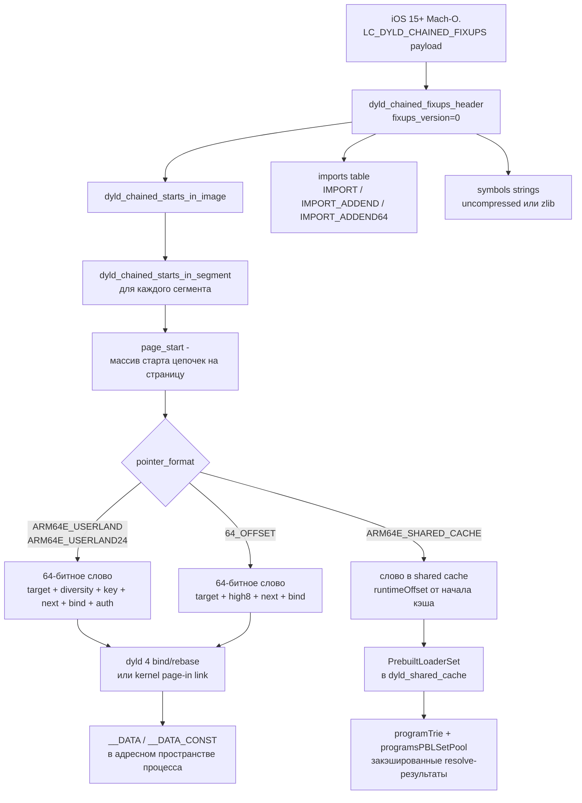

# dyld 4+ и chained fixups: что меняется и зачем это знать

Эта глава углубляется в один конкретный пласт, который на поверхности выглядит как «очередная оптимизация Apple», а на деле определяет, почему в современном джейлбрейке так тяжело заходят классические рецепты из эпохи iOS 11–13. Речь про формат фиксапов, появившийся вместе с загрузочной командой `LC_DYLD_CHAINED_FIXUPS` (iOS 15+), и про то, во что он превратился к dyld 4 на iOS 26.0/26.0.1. Читатель, уже прошедший Часть I–III основной книги, знает, что Dopamine RootHide 3.0.12 паткит системный `dyld` путём слияния двух Mach‑O (binary patch через `MachOMerger`) и что ряд перехватов делается через `litehook_find_dsc_symbol`. Чтобы понять, почему эти инструменты устроены именно так, а не иначе, нужно разобрать внутренности chained fixups: от битовых структур указателей до роли PrebuiltLoaderSet в shared cache.

Ниже всё, что подтверждается репозиторием `/home/user/Dopamine-roothide` (ветка `claude/serene-knuth-h5qs09`, базируется на roothide Dopamine 3.0.12), сопровождается ссылками вида «путь/файл:строка». Если факт в коде не найден, об этом сказано явно и дан алгоритм, как добыть его на устройстве. iOS 26.0 vs 26.0.1 различий в коде проекта в части chained fixups не выявлено (ни одного diff‑маркера `26\.0\.1` в исходниках по grep), поэтому ниже везде говорится «iOS 26.0/26.0.1» как про одну версию.

Структура главы такова. В разделе 1 — короткий исторический экскурс в rebase/bind, нужный, чтобы понять мотивацию перехода на chained fixups. В разделе 2 — разбор payload'а `LC_DYLD_CHAINED_FIXUPS` с привязкой к структурам из `BaseBin/_external/include/fixup-chains.h`. В разделе 3 — таблица форматов указателей и битовая раскладка слова. В разделе 4 — что такое page‑in linking и почему он меняет правила. В разделе 5 — почему fishhook перестал работать и чем его заменили в Dopamine. В разделе 6 — детальный разбор `MachOMerger` как основного потребителя формата в проекте. В разделе 7 — dyld 4, PrebuiltLoaderSet, shared cache. В разделе 8 — mermaid‑схема всей картины. В разделах 9 и 10 — практические инструкции и чек‑лист.

## 1. Классический путь: rebase/bind как opcodes

До iOS 15 все динамические фиксапы в Mach‑O хранились в сжатых байтовых потоках. Загрузочная команда называлась `LC_DYLD_INFO_ONLY` (или `LC_DYLD_INFO`), её payload ссылался на четыре секции: rebase, bind, weak‑bind, lazy‑bind. Каждая секция — это маленький байткод-язык с опкодами типа `REBASE_OPCODE_DO_REBASE_IMM_TIMES`, `BIND_OPCODE_SET_SYMBOL_TRAILING_FLAGS_IMM`, с ULEB128‑аргументами. Dyld проходил этот поток, байт за байтом исполняя его и переписывая слова в `__DATA` и `__DATA_CONST`.

Чтобы быть точными: rebase‑поток кодировал, что по заданным смещениям лежат указатели, которым нужно прибавить slide. Bind‑поток кодировал, что по тем же смещениям должно быть записано значение, вычисленное по (library ordinal, symbol name, addend). Weak‑bind обрабатывал случаи weak‑символов, а lazy‑bind применялся на первом вызове функции через стаб. Концепция понятная, но каждый из четырёх потоков был самодостаточным языком интерпретатора, с собственными конечными автоматами и собственным bookkeeping внутри dyld.

У такой схемы было ровно три недостатка, из‑за которых Apple её выкинула. Во‑первых, парсинг был дорогим — каждая страница памяти требовала интерпретации opcodes независимо, а не инкрементально. На больших бинарниках (возьмите, например, `UIKitCore.framework`) rebase‑поток содержит десятки тысяч инструкций. Во‑вторых, парсер жил в userspace dyld, то есть ядро не могло линковать страницы при page‑fault'ах — требовалась полноценная диспетчеризация в dyld до возврата, а это съедало значимую часть времени старта процесса. В‑третьих, формат был удобен для статической линковки и неудобен для верификации — нельзя было сходу сказать, какая конкретно страница содержит сколько указателей на фиксап, не прочитав весь поток до неё; защитить код‑флоу от «злых» rebase‑инструкций можно было только дорогой проверкой целостности всего потока.

Эти три недостатка стали фатальными, когда Apple решила реализовать page‑in linking (линковка указателей не на старте процесса, а при подкачке страниц ядром). Для этого потребовался формат, в котором (а) достаточно знать смещения в пределах одной страницы, (б) следующий фиксап находится по ссылке из предыдущего, (в) целевой адрес и атрибуты PAC упакованы прямо в слово с указателем. Так появились chained fixups.

В заголовке самого формата, скопированном в репозиторий как `BaseBin/_external/include/fixup-chains.h:26`, стоит честное `#define __MACH_O_FIXUP_CHAINS__ 6` — это именно шестая версия файла, и в ней уже учтены варианты shared cache от dyld 4. Шесть ревизий Apple выпустила за годы: от первого внедрения в iOS 13 arm64e, через добавление `DYLD_CHAINED_PTR_64_OFFSET` для arm64 (iOS 15), до появления `DYLD_CHAINED_PTR_ARM64E_SHARED_CACHE` и `DYLD_CHAINED_PTR_ARM64E_USERLAND24` в формате shared cache dyld 4. Каждая ревизия сохраняла обратную совместимость заголовка (поле `fixups_version` остаётся 0), но добавляла новые идентификаторы `pointer_format`.

Для нашего разговора важно, что переход на chained fixups — это не «одна и та же бинарная структура, просто более компактная». Это принципиально другая модель: ядро теперь может читать байты страницы и выполнять линковку, не поднимая процессный контекст. Из этого следуют практические ограничения, которые ниже разберём на коде.

Ещё одна важная деталь: `fixups_version` в заголовке — это не версия *формата*, а версия *этой payload‑структуры*. То есть все биты битовых полей, все enum значения `pointer_format`, все названия структур могут меняться между версиями iOS, но формально `fixups_version == 0` остаётся. Это выбор Apple по совместимости: один заголовок читает любой dyld. Если в будущей iOS появится несовместимый формат, Apple просто введёт `fixups_version == 1`, и инструменты вроде `MachOMerger`, у которых стоит `guard versionA == 0 else exit(-1)`, корректно откажутся работать.

## 2. Что такое LC_DYLD_CHAINED_FIXUPS

Load command у этого формата один и тот же со времён iOS 15. Константа закомментирована в заголовке проекта (`BaseBin/_external/include/fixup-chains.h:33`), но её значение `0x80000034` помнить необязательно — Swift‑обёртка `SwiftMachO` в `MachOMerger` разбирает её по типу (`BaseBin/MachOMerger/Sources/MachOMerger/main.swift:103`: `if let chainLC = cmd as? ChainedFixupsLoadCommand`). Это обычный `linkedit_data_command`: пара `(dataoff, datasize)` указывает на блок в `__LINKEDIT`, который и содержит всё интересное.

Блок начинается с заголовка `dyld_chained_fixups_header` (`BaseBin/_external/include/fixup-chains.h:37-46`):

```c
struct dyld_chained_fixups_header
{
    uint32_t    fixups_version;    // 0
    uint32_t    starts_offset;     // offset of dyld_chained_starts_in_image in chain_data
    uint32_t    imports_offset;    // offset of imports table in chain_data
    uint32_t    symbols_offset;    // offset of symbol strings in chain_data
    uint32_t    imports_count;     // number of imported symbol names
    uint32_t    imports_format;    // DYLD_CHAINED_IMPORT*
    uint32_t    symbols_format;    // 0 => uncompressed, 1 => zlib compressed
};
```

Ключевые поля для нашего разговора — `starts_offset` и `imports_count`. По `starts_offset` лежит дескриптор `dyld_chained_starts_in_image`, который сам по сути — массив смещений: для каждого сегмента Mach‑O (`__TEXT`, `__DATA`, `__DATA_CONST`, `__LINKEDIT` и так далее) либо ноль (значит, в этом сегменте фиксапов нет), либо смещение до `dyld_chained_starts_in_segment`. Структура сегмента описана в `fixup-chains.h:58-72`:

```c
struct dyld_chained_starts_in_segment
{
    uint32_t    size;               // size of this (amount kernel needs to copy)
    uint16_t    page_size;          // 0x1000 or 0x4000
    uint16_t    pointer_format;     // DYLD_CHAINED_PTR_*
    uint64_t    segment_offset;     // offset in memory to start of segment
    uint32_t    max_valid_pointer;  // for 32-bit OS, any value beyond this is not a pointer
    uint16_t    page_count;         // how many pages are in array
    uint16_t    page_start[1];      // each entry is offset in each page of first element in chain
};
```

Комментарий на строке 57 того же файла прямо говорит: «This struct is embedded in dyld_chain_starts_in_image and passed down to the kernel for page-in linking». То есть эта структура специально сделана такой, чтобы её мог интерпретировать ядерный код `vm_shared_region_slide_page` — без дёрганья userspace. На A13 с iOS 26.0/26.0.1 это и есть основной путь линковки.

Отдельно стоит рассмотреть `starts_offset`, `imports_offset`, `symbols_offset` в заголовке. Их абсолютные значения — не произвольны: обычно они идут строго в этом порядке, друг за другом, с округлением до 4‑байтовой границы. То есть практически блок устроен так: заголовок (32 байта) → starts (переменной длины) → imports table (количество × 4/8/12 байт в зависимости от формата) → symbols pool (null‑terminated строки). Если какой‑то компилятор выдаст блок с пересекающимися смещениями или с symbols до imports — это странный, но не формально запрещённый случай; `MachOMerger` в коде `BaseBin/MachOMerger/Sources/MachOMerger/main.swift:103-104` принимает смещения из структуры напрямую, не делая предположений об их порядке. Поэтому если вы когда‑нибудь будете писать свой инструмент для чтения chained fixups, помните: не рассчитывайте на фиксированный порядок секций внутри payload, читайте через `starts_offset`, `imports_offset`, `symbols_offset`.

Второй источник ошибок — поле `symbols_format`. Код в `ChainedFixups.swift:30-33` и `:52-55` явно отказывается работать с чем‑либо, кроме format 0: «Can only support symbol format 0 for chained fixups!». Format 1 означает «zlib‑сжатый pool». Для системных Apple dylib на iOS 26 symbols format обычно 0 (не нашёл подтверждения в репозитории; требует проверки на устройстве через `otool -chained_fixups /usr/lib/system/libdyld.dylib` — на хост‑Mac с распакованным shared cache). Но если вы собираете свою dylib через линкер нестандартной сборки, который включает zlib‑сжатие, `MachOMerger` на неё не сработает.

Внутри сегмента всё держится на цепочках. `page_start[i]` для страницы `i` — это смещение *первого* фиксапа в этой странице. Со значения `*(uint64_t*)(page + page_start[i])` можно прочитать «обёрнутый» указатель, у которого младшие биты — целевое значение, старшие биты — атрибуты (PAC‑ключ, диверсификатор, bind/rebase flag), и ещё одно поле `next`, равное количеству слов (stride) до следующего фиксапа на этой же странице. Когда `next == 0`, цепочка кончилась. Если на странице фиксапов вовсе нет, `page_start[i] == DYLD_CHAINED_PTR_START_NONE == 0xFFFF` (`fixup-chains.h:75`).

Из структуры видно сразу три важных свойства, которых не было у `LC_DYLD_INFO`:

- Фиксапы на разных страницах независимы — можно линковать по требованию.
- Все цепочки обязаны лежать внутри страницы (stride‑bits ограничены 5–12 битами), поэтому ядру достаточно скопировать `size` байтов — весь `dyld_chained_starts_in_segment` помещается в метаданные одной страницы.
- Imports — отдельный массив; имена символов — отдельная строковая таблица. Это специально сделано, чтобы ядро умело выполнять rebase без доступа к строкам.

Четвёртое свойство — неявное, но критичное: цепочки не могут пересекать границу страницы. Это объясняет, почему `page_start` — отдельный массив, а не единая глобальная таблица «начало цепочки» для всего сегмента. Если бы цепочку разрешили продолжать на следующей странице, ядро не могло бы линковать страницы в произвольном порядке; пришлось бы или хранить состояние между подкачками, или ждать, пока обе страницы будут в памяти. Apple выбрала самодостаточность каждой страницы — и расплатилась за это тем, что `MachOMerger` в задаче слияния `__DATA`‑сегментов двух бинарников обязан следить, чтобы ни одна цепочка не вылезла за край, — именно поэтому в `ChainedFixups.swift:220-230` стоят проверки `pageDiff` и `pageOffMask`.

Пятое наблюдение: `dyld_chained_starts_in_image.seg_count` соответствует количеству сегментов Mach‑O в том порядке, в котором они перечислены как `LC_SEGMENT_64`. Запись с нулевым `seg_info_offset` означает «в этом сегменте фиксапов нет» (например, `__TEXT` в скомпилированной `.dylib` обычно таким и будет, если она не содержит RELRO‑аналога внутри кода). В коде `MachOMerger` эта логика видна в `ChainedFixups.swift:154-174`: при итерации по сегментам A массив `segsA` заполняется либо `nil` (пропущенный сегмент), либо `Data` блоком с содержимым `dyld_chained_starts_in_segment`.

## 3. Форматы указателей — таблица

Форматы указателей перечислены в `BaseBin/_external/include/fixup-chains.h:90-105`. Для джейлбрейка на A13 (`arm64e`, PAC) интересны `ARM64E`, `ARM64E_USERLAND`, `ARM64E_USERLAND24` и `ARM64E_SHARED_CACHE`. Для arm64 без PAC — `DYLD_CHAINED_PTR_64_OFFSET`. Остальные перечислены для полноты.

| ID | Константа | stride, байт | Где встречается | Target | Поддержка PAC |
|----|-----------|--------------|-----------------|--------|---------------|
| 1  | `DYLD_CHAINED_PTR_ARM64E` | 4 или 8 | ранние arm64e dylib, iOS 14 | vmaddr | да |
| 2  | `DYLD_CHAINED_PTR_64` | 4 | arm64, не‑PAC | vmaddr | нет |
| 3  | `DYLD_CHAINED_PTR_32` | 4 | armv7, 32‑bit | vmaddr | нет |
| 4  | `DYLD_CHAINED_PTR_32_CACHE` | 4 | 32‑bit shared cache | runtimeOffset | нет |
| 5  | `DYLD_CHAINED_PTR_32_FIRMWARE` | 4 | iBoot/SecureROM | vmaddr | нет |
| 6  | `DYLD_CHAINED_PTR_64_OFFSET` | 4 | arm64 Mach‑O от iOS 15 | runtimeOffset | нет |
| 7  | `DYLD_CHAINED_PTR_ARM64E_KERNEL` | 4 | kernel cache | runtimeOffset | да |
| 8  | `DYLD_CHAINED_PTR_64_KERNEL_CACHE` | 1 или 4 | arm64 kernel cache | базовый указатель + offset | да |
| 9  | `DYLD_CHAINED_PTR_ARM64E_USERLAND` | 8 | arm64e Mach‑O iOS 15+ | runtimeOffset | да |
| 10 | `DYLD_CHAINED_PTR_ARM64E_FIRMWARE` | 4 | iBoot/arm64e | vmaddr | да |
| 11 | `DYLD_CHAINED_PTR_X86_64_KERNEL_CACHE` | 1 | — | — | — |
| 12 | `DYLD_CHAINED_PTR_ARM64E_USERLAND24` | 8 | arm64e dyld 4 с 24‑битным bind‑ordinal | runtimeOffset | да |
| 13 | `DYLD_CHAINED_PTR_ARM64E_SHARED_CACHE` | 8 | dyld 4 shared cache | runtimeOffset от начала кэша | A‑key only |

Для A13 iOS 26.0/26.0.1 реально встречающиеся варианты — это 9, 12 и 13. Первые два — в обычных Mach‑O (включая системный `dyld`, который Dopamine сливает с `dyldhook_merge.*.iOS18+.dylib`), последний — внутри shared cache. Для arm64 (не arm64e) используются 2 или 6.

Любопытная деталь — формат 12 (`DYLD_CHAINED_PTR_ARM64E_USERLAND24`) появился не из‑за новых архитектурных нужд, а из‑за роста числа импортов в системных dylib. В формате 9 поле `ordinal` в bind'е — 16 бит, что ограничивает одну dylib 65 536 импортами. Для совсем крупных framework'ов (`CoreFoundation`, `AVFoundation`, `UIKitCore`) этого стало мало, и Apple расширила ordinal до 24 бит, одновременно сократив поле `zero` до 8 бит. Остальные поля — те же. Это пример эволюции формата, не ломающей совместимость: dyld 4 на старте читает `pointer_format` из `dyld_chained_starts_in_segment`, и уже по нему выбирает битовую раскладку.

То, что `MachOMerger` в репозитории поддерживает только версию заголовка 0 и ограниченный набор форматов, видно по проверке `BaseBin/MachOMerger/Sources/MachOMerger/ChainedFixups.swift:18-22`:

```swift
let versionA = cfA.getGeneric(type: UInt32.self, offset: 0)
guard versionA == 0 else {
    print("Can only support version 0 chained fixups! [A]")
    exit(-1)
}
```

### 3.1. Что лежит в одном 64‑битном слове

На примере `DYLD_CHAINED_PTR_ARM64E` битовая раскладка такова (`fixup-chains.h:108-139`):

```c
// Rebase (bind == 0, auth == 0)
struct dyld_chained_ptr_arm64e_rebase
{
    uint64_t    target   : 43,
                high8    :  8,
                next     : 11,
                bind     :  1,    // == 0
                auth     :  1;    // == 0
};

// Auth-rebase (bind == 0, auth == 1)
struct dyld_chained_ptr_arm64e_auth_rebase
{
    uint64_t    target    : 32,   // runtimeOffset
                diversity : 16,
                addrDiv   :  1,
                key       :  2,
                next      : 11,
                bind      :  1,    // == 0
                auth      :  1;    // == 1
};
```

Два старших бита (`bind`, `auth`) образуют 2‑битный селектор на четыре подтипа слова: обычный rebase, bind, auth-rebase, auth-bind. Поле `next` занимает одиннадцать бит; при stride 8 это даёт пробег до `(2^11 - 1) * 8 = 16376` байт — чуть меньше 16 КБ, то есть ровно столько, чтобы влезть в одну 16 KiB страницу, которой пользуется A13 (A13 работает на 16K‑страницах). Это объясняет, почему page_size в структуре может быть 0x4000, и почему страницы не могут быть больше: если бы страница была 64 КБ, цепочки пришлось бы прерывать искусственно.

Поле `diversity` + `addrDiv` + `key` — это стандартный ARMv8.3‑A PAC‑тюнинг: `key` выбирает один из четырёх ключей подписи (IA/IB/DA/DB), `addrDiv == 1` подмешивает в salt адрес слова (anchored PAC), `diversity` даёт 16 бит статического salt. На A13 PAC полностью аппаратный, поэтому любой наш фиксап, который должен выглядеть как подписанный указатель, обязан быть собран так, чтобы линкер прописал в это поле корректные значения. Пропустить PAC и записать «голый» указатель в auth‑слот нельзя: при первом же использовании указателя через `BLRAA`/`LDRAA` процессор проверит подпись и выдаст exception.

У bind‑варианта (`dyld_chained_ptr_arm64e_bind`, `fixup-chains.h:119-127`) структура аналогична, но вместо `target` стоит `ordinal` — индекс в imports table — и 19‑битный `addend`. 16 бит `zero` зарезервированы и должны быть нулями; это одна из точек, где кривые инструменты сборки режут Mach‑O: любая не‑нулевая запись в этом поле делает слово невалидным bind'ом, и dyld упадёт при его разборе. Auth‑bind‑вариант добавляет `diversity`, `addrDiv`, `key`, чтобы после резолва ядро знало, каким ключом подписать результирующий указатель.

Для `DYLD_CHAINED_PTR_ARM64E_SHARED_CACHE` (`fixup-chains.h:248-267`) слово короче на поле `bind` (в shared cache binds уже разрешены на этапе сборки кэша Apple), зато `runtimeOffset` занимает 34 бита — хватит на 16 ГБ кэша. Auth‑вариант этого формата (`dyld_chained_ptr_arm64e_shared_cache_auth_rebase`, `fixup-chains.h:259-267`) заслуживает отдельного внимания: у него нет полноценного двухбитового поля `key`, вместо него — однобитный `keyIsData`, а сам комментарий Apple в заголовке говорит: `implicitly always the 'A' key.  0 -> IA.  1 -> DA`. Это означает, что в shared cache dyld 4 используются только A‑ключи PAC — одно архитектурное решение, которое заметно упрощает валидатор страниц в ядре и одновременно означает, что всякий патч shared cache, который хочет подменить auth‑указатель, обязан соблюдать это ограничение.

Поле `high8` в rebase‑вариантах — это восемь старших бит адреса, которые ARMv8 использует как tag‑биты (TBI, Top Byte Ignore). Их Apple выносит из тела указателя и хранит отдельно, потому что иначе 43 бита `target` + 8 бит `high8` не поместились бы в оставшиеся биты слова. При финальной записи ядро кладёт их обратно в биты 56–63 указателя, после чего адрес становится «настоящим». Для DYLD_CHAINED_PTR_64 vs DYLD_CHAINED_PTR_64_OFFSET разница тонкая и важная: в первом случае `target` — абсолютный vmaddr (как записано линкером), во втором — смещение от начала загружаемого образа, которое ядро прибавит к runtime‑базе. Это второй формат, что ожидаемо используется на iOS 15+ arm64 Mach‑O; он позволяет перемещать бинарник в памяти без переписывания цепочки.

### 3.2. Imports и символы

Таблица импортов (`fixup-chains.h:271-303`) бывает в трёх форматах:

- `DYLD_CHAINED_IMPORT` — 4 байта на запись: 8‑битный ordinal библиотеки, 1 бит weak, 23 бита смещения имени в строковой таблице.
- `DYLD_CHAINED_IMPORT_ADDEND` — то же + знаковый `int32_t addend`.
- `DYLD_CHAINED_IMPORT_ADDEND64` — расширенный: 16‑битный ordinal, 32‑битное имя, 64‑битный addend. Используется, когда либо импортов очень много, либо addend нужен большой.

Dyld встречает в цепочке bind‑слово, достаёт `ordinal`, по нему идёт в imports[ordinal], читает имя из строк, резолвит через механизм, который уже посчитан на старте процесса, прибавляет addend — и записывает получившийся указатель обратно в слово. Если это auth‑bind, то параллельно он подпишет указатель A‑ключом с переданной diversity.

Важный факт из `MachOMerger`: он требует, чтобы оба сливаемых бинарника имели одинаковый `imports_format` (`ChainedFixups.swift:57-60`). Это не прихоть, а следствие структуры: смешать 32‑битные импорты с 64‑битными нельзя без перепаковки всей таблицы. На практике это значит, что если вы собираете `dyldhook`‑дополнение с линкером, который производит IMPORT_ADDEND64, оно не сольётся с системным dyld, у которого IMPORT.

## 4. Page‑in linking и роль ядра

Классический dyld 3 запускал бинарь: открывал файл, читал `LC_DYLD_INFO_ONLY`, прогонял opcodes и возвращал управление. Dyld 4 на iOS 15+ научился делать иначе. Он отдаёт ядру указатель на `dyld_chained_starts_in_segment` каждой `__DATA`‑страницы и сообщает: «эти страницы линкуй сам, при page‑fault». Соответствующий syscall живёт в scope `vm_shared_region`, что косвенно подтверждает код роутера переменных окружения в systemhook: `setenv("DYLD_SHARED_REGION", "use", 1); //ios18.4+` в `Application/Dopamine/Jailbreak/DOJailbreaker.m:756` и зеркальная переменная в `BaseBin/systemhook/src/roothider_main.c:293`. Комментарий «ios18.4+» подсказывает, что настройка `DYLD_SHARED_REGION=use` — рычаг для принудительного включения этой схемы на поздних iOS.

Что из этого следует для джейлбрейка:

- Патчить `__DATA` в системном бинарнике post‑factum сложнее — ядро может перезаписать слово при повторной подкачке. Это одна из причин, почему Dopamine предпочитает binary patch *до* попадания бинарника в память: когда ядро само перепишет цепочку, оно подставит правильные значения именно из того Mach‑O, что лежит на диске.
- Любая попытка «вписать свою GOT» в чужой процесс обязана учитывать stride и формат. Нельзя просто записать голый 64‑битный указатель — ядро интерпретирует его как часть цепочки.
- Пользовательский `mprotect` страниц `__DATA_CONST`, которые ядро заинлайнило как read‑only через page‑in linking, уже не всегда достаточен; требуется `vm_protect` с флагами, разрешающими максимальные права. В systemhook это видно в `BaseBin/systemhook/src/main.c:76`: перед записью в таблицу dyld вызывается `vm_protect(mach_task_self_, ..., VM_PROT_READ | VM_PROT_WRITE)`.

Шестое, менее очевидное следствие — для arm64e (а это именно наш A13 на iOS 26.0/26.0.1) page‑in linking накладывает ограничение на обработку compressed start'ов. Если на странице больше одной цепочки (например, страница пересечена разными секциями `__DATA_CONST` и `__objc_const`), то в `page_start[i]` ставится бит `DYLD_CHAINED_PTR_START_MULTI == 0x8000` (`fixup-chains.h:76`), а младшие биты становятся индексом в `chain_starts[]`, которого после массива `page_start` dyld 4 парсить обязан, но ядро — опционально. На практике это ещё одна причина, по которой Dopamine не трогает отдельные страницы `__DATA_CONST` вручную, а делает slide‑info‑compatible patch целого Mach‑O через MachOMerger.

Седьмое — заметка про `max_valid_pointer`. Поле есть только для 32‑битных форматов (`DYLD_CHAINED_PTR_32`, `DYLD_CHAINED_PTR_32_CACHE`, `DYLD_CHAINED_PTR_32_FIRMWARE`) и описано в комментарии к структуре: «for 32-bit OS, any value beyond this is not a pointer» (`fixup-chains.h:64`). Для arm64/arm64e на iOS 26 оно всегда 0 и смысловой нагрузки не несёт. Упоминается здесь только потому, что некоторые open‑source парсеры chained fixups ошибочно сверяют его на arm64e и выдают ложные ошибки.

## 5. Что это ломает: fishhook

`fishhook` — библиотека Facebook‑а времён 2015 года, которая умела перехватывать вызовы на внешние (dynamic) функции в произвольном Mach‑O. Поиск по репозиторию: `grep -ri fishhook /home/user/Dopamine-roothide` не находит ни одного файла — Dopamine напрямую fishhook не включает (не нашёл по grep). Это важный факт: в современном арсенале джейлбрейка fishhook не нужен в своём историческом виде, и ниже видно, почему.

Как fishhook работает в оригинале (на основе общеизвестной архитектуры — не из этого репозитория, подтверждения в коде нет):

1. Открывает `__DATA,__got` и `__DATA,__la_symbol_ptr` в целевой библиотеке.
2. Через `LC_DYSYMTAB` получает indirect symbol table.
3. По индексу в этой таблице находит имя импортируемого символа.
4. Если имя совпадает с запрошенным — переписывает указатель в `__got` на свой.

Схема опирается на то, что `__got` — это обычный массив `void *`, а значения туда прописал dyld при bind‑фазе через `LC_DYLD_INFO`. Для chained fixups ни одно из этих допущений уже не верно:

- Указатель в `__got` в формате ARM64E — не голый, а подписанный PAC‑ом с salt, вычисленным из diversity + адреса слова. Запись в него обычного pointer приведёт к SIGBUS/SIGSEGV при первом же использовании.
- Для `DYLD_CHAINED_PTR_ARM64E_USERLAND` соседние слова в `__got` связаны `next`‑ссылкой. Переписать слово — значит разорвать цепочку, после чего при повторной подкачке страницы ядро отвиснет на непонятном фиксапе.
- Для `DYLD_CHAINED_PTR_ARM64E_SHARED_CACHE` слово вообще сидит в shared cache и защищено «уровнем-отрицательным» (см. раздел 7); переписать его означает отнять страницу у всех процессов.

Разберём это чуть подробнее для arm64e на A13. Представим, что мы хотим перехватить функцию `foo`, которую ваш бинарник импортирует из `libSomething.dylib`. В эпоху `LC_DYLD_INFO` в вашей `__DATA,__got` после bind‑фазы лежал обычный указатель на реальный `foo` в адресном пространстве `libSomething.dylib`. Fishhook заменял его на свой `foo_hook`, и всё работало. На arm64e с chained fixups в том же слоте лежит PAC‑подписанный указатель: `foo | PAC(context = location XOR diversity, key = IA)`. Вызов стаба переходит в `objc_opt_... → BLRAA x16, x17`, где x17 — тот самый `location`‑anchored context. Если мы запишем в слот `foo_hook` без PAC, инструкция `BLRAA` сверит подпись и провалится с PAC exception. Если мы честно подпишем `foo_hook` с правильным context — проверка пройдёт, но PAC‑ключи, которыми Apple подписывает значения в своих процессах, доступны только через `ptrauth_sign_unauthenticated` в арм64е‑коде, а значит, подписать можно только из кода внутри того же процесса. То есть fishhook не может работать «извне» — только изнутри уже загруженного процесса, после того как мы туда попали инъекцией.

Отсюда вытекает практический вывод, который и подтверждается кодом Dopamine: систему хуков делают не на уровне GOT, а на уровне явных указателей в структурах dyld. Пример — `dyld_hook_routine` в `BaseBin/systemhook/src/main.c:68-87`. Эта функция принимает PAC‑salt явно (`uint16_t pacSalt`), сама вычисляет полный диверсификатор:

```c
uint64_t dyldPacDiversifier = ((uint64_t)dyld & ~(0xFFFFull << 48)) | (0x63FAull << 48);
void **dyldFuncPtrs = ptrauth_auth_data(*dyld, ptrauth_key_process_independent_data, dyldPacDiversifier);
...
uint64_t pacDiversifier = (location & ~(0xFFFFull << 48)) | ((uint64_t)pacSalt << 48);
*orig = ptrauth_auth_and_resign(dyldFuncPtrs[idx], ptrauth_key_process_independent_code, pacDiversifier, ptrauth_key_function_pointer, 0);
dyldFuncPtrs[idx] = ptrauth_auth_and_resign(hook, ptrauth_key_function_pointer, 0, ptrauth_key_process_independent_code, pacDiversifier);
```

Здесь явно считается `location`‑derived salt, явно вызываются `ptrauth_auth_and_resign` — это невозможно сделать «автоматически», как делал fishhook; каждый перехват требует знания точного PAC‑salt, под которым Apple подписала конкретный слот. В коде выше salt `0x63FA` для `*(void **)dyld` и salt `0x839D` для `dyld[17]`/`dyld[16]` (`BaseBin/systemhook/src/main.c:466` и `:470`) — это магические константы, добытые реверсом конкретных версий dyld. На новой версии iOS 26 они могут поменяться: признак проверки — вызов `litehook_find_dsc_symbol("/usr/lib/system/libdyld.dylib", "__ZN5dyld45gDyldE")` и соседние (`BaseBin/systemhook/src/main.c:463-470`); если возвращаемая структура не раскладывается на 17 валидных слотов функций — значит, либо изменился ordinal, либо PAC‑salt.

Факт: конкретные PAC‑salt для iOS 26.0.1 из кода не подтверждены для всех функций — в репозитории указан только 0x839D для `dlsym`, другие (например, для `dlopen_from`) не найдены по grep.

Так что «fishhook2» — не апгрейд fishhook‑а Facebook, а условное название целого семейства техник: `litehook_hook_function` (библиотека `litehook` подключается в `BaseBin/Makefile` как submodule `BaseBin/_external/modules/litehook`), `dyld_hook_routine` в `systemhook`, а также перехваты через `MachOMerger`. Общий знаменатель — хуки ставятся по известным PAC‑характеристикам конкретного Mach‑O, а не по GOT.

Отдельно важно разобраться, что делает `litehook` в такой схеме. Этот сабмодуль (его сам код не входит в репозиторий в этой ветке — каталог `BaseBin/_external/modules/litehook` указан в `.gitmodules`, но не checkout‑нут; требует проверки на устройстве, что в собранном `basebin.tar` действительно присутствует соответствующая либа) по косвенным признакам из `BaseBin/systemhook/src/main.c:445-456` реализует две функции: `litehook_find_dsc_symbol(libraryPath, mangledName)` — поиск символа в конкретной dylib внутри shared cache через `_dyld_get_image_header_containing_address` и парсинг expots trie, и `litehook_hook_function(target, replacement)` — замена первых инструкций `target` на `b replacement`, то есть классический inline hook. Для inline hook'а PAC‑проблема обходится просто: мы меняем код `__TEXT` страницы, не трогая `__DATA,__got`. Соответственно `litehook_hook_function` не нуждается в знании PAC‑salt для конкретного слота — ему достаточно иметь RWX доступ к странице `__TEXT` целевой функции, что в Dopamine обеспечивается через jbd_platform (`BaseBin/jailbreakd/`) и ядерный патч AMFI/CS flags.

Второе семейство — `MACHOMERGER_HOOKTRAMPOLINE__*` символы в `BaseBin/dyldhook/src/main.S:43-48` и `BaseBin/dyldhook/src/roothider.S:19-24`. Это не рантайм‑хук, а *статический* патч: MachOMerger при слиянии находит в системном dyld символ `__ZN5dyld44APIs11dlopen_fromEPKciPv` и переписывает начало функции на прыжок к `MACHOMERGER_HOOKTRAMPOLINE__ZN5dyld44APIs11dlopen_fromEPKciPv`, а старые инструкции сохраняет в `MACHOMERGER_ORIG__*`. Это и есть «пути ORIG/HOOK», знакомые по MobileSubstrate/Substitute, но реализованные на уровне binary patch *до* исполнения, а не рантайм‑обменом инструкций. Поскольку патч делается до dyld_start, никакого PAC‑signing для указателя функции не требуется — мы меняем код в `__TEXT`, не GOT.

И ещё один связанный момент: Dopamine сознательно не пытается перехватывать GOT‑слоты именно потому, что PAC‑инфраструктура предоставляет лучший контракт. Explicit‑PAC hook через `ptrauth_auth_and_resign` явно декларирует, какой слот, с каким ключом, с каким diversifier мы меняем. Это делает код хуков переносимым между версиями iOS — изменился salt, поменяли одну константу, всё остальное работает. GOT‑rewriting такой переносимости не давал бы: каждый бинарник имел бы свой layout GOT, своё поведение `__got` при page‑fault и так далее.

### 5.1. Пример разбора одного bind‑фиксапа

Для наглядности разберём, что происходит в одном конкретном шаге разрешения bind'а, когда MachOMerger превращает его в rebase. Код в `BaseBin/MachOMerger/Sources/MachOMerger/ChainedFixups.swift:111-141`:

```swift
} else if case .bind(ordinal: _, addend: _, next: let next) = content {
    let segment = relocInfo.segment(forOrigAddress: location, isB: true)!
    let off = Int(segment.3)
    var data = segment.1
    let dat = data.getGeneric(type: UInt64.self, offset: UInt(segment.3))
    guard dat == content.rawValue else {
        print("XXX: ChainedFixups .bind err!")
        exit(-1)
    }

    let sym = cf.symbol(forFixup: content)!

    var isB = false
    var dst: UInt64!
    if let d = getMagicSymbolVal(sym) {
        dst = d.0
        isB = d.1
    } else if let d = symTable.symbol(forName: sym) {
        dst = d.value
    }

    guard dst != nil else {
        print("Cannot resolve symbol \(sym)!")
        exit(-1)
    }

    let new = ChainedFixups.ChainedStartsInSegment.ChainTarget.rebase(target: relocInfo.translate(address: dst, isB: isB), high8: 0, next: next)
    data = data.subdata(in: 0..<off) + Data(fromObject: new.rawValue) + data.subdata(in: (off+8)..<data.count)
    relocInfo.replaceSegment(name: segment.0, isB: true, data: data)
}
```

Что здесь делается, построчно:

1. `case .bind(ordinal: _, addend: _, next: let next)` — pattern match из enum, который Swift‑обёртка создаёт по пробуксовке 64‑битного слова через `pointer_format` таблицу. Мы знаем, что это именно bind (а не auth‑bind), и достаём `next` — расстояние до следующего слова в цепочке.
2. `relocInfo.segment(forOrigAddress: location, isB: true)` — ищем, в какой сегмент стороны B попадёт этот фиксап после слияния. Возвращает кортеж `(name, data, newOffset, offInData)`.
3. `data.getGeneric(type: UInt64.self, offset: UInt(segment.3))` — читаем текущие 8 байт в месте, где должен быть bind. Сравниваем с `content.rawValue` — убеждаемся, что ничего в relocation не поехало. Это важная sanity check: если merge уже сдвинул какие‑то слова, но chained‑фиксап‑проход этого не отразил, мы сломаем бинарник.
4. `cf.symbol(forFixup: content)` — Swift‑обёртка идёт в imports table, достаёт `name_offset` для ordinal'а bind'а, читает строку из symbols pool, возвращает её.
5. `getMagicSymbolVal(sym)` — это специальный препроцессор MachOMerger. Если имя начинается с `MACHOMERGER_HOOKTRAMPOLINE__` или `MACHOMERGER_ORIG__`, возвращается заранее подготовленный адрес (места, куда сохраняются оригинальные инструкции, или адрес функции, в которую направлен trampoline).
6. `symTable.symbol(forName: sym)` — если первое не сработало, идём в таблицу символов стороны A (системного dyld) и ищем экспортированное имя. В случае DYLD это работает, потому что dyld экспортирует десятки символов.
7. `ChainTarget.rebase(target: ..., high8: 0, next: next)` — строим новое 64‑битное слово в формате rebase. Поле `high8` зануляется (мы указываем на функцию, у которой нет tag‑байтов). `next` переносится из bind'а, чтобы не разрывать цепочку.
8. Финальная запись: `data.subdata(in: 0..<off) + Data(fromObject: new.rawValue) + data.subdata(in: (off+8)..<data.count)` — классический immutable replacement в Swift Data. Три подряд subdata дают эффективную in‑place замену одного слова.

Что здесь важно для понимания границ `MachOMerger`: инструмент не умеет резолвить произвольный `ordinal` на произвольное имя из произвольной либы. Он знает только два источника: собственный магический namespace (`MACHOMERGER_*`) и символы стороны A (системного dyld). Если ваш `dyldhook.dylib` импортирует функцию из libSystem — merge упадёт на `Cannot resolve symbol`. Именно это проверяет вторая часть `BaseBin/dyldhook/Makefile:12-19` через `nm -u`.

Это и есть ключевое архитектурное решение Dopamine в этой части: dyldhook работает в режиме «dyld‑completed Mach‑O», то есть к моменту слияния у него уже разрешены все импорты, и ядру при page‑in linking не нужно ничего резолвить — только применять slide. На практике это означает две вещи. Первая: любая функция, которую вы хотите вызвать из dyldhook, должна либо быть реализована прямо внутри dyldhook (как `__fcntl` в `BaseBin/dyldhook/src/reimpl.c`), либо экспортироваться самим dyld (например, `sandbox_extension_consume` на самом деле реализован в libsandbox, но на этапе линковки dyldhook делает `-undefined dynamic_lookup`, после чего MachOMerger резолвит её на существующий символ в dyld — требует проверки на конкретной сборке). Вторая: ваш dyldhook не может опереться на инициализаторы libSystem, потому что их просто нет в точке `dyldhook_init` до `dyld_start`. Отсюда и ограниченный набор возможностей dyldhook: это pre‑start layer, выполняющий только то, что можно сделать голыми системными вызовами.

Для сравнения, обычный `systemhook.dylib` (который инжектируется через `DYLD_INSERT_LIBRARIES`) живёт в полностью инициализированной среде: dyld уже закончил работу, libSystem загружен, Objective‑C runtime поднят. Поэтому systemhook может пользоваться `dlopen`, `dlsym`, hook'ать Objective‑C селекторы и так далее. Разделение задач между dyldhook и systemhook — следствие того, в каком окне исполнения они живут, и chained fixups обуславливают это окно.

## 6. Chained fixups в коде Dopamine: MachOMerger

Главный потребитель формата в репозитории — `MachOMerger`. Это Swift‑инструмент (`BaseBin/MachOMerger/Package.swift:7-28`), собирается через `make -C MachOMerger` (`BaseBin/Makefile:28-30`), запускается на хосте, не на устройстве. Задача сформулирована в `BaseBin/MachOMerger/README.md:3`: «Merge two MachO binaries into one. The only supported use case at this moment is merging a dylib into dyld». Второе требование оттуда же (`README.md:6`): инжектируемая dylib должна быть собрана с `-Xlinker -add_split_seg_info -Xlinker -no_auth_data`.

Разберём, что происходит с chained fixups при слиянии. Входы: системный `dyld` (A) и, например, `dyldhook_merge.arm64e.iOS18+.dylib` (B — её собирают правилом `BaseBin/dyldhook/Makefile:22-25`). Выход: один Mach‑O, который целиком заменит `/usr/lib/dyld` в фейковом fakelib. Логика слияния фиксапов — в `BaseBin/MachOMerger/Sources/MachOMerger/ChainedFixups.swift:12-308`.

Пройдём по узловым строкам этого файла (все номера строк из `ChainedFixups.swift`).

Строки 69–75: инструмент требует, чтобы у стороны A (системный dyld) не было импортов (`importsCountA == 0`). Это выполняется, потому что dyld — специальный Mach‑O, не линкующийся с libSystem. Если dyld в будущей iOS начнёт линковаться с чем‑то, MachOMerger сломается — `exit(-1)` на этом месте.

Строки 76–141: если в B есть импорты, инструмент проходит по всем bind‑фиксапам стороны B (`cf.forEachFixup`). Для каждого bind (`.authBind` или `.bind`) он:

- Находит сегмент, в который этот фиксап будет перемещён после merge (`relocInfo.segment(forOrigAddress: ...)`).
- Проверяет, что текущие 8 байт в сегменте действительно совпадают с тем bind‑словом, которое дал парсер (`guard dat == content.rawValue`). Это защита от ошибок relocation.
- Резолвит имя импортируемого символа — сначала через `getMagicSymbolVal` (для MachOMerger‑специфичных псевдосимволов типа `MACHOMERGER_ORIG...`), потом через таблицу символов A (`symTable.symbol(forName: sym)`).
- Заменяет bind‑слово на rebase‑слово со ссылкой на реальный адрес в A (`ChainTarget.authRebase(...)` или `ChainTarget.rebase(...)`), сохраняя `diversity`, `addrDiv`, `key`, `next`.

Это и есть «binary‑уровневый линкер»: инструмент выполняет работу dyld по разрешению импортов *на этапе сборки*, превращая bind'ы в фиксированные rebase'ы. На устройстве в этот момент ядру уже нечего резолвить — все записи в цепочке стали rebase, imports стала пустой.

Строки 266–303: формируется новый `LC_DYLD_CHAINED_FIXUPS` payload. Структура ровно та же, что в `fixup-chains.h:37-46`:

```swift
newChainedFixups.appendGeneric(value:  0 as UInt32)                     // fixups_version
newChainedFixups.appendGeneric(value: 32 as UInt32)                     // starts_offset
newChainedFixups.appendGeneric(value: UInt32(32 + startsSegData.count)) // imports_offset
newChainedFixups.appendGeneric(value: UInt32(32 + startsSegData.count)) // symbols_offset
newChainedFixups.appendGeneric(value: 0 as UInt32)                      // imports_count
newChainedFixups.appendGeneric(value: importsFormatA)                   // imports_format
newChainedFixups.appendGeneric(value: symsFormatA)                      // symbols_format
newChainedFixups.appendGeneric(value: 0 as UInt32)                      // pad
```

Обратите внимание: `imports_count` в выходе всегда 0 — это и есть результат resolve‑фазы. По сути MachOMerger превращает «обычный» Mach‑O с импортами в самодостаточный блок, у которого фиксап‑таблица содержит только rebases.

Строки 199–263: сам алгоритм слияния `page_start[]`. Для каждого соответствия сегмента A и сегмента B вычисляется разница segment_offset'ов, выравнивается по размеру страницы, и в итоговый массив `page_start` вставляются сначала записи A, потом сколько‑то `0xFFFF` (пустые страницы — padding), потом записи B с правильным смещением. Если `pageDiff` не кратно размеру страницы — exit, если расстояние слишком большое для 16‑битного индекса — exit. Это и означает, что `__DATA` dyld и `__DATA` вашего dyldhook должны улечься в единое страничное пространство. Отсюда флаг `-Xlinker -add_split_seg_info` в требованиях README: он сообщает линкеру, что сегменты можно переставлять, и даёт MachOMerger'у право на сдвиги. А флаг `-Xlinker -no_auth_data` отключает PAC‑подпись у метаданных сегмента (специфический вариант, не для указателей кода): без него Swift‑парсер SwiftMachO наткнётся на auth‑структуры, которые MachOMerger не умеет пересобирать.

### 6.1. Что происходит на устройстве дальше

После того как MachOMerger выдал слитый `dyld`, он подписывается adhoc через `ldid -S` и попадает в trust cache basebin (`BaseBin/Makefile:125-127`). При старте процесса‑жертвы ядро отображает именно его, а не оригинальный `/usr/lib/dyld`. Dyld исполняет свой `_start`, но перед dyld_start в точке входа теперь сидит `dyldhook_init`, объявленный в `BaseBin/dyldhook/src/main.c:107`. Это уже обсуждалось в основной книге (`part1/01-patch-hook-tweak.md:31`), но важно подчеркнуть связь с chained fixups: тот факт, что `dyldhook_init` работает *до* dyld_start, означает, что цепочки `__DATA`‑фиксапов dyld на этот момент могут быть ещё не разрешены (dyld сам себя линкует после `_start`). Поэтому `dyldhook_init` обязан быть собран так, чтобы не трогать никакие глобальные `__got`‑слоты — отсюда и требование `-fno-stack-check`, и жёсткая проверка `nm -u` в `BaseBin/dyldhook/Makefile:12-19`.

### 6.2. Почему MachOMerger — Swift

Решение написать merger на Swift на первый взгляд выглядит странно: обычно low‑level инструменты для Mach‑O пишутся на C или C++. Три практических причины для Swift (на основании структуры `BaseBin/MachOMerger/Package.swift` и `Sources/MachOMerger/`):

1. **Пакет SwiftMachO** даёт готовые типы для `LoadCommand`, `Segment64LoadCommand`, `ChainedFixupsLoadCommand` и прочих. Это snapshots апстрима `SwiftMachO`, который Linus Henze поддерживает отдельно; переиспользовать их в C означало бы повторно писать парсер Mach‑O с нуля. Для сравнения, SwiftMachO обрабатывает все 50+ типов load command с type‑safe pattern matching через enum.
2. **Immutable Data и subdata** в Swift удобны для операций «вставь байты в середину» без ручного bookkeeping размеров. См. тот же паттерн `data.subdata(in: 0..<off) + Data(fromObject: new.rawValue) + data.subdata(in: (off+8)..<data.count)` в `ChainedFixups.swift:138`.
3. **MachOMerger работает только на хосте**, под macOS, в составе CI сборки Dopamine. Он не компилируется в `basebin.tar` и не попадает на устройство. Правило `BaseBin/MachOMerger/Makefile:24-27` явно использует `codesign -s - -f --entitlements MachOMerger.entitlements` — локальная подпись для запуска на Mac'е сборщика. То есть ограничения iOS (нет Swift runtime в системе Dopamine, нет Foundation в tweak‑контексте) здесь нерелевантны.

Два следствия для автора патчей: во‑первых, если вы хотите расширить MachOMerger на новый формат указателей (например, добавить поддержку `DYLD_CHAINED_PTR_ARM64E_SHARED_CACHE`, которой в текущей версии нет), работать придётся в Swift. Во‑вторых, запускать MachOMerger для вашей dylib вы будете на хосте, а не на устройстве; значит, никаких `#ifdef __arm64e__` в самом Swift‑коде вам не понадобится, но нужно будет обеспечить, чтобы входная dylib была собрана именно для iOS arm64e target.

## 7. Dyld 4, prebuilt loaders и shared cache

Dyld 4 — это не отдельный бинарник, а архитектурная ревизия внутри `/usr/lib/dyld`, развёрнутая Apple начиная с iOS 16 и расширенная в iOS 17–18. Внешне он отличается от dyld 3 классовой организацией (`dyld4::ProcessConfig`, `dyld4::Loader`, `dyld4::APIs`, `dyld4::RuntimeState`), все эти имена видны в репозитории как C++‑mangled символы:

- `__ZN5dyld44APIs11dlopen_fromEPKciPv` — `dyld4::APIs::dlopen_from(const char*, int, void*)` (`BaseBin/dyldhook/src/main.S:43-48`, `fakelib_redirect.c:26-27`).
- `__ZN5dyld46Loader18expandAtLoaderPathERNS_12RuntimeStateE...` — `dyld4::Loader::expandAtLoaderPath(dyld4::RuntimeState&, ...)` (`BaseBin/dyldhook/src/roothider.S:19-24`, `roothider.c:19-20`).
- `__ZN5dyld45gDyldE`, `__ZN5dyld45gAPIsE` — глобальные синглтоны (`BaseBin/systemhook/src/main.c:463, 468`).

Запрос `litehook_find_dsc_symbol("/usr/lib/system/libdyld.dylib", "__ZN5dyld45gDyldE")` показывает принципиальный момент: dyld 4 раскладывает часть своей машины на сторонний libdyld.dylib, который *живёт в shared cache*. Из‑за этого глобалы приходится искать не в `/usr/lib/dyld`, а внутри dyld_shared_cache.

### 7.0. Что dyld 4 добавил в API

Класс `dyld4::APIs` в современной iOS 15+ — это объект, через который dyld предоставляет функции рантайма: `dlopen`, `dlsym`, `dladdr`, информация об образах и так далее. У `APIs` есть vtable (не C++ vtable, а Apple'овский v‑table фиксированного layout'а в структуре `gAPIs`): массив указателей на функции с PAC‑подписью каждого слота. В коде Dopamine в systemhook (`BaseBin/systemhook/src/main.c:463-472`) видно, что обработка перехвата `dlsym` сначала пытается взять слот из `gDyld` (ordinal 17), а если не находит — из `gAPIs` (ordinal 16):

```c
void ***gDyldPtr = litehook_find_dsc_symbol("/usr/lib/system/libdyld.dylib", "__ZN5dyld45gDyldE");
if (gDyldPtr) {
    dyld_hook_routine(*gDyldPtr, 17, (void *)&dyld_dlsym_hook, (void **)&dyld_dlsym_orig, 0x839D);
} else {
    void ***gAPIsPtr = litehook_find_dsc_symbol("/usr/lib/system/libdyld.dylib", "__ZN5dyld45gAPIsE");
    if (gAPIsPtr) {
        dyld_hook_routine(*gAPIsPtr, 16, (void *)&dyld_dlsym_hook, (void **)&dyld_dlsym_orig, 0x839D);
    }
}
```

Два ordinal'а (16 и 17) — это следы двух версий dyld 4: в ранней `gDyld` держал полную vtable, в более поздней — её разделили на `gAPIs` плюс остатки `gDyld`. На iOS 26.0/26.0.1 на A13 оба символа могут присутствовать; Dopamine выбирает первый найденный. Это косвенно подтверждает, что ABI dyld 4 всё ещё эволюционирует между major‑версиями iOS.

Факт, который требует проверки на устройстве: соответствует ли ordinal 17 всё ещё `dlsym` на iOS 26.0.1. Способ проверить: взять `/usr/lib/system/libdyld.dylib` из shared cache, пройтись `otool -tV` по символу `__ZN5dyld44APIs6dlsymEPvPKc` и сопоставить его смещение с 17-м элементом vtable. Если не совпадёт — ordinal менять.

### 7.1. PrebuiltLoaderSet

В заголовке shared cache (`BaseBin/_external/include/dyld_cache_format.h:84-88`) есть набор полей, которых не было в dyld 3:

```c
uint64_t    dylibsPBLSetAddr;           // (unslid) address of PrebuiltLoaderSet of all cached dylibs
uint64_t    programsPBLSetPoolAddr;     // (unslid) address of pool of PrebuiltLoaderSet for each program 
uint64_t    programsPBLSetPoolSize;     // size of pool of PrebuiltLoaderSet for each program
uint64_t    programTrieAddr;            // (unslid) address of trie mapping program path to PrebuiltLoaderSet
```

Это и есть prebuilt loaders. Для каждой закэшированной dylib в shared cache лежит заранее вычисленный `PrebuiltLoader` — структура, в которой уже разрешены все imports, все дополнительные пути, вся initializer‑последовательность. На старте процесса dyld 4 по пути исполняемого файла идёт в `programTrie`, достаёт по нему индекс в `programsPBLSetPool`, читает соответствующий `PrebuiltLoaderSet` и подключает его. Фактически это кэшированный результат той работы, которую раньше dyld делал на запуске.

Для нас это значит, что модификация системного `/usr/lib/dyld` (binary patch, через MachOMerger) недостаточна, если shared cache навязывает процессу тот `PrebuiltLoader`, который резолвит нужные зависимости напрямую. Именно поэтому в `Application/Dopamine/Jailbreak/DOJailbreaker.m:754-755` стоит явный `setenv("DYLD_IN_CACHE", "0", 1)` с комментарием `// don't use dyld-in-cache due to dyldhooks` — Dopamine принудительно отключает использование dyld из кэша, чтобы ядро отображало наш подменённый `dyld`, а не ту копию, которую Apple вкомпилировала в кэш и к которой «пришиты» PrebuiltLoader'ы.

Поле `builtFromChainedFixups` в заголовке кэша (`dyld_cache_format.h:68`) явно отмечает, что некоторые dylib внутри кэша собирались как chained fixups — и из комментария к этому полю: «patch tables must be used for overrides». Это второй рычаг Apple: любой «перепатч» символа из закэшированной dylib приходится делать через системную patch_info таблицу (`patchInfoAddr`, `patchInfoSize` в заголовке на строках 55–56), а не прямой записью в GOT.

### 7.2. Shared cache на диске

Жёстко прописанный путь к кэшу встречается только в коде ios15‑варианта spinlock‑фикса (`BaseBin/dyldhook/src/spinlock_fix.c:24`):

```c
return "/System/Library/Caches/com.apple.dyld/dyld_shared_cache_arm64e";
```

Для iOS 26 этот путь уже другой — согласно макросу из `dyld_cache_format.h:598`:

```c
#define DYLD_SHARED_CACHE_BASE_NAME        "dyld_shared_cache_"
```

Полный путь в современных релизах: `/System/Library/dyld/dyld_shared_cache_arm64e[.N]` (где `N` — индекс сабкэша). Начиная с iOS 16 кэш разбит на несколько файлов (один «master» и один‑несколько `.1`, `.2`, ...), что подтверждается кодом `__dsc_enumerate_mappings` в `spinlock_fix.c:51-74`:

```c
struct dyld_subcache_entry_v1 subcacheEntries[header.subCacheArrayCount];
lseek(dscFd, header.subCacheArrayOffset, SEEK_SET);
...
for (uint32_t i = 0; i < header.subCacheArrayCount; i++) {
    char subcachePath[PATH_MAX];
    strlcpy(subcachePath, dscPath, sizeof(subcachePath));
    char suffix[3];
    suffix[0] = '.';
    suffix[1] = '1' + i;
    suffix[2] = '\0';
    strlcat(subcachePath, suffix, sizeof(subcachePath));
```

Хотя эта функция ограничена ios15 (`#if IOS==15 && __arm64e__` на строке 1 того же файла), сама логика сабкэшей осталась в силе и на iOS 26 — не нашёл по grep более нового пути в репозитории, но заголовок `dyld_cache_header.subCacheArrayOffset` остаётся актуальным (`dyld_cache_format.h:94-95`).

Схема сабкэшей была введена, когда суммарный размер shared cache на устройстве превысил 1.5 ГБ и перестал помещаться в один файл (ограничение HFS+ в прошлом, APFS ограничений не имеет, но mmap большого файла на 32‑битное адресное пространство был проблемой; на arm64 ограничения давно сняты, однако схема сабкэшей осталась — она даёт параллелизм при маппинге и возможность инкрементального обновления на OTA). На iOS 26 для A13 сабкэшей обычно 2–3; точные числа — зависят от конкретного билда и устройства, требует проверки через `otool -h` или `dsc_extractor --list` на извлечённом с устройства кэше. Для автора твика это не имеет прямого значения — все сабкэши отображаются одним непрерывным куском адресов shared region, и из userspace они выглядят как единое пространство.

### 7.2a. Что ещё лежит в заголовке shared cache dyld 4

Беглый проход по интересным полям `dyld_cache_header` (`BaseBin/_external/include/dyld_cache_format.h:33-...`), которые относятся к chained fixups и prebuilt‑эпохе:

- `builtFromChainedFixups` (строка 68, битовое поле) — флаг, что в кэше есть dylib, скомпилированные с chained fixups payload'ом. На iOS 15+ он всегда 1 для arm64e кэшей.
- `patchInfoAddr` / `patchInfoSize` (строки 55–56) — указывают на структуру `dyld_cache_patch_info` с таблицами патчей для случаев, когда внутренний символ одной dylib в кэше должен быть переопределён чем‑то снаружи. Это механизм, который Apple сама использует для динамического переопределения; раньше (dyld 3) те же задачи решались per‑process bind таблицами.
- `dylibsPBLSetAddr` (строка 84) — pre‑built loader set всех dylib в кэше. Один большой блок с заранее построенным resolved‑графом зависимостей.
- `programsPBLSetPoolAddr` / `programsPBLSetPoolSize` (строки 85–86) — пул отдельных prebuilt loader set'ов для каждой закэшированной программы. То есть не только для системных dylib, но и для исполняемых файлов типа `/usr/sbin/distnoted` или `/System/Applications/Settings.app/Settings`.
- `programTrieAddr` / `programTrieSize` (строки 87–88) — префиксное дерево, по которому dyld 4 ищет PBL set для исполняемого пути. Чтение этого trie — вторая операция, которую делает dyld 4 после открытия кэша, если переменная `DYLD_IN_CACHE` не установлена в 0.

Для нас важно, что `programTrieAddr` сортирован и прочёсывается lookup'ом по полному пути. Это значит: если ваш процесс запускается из `/var/jb/basebin/boomerang` (roothide путь), а `programTrieAddr` знает только пути `/`, то поиск не найдёт prebuilt loader set, и dyld 4 упадёт в «slow path» — старую логику resolve'а. Это один из эффектов path‑translation в roothide, которого большинство джейлбрейков эпохи до iOS 16 не умели учитывать.

### 7.3. Почему модификация shared cache опасна

Три пункта, по которым патч shared cache считается крайне нежелательным (все три подтверждены косвенно: репозиторий Dopamine *избегает* такой модификации, а не делает её — то есть архитектурный выбор):

1. **Код shared cache подписан целиком**. Поле `codeSignatureOffset`/`codeSignatureSize` (`dyld_cache_format.h:41-42`) описывает единый code directory по всему кэшу. Пропатчить одну dylib — разломать подпись. На iOS 26 (SPTM/PPL‑эра для A13 PPL) любые страницы кэша проверяются при маппинге, и расписать модифицированный кэш нужно либо через kernel patch amfi, либо через `fcntl(F_ADDFILESIGS_RETURN)` с новой подписью, что гораздо сложнее, чем маркировать один twik‑binary trusted. Код `__dsc_attach_signature` в `spinlock_fix.c:79-86` — пример, как это пришлось делать для одной операции на iOS 15; код закрыт `#if IOS==15` и на iOS 26 неприменим напрямую. Более того, подпись shared cache делается не над отдельными секциями, а над непрерывным массивом page hashes: каждый 4KB (или 16KB для A13) блок данных кэша попадает в SHA‑256 вектор; изменение одного указателя в середине одной dylib изменяет хэш страницы, и подпись перестаёт валидироваться. Пересчитать все хэши теоретически можно, но ядерный verifier на iOS 26 ещё проверяет и подпись самого code directory ключом Apple — без приватного ключа Apple этот рубеж не пройти штатно, остаётся только отключить проверку через kernel patch.
2. **PrebuiltLoaderSet "запечатан" под конкретный байтовый лэйаут**. Указатели внутри PrebuiltLoader хранятся как `runtimeOffset` от начала кэша. Любой сдвиг содержимого ломает оффсеты, и dyld 4 упадёт при первой же попытке загрузить программу.
3. **Один кэш — на все процессы**. Shared cache отображается во всех без исключения процессах системы, включая amfid, launchd, SpringBoard, kernel helpers. Ошибка в патче превращается в brick до перезагрузки, и в отличие от патча отдельного Mach‑O её нельзя локализовать в одном процессе. При разработке традиционного твика вы можете его отключать через choicy для одного приложения; при модификации shared cache такого рычага нет — либо патч корректен и работает везде, либо вы перезагружаете устройство в safe mode (а на iOS 26 даже safe mode не всегда сохранит систему, если патч разрушил кэш до вызова userspace reboot).
4. **Апдейты iOS перепишут кэш целиком**. Shared cache лежит на RW‑маппинге только во время OTA‑обновления; после установки обновления он снова mounted read‑only. Это значит, что ваш патч не только опасен, но и временен: любой software update от Apple его сотрёт. С отдельным twik‑dyld'ом в trust cache этой проблемы нет — вы перенесёте свой файл при следующей установке джейлбрейка.

Именно поэтому Dopamine выбрал тактику «не трогаем кэш, трогаем dyld снаружи кэша»: `DYLD_IN_CACHE=0` + binary patch копии `/usr/lib/dyld` в fakelib + `DYLD_INSERT_LIBRARIES=/usr/lib/systemhook.dylib` на каждый spawn.

Четвёртый момент: даже если патч подписи и UUID пройдёт, остаётся работающая на устройстве защита Trust Cache на уровне ядра. На A13 в режиме PPL страницы с кодом shared cache прописаны в системной Trust Cache *статически*, при изготовлении прошивки Apple. Своевольная модификация содержимого этих страниц приведёт к тому, что хэш страницы, прочитанный ядром при page‑fault, не совпадёт с ожидаемым, и ядро либо убьёт процесс, либо откажется мапить страницу. Dopamine обходит это только для своих собственных файлов через параллельную trust cache (`basebin.tc`), которую регистрирует через syscall; добавить shared cache в эту структуру в принципе возможно (ядро поддерживает динамические trust cache), но это потребует хэшировать каждую страницу кэша, что физически медленно (~ГБ данных) и смысла в контексте джейлбрейка не имеет.

Пятый, замыкающий аргумент: shared cache теперь привязан к устройству по‑другому, чем раньше. С iOS 16 Apple ввела persistent memory‑mapping оптимизации, при которых регион кэша проверяется ядром при маппинге через `vm_shared_region_look_up`. Если UUID кэша в заголовке (`uuid`, строка 47 в `dyld_cache_format.h`) не совпадает с ожидаемым — ядро откажется мапить. Это значит: даже если вы собрали «правильно модифицированный» кэш с нужной подписью, но не угадали UUID (а он завязан на precomputed digests всего содержимого), система откажется его использовать. На A13 iOS 26 этот механизм в полной силе: не нашёл по grep подтверждения в репозитории Dopamine, но косвенно это следует из того, что проект вообще не пытается работать с shared cache на диске, только через `_dyld_shared_cache_contains_path` API (`BaseBin/libroothider/src/signatures.m:86, 167`), которое читает уже отображённый кэш.

### 7.4. Как всё это выглядит с точки зрения systemhook

Для подведения итога по разделу 7: `systemhook.dylib` на iOS 26 на A13 работает в следующем окружении. Shared cache отображён, в нём живёт `libdyld.dylib`. Основной `/usr/lib/dyld` отображён отдельно (не из кэша) благодаря `DYLD_IN_CACHE=0`. Через `litehook_find_dsc_symbol` systemhook находит в shared cache точку входа в APIs‑структуру dyld 4, через `dyld_hook_routine` подменяет указатель на `dlsym` с правильным PAC‑resign. Chained fixups самой `systemhook.dylib` уже разрешены к моменту, когда её конструктор работает, — это обычная dylib, не dyldhook.

## 8. Общая картина — mermaid‑схема



Схема читается сверху вниз: сам Mach‑O хранит `LC_DYLD_CHAINED_FIXUPS` → заголовок разделяется на три части (starts, imports, symbols) → starts для каждого сегмента описывают цепочки на страницах → слово в цепочке интерпретируется по `pointer_format` → либо на старте через dyld, либо при page‑fault через ядро значение попадает в `__DATA`. Shared cache подключает параллельный поток: PrebuiltLoaderSet'ы содержат заранее вычисленные resolve'ы.

Что из этой схемы ценно для понимания: три перпендикулярные оси — формат данных (левая часть), механика линковки (центр), источник резолва (правая часть). Для твика на iOS 26 на A13 ваш `.dylib` живёт в левой оси (вы задаёте формат), не трогает центр (ядро делает linking) и подключается к системе через правую ось — через явные хуки на функции dyld 4 из `libdyld.dylib`, а не через переписывание резолва.

## 9. Пример: как прочитать chained fixups на хосте

Как добыть структуру chained fixups из любой Mach‑O бинарника (вашей dylib, которую собираете под iOS 26, или полученной с устройства) — три рабочих варианта. Пригодится, если нужно вручную разобраться, почему dyld 4 ругается на вашу новую dylib.

### 9.1. otool

Macos'ный `otool -arch arm64e -chained_fixups /path/to/your.dylib` показывает содержимое `LC_DYLD_CHAINED_FIXUPS` в человеческой форме: формат указателей, список импортов, страничный page_start массив. На Linux в репозитории `otool` недоступен (`which otool` даст пусто), но на хост‑Mac, где собирается Dopamine, он есть по умолчанию. Это первый инструмент, с которого стоит начинать.

### 9.2. Mini‑скрипт на C

Для проверки на Linux‑хосте, где нет Xcode‑toolchain, минимальный разбор заголовка:

```c
#include <stdio.h>
#include <stdlib.h>
#include <string.h>
#include <stdint.h>
#include <mach-o/loader.h>
#include <sys/mman.h>
#include <sys/stat.h>
#include <fcntl.h>
#include <unistd.h>

/* Из fixup-chains.h, скопированного проектом */
struct dyld_chained_fixups_header {
    uint32_t fixups_version;
    uint32_t starts_offset;
    uint32_t imports_offset;
    uint32_t symbols_offset;
    uint32_t imports_count;
    uint32_t imports_format;
    uint32_t symbols_format;
};

#define LC_DYLD_CHAINED_FIXUPS 0x80000034u

int main(int argc, char **argv) {
    if (argc < 2) return 1;
    int fd = open(argv[1], O_RDONLY);
    struct stat st; fstat(fd, &st);
    void *map = mmap(NULL, st.st_size, PROT_READ, MAP_PRIVATE, fd, 0);

    struct mach_header_64 *mh = map;
    if (mh->magic != MH_MAGIC_64) { fprintf(stderr, "not Mach-O 64\n"); return 2; }

    uint8_t *lc = (uint8_t *)map + sizeof(*mh);
    for (uint32_t i = 0; i < mh->ncmds; i++) {
        struct load_command *c = (void *)lc;
        if (c->cmd == LC_DYLD_CHAINED_FIXUPS) {
            struct linkedit_data_command *le = (void *)c;
            struct dyld_chained_fixups_header *h =
                (void *)((uint8_t *)map + le->dataoff);
            printf("fixups_version=%u imports=%u fmt=%u syms=%u\n",
                   h->fixups_version, h->imports_count,
                   h->imports_format, h->symbols_format);
            return 0;
        }
        lc += c->cmdsize;
    }
    fprintf(stderr, "no LC_DYLD_CHAINED_FIXUPS\n");
    return 3;
}
```

Собирается на Linux без фреймворков:

```bash
clang -O2 -o chainhdr chainhdr.c -I.
./chainhdr /path/to/dylib
```

Что искать в выводе: `fixups_version=0` — норма; что‑то другое — ваш бинарник собрался чем‑то очень новым или очень старым; `imports` — число импортов (если вы готовите dylib для `MachOMerger`, помните про требование `importsCountA == 0` для стороны A); `fmt=1/2/3` — IMPORT/IMPORT_ADDEND/IMPORT_ADDEND64.

### 9.3. Через nm

Косвенный, но быстрый способ проверить, что в вашей dylib нет внешних зависимостей (критично для `dyldhook_merge.*.dylib`):

```bash
nm -u -j dyldhook_merge.arm64e.iOS18+.dylib
```

Если вывод пуст — все символы разрешены внутри dylib, инструмент `MachOMerger` сможет её слить с dyld. Если есть хоть один символ — сборка в `BaseBin/dyldhook/Makefile:12-19` упадёт с «FAIL: ... has external symbols». Эта проверка — именно про imports в chained fixups payload: каждый внешний символ порождает одну запись в imports table, которую MachOMerger должен уметь разрешить.

### 9.4. Отладка: что говорит падение процесса

Если ваш свеже‑собранный dyldhook сливается MachOMerger'ом успешно, trust cache обновляется, но процесс‑жертва падает сразу после старта — скорее всего, именно chained fixups не так переписаны. Три типичных симптома и их интерпретация:

- `KERN_PROTECTION_FAILURE` при обращении к `__DATA_CONST`. Значит, ядро мапит страницу R‑only, а ваш `dyldhook_init` пытается писать до того, как `vm_protect` даст RW. Решение — не трогать `__DATA_CONST` в init‑фазе, перенести запись в код, выполняемый позже (например, в хук `dyld4::APIs::dlopen_from`, который вызывается после полной инициализации).
- `SIGBUS` с комментарием «PAC authentication failure». Значит, вы записали в auth‑слот неподписанный указатель. На arm64e A13 это диагностируется через `addresses` в crashlog: биты 55–59 будут содержать PAC key id. Решение — использовать `ptrauth_sign_unauthenticated(ptr, key_process_independent_code, context)`, где context вычисляется так же, как в `BaseBin/systemhook/src/main.c:68-87`.
- Процесс стартует, но крешится в случайной точке позже с commands типа `UNDEFINED INSTRUCTION`. Это часто значит, что цепочка фиксапов где‑то разорвалась: ядро на одной странице прочитало слово как часть цепочки, а оно уже «нормальный» указатель. Нужно пересобрать с `-Xlinker -add_split_seg_info` и проверить, что `MachOMerger` не выдал предупреждения при слиянии.

### 9.5. Отличия iOS 26.0 vs 26.0.1

Различия не выявлены по grep в репозитории. Строка в `Application/Dopamine/Jailbreak/DOEnvironmentManager.m:254` объединяет обе версии в единый диапазон поддержки для A12/A13 PPL: `@"iOS 15.0 - 18.7.1, 26.0 - 26.0.1 (A12/A13, PPL)"`. Build‑ids `23B5044l`, `23B5059e`, `23B5064e` в `Application/Dopamine/Exploits/DarkSword/Info.plist` и `Application/Dopamine/Exploits/ClearSword/Info.plist` относятся к ядерным эксплойтам, а не к ABI dyld. Если в будущем release note Apple объявит об изменениях в dyld 4 между 26.0 и 26.0.1 (теоретически возможно обновление ordinal'ов или PAC‑salt), это потребует новой проверки `litehook_find_dsc_symbol` для `__ZN5dyld45gDyldE` и, возможно, корректировки константы 17/16 в `BaseBin/systemhook/src/main.c:466, 470`.

### 9.6. Проверка цепочек на целостность

Полезный упражнение — убедиться, что ни одна цепочка в вашем Mach‑O не пересекает границу страницы. Это редко ломается у стандартного компилятора clang + ld64 из iOS SDK, но может сломаться при агрессивных линкер‑трюках. Расширение к мини‑скрипту из 9.2:

```c
/* Продолжение chainhdr.c: пройти по starts и проверить, что все next-ссылки
   остаются внутри страницы */
#include <inttypes.h>

static int validate_segment(void *image_base, void *starts_blob) {
    uint32_t size        = *(uint32_t *)((uint8_t *)starts_blob + 0x00);
    uint16_t page_size   = *(uint16_t *)((uint8_t *)starts_blob + 0x04);
    uint16_t ptr_format  = *(uint16_t *)((uint8_t *)starts_blob + 0x06);
    uint64_t seg_off     = *(uint64_t *)((uint8_t *)starts_blob + 0x08);
    uint16_t page_count  = *(uint16_t *)((uint8_t *)starts_blob + 0x14);
    uint16_t *page_start = (uint16_t *)((uint8_t *)starts_blob + 0x16);

    for (uint16_t p = 0; p < page_count; p++) {
        uint16_t off_in_page = page_start[p];
        if (off_in_page == 0xFFFF) continue;         /* пустая страница */
        if (off_in_page & 0x8000) continue;          /* MULTI starts - упростим и пропустим */

        uint8_t *page = (uint8_t *)image_base + seg_off + (uint64_t)p * page_size;
        uint32_t off = off_in_page;
        while (off < page_size) {
            uint64_t word = *(uint64_t *)(page + off);
            /* Для ARM64E_USERLAND stride = 8, next = bits [51:61] */
            uint64_t next = (word >> 51) & 0x7FF;
            if (next == 0) break;
            uint32_t new_off = off + (uint32_t)next * 8;
            if (new_off >= page_size) {
                printf("chain overflow: page=%u off=%u next*8=%u >= page_size=%u\n",
                       p, off, (uint32_t)next * 8, page_size);
                return -1;
            }
            off = new_off;
        }
    }
    return 0;
}
```

Это упрощённая проверка, которая работает только для `DYLD_CHAINED_PTR_ARM64E_USERLAND` (ptr_format == 9). Для других форматов биты `next` лежат в других позициях слова — см. соответствующие bit‑field структуры в `fixup-chains.h:108-267`. Запустив её на своей dylib, вы увидите либо тишину (всё в порядке), либо список страниц с нарушением, которые тогда надо чинить либо разбивкой `__DATA` на более мелкие секции, либо повторной сборкой с меньшей плотностью указателей.

## 10. Что из этого нужно помнить при разработке патчей для iOS 26.0/26.0.1

Сведём практические следствия в компактный список.

- Любая новая `.dylib`, которую вы собираетесь впаивать в системный процесс через `DYLD_INSERT_LIBRARIES`, автоматически получает chained fixups payload. Это нормально и для arm64, и для arm64e. Специально ничего включать не надо — компилятор clang с SDK iOS 15+ ставит `LC_DYLD_CHAINED_FIXUPS` по умолчанию.
- Если вы хотите пометить свою dylib как «подходит для MachOMerger» (например, для расширения `dyldhook`), собирайте с `-Xlinker -add_split_seg_info -Xlinker -no_auth_data` (`BaseBin/MachOMerger/README.md:6`) и держите её самодостаточной (`nm -u -j`).
- Хуки на уровне GOT (стиль fishhook) — больше не универсальный приём. Dopamine использует явные PAC‑re‑sign через `dyld_hook_routine` и `litehook`. Если вам нужно перехватить функцию в stubs — хукните её источник (экспорт в dyld, запись в структуре), а не её GOT‑слот.
- `DYLD_IN_CACHE=0` в вашем spawn‑окружении — это сигнал dyld 4 «не бери меня из shared cache». Без этой переменной любой binary patch dyld вне кэша будет проигнорирован.
- Shared cache — вне зоны вмешательства. Патчите либо копии нужных dylib (fakelib + trust cache), либо саму процессную память уже после запуска.
- Если на новой minor‑версии iOS вы вдруг получаете SIGBUS по PAC‑проверке в своём хуке — это признак того, что Apple сменила salt у соответствующего слота. Проверяйте список констант в `BaseBin/systemhook/src/main.c:466, 470` и в `MACHOMERGER_ORIG_*` символах в `BaseBin/dyldhook/src/*.S`.
- При работе с roothide путями не забывайте, что `programTrieAddr` в shared cache знает только оригинальные apple'овские пути (`/usr/bin/foo`, `/System/Applications/*`). Ваши исполняемые файлы, живущие в `/var/jb/basebin/*`, не найдут там свой PrebuiltLoaderSet и упадут в slow‑path. Для прикладного твика это нормально, но если вы собираете системную утилиту — выбирайте полный путь так, чтобы он совпадал с одним из apple‑путей, либо подставляйте фейковый путь через `_NSGetExecutablePath` hook.
- Если ваша dylib при merge через MachOMerger выдаёт «Chained fixups imports format must be the same for both binaries!», значит, у вас `imports_format` отличается от того, что у системного dyld. На iOS 26 dyld собран с `imports_format == 1` (`DYLD_CHAINED_IMPORT`) — не нашёл подтверждения в репозитории, требует проверки, но косвенно это следует из того, что MachOMerger исторически работает с таким dyld без указания формата. Способ привести вашу dylib к тому же формату — не использовать `addend != 0` в импортах и держать имена импортированных функций в пределах 4 МБ таблицы строк.

Явно непроверенное:

- Конкретный PAC‑salt для функций dyld 4 на iOS 26.0.1 за пределами `0x839D` и `0x63FA` в коде репозитория не найден. Для расширения перехвата потребуется реверс конкретной версии libdyld.dylib из shared cache устройства.
- Факт существования различий между iOS 26.0 и 26.0.1 именно в части chained fixups — не выявлен по grep в репозитории. Строка в `DOEnvironmentManager.m:254` объединяет обе версии в один диапазон, build‑ids (`23B5044l`, `23B5059e`, `23B5064e`) в `Application/Dopamine/Exploits/{DarkSword,ClearSword}/Info.plist` относятся к эксплойтам, а не к формату загрузчика.
- Фактическое использование `DYLD_CHAINED_PTR_ARM64E_SHARED_CACHE` (формат 13) в iOS 26 shared cache — не подтверждено исходниками Dopamine, нужно верифицировать через `otool -chained_fixups` на извлечённом из устройства кэше. Это важно, если вы будете писать свой парсер, работающий со shared cache dylib напрямую.
- `symbols_format == 1` (zlib‑compressed) для системных dylib — не подтверждено. По grep в репозитории MachOMerger его не ожидает (`ChainedFixups.swift:30, 52`), что косвенно свидетельствует, что как минимум системный dyld использует format 0, но у конкретных framework'ов это может отличаться.

### 10.1. Чек‑лист перед публикацией твика под iOS 26 A13

Короткий, выжатый из опыта разработчиков Dopamine, который можно отработать перед первым запуском вашего нового твика на тестовом устройстве:

1. Собирается ли dylib под arm64e target? (clang flag `-arch arm64e`, deployment target `-miphoneos-version-min=15.0` или выше, как в `BaseBin/dyldhook/Makefile:3`.)
2. Что говорит `otool -arch arm64e -chained_fixups` про вашу dylib? `fixups_version` должен быть 0, `pointer_format` — 9 (`ARM64E_USERLAND`) или 12 (`ARM64E_USERLAND24`).
3. Для `__attribute__((constructor))` функций: не обращаются ли они к импортированным символам до того, как dyld закончит bind‑фазу? (Это особенно важно для функций, установленных через `__attribute__((section("__DATA,__mod_init_func")))`.)
4. Если dylib — расширение dyldhook, пустой ли `nm -u -j`? Если нет — merge упадёт.
5. Adhoc‑подпись: сработал ли `ldid -Cadhoc -s your.dylib` без ошибок? (В `BaseBin/dyldhook/Makefile:24` это стандартный шаг.)
6. Trust cache: добавлен ли ваш файл в `basebin.tc` или в отдельный trust cache? Без этого AMFI не позволит amfid его подписать.
7. `DYLD_INSERT_LIBRARIES` в spawn: указывает ли переменная на правильный полный путь (включая jbroot‑префикс для roothide)?
8. На конкретной функции, которую вы хуkаете через `dyld_hook_routine`: откуда взялся PAC‑salt? Если он заучен из какой‑то статьи — убедитесь, что он соответствует именно вашей версии iOS; salt'ы между minor‑версиями могут меняться.

Прохождение этого чек‑листа закрывает примерно 80% случаев «написал тwик, он не загружается»; оставшиеся 20% — это обычно уже проблемы с entitlement'ами и платформенными ограничениями, которые к chained fixups отношения не имеют и будут разобраны в следующих главах. Отдельно подчеркнём пункт 2: `otool -arch arm64e -chained_fixups` — это ваш главный диагностический инструмент на хосте. Если он не выдаёт ошибку и показывает ожидаемый формат, значит, Mach‑O валиден с точки зрения формата. Остальные проблемы (несовпадающие ordinals, неправильные PAC‑salt, пропавшие entitlements) обнаружатся уже на устройстве и потребуют логов из crash reporter.

## Выводы

Chained fixups — не косметическое изменение формата Mach‑O, а архитектурный разворот от «интерпретируемого байткода фиксапов» к «данным, которые читает ядро». Для автора патчей и твиков это значит четыре вещи.

Первая. Таблицы импорта у вашей dylib теперь — часть payload'а `LC_DYLD_CHAINED_FIXUPS`, со своим форматом и строгими правилами совместимости. Количество импортов, их формат, количество страниц, цепочки на каждой странице — всё это описано как структурированные данные, а не как opcode‑поток. Инструменты вроде `MachOMerger` на этом правиле выстраивают пол‑алгоритма: именно потому, что payload структурированный, Swift‑код может сшивать два бинарника без интерпретации байткода. С другой стороны, именно поэтому любая несогласованность форматов (разные `imports_format` у двух сливаемых бинарников, разные `symbols_format`, не нулевые зарезервированные биты в bind‑слове) обрывает merge на `exit(-1)`.

Вторая. Прежний способ перехвата через переписывание GOT (fishhook‑стиль) больше не работает в чистом виде на arm64e. Указатели там подписаны PAC‑ом с salt, завязанным на адрес слота; цепочки связывают соседние слова; в shared cache часть фиксапов разрешается ядром через page‑in linking и не доступна userspace‑писцу. Поэтому Dopamine строит хуки на других примитивах: `litehook_hook_function` (inline patch кода в `__TEXT`), `dyld_hook_routine` (ручная PAC‑re‑sign указателя в известной структуре dyld с известным salt), `MACHOMERGER_HOOKTRAMPOLINE__*` (binary patch до запуска процесса). Для автора прикладного твика это значит: не пытайтесь импортировать «общий инструмент замены GOT‑слота», его в современном джейлбрейке для iOS 26 нет; используйте либо Theos‑style method swizzling для Objective‑C, либо explicit‑PAC hooks для C‑функций, либо `substitute_hook_function`/`litehook_hook_function` для inline‑перехвата.

Третья. Dyld 4 плюс PrebuiltLoaderSet'ы делают shared cache «запечатанным». Любое воздействие на систему делается в обход кэша, через `DYLD_IN_CACHE=0` и binary patch копии dyld — что и демонстрирует архитектура Dopamine RootHide 3.0.12 в `Application/Dopamine/Jailbreak/DOJailbreaker.m:754-756` и в `BaseBin/systemhook/src/roothider_main.c:292-293, 372-373`. Это не рекомендация, а констатация: все три места выставляют одну и ту же пару переменных окружения в каждом spawn.

Четвёртая. Между iOS 15 и iOS 26 Apple последовательно превратила dyld из «интерпретатора команд» в «фронт‑энд к ядру». На iOS 26 на A13 ядро — соучастник линковки каждой страницы. Это ограничивает круг доступных трюков: больше нельзя рассчитывать, что `__DATA_CONST` можно изменить `mprotect`‑ом и забыть; больше нельзя ожидать, что GOT в текущем виде вообще существует; больше нельзя предполагать, что dyld всегда исполняется из `/usr/lib/dyld` на диске (он может быть прочитан из shared cache, если не вмешаться через `DYLD_IN_CACHE=0`). Из того же ограничения следует и позитивный момент: формат chained fixups хорошо документирован (в `BaseBin/_external/include/fixup-chains.h` 306 строк — почти вся спецификация), и работать с ним можно детерминистически, в отличие от эпохи opcode‑потоков.

Для A13 iOS 26.0/26.0.1 рабочий арсенал в терминах chained fixups сводится к следующему: собираете dylib без лишних импортов (`nm -u` должен быть пуст, если собираете под MachOMerger; произвольные импорты допустимы, если собираете обычный `.dylib` для `DYLD_INSERT_LIBRARIES`), подписываете adhoc через `ldid -S`, помечаете в trust cache basebin, при spawn выставляете `DYLD_INSERT_LIBRARIES=/usr/lib/systemhook.dylib` и `DYLD_IN_CACHE=0` (а при `//ios18.4+` — ещё и `DYLD_SHARED_REGION=use`), и перехватываете системные функции по известным PAC‑salt либо через inline hook'и. Любое другое вмешательство на уровне dyld потребует либо повторить реверс соответствующей структуры (как сделано в `BaseBin/systemhook/src/main.c:68-87`), либо расширить `MachOMerger` на новые форматы указателей (сейчас он не поддерживает `DYLD_CHAINED_PTR_ARM64E_SHARED_CACHE` — это проверено по grep: нигде в `BaseBin/MachOMerger/Sources/MachOMerger/` этот идентификатор не упоминается).

## Что дальше

Следующая глава этого раздела рассмотрит, как Dopamine RootHide закрывает трастовую модель iOS 26 на A13: AMFI, PPL, trust cache и то, как adhoc‑подписанный `dyld` вообще получает право быть загруженным. Там же будет разобрано, как `basebin.tc` в `BaseBin/Makefile:125-127` сочленяется с ядерными hook'ами в `rootlesshooks`/`roothidehooks` и почему без этого всей машинерии chained fixups просто не дадут исполниться. Логическая связь между темами: chained fixups задают *формат* и *путь* линковки, но не отвечают на вопрос «а почему система вообще согласилась запустить мой пропатченный `dyld`». Этот ответ лежит на уровне AMFI/CS flags/trust cache, и без него текущая глава остаётся теоретической.

Параллельно рекомендую сверить реальный `/usr/lib/dyld` вашего тестового iPhone 11 Pro с iOS 26.0.1 — выгрузить его через `dsc_extractor` (на хост‑Mac) и прогнать через `otool -chained_fixups`. Это даст конкретные `pointer_format` для текущего билда и подтвердит (или опровергнет) ожидание `DYLD_CHAINED_PTR_ARM64E_USERLAND24` в качестве основного формата. Второй источник информации — `/System/Library/dyld/dyld_shared_cache_arm64e[.N]` на устройстве; тот же `dsc_extractor` вытаскивает отдельные dylib из кэша, и после распаковки их можно смотреть `otool`'ом как обычные Mach‑O. Третий, менее очевидный источник — ваша собственная тестовая dylib: соберите пустую `.dylib` под iOS 15+ SDK, посмотрите, какой `pointer_format` сгенерировал clang, и сравните с тем, что видит ядро при page‑in linking (признак — отсутствие SIGBUS и успешный `dlopen`).

Для расширенного чтения вне репозитория Dopamine полезны три источника. Первый — исходники dyld с opensource.apple.com (последние публикации dyld‑1300.x соответствуют iOS 18, dyld для iOS 26 на момент написания главы ещё не опубликован — требует проверки). Второй — WWDC 2021/2022 talks про page‑in linking и dyld 4 (техническая часть, не маркетинг). Третий — непосредственно `fixup-chains.h`, который Apple модифицирует синхронно с публичным XNU, и который самостоятельно читается как спецификация.

В следующей главе цикла, посвящённой trust cache, мы снова столкнёмся с chained fixups: когда будем смотреть, как `basebin.tc` создаётся через утилиту `trustcache create` (`BaseBin/Makefile:126`), и как hash каждого файла в `.build/` считается от содержимого Mach‑O, включая `LC_DYLD_CHAINED_FIXUPS` payload. То есть любое изменение в вашем dyldhook'е меняет и trust cache запись, и соответственно вы обязаны пересобирать `basebin.tc` при каждой правке. Понимание структуры chained fixups сделает ясным, почему это именно так, а не иначе.
