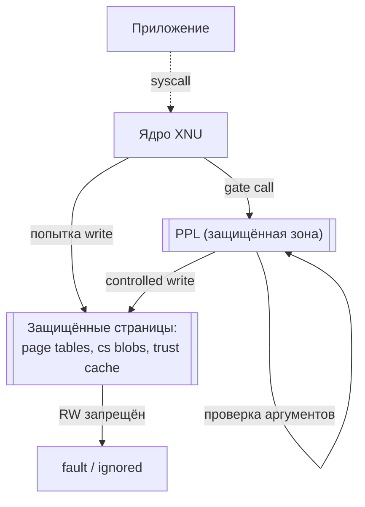
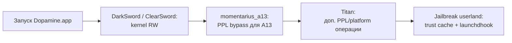

# Deep-dive 04. PPL (Page Protection Layer) и почему iOS 26 на A13 оказалась доступной

Это архитектурный разбор, не инструкция по эксплуатации. Задача главы — объяснить **на уровне понимания**, почему iOS 26.0/26.0.1 поддерживается Dopamine только для A12/A13, и какие аппаратные особенности этих чипов делают это возможным.

Детали ядерных эксплойтов, работающих против PPL — не предмет этой главы. Я опираюсь на публичные описания PPL от Apple и исследователей iOS; конкретный «как обойти» остаётся в коде проекта (`Application/Dopamine/Exploits/`), с теми же правилами ответственности, что для любого security-инструмента.

## 1. Что защищает PPL

**Page Protection Layer** — hardware/firmware-level защита в Apple SoC, появившаяся в A12 (iPhone XS, 2018). Назначение: **никто, даже ядро**, не может **записывать** в определённые физические страницы памяти без прохождения специального узкого шлюза.

Какие страницы защищены:

- Текст ядра (`__TEXT`-сегменты XNU).
- Таблицы страниц (page tables) всех процессов.
- Trust cache структуры в ядре.
- Codesign-blobs загруженных dylib.
- `__PPLTEXT` — сам код PPL (с замкнутым доступом к себе).

Почему это важно: до PPL, если ядро было скомпрометировано (эксплойт даёт kernel RW), можно было переписать подпись процесса или добавить cdhash в trust cache **напрямую**. С PPL — kernel RW недостаточно; все эти операции идут через PPL gateway, который проверяет вызывающего.

## 2. Как PPL работает (концептуально)

Схема:

Разбор:

- Ядро работает в двух режимах: **обычный** и **PPL-режим**.
- Обычное ядро не может писать в защищённые страницы — попытка приводит к hardware fault.
- Единственный путь — специальная последовательность инструкций, которая переводит CPU в PPL-mode. В этом режиме доступ открыт.
- PPL-режим активен только во время выполнения ограниченного набора функций (`__PPLTEXT`). Эти функции проверяют свои аргументы (кто вызывает, что хочет записать) и либо выполняют операцию, либо отказывают.

## 3. Что это даёт Apple

- **Защита от persistent jailbreak**: даже если эксплойт даёт полный kernel RW, он не может переписать систему codesign так, чтобы она переживала перезагрузку, пока trust cache защищён PPL.
- **Защита от rootkit**: злонамеренный kext (которого на iOS нет, но аналогично для kernel-code) не может скрыться — его код не может сделать себя валидным без прохождения через PPL.
- **Защита от privilege escalation в userspace**: нельзя подделать credentials процесса без PPL.

## 4. Почему именно A12/A13 для iOS 26

Это ключевой вопрос этой главы. Dopamine декларирует (`DOEnvironmentManager.m:254`) поддержку iOS 26.0/26.0.1 **только** на A12 и A13. Почему не A14+?

На A14 Apple ввели **SPTM (Secure Page Table Monitor)** и **TXM (Trusted eXecution Monitor)** — следующее поколение защит, которое:

- Переносит часть PPL-ответственности на более низкий уровень (отдельное monitor-firmware).
- Усложняет обходы: несколько независимых monitor'ов проверяют друг друга.
- Применяет PAC более жёстко к указателям, относящимся к безопасности.

На A14+ с iOS 26 Dopamine на момент написания книги не декларирует работу — публичные PPL-обходы, работающие на A12/A13 (момент того же билда iOS), не применимы на SPTM. Это **не вопрос «не умеет», это вопрос** «не на этой версии реализации».

На A12/A13 с iOS 26 PPL — да, активен; но его реализация **не изменилась** радикально между iOS 18 (где jailbreak давно работает) и iOS 26. Поэтому те же классы обходов, которые были актуальны на 18.7.x на A13, адаптируются для 26.0/26.0.1.

## 5. Классы подходов к PPL (общая картина)

Публичная литература (Apple research papers, security conferences, writeups) описывает несколько классов:

1. **Хранить cheat в kernel memory и переливать через нужные моменты**. PPL-защищённые области остаются защищёнными, но jailbreak живёт в unprotected ядерной памяти.
2. **Атаковать race-conditions** при входе/выходе PPL. Если PPL-функция проверяет аргумент до того, как использует, можно подменить аргумент между проверкой и использованием (TOCTOU).
3. **Атаковать баги в самом PPL коде**. PPL — небольшой objem кода (несколько тысяч инструкций), но в нём могут быть ошибки.

Dopamine использует эксплойты (DarkSword/ClearSword на уровне ядра + momentarius_a13 + Titan для PPL bypass на A13). Это **кумулятивные** цепочки — несколько сложенных уязвимостей. Детали — в соответствующих файлах `Application/Dopamine/Exploits/`.

## 6. Эксплойты для A13 в Dopamine

Из `Application/Dopamine/Exploits/`:

| Эксплойт | Папка | Таргет (концептуально) |
|---|---|---|
| **DarkSword** | `DarkSword/` | Kernel RW primitives (socket/IPv6/race) |
| **ClearSword** | `ClearSword/` | Alternative kernel RW |
| **momentarius** | `momentarius/` | PPL bypass (A13-specific в `momentarius_a13.c`) |
| **Titan** | `Titan/` | A13-specific PPL/platform |
| **weightBufs** | `weightBufs/` | Neural engine driver (ранние iOS) |
| **dmaFail** | `dmaFail/` | DMA path |
| **multicast_bytecopy** | `multicast_bytecopy/` | Multicast socket (ранние iOS) |
| **palera1n** | `palera1n/` | checkm8-based (до A11) |
| **kfd** | `kfd/` | Kernel file descriptor |

Для A13 + iOS 26 активная цепочка:

Это **схематически**; реальная цепочка — в коде `DOExploitManager.m` + `DOJailbreaker.m`.

## 7. Что это значит для автора твика

**Напрямую — ничего**. Автор твика работает в userspace, который Dopamine уже jailbroke. PPL для твика невидим — он уже «пробит» на уровне, который делал Dopamine на старте.

**Косвенно** — важно знать:

1. **Jailbreak не персистентен** на iOS 26.0/26.0.1 для A13 — после полной перезагрузки устройства jailbreak нужно активировать заново. Это связано с тем, что PPL-защищённые trust cache структуры сбрасываются при cold boot.
2. **Твики загружаются через dynamic trust cache**, который устанавливается при каждом userspace boot. Это делает jailbreak-пайплайн каждый раз: эксплойт → kernel RW → PPL bypass → trust cache injection.
3. **Это объясняет, почему Dopamine декларирует только A12/A13** для iOS 26: только для них в проекте есть рабочие PPL-обходы. Для A14+ нужны обходы SPTM/TXM, которых в текущей кодовой базе нет.

## 8. Что НЕ описывает эта глава

Намеренно опущено:

- **Конкретный код PPL bypass** — он в репозитории (`momentarius_a13.c`), я его не пересказываю.
- **Specific CVE references** — Apple и исследователи публикуют их в своих источниках, я к ним не вожу читателя за руку.
- **Инструкции «как написать свой PPL bypass»** — это research work, не предмет книги про tweak-разработку.

Эта глава — про **понимание ландшафта**, не про weaponization.

## 9. Этические замечания

PPL и его обходы — это **security research**. Применение этих техник:

- **Легитимно** на собственном устройстве для jailbreak/research.
- **Легитимно** в академических публикациях.
- **Нелегитимно** для атак на чужие устройства.
- **Нелегитимно** для обхода защит от кражи устройства (Activation Lock) — проект Dopamine не делает этого.

Автор твика пользуется плодами security research — это накладывает **минимальные** этические обязательства: не распространять эксплойты в отрыве от контекста (jailbreak для personal device modification), не ломать privacy других пользователей через свои твики.

## 10. Что подтверждено

- **Подтверждено исходниками**:
  - A12 и A13 — CPUFAMILY_ARM_VORTEX_TEMPEST и CPUFAMILY_ARM_LIGHTNING_THUNDER (`DOExploit.m:84, 86`).
  - Строка «PPL» в декларации поддержки (`DOEnvironmentManager.m:254`): «iOS 15.0 - 18.7.1, 26.0 - 26.0.1 (A12/A13, PPL)».
  - Файлы эксплойтов: `momentarius/momentarius_a13.c`, `Titan/exploit/titan.{h,m}`, `DarkSword/DarkSword.m`, `ClearSword/exploit/poc.c`.
  - Проверка SPTM в `DOEnvironmentManager.m` (ветка `-isSPTM`).
- **Подтверждено Apple**: PPL — публично описана Apple в документации Platform Security и в WWDC talks (без детальных схем).
- **Подтверждено research community**: PPL появился на A12 (2018), SPTM/TXM на A14+ (2020+).
- **Требует проверки на устройстве**: что конкретный PPL bypass на вашем билде iOS 26 стабильно работает — реальность эксплойтов на реальной железке.
- **Не подтверждено** (намеренно опущено): конкретные instruction-level детали обхода — за пределами области этой главы.

## 11. Выводы

Главный тезис: **PPL — hardware-уровневая защита на A12+**. Dopamine обходит её на A12/A13 для iOS 26 через цепочку эксплойтов DarkSword/ClearSword + momentarius_a13 + Titan. На A14+ стоят более новые защиты (SPTM/TXM), которых проект на момент книги не покрывает для iOS 26.

Для автора твика это означает:

- **Ваше устройство** — iPhone 11, 11 Pro, 11 Pro Max, iPhone SE 2nd gen (A13).
- **Ваша iOS** — 26.0 или 26.0.1.
- **Для вас всё работает**, потому что security research team (opa334 и соавторы) проделали нижнюю работу.
- **Не персистентно** — jailbreak нужно переактивировать после cold boot.

Это карта местности, по которой вы сейчас ходите. Нижние слои работают, но знать о них полезно — на случай, если вдруг один из слоёв даст сбой.

## 12. Что дальше

- Обзор эксплойтов — Deep-dive 10 (планируется, с теми же правилами «архитектурный, не weaponization»).
- Trust cache — Deep-dive 05.
- Codesign — Deep-dive 06.
- Physical memory — Deep-dive 07 (physrw).
- История jailbreak-эволюции — глава «History» (если будет написана).

Этой главой закрывается подсекция «архитектурные основы безопасности iOS».
