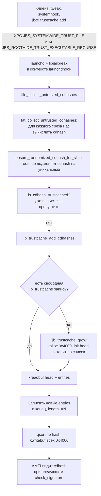
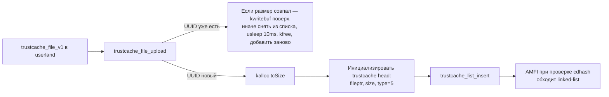
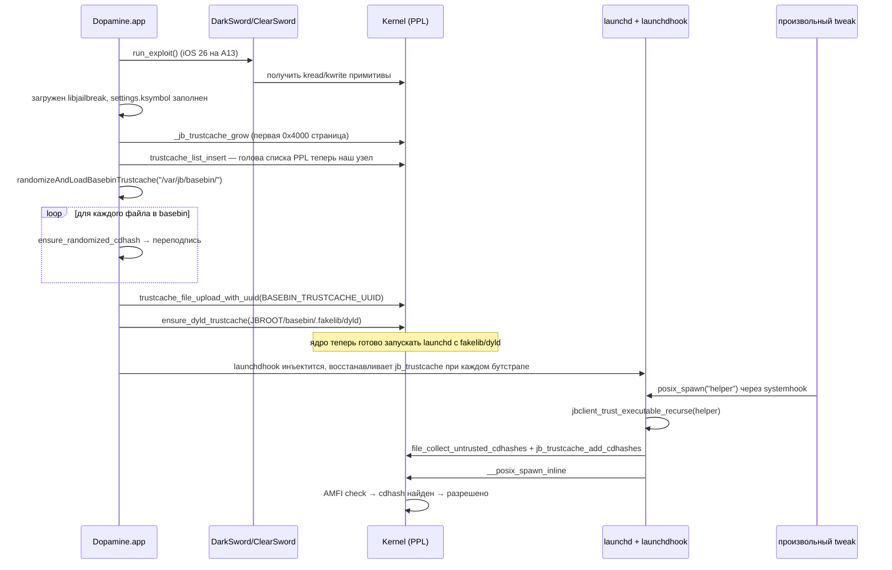

# Trust cache: как Dopamine «подписывает» твики

AMFI на iOS отказывается запускать Mach-O, если его cdhash не числится в списке «заведомо благонадёжных». Этот список называется *trust cache*: карта из `cdhash → тип бинаря`, которой ядро (а точнее — PPL на A13 и SPTM/TXM на A15+) безусловно доверяет. Чтобы запустить сторонний твик, инъектированный в произвольный процесс, Dopamine не подделывает подписи и не чинит `amfid` — он добавляет cdhash твика в собственный, динамически выращенный trust cache прямо в ядре. Эта глава разбирает, как именно это сделано в ветке `roothide`: как устроен файл trust cache, как Dopamine инициализирует «пустую» запись в списке PPL, как через kernel-write туда досыпаются свежие cdhash, как это публикуется наружу через `libjailbreak`/`jbclient_*`, и что произойдёт, если про cdhash своего бинарника забыть.

Контекст, зафиксированный ранее в книге, тут важен: мы говорим про iOS 26.0–26.0.1 на A13 (PPL). Это подтверждено явной проверкой в `Application/Dopamine/Jailbreak/DOEnvironmentManager.m:254` и `Info.plist` эксплойтов `DarkSword`/`ClearSword` (см. Часть III). А13 — это PPL, а не SPTM, значит путь кода, помеченный `ksymbol(ppl_trust_cache_rt)`, — именно наш путь. На различия с A15+ я указываю отдельно, но все рассуждения ниже ориентированы на PPL.

## Что такое trust cache в терминах AMFI

Trust cache — это таблица из записей фиксированного размера. Поиск по ней идёт по `cdhash` (SHA-256-или-SHA-1 от специального блока Code Signature; длина — `CS_CDHASH_LEN`, традиционно 20 байт). Структуру одной записи и файла trust cache в проекте описывает `BaseBin/libjailbreak/src/trustcache_structs.h`:

```c
// trustcache_structs.h:9
typedef uint8_t cdhash_t[CS_CDHASH_LEN];

// trustcache_structs.h:11
typedef struct trustcache_entry_v1
{
    cdhash_t hash;
    uint8_t  hash_type;   // 1 — SHA-1-truncated-to-20, 2 — SHA-256-truncated
    uint8_t  flags;       // битовая маска «что разрешено этому cdhash»
} __attribute__((__packed__)) trustcache_entry_v1;

// trustcache_structs.h:18
typedef struct s_trustcache_file_v1
{
    uint32_t version;
    uuid_t   uuid;
    uint32_t length;
    trustcache_entry_v1 entries[];
} __attribute__((__packed__)) trustcache_file_v1;
```

Это не придуманный Dopamine формат — это разбор того, что XNU/AMFI уже умеют парсить. Запись в 22 байта (`20 + 1 + 1`) и файл с UUID и массивом записей переменной длины — ровно то, что ядро загружает из образов trust cache на диске при обычной работе iOS.

Поверх `trustcache_file_v1` в ядре живёт «head»-структура: linked-list-узел, через который AMFI перебирает все известные trust cache при проверке cdhash. Её layout зависит от версии iOS; Dopamine закодировал смещения в `BaseBin/libjailbreak/src/info.c`:

```c
// info.c:353 (iOS 16+ layout до изменений 18.1 beta5)
gSystemInfo.kernelStruct.trustcache.nextptr      = 0x0;
gSystemInfo.kernelStruct.trustcache.prevptr      = 0x8;
gSystemInfo.kernelStruct.trustcache.type         = 0x10;
gSystemInfo.kernelStruct.trustcache.size         = 0x18;
gSystemInfo.kernelStruct.trustcache.fileptr      = 0x20;
gSystemInfo.kernelStruct.trustcache.struct_size  = 0x28;
```

Для iOS 18.1+ (а значит и для 26.0–26.0.1) комментарии в коде прямо сообщают о смещениях — `fileptr` переехал на `0x18`, `size` вообще убрали; на 26.4+/26.5+ ещё поменяли иные соседние структуры, но trust cache остался со всё теми же `nextptr=0`, `prevptr`, `fileptr`:

```c
// info.c:497
// iOS 18.1+ (beta 5 and up)
if (strcmp(darwinVersion, "24.1.0") >= 0 && ...) {
    // No more size
    gSystemInfo.kernelStruct.trustcache.size        = 0x0;
    gSystemInfo.kernelStruct.trustcache.fileptr     = 0x18;
    gSystemInfo.kernelStruct.trustcache.struct_size = 0x28;

    // iOS 18.4+
    if (strcmp(darwinVersion, "24.4.0") >= 0) {
        ...
        // No more prev (Fully back to iOS 15 format, lol)
        gSystemInfo.kernelStruct.trustcache.prevptr = 0x0;
```

Для 26.0 (`darwin 25.0.0`, см. `info.c:544`) полезных отличий от 18.4+ в самой `trustcache head` в коде не заявлено. **Различия между 26.0 и 26.0.1 в коде репозитория по данной подсистеме я не нашёл по grep** — все проверки идут от значений `darwinVersion` вида `25.0.0`, `25.4.0`, `25.5.0`.

Как AMFI на самом деле реагирует на запись в этом списке и какая часть флагов проверяется — это внутренняя кухня XNU/AMFI/PPL, за пределами репозитория Dopamine, и в данной главе проверяется только то, что код Dopamine прописывает в структуру. Поведение AMFI «после» мы фиксируем как **требует проверки на устройстве** в разделе «Что произойдёт, если забыть добавить cdhash».

## Два пути добавления: dynamic trust cache и файл на диске

Dopamine использует trust cache в двух связанных, но разных сценариях.

**Dynamic trust cache** — это аллокация в ядре на 16 КиБ (`JB_TRUSTCACHE_SIZE = 0x4000`), в которую Dopamine сам пишет cdhash через примитив kernel-write и которую он вклинивает в linked-list `pmap_image4_trust_caches` / `ppl_trust_cache_rt` / `txm_trustcache_root` (`trustcache.c:22`). Такой cache «динамический» в том смысле, что он создан после загрузки системы и живёт до перезагрузки.

**Файл trust cache на диске** — это уже готовый `trustcache_file_v1`, который Dopamine либо строит на лету (например, вокруг cdhash динамического `dyld`), либо берёт из `basebin.tc` (сборочный артефакт). Такой файл загружается через `trustcache_file_upload()`, тоже превращаясь в запись linked-list ядра, но содержимое там фиксированное.

Персистентности trust cache **между перезагрузками в ядре нет** (ядро не хранит сторонние trust cache на диске), поэтому «персистентность» для Dopamine означает: при каждой загрузке `launchd`-hook ставит все нужные cdhash заново из `basebin.tc` и, если надо, перекладывает рандомизированный cdhash динамического dyld.

Сравним пути коротко:

| Путь | Где собирается cdhash | Где живёт в ядре | Когда применяется |
|------|-----------------------|------------------|-------------------|
| `basebin.tc` | На хосте, через `trustcache create` (`BaseBin/Makefile:125-127`) | Отдельная запись в linked-list, UUID `BASEBIN_TRUSTCACHE_UUID` (`trustcache.h:11`) | После эксплойта: `DOJailbreaker.m:369` → `randomizeAndLoadBasebinTrustcache` |
| dynamic dyld | На устройстве: `ensure_randomized_cdhash` (`libroothider/src/recdhash.m:84`) | Отдельная запись, UUID `DYLD_TRUSTCACHE_UUID` (`trustcache.h:12`) | `ensure_dyld_trustcache` (`libroothider/src/common.m:669`) |
| Твики, cli, пользовательские mach-o | На устройстве: `file_collect_untrusted_cdhashes_by_path` | Общий «jb_trustcache» (структура с магиком `JBJBJBJB`), 0x4000 на блок | `jb_trustcache_add_cdhashes` (`trustcache.c:225`) |

### Схема потока



Отдельно, для фиксированных файлов, из `trustcache_file_upload`:



## Поиск головы списка: три поколения ядер

```c
// trustcache.c:22
uint64_t _trustcache_list_get_start(void)
{
    if (ksymbol(pmap_image4_trust_caches)) {        // iOS <=15
        return kread64(ksymbol(pmap_image4_trust_caches));
    }
    else if (ksymbol(ppl_trust_cache_rt)) {         // iOS >=16, PPL
        return kread64(kread64(ksymbol(ppl_trust_cache_rt) + 0x20));
    }
    else if (ksymbol_txm(txm_trustcache_root)) {    // iOS >=17, SPTM/TXM
        return kread64(kread64(ksymbol_txm(txm_trustcache_root) + 0x20));
    }
    return 0;
}
```

На A13 под iOS 26 активная ветка — вторая, `ppl_trust_cache_rt`. По разборке XPF-патчей (`BaseBin/libjailbreak/src/info.h:102,113`) видно, что символы ядра для trust cache разводятся отдельно по PPL и TXM. Если вы читаете этот код сверху-вниз, важно не упустить, что head — это **не сам linked-list**, а глобал, который *содержит адрес* runtime-структуры; `+0x20` там — поле «текущая голова списка». Два `kread64` подряд: сначала адрес runtime, потом — указатель на первый узел.

Запись головы симметричная (`trustcache.c:37`):

```c
void _trustcache_list_set_start(uint64_t newStart)
{
    ...
    else if (ksymbol(ppl_trust_cache_rt)) {
        kwrite64(kread64(ksymbol(ppl_trust_cache_rt) + 0x20), newStart);
    }
    ...
}
```

Разбор строк:
- `ksymbol(ppl_trust_cache_rt)` — kaddr глобала (его находит XPF offset finder, см. ранее в книге).
- `+ 0x20` — смещение внутри ppl_trust_cache_rt, где лежит указатель на массив рантайма с полями trust cache.
- `kread64(...)` — читаем сам указатель рантайма.
- Внешний `kwrite64` — обновляем «текущую голову».

**Про `+ 0x20`:** это непроверяемое по сорцам Dopamine значение; XPF находит сам символ ядра, но смещение внутри него зафиксировано тут хардкодом. На iOS 26 оно всё ещё `0x20`, судя по тому, что отдельного override в `info.c` для `darwin 25.*` нет. **Непроверенное утверждение — требует проверки на устройстве, если offset сломается, Dopamine не найдёт голову списка и получит NULL.**

## Вставка узла: PPL vs SPTM

Логика вставки `trustcache_list_insert` на PPL проста — вставляем в голову:

```c
// trustcache.c:61
int trustcache_list_insert(uint64_t tcToInsert)
{
    if (!tcToInsert) return -1;

    if (ksymbol(SPTMArgs)) {
        // SPTM/TXM: наши аллокации read-only для TXM...
        __block uint64_t lastTC = 0;
        _trustcache_list_enumerate(^(uint64_t tcKaddr, bool *stop) {
            lastTC = tcKaddr;
        });

        if (koffsetof(trustcache, prevptr)) {
            kwrite64(tcToInsert + koffsetof(trustcache, prevptr), lastTC);
        }
        kwrite64(lastTC + koffsetof(trustcache, nextptr), tcToInsert);
    }
    else {
        uint64_t previousStartTC = _trustcache_list_get_start();
        kwrite64(tcToInsert + koffsetof(trustcache, nextptr), previousStartTC);
        if (koffsetof(trustcache, prevptr)) {
            kwrite64(previousStartTC + koffsetof(trustcache, prevptr), tcToInsert);
        }
        _trustcache_list_set_start(tcToInsert);
    }

    return 0;
}
```

Разбор по строкам (ветка PPL — наша):
1. `previousStartTC = _trustcache_list_get_start()` — текущая голова списка (может быть не NULL — там обычно уже лежат статические trust cache от самой iOS).
2. `kwrite64(tcToInsert + koffsetof(trustcache, nextptr), previousStartTC)` — наш новый узел ссылается `next` на старую голову. `koffsetof(trustcache, nextptr) == 0x0` (`info.c:239,354`), так что фактически пишется в самое начало нашей структуры.
3. `if (koffsetof(trustcache, prevptr))` — на iOS 18.4+/26 `prevptr` занулён (`info.c:522`), и этот блок пропускается. На «переходных» ядрах (iOS 16–18.3) `prevptr` жил на `0x8`, и обратную ссылку надо было поддерживать явно.
4. `_trustcache_list_set_start(tcToInsert)` — объявляем наш узел новой головой.

На A15+ SPTM/TXM запрещает нам писать в чужие узлы (`prevptr` чужого read-only), поэтому Dopamine там идёт в хвост. На A13 это неактуально.

## Файл в ядре: как Dopamine уложил свой «пустой» trust cache

Ключевая конструкция — `jb_trustcache` в `trustcache_structs.h:27`:

```c
#define JB_MAGIC 0x424a424a424a424a // "JBJBJBJB"
typedef struct jb_trustcache
{
    // На iOS 15 размер trustcache head 0x10, на iOS 16 — 0x28; берём с запасом.
    uint8_t trustcache[0x40];
    uint64_t magic;
    trustcache_file_v1 file;
} __attribute__((__packed__)) jb_trustcache;

#define JB_TRUSTCACHE_SIZE 0x4000
#define JB_TRUSTCACHE_ENTRY_COUNT \
    ((JB_TRUSTCACHE_SIZE - sizeof(jb_trustcache)) / sizeof(trustcache_entry_v1))
```

Это layout одной kalloc-страницы: сначала «голова» linked-list (точный layout которой нам неизвестен до рантайма, поэтому резервируется 0x40), затем магик (`JBJBJBJB`), затем сам `trustcache_file_v1` + массив entries. Через магик Dopamine отличает *свои* trust cache от системных: `_is_jb_trustcache` (`trustcache.c:139`) проверяет, что `fileptr` указывает ровно на `offset(jb_trustcache.file)` и что `magic` на месте.

Инициализация такой страницы:

```c
// trustcache.c:168
uint64_t _jb_trustcache_grow(void)
{
    uint64_t jbTcKern = 0;
    if (kalloc(&jbTcKern, 0x4000) != 0) return 0;

    jb_trustcache *jbTc = alloca(sizeof(jb_trustcache));
    memset(jbTc, 0, sizeof(jb_trustcache));
    _trustcache_file_init(&jbTc->file);
    jbTc->magic = JB_MAGIC;
    *(uint64_t *)(jbTc->trustcache + koffsetof(trustcache, fileptr))
        = (jbTcKern + offsetof(jb_trustcache, file));
    if (koffsetof(trustcache, size)) {
        *(uint64_t *)(jbTc->trustcache + koffsetof(trustcache, size)) = JB_TRUSTCACHE_SIZE;
    }
    if (koffsetof(trustcache, type)) {
        *(uint64_t *)(jbTc->trustcache + koffsetof(trustcache, type)) = 0x5;
    }
    kwritebuf(jbTcKern, jbTc, sizeof(*jbTc));
    trustcache_list_insert(jbTcKern);
    return jbTcKern;
}
```

Разбор:
1. `kalloc(&jbTcKern, 0x4000)` — отдельная страница в ядре. Это обязательное условие вставки: `trustcache_file_upload` проверяет, что `tcSize > 0x4000 → -1`.
2. Локальный шаблон `jbTc` заполняется в user-space, потом целиком заливается `kwritebuf`.
3. `_trustcache_file_init` ставит `version = 1` и генерирует случайный UUID (`trustcache.c:10`).
4. `fileptr` указывает прямо на поле `file` внутри аллокации: AMFI обходит head, читает `fileptr`, попадает в `trustcache_file_v1`.
5. `type = 0x5` — тип trust cache. **Значение 0x5 — то, что ожидает ppl для «loadable trust cache»**; это непроверяемая по исходникам XNU в репозитории константа, но она используется и для статической загрузки (`trustcache.c:390`). Отмечаем как **подтверждено исходниками Dopamine, семантика внутри ядра — требует проверки по XNU**.
6. На 26 `size == 0`, значит ветка `if (koffsetof(trustcache, size))` пропускается — ядро больше не хранит длину в head.
7. `trustcache_list_insert` вклинивает новый узел в голову списка PPL.

После этого всё добавление cdhash — это `kreadbuf` страницы в userspace, модификация массива `entries`, `qsort`, `kwritebuf` обратно (`trustcache.c:212-219`).

## Горячая вставка cdhash: `jb_trustcache_add_cdhashes`

```c
// trustcache.c:225
int jb_trustcache_add_cdhashes(cdhash_t *hashes, uint32_t hashCount)
{
    struct trustcache_entry_v1 entries[hashCount];
    for (int i = 0; i < hashCount; i++) {
        memcpy(entries[i].hash, hashes[i], sizeof(cdhash_t));
        entries[i].hash_type = 1;
        entries[i].flags     = 0;
    }
    return jb_trustcache_add_entries(entries, hashCount);
}
```

Строки для разбора:
- `hash_type = 1` — это SHA-1-truncated вариант cdhash. ChOma при вычислении cdhash для адхок-подписей отдаёт именно 20 байт SHA-1 от CMS-less SuperBlob (функция `code_signature_calculate_adhoc_cdhash` в `signatures.c:96`, см. также Часть II). Для «обычных» entries из файла trust cache (`trustcache_file_build_from_cdhashes`, `trustcache.c:414`) `hash_type = 2` (SHA-256-truncated). Расхождение — осознанное: добавляемые в рантайме cdhash — ADhoc, статически собранные — Apple.
- `flags = 0` — никаких особых разрешений не выставляется; AMFI воспримет такую запись как «обычный доверенный бинарь».

`jb_trustcache_add_entries` обходит список, ищет свободную jb-страницу (`length < JB_TRUSTCACHE_ENTRY_COUNT`), при необходимости аллоцирует новую через `_jb_trustcache_grow` и дописывает entries, пересортировывая массив по `memcmp` над cdhash (`trustcache.c:134`). Сортировка нужна, потому что проверка `trustcache_contains_cdhash` (`trustcache.c:450`) — бинарный поиск.

## Готовые файлы: `trustcache_file_upload`

Этот путь используется в двух местах:
- `randomizeAndLoadBasebinTrustcache` для файла `basebin.tc` после рандомизации его cdhash.
- `ensure_dyld_trustcache` для cdhash динамического dyld.

Код интересен обработкой конфликта по UUID:

```c
// trustcache.c:328
int trustcache_file_upload(trustcache_file_v1 *tc)
{
    uint64_t tcSize = ksizeof(trustcache) + sizeof(trustcache_file_v1)
                       + (tc->length * sizeof(trustcache_entry_v1));
    if (tcSize > 0x4000) return -1;

    // Проверяем, нет ли в списке trust cache с таким же UUID
    __block uint64_t existingTcKaddr = 0;
    _trustcache_list_enumerate(^(uint64_t tcKaddr, bool *stop) {
        uint64_t tcFileKaddr = kread64(tcKaddr + koffsetof(trustcache, fileptr));
        uuid_t tcFileUUID;
        kreadbuf(tcFileKaddr + offsetof(trustcache_file_v1, uuid),
                 tcFileUUID, sizeof(tcFileUUID));
        if (memcmp(tcFileUUID, tc->uuid, sizeof(tcFileUUID)) == 0) {
            existingTcKaddr = tcKaddr;
            *stop = true;
        }
    });

    if (existingTcKaddr != 0) {
        if (_is_jb_trustcache(existingTcKaddr)) {
            // Коллизия UUID с jb_trustcache — abort
            return -1;
        }
        ...
        if (prevTcSize == tcSize) {
            // Тот же размер — просто перезаписать
            kwritebuf(prevTcFile, tc, tcSize - ksizeof(trustcache));
            return 0;
        }
        else {
            // Иной размер — снять со списка, подождать, kfree
            if (trustcache_list_remove(existingTcKaddr) != 0) return -1;
            usleep(10000); // надеемся, что все текущие читатели ушли
            kfree(existingTcKaddr, prevTcSize);
        }
    }
    ...
}
```

Два технических момента, которые стоит понимать, если вы пишете свой твик, который по какой-то причине грузит собственный trust cache:

1. **UUID — ключ идемпотентности.** Если два разных вызова используют один и тот же UUID (например, `BASEBIN_TRUSTCACHE_UUID`), ядро не получит дубль; старая запись либо перепишется, либо будет снята со списка и освобождена. Это и позволяет `jbupdate_basebin` (`BaseBin/launchdhook/src/update.m:33`) обновлять basebin trust cache на лету без «утечки» старого.
2. **`usleep(10000)`** — явный «мы не блокируем читателей из ядра, но надеемся, что за 10 мс AMFI закончит текущую проверку и свои read'ы к памяти, которую мы собираемся освободить». Автор прямо об этом пишет в комментарии: «we can't take a lock... so we do the next best thing». Это гонка, которой с точки зрения чистоты кода не должно быть, но в практике Dopamine на PPL она не ловится.

## Публичный API libjailbreak

Из `BaseBin/libjailbreak/src/trustcache.h`:

```c
// trustcache.h:14-30
int  trustcache_list_insert(uint64_t tcKaddr);

int  jb_trustcache_add_entries(struct trustcache_entry_v1 *entries, uint32_t entryCount);
int  jb_trustcache_add_entry  (trustcache_entry_v1 entry);
int  jb_trustcache_add_cdhashes(cdhash_t *hashes, uint32_t hashCount);
xpc_object_t jb_trustcache_info(void);
void jb_trustcache_clear(void);

void jb_trustcache_debug_print(FILE *f);

int  trustcache_file_upload(trustcache_file_v1 *tc);
int  trustcache_file_upload_with_uuid(trustcache_file_v1 *tc, uuid_t uuid);
int  trustcache_file_build_from_cdhashes(cdhash_t *CDHashes, uint32_t CDHashCount,
                                         trustcache_file_v1 **tcOut);
int  trustcache_file_build_from_path(const char *filePath, trustcache_file_v1 **tcOut);

bool is_cdhash_in_trustcache(uint64_t tcKaddr, cdhash_t CDHash);
bool is_cdhash_trustcached(cdhash_t CDHash);
```

Из `trustcache_fs.h`:

```c
int jb_trustcache_add_file(const char *filePath);
int jb_trustcache_add_directory(const char *directoryPath, bool recursive);
```

Назначение по группам:

| Функция | Контекст | Что делает |
|---------|----------|------------|
| `jb_trustcache_add_cdhashes` | в процессе с kernel-write | Добавить готовые 20-байтовые cdhash в jb_trustcache |
| `jb_trustcache_add_entries` | то же | Низкоуровневый вариант: `trustcache_entry_v1` с явным `hash_type` |
| `jb_trustcache_add_entry` | то же | Удобный wrapper на одну запись |
| `jb_trustcache_add_file` | в процессе с kernel-write | Открыть Mach-O/Fat, собрать все untrusted cdhash, добавить (`trustcache_fs.c:80`) |
| `jb_trustcache_add_directory` | то же | Рекурсивный обход каталога, те же действия |
| `is_cdhash_trustcached` | то же | Пройти linked-list, бинарный поиск — есть ли cdhash уже в trustcache |
| `jb_trustcache_info` | то же | XPC-массив jb_trustcache (uuid + массив cdhash) для диагностики |
| `jb_trustcache_clear` | то же | Обнулить `length` всех jb-страниц (сами entries остаются в памяти, но ядро их не видит) |
| `trustcache_file_upload[_with_uuid]` | то же | Загрузить готовый файл trust cache как отдельный узел списка |
| `trustcache_file_build_from_cdhashes` | в любом контексте | Собрать `trustcache_file_v1` в userland из массива cdhash |
| `trustcache_file_build_from_path` | то же | Прочитать готовый файл с диска |

Все `jb_trustcache_*` работают прямо через `kread/kwrite` и предполагают, что вызывающий процесс уже имеет kernel-write (у Dopamine это `launchd` и приложение Dopamine сразу после пост-эксплойта).

## Что из этого доступно стороннему твику

Сторонний твик kernel-write-примитивом **не владеет**: доступ к памяти ядра есть только у процессов, в которые `launchdhook` протащил физический R/W. Поэтому твик обращается в `launchd` по XPC, а дальше его работу делает `jbserver` в контексте launchd. Из `BaseBin/libjailbreak/src/jbclient_xpc.h`:

```c
// jbclient_xpc.h:16
int jbclient_trust_file(int fd, struct siginfo *siginfo, bool attach);
int jbclient_trust_file_by_path(const char *path);
...
int jbclient_root_trustcache_info(xpc_object_t *infoOut);
// int jbclient_root_trustcache_add_cdhash(uint8_t *cdhashData, size_t cdhashLen);
int jbclient_root_trustcache_clear(void);
```

И из `BaseBin/libjailbreak/src/jbclient_roothide.c:170,203`:

```c
int jbclient_trust_executable_recurse(const char *executablePath,
                                      xpc_object_t preferredArchsArray);
int jbclient_trust_library_recurse(const char *libraryPath,
                                   void *addressInCaller);
```

Матрица «кто и что может»:

| Клиент | Домен JBServer | Вызов | Что получает |
|--------|----------------|-------|--------------|
| любой процесс | `JBS_DOMAIN_SYSTEMWIDE` | `JBS_SYSTEMWIDE_TRUST_FILE` | Отдать fd, получить добавление cdhash всех срезов в trustcache (`jbdomain_systemwide.c:103`) |
| любой процесс (roothide) | `JBS_DOMAIN_ROOTHIDE` | `JBS_ROOTHIDE_TRUST_EXECUTABLE_RECURSE` | То же + рекурсивный обход зависимостей и `@executable_path` (`jbdomain_roothide.c:57`) |
| любой процесс (roothide) | `JBS_DOMAIN_ROOTHIDE` | `JBS_ROOTHIDE_TRUST_LIBRARY_RECURSE` | То же для dlopen; передаёт caller image и cwd для `@loader_path`/`@executable_path` |
| только root | `JBS_DOMAIN_ROOT` | `JBS_ROOT_TRUSTCACHE_INFO` | XPC-массив всех jb_trustcache |
| только root | `JBS_DOMAIN_ROOT` | `JBS_ROOT_TRUSTCACHE_CLEAR` | Обнулить length всех jb_trustcache |
| только root | `JBS_DOMAIN_ROOT` | `JBS_ROOT_TRUSTCACHE_ADD_CDHASH` | **В roothide-ветке отключён и помечен как unsupported** (`jbdomain_root.c:91-96`, `jbdomain_roothide.c:9-12`); в комментарии сказано, что надо вместо голого cdhash работать через `trust_file` |

Важная деталь по `JBS_SYSTEMWIDE_TRUST_FILE`: в roothide-ветке обработчик обрезан — он не делает `trust_signatures` (который бы прошёл по пути отключённого `amfid`-патча), а просто досылает cdhash в jb_trustcache и завершается:

```c
// jbdomain_systemwide.c:124-149
struct statfs fsb;
int fsr = fstatfs(fd, &fsb);
if (fsr == 0) {
    // Everything on rootfs/fakelib — уже в trustcache системного образа
    if (!strcmp(fsb.f_mntonname, "/")) {
        close(fd);
        return 0;
    }
}

/************************ roothide specfic ************************/
cdhash_t *cdhashes = NULL;
uint32_t cdhashCount = 0;
file_collect_untrusted_cdhashes(fd, &cdhashes, &cdhashCount);

int retval = 0;
if (cdhashes && cdhashCount > 0) {
    retval = jb_trustcache_add_cdhashes(cdhashes, cdhashCount);
    free(cdhashes);
}

close(fd);
return retval;
/*******************************************************************/
```

Разбор:
1. Если fd принадлежит `/` (rootfs), считается, что всё там уже в системном trust cache, и ничего делать не надо.
2. Для всего остального вызывается `file_collect_untrusted_cdhashes` — он открывает fd как Fat/Mach-O и для каждого среза проверяет, подписан ли он адхок и нет ли уже такого cdhash в trustcache (`signatures.c:131`).
3. Собранные cdhash пихаются в jb_trustcache.

Весь оригинальный upstream-код Dopamine после `/* roothide specfic */` отрезан: ветка `trust_signatures` + `F_ADDSIGS` в roothide не используется, потому что roothide применяет собственный флоу через `recdhash` и не трогает amfid.

### Что из этого стоит использовать из твика

- **Запуск отдельного бинарника из твика** (например, вспомогательного CLI). Правильный вызов — `jbclient_trust_executable_recurse(path, NULL)`. Он не только добавит cdhash самого бинарника, но и пройдёт по его явным зависимостям (LC_LOAD_DYLIB и т. п.) с учётом `@executable_path`/`@loader_path`.
- **Динамический `dlopen` сторонней dylib**. Это должен делать `systemhook` в вашем процессе автоматически (`roothide_main.c:401,410,419,428` — хуки dlopen семейства), но если вы по каким-то причинам отключили systemhook, вызовите `jbclient_trust_library_recurse(libraryPath, __builtin_return_address(0))` до своего `dlopen`.
- **Готовый файл с cdhash**. Это нестандартный путь; обычный тык доступен только root-процессам. Через XPC добавить произвольный cdhash «из воздуха» в текущей ветке roothide запрещено (`JBS_ROOT_TRUSTCACHE_ADD_CDHASH → roothide_unsupport_request`).

Пример минимального вспомогательного кода из твика, который гарантирует, что ваш собственный `MyHelper` можно будет `posix_spawn`-нуть:

```c
#include <libjailbreak/jbclient_xpc.h>
#include <libjailbreak/jbclient_roothide.h>

static int MyTweak_ensure_helper_trusted(void)
{
    const char *helperPath = JBROOT_PATH("/usr/local/bin/MyHelper");

    // Рекурсивно загнать cdhash самого MyHelper и его зависимостей в jb_trustcache.
    // 0 — успех; отрицательные коды см. в jbclient_roothide.c:170
    int r = jbclient_trust_executable_recurse(helperPath, NULL);
    if (r != 0) {
        NSLog(@"[MyTweak] trust_executable_recurse(%s) failed: %d", helperPath, r);
        return r;
    }
    return 0;
}
```

Разбор:
- `JBROOT_PATH` — макрос из libroothider, который приклеивает рандомизированный `/var/jb-...` префикс (Часть I, глава 5).
- Второй аргумент — `preferredArchsArray` в формате XPC-массива словарей `{"type": …, "subtype": …}`. Для простого запуска по умолчанию достаточно NULL — тогда trust-flow возьмёт срез Fat по правилам `fat_find_preferred_slice`.
- Код `-2` означает, что `access(executablePath, F_OK) != 0`; `-3` — путь к библиотеке существует, но ссылка от исходной библиотеки оказалась внутри dyld shared cache (`jbclient_roothide.c:207`). На практике вам достаточно отличать 0 от «что-то не так».

Если хочется ограничиться старым трастом «одна подпись → одна запись», то API — `jbclient_trust_file_by_path(path)`:

```c
int jbclient_trust_file_by_path(const char *path)
{
    int fd = open(path, O_RDONLY);
    if (fd < 0) return -1;
    int r = jbclient_trust_file(fd, NULL, false);
    close(fd);
    return r;
}
```

Эта версия не ходит по LC_LOAD_DYLIB, что проще, но ненадёжно для современных Mach-O с кучей зависимостей.

## Пример: вручную добавить cdhash из launchd-привилегированного процесса

Если ваш код исполняется в процессе, который сам получает kernel-write через `jbclient_root_get_physrw` (это крайне узкий сценарий, обычно только `jbctl` и сам Dopamine), публичный API выглядит так:

```c
#include <libjailbreak/trustcache.h>
#include <libjailbreak/signatures.h>

int add_cdhashes_of_binary(const char *path)
{
    cdhash_t *hashes = NULL;
    uint32_t  count  = 0;

    // Прочитать Mach-O/Fat, посчитать cdhash каждого среза, пропустить то,
    // что уже доверено, в roothide — через randomized_cdhash.
    file_collect_untrusted_cdhashes_by_path(path, &hashes, &count);

    if (!hashes || count == 0) {
        return 0; // ничего нового, или это не Mach-O
    }

    // Залить в динамический jb_trustcache через kernel-write
    int r = jb_trustcache_add_cdhashes(hashes, count);
    free(hashes);
    return r;
}
```

Строки:
- `file_collect_untrusted_cdhashes_by_path` — верхний уровень; внутри открывает `fd`, оборачивает в Fat через ChOma и вызывает `fat_collect_untrusted_cdhashes` (`signatures.c:103`). Там же выполняется roothide-ный `ensure_randomized_cdhash_for_slice`, который переподписывает срез уникальной подписью (см. главу про PAC и adhoc-подписи).
- `jb_trustcache_add_cdhashes` — тот самый путь через `_jb_trustcache_grow` и `kwritebuf`. Возвращает 0 при успехе.

Отметьте: за `_jb_trustcache_grow` стоит `kalloc(0x4000)` и `trustcache_list_insert`. Это не бесплатная операция. Dopamine это понимает и держит одну страницу на `JB_TRUSTCACHE_ENTRY_COUNT` записей (`(0x4000 - sizeof(jb_trustcache)) / 22` ≈ много сотен cdhash), допуская рост только когда места нет.

## Diagnostic surface: `jbctl trustcache info`

Из `BaseBin/jbctl/src/main.m:95` виден удобный пользовательский инструмент:

```bash
# От root в iOS shell после джейлбрейка:
$ jbctl trustcache info
Jailbreak Trustcache 0 <UUID: 4254ee34...> (length: 128)
| 1:    b61a4acb0bf1b4c62f...
| 2:    ...
Jailbreak Trustcache 1 <UUID: 00000000...> (length: 24)
| 1:    ...
```

Эту команду стоит знать: она выводит все jb_trustcache из ядра. Если у вас после запуска какого-то бинарника AMFI отвергает его как «unsigned», первым делом смотрите, есть ли там его cdhash. Получить cdhash своего бинаря в userland можно через `ldid -h /path/to/file` или через `codesign -d --verbose=4` на macOS. Также рядом — очистка: `jbctl trustcache clear` (`main.m:123` → `jbclient_root_trustcache_clear` → `jb_trustcache_clear` → `kwrite32` длины в 0 всех jb-страниц, `trustcache.c:161`). После `clear` все добавленные через systemhook/jbclient cdhash станут невидимы для AMFI, но basebin и dyld trust cache **не** чистятся — у них свои UUID, и `jb_trustcache_clear` их не трогает (это другой путь, см. `trustcache_file_upload`).

## Что произойдёт, если забыть добавить cdhash

Это ключевой вопрос «зачем всё это». Ответ опирается на поведение AMFI на iOS, зафиксированное за много лет; строгое поведение именно XNU 25.0.0 я проверить по исходникам этого репозитория не могу, он содержит только пользовательский слой Dopamine.

Что подтверждено исходниками Dopamine:
1. Если cdhash отсутствует в trust cache, `is_cdhash_trustcached()` вернёт `false` (`trustcache.c:476`). Это строго деткектится функцией Dopamine — то есть «отсутствие» в этом смысле есть именно отсутствие записи в linked-list, а не какая-то более тонкая проверка.
2. `jbclient_trust_file`/`jbclient_trust_executable_recurse` вызываются из `systemhook` **перед** `__posix_spawn_inline` (`BaseBin/systemhook/src/roothider_main.c:258,305`). Это и есть встроенная «страховка»: если бинарь был на fakelib и ещё не трастился, systemhook успеет добавить его cdhash до того, как ядро попросит AMFI проверить подпись.

Что опирается на поведение AMFI (это описано как общеизвестное в open-source разборах и в комментариях самого Dopamine, но строгой ссылки на XNU 25.0.0 в репозитории нет; **непроверенное утверждение — требует проверки на устройстве**):

- Ядро, встретив неподписанный или адхок-подписанный Mach-O без cdhash в trust cache, не загрузит его: AMFI вернёт ошибку, `posix_spawn` упадёт с `EPERM`/`EBADEXEC`.
- Для dynamically loaded dylib — ядро откажет на этапе `vm_protect`-мапирования `__TEXT`-сегмента (`dlopen` вернёт NULL, `dlerror` обычно содержит упоминание code-signature).
- Для `execve` исход тот же — отказ по AMFI.

Один из комментариев в коде прямо описывает, зачем нужно трастить динамический dyld:

```c
// BaseBin/libroothider/src/common.m:669 — ensure_dyld_trustcache
// trusting dyld file: %s
```

Dopamine рандомизирует cdhash самого `dyld` (чтобы разные устройства имели разные cdhash одного и того же бинаря — противохост-fingerprint-мера), и после рандомизации **обязан** его затрастить. Иначе ядро не стартует процесс с этим dyld. То же относится ко всем файлам в `/var/jb/basebin`.

Для `basebin.tc` в коде указано (`DOJailbreaker.m:367`):

```c
- (NSError *)loadBasebinTrustcache
{
    int ret = randomizeAndLoadBasebinTrustcache(JBROOT_PATH("/basebin/"));
    if (ret != 0) {
        return [NSError errorWithDomain:JBErrorDomain
             code:JBErrorCodeFailedBasebinTrustcache
             userInfo:@{NSLocalizedDescriptionKey :
                 [NSString stringWithFormat:@"Failed to load BaseBin trustcache: %d", ret]}];
    }
    return nil;
}
```

Если `randomizeAndLoadBasebinTrustcache` падает, джейлбрейк не продолжается с ошибкой. Логика проста: без залитого basebin-trustcache launchd не сможет корректно запустить systemhook/launchdhook, а значит остальной процесс развёрнется в сломанное состояние.

**Разница 26.0 vs 26.0.1:** в коде проекта по grep я не нашёл развилок между 26.0 и 26.0.1 в данной подсистеме. Все проверки идут по `darwinVersion` на уровень `25.0.0`/`25.4.0`/`25.5.0`. По release notes Apple различия 26.0 vs 26.0.1 на A13 касались в основном пользовательских багов; **для trust cache различия не выявлены**.

## `is_cdhash_trustcached` как опорный предикат во всех пайплайнах

Простая проверка «уже или нет» — главный rate-limiter в этой подсистеме. Без неё Dopamine регулярно отправлял бы одни и те же cdhash в ядро, тратя RAM и, в худшем случае, вызывая `_jb_trustcache_grow` без необходимости. Вот где она используется:

| Файл | Контекст |
|------|----------|
| `BaseBin/libjailbreak/src/signatures.c:131` | внутри `fat_collect_untrusted_cdhashes` при каждом срезе Fat — не возвращать cdhash, который уже доверен |
| `BaseBin/libjailbreak/src/signatures.c:336` | `trust_signatures` upstream — не добавлять второй раз (в roothide отрезан, но код сохранён) |
| `BaseBin/libroothider/src/common.m:679` | `ensure_dyld_trustcache` — не загружать свой trust cache для dyld, если он уже есть |
| `BaseBin/libroothider/src/signatures.m:255` | roothide-ный путь сбора cdhash рекурсивно по зависимостям |

Реализация бинарного поиска для скорости:

```c
// trustcache.c:450
bool trustcache_contains_cdhash(uint64_t tcKaddr, cdhash_t CDHash)
{
    uint64_t tcFileKaddr = kread64(tcKaddr + koffsetof(trustcache, fileptr));
    uint32_t length = kread32(tcFileKaddr + offsetof(trustcache_file_v1, length));
    if (length == 0) return false;

    int32_t left = 0;
    int32_t right = length - 1;

    while (left <= right) {
        int32_t mid = (left + right) / 2;
        cdhash_t itCDHash;
        kreadbuf(tcFileKaddr + offsetof(trustcache_file_v1, entries[mid].hash),
                 itCDHash, CS_CDHASH_LEN);
        int32_t cmp = memcmp(CDHash, itCDHash, CS_CDHASH_LEN);
        if (cmp == 0) return true;
        if (cmp < 0)  right = mid - 1;
        else          left  = mid + 1;
    }
    return false;
}
```

Важные моменты:
- Каждая итерация делает **два `kread`**: один — на `fileptr` (вне цикла), один — на 20 байт `itCDHash` внутри. На N записях это O(log N) kread. На практике это заметно, но терпимо: для N=1024 — 10 kread, под PPL это десятки микросекунд.
- Сортировка внутри страницы (`_trustcache_file_sort`, `trustcache.c:134`) — ключевое условие корректности бинарного поиска. Любой код, который правит entries напрямую без последующего `qsort`, сломает поиск. Поэтому `jb_trustcache_add_entries` всегда делает `_trustcache_file_sort` перед `kwritebuf`.

Общая обёртка `is_cdhash_trustcached` просто обходит linked-list и возвращает `true` на первом совпадении (`trustcache.c:476`), поэтому если cdhash добавлен в нескольких местах (например, системным образом iOS и дополнительно в jb_trustcache), это не ломается.

## Байтовый разбор файла trust cache

Для статической загрузки через `trustcache_file_upload`/`basebin.tc` на диске лежит такой формат (из `trustcache_structs.h`):

```
offset  size   поле                 комментарий
 0x00   4      version              = 1 (trustcache_file_v1)
 0x04   16     uuid                 128-битный UUID, уникален в пределах linked-list
 0x14   4      length               число entries
 0x18   22*N   entries[N]           массив, отсортированный по hash
```

Каждая entry — ровно 22 байта (`#pragma pack` эквивалент через `__attribute__((packed))`):

```
offset  size   поле
 0x00   20     hash                 cdhash_t
 0x14    1     hash_type            1 = SHA1-trunc20, 2 = SHA256-trunc20
 0x15    1     flags                0 для обычных трастов
```

Утилита `trustcache` (упомянутая в `BaseBin/Makefile:126` как `trustcache create .build/basebin.tc .build`) собирает такой файл из набора Mach-O. Это внешняя тулза (из проекта ChOma/libtrustcache). В ветке `roothide` она не используется напрямую в рантайме: `randomizeAndLoadBasebinTrustcache` не читает `basebin.tc` с диска, а пересобирает его из рандомизированных cdhash всех файлов в `/var/jb/basebin`. Файл `basebin.tc` остаётся в tar-архиве для обратной совместимости с кодом upstream, но на устройстве загружается именно пересобранный на лету trust cache.

Полезный тест на целостность — `trustcache_file_build_from_path` (`trustcache.c:423`):

```c
size_t actualTcSize = sizeof(trustcache_file_v1)
                   + (sizeof(trustcache_entry_v1) * file->length);
if (actualTcSize != tcSize) {
    free(file);
    return -1;
}
```

Разбор: прочитав файл, Dopamine сверяет, что заявленный `length` соответствует реальному размеру. Это защита от повреждённого `basebin.tc`.

## Жизненный цикл: от эксплойта до запуска твика



Отметьте стрелки, где фигурирует `K`: все взаимодействия с ядром идут через kernel-write-примитив, физически — через page-table-патч, выданный тому процессу (Dopamine.app, затем launchd), который получил `JBS_ROOT_GET_PHYSRW`.

## Почему upstream `trust_signatures` в roothide отрезан

В upstream-Dopamine `systemwide_trust_file` после сбора `siginfo` вызывает `trust_signatures(pid, fd, sigInfos, sigInfoCount)` (`jbdomain_systemwide.c:165` в закомментированном коде). Эта функция делала две вещи сразу:
1. Добавляла cdhash в trust cache.
2. Через `F_ADDSIGS` прицепляла модифицированный `CS_SuperBlob` к `fd`, что позволяло исправлять «сломанные» подписи сторонних IPA.

В ветке `roothide` этот путь выключен — обработчик обрезан до `jb_trustcache_add_cdhashes`. Причина — в самой roothide-архитектуре: вместо того чтобы вкладывать правильный superblob в fd, roothide **модифицирует файл на диске** через `ensure_randomized_cdhash_for_slice`:

```c
// signatures.c:135 — внутри fat_collect_untrusted_cdhashes
if(ensure_randomized_cdhash_for_slice(filepath, macho->archDescriptor.offset, cdhash) != 0) {
    JBLogError("Failed to ensure randomized cdhash for %s", filepath);
    return;
}
```

Это даёт неожиданный, но важный побочный эффект: cdhash каждого бинаря становится **уникальным для устройства**. Два разных джейлбрейкнутых устройства, запустив тот же IPA, добавят в trust cache разные cdhash. Это антипрофилинг-мера: сервер, не видя одинаковых cdhash, не может по ним кореллировать устройства.

Если вам важен совместимый upstream-поведение (например, вы портируете чей-то старый твик), помните: `jbclient_trust_file` в roothide **не** вернёт ошибку, если файл не был переподписан; он тихо залезет в код `/* roothide specfic */` и не позовёт upstream-ветку. На практике это означает, что ваш твик никогда не увидит `trust_signatures` в стеке.

## Mini-FAQ по типичным ошибкам

**«Твик нормально установился, но посадочный helper падает с SIGKILL сразу после `posix_spawn`».** Почти всегда — это не доставленный cdhash. Запустите `jbctl trustcache info | grep -i <первые байты вашего cdhash>`. Если cdhash нет — `jbclient_trust_executable_recurse(path, NULL)` до спавна.

**«dlopen вернул NULL, в dlerror — что-то про code-signature».** cdhash самой dylib или одной из её зависимостей не в trustcache. Systemhook должен был это сделать, но если dlopen идёт из процесса, где systemhook не загружен (`launchctl setenv DYLD_INSERT_LIBRARIES` не сработал, скажем, для platform binary) — вручную позовите `jbclient_trust_library_recurse`.

**«После reboot всё сломалось».** Trust cache нечитаемый из ядра между перезагрузками. Это ожидаемо. Dopamine восстанавливает basebin + dyld + свои cdhash при каждом запуске (роль launchdhook'а). Если ваш твик держит собственные бинарники вне `/var/jb/basebin`, вам нужно либо добавлять их в trustcache при каждом запуске (в `-constructor`-функции твика), либо класть их туда, где systemhook сам затрастит на spawn.

**«Я переподписал бинарник новым cdhash и жду, что AMFI сразу увидит».** Сам факт переподписи в userland ядро **не замечает** — надо повторно вызвать `jbclient_trust_file_by_path` или `jbclient_trust_executable_recurse` после переподписи, чтобы новый cdhash попал в jb_trustcache.

## Почему 0x4000, что внутри и как это соотносится с vm_page

Константа `JB_TRUSTCACHE_SIZE = 0x4000` — 16 КиБ, ровно размер одной крупной страницы. На A13 iOS использует 16 КиБ-страницы для kernel-пулов, и `kalloc(0x4000)` возвращает физически выровненную страницу (это свойство важно для PPL, которая делает защитные проверки на выравнивание), **непроверенное утверждение по XNU-source — требует проверки по kalloc.c, в репозитории Dopamine kalloc только обёрнут**. Из этого размера Dopamine вычитает `sizeof(jb_trustcache)` (0x40 на head + 8 байт магика + 0x18 на `trustcache_file_v1`-заголовок) и получает место под entries:

```
JB_TRUSTCACHE_ENTRY_COUNT = (0x4000 - sizeof(jb_trustcache)) / sizeof(trustcache_entry_v1)
                          = (16384 - (0x40 + 8 + 0x18)) / 22
                          = (16384 - 96) / 22
                          ~ 740 cdhash на страницу
```

Это даёт потолок одной страницы в ~740 cdhash. На практике один твик с десятком зависимостей добавляет 15-30 cdhash; `_jb_trustcache_grow` вторую страницу вызовет только если на устройстве установлены сотни твиков или много крупных бандлов.

Разбор содержимого страницы в памяти:

```
offset   bytes                            содержимое
0x0000   0x40                             trustcache head (nextptr, prevptr, type,
                                           size, fileptr, прочее — layout зависит от iOS)
0x0040   8        'JBJBJBJB' (JB_MAGIC)   маркер, что это Dopamine-ный узел
0x0048   4        version=1               trustcache_file_v1.version
0x004C   16       uuid                    trustcache_file_v1.uuid (случайный)
0x005C   4        length                  trustcache_file_v1.length (растёт по мере вставок)
0x0060   22       entries[0]              первый cdhash + hash_type + flags
0x0076   22       entries[1]
...      ...      ...
0x3FFF                                     последний байт страницы
```

Это ровно то, что AMFI/PPL ожидают увидеть по указателю `fileptr` в head: сразу `trustcache_file_v1` с его длиной и массивом entries. Магик `JBJBJBJB` лежит *перед* `trustcache_file_v1` и ядром не читается — он нужен только Dopamine, чтобы отличать свои узлы.

## Проверка «это jb_trustcache или системный?»

Код `_is_jb_trustcache` опирается на то, что только у наших узлов `fileptr` указывает на `kaddr + offsetof(jb_trustcache, file)` ровно, а на этом смещении минус 8 лежит магик:

```c
// trustcache.c:139
bool _is_jb_trustcache(uint64_t tcKaddr)
{
    uint64_t jbTcFile = tcKaddr + offsetof(jb_trustcache, file);
    uint64_t file = kread64(tcKaddr + koffsetof(trustcache, fileptr));
    if (file == jbTcFile) {
        // Если между началом страницы и файлом лежит ровно одно 8-байтное значение,
        // проверить, что оно равно JB_MAGIC
        // Это 100% надёжный способ определить, наш это trust cache или нет
        return (kread64(tcKaddr + offsetof(jb_trustcache, magic)) == JB_MAGIC);
    }
    return false;
}
```

Разбор:
- `jbTcFile = tcKaddr + offsetof(jb_trustcache, file)` — вычисляем, *где должен был бы лежать `trustcache_file_v1`*, если это наш узел (`0x48` в userspace layout).
- `file = kread64(tcKaddr + koffsetof(trustcache, fileptr))` — читаем из ядра реальный `fileptr`. Для системных trust cache iOS он показывает в другую память (отдельно от самой head), для наших — ровно внутрь той же страницы.
- Совпадение — необходимое, но не достаточное условие. Для гарантии читаем магик.

Этот предикат защищает `trustcache_file_upload` от ошибки типа «попытаться `kfree` чужой trust cache iOS» — если кто-то случайно подсунет файл с UUID, который почему-то совпал с системным, `_is_jb_trustcache(existingTcKaddr)` вернёт false, upload откажет (`trustcache.c:347`).

## Персистентность: роль launchdhook

Между перезагрузками trust cache в ядре не живёт — iOS загружает только свои статические. Поэтому Dopamine должен **каждую загрузку** заново поставить все нужные cdhash. За это отвечает `BaseBin/launchdhook/src/roothider.m`:

```c
// roothider.m:137
int ret = ensure_dyld_trustcache(JBROOT_PATH("/basebin/.fakelib/dyld"));
```

и `BaseBin/launchdhook/src/update.m:45`:

```c
r = randomizeAndLoadBasebinTrustcache(tmpBasebinPath.fileSystemRepresentation);
```

Схема загрузки:

1. Запускается ядерный launchd. iOS штатно читает свои trust cache из `/private/preboot/...`.
2. Dopamine заранее подменил dyld на свой через fakelib (см. главы книги про PAC и dyld-patch). Чтобы iOS его запустил, его cdhash уже должен быть в trust cache.
3. Эксплойт случается *до* первого спавна любого «нашего» бинаря в этой сессии; `Dopamine.app` после эксплойта вызывает `loadBasebinTrustcache` (`DOJailbreaker.m:367`), потом `ensure_dyld_trustcache` (`DOJailbreaker.m:745`).
4. На устройстве эксплойт в Dopamine делается только через UI пользователя (это — jailbreak, который надо «запустить»). Поэтому на reboot устройство оказывается в чистом состоянии; пользователь снова жмёт кнопку «Jailbreak».

**Это важно отметить:** автоматической загрузки trust cache при boot в roothide-ветке нет; «persistent» в этом проекте означает только «переживаемость апдейтов basebin», а не «переживаемость reboot». Соответствующая реальность для вашего твика: все добавленные cdhash уходят, когда пользователь ребутится без запуска джейлбрейка.

При обновлении basebin (`jbupdate_basebin`, `BaseBin/launchdhook/src/update.m:15`) последовательность другая:

```c
// update.m:33
NSString *trustcachePath = [tmpBasebinPath stringByAppendingPathComponent:@"basebin.tc"];
if (![[NSFileManager defaultManager] fileExistsAtPath:trustcachePath]) return 3;
...
r = randomizeAndLoadBasebinTrustcache(tmpBasebinPath.fileSystemRepresentation);
```

Разбор:
- Распакованный tar должен содержать `basebin.tc` (это маркер «новый basebin»), но реальная загрузка идёт через `randomizeAndLoadBasebinTrustcache`, который заново считает cdhash всех файлов обновления. Старый trust cache с UUID `BASEBIN_TRUSTCACHE_UUID` будет перезаписан через `trustcache_file_upload_with_uuid` (идемпотентность по UUID).

## Фронтир безопасности: что умеет ломать атакующий

Это не рекомендация, а предупреждение автору твиков:

1. **Trust cache разрушает инвариант подписи.** Любой cdhash, попавший в jb_trustcache, принимается ядром как доверенный — независимо от того, что реально было в LC_CODE_SIGNATURE данного бинаря. Если ваш твик даёт пользователю интерфейс «добавить произвольный путь», вы фактически дарите root-эскалацию: злонамеренный Mach-O с cdhash уже в trust cache запустится, даже если его подпись в принципе валидна только по форме.
2. **Удалить cdhash «точечно» нельзя.** В публичном API есть `jb_trustcache_clear` — обнуление **всех** jb-записей сразу. Логика «вот этот конкретный cdhash убери» не реализована — нужно либо дорабатывать библиотеку, либо делать `clear` + повторная загрузка всех нужных.
3. **Фингерпринтинг — реальная угроза.** Утилита приложения, вызывающая `jbclient_root_trustcache_info`, может видеть все cdhash. Это по умолчанию ограничено root-процессами (`JBS_DOMAIN_ROOT`), но в неправильно сконфигурированном твике, который запускает helper от root, этот сюрприз можно случайно выдать наружу. Не логируйте список cdhash.

## Диагностический вывод `jb_trustcache_debug_print`

Код в `trustcache.c:278` печатает все jb_trustcache, а затем все остальные trust cache из linked-list. Это полезно, если вы ковыряете kernel-state из своего отладочного helper:

```c
void jb_trustcache_debug_print(FILE *f)
{
    __block int i = 0;
    _jb_trustcache_enumerate(^(uint64_t jbTcKaddr, bool *stop) {
        uuid_t uuid;
        kreadbuf(jbTcKaddr + offsetof(jb_trustcache, file.uuid), (void *)uuid, sizeof(uuid));
        uint32_t length = kread32(jbTcKaddr + offsetof(jb_trustcache, file.length));

        uint32_t *uuidData = (uint32_t *)uuid;
        fprintf(f, "Jailbreak TrustCache %d <%08x%08x%08x%08x> (length: %u) (kaddr: 0x%llx):\n",
                i++, htonl(uuidData[0]), htonl(uuidData[1]), htonl(uuidData[2]),
                htonl(uuidData[3]), length, jbTcKaddr);
        ...
    });

    _trustcache_list_enumerate(^(uint64_t tcKaddr, bool *stop) {
        if (_is_jb_trustcache(tcKaddr)) return;  // уже выше напечатано

        uint64_t tcFileKaddr = kread64(tcKaddr + koffsetof(trustcache, fileptr));
        uint32_t length = kread32(tcFileKaddr + offsetof(trustcache_file_v1, length));
        if (length == 0) return;
        ...
    });
}
```

Разбор:
- Первый блок — наши jb_trustcache (UUID случайный у каждой новой страницы, печатается как big-endian шестнадцатеричная строка).
- Второй блок — все остальные trust cache iOS (static от Apple, cryptexes, basebin, dyld). Условие `length == 0` отсекает «пустые» слоты, если такие есть.

Пример (условный, формат вывода):

```
Jailbreak TrustCache 0 <7f4a3b2c1d0e8a7b6c5d4e3f2a1b0c9d> (length: 32) (kaddr: 0xffffffe0043a0000):
| b61a4acb0bf1b4c62fe92d8fa10b3cde7f1e2a3b
| ...
TrustCache File <4241534542494e00000000000000000> (length: 24) (kaddr: 0xffffffe0043b0000):
| ...
```

UUID `4241534542494e00...` в выводе — это ASCII `BASEBIN\0`; то же — в hex, вот почему в `trustcache.h:11` магик строится по символам.

## Семантика `hash_type` подробнее

Поле `hash_type` в `trustcache_entry_v1` принимает два значения, которые Dopamine использует различно:

- **1** — SHA1-truncated. Это исторический формат cdhash: SHA-1 от CodeDirectory даёт 20 байт, cdhash = первые 20. Используется для **динамически** добавляемых cdhash через `jb_trustcache_add_cdhashes` (`trustcache.c:230`).
- **2** — SHA256-truncated. SHA-256 от CodeDirectory даёт 32 байта, cdhash = первые 20. Используется для **статически** собранных файлов trust cache через `trustcache_file_build_from_cdhashes` (`trustcache.c:414`).

Расхождение прагматично: `fat_collect_untrusted_cdhashes` считает cdhash через `code_signature_calculate_adhoc_cdhash` (ChOma), которая возвращает один конкретный hash — не оба. Dopamine решает проблему, помечая его как SHA1-trunc. AMFI в современных iOS, насколько известно, принимает оба типа (**требует проверки по XNU 25.0.0**), но если устройство переключится на принудительный SHA-256, часть entries из jb_trustcache могут не сработать. Пока такой инцидент не зафиксирован, но помните, что `hash_type` — не декоративное поле.

## Разница между PPL (A13) и SPTM/TXM (A15+) в контексте trust cache

Короткая сводка для авторов твиков, которые хотят, чтобы их код пережил переход на A15+:

| Аспект | A13 PPL (наш случай) | A15+ SPTM/TXM |
|--------|----------------------|---------------|
| Головной символ | `ppl_trust_cache_rt + 0x20` | `txm_trustcache_root + 0x20` |
| Прямой kwrite в чужой узел | Разрешён | **Запрещён** — чужие trust cache read-only для TXM |
| Куда вставлять новый узел | В голову списка | В хвост |
| Как Dopamine определяет режим | `ksymbol(SPTMArgs)` в `trustcache.c:65` | то же |
| Проверка `prevptr` при вставке | На 26 `prevptr=0`, блок пропускается | Активно используется |
| Производительность вставки | O(1) — write head + nextptr | O(N) — обход всего списка до конца |

Это значит, что код в вашем твике, вызывающий `jbclient_trust_executable_recurse`, одинаково работает на обеих архитектурах (XPC-слой это абстрагирует), но *стоимость* операции на A15+ линейно зависит от числа ранее загруженных trust cache. На практике — незаметно; но если вы делаете пакетную загрузку тысяч бинарников, разница может быть измеримой.

## Корнер-кейсы, зафиксированные в коде

**Cryptexes пропускаются**. `fat_collect_untrusted_cdhashes` (`signatures.c:114`):

```c
if(string_has_prefix(filepath, "/private/preboot/Cryptexes/")) {
    JBLogDebug("Skipping Cryptexes file: %s", filepath);
    return;
}
```

Это обязательно: Cryptexes подписаны Apple, их cdhash уже в системном trust cache, и пытаться их добавить — пустая трата kwrite.

**Removable system apps тоже пропускаются**:

```c
// signatures.c:118
if(isRemovableBundlePath(filepath) && !hasTrollstoreLiteMarker(filepath)) {
    JBLogDebug("ignoring addhoc signed app: %s\n", filepath);
    return;
}
```

Логика: iOS 16+ подписывает удаляемые системные приложения адхок. Если бы Dopamine их трастил, кто угодно, кто подменил бинарь на удаляемом slot, получил бы доверие ядра. Исключение — приложения TrollStore Lite, которые на устройстве джейлбрейкера считаются «нашими» и для них адхок доверять надо.

**Файлы на rootfs в `systemwide_trust_file`** (`jbdomain_systemwide.c:127`):

```c
if (!strcmp(fsb.f_mntonname, "/")) {
    close(fd);
    return 0;
}
```

Rootfs подписан Apple — всё, что там, уже в системном trust cache. Пропускаем, не тратим kwrite.

## Тонкая работа: `trustcache_list_remove` и `kfree` в контексте live-ядра

Код `trustcache_list_remove` (`trustcache.c:92`) показывает, как Dopamine решает проблему «удалить узел из linked-list, в котором одновременно может ходить AMFI»:

```c
int trustcache_list_remove(uint64_t tcKaddr)
{
    if (!tcKaddr) return -1;

    uint64_t nextTc = kread64(tcKaddr + koffsetof(trustcache, nextptr));

    uint64_t curTc = _trustcache_list_get_start();
    if (curTc == 0) return -1;
    else if (curTc == tcKaddr) {
        _trustcache_list_set_start(nextTc);
        if (nextTc && koffsetof(trustcache, prevptr)) {
            kwrite64(nextTc + koffsetof(trustcache, prevptr), 0);
        }
    }
    else {
        uint64_t prevTc = 0;
        while (curTc != tcKaddr) {
            if (curTc == 0) return -1;
            prevTc = curTc;
            curTc = kread64(curTc);
        }
        kwrite64(prevTc + koffsetof(trustcache, nextptr), nextTc);
        if (nextTc && koffsetof(trustcache, prevptr)) {
            kwrite64(nextTc + koffsetof(trustcache, prevptr), prevTc);
        }
    }
    return 0;
}
```

Разбор:
1. Снятие с головы — один `kwrite` в head-символ ядра плюс занудивание `prevptr` у нового первого (на 26 этот блок пропускается, т.к. `prevptr=0`).
2. Снятие из середины — обход `next` до нужного узла, запись `nextptr` предыдущего, занудивание `prevptr` у следующего. Та же оптимизация.
3. Ошибку `-1` возвращает, если узел не найден. Это защищает от двойного `kfree`.

Жизненно важная деталь — это код **не берёт никаких блокировок**. Ядерный AMFI может параллельно обходить этот же список. Если AMFI успел прочитать `nextTc` до нашего `kwrite64` в `prevTc + nextptr`, он уже не вернётся к удаляемому узлу. Но если он был *внутри* удаляемого узла в момент `kfree`, может прочитать мусор. Именно поэтому `trustcache_file_upload` между `remove` и `kfree` вставляет `usleep(10000)` (10 мс) — надеясь, что AMFI успеет закончить все начавшиеся обходы:

```c
// trustcache.c:365
if (trustcache_list_remove(existingTcKaddr) != 0) return -1;
usleep(10000); // hope for current accesses to finish if there are any
kfree(existingTcKaddr, prevTcSize);
```

Это **явная гонка**, которой автор отдаёт себе отчёт (см. комментарий «we can't take a lock (at least not yet??)»). На практике никто не замечал её срабатывания. Но если вы встречаете разовый панин «AMFI invalid signature after reload» после `jbupdate` — вот источник.

## Строгое требование: сортировка перед `kwritebuf`

Детальный разбор `jb_trustcache_add_entries` (`trustcache.c:189`):

```c
int jb_trustcache_add_entries(struct trustcache_entry_v1 *entries, uint32_t entryCount)
{
    uint32_t remainingEntryCount = entryCount;
    while (remainingEntryCount > 0) {
        __block uint64_t freeJbTcKaddr = 0;
        __block uint32_t freeJbTcCurrentLength = 0;
        _jb_trustcache_enumerate(^(uint64_t jbTcKaddr, bool *stop) {
            uint32_t length = kread32(jbTcKaddr + offsetof(jb_trustcache, file.length));
            if (length < JB_TRUSTCACHE_ENTRY_COUNT) {
                freeJbTcKaddr = jbTcKaddr;
                freeJbTcCurrentLength = length;
                *stop = true;
            }
        });
        if (freeJbTcKaddr == 0) {
            freeJbTcKaddr = _jb_trustcache_grow();
        }

        uint32_t entryCountToInsert = JB_TRUSTCACHE_ENTRY_COUNT - freeJbTcCurrentLength;
        if (remainingEntryCount < entryCountToInsert) {
            entryCountToInsert = remainingEntryCount;
        }

        jb_trustcache *jbTc = alloca(JB_TRUSTCACHE_SIZE);
        kreadbuf(freeJbTcKaddr, jbTc, JB_TRUSTCACHE_SIZE);
        for (uint32_t i = 0; i < entryCountToInsert; i++) {
            jbTc->file.entries[freeJbTcCurrentLength+i] = entries[i];
        }
        jbTc->file.length += entryCountToInsert;
        _trustcache_file_sort(&jbTc->file);
        kwritebuf(freeJbTcKaddr, jbTc, JB_TRUSTCACHE_SIZE);
        remainingEntryCount -= entryCountToInsert;
    }
    return 0;
}
```

По строкам:
- Внешний `while` работает порциями: если в текущей jb-странице осталось место на 100 entries, а у нас 300 — заполнит эту, потом вырастет новую и заполнит, и ещё раз.
- `_jb_trustcache_enumerate` ищет **первую** страницу с местом. Это не оптимально (теоретически в середине может быть страница с большим запасом), но на практике страницы заполняются по порядку.
- `alloca(JB_TRUSTCACHE_SIZE)` — вся страница в стек. 16 КиБ стека — крупно, но жизнеспособно для libjailbreak (стек launchd/Dopamine.app большой).
- `kreadbuf(freeJbTcKaddr, jbTc, JB_TRUSTCACHE_SIZE)` — одной операцией 16 КиБ из ядра. На PPL kreadbuf реализован через физ-R/W, за один вызов читает большие буферы без мелкого перебора страниц.
- Новые entries кладутся **в конец** массива, но потом `_trustcache_file_sort` пересортировывает всю страницу по cdhash. Это обязательно для корректности `trustcache_contains_cdhash` (бинарный поиск).
- `kwritebuf` обратно всю страницу. Да, атомарно это не делается — есть окно, когда часть страницы на диске новая, часть старая. Но AMFI не кэширует trust cache между вызовами (теоретически), **требует проверки по XNU 25.0.0**.

Если у вас в проекте нужен **свой** jb_trustcache (например, вы хотите отделить cdhash специфичные вашему твику от общего пула), это не поддерживается через публичный API. `_jb_trustcache_grow` статическая, и других способов аллоцировать такую страницу нет. Вместо этого соберите `trustcache_file_v1` с уникальным UUID и загрузите через `trustcache_file_upload_with_uuid` — это даст вам отдельный узел linked-list, который вы потом сможете снять через переопределение `trustcache_list_remove` (но это уже за гранью public API).

## Выводы

Trust cache в Dopamine — это не отдельная подсистема «проверки подписей», а намеренно простой слой, который делает ровно одно: подменяет ответ ядерного AMFI на вопрос «я знаю этот cdhash?» с «нет» на «да». Технически он состоит из трёх вещей:

1. Поиск головы `pmap_image4_trust_caches` / `ppl_trust_cache_rt` / `txm_trustcache_root` и вставка в linked-list — `trustcache.c:22-90`.
2. Собственная kalloc-страница с магиком `JBJBJBJB`, в которой `trustcache_file_v1` занимает хвост, а 0x40 байт в начале оставлены под head нужной iOS — `trustcache_structs.h:27-37`.
3. Публичный API — `jb_trustcache_add_cdhashes`, `trustcache_file_upload[_with_uuid]`, `is_cdhash_trustcached`, плюс XPC-шлюз через `jbclient_trust_file`/`jbclient_trust_executable_recurse`, который даёт пользовательским твикам путь без собственного kernel-write.

Эта архитектура — результат уверенного ответа на вопрос «что проще: патчить amfid или потрогать таблицу cdhash?». Roothide-ветка жёстко идёт по второму пути: upstream-Dopamine ещё держал `trust_signatures` + `F_ADDSIGS`, но тут этот код отрезан и помечен `roothide specfic`.

## Что дальше

- Внимательно прочитайте `BaseBin/libjailbreak/src/signatures.c` целиком — это ваш следующий слой: как Dopamine считает cdhash для адхок-подписей, как через ChOma разбирает `CS_SuperBlob`, как в `fat_collect_untrusted_cdhashes` пропускает Cryptexes, removable bundles и чужие cdhash. Это уже тема следующих глав этой части — об adhoc-подписях и о рандомизации cdhash (`recdhash.m`).
- Если хочется проверить всё, что в этой главе помечено «требует проверки на устройстве», сделайте так:
  1. `jbctl trustcache clear` → попробуйте `posix_spawn` любого бинаря вне `/var/jb/basebin` → подтвердится, что AMFI отказывает.
  2. `nm -g $(which libjailbreak.dylib) | grep trustcache` на устройстве — чтобы увидеть, какие символы доступны.
  3. Сравните `jbctl trustcache info` до и после запуска твика с большим числом зависимостей — так увидите, как systemhook подкидывает cdhash.
- Для тех, кто пишет собственный менеджер пакетов (альтернативу Sileo/Zebra), критичный момент — вызывать `jbclient_trust_executable_recurse` **для каждого** `postinst`-скрипта и для каждого бинарника, который этот скрипт собирается `exec`-нуть внутри одного процесса установки. На практике проще обернуть `execve` в тонкую обёртку, которая сначала трастит путь.
- Открытый вопрос, который не разрешается чтением исходников: **точный layout runtime-структуры по смещению `+0x20` от `ppl_trust_cache_rt` на iOS 26.0.1**. Пока в репозитории нет кейса, где это смещение задано через XPF-патч или через per-version override, значит оно хардкод. Если на 26.1+ оно поменяется, Dopamine тихо получит NULL из `_trustcache_list_get_start`. Проверить это на устройстве можно, сравнив вывод `jbctl trustcache info` до и после джейлбрейка — пустой вывод обычно указывает именно на эту ошибку.
