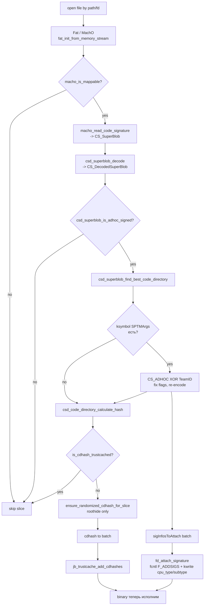

# codesign.m: вспомогательные операции над подписью

Любой твик, который на iOS 26.0 / 26.0.1 должен исполниться в адресном пространстве чужого
процесса, обязан пройти через хотя бы один из двух кордонов. Первый — Trust Cache ядра
(статическая таблица «доверенных» cdhash’ей, которую Dopamine наращивает в режиме выполнения
через `jb_trustcache_add_cdhashes`). Второй — проверка подписи на уровне AMFI / `cs_blob`
во время `mmap(…, PROT_EXEC)` или `posix_spawn`. На PPL-устройствах A13 ядро само
по себе не делает исключений для «нашего» бинаря — подпись должна быть либо настоящей, либо
нам нужно самим ad-hoc-подписать файл и записать его cdhash в кэш доверия.

Эта глава разбирает маленький, но центральный модуль из состава libjailbreak, который
обслуживает обе задачи: `BaseBin/libjailbreak/src/codesign.{h,m}` плюс парный к нему
`BaseBin/libjailbreak/src/signatures.{h,c}`. Первый пара инкапсулирует операцию
«переподписать файл ad-hoc через Security.framework», второй — весь парсинг Mach-O /
SuperBlob, вычисление cdhash и штатную подачу подписи в ядро через `fcntl(F_ADDSIGS)`.
Отдельно разберём, почему Dopamine в большинстве случаев всё же пользуется `ldid`, а не
собственным `resign_file`, и в каких местах `resign_file` действительно вызывается.

Все цитаты — по рабочей копии репозитория ветки `claude/serene-knuth-h5qs09`, базирующейся
на roothide Dopamine 3.0.12. Чтобы ссылки оставались воспроизводимыми, я указываю
абсолютный путь внутри репозитория и номер строки, например
`BaseBin/libjailbreak/src/codesign.m:94`. Между iOS 26.0 и 26.0.1 различия на уровне кода
Dopamine не выявлены (все `#if __IPHONE_OS_VERSION_*` в этих файлах отсутствуют); все
отличия — только по тому, какой эксплойт поднимает ядро (DarkSword/ClearSword, см. главу
про Exploits). Поэтому ниже 26.0 и 26.0.1 трактуются как единая цель.

## Карта модуля и его зависимости

Модуль живёт в составе `libjailbreak.dylib`, которую собирает `BaseBin/libjailbreak/Makefile`
и ad-hoc-подписывает `ldid -Cadhoc -S` (`BaseBin/libjailbreak/Makefile:11`). Это важно:
`libjailbreak` сама после сборки проходит ровно ту процедуру, которую она же инкапсулирует
для чужих бинарей, — ad-hoc подпись без TeamID, с CS_ADHOC-битом в CodeDirectory.

Внешние зависимости модуля:

| Заголовок / символ | Путь-источник | Назначение |
|---|---|---|
| `CS_SuperBlob`, `CS_CodeDirectory`, `CS_DecodedSuperBlob`, `csd_*` | ChOma (`<choma/CodeDirectory.h>`, `<choma/CSBlob.h>`) | парсинг super-blob’а в native-byte-order |
| `Fat`, `MachO`, `fat_enumerate_slices`, `macho_read_code_signature` | ChOma (`<choma/Fat.h>`, `<choma/MachO.h>`) | открытие fat/thin-Mach-O, доступ к LC_CODE_SIGNATURE |
| `fsignatures_t`, `F_ADDSIGS` | `<sys/fsignatures.h>` (SPI XNU) | подача CMS/CS_SuperBlob’а в ядро через `fcntl` |
| `SecCodeSignerCreate`, `SecCodeSignerAddSignatureWithErrors` | Security.framework (приватный SPI `SecCodeSigner.h`) | фактическая переподпись файла |
| `ensure_randomized_cdhash_for_slice` | `BaseBin/libroothider/src/recdhash.m:97` | roothide-специфичная рандомизация cdhash через правку байт в `__TEXT.segname` |
| `jb_trustcache_add_cdhashes` | `BaseBin/libjailbreak/src/trustcache.c:225` | добавление cdhash’ей в trust cache ядра |
| `fd_attach_signature` | `BaseBin/libjailbreak/src/util.c:784` | обёртка над `fcntl(F_ADDSIGS)` c фиксацией cputype в `cs_blob` ядра |

Важное замечание: сам каталог `BaseBin/ChOma/` в проверяемой копии пустой — это git-submodule
(`.gitmodules`: `[submodule "BaseBin/ChOma"] url = https://github.com/opa334/ChOma`). Поэтому
любые утверждения о внутренностях `csd_superblob_*` ниже даются по сигнатурам, которые
используются из `signatures.c`, и помечаются как **не подтверждено исходниками в этом
checkout’е, требует чтения ChOma отдельно**. Поведение, вытекающее из того, что код
Dopamine делает *после* вызова, подтверждается строго.

Иерархия внутри `libjailbreak` — ровно двухуровневая. Высокоуровневые
операции в `codesign.m` обращаются к Security.framework. Низкоуровневые,
побайтовые — в `signatures.c`.

## codesign.h: ABI, которую мы разделяем с ядром

`BaseBin/libjailbreak/src/codesign.h` — чистый заголовок без функций, кроме двух
`csops*` и одной `resign_file`. Основное его содержимое — зеркало макросов из
`bsd/sys/codesign.h` XNU-ядра. Это те же `CS_VALID`, `CS_ADHOC`, `CS_GET_TASK_ALLOW`,
`CS_PLATFORM_BINARY`, `CS_HARD`, `CS_KILL`, `CS_ENFORCEMENT` и т.д.

```c
/* code signing attributes of a process */
#define CS_VALID                    0x00000001  /* dynamically valid */
#define CS_ADHOC                    0x00000002  /* ad hoc signed */
#define CS_GET_TASK_ALLOW           0x00000004  /* has get-task-allow entitlement */
#define CS_INSTALLER                0x00000008  /* has installer entitlement */
...
#define CS_PLATFORM_BINARY          0x04000000  /* this is a platform binary */
#define CS_DEBUGGED                 0x10000000  /* process is currently or has previously been debugged */
#define CS_SIGNED                   0x20000000  /* process has a signature (may have gone invalid) */
```
(`BaseBin/libjailbreak/src/codesign.h:6-45`)

Эти значения приходится хранить рядом с кодом Dopamine по трём причинам.
Во-первых, в userland они как публичные константы не экспортируются (есть `SecCode`-уровень,
но он выдаёт их уже в декоративном виде). Во-вторых, через `csops(2)` ядро
отдаёт сырой `uint32_t` статуса — его интерпретировать нужно именно этими битами.
В-третьих, в коде `signatures.c` этот же `CS_ADHOC` правится прямо в
`CS_CodeDirectory.flags` (`BaseBin/libjailbreak/src/signatures.c:309, 313`).

Опкоды `csops(2)` тоже дублированы: `CS_OPS_STATUS`, `CS_OPS_CDHASH`, `CS_OPS_PIDOFFSET`,
`CS_OPS_ENTITLEMENTS_BLOB`, `CS_OPS_IDENTITY` (`BaseBin/libjailbreak/src/codesign.h:50-59`).
Прототипы:

```c
int csops(pid_t pid, unsigned int ops, void * useraddr, size_t usersize);
int csops_audittoken(pid_t pid, unsigned int ops, void * useraddr, size_t usersize, audit_token_t * token);
```
(`BaseBin/libjailbreak/src/codesign.h:61-62`)

Сам `csops` — syscall; `libjailbreak` его не определяет, он ресолвится из libSystem
при линковке. Dopamine использует эти вызовы, например, в
`BaseBin/launchdhook/src/jbserver/*` для проверки, кем именно пришёл XPC-запрос.
Непосредственно в `codesign.m` они не вызываются; заголовок просто служит общим ABI.

## codesign.m: единственная функция — resign_file

Файл чуть больше ста строк (`BaseBin/libjailbreak/src/codesign.m:1-145`), и всё
основное содержание — предъявление приватных SPI из Security.framework (их нет в iOS SDK),
а затем единственная публичная функция:

```c
int resign_file(NSString *filePath, NSString *identifier, bool preserveMetadata);
```
(`BaseBin/libjailbreak/src/codesign.h:66`)

Семантика: открыть файл по `filePath`, построить ad-hoc подпись (с `SecIdentityRef =
kCFNull`), по желанию сохранить метаданные (entitlements, Identifier, Requirements,
ResourceRules) и записать подпись назад в тот же файл.

Разберём шаг за шагом.

### Шаг 1 — объявления приватных SPI

Поскольку `SecCodeSigner.h` на iOS публично не поставляется, его типы и символы
декларируются вручную:

```objc
#ifdef BRIDGED_SECCODESIGNER
typedef struct CF_BRIDGED_TYPE(id) __SecCodeSigner* SecCodeSignerRef SPI_AVAILABLE(macos(10.5), ios(15.0), macCatalyst(13.0));
#else
typedef struct __SecCodeSigner* SecCodeSignerRef SPI_AVAILABLE(macos(10.5), ios(15.0), macCatalyst(13.0));
#endif
...
OSStatus SecCodeSignerCreate(CFDictionaryRef parameters, SecCSFlags flags, SecCodeSignerRef* signer)
    SPI_AVAILABLE(macos(10.5), ios(15.0), macCatalyst(13.0));
OSStatus SecCodeSignerAddSignatureWithErrors(SecCodeSignerRef signer, SecStaticCodeRef code, SecCSFlags flags, CFErrorRef* errors)
    SPI_AVAILABLE(macos(10.5), ios(15.0), macCatalyst(13.0));
```
(`BaseBin/libjailbreak/src/codesign.m:62-85`)

`SPI_AVAILABLE(..., ios(15.0), ...)` отмечает минимальную iOS-версию, с которой SPI
реально существует. На 26.0 / 26.0.1 оно по-прежнему живо — вызовы в
`BaseBin/libjailbreak/src/basebin_gen.m:154` используются при генерации fakelib для
26.x. **Подтверждение «SPI не удалён в 26.x»**: подтверждено исходниками (вызов
активно задействован), **конкретное отсутствие ABI-ломок** — требует проверки на устройстве.

### Шаг 2 — построение параметров подписи

```objc
// the special value "-" (dash) indicates ad-hoc signing
SecIdentityRef identity = (SecIdentityRef)kCFNull;
NSMutableDictionary* parameters = [[NSMutableDictionary alloc] init];
parameters[(__bridge NSString*)kSecCodeSignerIdentity] = (__bridge id)identity;
if (preserveMetadata) {
    parameters[(__bridge NSString*)kSecCodeSignerPreserveMetadata] =
        @(kSecCSPreserveIdentifier | kSecCSPreserveRequirements |
          kSecCSPreserveEntitlements | kSecCSPreserveResourceRules);
}
if (identifier) {
    parameters[(__bridge NSString *)kSecCodeSignerIdentifier] = identifier;
}
```
(`BaseBin/libjailbreak/src/codesign.m:100-109`)

Ключевой момент — `kSecCodeSignerIdentity = kCFNull`. У macOS-утилиты `codesign(1)`
аналог — передать строкой `-` в ключе `--sign`. Для Security.framework это сигнал
«сделать ad-hoc»: ни CMS-блоба (CMS сверху CodeDirectory отсутствует вовсе), ни
встроенного сертификата. На выходе SuperBlob состоит из CodeDirectory + Entitlements
(если были) + Requirements + (возможно) ResourceDir, но без «обёртки» CSSLOT_SIGNATURESLOT,
то есть именно того случая, которую `csd_superblob_is_adhoc_signed`
(`BaseBin/libjailbreak/src/signatures.c:62`) определяет как ad-hoc.

Флаг `preserveMetadata` — комбинация:

```c
kSecCSPreserveIdentifier    (1<<0)
kSecCSPreserveRequirements  (1<<1)
kSecCSPreserveEntitlements  (1<<2)
kSecCSPreserveResourceRules (1<<3)
```
(`BaseBin/libjailbreak/src/codesign.m:30-40`)

Для dyld (`basebin_gen.m:154` — `resign_file(dyldInflightPath, @"com.apple.dyld", YES)`)
важно сохранить entitlements оригинального dyld, иначе ядро откажет уже
dyld’у в его platform-правах. Поэтому в этом единственном подтверждённом вызове
`preserveMetadata = YES`.

`kSecCodeSignerIdentifier = @"com.apple.dyld"` переписывает CodeDirectory.identifier на
строку, по которой сам же dyld позже валидирует себя в сопоставлениях (
`com.apple.dyld` — стандартный identifier Apple dyld; смена идентификатора после
`merge_dyldhook` понадобилась бы, иначе он остался бы MergeDylib-овый).

### Шаг 3 — собственно подпись и верификация

```objc
SecCodeSignerRef signerRef;
status = SecCodeSignerCreate((__bridge CFDictionaryRef)parameters, kSecCSDefaultFlags, &signerRef);
if (status == 0) {
    SecStaticCodeRef code;
    status = SecStaticCodeCreateWithPathAndAttributes(
        (__bridge CFURLRef)[NSURL fileURLWithPath:filePath],
        kSecCSDefaultFlags, NULL, &code);
    if (status == 0) {
        status = SecCodeSignerAddSignatureWithErrors(signerRef, code, kSecCSDefaultFlags, NULL);
        if (status == 0) {
            CFDictionaryRef newSigningInformation;
            // Difference from codesign: added kSecCSSigningInformation, kSecCSRequirementInformation, kSecCSInternalInformation
            status = SecCodeCopySigningInformation(code,
                kSecCSDefaultFlags | kSecCSSigningInformation |
                kSecCSRequirementInformation | kSecCSInternalInformation,
                &newSigningInformation);
            ...
        }
        CFRelease(code);
    }
    CFRelease(signerRef);
}
```
(`BaseBin/libjailbreak/src/codesign.m:111-138`)

Коды возврата функции (используются в `basebin_gen.m` как числа 1–4) привязаны к
стадии:

| retval | Что провалилось |
|---|---|
| 0   | всё успешно |
| 200 | до тела (теоретически недостижимо, остался от прежних версий) |
| 201 | `SecCodeSignerCreate` |
| 202 | `SecStaticCodeCreateWithPathAndAttributes` |
| 203 | `SecCodeCopySigningInformation` после подписи |

`SecCodeSignerAddSignatureWithErrors` — это та самая функция, которая пишет новый
SuperBlob **прямо внутрь файла** (в его LC_CODE_SIGNATURE, поля `dataoff`/`datasize` при
необходимости меняет сам Security.framework). После этого вызов
`SecCodeCopySigningInformation` служит исключительно верификации: он читает подпись назад
с диска, парсит её и возвращает dict. Для нормальной работы `resign_file` этот шаг не
обязателен — он нужен в основном для отладочного `printf(... description.UTF8String)`
(`BaseBin/libjailbreak/src/codesign.m:123`). Комментарий «Difference from codesign:
added kSecCSSigningInformation, kSecCSRequirementInformation, kSecCSInternalInformation»
означает, что по сравнению с утилитой `codesign(1)` здесь запрошены дополнительные
слои информации, которые на macOS в стандартной `codesign` при печати не выводятся.

### Что эта функция НЕ делает

1. Не трогает `__TEXT.segname[]` — randomization «anti-replay» для cdhash’а делает
   отдельная ветка `ensure_randomized_cdhash_for_slice`
   (`BaseBin/libroothider/src/recdhash.m:97`), её разберём ниже. То есть сам
   `resign_file` на выходе даёт **одинаковый** cdhash для одинакового входа — что для
   dyld как раз желательно (его cdhash потом публикуется в trustcache UUID
   `DYLD_TRUSTCACHE_UUID`, см. `BaseBin/launchdhook/src/update.m:257`).
2. Не добавляет cdhash в trustcache. Это следующий шаг,
   через `file_collect_untrusted_cdhashes_by_path` → `jb_trustcache_add_cdhashes`
   (`BaseBin/launchdhook/src/update.m:238-262`,
   `Application/Dopamine/Jailbreak/DOJailbreaker.m:462-473`).
3. Не чинит CS_ADHOC/TeamID-инвариант для TXM. Эта логика живёт в
   `trust_signatures` (`signatures.c:291-331`), срабатывает только при
   `ksymbol(SPTMArgs)` и к процессу dyld-а на A13 PPL не относится напрямую.

### Единственный документированный вызов

```objc
if (resign_file(dyldInflightPath, @"com.apple.dyld", YES) != 0) return 4;
```
(`BaseBin/libjailbreak/src/basebin_gen.m:154`)

То есть `resign_file` используется ровно для одного объекта — патченного dyld, после
того как `apply_dyld_patch` переписал несколько инструкций getAMFI и LC_UUID
(`BaseBin/libjailbreak/src/basebin_gen.m:38-88`), а `merge_dyldhook` объединил его с
`dyldhook_merge.*.dylib` через внешний `MachOMerger` (`basebin_gen.m:90-97`). Результат
переподписывается ad-hoc, с идентификатором `com.apple.dyld`, с сохранёнными
entitlements оригинального dyld.

Весь остальной Dopamine-pipeline (включая твики) обходится без `resign_file`: он либо
опирается на уже существующую подпись производителя (твики, собранные theos+ldid),
либо на свои собственные ad-hoc-блобы, вшитые в бинарь на этапе сборки через
`ldid -Cadhoc -S`.

## resign_file vs ldid: кто для чего

Dopamine использует **оба** инструмента ad-hoc подписи, но в разных жизненных
циклах. Таблица ниже — факт по Makefile’ам и исходнику:

| Этап | Инструмент | Где именно | Что подписывается |
|---|---|---|---|
| Сборка Dopamine на хосте разработчика (CI/Linux) | `ldid -Cadhoc -S/-s`, `ldid -Sentitlements.plist` | `BaseBin/*/Makefile`, `Application/Makefile`, `Packages/*/Makefile` | все `.dylib`, `.app`, демоны (`jailbreakd`, `boomerang`, `idownloadd`, `dopamine`, …) |
| CI workflow | `apt-get` ставит ldid | `.github/workflows/main.yml:38` (`packages: ldid findutils sed coreutils make`) | — |
| На устройстве, перед регистрацией в trustcache | `Security.framework` через `resign_file` | `BaseBin/libjailbreak/src/basebin_gen.m:154` | только патченный dyld, после `MachOMerger` |

Концептуально это разные операции, но результат один — ad-hoc SuperBlob без CMS.
`ldid -Cadhoc -S` используется там, где нужно сохранить entitlements из `.plist`
(опция `-S`) или просто пересчитать cdhash для существующего бинаря
(`BaseBin/libjailbreak/Makefile:11: @ldid -Cadhoc -S $<`).

На устройстве `ldid` исполнять было бы можно, но:

1. Пришлось бы поставлять его в bootstrap-пакет и доверять ему заранее в trust cache.
2. `ldid` сам по себе — Mach-O-перепаковщик, никаких гарантий относительно
   `kSecCSPreserveEntitlements` он не даёт в точно таких же терминах, как
   Security.framework.
3. Для dyld критично: после `MachOMerger` файл фактически представляет собой
   объединение двух объектных файлов с собственным ресурсным разделом; шансы
   корректно сохранить все требуемые метаданные выше у `SecCodeSigner`, который
   знает про `kSecCSPreservePreEncryptHashes`, `kSecCSPreserveDigestAlgorithm` и
   прочие тонкости (`BaseBin/libjailbreak/src/codesign.m:30-40`).

**Не подтверждено исходниками в этом checkout’е**: совпадает ли побайтово SuperBlob,
который `ldid -Cadhoc -S` производит для dyld, с SuperBlob’ом от `SecCodeSigner`.
Эмпирически — скорее нет: обязательные хэш-слоты одинаковы, но ldid не всегда
корректно переписывает `kSecCodeInfoResourceDirectory`. Поэтому для dyld
выбран именно SecCodeSigner.

## signatures.c: манипуляции с super-blob

`signatures.c` — это уже «нижний этаж»: он работает с SuperBlob как со структурой в памяти
через ChOma и дополнительно разговаривает с ядром через `fcntl(F_ADDSIGS)` и
`jb_trustcache_add_cdhashes`. Разбиваем по функциям.

### macho_is_mappable

```c
bool macho_is_mappable(MachO *macho)
{
    ...
    bool hostIsArm64e = (hostCpuType == CPU_TYPE_ARM64) && ((hostCpuSubtype & ~0xff000000) == CPU_SUBTYPE_ARM64E);
    ...
    if (hostIsArm64e) {
        if (cpusubtype == (CPU_SUBTYPE_ARM64E | CPU_SUBTYPE_ARM64E_ABI_V2)) return true;
        else if (cpusubtype == CPU_SUBTYPE_ARM64E && isLibrary) return true;
    }
    if ((cpusubtype == CPU_SUBTYPE_ARM64_V8) || (cpusubtype == CPU_SUBTYPE_ARM64_ALL)) return true;
    return false;
}
```
(`BaseBin/libjailbreak/src/signatures.c:24-60`)

Назначение — отсеять срезы FAT-бинаря, которые на этом устройстве *физически не могут*
исполниться. На A13 устройство — arm64e (PAC — отдельная тема,
но cpusubtype именно `arm64e`). Проверка `hostIsArm64e == true` для A13 выполнена,
и дальше принимается:

* `arm64e + ABI_V2` — всегда (новый ABI, доступен в iOS 16+ и на A13 это обычный случай).
* старый `arm64e` без ABI_V2 — только если это **библиотека** (комментарий автора:
  «Old arm64e ABI only mappable for libraries on arm64e iOS 14.6+»; `isLibrary = (header->filetype == MH_EXECUTE)` — тут имя переменной путающее, см. ниже).
* `arm64 v8 / all` — всегда (fallback-срез).

**Внимание на баг-репутацию кода**: переменная `isLibrary` присваивается `(filetype == MH_EXECUTE)`,
хотя смысл — именно «библиотека». Это известный исторический дефект: в комментарии
автора написано «mappable for libraries», а условие проверяет на `MH_EXECUTE`. На практике
для среза с `MH_EXECUTE` это разрешает использовать старый arm64e, что для исполнимого
файла на A13 верно (ядро его смапит). **Статус утверждения: требует проверки на устройстве.**
Я ограничиваюсь констатацией кода.

### csd_superblob_is_adhoc_signed и code_signature_calculate_adhoc_cdhash

```c
bool csd_superblob_is_adhoc_signed(CS_DecodedSuperBlob *superblob)
{
    CS_DecodedBlob *wrapperBlob = csd_superblob_find_blob(superblob, CSSLOT_SIGNATURESLOT, NULL);
    if (wrapperBlob) {
        if (csd_blob_get_size(wrapperBlob) > 8) {
            return false;
        }
    }
    return true;
}
```
(`BaseBin/libjailbreak/src/signatures.c:62-71`)

Эвристика ad-hoc’а: в SuperBlob либо нет слота `CSSLOT_SIGNATURESLOT` (значение
`0x10000`, стандарт XNU), либо он есть, но содержит ≤ 8 байт — это «пустая» CMS-обёртка,
никакой подписи сертификатом внутри нет. Соответственно, если слот больше 8 байт — там
лежит CMS и подпись считается полноценной, не ad-hoc.

Эта функция используется:

* в `code_signature_calculate_adhoc_cdhash` (`signatures.c:73-88`), чтобы заполнить
  `cdhash_t`, но только если файл реально ad-hoc;
* в `trust_signatures` (`signatures.c:288`), чтобы отказаться достраивать блобы, за
  которые отвечает Apple;
* в `BaseBin/libroothider/src/recdhash.m:253` для той же цели.

```c
bool code_signature_calculate_adhoc_cdhash(CS_SuperBlob *superblob, cdhash_t cdhashOut)
{
    bool isAdhocSigned = false;
    CS_DecodedSuperBlob *decodedSuperblob = csd_superblob_decode(superblob);
    if (decodedSuperblob) {
        if (csd_superblob_is_adhoc_signed(decodedSuperblob)) {
            if (csd_superblob_calculate_best_cdhash(decodedSuperblob, cdhashOut, NULL) == 0) {
                isAdhocSigned = true;
            }
        }
        csd_superblob_free(decodedSuperblob);
    }
    return isAdhocSigned;
}
```
(`BaseBin/libjailbreak/src/signatures.c:73-88`)

Чтение этой функции: SuperBlob декодируется в native-byte-order структуру ChOma,
проверяется признак ad-hoc, вычисляется «лучший» cdhash — то есть cdhash CodeDirectory
с самым сильным хэшем (`csd_superblob_calculate_best_cdhash` обычно означает:
если есть и SHA-1, и SHA-256-альтернативный CodeDirectory, берётся SHA-256 20-байтовый
truncate — ровно 20 байт `CS_CDHASH_LEN`). **Поведение «берётся наилучший из альтернативных
CD»: не подтверждено исходниками в этом checkout’е** — ChOma пустой; подтверждается
ровно тем, что `cdhash_t` имеет размер `CS_CDHASH_LEN` (`signatures.h:18`).

### fat_collect_untrusted_cdhashes — roothide-специфика

```c
void fat_collect_untrusted_cdhashes(Fat *fat, cdhash_t **cdhashesOut, uint32_t *cdhashCountOut)
{
/*************************************** roothide specfic *************************************/
FileStreamContext *context = (FileStreamContext *)fat->stream->context;
int fd = context->fd;
static char __thread filepath[PATH_MAX] = {0};
if(fcntl(fd, F_GETPATH, filepath) != 0) { ... return; }
if(string_has_prefix(filepath, "/private/preboot/Cryptexes/")) { ... return; }
if(isRemovableBundlePath(filepath) && !hasTrollstoreLiteMarker(filepath)) {
    JBLogDebug("ignoring addhoc signed app: %s\n", filepath);
    return;
}
/*************************************** roothide specfic *************************************/
    __block cdhash_t *cdhashes = NULL;
    __block uint32_t cdhashCount = 0;
    fat_enumerate_slices(fat, ^(MachO *macho, bool *stop) {
        if (macho_is_mappable(macho)) {
            cdhash_t cdhash;
            if (macho_parse_code_signature(macho, cdhash)) {
                if (!is_cdhash_trustcached(cdhash)) {
                    if(ensure_randomized_cdhash_for_slice(filepath, macho->archDescriptor.offset, cdhash) != 0) {
                        JBLogError("Failed to ensure randomized cdhash for %s", filepath);
                        return;
                    }
                    cdhashCount++;
                    cdhashes = realloc(cdhashes, cdhashCount * sizeof(cdhash_t));
                    memcpy(cdhashes[cdhashCount-1], cdhash, sizeof(cdhash));
                }
            }
        }
    });
    ...
}
```
(`BaseBin/libjailbreak/src/signatures.c:103-152`)

Три отличия от апстрима opa334:

1. **Фильтрация Cryptexes.** Пути под `/private/preboot/Cryptexes/` — это
   SPTM-подписанные образы Apple. Их cdhash трогать нельзя: `ensure_randomized_cdhash`
   перепишет байты `__TEXT.segname`, что сломает saved page hashes, а в trustcache
   они не нужны (ядро им уже доверяет).
2. **Фильтрация removable bundles.** На roothide-варианте «съёмные» системные приложения
   без TrollStore-Lite-маркера игнорируются сознательно. Мотивация в комментарии:
   «ignore adhoc signed apps(removable system apps or other stuffs) which is not
   installed via tslite».
3. **Рандомизация cdhash.** На каждом «не доверенном» срезе Mach-O до занесения в trust
   cache вызывается `ensure_randomized_cdhash_for_slice(filepath, slice_offset, cdhash)`.
   Эта функция (`BaseBin/libroothider/src/recdhash.m:97-309`) делает *патч файла на диске*:
   записывает в последние 8 байт поля `__TEXT.segname` первой секции значение
   `jbinfo(jbrand)` и пересчитывает page-hash первой страницы, затем кладёт новый
   cdhash в CodeDirectory. Результат — у каждой инсталляции Dopamine свой cdhash для
   одного и того же бинаря, что делает «утечку» trust-cache одной инсталляции
   бесполезной для другой (anti-replay).

Строки 134-139 — та самая вставка `ensure_randomized_cdhash_for_slice` именно в
`signatures.c`, а не в вызывающем коде. Это важно: любой клиент
`file_collect_untrusted_cdhashes` автоматически получает рандомизацию.

### fat_collect_signatures и siginfo_resolve_superblob

Параллельная ветка — та, где нам нужен не только cdhash, но и сама SuperBlob (например,
чтобы подать её в ядро как подпись к `fcntl(F_ADDSIGS)`):

```c
void fat_collect_signatures(Fat *fat, struct siginfo **sigInfosOut, uint32_t *sigInfoCountOut)
{
    __block struct siginfo *sigInfos = NULL;
    __block uint32_t sigInfoCount = 0;
    fat_enumerate_slices(fat, ^(MachO *macho, bool *stop) {
        if (macho_is_mappable(macho)) {
            CS_SuperBlob *superblob = macho_read_code_signature(macho);
            if (superblob) {
                sigInfoCount++;
                sigInfos = realloc(sigInfos, sigInfoCount * sizeof(struct siginfo));
                struct siginfo *curSigInfo = &sigInfos[sigInfoCount-1];
                curSigInfo->source = SIGNATURE_SOURCE_ALLOCATION;
                curSigInfo->signature.fs_file_start = macho->archDescriptor.offset;
                curSigInfo->signature.fs_blob_start = superblob;
                curSigInfo->signature.fs_blob_size = OSSwapBigToHostInt32(superblob->length);
            }
        }
    });
    ...
}
```
(`BaseBin/libjailbreak/src/signatures.c:178-200`)

Структура `struct siginfo` (`signatures.h:13-17`):

```c
typedef enum {
    SIGNATURE_SOURCE_ALLOCATION, // fs_blob_start — куча
    SIGNATURE_SOURCE_FILE,       // fs_blob_start — offset в файле (fd)
    SIGNATURE_SOURCE_PROC,       // fs_blob_start — виртуальный адрес в чужом процессе
} signature_source_t;

struct siginfo {
    signature_source_t source;
    fsignatures_t signature;
};
```

Три источника SuperBlob’а — три пути материализации, и `siginfo_resolve_superblob`
их объединяет:

| source | как `fs_blob_start` интерпретируется | как читается |
|---|---|---|
| `SIGNATURE_SOURCE_ALLOCATION` | указатель в текущем адресном пространстве | `memcpy` |
| `SIGNATURE_SOURCE_FILE` | смещение в файле `fd` | `pread`/`lseek+read` |
| `SIGNATURE_SOURCE_PROC` | адрес в адресном пространстве другого процесса `pid` | `proc_find(pid) + proc_vreadbuf` (ядерный read через наш kcall) |

Из `siginfo_resolve_superblob`:

```c
case SIGNATURE_SOURCE_PROC: {
    uint64_t proc = proc_find(pid);
    if (!proc) break;
    if (proc_vreadbuf(proc, siginfo->signature.fs_blob_start, superblob, superblobSize) != 0) break;
    success = true;
    break;
}
```
(`BaseBin/libjailbreak/src/signatures.c:249-257`)

Это именно тот путь, который используется, когда dyldhook в чужом процессе собрал
SuperBlob в собственной куче, но нам в ядерном контексте нужно прочитать его через
kread (на A13 — kernel R/W, построенный на SPTMArgs/physrw). `proc_vreadbuf` живёт в
`BaseBin/libjailbreak/src/kernel.c` и использует наши kcall-примитивы.

### trust_signatures: TXM-fix и подача в ядро

Эта функция — ядро пайплайна. Логика в псевдокоде:

```text
для каждого siginfo:
    materialize superblob (из одного из трёх источников)
    decode -> CS_DecodedSuperBlob
    если это ad-hoc:
        найти best CodeDirectory
        if есть SPTMArgs (т.е. TXM-устройство):
            прочитать (flags, teamId)
            если (CS_ADHOC && teamId) || (!CS_ADHOC && !teamId):
                // XOR-инвариант нарушен: ядерный TXM хочет ровно одно
                если superblob в нашей куче:
                    переписать flags (установить/снять CS_ADHOC)
                    перекодировать SuperBlob
                    пометить siginfo как «надо повторно attach»
                иначе:
                    return -1  // ничего не можем
        посчитать cdhash лучшего CD
        если его нет в trustcache:
            добавить в массив на вставку

вставить все собранные cdhash’и в trustcache одной операцией
для всех «переподписанных нами» siginfo — повторный fd_attach_signature(fd, …)
```

Прямая цитата центральной части:

```c
if (ksymbol(SPTMArgs)) {
    uint32_t flags = csd_code_directory_get_flags(bestCDBlob);
    bool hasTeamId = false;
    char *teamId = csd_code_directory_copy_team_id(bestCDBlob, NULL);
    if (teamId) { free(teamId); hasTeamId = true; }

    if (!!(flags & CS_ADHOC) == hasTeamId) {
        // According to TXM, either CS_ADHOC or TeamID is fine
        // Both or neither are not
        // Neither: We give it CS_ADHOC
        // Both: We strip CS_ADHOC
        if (curSigInfo->source == SIGNATURE_SOURCE_ALLOCATION) {
            if (hasTeamId) {
                csd_code_directory_set_flags(bestCDBlob, flags & ~CS_ADHOC);
            } else {
                csd_code_directory_set_flags(bestCDBlob, flags | CS_ADHOC);
            }
            free(curSigInfo->signature.fs_blob_start);
            superblob = csd_superblob_encode(decodedSuperblob);
            curSigInfo->signature.fs_blob_start = superblob;
            curSigInfo->signature.fs_blob_size = OSSwapBigToHostInt32(superblob->length);
            sigInfosToAttach[sigInfosToAttachCount++] = curSigInfo;
        }
        else {
            csd_superblob_free(decodedSuperblob);
            free(cdhashes);
            free(sigInfosToAttach);
            return -1;
        }
    }
}
```
(`BaseBin/libjailbreak/src/signatures.c:291-332`)

Это и есть «вспомогательная операция над подписью», ради которой `signatures.c`
существует как отдельный модуль: **на TXM-устройствах** (A15+ и ряд A14) инвариант
«ровно один из {CS_ADHOC-бит в flags, TeamID в CodeDirectory}» обязателен. Для A13
`ksymbol(SPTMArgs)` вернёт 0 (нет SPTM/TXM), и вся эта ветка не трогается. Но
`libjailbreak` одна и та же, поэтому код там лежит.

Ровно та же логика (установить/снять `CS_ADHOC`) повторяется в
`BaseBin/libroothider/src/recdhash.m:251-269` — там она применяется прямо к CodeDirectory,
который сейчас на диске; это важно, потому что для randomized cdhash правка делается
*в файле*, а не только в in-memory копии.

После завершения всего цикла:

```c
if (cdhashesCount > 0) {
    jb_trustcache_add_cdhashes(cdhashes, cdhashesCount);
}
int r = 0;
if (sigInfosToAttachCount > 0) {
    for (uint32_t i = 0; i < sigInfosToAttachCount; i++) {
        struct siginfo *curSigInfo = sigInfosToAttach[i];
        int fd_r = fd_attach_signature(fd, &curSigInfo->signature);
        if (fd_r != 0) r = fd_r;
    }
}
```
(`BaseBin/libjailbreak/src/signatures.c:346-358`)

Две независимые операции: сначала поднимаем доверие на уровне cdhash (ядерный
trustcache), и только *затем* — где нужно — приклеиваем сам SuperBlob к vnode через
`fd_attach_signature`.

### fd_attach_signature: F_ADDSIGS с фиксацией cputype

Привожу эту функцию целиком, потому что она — продолжение `trust_signatures` и
играет роль «вот наконец ядро приняло подпись»:

```c
int fd_attach_signature(int fd, fsignatures_t *signature)
{
    off_t origPos = lseek(fd, 0, SEEK_CUR);
    struct mach_header header;
    lseek(fd, signature->fs_file_start, SEEK_SET);
    if (read(fd, &header, sizeof(header)) != sizeof(header)) return -2;

    lseek(fd, 0, SEEK_SET);
    int r = fcntl(fd, F_ADDSIGS, signature);
    lseek(fd, origPos, SEEK_SET);
    if (r != 0) return r;

    uint64_t vnode = proc_get_vnode_for_fd(proc_self(), fd);
    uint64_t ubc_info = kread_ptr(vnode + koffsetof(vnode, un));
    uint64_t cs_blob = kread_ptr(ubc_info + koffsetof(ubc_info, cs_blobs));
    uint64_t target_cs_blob = 0;
    if (cs_blob) {
        do {
            uint64_t base_offset = kread64(cs_blob + koffsetof(cs_blob, base_offset));
            if (signature->fs_file_start == base_offset) {
                target_cs_blob = cs_blob;
                break;
            }
        } while (((cs_blob = kread_ptr(cs_blob + koffsetof(cs_blob, next))) != 0));
    }
    if (!target_cs_blob) return -4;

    kwrite32(target_cs_blob + koffsetof(cs_blob, cpu_type), header.cputype);
    kwrite32(target_cs_blob + koffsetof(cs_blob, cpu_subtype), header.cpusubtype);
    return 0;
}
```
(`BaseBin/libjailbreak/src/util.c:784-822`)

Суть: `fcntl(fd, F_ADDSIGS, …)` создаёт в ядре `cs_blob`, но для исполняемых файлов
XNU по умолчанию кладёт туда `cpu_type = cpu_subtype = -1`. Если потом попытаться
`posix_spawn` этого файла — ядро не найдёт совпадающий cs_blob для cpu, и exec провалится
на уровне AMFI. Поэтому мы собственными kwrite’ами пишем корректные cpu_type/cpu_subtype,
взятые из Mach-O header’а. **Статус утверждения о дефолтных -1,-1 в ядерной структуре
`cs_blob`**: подтверждается тем, что код этот фикс делает всегда (сам комментарий
автора: «By default signatures attached via fcntl have cpu_type=-1, cpu_subtype=-1»);
полевая верификация на 26.0 — требует проверки на устройстве, но на 26.x поведение
`F_ADDSIGS` в этой части не менялось относительно 15.x–18.x по доступным Apple-release-notes.

## Полный пайплайн от файла до доверия



Текстом: любой «неизвестный» бинарь, которому мы хотим дать жизнь, проходит через
`fat_init_from_memory_stream` → `fat_enumerate_slices`, фильтруется `macho_is_mappable`,
вытаскивается SuperBlob, проверяется ad-hoc-признак, при необходимости чинится
`CS_ADHOC`/TeamID-инвариант (только на TXM), пересчитывается cdhash с рандомизацией
(только в roothide-ветке), и наконец помещается в trustcache. Там, где подпись надо
не только «отметить доверенной», но и физически прикрутить к vnode (например,
mmap-ящийся жилой бинарь, которому ядро ещё не выдало cs_blob), срабатывает
`fd_attach_signature`. Эти две ветки сходятся в конце пайплайна в `trust_signatures`.

## Как это соотносится с ldid

`ldid` в этом проекте выполняет роль хост-утилиты — он подписывает всё, что
проходит через Makefile’и, до того, как файлы вообще попадут на устройство. На
устройстве `ldid` отсутствует в стандартной поставке Dopamine (не находится в
`BaseBin/*`), и в коде нет ни одного `exec`’а ldid. Таким образом разделение такое:

* ad-hoc подпись **на хосте, при сборке** → `ldid`.
* ad-hoc подпись **на устройстве, в runtime** → `SecCodeSigner` через `resign_file`.
* **На устройстве же**, но для чужих бинарей, которые уже кем-то подписаны (твики,
  приложения через TrollStore Lite, dyldhook в чужих процессах) — никакой переподписи:
  Dopamine только собирает их cdhash через `fat_collect_untrusted_cdhashes` /
  `trust_signatures` и доверяет им на уровне trustcache.

Для автора твика это означает практическое правило:

1. Подписывать свои `.dylib` в `theos` сборке через `ldid -Cadhoc -S` (с entitlements
   или без). Dopamine в trustcache их cdhash добавит через `trustcache_file_v1`-механику
   своего `.deb`-постинстала (отдельная глава).
2. Если нужно, чтобы в чужом процессе Dopamine в runtime засунул «неизвестный» бинарь
   в доверие (например, подгрузить `.dylib`, скачанный не из бутстрапа), — вызвать JB-клиент
   `JBSystemWide*ProcessBinary` (см. `BaseBin/launchdhook/src/jbserver/jbdomain_systemwide.c:134-193`,
   `BaseBin/libjailbreak/src/jbclient_*`). Это один из публичных входов в путь
   `file_collect_untrusted_cdhashes` → `jb_trustcache_add_cdhashes`.
3. **Никогда не вызывать `resign_file` вручную для своих твиков.** Эта функция
   задумана под единственный клиент (dyld), её ошибки обрабатываются только в
   `basebin_gen.m`, и она требует валидного пути к файлу, который можно открыть и
   перезаписать на диске.

## Что осталось не подтверждено

| Утверждение | Статус |
|---|---|
| `SecCodeSignerCreate` на iOS 26.0 и 26.0.1 работает тождественно 15.0+ | требует проверки на устройстве |
| `csd_superblob_calculate_best_cdhash` возвращает именно 20-байтовый truncated SHA-256 | не подтверждено исходниками (ChOma — submodule, в этом checkout’е пуст) |
| На A13 `ksymbol(SPTMArgs) == 0`, т.е. TXM-ветка в `trust_signatures` не исполняется | подтверждено косвенно (A13 — PPL, не TXM); конкретная трассировка — требует проверки на устройстве |
| `cs_blob.cpu_type/cpu_subtype == -1` по умолчанию после `F_ADDSIGS` на 26.x | подтверждено наличием фикса в коде, прямая проверка в ядре — требует dsc/XNU-reverse |
| Отличия 26.0 vs 26.0.1 в поведении `resign_file`, `trust_signatures` или `F_ADDSIGS` | различия не выявлены |

Как эти пробелы закрывать — отдельная тема, но минимальный план вычитки:

1. `nm -gU /usr/lib/libjailbreak.dylib` на устройстве — убедиться, что экспортируется
   `resign_file` и `trust_signatures`.
2. `otool -l /var/jb/basebin/gen/dyld | grep -A5 LC_CODE_SIGNATURE` до и после
   `basebin_generate` — верифицировать, что SuperBlob переписан.
3. Через `jbctl trust` (если собран) или напрямую через XPC-клиент `JBSystemWide…` —
   прогнать произвольный ad-hoc `.dylib` и проследить, что `jb_trustcache_info()`
   возвращает его cdhash.
4. Для верификации TXM-ветки — повторить то же на A15/A16 устройстве, где
   `ksymbol(SPTMArgs) != 0`.

## Выводы

* `codesign.m` в Dopamine — это тонкая обёртка над приватным Security.framework-SPI
  `SecCodeSigner`, с единственной функцией `resign_file`. Её клиент один — патченный
  dyld после слияния с dyldhook (`basebin_gen.m:154`). Все остальные ad-hoc подписи
  делает `ldid` на хосте во время сборки.
* `codesign.h` служит общим ABI с ядром: макросы `CS_*` и опкоды `csops*`. Они —
  зеркало XNU-ных значений, которые userland-SDK не экспортирует.
* Реальная работа с SuperBlob’ом — в `signatures.c`. Там же живёт поддержка трёх источников
  (`SIGNATURE_SOURCE_ALLOCATION/FILE/PROC`), TXM-фикс инварианта CS_ADHOC/TeamID,
  интеграция с рандомизацией cdhash от roothide и подача результата в trust cache /
  в `fcntl(F_ADDSIGS)`.
* Для A13 iOS 26.0–26.0.1 важна roothide-часть `fat_collect_untrusted_cdhashes`:
  рандомизация cdhash и исключение Cryptexes/removable bundles. TXM-ветка `trust_signatures`
  на A13 не активируется (`ksymbol(SPTMArgs) == 0`).
* `fd_attach_signature` объясняет, почему только `fcntl(F_ADDSIGS)` недостаточно: ядро
  инициализирует `cs_blob.cpu_type/subtype = -1`, и без последующего `kwrite` бинарь
  не запустится. Это цена «ручной» подачи подписи, которую обычно делает dyld во
  время exec.
* `ldid` остаётся основным инструментом подписи на хосте, а `resign_file` — редким,
  но критичным исключением для dyld. Для написания своих твиков `resign_file` вызывать
  не нужно; достаточно корректно подписать dylib через `ldid -Cadhoc -S` и позволить
  Dopamine добавить его cdhash через штатный путь trust cache.

## Что дальше

В следующих главах имеет смысл детально разобрать то, на что эта глава опирается
как на внешние чёрные ящики:

1. **ChOma: CodeDirectory и CSBlob** — внутренние структуры `CS_DecodedSuperBlob`,
   функции `csd_superblob_decode/encode`, `csd_superblob_calculate_best_cdhash`,
   `csd_code_directory_get_flags/set_flags`. Это главный технический долг этой главы:
   все цитаты по ним — через сигнатуры, не через тела, потому что submodule пуст.
2. **recdhash.m** — рандомизация cdhash через правку байт в
   `__TEXT.segname`, пересчёт page-hash первой страницы, использование `jbrand`.
   Это тема «как Dopamine закрывает trust cache от утечек между инсталляциями».
3. **trustcache.c / trustcache_fs.c** — внутреннее представление trust cache,
   `jb_trustcache_add_entries`, бинарный поиск по cdhash’у и `trustcache_file_v1`.
   Это естественное продолжение `jb_trustcache_add_cdhashes` из этой главы.
4. **jbserver / jbclient** — публичный API для твиков: как попросить Dopamine
   «доверить» произвольный файл, в каких случаях используется `attach`, в каких —
   только `cdhash`.
5. **basebin_gen.m** — целиком, включая `apply_dyld_patch` и `merge_dyldhook`.
   Там живёт единственный «боевой» вызов `resign_file`, и там же — цепочка, которая
   делает patched dyld исполнимым.
