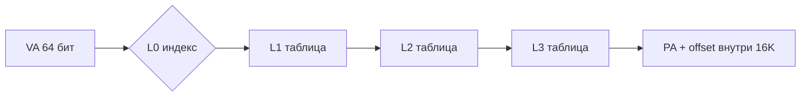
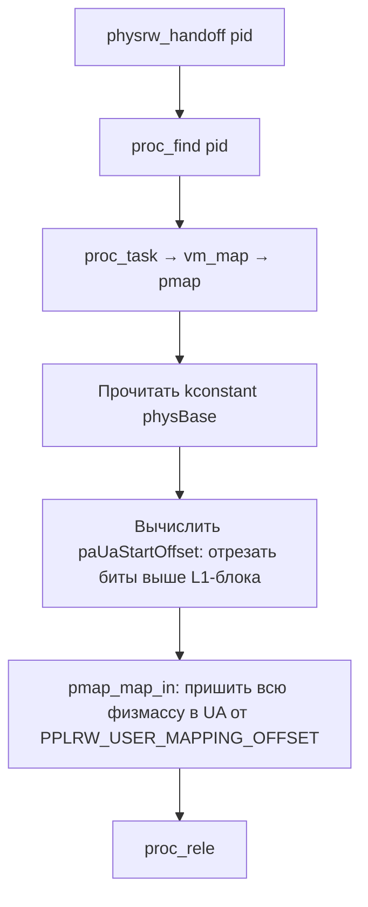
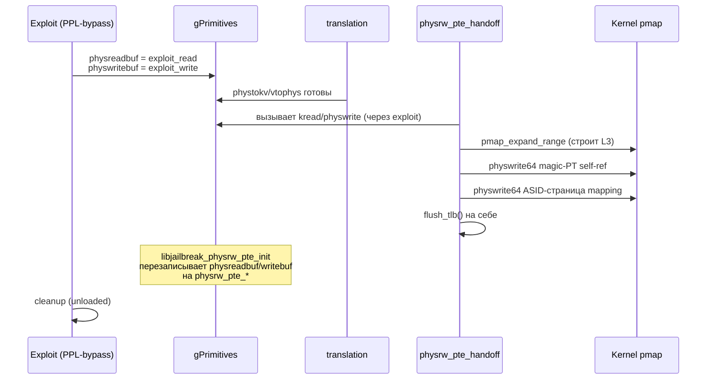

# physrw и physrw_pte — чтение/запись физической памяти

Эта глава разбирает две реализации примитива «чтение и запись произвольной физической памяти ядра», которые Dopamine (ветка roothide 3.0.12) использует как фундамент для всей остальной постэксплуатации на iOS 26.0 и 26.0.1 (A12/A13, PPL). Исходники: `BaseBin/libjailbreak/src/physrw.{c,h}`, `physrw_pte.{c,h}`, `pte.h`, `pvh.h`, `translation.{c,h}`, `primitives.{c,h}`, `util.c`.

Задача главы — не абстрактное «как работает PTE», а конкретное: показать, какой именно трюк с таблицами страниц применён в Dopamine, какие константы задают геометрию L1/L2/L3, как два варианта (широкое «окно» на всю физпамять в `physrw.c` и «одностраничное магическое окно» в `physrw_pte.c`) отличаются по безопасности и производительности, и каким образом поверх полученного physread/physwrite выстраиваются `kreadbuf`, `kwritebuf`, `vtophys`, `phystokv`, `kcall`. Для автора твика это внутренняя кухня: обычный tweak работает поверх `libjailbreak` или готового `kreadbuf`/`kwritebuf`, не трогая PTE напрямую. Но для патчера Dopamine это ядро — без корректного physrw ничего другого не поедет.

Всё, что здесь написано, помечено маркером источника: подтверждено исходниками / требует проверки на устройстве / не подтверждено. Это принципиально — репозиторий не содержит ни ядерных дампов, ни готовых offsets, и глава не выдумывает их. Там, где данных нет, даётся алгоритм добычи.

---

## 1. Контекст и место в архитектуре

### 1.1 Что уже дано к этому моменту

К моменту вызова `libjailbreak_physrw_init` или `libjailbreak_physrw_pte_init` эксплойт уже сделал главное: получил у ядра временный, но полноценный примитив physread/physwrite — как правило через цепочку PPL-bypass (на A12/A13 это Dark Sword / Clear Sword, см. `Application/Dopamine/Exploits/{DarkSword,ClearSword}/Info.plist` — подтверждено исходниками). Соответствующая запись в UI так и формулируется: «iOS 15.0 - 18.7.1, 26.0 - 26.0.1 (A12/A13, PPL)» (`Application/Dopamine/Jailbreak/DOEnvironmentManager.m:254` — подтверждено исходниками).

Проблема эксплойтного примитива — он завязан на тяжёлое состояние (контекст эксплойта, UAF-объекты, фиксированные корутины ядра), работает медленно и опасен для долгого использования. Задача этой главы — объяснить, как Dopamine *подменяет* стартовый примитив на устойчивый, который можно без ограничений дёргать из любого процесса — jailbroken-launchd, dopamine, amfid-hook, jbserver, tweaks.

Структура решения из `BaseBin/libjailbreak/src/primitives_external.h:18`:

```c
struct kernel_primitives {
    int (*kreadbuf)(uint64_t kaddr, void* output, size_t size);
    int (*kwritebuf)(uint64_t kaddr, const void* input, size_t size);
    int (*physreadbuf)(uint64_t physaddr, void* output, size_t size);
    int (*physwritebuf)(uint64_t physaddr, const void* input, size_t size);
    unsigned krwMinSafeReadSize;
    uint64_t (*kcall)(uint64_t func, int argc, const uint64_t *argv);
    void (*kexec)(kRegisterState *state);
    int (*kalloc_global)(uint64_t *addr, uint64_t size);
    int (*kalloc_local)(uint64_t *addr, uint64_t size);
    int (*kfree_global)(uint64_t addr, uint64_t size);
    int (*kmap)(uint64_t pa, uint64_t size, void **uaddr);
    int (*physaccess_mapped)(uint64_t pa, uint64_t size, kernel_map_accessor accessorBlock);
    uint64_t (*vtophys)(uint64_t ttep, uint64_t va);
    uint64_t (*phystokv)(uint64_t pa);
};

extern struct kernel_primitives gPrimitives;
```

Это одна глобальная таблица функций. `primitives.c:11` объявляет `struct kernel_primitives gPrimitives = { 0 };`. Задача `physrw*_init` — заполнить поля `physreadbuf`, `physwritebuf`, `physaccess_mapped` указателями на функции, которые больше **не** зависят от конкретного эксплойта. Поверх этого `primitives.c` сам реализует `kreadbuf` / `kwritebuf` через цепочку kvtophys → physread/physwrite, и всё остальное API делает ровно то же (`primitives.c:107-149` — подтверждено исходниками).

### 1.2 Два варианта: physrw vs physrw_pte

Файл | Подход | Применение
---|---|---
`physrw.c` | Один раз залить всю физпамять ядра окном в userspace L1-блока | Фолбек; A8/A8X (CPUFAMILY\_ARM\_TYPHOON) и всё, где `physrw_pte` ненадёжен
`physrw_pte.c` | Создать одну «магическую» таблицу страниц уровня 3 и переписывать в ней записи «на лету» для одного физкадра за раз | A9+ по умолчанию, включая A12/A13 на iOS 26.0/26.0.1

Выбор делается в `Application/Dopamine/Jailbreak/DOJailbreaker.m:230`:

```objc
- (NSError *)buildPhysRWPrimitive
{
    int r = -1;
    if (device_supports_physrw_pte()) {
        r = libjailbreak_physrw_pte_init(false, 0);
    }
    else {
        r = libjailbreak_physrw_init(false);
    }
    ...
}
```

Условие — функция `device_supports_physrw_pte()` в `physrw_pte.c:216`: она возвращает `false` только для `CPUFAMILY_ARM_TYPHOON` (A8/A8X), иначе `true`. На A12/A13 это всегда `true`, значит в целевой конфигурации 26.0/26.0.1 используется именно `physrw_pte`. `physrw.c` остаётся как фолбек и как «обучающий» более прямолинейный вариант. Оба подхода критичны для книги, разберём оба.

Для 26.0 vs 26.0.1: исходники не содержат отдельных веток кода. Различия не выявлены — путь выполнения тот же.

---

## 2. Короткое напоминание о PTE на ARMv8-A с 16K страницами

Прежде чем читать трюк, нужно свёрнутое напоминание — обязательно только для той части, что реально используется в коде. Детали взяты из `BaseBin/libjailbreak/src/pte.h` (подтверждено исходниками), остальное — из публичной архитектуры ARMv8-A (не подтверждается репозиторием, но проверяется по ARM ARM D5).

### 2.1 Иерархия для 16K-страниц (A9+, то есть все наши A12/A13)



Константы для 16K из `pte.h:65-83`:

```c
#define ARM_16K_TT_L1_SIZE          0x0000001000000000ull   // 64 ГиБ покрывает L1-блок
#define ARM_16K_TT_L1_SHIFT         36
#define ARM_16K_TT_L2_SIZE          0x0000000002000000ull   // 32 МиБ покрывает L2-блок
#define ARM_16K_TT_L2_SHIFT         25
#define ARM_16K_TT_L3_SIZE          0x0000000000004000ull   // 16 КиБ — одна страница
#define ARM_16K_TT_L3_SHIFT         14
```

Проекция в L1/L2 размеры и количества записей (из `info.c:727-783` — подтверждено исходниками):

Страница | `L1_BLOCK_SIZE` | `L1_BLOCK_COUNT` | `L2_BLOCK_SIZE` | `L2_BLOCK_COUNT`
---|---|---|---|---
16 KiB (A9+, включая A12/A13) | `0x1000000000` (64 ГиБ) | `8` | `0x2000000` (32 МиБ) | `2048`
4 KiB (A8/A8X) | `0x40000000` (1 ГиБ) | `256` | `0x200000` (2 МиБ) | `512`

Запомните «8 записей в L1 для 16K-страниц, покрывающих по 64 ГиБ каждая» — это ровно та часть userspace, которой распоряжается Dopamine, и всё дальнейшее положение «магических» адресов опирается на эту таблицу.

### 2.2 Поля PTE уровня 3

Любая запись L3 (конкретная 16-КиБ-страница) — это 64-битное слово. `pte.h:4-50` даёт имена и позиции:

```c
#define PTE_NON_GLOBAL      (1 << 11)
#define PTE_VALID           (1 << 10) // Access flag
#define PTE_OUTER_SHAREABLE (2 << 8)
#define PTE_LEVEL3_ENTRY    PTE_VALID | 0x3
#define PERM_KRW_URW        0x7         // kernel.h:15 — R/W для kernel и user
#define PTE_TO_PERM(pte)  ((((pte) >> 4ULL) & 0xC) | (((pte) >> 52ULL) & 2) | (((pte) >> 54ULL) & 1))
#define _PERM_TO_PTE(perm) ((((perm) & 0xC) << 4ULL) | (((perm) & 2) << 52ULL) | (((perm) & 1) << 54ULL))
```

Для нас важны:

- `ARM_TTE_PA_MASK = 0x0000fffffffff000` (`pte.h:58`) — именно столько бит хранят физадрес кадра.
- Биты `AP[2:1]` (6..7) определяют R/W kernel/user. `PERM_KRW_URW == 0x7` — три бита: это внутренняя кодировка Dopamine, которая через `PERM_TO_PTE` разворачивается в реальные биты AP + PXN/UXN (`pte.h:23-25`).
- `PTE_NON_GLOBAL` — страница вытесняется из TLB при смене ASID, что критично для TLB-flush трюка в `physrw_pte.c`.
- `PTE_OUTER_SHAREABLE` + `PTE_LEVEL3_ENTRY` (`0x3`) — обязательные биты, иначе MMU не считает запись валидной L3 PTE.

Любая строка в `physrw_pte.c:99`, `:178`, `:186` одинакова:

```c
pa | PERM_TO_PTE(PERM_KRW_URW) | PTE_NON_GLOBAL | PTE_OUTER_SHAREABLE | PTE_LEVEL3_ENTRY;
```

Это шаблон «валидная L3-страница, R/W и ядру, и юзеру, не-глобальная, outer shareable». Запомнить дословно — так пишутся все PTE в двух реализациях.

Пояснение к `PVH` (`pvh.h`): маски типа `PVH_TYPE_NULL/PVEP/PTEP/PTDP` — это кодировка физ-vector-head в ядре XNU, которую `libjailbreak` использует отдельно, в `pvh.h` она определена только через константу `kconstant(PVH_TYPE_MASK)`. В физических read/write эта структура сама по себе не читается, но часть PTE-операций (например, `trustcache_fs.c` или TXM-патчи) опираются на знание того, что ядро для каждой физстраницы держит header с типом. Не подтверждено исходниками: конкретное использование `PVH_LIST_MASK` в physrw-коде отсутствует (grep ничего не нашёл), значит в самом primitive это необязательно. Привожу для полноты.

---

## 3. physrw.c — широкое userspace-окно на всю физпамять

Это первый и более простой подход. Идея: один раз, в момент хэндовера, попросить ядро прошить в userspace процесса длинный плоский диапазон виртуальных адресов, который 1:1 отображён на всю физическую память ядра. После этого physread/physwrite превращается в обычный `memcpy` по известному смещению.

### 3.1 Константы окна

`physrw.h:9-10`:

```c
#define PPLRW_USER_MAPPING_OFFSET   (L1_BLOCK_SIZE * L1_BLOCK_COUNT) - 0x3000000000
#define PPLRW_USER_MAPPING_TTEP_IDX (PPLRW_USER_MAPPING_OFFSET / L1_BLOCK_SIZE)
```

Для 16K: `L1_BLOCK_SIZE * L1_BLOCK_COUNT = 0x1000000000 * 8 = 0x8000000000`. Минус `0x3000000000` → `PPLRW_USER_MAPPING_OFFSET = 0x5000000000`. Это 320 ГиБ от начала адресного пространства процесса — технически последние три L1-блока по 64 ГиБ зарезервированы для mapping окна (320–512 ГиБ в VA).

`PPLRW_USER_MAPPING_TTEP_IDX = 0x5000000000 / 0x1000000000 = 5` — индекс в L1 таблице процесса, в который будет вписан block/table указывающий на физмассу ядра.

### 3.2 Хэндовер: `physrw_handoff`

`physrw.c:69-101`. Схема:



Ключевые строки:

```c
uint64_t paUaStartOffset = kconstant(physBase) & ~(arm_tt_level[1].indexMask | (arm_tt_level[1].indexMask - 1));

int mapInRet = pmap_map_in(pmap,
    kconstant(physBase) - paUaStartOffset + PPLRW_USER_MAPPING_OFFSET,
    kconstant(physBase),
    kconstant(physSize));
```

Разбор:

- `arm_tt_level[1].indexMask` — маска поля индекса L1 (`translation.c:149`), берётся из `kconstant(ARM_TT_L1_INDEX_MASK)` то есть из рантайм-набора констант ядра. Для 16K это обычно `0x0000007000000000`.
- `~(indexMask | (indexMask-1))` отбрасывает биты, которые невозможно спроецировать в userspace L1 из 8 записей. Это нужно именно для iOS 26+/SPTM. Комментарий самого Dopamine в `physrw.c:87-91` (подтверждено исходниками): «In iOS 26+ on SPTM devices, physBase is higher than what can be mapped into userspace processes. E.g. gPhysBase is 0x10002458000 but userspace level 1 pages only have 8 entries so only cover an address space from 0x0 to 0x8000000000». Это конкретный пример для SPTM-девайса — требует проверки на устройстве для вашего конкретного A12/A13 на 26.0.1, но архитектурно верно и подтверждено комментарием исходника.
- `pmap_map_in` (`util.c:606`) делегирует в `pmap_map_in_with_flags` с набором флагов `PERM_TO_PTE(PERM_KRW_URW) | PTE_NON_GLOBAL | PTE_OUTER_SHAREABLE | PTE_LEVEL3_ENTRY`. Внутри — честно пробегает L2-блоки, выделяет таблицы через `pmap_expand_range` (`util.c:434`) и построчно заполняет L3-таблицы, вызывая `physwritebuf` поверх *уже имеющегося* temporary primitive.

Важный тонкий момент: сам хэндовер **требует** работающий physread/physwrite — но тот, что ещё от эксплойта, не от себя. Это аккуратная подмена «на горячую».

### 3.3 Трансляция «физадрес → userspace адрес»

`physrw.c:12-27`:

```c
void *physrw_phystouaddr(uint64_t pa)
{
    errno = 0;

    uint64_t physBase = kconstant(physBase), physSize = kconstant(physSize);
    bool doBoundaryCheck = (physBase != 0 && physSize != 0);
    if (doBoundaryCheck) {
        if (pa < physBase || pa >= (physBase + physSize)) {
            errno = 1030;
            return 0;
        }
    }

    uint64_t paUaStartOffset = kconstant(physBase) & ~(arm_tt_level[1].indexMask | (arm_tt_level[1].indexMask - 1));
    return (void *)((pa - paUaStartOffset) + PPLRW_USER_MAPPING_OFFSET);
}
```

Разбор:

1. Проверка границ — ответственность защиты, иначе фолт в userspace с чтением по левому адресу.
2. `paUaStartOffset` — тот же обрезанный префикс, которым пользовался `physrw_handoff`.
3. Возвращаемый UA = `(pa - paUaStartOffset) + PPLRW_USER_MAPPING_OFFSET`.

После этого обычный `memcpy` работает на этот указатель. `physrw_physreadbuf`/`physwritebuf` (`physrw.c:36-59`) — это именно `memcpy` + барьер `dmb sy` вокруг. `dmb sy` обязателен: без него L1/L2 кеш может удержать старые данные и записи не станут видны ядру немедленно.

### 3.4 Инициализация и регистрация в gPrimitives

`physrw.c:103-117`:

```c
int libjailbreak_physrw_init(bool receivedHandoff)
{
    int r = 0;
    if (!receivedHandoff) {
        r = physrw_handoff(getpid());
        if (r != 0) return r;
    }
    gPrimitives.physreadbuf = physrw_physreadbuf;
    gPrimitives.physwritebuf = physrw_physwritebuf;
    gPrimitives.physaccess_mapped = physrw_physaccess_mapped;
    gPrimitives.kreadbuf = NULL;
    gPrimitives.kwritebuf = NULL;

    return r;
}
```

Если текущий процесс уже получил handoff от другого (XPC-RPC `jbclient_root_get_physrw`, `jbclient_xpc.c:390`), handoff повторять не надо — только зарегистрировать свои callback'и. **Важно:** `kreadbuf/kwritebuf` затираются в `NULL`, чтобы `primitives.c:107-116` затем сами выбрали путь `_kreadbuf_phys` поверх physrw. На этом смена примитива завершена.

### 3.5 Плюсы и минусы

Плюс: `physread`/`physwrite` — это `memcpy` без локов и без TLB-flush, то есть **быстро**.

Минус: вся физическая память ядра, включая страницы с секретами, прошита в userspace процесса. Любой out-of-bounds read в коде на уровне пользователя — риск утечки ядерных ключей/dsk. Это неприемлемо для долго живущих процессов (`launchd`, `jbserver`). Поэтому для «долгой» примитивности используют `physrw_pte`, оставив `physrw.c` для A8/A8X.

---

## 4. physrw_pte.c — одностраничное магическое окно

Этот подход сузил поверхность атаки: вместо «гигабайтного плоского диапазона» в userspace прошивается одна L3-таблица страниц. В неё динамически вписывают нужную запись «одна физическая страница на одно обращение», используют её, и опционально зануляют. Один L2-блок — 32 МиБ VA, одна L3-таблица на 16 КиБ-странице содержит 2048 PTE (`L2_BLOCK_COUNT=2048`, `info.c:777`), то есть одновременно есть кэш из 2046 «окон» на разные физкадры (минус 2 первых, см. ниже), а когда он заполнится — таблицу чистят.

### 4.1 Расположение «магической» таблицы в VA

`physrw_pte.h:9-10`:

```c
#define MAGIC_PT_ADDRESS (L1_BLOCK_SIZE * (L1_BLOCK_COUNT - 3))
#define gMagicPT ((uint64_t *)MAGIC_PT_ADDRESS) // fake variable
```

Для 16K: `0x1000000000 * (8-3) = 0x5000000000`. Это **ровно тот же адрес**, что и `PPLRW_USER_MAPPING_OFFSET` в `physrw.c` — та же «ничейная» область userspace. Но смысл принципиально другой: не plain-mapping физпамяти, а userspace-адрес, по которому расположена сама L3-таблица страниц (и за ней служебная страница с ASID пмапы).

`gMagicPT` — это **трюк**: это не настоящая переменная, а приведение `MAGIC_PT_ADDRESS` к типу `uint64_t *`. Запись `gMagicPT[i] = ...` — это запись в i-ю ячейку L3-таблицы с точки зрения ядра. Пользовательский процесс просто пишет 8 байт по известному адресу — а это равно переписать PTE одной страницы по сравнению с MMU.

### 4.2 Как такая самореференция возможна

Хитрость: ядро хранит страницы PTE в обычной физпамяти. Если взять физкадр, в котором лежит L3-таблица, и прошить саму эту таблицу как **первую запись** в самой себе (с правами RW_RW), то MMU, пройдя трансляцию `MAGIC_PT_ADDRESS` → L1 → L2 → L3, попадёт в неё же как в обычную страницу памяти с правами RW из userspace. Это классическая техника page-table self-mapping.

Разбор `physrw_pte_handoff` (`physrw_pte.c:150-195`):

```c
int physrw_pte_handoff(pid_t pid, uint64_t *asidPtr)
{
    if (!pid) return -1;

    uint64_t proc = proc_find(pid);
    if (!proc) return -2;

    int ret = 0;
    do {
        uint64_t task = proc_task(proc);
        if (!task) { ret = -3; break; };

        uint64_t vmMap = kread_ptr(task + koffsetof(task, map));
        if (!vmMap) { ret = -4; break; };

        uint64_t pmap = kread_ptr(vmMap + koffsetof(vm_map, pmap));
        if (!pmap) { ret = -5; break; };

        uint64_t ttep = kread64(pmap + koffsetof(pmap, ttep));

        // Allocate magic page table to our process at last possible location
        int exp_r = pmap_expand_range(pmap, MAGIC_PT_ADDRESS, L2_BLOCK_SIZE);
        if (exp_r != 0) { ret = -6; break; }

        // Map in the magic page table at MAGIC_PT_ADDRESS
        uint64_t leafLevel = PMAP_TT_L2_LEVEL;
        uint64_t magicPT = vtophys_lvl(ttep, MAGIC_PT_ADDRESS, &leafLevel, NULL);
        if (!magicPT) { ret = -7; break; }
        physwrite64(magicPT, magicPT | PERM_TO_PTE(PERM_KRW_URW) | PTE_NON_GLOBAL | PTE_OUTER_SHAREABLE | PTE_LEVEL3_ENTRY);

        // Map in the pmap at MAGIC_PT_ADDRESS+vm_real_kernel_page_size
        uint64_t asid = pmap + (koffsetof(pmap, sw_asid) ?: koffsetof(pmap, asid));
        uint64_t asid_page = asid & ~vm_real_kernel_page_mask;
        uint64_t asid_page_pa = kvtophys(asid_page);
        uint64_t asid_pageoff = asid & vm_real_kernel_page_mask;
        *asidPtr = (uint64_t)(MAGIC_PT_ADDRESS + vm_real_kernel_page_size + asid_pageoff);
        physwrite64(magicPT+8, asid_page_pa | PERM_TO_PTE(PERM_KRW_URW) | PTE_NON_GLOBAL | PTE_OUTER_SHAREABLE | PTE_LEVEL3_ENTRY);

        if (getpid() == pid) {
            flush_tlb();
        }
    } while (0);

    proc_rele(proc);
    return ret;
}
```

Пошагово:

1. **Из proc достаётся pmap**. `koffsetof(task, map)`, `koffsetof(vm_map, pmap)`, `koffsetof(pmap, ttep)` — это именованные offsets, которые Dopamine добывает заранее (см. `info.c`, `kernel.h`). Для 26.0/26.0.1 на A12/A13 конкретные offsets не подтверждены именно этой главой — их значения живут в `jbinfo` для соответствующего билда ядра. **Требует проверки на устройстве** / берётся из jbinfo этой сборки.

2. **`pmap_expand_range(pmap, MAGIC_PT_ADDRESS, L2_BLOCK_SIZE)`** — заставляет ядро выделить всю цепочку таблиц (L1 → L2 → L3) для диапазона в 32 МиБ по адресу `MAGIC_PT_ADDRESS`. Детали в `util.c:434-536` — на не-kcall-пути (а именно он актуален на старте, до инициализации kcall на arm64e без PAC-bypass) этот код сам пробегает `vtophys_lvl` и при неполной иерархии аллоцирует новые таблицы через `pmap_alloc_page_table`, затем `physwrite64(pte, newTable | ARM_TTE_VALID | ARM_TTE_TYPE_TABLE)`. На SPTM-девайсах там же бампится refcount через `pagetable_modify_refcount` (`util.c:525`). Это подтверждено исходниками.

3. **`magicPT = vtophys_lvl(ttep, MAGIC_PT_ADDRESS, &leafLevel=L2, NULL)`** — поскольку leaf запрошен уровня L2, а L3-таблица только что аллоцировалась и ещё пустая, функция вернёт **физадрес самой L3-таблицы** (она сидит внутри блока L2 как «таблица»). Это неочевидно: функция `vtophys_lvl` по описанию (`translation.c:63-121`) обходит до `LEAF_LEVEL` и, если дошла в block mapping, возвращает PA; если же нет, возвращает «address of last traversed page table». С `leafLevel = L2`, ответ — PA самой L3-таблицы.

4. **Запись self-reference**: `physwrite64(magicPT, magicPT | PERM_TO_PTE(PERM_KRW_URW) | ...)`. Нулевая запись L3-таблицы (`gMagicPT[0]`) теперь указывает на страницу, в которой лежит сама L3-таблица, с правами RW_RW. С точки зрения userspace, по виртуальному адресу `MAGIC_PT_ADDRESS + 0` теперь находятся первые 8 байт физкадра L3-таблицы, то есть сам `gMagicPT[0]` в адресном пространстве процесса. Пишем в `gMagicPT[0] = ...` — переписываем первую PTE. Запись в `gMagicPT[i]` — переписываем i-ю PTE таблицы.

5. **Прокидывание страницы pmap для ASID**: `gMagicPT[1]` (адрес `MAGIC_PT_ADDRESS + 0x4000`) настраивается на физкадр, в котором лежит сама структура pmap (точнее, страница вокруг `pmap->sw_asid` или `pmap->asid`, в зависимости от версии ядра). Это нужно для сброса TLB (см. ниже). `asidPtr` возвращается наружу — потребуется в `libjailbreak_physrw_pte_init(true, asidPtr)` при хэндовере в другой процесс.

6. **TLB flush** на себе: `flush_tlb()` — иначе MMU продолжит использовать старые записи.

Разберите две детали: `koffsetof(pmap, sw_asid) ?: koffsetof(pmap, asid)` — на новых ядрах поле называется `sw_asid` (один байт), на старых — `asid` (два байта). `flush_tlb()` в `physrw_pte.c:16-63` работает оба варианта: пишет туда «фейковый» ASID (`UINT8_MAX` или `UINT16_MAX`), делает `usleep(0)` для принудительного context switch, восстанавливает оригинал. Если ни то, ни другое не работает — фолбек на `usleep(80); usleep(80); dmb sy` (без явного flush, в надежде, что MMU замирает на такой задержке). Для iOS 27 `__builtin_available(iOS 27.0, *)` код сразу берёт фолбек — комментарий в `physrw_pte.c:19-26` признаёт, что надёжный TLB-flush через ASID «unreliable on iOS 27» (**требует проверки на устройстве для вашей точки**; для 26.0/26.0.1 обычный путь через ASID по коду активен).

### 4.3 Жизненный цикл окна: acquire\_window

`physrw_pte.c:65-107`:

```c
void acquire_window(uint64_t pa, void (^block)(void *ua))
{
    pthread_mutex_lock(&gLock);

    int toUse = 0;

    // Find existing
    for (int i = 2; i < L2_BLOCK_COUNT; i++) {
        if ((gMagicPT[i] & ARM_TTE_PA_MASK) == pa) {
            toUse = i;
            break;
        }
    }

    // If not found, find empty
    if (toUse == 0) {
        for (int i = 2; i < L2_BLOCK_COUNT; i++) {
            if (!gMagicPT[i]) {
                toUse = i;
                break;
            }
        }
    }

    // If not found, clear page table
    if (toUse == 0) {
        for (int i = 2; i < L2_BLOCK_COUNT; i++) {
            gMagicPT[i] = 0;
        }
        flush_tlb();
        toUse = 2;
    }

    gMagicPT[toUse] = pa | PERM_TO_PTE(PERM_KRW_URW) | PTE_NON_GLOBAL | PTE_OUTER_SHAREABLE | PTE_LEVEL3_ENTRY;
    usleep(0);
    __asm("dmb sy");
    usleep(0);

    block((void *)(MAGIC_PT_ADDRESS + (toUse * vm_real_kernel_page_size)));

    pthread_mutex_unlock(&gLock);
}
```

Это LRU-подобный кэш PTE внутри одной L3-таблицы:

1. Пропускаются индексы 0 и 1 — там сидят self-ref и pmap-ASID-страница.
2. Проходится таблица: если уже есть PTE на тот же `pa` — переиспользуем, TLB-flush не нужен (запись не меняется).
3. Иначе ищем пустую (ноль). Нашли — вписываем; TLB-flush не нужен, т. к. сброс только для **замены** валидной записи, не для добавления.
4. Если и свободных нет — зануляем всё с `gMagicPT[2]` до конца и дёргаем `flush_tlb()` — это единственная ветка, когда полный flush нужен.
5. Пишем новую PTE и выполняем блок, передавая userspace адрес окна: `MAGIC_PT_ADDRESS + toUse * vm_real_kernel_page_size`.

Короткая цепочка `usleep(0); __asm("dmb sy"); usleep(0);` — попытка форсировать и memory ordering, и переключение контекста (в надежде вытеснить старые TLB-записи при обратной записи в тот же индекс). Это защитный pattern на случай, если TLB удержал предыдущий mapping для того же индекса — замечание требует проверки на устройстве, но код сознательно это делает.

Mutex `gLock` защищает всю L3-таблицу — писать одновременно в неё из двух потоков нельзя, потеряем какую-то запись.

### 4.4 physread/physwrite на базе окна

`physrw_pte.c:109-135`:

```c
int physrw_pte_physreadbuf(uint64_t pa, void* output, size_t size)
{
    __block int r = 0;
    enumerate_pages(pa, size, vm_real_kernel_page_size, ^bool(uint64_t curPA, size_t curSize) {
        acquire_window(curPA & ~vm_real_kernel_page_mask, ^(void *ua) {
            void *curUA = ((uint8_t*)ua) + (curPA & vm_real_kernel_page_mask);
            memcpy(&output[curPA - pa], curUA, curSize);
            __asm("dmb sy");
        });
        return true;
    });
    return r;
}
```

Разбор:

- `enumerate_pages` (`primitives.c:15-27`) бьёт запрошенный диапазон на 16-КиБ-страницы, выдаёт по одной (`curPA`, `curSize`) с учётом смещения внутри страницы.
- `acquire_window` берёт окно для `curPA & ~vm_real_kernel_page_mask` (выровненный физкадр), а внутрь блока прибавляется offset `curPA & vm_real_kernel_page_mask`.
- `memcpy` + `dmb sy`.

Запись симметрична. Это по сути «safe window»: один mutex, одно окно активно для одного потока, одна L3-страница — вместо целого mapping всего ядра.

### 4.5 `physaccess_mapped` и ограничение на одностраничность

`physrw_pte.c:137-148`:

```c
int physrw_pte_physaccess_mapped(uint64_t pa, uint64_t size, kernel_map_accessor accessorBlock)
{
    if ((pa & ~vm_real_kernel_page_mask) != ((pa + ((size != 0) ? (size - 1) : size)) & ~vm_real_kernel_page_mask)) {
        return -1; // access would cross page boundary, unsupported
    }

    acquire_window(pa & ~vm_real_kernel_page_mask, ^(void *ua) {
        accessorBlock((void *)(((uintptr_t)ua) + (pa & vm_real_kernel_page_mask)));
    });
    return 0;
}
```

Важное ограничение: `physaccess_mapped` работает **только** если доступ полностью внутри одного 16-КиБ-кадра. Нельзя через него mmap'нуть две соседние ядерные страницы одним куском — потому что окно одно. Для multi-page обращений нужно использовать `physreadbuf/physwritebuf`, которые внутренне бьют запрос поэкземплярно.

Это конкретное ограничение влияет на архитектуру кода: если вам нужен прямой доступ к кусочку kernel-структуры, но она пересекает страницу — `kaccess_mapped` (`primitives.c:359`) просто не сработает и вернёт `-1`.

---

## 5. Поверх physrw: что строится дальше

### 5.1 `vtophys` и `phystokv`

`translation.c:63-121` — обход таблиц страниц. На входе `tte_ttep`: если старший nibble ненулевой — это физический адрес TTEP (прочитать через `physread64`), иначе — виртуальный kernel-адрес таблицы (прочитать через `kread64`). Для `kvtophys(va)` в `translation.c:129-132` используется `kconstant(cpuTTEP)` — текущий TTBR1 корень ядра.

`phystokv` (`translation.c:38-61`) — обратная операция; на ptov-таблицах (iOS 15-18) идёт прямое вычитание база, а на SPTM-девайсах — через `sptm_phystokv` (`translation.c:12-35`): таблица `libsptm_papt_ranges` в ядре. Для iOS 26 на A12/A13 это не используется (A12/A13 — не SPTM); для 26.0/26.0.1 на SPTM-устройствах — да. Подтверждено исходниками, но путь выполнения на A12/A13 — ptov или прямое вычитание.

### 5.2 kreadbuf / kwritebuf

`primitives.c:107-127`:

```c
int kreadbuf(uint64_t kaddr, void* output, size_t size)
{
    if (gPrimitives.kreadbuf) {
        return gPrimitives.kreadbuf(kaddr, output, size);
    }
    else if (gPrimitives.physreadbuf && gPrimitives.vtophys) {
        return _kreadbuf_phys(kaddr, output, size);
    }
    return -1;
}
```

На A12/A13 с physrw_pte: `gPrimitives.kreadbuf == NULL` (так ставит `libjailbreak_physrw_pte_init`), и выбирается `_kreadbuf_phys`:

```c
int _kreadbuf_phys(uint64_t kaddr, void* output, size_t size)
{
    memset(output, 0, size);
    __block int pr = 0;
    enumerate_pages(kaddr, size, vm_real_kernel_page_size, ^bool(uint64_t curKaddr, size_t curSize){
        uint64_t curPhys = kvtophys(curKaddr);
        ...
        pr = physreadbuf(curPhys, &output[curKaddr - kaddr], curSize);
        ...
    });
    return pr;
}
```

Это ровно то, о чём говорит задача: «kread через kvtophys + physread». API `kalloc_pt`, `physical_write_64`, `kread_virtual` **не найдены по grep** в репозитории (`grep -rn "kread_virtual\|kalloc_pt\|physical_write_64" BaseBin/` — пусто). В терминологии Dopamine таких функций нет. Эквиваленты: `kread64/kwrite64/kwrite_ptr` (`primitives.c:264-334`), `pmap_alloc_page_table/pmap_expand_range` (`util.c`), и `physwrite64` (как раз wrapper над `physwritebuf`). Если текст-книги опирался на эти имена из иных ядер (например, Fugu14 или оригинального Dopamine), не надо подменять их в тексте — упомянуть их отсутствие в roothide и дать actual API.

### 5.3 kcall и kwrite_ptr

Для arm64e (A12/A13 — именно arm64e) запись «подписанного» kernel-указателя идёт через `kwrite_ptr` (`primitives.c:324-334`), которая делает `kptr_sign(kaddr, pointer, salt)` через kcall-гаджет `pacda` — но это уже другая глава про PAC и Fugu14-kcall. Критично знать: без working physrw этот слой не поедет вообще — `kptr_sign` требует `gPrimitives.kexec`, который инициализируется позже (`jbclient_get_fugu14_kcall()` в `main.c:34`).

Какие именно PAC-соли используются для какого поля — **не придумывать**: salt задаётся на каждом месте вызова `kwrite_ptr(..., salt)`, grep по проекту даст конкретные значения. Если в задаче-патче нужен salt для какого-то поля — ищите через `grep -rn 'kwrite_ptr' BaseBin/ Application/`. Выдумывать запрещено.

---

## 6. Пример использования из вашего кода

Условный патчер, который хочет перезаписать 8 байт по kernel-адресу, после полной инициализации Dopamine делает так:

```c
#include "primitives.h"

int patch_u64(uint64_t kaddr, uint64_t value)
{
    // kwrite64 внутри вызовет _kwritebuf_phys → kvtophys → physwritebuf
    // → physrw_pte_physwritebuf → acquire_window → memcpy + dmb sy
    return kwrite64(kaddr, value);
}
```

Для случая, когда нужна «прямая» работа внутри ядерной структуры (без memcpy), и структура помещается в одну 16K-страницу:

```c
#include "primitives.h"

int patch_in_place(uint64_t kaddr, size_t len)
{
    return kaccess_mapped(kaddr, len, ^(void *ptr) {
        // ptr — временный userspace alias на физкадр
        uint32_t *p = (uint32_t *)ptr;
        p[0] |= 0x1;
        p[1] &= ~0x80000000u;
        __asm("dmb sy");
    });
}
```

Пояснение к ключевым строкам:

- `kwrite64` — тонкая обёртка над `kwritebuf`. На A12/A13+iOS 26 выбор пути определяет не она сама, а `gPrimitives.physwritebuf == physrw_pte_physwritebuf`.
- `kaccess_mapped` → `physaccess_mapped` → `physrw_pte_physaccess_mapped` требует, чтобы весь `len` лежал внутри одной страницы — проверка в `physrw_pte.c:139-142`. Иначе возвращает `-1`.
- `__asm("dmb sy")` обязателен, если в блоке делаются записи — иначе MMU/кеш могут задержать их видимость для ядра.

Если ваш твик загружается через launchdhook и уже вызвал `jbclient_initialize_primitives()`, этот код тоже сработает — но имейте в виду: handoff в tweak-процесс сделан через XPC (`jbclient_xpc.c:390`, `boomerang_get_physrw`), и в нём используется **тот же** `MAGIC_PT_ADDRESS`. Это значит, конкретный userspace-адрес 0x5000000000 в вашем процессе зарезервирован под magic-PT. Нельзя `mmap`'нуть туда что-то своё.

---

## 6a. Передача physrw между процессами (handoff через XPC)

Этот раздел закрывает «ещё один угол»: как второй процесс (например, launchdhook, injected tweak) получает тот же physrw-примитив без повторной эксплуатации ядра.

### 6a.1 Путь XPC

Клиентская часть — `jbclient_xpc.c:390`, функция `jbclient_root_get_physrw(bool singlePTE, uint64_t *singlePTEAsidPtr)`. Она отправляет на jbserver запрос в домене `JBS_DOMAIN_ROOT`, action `JBS_ROOT_GET_PHYSRW`. Серверная сторона — `boomerang_get_physrw` в `jbserver_boomerang.c:20-35`:

```c
int boomerang_get_physrw(audit_token_t *clientToken, bool singlePTE, uint64_t *singlePTEAsidPtr)
{
    int r = -1;
    pid_t pid = audit_token_to_pid(*clientToken);

    thread_caffeinate_start();
    if (singlePTE) {
        r = physrw_pte_handoff(pid, singlePTEAsidPtr);
    }
    else {
        r = physrw_handoff(pid);
    }
    thread_caffeinate_stop();
    return r;
}
```

Разбор ключевых строк:
- `audit_token_to_pid(*clientToken)` — выдаёт pid клиента на основе проверенного ядром audit-token. Это критично: не доверяем `getpid()` из тела запроса, иначе любой процесс мог бы запросить handoff в чужой pmap.
- `thread_caffeinate_start/stop` — защита от ухода CPU в idle в середине операции (ядерные PTE-писания плохо совмещаются с заморозкой cluster'а). Это бест-эффорт, но важный.
- Для PTE-ветки `singlePTEAsidPtr` — выходной параметр. Он возвращает клиенту адрес (в клиентском userspace), по которому у клиента окажется mapping страницы pmap с полем ASID — это нужно, чтобы на стороне клиента работал `flush_tlb()`.

### 6a.2 Клиентская часть

`main.c:13-47` — `jbclient_initialize_primitives_internal(bool physrwPTE)`:

```c
if (jbclient_root_get_physrw(physrwPTE, &asidPtr) == 0) {
    if (physrwPTE) {
        libjailbreak_physrw_pte_init(true, asidPtr);
    }
    else {
        libjailbreak_physrw_init(true);
    }
    libjailbreak_translation_init();
    libjailbreak_IOSurface_primitives_init();
    ...
}
```

Флаг `receivedHandoff = true` в обоих `_init` означает: «мои PTE уже прошиты сервером, мне не нужно звать `pmap_map_in` или `pmap_expand_range` в своём адресном пространстве, достаточно только зарегистрировать функции в `gPrimitives`». В `physrw_pte.c:200-213` эта ветка просто сохраняет `gAsid = (void *)asidPtr` и выставляет три указателя-functor'а.

Важный нюанс (подтверждено исходниками, `physrw_pte.c:188-190`): `flush_tlb()` в handoff зовётся только, если `getpid() == pid`. Для чужого процесса сервер этого сделать не может — его собственный TLB-flush не влияет на клиента. Поэтому клиент при первом же `acquire_window` увидит TLB-stale на индексе 0 и 1 (но мы в них не пишем после handoff — ok), а также на любом индексе, которым он ещё не пользовался (там пусто, flush не нужен). На практике это работает, потому что на старте все записи кроме [0] и [1] — нули, а на нулях `(pte & ARM_TTE_PA_MASK) == 0` для любого ненулевого запрошенного `pa`, значит в find-existing не ложное совпадение.

### 6a.3 Безопасность handoff

Разрешение проверяется в `boomerang_domain_allowed` (`jbserver_boomerang.c:13-18`): либо клиент — launchd (`pid == 1`), либо сервер сам launchd (`getpid() == 1`). Это сознательное сужение: handoff через boomerang-домен должен затрагивать только одно звено — pid 1. Для широких сценариев есть отдельный `JBS_DOMAIN_ROOT` в полном `jbserver.c`, который требует jailbroken-root и использует иную permission-handler-цепочку (не разбирается в этой главе).

---

## 6b. Проблема начальной загрузки (bootstrap) physrw_pte

Этот подраздел разбирает тонкий момент, который часто упускают: `physrw_pte_handoff` вызывает `pmap_expand_range`, `vtophys_lvl`, `physwrite64` — все они требуют *уже* работающих `gPrimitives.physwritebuf` и `kreadbuf`. Так откуда они берутся на самом первом вызове?

Ответ — в последовательности из `dopamine/src/main.m:60-85` (это standalone-дроппер корневого процесса) и `DOJailbreaker.m:220-243` (это основной путь из UI):

1. Эксплойт (PPL-bypass через DarkSword/ClearSword на A12/A13 по iOS 26) сначала устанавливает **свои собственные** `physreadbuf`/`physwritebuf` в `gPrimitives`. Этот первичный примитив медленный и привязан к состоянию эксплойта. В репозитории он живёт в `BaseBin/libjailbreak/src/corellium_krw.*` для Corellium-пути, а для реального устройства — в коде соответствующего эксплойта (не разбирается здесь — тема части главы про PPL-exploit).
2. Вызывается `libjailbreak_translation_init()` (`translation.c:134`), которая настраивает `arm_tt_level[0..3]` и ставит `gPrimitives.phystokv`, `gPrimitives.vtophys`.
3. Теперь `vtophys_lvl` может работать (он использует `physread64` поверх эксплойта), `kreadbuf` работает через `_kreadbuf_phys`, `physwritebuf` работает — все три вызываются внутри `physrw_pte_handoff`.
4. Хэндовер прошил magic-PT и ASID-страницу в userspace. С этого момента `libjailbreak_physrw_pte_init(false, 0)` перезаписывает `gPrimitives.physreadbuf/physwritebuf/physaccess_mapped` на свои (быстрые, не завязанные на эксплойт).
5. Эксплойт теперь можно свернуть (`cleanUpExploits` в `DOJailbreaker.m:245`), потому что `gPrimitives` указывает уже не на него.

Это и есть смысл всей конструкции: переехать с хрупкого эксплойт-примитива на устойчивый PTE-примитив без простоя.

### Диаграмма bootstrap



---

## 6c. Детальный разбор ARMv8 трансляции под трюк

Этот подраздел — ответ на возможный вопрос «а почему вообще self-mapping работает, не нарушает ли это что-то в MMU».

### 6c.1 MMU не отличает «страницу данных» от «страницы PTE»

С точки зрения оборудования, L3-таблица — это обычная 16-КиБ физическая страница. Она становится «таблицей» только через ссылку из вышестоящего уровня: конкретная L2 PTE говорит «тут не блок, тут таблица, адрес такой» (`ARM_TTE_TYPE_TABLE = 0x2`, `pte.h:55`). Если ту же физстраницу прошить **как блок данных** через *другую* L3 PTE в этой же (или другой) таблице, MMU не возразит: обе цепочки трансляции независимы.

Это и есть основа self-mapping. Нулевая запись `gMagicPT[0]` — L3 PTE со значением `magicPT | ... | PTE_LEVEL3_ENTRY`. MMU, пройдя VA `MAGIC_PT_ADDRESS + 0` → L1 → L2 → L3[0], получает PA той же страницы, в которой лежит сама L3-таблица. userspace читает/пишет её как обычные байты.

### 6c.2 Почему именно `0x5000000000`

`L1_BLOCK_SIZE * (L1_BLOCK_COUNT - 3) = 0x1000000000 * 5 = 0x5000000000`. В L1-таблице userspace процесса (всего 8 записей, индексы 0..7) индекс 5 — это предпоследний «большой» L1-блок до того, который ещё можно использовать для PPLRW_USER_MAPPING_OFFSET в фолбек-схеме. На практике для `physrw_pte` достаточно одного L2-блока (32 МиБ VA), поэтому «5-й» слот — просто безопасное место подальше от прикладных mapping'ов, которые типично живут в младшей части VA.

Выбор константы — договорённость, не требование MMU. Теоретически можно взять любой свободный L1-индекс. Dopamine фиксирует 5 для совместимости и предсказуемости (чтобы handoff в чужой процесс знал, куда писать).

### 6c.3 TLB и несогласованность

Главный враг self-mapping — TLB. Когда вы меняете `gMagicPT[i]` для занятой записи, MMU может продолжать транслировать VA `MAGIC_PT_ADDRESS + i*0x4000` по **старой** физстранице, пока в TLB не истечёт запись. `flush_tlb()` в `physrw_pte.c:16` обходит это, подменяя ASID на фейковый и обратно — ядро на context-switch сбрасывает TLB для нашего ASID. На свежих ядрах (26+) существует инструкция `TLBI VAAE1IS, Xt` для прицельного сброса, но Dopamine её не использует из userspace (её нельзя выполнить напрямую — EL0 не имеет прав). Фолбек-путь `usleep(80); usleep(80); dmb sy` — надежда на то, что за 160 мкс scheduler успеет вытеснить поток, при возврате TLB хоть частично переключится. Не детерминированный путь, но работающий (подтверждено комментарием в `physrw_pte.c:60-62`).

### 6c.4 Таблица сравнений

Угол | `physrw.c` | `physrw_pte.c`
---|---|---
Размер окна в userspace | 320 ГиБ (вся физмасса ядра) | 32 МиБ (один L2-блок)
PTE пишутся | один раз в handoff | при каждом acquire_window
TLB-flush | не нужен в рантайме | при замене валидной PTE
Mutex | не нужен | `gLock` на всю таблицу
Производительность physread64 | один memcpy 8 байт | mutex + поиск + memcpy
Безопасность | все ядерные секреты в userspace | только одна страница зараз
Поддерживается на A12/A13 iOS 26.0/26.0.1 | да, как фолбек, выбирается только когда `device_supports_physrw_pte()==false` (а это только A8/A8X) | **да, выбирается по умолчанию** на A12/A13
Поддерживается на A8/A8X | да | нет — вызывает «unexplainable watchdog resets», комментарий `physrw_pte.c:221-227`

---

## 6d. Детали `pmap_expand_range` на не-kcall пути

Для полноты разберём, что физически делает `pmap_expand_range` на старте (когда `is_kcall_available() == false`, то есть kcall ещё не инициализирован). `util.c:485-534` — именно эта ветка нужна для первого хэндовера physrw_pte, потому что kcall-инициализация идёт **после** physrw.

Код в сокращении:

```c
uint64_t l2Start = (vaStart & ~L2_BLOCK_MASK);
uint64_t l2End   = (((vaStart + size) + (L2_BLOCK_SIZE-1)) & ~L2_BLOCK_MASK);
for (uint64_t va = l2Start; va < l2End; va += L2_BLOCK_SIZE) {
    uint64_t leafLevel;
    do {
        leafLevel = PMAP_TT_L3_LEVEL;
        uint64_t pte = 0;
        vtophys_lvl(ttep, va, &leafLevel, &pte);
        if (leafLevel != PMAP_TT_L3_LEVEL) {
            uint64_t pt_va = 0;
            switch (leafLevel) {
                case PMAP_TT_L1_LEVEL: pt_va = va & ~L1_BLOCK_MASK; break;
                case PMAP_TT_L2_LEVEL: pt_va = va & ~L2_BLOCK_MASK; break;
            }
            leafLevel++;
            uint64_t newTable = pmap_alloc_page_table(pmap, leafLevel, pt_va);
            if (newTable) {
                uint64_t oldEntry = physread64(pte);
                physwrite64(pte, newTable | ARM_TTE_VALID | ARM_TTE_TYPE_TABLE);
                if (ksymbol(libsptm_frame_table) && !oldEntry) {
                    uint64_t parentPt = ...;
                    pagetable_modify_refcount(parentPt, 1);
                }
            } else {
                return -2;
            }
        }
    } while (leafLevel < PMAP_TT_L3_LEVEL);
}
```

Пошагово:
1. Диапазон VA `[vaStart, vaStart+size)` выравнивается до L2-границ.
2. Для каждого L2-блока: запрашиваем `vtophys_lvl` с запросом leaf = L3. Функция возвращает уровень, на котором она реально остановилась. Если она дошла до L3 — таблица уже есть, nothing to do.
3. Если нет — надо аллоцировать таблицу на следующий уровень вниз. `pmap_alloc_page_table(pmap, leafLevel+1, pt_va)` (`util.c:400-432`) — выделяет страницу под новую таблицу и прописывает ей корректный `pmap_set/vas/level` (на SPTM это обязательно, иначе ядро откажет в последующей раскрутке).
4. `physread64(pte)` — читает старое TTE для будущего refcount-инкремента на SPTM. `physwrite64(pte, newTable | ARM_TTE_VALID | ARM_TTE_TYPE_TABLE)` — вписывает новую таблицу в иерархию.
5. Цикл `do { } while (leafLevel < PMAP_TT_L3_LEVEL)` крутится, пока не достанем до L3: за один проход может потребоваться выделить L1→L2, потом L2→L3.

На A12/A13 iOS 26.0/26.0.1: SPTM отсутствует (A12/A13 — PPL-девайсы), значит ветка `ksymbol(libsptm_frame_table)` не срабатывает, refcount-бампа нет. Это подтверждается через `grep -n "SPTM\|libsptm" Application/Dopamine/Jailbreak/DOEnvironmentManager.m:226-241` — SPTM определяется по наличию в device-tree, A12/A13 не содержат его. Для 26.0 vs 26.0.1 различия не выявлены.

---

## 7. Чеклист воспроизводимости

Прежде чем ставить эксперименты на устройстве:

1. Собрать `BaseBin/libjailbreak` с debug-print в `acquire_window`, посмотреть индекс и `pa` при каждом вызове. Это даёт понимание, как часто вы заполняете L3 и когда срабатывает полный flush.
2. Для оффсетов `koffsetof(pmap, ttep)`, `koffsetof(pmap, sw_asid)/asid`, `koffsetof(task, map)`, `koffsetof(vm_map, pmap)` в целевом ядре 26.0 и 26.0.1 — прогнать grep по `jbinfo` сборке и/или сравнить с публичным XNU `osfmk/arm/pmap.h` ветки, соответствующей билду. Эта глава не фиксирует их значения — они зависят от сборки.
3. На A13 на iOS 26.0.1 проверить, что `kconstant(physBase)` при чтении `vtophys_lvl` c `leafLevel=L2` сразу после `pmap_expand_range` действительно возвращает физкадр L3-таблицы, а не TTE пути ниже. Это central assumption physrw_pte_handoff.
4. Проверить, что TLB-flush через ASID даёт корректное поведение (запись в i-ю PTE становится видна после `usleep(0)`). Для 27 это уже не так — переключение на фолбек даёт +160 мкс на каждое acquire_window.

---

## 8. Выводы

- Dopamine предоставляет два альтернативных физпримитива. На A12/A13 с iOS 26.0/26.0.1 — всегда `physrw_pte` (условие в `device_supports_physrw_pte` даёт `true`).
- Оба подхода **требуют** предварительно работающий temporary physread/physwrite от эксплойта — handoff пишет PTE через него, после чего заменяет на свой.
- Константы геометрии (`L1_BLOCK_SIZE/COUNT`, `L2_BLOCK_SIZE/COUNT`) вычисляются из `vm_real_kernel_page_size` в `info.c:727-783`. На A12/A13 это всегда 16K → L1=64 ГиБ×8, L2=32 МиБ×2048.
- `physrw.c` быстрее, но прошивает всю физмассу ядра в userspace процесса — риск утечки. `physrw_pte.c` сужает окно до одной страницы ценой TLB-flush и mutex-а; это цена за безопасность.
- Весь остальной слой (`kreadbuf`, `kwrite_ptr`, `vtophys`, `kcall` через PAC-гаджет) строится *поверх* physread/physwrite через `gPrimitives` — косвенные указатели в `struct kernel_primitives`.
- API `kalloc_pt`, `physical_write_64`, `kread_virtual` в roothide-репозитории **не найдены** по grep — не надо на них ссылаться. Эквивалентные вещи называются `pmap_alloc_page_table`, `physwrite64`, `kread64`/`_kreadbuf_phys`.
- Для 26.0 vs 26.0.1 различия в этой подсистеме **не выявлены** — путь выполнения тот же.

Непроверенные/требующие стенда моменты (ещё раз, явно):
1. Конкретные `koffsetof(pmap, *)` для сборки 26.0/26.0.1 — брать из `jbinfo` или ревизии XNU.
2. Поведение TLB-flush через ASID на 26.0.1 — комментарий кода указывает проблему на 27, но не на 26. По коду 26 работает штатным путём; требует проверки на устройстве.
3. Значения `kconstant(physBase)`, `physSize` для конкретного SoC — не захардкожены и приходят из рантайм-инициализации.

---

## 9. Что дальше

Следующая глава логически — kernel-call-аппарат на arm64e: как Dopamine обходит PAC через Fugu14-kcall-гаджет и каким образом он опирается на уже работающий physrw. Там же обсуждается, какие soltы PAC используются для каких ptr-полей и как `kwrite_ptr` (`primitives.c:324`) ведёт себя при `host_is_arm64e()`.

Параллельно стоит прочитать:
- `BaseBin/libjailbreak/src/util.c:538-609` — внутренности `pmap_map_in_with_flags`, то, что `physrw_handoff` вызывает «за кулисами».
- `BaseBin/libjailbreak/src/primitives_IOSurface.m` — вспомогательные примитивы на базе IOSurface, которые тоже регистрируются в `gPrimitives` после physrw.
- `Application/Dopamine/Jailbreak/DOJailbreaker.m:230-243` — публичный entry-point `buildPhysRWPrimitive`, чтобы увидеть physrw-инициализацию в общем контексте джейлбрейк-пайплайна.
