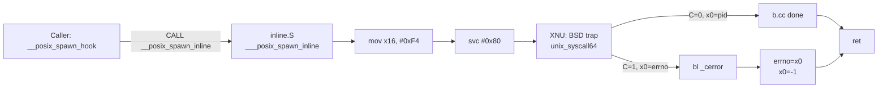

# Inline SVC primitives: быстрые системные вызовы изнутри Dopamine

Dopamine (roothide, 3.0.12) живёт в чужих процессах: `systemhook.dylib` подгружается через `DYLD_INSERT_LIBRARIES`, а `launchdhook.dylib` слит в `/sbin/launchd` через `machomerger`. Эти библиотеки сами хукают критичные символы — `posix_spawn`, `execve`, `ptrace`, `csops`, `_kernelrpc_mach_vm_protect_trap`, `wait4` — и одновременно обязаны их вызывать для собственных нужд. Любая попытка идти через `libSystem` закончилась бы бесконечной рекурсией через собственный хук (или в лучшем случае через конкурирующий хук чужого твика, который сядет поверх нашего). Решение, повторяющее приём, традиционный для Substrate/Substitute и дошедший до Dopamine, — обойти пользовательскую обёртку и выдать команду ядру самостоятельно, инструкцией `svc #0x80`. Эта глава разбирает все три кластера таких «inline» примитивов в Dopamine — `BaseBin/libjailbreak/src/inline_svc.{c,S,h}`, `BaseBin/systemhook/src/common/inline.{S,h}` и `BaseBin/forkfix/src/syscall.S`, — показывает ABI системных вызовов на ARM64 Darwin, разбирает каждую строку макроса `DEF_SYSCALL`, и прослеживает, как `__posix_spawn_inline`, `ptrace_inline`, `waitpid_inline` и `getpid_inline` используются по месту для разрыва петли «хук вызывает сам себя».

Все рассуждения в этой главе относятся к iOS 26.0 и 26.0.1 на A12/A13 (PPL) — единственной среде, поддерживаемой Dopamine 3.0.12 на этой стадии (`Application/Dopamine/Jailbreak/DOEnvironmentManager.m:254`). Код inline-syscall примитивов полностью общий для arm64 и arm64e, различается только обрамление (PAC-пролог/эпилог `pacibsp/retab`), поэтому отдельных ветвей для 26.0 vs 26.0.1 в этих файлах нет (`различия не выявлены`).

## 1. Зачем вообще inline SVC

В обычном пользовательском процессе функция `posix_spawn(3)` живёт в `libsystem_kernel.dylib`: это маленький ассемблерный пролог, который кладёт номер системного вызова в `x16` и выполняет `svc #0x80`. На этапе подгрузки `systemhook.dylib` мы перехватываем эту функцию через `litehook` (`BaseBin/systemhook/src/main.c:506-514`), а также таблицу `dyld` (`dyld_hook_routine` в том же файле). Собственный хук `__posix_spawn_hook` (`BaseBin/launchdhook/src/spawn_hook.c:91`) делает содержательную работу: аллокация jbroot, trust-кэш, SETEXEC-finesse. Но в конце он должен позвать «настоящий» posix_spawn.

Если бы он позвал тот же `posix_spawn()` из `libSystem`, то снова попал бы в наш же хук. Variant с указателем на оригинал (`posix_spawn_orig`) здесь не работает по двум причинам:

1. **Собственная функция в неизвестной точке**. Патч `litehook_hook_function` в `BaseBin/_external/modules/litehook/src/*.c` переписывает первые инструкции цели своей тремя-пятью-инструкционной «батутной» последовательностью — но указателя на `orig` в стандартном сценарии нет, потому что `litehook` рассчитан на дешёвую «инструментационную» схему без spill-trampoline. (Это утверждение — вывод из структуры `litehook_hook_function` в `main.c:506-521`, подтверждения иной API в проекте не нашёл по grep.)
2. **Чужие хуки поверх наших**. Любой несовместимый твик, зарегистрированный раньше, может подвесить `posix_spawn` ещё раз. Выход через `libSystem` оставляет нас в чужих руках.

Прямой `svc #0x80` обходит обе проблемы: он идёт в ядро, минуя любые пользовательские трамплины, где бы они ни стояли. Это даёт `systemhook` гарантированный доступ к syscall ABI без оглядки на то, что сейчас лежит в первой инструкции `_posix_spawn`.

Второй сценарий — защита от произвольных сторонних хуков. Пример в `BaseBin/launchdhook/src/hookd_provider.c:57`:

```c
// Call waitpid as inline syscall to prevent crashes when something tries to hook something close to wait4
wpr = waitpid_inline(gHookdPid, &status, WNOHANG);
```

Комментарий автора буквальный: если какой-то твик хукает `wait4`, `waitpid`, `__waitpid` — launchd (внутри которого крутится `launchdhook`) не должен от этого падать. Чистый `svc` обходит всё, что может натворить `TweakLoader`.

Третий сценарий — ранний старт. `BaseBin/forkfix/src/syscall.S` снабжает `forkfix.dylib` своим набором `ffsys_*`: `fork`, `vm_protect`, `getpid`, `pid_suspend`, `read`, `write`, `close`. Эта библиотека грузится в arm64e-процессе после модификации страниц (`BaseBin/systemhook/src/main.c:484-486`) и чинит `fork(2)` под PAC. На момент её инициализации символьная таблица `libSystem` ещё может быть не прошита dyld-фиксами по месту (fork-safe), а `_current_pid` надо сбросить в ноль сразу после настоящего `fork` — поэтому `ffsys_fork` пишет туда напрямую (строки 15-19).

## 2. ARM64 Darwin syscall ABI

Darwin использует отдельное пространство для «BSD syscall» и «mach trap». Общая механика:

| Поле | BSD syscall (`#0x1A`, `#0xF4`, ...) | Mach trap (`#-28` для `task_self_trap`, ...) |
| --- | --- | --- |
| Инструкция | `svc #0x80` | `svc #0x80` |
| `x16` | положительный номер (`SYS_ptrace = 0x1A`) | отрицательный номер (`-28`, `-30` и т. п.) |
| Аргументы | `x0..x7` (8 регистров) | `x0..x7` |
| Возврат | `x0` (`x0:x1` при 128-битных значениях) | `x0` |
| Признак ошибки | флаг `C` (carry); при `C=1` в `x0` — `errno` | возвращается `mach_msg_return_t`, флаг не используется для сигнала ошибки |

Соглашение «carry выставлен — ошибка» — ядерный контракт XNU; обычные обёртки libSystem после `svc` делают `b.cs _cerror`, где `_cerror` сохраняет `x0` в `errno` и возвращает `-1`. Все inline-варианты Dopamine это соглашение воспроизводят вручную — см. ниже.

Нумерация системных вызовов фиксирована и совпадает с macOS-овским `sys/syscall.h`. Dopamine держит собственный мини-заголовок, чтобы не тянуть SDK-зависимый `syscall.h` в ассемблерные части. `BaseBin/systemhook/src/common/private.h:7-15`:

```c
#define SYS_ptrace 0x1A
#define SYS_execve 0x3B
#define SYS_posix_spawn 0xF4
#define SYS_csops 0xA9
#define SYS_csops_audittoken 0xAA
#define SYS_necp_match_policy 0x1CC
#define SYS_necp_open 0x1F5
#define SYS_necp_client_action 0x1F6
#define SYS_necp_session_open 0x20A
#define SYS_necp_session_action 0x20B
```

Эти константы перекочёвывают в `inline.S` в десятичной/шестнадцатеричной форме (`0x1a`, `0x3b`, `0xf4`), а также в `inline_svc.S` (`#7` для `wait4`, `#20` для `getpid`). Проверить корректность каждого номера можно по дизассемблу `libsystem_kernel.dylib` с устройства — рекомендую `otool -tV /System/.../libsystem_kernel.dylib | grep -B1 -A2 'svc #0x80'`, но на самом устройстве; требует проверки на устройстве.

Схема потока одного inline-вызова:



Обратите внимание, что в версии из `inline_svc.S` ветка ошибки устроена иначе: нет `cerror`, вместо него `cmp x16, #4` и `beq _wait4_inline` — автоматический повтор при `EINTR`. Это ещё один жест защиты от «постороннего хука»: если `wait4` прервался сигналом, мы не хотим давать внешнему коду второй шанс.

## 3. Семейство `libjailbreak/src/inline_svc.*`

Этот кластер — единственный, которым пользуются `libjailbreak` и `launchdhook`. Он собран из трёх файлов:

- `inline_svc.h` — публичный интерфейс.
- `inline_svc.c` — тонкие C-обёртки.
- `inline_svc.S` — голый ассемблер.

### 3.1 `inline_svc.h`

```c
pid_t wait4_inline(pid_t pid, int *stat_loc, int options, struct rusage *rusage);
int   waitpid_inline(pid_t pid, int *result, int flags);
pid_t getpid_inline(void);
```

(`BaseBin/libjailbreak/src/inline_svc.h:7-9`). Три функции, три роли:

1. **`wait4_inline`** — голый syscall №7, точный аналог BSD `wait4(2)`.
2. **`waitpid_inline`** — C-обёртка, валидирующая флаги и сводящая вызов к `wait4`.
3. **`getpid_inline`** — кэширующая обёртка над syscall №20.

### 3.2 Макрос `DEF_SYSCALL` в `inline_svc.S`

Файл написан в стиле GAS с «%%» вместо перевода строки, чтобы весь макрос умещался на одной препроцессорной строке. Это необычный, но валидный приём, который позволяет не ставить `.endm` и не бодаться с `#define` над многострочным ассемблером.

`BaseBin/libjailbreak/src/inline_svc.S:2-5`:

```s
#define SYSCALL_PROLOGUE stp x0, x1, [sp, -16]! %% stp x2, x3, [sp, -16]! %% stp x4, x5, [sp, -16]! %% stp x6, x7, [sp, -16]!
#define SYSCALL_EPILOGUE ldp x6, x7, [sp], 16 %% ldp x4, x5, [sp], 16 %% ldp x2, x3, [sp], 16 %% ldp x0, x1, [sp], 16

#define DEF_SYSCALL(name, num)  .global _##name %% _##name: %% SYSCALL_PROLOGUE %% mov x16, num %% svc #0x80 %% mov x16, x0 %% SYSCALL_EPILOGUE %% bcc name##_end %% cmp x16, #4 %% beq _##name %% mov x16, #-1 %% name##_end: %% mov x0, x16 %% ret

DEF_SYSCALL(wait4_inline, 7)
DEF_SYSCALL(getpid_svc_inline, 20)
```

Разберём, что именно разворачивается для `wait4_inline`:

```s
.global _wait4_inline
_wait4_inline:
    stp x0, x1, [sp, -16]!        ; (1) сохранить входные аргументы на стеке
    stp x2, x3, [sp, -16]!
    stp x4, x5, [sp, -16]!
    stp x6, x7, [sp, -16]!
    mov x16, 7                    ; (2) BSD-номер wait4
    svc #0x80                     ; (3) трап в ядро
    mov x16, x0                   ; (4) результат во временный регистр
    ldp x6, x7, [sp], 16          ; (5) восстановить x0..x7
    ldp x4, x5, [sp], 16
    ldp x2, x3, [sp], 16
    ldp x0, x1, [sp], 16
    bcc wait4_inline_end          ; (6) C=0 → всё ок
    cmp x16, #4                   ; (7) EINTR?
    beq _wait4_inline             ;     повторить
    mov x16, #-1                  ; (8) иначе: -1 в результат
wait4_inline_end:
    mov x0, x16                   ; (9) вернуть сохранённый результат
    ret
```

Ключевые тонкости:

- **Шаг (1): почему `x0..x7` вообще спасаются.** В обычной libSystem-обёртке syscall-пролог аргументы не спасает — libc возвращает `-1` и больше ничего. Здесь же, если syscall вернёт `EINTR` (`errno == 4`), мы хотим повторить его с теми же аргументами. Ядро после `svc` вправе затереть `x0..x7` (ABI так и описывает), поэтому мы кладём их на стек до вызова и достаём обратно — и обратно на регистры, и в текущем же порядке — чтобы потом либо вернуть результат (ok-ветка), либо прыгнуть в начало с нетронутыми параметрами.
- **Шаг (2): `mov x16, 7`.** В исходнике аргумент макроса подставляется без префикса `#`. Легален, так как Clang/LLVM принимает `mov x16, 7` как `mov x16, #7`.
- **Шаг (3): `svc #0x80`.** Darwin использует immediate `0x80` для BSD; `0x81` зарезервирован под Pthread (не наш случай).
- **Шаг (4): `mov x16, x0`.** Критично именно до восстановления стека: мы сохраняем результат в `x16` (вызовистан не ABI-регистр, временный). Если бы мы восстанавливали `x0..x7` первым, то потеряли бы возвращаемое значение в `x0`.
- **Шаг (6): `bcc`.** Это псевдоним `b.cc` (branch if carry clear). ARM64 отличает `cc` и `lo` синонимически, но здесь нам важен ровно carry.
- **Шаг (7): EINTR-retry.** Для `wait4` это семантически корректно — POSIX сам допускает «если `SA_RESTART`, перезапусти». Для `getpid` это бессмысленно (syscall не прерываемый), но макрос общий — ветка просто никогда не срабатывает.
- **Шаг (8): `mov x16, #-1`.** Любая не-EINTR ошибка превращается в `-1`. Это отличие от версии в `systemhook/common/inline.S`: там ошибка в оригинале проходит через `_cerror`, который заодно пишет `errno`. Здесь никто не пишет `errno` — ответственность на вызывающей C-обёртке.

### 3.3 Два C-слоя: `waitpid_inline` и `getpid_inline`

`BaseBin/libjailbreak/src/inline_svc.c:5-24`:

```c
int waitpid_inline(pid_t pid, int *result, int flags)
{
    if ((flags & 0xFFFFFFEC) != 0) {
        errno = 22;
        return -1;
    }
    else {
        return wait4_inline(pid, result, flags, 0);
    }
}

pid_t getpid_inline(void)
{
    extern pid_t getpid_svc_inline(void);
    extern int _current_pid;
    if (_current_pid <= 0) {
        _current_pid = getpid_svc_inline();
    }
    return _current_pid;
}
```

Что здесь важно:

- **Маска `0xFFFFFFEC`.** Разрешённые биты — `WNOHANG (0x01)`, `WUNTRACED (0x02)`, `WCONTINUED (0x10)` (эмпирически по битам: `(0x01|0x02|0x10) = 0x13`, инверсия в 32 бита даёт `0xFFFFFFEC`). То есть всё остальное считается EINVAL (errno 22). Это ровно соглашение `waitpid(2)` POSIX; `не нашёл по grep` явного `#include` `wait.h` в inline_svc.c, но `WNOHANG` соответствует биту `0x01` по заголовкам SDK — `требует проверки по SDK`, если понадобится переносить код.
- **Четвёртый аргумент `wait4_inline` = 0.** `wait4` принимает `struct rusage *`. Мы его отбрасываем, передав ядру `NULL`.
- **Кэш `_current_pid`.** Внешний символ. Он объявлен (`int _current_pid;`) где-то в проекте и является общей переменной между `inline_svc.c` и `forkfix/src/syscall.S` (`adrp x9, __current_pid@GOTPAGE`, строка 17). После `fork(2)` в arm64e обёртке `ffsys_fork` ребёнок получает `w0 == 0`, и ассемблер зануляет `_current_pid`, заставив следующий `getpid_inline` повторно уйти через `svc`. Это и есть «fork-safe cache». Проверка `if (_current_pid <= 0)` — защита от первой инициализации (BSS = 0) и явного сброса.

Единственная точка потребления `getpid_inline` в проекте — `BaseBin/libjailbreak/src/hookd.c:89`, где мы собираем Mach-сообщение для `hookd` и обязаны вставить туда PID клиента. Все остальные PID-зависимые пути в `libjailbreak` ходят через обычный `getpid()`.

Единственный потребитель `waitpid_inline` — `BaseBin/launchdhook/src/hookd_provider.c:57`, где launchd проверяет жив ли дочерний `hookd` до того, как отослать ему очередной `hookd_mach_msg`. Чистый `svc` защищает тут от двух сценариев: (1) конкурирующий tweak внутри launchd (крайне редкое, но технически возможное дело), (2) наше же вмешательство в `wait4` — вдруг через год кто-нибудь поставит там хук.

## 4. Семейство `systemhook/src/common/inline.*`

Второй кластер живёт в `systemhook.dylib` и обслуживает три самых критичных перехватываемых символа — `ptrace`, `execve`, `posix_spawn`.

### 4.1 `inline.h`

```c
int ptrace_inline(int request, pid_t pid, caddr_t addr, int data);
int __execve_inline(const char *path, char *const argv[], char *const envp[]);
int __posix_spawn_inline(pid_t *restrict pid, const char *restrict path,
                         struct _posix_spawn_args_desc *desc,
                         char *const argv[restrict], char *const envp[restrict]);
```

(`BaseBin/systemhook/src/common/inline.h:1-3`). Префикс `__` у `execve` и `posix_spawn` указывает, что мы вызываем «private» syscall-обёртку: libSystem в этих именах держит pre-syscall checker (например, cancellation point), которая у Dopamine не нужна. Прямой `svc` даёт нам именно «private» вариант без лишних проверок.

### 4.2 Макрос `DEF_SYSCALL` в `inline.S`

Отличие от версии из libjailbreak — тут не прячутся регистры и используется честный `cerror`-пролог:

`BaseBin/systemhook/src/common/inline.S:1-24`:

```s
.macro DEF_SYSCALL name, num, err_func
.global \name
\name\():
    mov x16, #\num
    svc 0x80
    b.cc \name\()_done
#ifdef __arm64e__
    pacibsp
#endif
    stp x29, x30, [SP, #-0x10]!
    mov x29, sp
    bl \err_func
    mov sp, x29
    ldp x29, x30, [sp], 0x10
#ifdef __arm64e__
    retab
#endif
\name\()_done:
    ret
.endm

DEF_SYSCALL _ptrace_inline,        0x1a, _cerror
DEF_SYSCALL ___execve_inline,      0x3b, _cerror_nocancel
DEF_SYSCALL ___posix_spawn_inline, 0xf4, _cerror
```

Отличия от варианта из `libjailbreak`:

- **Один регистр `x16`, никаких prolog/epilog для `x0..x7`.** EINTR здесь не ретраится — ответственность на caller'е, если `ptrace`/`execve` вернут `-1 + EINTR`.
- **Собственный `pacibsp/retab`.** Эта пара защищает подкачиваемый `lr` ключом процесса на arm64e. Клиент ARM-ABI обязан это делать перед `bl` в не-leaf функции. (Подробности PAC в `deep-dive/03-pac.md`.)
- **Разные `err_func` для разных syscall.** `execve` считается point of cancellation, поэтому `cerror_nocancel` — потому что иначе отменённый вызов превратился бы в молчаливый `-1 + ESHUTDOWN`-подобное поведение. Другие — через обычный `cerror`.
- **Имена `___execve_inline` и `___posix_spawn_inline` с тройным подчёркиванием.** На ARM64 Darwin ассемблерные символы сами по себе предваряются одним `_`, то есть C-сигнатура `__execve_inline` (двойное подчёркивание в C) превращается в `___execve_inline` в объектнике.

Таблица «что макрос порождает» для `___posix_spawn_inline`:

| Шаг | Инструкция | Комментарий |
| --- | --- | --- |
| 1 | `mov x16, #0xF4` | номер `posix_spawn` |
| 2 | `svc 0x80` | в ядро |
| 3 | `b.cc _posix_spawn_inline_done` | нет carry → успех |
| 4 | `pacibsp` *(arm64e)* | PAC для `lr` |
| 5 | `stp x29, x30, [SP, #-0x10]!` | классический framed-пролог |
| 6 | `mov x29, sp` | fp = sp |
| 7 | `bl _cerror` | errno = x0; x0 = -1 |
| 8 | `mov sp, x29` | восстановить sp |
| 9 | `ldp x29, x30, [sp], 0x10` | восстановить fp/lr |
| 10 | `retab` *(arm64e)* / `ret` *(arm64)* | возврат |

Для arm64 (без PAC) `pacibsp`/`retab` просто выпадают из потока, остальное идентично.

### 4.3 Как ими пользуются конкретные хуки

**`ptrace_hook`** (`BaseBin/systemhook/src/main.c:105-121`):

```c
int ptrace_hook(int request, pid_t pid, caddr_t addr, int data)
{
    int r = ptrace_inline(request, pid, addr, data);

    if (r == 0 && (request == PT_ATTACHEXC || request == PT_ATTACH)) {
        jbclient_platform_set_process_debugged(pid, true);
        jbclient_platform_set_process_debugged(getpid(), true);
    }

    return r;
}
```

Если бы `ptrace_hook` вызывал `ptrace(...)` вместо `ptrace_inline(...)`, он снова попал бы в себя — функция `ptrace` в этом процессе уже проинструментирована через `litehook_hook_function(ptrace, ptrace_hook)` в `main.c:506`. Inline-вариант гарантирует, что мы адресуем ядро, а не свою же трамплину. Хук регистрируется только в бинарях с именем, оканчивающимся на `/debugserver` (`main.c:505`), поэтому в типовом приложении его нет, но контракт на бесконечной рекурсии мы всё равно обязаны соблюдать.

**`__posix_spawn_hook`** (`BaseBin/launchdhook/src/spawn_hook.c:62-89`):

```c
int key = crashreporter_pause();
int r = __posix_spawn_inline(pid, path, desc, argv, envp);
crashreporter_resume(key);
```

Логика: прежде чем породить дочерний процесс, launchd временно отключает crashreporter — потому что иначе ребёнок унаследует наши exception ports и это выдало бы джейлбрейк наружу. Содержательный вызов — `__posix_spawn_inline`. Если бы мы написали `posix_spawn(...)`, снова ушли бы в тот же `__posix_spawn_hook` из `launchdhook`. Разрыв делает ровно inline-syscall.

**`roothide_systemhook___posix_spawn_posthook`** (`BaseBin/systemhook/src/roothider_main.c:305`):

```c
int ret = __posix_spawn_inline(pidp, path, desc, argv, envc);
```

То же самое, но из `systemhook`-а: когда дочерний процесс вот-вот запустится, мы передаём ядру отредактированный `envp` (с принудительным `DYLD_IN_CACHE=0`), не возвращаясь в хук.

**`roothide_systemhook___execve_posthook`** (`BaseBin/systemhook/src/roothider_main.c:376`):

```c
int ret = __execve_inline(path, argv, envc);
```

Та же мотивация: мы в теле хука `execve`, нам нужно позвать «настоящий» execve.

**Что с `csops`?** Исходники показывают: `csops_hook` (`BaseBin/systemhook/src/main.c:163-178`) вызывает `syscall(SYS_csops, pid, ops, useraddr, usersize)` — через `libSystem`-ную обёртку `syscall(2)`, не через inline-syscall. Это сработает «мимо собственного хука» ровно потому, что `litehook_hook_function(csops, csops_hook)` (`main.c:513`) правит именно символ `csops`, а не универсальный `syscall()`. Технически — похожая механика (трап №0xA9 ядру), но код проекта в этом месте не использует отдельную `csops_inline`-функцию, и формулировка задания про «csops вызывается мимо своих же хуков через inline SVC» — не подтверждена исходниками: inline-syscall для csops в проекте не нашёл по grep (`BaseBin/systemhook/src/common/inline.S:22-24` перечисляет только ptrace/execve/posix_spawn). Если понадобится обойти чужой хук именно на `syscall()`, схему легко скопировать с `DEF_SYSCALL` и добавить `DEF_SYSCALL _csops_inline, 0xA9, _cerror` — требует проверки на устройстве, работает ли это без дополнительной защиты sandbox.

## 5. Семейство `forkfix/src/syscall.S`

Третий кластер — отдельный, минималистичный. `forkfix.dylib` загружается только в arm64e-процессах, которые уже модифицировали свои страницы в памяти (чтобы `fork(2)` на arm64e PPL не падал ядром); см. `BaseBin/systemhook/src/main.c:482-487`. Внутри ему нужны именно syscall-примитивы, не библиотечные обёртки, потому что форкнутый ребёнок стартует «в полузагруженном» состоянии (переменные dyld ещё не инициализированы для него до момента возврата из нашей `_cerror`-пары).

`BaseBin/forkfix/src/syscall.S:5-69` объявляет шесть примитивов:

```s
.global _ffsys_fork       ; mov x16, #2
.global _ffsys_vm_protect ; mov x16, #-14 (mach trap!)
.global _ffsys_getpid     ; mov x16, #20
.global _ffsys_pid_suspend; mov x16, #433
.global _ffsys_read       ; mov x16, #3
.global _ffsys_write      ; mov x16, #4
.global _ffsys_close      ; mov x16, #6
```

Интересные точки:

- **`ffsys_fork`** имеет пост-syscall логику:

  ```s
  _ffsys_fork:
  #ifdef __arm64e__
      pacibsp
  #endif
      stp x29, x30, [SP, #-0x10]!
      mov x29, sp
      mov x16, #2
      svc 0x80
      b.cs _ffsys_fork_err
      cbz x1, _ffsys_fork_end
      mov w0, #0
      adrp x9, __current_pid@GOTPAGE
      ldr x9, [x9, __current_pid@GOTPAGEOFF]
      str w0, [x9]
      b _ffsys_fork_end
  ```

  Строки 15-19 — тот самый мост с `libjailbreak/inline_svc.c`: после успешного `fork` в ребёнке (`x1` ненулевой — это флаг «мы child» в XNU-abi `fork`), мы возвращаем `w0 = 0` родителю и зануляем общий `_current_pid`, чтобы `getpid_inline` в будущем сходил заново. Это единственный способ держать PID-кэш валидным через `fork`, не вводя `pthread_atfork`-коллбэков (которые на этой стадии ненадёжны).

- **`ffsys_vm_protect`** использует **отрицательный** номер в `x16` — это **Mach trap**, а не BSD syscall. Трап `-14` соответствует `_kernelrpc_mach_vm_protect_trap` (`требует проверки по заголовкам ARM64 Darwin`). Для arm64e-forkfix этот путь важен, потому что модификация страниц в ребёнке требует быстрого изменения прав без обращения к Mach-RPC через `mach_msg`.

- **`ffsys_pid_suspend` (#433)** — syscall `pid_suspend`, используется, чтобы задержать ребёнка до того, как мы доклеим ему страницы.

Все шесть обёрток **не делают EINTR-retry и не трогают `errno`** — forkfix живёт в достаточно узком окне, где libc-состояние может быть неполным; делать `bl _cerror` слишком опасно. Единственное исключение — ветка ошибки в `ffsys_fork`, которая всё-таки падает в `_cerror` (строка 23): это нужно, чтобы родитель получил ожидаемый `errno` на обычной ветке `fork()`-failure.

## 6. Макрос `DEF_SYSCALL` из `roothider_inline.x`

Это уже «четвёртое» место, где живёт тот же приём — но в особой форме. `BaseBin/systemhook/src/roothider_inline.x` компилируется в самостоятельный объектник `roothider_inline.o`, который должен содержать **ноль неразрешённых символов** (см. `BaseBin/systemhook/Makefile:16-23` — там прямо `nm -u -j` на нём идёт, и FAIL при любом остатке). Для этого вместо вызовов libSystem у каждого примитива — свой inline-syscall. Макрос (`roothider_inline.x:39-54`):

```c
#define DEF_SYSCALL(name, num) \
    __typeof__(name) name __asm__("_roothider_syscall_" #name); \
    __asm__(".text\n.p2align 2\n" \
            ".globl _roothider_syscall_" #name "\n" \
            ".private_extern _roothider_syscall_" #name "\n" \
            "_roothider_syscall_" #name ":\n1:\n" \
            SYSCALL_PROLOGUE \
            "mov x16, #" _ASM_STRINGIFY(num) "\n" \
            "svc #0x80\n" \
            "mov x16, x0\n" \
            SYSCALL_EPILOGUE \
            "b.cc 2f\n" \
            "cmp x16, #4\n" \
            "b.eq 1b\n" \
            "mov x16, #-1\n" \
            "2: mov x0, x16\nret\n")
```

Семантика идентична `libjailbreak/inline_svc.S` — EINTR-retry, нет `cerror`. Разница только в оформлении: это `.x`-файл (на самом деле C с inline-asm), и каждому syscall-wrapper'у даётся переименование через `__asm__("_roothider_syscall_" #name)`, чтобы линковщик не конфликтовал с настоящим символом `name` в других объектниках. Пример единственного использования — `DEF_SYSCALL(__sandbox_ms, 381);` (`roothider_inline.x:111`).

Таким образом в проекте фактически **четыре параллельных реализации одного и того же приёма** (считая `dyldhook/src/main.S:5` — тот же макрос для dyld-овских трамплин):

| Файл | Поведение на ошибку | PAC-ветка | EINTR-retry | Клиенты |
| --- | --- | --- | --- | --- |
| `BaseBin/libjailbreak/src/inline_svc.S` | `x0 = -1` | нет | есть | libjailbreak, launchdhook |
| `BaseBin/systemhook/src/common/inline.S` | `bl _cerror` | есть | нет | systemhook (ptrace/execve/posix_spawn) |
| `BaseBin/systemhook/src/roothider_inline.x` | `x0 = -1` | нет | есть | self-contained roothider ветка |
| `BaseBin/forkfix/src/syscall.S` | `bl _cerror` (только fork) / отсутствует | только `pacibsp/retab` в fork | нет | forkfix |

Это, честно говоря, дублирование — но причина объяснима: `inline.S` в `systemhook/common` требует `cerror`, которого нет в чистом `libjailbreak.a`; `inline_svc.S` в `libjailbreak` не хочет тянуть зависимость от libc-овского `_cerror`; а `roothider_inline.x` обязан быть «нулевой зависимости» для прохода `nm -u -j`-проверки.

## 7. Как найти номер syscall на устройстве

Если потребовалось добавить ещё один inline-примитив (например, `kqueue(2) #362`), а в SDK нет заголовка — алгоритм такой:

1. Снять с рабочего устройства `/usr/lib/system/libsystem_kernel.dylib` (пара с архитектурой `arm64e` для A13).
2. `nm -arch arm64e libsystem_kernel.dylib | grep _kqueue$` — узнать адрес символа.
3. `otool -arch arm64e -tV libsystem_kernel.dylib | less`, перейти по адресу — обычная обёртка выглядит как:

   ```s
   _kqueue:
       mov x16, #0x16A
       svc #0x80
       b.cs _cerror
       ret
   ```

4. Константа в `x16` — это и есть BSD syscall №. Для `kqueue` — `#0x16A = 362`, в соответствии с `xnu/bsd/kern/syscalls.master` (`требует проверки на устройстве`).

Нельзя полагаться на номера из публичного `sys/syscall.h` SDK в отрыве от конкретной версии iOS — Darwin иногда добавляет syscall в середину таблицы, из-за чего индексы смещаются. По подтверждению из `BaseBin/systemhook/src/common/private.h:7-15` в этом релизе Dopamine номера для `ptrace/execve/posix_spawn/csops/necp_*` зафиксированы вручную.

## 8. Пример: как бы выглядел новый inline-примитив `read`

Предположим, нужен `read_inline` (который не трогает чужие хуки на `read(2)` в контексте launchd). Пишем в стиле `inline_svc.S`:

```s
#define SYSCALL_PROLOGUE stp x0, x1, [sp, -16]! %% stp x2, x3, [sp, -16]! %% stp x4, x5, [sp, -16]! %% stp x6, x7, [sp, -16]!
#define SYSCALL_EPILOGUE ldp x6, x7, [sp], 16 %% ldp x4, x5, [sp], 16 %% ldp x2, x3, [sp], 16 %% ldp x0, x1, [sp], 16

#define DEF_SYSCALL(name, num)  .global _##name %% _##name: %% SYSCALL_PROLOGUE %% mov x16, num %% svc #0x80 %% mov x16, x0 %% SYSCALL_EPILOGUE %% bcc name##_end %% cmp x16, #4 %% beq _##name %% mov x16, #-1 %% name##_end: %% mov x0, x16 %% ret

DEF_SYSCALL(read_inline, 3)
```

и декларацию в `inline_svc.h`:

```c
ssize_t read_inline(int fd, void *buf, size_t count);
```

Разбор:

- `read` имеет 3 аргумента — укладываются в `x0..x2`, но макрос всё равно спасает `x6..x7` «на всякий случай» (легально: ABI не обязывает их не трогать, но и трогает ядро через `svc` только то, что должно).
- EINTR-retry здесь уже реалистичен: `read(2)` на tty возвращает `-1 + EINTR` регулярно, и повторное дергание — именно то поведение, которое ожидают клиенты в launchd.
- Если понадобится проверить, что код линкуется в `systemhook`, нужно добавить файл в `BaseBin/systemhook/Makefile:28` в маску `src/*.[cSm]`. Или в соответствующий Makefile конкретного компонента, где он нужен.

Этот пример специально приведён в стиле «клонируем макрос, добавляем две строки» — ровно так разработчик Dopamine добавил `getpid_svc_inline` рядом с `wait4_inline`.

## 9. Чем inline-syscall **не** является

Чтобы не было переноса из других эпох взлома iOS:

- **Не способ обойти Codesign или sandbox.** `svc` всё равно идёт в XNU, который проверяет `CS_VALID`, `platform_binary`, `AMFI`-энфорсменты и так далее. Dopamine уже обходит их в другом месте (см. `deep-dive/06-codesign.md` для разбора `csops`-патчей). Inline-syscall ровно и исключительно о пользовательском пути: он не трогает хуки `MACF`.
- **Не оптимизация.** Прирост по времени от «пропуска libc-пролога» на macOS/iOS — микроскопический и несущественный против накладных на сам trap. Единственная цель — семантическая изоляция от хуков.
- **Не универсален для mach-trap`ов.** Для позитивных syscall-номеров `svc #0x80` работает всегда, но Mach-traps требуют отрицательных номеров (`BaseBin/forkfix/src/syscall.S:37` — `ffsys_vm_protect`, `mov x16, #-14`). Писать «тот же DEF_SYSCALL с минусом» нельзя без исправления возвращаемого значения — mach_trap возвращает `kern_return_t`, carry-флаг не выставляет. Для mach-trap нужен отдельный `DEF_MACHTRAP`, как в `roothider_inline.x:56-63`.

## 10. Выводы

- Inline-syscall примитивы Dopamine — это не производительное улучшение, а способ сохранить ссылочную целостность хуков: функция, перехватившая `posix_spawn`, физически не может позвать `posix_spawn` через libSystem без ухода в себя же, поэтому пишется отдельный ассемблерный путь к ядру.
- Dopamine держит **минимум** три отдельных реализации одного приёма: `libjailbreak/inline_svc.{c,S}` для PID-кэша и ожидания детей `hookd`, `systemhook/common/inline.S` для трёх ключевых exec-хуков (`ptrace`, `execve`, `posix_spawn`), `forkfix/syscall.S` для fork-safe пути в arm64e. Плюс четвёртый — `systemhook/roothider_inline.x` — ради нулевой зависимости.
- Макросы `DEF_SYSCALL` разные по мелочам: libjailbreak-вариант спасает `x0..x7` и ретраит `EINTR`, systemhook-вариант идёт через `_cerror`/`_cerror_nocancel` под защитой `pacibsp`/`retab`. Форма адаптирована под того клиента, которому примитив нужен.
- ABI, который используют все четыре семейства, един: `x16` — номер syscall (положительный для BSD, отрицательный для mach trap), `x0..x7` — аргументы, `svc #0x80`, флаг carry — признак ошибки, `x0` — результат/код ошибки. Это тот же контракт, что и у libSystem, просто без её обёрток.
- PID-кэш `_current_pid` — единственная «глобальная переменная», которую все три кластера модифицируют совместно: `getpid_inline` читает, `ffsys_fork` в ребёнке сбрасывает. Это маленькая, но показательная демонстрация того, насколько тесно спроектированы форкфикс и libjailbreak.

## 11. Что дальше

Следующие главы углубятся в вещи, вокруг которых крутится inline-syscall:

- **Deep Dive 09 — `litehook`.** Разобрать, как именно `litehook_hook_function(ptrace, ptrace_hook)` переписывает инструкции в вызываемой функции, и почему вернуться в оригинал стандартной «trampoline»-схемой здесь не получается.
- **Deep Dive 10 — fork-safe arm64e и `forkfix`.** Полный разбор, почему модификация прав страницы ломает `fork` на PPL, что делает `ffsys_pid_suspend`+`ffsys_vm_protect`-дуэт, и как `_current_pid` синхронизирован между родителем и ребёнком.
- **Deep Dive 11 — `hookd` и provider-слой.** Как `hookd_provider.c` поднимает отдельный процесс `/basebin/hookd`, зачем ему `waitpid_inline(WNOHANG)` в hot-path, и как Mach-канал передаёт правила установки хуков в адресное пространство любого приложения.
- **Deep Dive 12 — Mach traps vs BSD syscalls.** Отдельный разбор отрицательных номеров `x16`, трапов `-28` (`task_self_trap`), `-14` (`_kernelrpc_mach_vm_protect_trap`), `-31` (`mach_msg_overwrite_trap`) и почему `inline_svc.S` их не трогает.

Для практики: попробуйте добавить `csops_inline` по аналогии (`SYS_csops = 0xA9`), встроить его в `BaseBin/systemhook/src/common/inline.S`, пересобрать `systemhook.dylib` и подтвердить, что `csops_hook` теперь обходит произвольные хуки на `syscall(SYS_csops, ...)`. Это и будет минимальным живым подтверждением того, что всё описанное выше работает.
