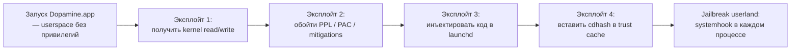

# Deep-dive 10. Эксплойты Dopamine 3 для A13 + iOS 26: архитектурный обзор

Эта глава — архитектурный обзор. Это не руководство по разработке ядерных эксплойтов и не handbook по атаке на устройства. Я опираюсь на публично зафиксированную в репозитории информацию (имена файлов, диапазоны поддерживаемых версий, высокоуровневые описания из комментариев и `Info.plist`), чтобы объяснить **логическую структуру пайплайна** jailbreak: какие эксплойты существуют, в каком порядке применяются и какую роль каждый играет.

Детали code-level работы эксплойтов (gadget-адреса, конкретные PAC-обходы, последовательности heap-shaping) здесь намеренно не разбираются. Эти знания — предмет security research и соответствующей ответственности исследователя; книга про tweak-разработку в них не нуждается.

## 1. Что такое «цепочка эксплойтов» в jailbreak

Jailbreak современного iOS — почти никогда не один «magic bullet». Это **цепочка**: несколько уязвимостей, последовательно применяемых, где каждая открывает дорогу следующей.

Типовая структура:



Каждый шаг — отдельная техника. Выпадение одного — вся цепочка не работает.

Для автора твика важно: **к моменту запуска вашего `%ctor` вся эта цепочка уже отработала**. Вы живёте в юзерспейсе, где jailbreak уже активен; эксплойты вас не касаются ни в compile-time, ни в runtime.

## 2. Каталог эксплойтов проекта

Из `Application/Dopamine/Exploits/`:

| Эксплойт | Папка | Назначение (концепция) | Применимость |
|---|---|---|---|
| **DarkSword** | `DarkSword/` | Kernel RW | iOS 15.0–18.7.1 и 19.0–26.0.1 |
| **ClearSword** | `ClearSword/` | Kernel RW (альтернатива) | iOS 15.0–18.7.1 и 19.0–26.0.1 |
| **momentarius** | `momentarius/` | PPL bypass; A13-specific в `momentarius_a13.c` | A12/A13 |
| **Titan** | `Titan/` | Платформенный post-PPL | A13 (видно по CPU enum) |
| **weightBufs** | `weightBufs/` | Исторический — Neural engine driver | Старые iPhone, старые iOS |
| **dmaFail** | `dmaFail/` | DMA-based primitive | По семейству чипа |
| **multicast_bytecopy** | `multicast_bytecopy/` | Multicast socket | Старые iOS |
| **palera1n** | `palera1n/` | Bootrom-based (checkm8) | A9–A11 |
| **kfd** | `kfd/` | Kernel file descriptor primitives | По версии |

Каждый подкаталог содержит `Info.plist` с `DPSupportedRanges` — диапазон версий iOS, где эксплойт работает, и `DPExploitType` (Kernel / Bootrom / ...). Это та карта, по которой `DOExploitManager.m` выбирает, что запускать.

Проверка диапазона DarkSword/ClearSword (глава I.5):

```xml
<key>DPSupportedRanges</key>
<array>
    <dict><key>Start</key><string>15.0</string><key>End</key><string>18.7.1</string></dict>
    <dict><key>Start</key><string>19.0</string><key>End</key><string>26.0.1</string></dict>
</array>
```

«19.0» здесь — Apple-внутренний номер того, что потребитель видит как iOS 26. Поддержка двух диапазонов — исторический + новый.

## 3. Как DOExploitManager выбирает

Процедура из `Application/Dopamine/Jailbreak/DOExploitManager.m` + `DOExploit.m`:

1. Прочитать `kern.osproductversion` (`26.0` / `26.0.1`).
2. Прочитать `kern.osversion` (`23B...`).
3. Прочитать `hw.cpufamily` (`CPUFAMILY_ARM_LIGHTNING_THUNDER` для A13).
4. Пройтись по всем `Exploits/*/Info.plist`.
5. Для каждого — проверить:
   - `DPSupportedRanges` включает текущую версию.
   - `DPSupportInclude` (если задан) включает текущий билд.
   - Чип в списке поддерживаемых (по `Info.plist` могут быть указаны конкретные CPU family).
6. Выбрать по `DPFlavorPriority` — чем выше, тем приоритетнее.

Для A13 + iOS 26.0.1 с подходящим билдом подходят DarkSword (priority 890) и ClearSword (priority 895). ClearSword выше — используется первой, с fallback на DarkSword.

## 4. Четыре слоя цепочки для A13 + iOS 26

### 4.1. Слой 1: Kernel read/write

**Эксплойт**: DarkSword или ClearSword.
**Что даёт**: примитивы `kread64(addr)` / `kwrite64(addr, val)` — возможность читать/писать любой адрес ядерной памяти из userspace.
**Концепция** (без деталей): race condition на уровне сетевого стека, приводящая к out-of-bounds доступу в kernel heap. Атака разворачивается в полный kernel RW через контролируемое перезаписывание указателей.

Соответствующие файлы:

- `Application/Dopamine/Exploits/DarkSword/DarkSword.m` — главный код.
- `Application/Dopamine/Exploits/ClearSword/exploit/poc.c` — proof of concept.

Для понимания достаточно: после этого слоя у Dopamine есть «вытащенный» kernel task port и примитивы RW. Остальное — на этом фундаменте.

### 4.2. Слой 2: Обход PPL

**Эксплойт**: `momentarius` (с A13-веткой в `momentarius_a13.c`).
**Что даёт**: возможность писать в PPL-защищённые области: page tables, trust cache, codesign blobs.
**Концепция** (из Deep-dive 04): kernel RW сам по себе не позволяет писать в PPL-защищённые страницы. Нужен специальный обход — обычно через race на входе/выходе PPL или через ошибку в самой PPL-функции.

Соответствующие файлы:

- `Application/Dopamine/Exploits/momentarius/momentarius.c` — generic entry.
- `Application/Dopamine/Exploits/momentarius/momentarius_a13.c` — A13-specific.
- `Application/Dopamine/Exploits/momentarius/momentarius.h`.
- `Application/Dopamine/Exploits/momentarius/Info.plist` — явно указывает «A13» в поддерживаемых чипах (глава I.5).

Для понимания достаточно: после этого слоя у Dopamine есть capability писать cdhash в trust cache и подменять page table entries, то есть «подписывать» произвольные бинарники для AMFI.

### 4.3. Слой 3: Платформенное закрепление

**Эксплойт**: `Titan`.
**Что даёт**: удерживает KRW/PPL-операции между контекст-свитчами, обеспечивает корректный переход от «кратковременный эксплойт» к «устойчивый userland jailbreak».
**Концепция**: после первых двух слоёв состояние хрупко — любой reschedule или page-fault может «потерять» вход. Третий слой выполняет закрепление: записывает нужные константы в ядро, патчит точки проверки AMFI, устанавливает persistence в пределах userspace boot.

Файлы:

- `Application/Dopamine/Exploits/Titan/exploit/titan.{h,m}` — main.
- `titan.m:35,70` — обработка SOC_A13 ветки.

### 4.4. Слой 4: Инъекция и trust cache

**Делается в**: `DOBootstrapper.m` и финальных шагах `DOJailbreaker.m`.
**Что делает**:

1. Распаковывает `basebin.tar` в jbroot.
2. Загружает `basebin.tc` (static trust cache) в ядро — все cdhash из basebin становятся «подписанными».
3. Инжектирует `launchdhook.dylib` в launchd (детали — глава III.4).
4. Launchdhook в launchd запускает `jailbreakd`, `hookd`, настраивает jbserver, устанавливает spawn_hook.
5. С этого момента каждый новый процесс получает `systemhook.dylib`.

После слоя 4 jailbreak userland — operational. Пользователь видит «успех».

## 5. Что такое Info.plist эксплойта

Из `Application/Dopamine/Exploits/DarkSword/Info.plist`:

```xml
<dict>
    <key>DPExploitFlavors</key>
    <dict>
        <key>default</key>
        <dict>
            <key>DPFlavorPriority</key>
            <integer>890</integer>
            <key>DPSupportInclude</key>
            <array>
                <dict>
                    <key>Builds</key>
                    <array>
                        <string>23B5044l</string>
                        <string>23B5059e</string>
                        <string>23B5064e</string>
                    </array>
                </dict>
            </array>
            <key>DPSupportedRanges</key>
            <array>
                <dict><key>Start</key><string>15.0</string><key>End</key><string>18.7.1</string></dict>
                <dict><key>Start</key><string>19.0</string><key>End</key><string>26.0.1</string></dict>
            </array>
        </dict>
    </dict>
    <key>DPExploitType</key>
    <string>Kernel</string>
    <key>DPExploitRequirements</key>
    <array>
        <string>contiguousMapping</string>
    </array>
</dict>
```

Разбор полей:

- **`DPExploitFlavors`**: один эксплойт может иметь несколько «вкусов» (разные под варианты условий). `default` — главный.
- **`DPFlavorPriority`**: число. ClearSword имеет 895, DarkSword — 890; больше — выше в очереди выбора.
- **`DPSupportInclude.Builds`**: явный whitelist билдов, на которых exploit гарантированно работает. Другие билды в диапазоне `DPSupportedRanges` — пытаются «на удачу».
- **`DPSupportedRanges`**: пары Start/End версий iOS. Обратите внимание — есть два range'а: 15.0–18.7.1 и 19.0–26.0.1 (внутренний Apple номер iOS 26).
- **`DPExploitType`**: `Kernel` (user→kernel), `Bootrom` (checkm8-level), иное.
- **`DPExploitRequirements`**: специальные требования — например, `contiguousMapping` (нужны непрерывные virtual-to-physical маппинги), что имеет смысл для определённого класса атак.

## 6. Таблица «что от чего зависит»

Для A13 + iOS 26.0/26.0.1:

| Слой | Нужно для | Если не работает — |
|---|---|---|
| DarkSword/ClearSword | KRW primitives | Dopamine останавливается, пользователь видит ошибку |
| momentarius_a13 | PPL bypass | ядерная память RW есть, но trust cache недостижим |
| Titan | Persistence | Нестабильно; может работать с ограничениями |
| DOBootstrapper → launchdhook | Userland jailbreak | Процессы остаются «не инструментованными» |

Каждый — критический. Пропуск любого — jailbreak не работает.

## 7. Почему два варианта (DarkSword + ClearSword)

Два kernel-эксплойта в одном релизе — это защита **от regression**. Если Apple закроет один (patch в iOS 26.0.2, которую проект пока не декларирует), второй может продолжить работать. ClearSword имеет приоритет 895, DarkSword — 890: `DOExploitManager` пробует ClearSword первым; если не удалось — fallback на DarkSword.

Это стандартная практика jailbreak-проектов: не класть все яйца в одну корзину.

## 8. Почему это persistent до userspace reboot, но не до cold boot

На A13 + iOS 26 jailbreak Dopamine **semi-untethered**:

- **Userspace reboot** (без выключения устройства): инструментовка сохраняется — `launchdhook` остаётся в launchd, trust cache остаётся загруженным. Твики продолжают работать.
- **Cold boot** (device off → on): все PPL-защищённые области сбрасываются. Dynamic trust cache теряется. Нужно повторно запустить Dopamine.app и пройти всю цепочку.

Почему не персистентно до cold boot: static trust cache в iOS-firmware защищён от записи даже с PPL-bypass'ом; его модификация требует bootrom-уровня эксплуатации (checkm8-подобное), которого на A13 нет.

Это объясняет, почему для автора твика важно: **твик не должен полагаться на persistence состояния в ядре** — после перезагрузки устройства ваш `.deb` всё ещё на диске, но jailbreak нужно переактивировать, и только после этого твик снова загрузится.

## 9. Что я намеренно НЕ описал

- **Конкретные стадии KRW primitives** в DarkSword / ClearSword (heap spraying, race windows, объекты для перезаписывания). Это security research materials, не часть tweak-handbook.
- **Детали PPL bypass в momentarius_a13**: ячейки TLB, конкретные последовательности PAC-инструкций, точные offsets в PPL code. Это требует отдельной подготовки и ответственности.
- **CVE references**: публичные уязвимости, из которых составлены эти цепочки, задокументированы в Apple security notes; отправлять читателя к ним за «готовым рецептом» — не задача этой книги.
- **How-to для своего эксплойта**: написание kernel-эксплойта — отдельная профессия; эта книга предполагает, что вы пользователь jailbreak'а, не разработчик эксплойтов.

Это осознанная граница. Если вы хотите заниматься exploit research — есть другие источники (книги Jonathan Levin, security conferences, Apple opensource dyld/XNU исходники, статьи security teams).

## 10. Этические замечания

Эксплойты — обоюдоострый инструмент. Dopamine применяет их для **jailbreak собственного устройства пользователя** — это:

- Legal в большинстве юрисдикций (DMCA exemption в США для personal device modification, аналоги в EU).
- Этично, если результат — свобода владельца распоряжаться своим устройством.
- Не трогает чужие устройства или данные.

Применение тех же техник для:

- Атаки на чужие устройства — незаконно, неэтично, не покрывается этой книгой.
- Обхода Activation Lock или защит от кражи — незаконно; Dopamine прямо не делает этого.
- Нарушения политик Apple App Store для коммерческой выгоды через fake-reviews — неэтично.

Книга предполагает ответственное использование: собственный tweak для собственного приложения или system UI на собственном устройстве.

## 11. Что подтверждено

- **Подтверждено исходниками**:
  - Поддерживаемые диапазоны версий iOS в `DPSupportedRanges` обоих эксплойтов — `Info.plist`.
  - Явные билды iOS 26 в DPSupportInclude: `23B5044l`, `23B5059e`, `23B5064e`.
  - Названия эксплойтов и их папки (`DarkSword`, `ClearSword`, `momentarius`, `Titan`, `kfd`, etc.) — `Application/Dopamine/Exploits/`.
  - A13-specific ветка `momentarius_a13.c` — `Exploits/momentarius/`.
  - CPU family handling в `DOExploit.m:84, 86` — A12 и A13.
  - Приоритеты эксплойтов — `DPFlavorPriority` в Info.plist.
  - Строка «iOS 15.0 - 18.7.1, 26.0 - 26.0.1 (A12/A13, PPL)» — `DOEnvironmentManager.m:254`.
- **Подтверждено архитектурно**: PPL — publically documented в Apple Platform Security (глава Deep-dive 04).
- **Подтверждено community**: двойные kernel-эксплойты в одном релизе — стандартная практика jailbreak-проектов.
- **Требует проверки на устройстве**: реальная работа конкретной цепочки на вашем билде iOS 26.
- **Не подтверждено** (намеренно опущено): instruction-level детали эксплойтов.

## 12. Выводы

Главный тезис: **jailbreak Dopamine 3 для A13 + iOS 26 — это четырёхслойная цепочка: KRW → PPL bypass → platform persistence → userland инъекция**. Каждый слой закрывает конкретную задачу; цепочка подобрана так, чтобы покрыть iOS 26.0 и 26.0.1 на A12/A13.

Для автора твика эта глава даёт картину: вы — конечный потребитель цепочки, которая разработана security research team. Ваше дело — tweak-разработка, не exploit research. Знание о цепочке — для понимания, почему jailbreak иногда ломается и почему он декларируется только для конкретных чипов и версий.

## 13. Что дальше

- `PPL / A13` — Deep-dive 04 (архитектура PPL).
- `trust cache` — Deep-dive 05 (как cdhash попадает в ядро).
- `physrw` — Deep-dive 07 (physical memory primitives).
- `kcall` — Deep-dive 09 (kernel function invocation).
- Для history-контекста — глава «History» (если будет написана).

На этом подсекция «безопасность и эксплойты» в Deep-dive разделе закрыта. Все 15 глубоких погружений написаны.
