# XPF (eXtensible Patchfinder) — как Dopamine находит смещения в ядре

Главу о запуске Dopamine (Часть II) мы заканчивали на том, что процесс
`com.opa334.Dopamine.roothide` в первой фазе джейлбрейка должен ответить на
простой с виду вопрос: «где именно в этой конкретной сборке `kernelcache`
лежит `allproc`, где `pv_head_table`, где функция `pmap_create_options`, и
как именно сейчас уложены поля в `struct proc_ro`?». Без этих чисел ни
`arm64_kcall`, ни `physrw`, ни trustcache-инъекция работать не будут —
примитивы просто обратятся в случайную память. На A13 с iOS 26.0 / 26.0.1
никаких готовых таблиц от Apple нет, поэтому всю работу берёт на себя
отдельная библиотека — **XPF (eXtensible Patchfinder)**. Эта глава
разбирает, как она устроена, как Dopamine её вызывает, какой набор
метрик применяется для A12/A13 PPL-веток и что именно нужно обновлять,
когда Apple выкатывает очередной минорный релиз. В конце — анализ
коммита `96ab178 "Fix some offsets on iOS 26.5+"` как эталонного
примера того, что ломается от минора к минору.

> Важное предупреждение. Исходники самой библиотеки XPF в этом снапшоте
> репозитория подтянуты как git-submodule из `https://github.com/opa334/XPF`
> (см. `.gitmodules`), но каталог `BaseBin/XPF/` в рабочем дереве **пустой**
> (`ls -la BaseBin/XPF` показывает только `.` и `..`). Поэтому всё, что в
> этой главе относится к *внешнему* API XPF (`xpf_start_with_kernel_path`,
> `pfmetric_pattern_init`, `gXPF.kernelTextSection`, `PFSection`, набор
> `xpf_item_register` и т.п.), **подтверждено только по его точкам
> использования в Dopamine-roothide** и по единственному исходнику XPF,
> который действительно лежит в репозитории — `BaseBin/libroothider/src/xpf.m`.
> Поля `gXPF.*` и сигнатуры `pfmetric_*`, которые видны в этом файле,
> приводятся «как есть по использованию»; детали реализации самой
> XPF (как именно `pfmetric_run` обходит секцию, как парсится fileset)
> **не нашёл по grep** в этом снапшоте и помечаются как «требует проверки
> в репозитории XPF».

## 11.1 Зачем вообще отдельный patchfinder

Исторически каждый большой джейлбрейк тащил внутри себя собственный
набор «паттернов»: кусков машинного кода и строк, по которым находились
нужные символы в `kernelcache`. Проблемы такого подхода хорошо видны,
если открыть `BaseBin/libjailbreak/src/info.c` — там только *часть*
смещений жёстко вшита в код (`jbinfo_initialize_hardcoded_offsets`), и
даже эта часть расписана ветками по версиям Darwin и по CPU-семейству
(см. ниже §11.6). Всё, что меняется от сборки к сборке — адреса
функций, адреса глобалов, размеры структур — не может быть захардкожено:
между `23B5044l`, `23B5059e` и `23B5064e` (три билда iOS 26.0,
разрешённые для DarkSword/ClearSword в `Application/Dopamine/Exploits/*/Info.plist`)
Apple вполне могла сдвинуть `allproc` и переупаковать `proc_ro`. Решение
Dopamine — вынести всё «нехардкодное» в отдельную библиотеку с
декларативным описанием:

- **паттерн** — последовательность ARM64-инструкций с масками,
  строка-литерал в `__TEXT_CSTRING`/`__cstring`, или xref на уже
  найденный адрес;
- **метрика** — объект (`PFPatternMetric`, `PFStringMetric`,
  `PFXrefMetric`), который ищет паттерн внутри `PFSection`;
- **item** — именованная «ячейка результата» (`"kernelSymbol.allproc"`,
  `"kernelStruct.proc_ro.ucred"`), зарегистрированная через
  `xpf_item_register`;
- **set** — именованная группа item'ов, которую вызывающий код
  запрашивает по имени (`"struct"`, `"translation"`, `"IOSurface"` и т.д.).

Результат вызова — один большой `xpc_object_t` dictionary со всеми
найденными значениями, который Dopamine дальше напрямую десериализует
в структуру `gSystemInfo` (`BaseBin/libjailbreak/src/info.c:13-16`).
То есть граница между patchfinder'ом и остальным джейлбрейком
проходит ровно по этому XPC-словарю. Это и есть «extensible» в
названии: добавить новый item — значит зарегистрировать его в XPF и
расширить `struct system_info` в `info.h`.

## 11.2 Где именно XPF подключается в Dopamine-roothide

Карта зависимостей собирается из `BaseBin/Makefile`:

```make
XPF: .build .include ChOma
	@$(MAKE) -C XPF output/ios/libxpf.dylib CHOMA_PATH=../ChOma CHOMA_DYLIB_PATH="../.build"
	@ldid -Cadhoc -s XPF/output/ios/libxpf.dylib
	@cp XPF/output/ios/libxpf.dylib .build/libxpf.dylib
	@mkdir -p .include/xpf
	@cp XPF/src/xpf.h .include/xpf
```

Ключевые факты:

- XPF линкуется как динамическая библиотека `libxpf.dylib`,
  положенная в `.build` (`BaseBin/Makefile:33-39`).
- Публичный заголовок — ровно один файл `XPF/src/xpf.h`, он
  копируется в `.include/xpf/xpf.h` и затем попадает в SDK, которым
  собираются `libroothider`, `launchdhook` и само приложение Dopamine.
- Собственный ChOma (`libchoma.dylib`) — обязательная зависимость:
  XPF опирается на разбор Mach-O и kernelcache через ChOma
  (это видно по `CHOMA_PATH=../ChOma`).
- `libroothider` при линковке подхватывает `-lchoma -lxpf -ljailbreak`
  (`BaseBin/libroothider/Makefile:7`), то есть roothide-дополнения к
  XPF живут не в самом submodule, а в roothide-слое поверх него.
- Приложение Dopamine тащит `libxpf.dylib` и как framework, и как
  embedded dylib: `Application/Dopamine.xcodeproj/project.pbxproj:244-245`
  (`libxpf.dylib in Frameworks` и `in Embed Libraries`).
- Лицензия XPF (Apache 2.0, если судить по тому, что upstream — opa334)
  **упакована как ресурс** в UI About через
  `Application/Dopamine/UI/Settings/DOLicenseViewController.m:116-117`.

Таким образом XPF используется в **двух разных процессах**:

1. **Приложение Dopamine** (`Application/Dopamine/Jailbreak/DOJailbreaker.m`,
   метод `-gatherSystemInformation`) — на первой стадии джейлбрейка, до
   выхода на эксплойт. Здесь patchfinding запускается на kernelcache,
   SPTM-образ и TXM-образ, прочитанных с устройства.
2. **launchdhook внутри launchd** (`BaseBin/launchdhook/src/update.m`,
   функция `jbupdate_update_system_info`) — при `jbupdate` после
   апгрейда Dopamine на новый релиз. Здесь XPF подгружается через
   `dlopen("@loader_path/libxpf.dylib", RTLD_NOW)`
   (`BaseBin/launchdhook/src/update.m:99`), что подчёркивает: XPF
   не присутствует в системном `dyld shared cache`, она всегда
   приезжает со своим Dopamine-рантаймом.

## 11.3 Публичный API XPF, как его видит Dopamine

Полную декларацию `xpf.h` в этом снапшоте я прочитать не могу (submodule
пустой), но из `DOJailbreaker.m` и `update.m` можно восстановить
стабильную поверхность API:

```objc
#import <xpf/xpf.h>

int   xpf_start_with_kernel_path(const char *kc, const char *sptm, const char *txm);
void  xpf_stop(void);
const char *xpf_get_error(void);

bool  xpf_set_is_supported(const char *name);
xpc_object_t xpf_construct_offset_dictionary(const char *sets[]);

extern struct {
    uint64_t  kernelBase;
    uint64_t  sptmBase;
    uint64_t  txmBase;
    bool      sptm;
    bool      txm;
    bool      kernelIsFileset;
    bool      kernelIsArm64e;
    const char *darwinVersion;
    void     *kernel;
    PFSection *kernelTextSection;
    PFSection *kernelDataSection;
    PFSection *kernelStringSection;
    PFSection *kernelAMFIStringSection;
    PFSection *kernelPrelinkTextSection;
    // ...
} gXPF;
```

Фактические точки использования, по которым восстановлена эта таблица:

- `Application/Dopamine/Jailbreak/DOJailbreaker.m:86` — старт.
- `Application/Dopamine/Jailbreak/DOJailbreaker.m:106-117` — проба опциональных set'ов.
- `Application/Dopamine/Jailbreak/DOJailbreaker.m:119` — построение словаря.
- `Application/Dopamine/Jailbreak/DOJailbreaker.m:121-127` — чтение `gXPF.kernelBase`, `gXPF.sptmBase`, `gXPF.txmBase`, флагов `gXPF.sptm`/`gXPF.txm`.
- `BaseBin/libroothider/src/xpf.m:214-229` — чтение `gXPF.kernelIsArm64e`, `gXPF.kernelIsFileset`, `gXPF.darwinVersion`, `gXPF.kernelDataSection`, `gXPF.kernelStringSection`, `gXPF.kernelAMFIStringSection`, `gXPF.kernelPrelinkTextSection`.

Жизненный цикл XPF в вызывающем коде всегда один:

```c
int r = xpf_start_with_kernel_path(kc, sptm, txm);
if (r == 0) {
    // Собрать массив sets[], проверить supported(), построить словарь
    xdict = xpf_construct_offset_dictionary(sets);
    // Добить своими roothide-item'ами
    roothide_xpf_append_roothide_offsets(xdict);
    xpf_stop();
}
```

`xpf_start_with_kernel_path` — парсер kernelcache. Он получает путь
к `kernelcache`, опциональные пути к SPTM/TXM-образам (на A12/A13
PPL эти параметры передаются `NULL`, так как SPTM присутствует только
на A15+), и наполняет глобальный `gXPF`: разбирает Mach-O / fileset,
находит сегменты, запоминает `kernelBase`. `xpf_stop()` освобождает
память, прочитанную с диска, после того как словарь уже построен.

### 11.3.1 Поток данных сквозь XPF

```mermaid
flowchart LR
    A["kernelcache на устройстве\n/System/Library/Caches/com.apple.kernelcaches/"] --> B["ChOma: Mach-O / fileset\nkernelcache parsing"]
    B --> C["xpf_start_with_kernel_path()\nнаполняет gXPF.*"]
    C --> D["PFSection: kernelTextSection,\nkernelDataSection, kernelStringSection, ..."]
    D --> E["pfmetric_pattern_init / pfmetric_string_init / pfmetric_xref_init\nпоиск по маске/строке/xref"]
    E --> F["xpf_item_register (имя -> callback)"]
    F --> G["xpf_construct_offset_dictionary(sets)\n-> xpc_object_t (словарь имя->uint64)"]
    G --> H["roothide_xpf_append_roothide_offsets()\n+kernelSymbol.nchashtbl,\n+kernelSymbol.nchashmask,\n+kernelSymbol.launch_env_logging,\n+kernelSymbol.developer_mode_status"]
    H --> I["jbinfo_initialize_dynamic_offsets()\nраспаковка в gSystemInfo"]
    I --> J["jbinfo_initialize_hardcoded_offsets()\nдобавка версионных структурных полей"]
    J --> K["ksymbol/koffsetof/kconstant\nв libjailbreak"]
```



Критическая деталь: `xpf_construct_offset_dictionary` **не** возвращает
«итоговую» картину. Он даёт только то, что найдено patchfinder'ом из
бинарей. Хардкод-таблица в `jbinfo_initialize_hardcoded_offsets`
(`BaseBin/libjailbreak/src/info.c:35+`) идёт поверх, и именно она
содержит версионно-зависимые смещения внутри структур (`proc`,
`proc_ro`, `vm_map`, `vm_map_entry`, `pmap`), для которых дешевле и
надёжнее сверка `strcmp(darwinVersion, "22.0.0") >= 0`, чем paттерн по
коду.

## 11.4 Какие set'ы запрашивает Dopamine

Код в `DOJailbreaker.m` строит статический массив имён и дополняет его
опциональными через `xpf_set_is_supported`:

```objc
char *sets[] = {
    "translation",
    "trustcache",
    "sandbox",
    "physmap",
    "struct",
    "physrw",
    "IOSurface",
    NULL, NULL, NULL, NULL, NULL,
};

uint32_t idx = 0;
while (sets[++idx]);

if (xpf_set_is_supported("devmode"))    sets[idx++] = "devmode";
if (xpf_set_is_supported("badRecovery"))sets[idx++] = "badRecovery";
if (xpf_set_is_supported("arm64kcall")) sets[idx++] = "arm64kcall";
if (xpf_set_is_supported("perfkrw"))    sets[idx++] = "perfkrw";
```

Семь обязательных set'ов и четыре опциональных. Назначение
обязательных можно восстановить по именам ключей, которые потом
десериализуются в `gSystemInfo` через `KERNEL_SYMBOLS_ITERATE`
(`BaseBin/libjailbreak/src/info.h:681-687`). Таблица (все пункты —
подтверждено по использованию в `info.h` и callsite'ам в `libjailbreak`):

| set           | Что из него берёт libjailbreak                                    | Подтверждение |
| ------------- | ------------------------------------------------------------------ | ------------- |
| `translation` | `cpu_ttep`, `gPhysBase`, `gPhysSize`, `gVirtBase`, `ptov_table`    | `info.h:86-100`, `kernel.c:105` |
| `trustcache`  | `pmap_image4_trust_caches`, `ppl_trust_cache_rt`, `txm_trustcache_root` | `info.h:93-113` |
| `sandbox`     | `mac_label_set`                                                    | `info.h:77` |
| `physmap`     | `pv_head_table`, `pp_attr_table`, `vm_page_array_*`, `vm_first_phys*`, `vm_last_phys` | `info.h:87-98`, `kernel.c:111-117` |
| `struct`      | Поля `proc`, `task`, `vm_map`, `pmap`, `ipc_*` — то, что лежит в `kernelStruct.*` | `info.h:124-371` |
| `physrw`      | Константы/функции для `physrw`-примитива                           | `BaseBin/libjailbreak/src/physrw.c` (не нашёл по grep имён ключей — требует проверки в репозитории XPF) |
| `IOSurface`   | `kernelStruct.IOSurface.memoryDescriptor` (`info.c:94`) и связанные ranges | `info.h:347-350` |

И четыре опциональных set'а — то, что XPF может *не* поддерживать на
данной версии (поэтому и `xpf_set_is_supported`):

- `devmode` — `developer_mode_enabled` (NON-SPTM, `info.h:101`) и
  `developer_mode_status` (roothide-дополнение, `xpf.m:117`).
- `badRecovery` — отдельная ветка эксплуатации boot-time flags; на
  A12/A13 PPL не всегда применима.
- `arm64kcall` — поиск гаджетов (`kernelGadget.*`, `info.h:124-135`)
  для arm64-kcall-бэкенда. На arm64e не используется (там Fugu14
  kcall).
- `perfkrw` — `perfmon_dev_open`, `perfmon_devices`, `cdevsw`
  (`info.h:61,80-81`) для perfmon-based KRW.

Если XPF возвращает `supported=false` на `arm64kcall`, Dopamine
переключается на другой KRW-примитив (`BaseBin/libjailbreak/src/kcall_arm64.c`,
инициализируется из `jbupdate_finalize_stage2`, `update.m:224-228`).

## 11.5 Как XPF описывает «паттерн поиска» — на примере `nchashtbl`

Это ровно тот случай, где у нас есть исходник: roothide-доп
`xpf_find_namecache` в `BaseBin/libroothider/src/xpf.m:35-124`. Код
находит глобальный указатель `nchashtbl` и маску `nchashmask` в
функции `nchinit`, которую inline-ом разворачивает `init_crc32`.
Разбор идёт в три шага.

### Шаг 1. Якорь — инструкции `MOVZ Wn,#0x1DB7` + `MOVK Wn,#0x4C1, LSL #16`

Константа `0x04C11DB7` — порождающий полином CRC-32. Любая функция,
которая его зашивает, обязана выставить это 32-битное значение парой
`MOVZ`/`MOVK`. XPF умеет сгенерировать именно такую пару с «любым»
регистром назначения:

```objc
uint32_t movzAny = 0, movzAnyMask = 0;
uint32_t movkAny = 0, movkAnyMask = 0;
arm64_gen_mov_imm('z', ARM64_REG_ANY, OPT_UINT64(0x1db7),  OPT_UINT64_NONE, &movzAny, &movzAnyMask);
arm64_gen_mov_imm('k', ARM64_REG_ANY, OPT_UINT64(0x4c1),   OPT_UINT64(16),  &movkAny, &movkAnyMask);
uint32_t crcFlagInst[] = { movzAny, movkAny };
uint32_t crcFlagMask[] = { movzAnyMask, movkAnyMask };

PFPatternMetric *metric =
    pfmetric_pattern_init(crcFlagInst, crcFlagMask, sizeof(crcFlagInst), sizeof(uint32_t));
pfmetric_run(gXPF.kernelTextSection, metric, ^(uint64_t vmaddr, bool *stop) {
    crcFlag = vmaddr;
    *stop = true;
});
pfmetric_free(metric);
```

Что здесь важно:

- `arm64_gen_mov_imm` — хелпер XPF, который возвращает *инструкцию*
  и *маску* для сравнения; `ARM64_REG_ANY` в маске занулит поле Rd,
  `OPT_UINT64(16)` на `MOVK` задаёт `LSL #16`.
- `pfmetric_pattern_init` принимает массивы инструкций и масок,
  общий размер в байтах и stride (`sizeof(uint32_t)` — т.е. сдвиг по
  одной инструкции).
- `pfmetric_run` обходит `kernelTextSection` и вызывает блок на каждом
  совпадении; `*stop = true` обрывает перебор по первому хиту.
- Если `crcFlag == 0`, то XPF публикует ошибку через `xpf_set_error`,
  и `roothide_xpf_construct_offset_dictionary_wrapper` вернёт NULL,
  что в Dopamine превратится в `JBErrorCodeFailedKernelPatchfinding`
  (`DOJailbreaker.m:137`).

### Шаг 2. Переход к `_hashinit` — поиск `BL` от якоря

После `MOVZ`/`MOVK` компилятор обычно вставляет пролог CRC-таблицы, а
затем идёт `BL _hashinit`. XPF даёт отдельный хелпер
`arm64_gen_b_l`:

```objc
uint32_t blAnyInst = 0, blAnyMask = 0;
arm64_gen_b_l(OPT_BOOL(true), OPT_UINT64_NONE, OPT_UINT64_NONE, &blAnyInst, &blAnyMask);
uint64_t bl_hashinit = pfsec_find_next_inst(gXPF.kernelTextSection, crcFlag, 100, blAnyInst, blAnyMask);
```

`pfsec_find_next_inst` — не метрика, а линейный скан не более чем 100
инструкций вперёд. `OPT_BOOL(true)` указывает, что это именно `BL`, а
не `B`.

### Шаг 3. Пара `ADRP + STR` сразу после `BL` — целевой указатель

Семантика C-кода `nchashtbl = hashinit(...); nchashmask = nchash;`
даёт на выходе две пары `ADRP + STR` подряд. XPF декодирует адрес
назначения прямо из распакованных операндов:

```objc
uint32_t hashinitInst[] = { adrpAnyInst, strAnyInst };
uint32_t hashinitMask[] = { adrpAnyMask, strAnyMask };

metric = pfmetric_pattern_init(hashinitInst, hashinitMask, sizeof(hashinitInst), sizeof(uint32_t));
pfmetric_run_in_range(gXPF.kernelTextSection, bl_hashinit, bl_hashinit + 20 * 0x4, metric,
    ^(uint64_t vmaddr, bool *stop) {
        uint64_t adrp_value = 0, str_value = 0;
        arm64_dec_adr_p(pfsec_read32(gXPF.kernelTextSection, vmaddr), vmaddr, &adrp_value, NULL, NULL);
        arm64_dec_str_imm(pfsec_read32(gXPF.kernelTextSection, vmaddr + 0x4), NULL, NULL, &str_value, NULL, NULL);
        if (nchashtbl == 0) {
            nchashtbl = adrp_value + str_value;
        } else if (nchashmask == 0) {
            nchashmask = adrp_value + str_value;
            *stop = true;
            if (nchashtbl != nchashmask - 8) {
                nchashtbl = -1;
                nchashmask = -1;
            }
        }
    });
```

Ключевые элементы:

- `pfmetric_run_in_range` ограничивает скан диапазоном (20 инструкций).
- `arm64_dec_adr_p` возвращает *абсолютный* адрес, который формирует
  `ADRP` — то есть уже с учётом разметки страниц.
- `arm64_dec_str_imm` отдаёт immediate STR'а.
- `adrp_value + str_value` — это итоговый vmaddr глобала.
- **Sanity-check:** `nchashtbl != nchashmask - 8` отваливает кандидата,
  если найдены случайные хиты. Такие проверки — норма для XPF-item'ов;
  они нужны именно потому, что в ядре встречается не одна функция,
  работающая с CRC-32.

### 11.5.1 Метрики, которые XPF даёт из коробки

По нашему единственному исходнику видно как минимум три семейства:

| Метрика               | Смысл                                                                 |
| --------------------- | --------------------------------------------------------------------- |
| `PFPatternMetric`     | Побайтовое сравнение массива инструкций с маской                      |
| `PFStringMetric`      | Поиск строки-литерала в cstring-секции                                |
| `PFXrefMetric`        | Поиск ссылки на уже известный vmaddr (`XREF_TYPE_MASK_POINTER` и т.п.)|

Регистрация item'а и set'а — через два вызова:

```objc
xpf_item_register("kernelSymbol.nchashtbl",  xpf_find_namecache, (void *)(uintptr_t)1);
xpf_item_register("kernelSymbol.nchashmask", xpf_find_namecache, (void *)(uintptr_t)2);

XPFSet gNameCacheSet = {
    .name = "namecache",
    .supported = xpf_supported_always,
    .metrics = {
        "kernelSymbol.nchashtbl",
        "kernelSymbol.nchashmask",
        NULL,
    },
};

xpf_offset_dictionary_add_set(xdict, &gNameCacheSet);
```

(файл `BaseBin/libroothider/src/xpf.m`, строки 13-33 и 235-243). Это ровно
тот образец, по которому пишутся новые set'ы.

## 11.6 Как XPF использует metadata ядра

Patchfinder не ищет по голому `.text`. Он смотрит на kernelcache как
на набор именованных секций и, если это fileset, на набор именованных
kext-entry. Вот что из этого ловится в коде repo:

- **Fileset vs. prelinked.** В roothide-дополнении:
  ```objc
  if (gXPF.kernelIsFileset) {
      gKernelAMFIDataSection = xpf_pfsec_init("com.apple.driver.AppleMobileFileIntegrity", "__DATA", "__data");
  }
  else {
      gKernelPrelinkDataSection = xpf_pfsec_init(NULL, "__PRELINK_DATA", "__data");
  }
  ```
  (`BaseBin/libroothider/src/xpf.m:216-221`). Начиная с iOS 16 kernelcache
  — Mach-O fileset, и kexty лежат как subentry'и; `xpf_pfsec_init`
  позволяет получить `PFSection` из конкретного entry по имени.
  На «старом» kernelcache (не fileset) соответствующий код AMFI
  спрятан в `__PRELINK_TEXT` / `__PRELINK_DATA`.
- **Строки OID'ов.** Для поиска `developer_mode_status` и
  `launch_env_logging` XPF пользуется строками-описаниями, которые
  Apple не выкидывает между минорами: `"developer mode status"` и
  `"launch environment logging"`. Эти строки лежат либо в
  AMFI-секции (`gXPF.kernelAMFIStringSection`), либо, если AMFI
  prelinked, в `gXPF.kernelPrelinkTextSection`:
  ```objc
  PFSection *dataSec   = (gKernelAMFIDataSection ?: gXPF.kernelDataSection);
  PFSection *stringSec = (gXPF.kernelAMFIStringSection ?: gXPF.kernelStringSection);
  if (!gXPF.kernelIsArm64e && !gXPF.kernelIsFileset) {
      dataSec   = gKernelPrelinkDataSection;
      stringSec = gXPF.kernelPrelinkTextSection;
  }
  ```
  (`BaseBin/libroothider/src/xpf.m:143-148`).
- **Xref по указателям.** `PFXrefMetric` ищет
  слово-указатель в `dataSec`, которое ссылается на найденный
  `oid_descr_addr`. Это даёт адрес soid-записи в таблице OID'ов, а
  сдвиг `oid_name_ptr = oid_descr_ptr - 0x18` — конкретное смещение
  поля `oid_name` в структуре `sysctl_oid` на этой ветке ядра.
  Сдвиг `0x18` — хардкод, но защищён `pfsec_read_string`-ом и
  `strcmp(oid_name_string, oid_name)`-ом: при изменении раскладки
  структуры весь item «честно упадёт», и XPF вернёт ошибку
  `"Mismatch oid_name and oid_descr"` (`xpf.m:191-195`), а не
  молча получит мусор.

Общее правило. **XPF предпочитает строки и флаги** (CRC-полином,
«developer mode status») перед сырыми прологами функций. Это
принципиально: строки Apple менять дорого (ломает журналы, нарушает
символьную отладку в тулзах Apple), а раскладку кода внутри функции —
дёшево. То, что в последние пару минорных iOS Apple не трогала,
принимается за «якорь», а вокруг него уже матчится конкретика.

## 11.7 Что ломается на минорном релизе — коммит 96ab178

Коммит `96ab178 "Fix some offsets on iOS 26.5+"` (не нашёл сам файл
submodule'а, зато нашёл правку в `BaseBin/libjailbreak/src/info.c`) —
канонический пример того, что приходится править от минора к минору.
Darwin 25.4.0 (= iOS 26.5) переупаковал `proc_ro`: Apple убрала поле
`task_tokens` и сдвинула назад `mach_trap_filter_mask`,
`mach_kobj_filter_mask`, `t_flags_ro`. На iOS 27.0 (Darwin 27.0.0)
Apple, наоборот, *добавила* перед `ucred` новое поле
`p_fixed_vfs_resolve_flags`, и всё поехало на `+0x8`. До коммита
эти два события были слиты в одну ветку «27.0+», что ломало 26.5+.

Разберём ровно ту часть диффа, которая относится к A12/A13 PPL
(ветка `isArm64e && !hasSPTM`, которую мы отслеживаем в этой книге):

```c
// iOS 26.5+
if (strcmp(darwinVersion, "25.4.0") >= 0) {
    // proc_ro->task_tokens был удалён в 26.5
    gSystemInfo.kernelStruct.proc_ro.task_tokens            = 0;
    gSystemInfo.kernelStruct.proc_ro.mach_trap_filter_mask -= 0x28;
    gSystemInfo.kernelStruct.proc_ro.mach_kobj_filter_mask -= 0x28;
    gSystemInfo.kernelStruct.proc_ro.t_flags_ro            -= 0x28;

    // iOS 27.0+
    if (strcmp(darwinVersion, "27.0.0") >= 0) {
        // ... тот же набор, но для 27.0 с +0x8 сдвигом из-за p_fixed_vfs_resolve_flags
    }
}
```

Разбор ключевых строк:

- `strcmp(darwinVersion, "25.4.0") >= 0`. Строка приходит из
  `uname(&name); name.release` (`info.c:38-40`). Darwin 25.x
  соответствует iOS 26.x, 25.4.0 — это iOS 26.5. Для нашей целевой
  системы 26.0 / 26.0.1 (Darwin 25.0.x) этот блок **не исполняется**:
  26.0 и 26.0.1 продолжают работать как до коммита.
  **Различия между 26.0 и 26.0.1 на уровне раскладки `proc_ro`
  различия не выявлены** — обе версии попадают в одну и ту же
  ветку.
- `proc_ro.task_tokens = 0`. Специальное значение «поля больше нет»:
  функции-акцессоры в `libjailbreak` проверяют `koffsetof(proc_ro, task_tokens)`
  до разыменования и при нуле делают graceful fallback. Это общий
  приём, тот же `kernelStruct.task_tokens` исчезает первым, остальные
  поля подтягиваются сдвигом.
- `-= 0x28`. 40 байт — ровно размер того, что лежало до
  `mach_trap_filter_mask` в 26.4- (блок, где `task_tokens` сидел).
  Проверить это на устройстве — тривиально: взять ранее работавшие
  смещения в 26.0, добавить `0x28` к `mach_trap_filter_mask`, снять
  дамп и сравнить. **Требует проверки на устройстве 26.5+** —
  в целевой нам 26.0 / 26.0.1 это не применяется.

Что отсюда следует для автора твика/патча на 26.0 / 26.0.1:

1. XPF **уже разобрал** все *символические* смещения (адреса функций,
   глобалов), которые от 26.0 к 26.0.1 действительно сдвинулись.
2. Для **структурных** смещений на 26.0 / 26.0.1 работает хардкод
   `jbinfo_initialize_hardcoded_offsets` без ветки «26.5+».
3. Если переносить свой код на 26.5+, обязательные правки — ровно те
   четыре строки выше; забыть любую из них = kread/kwrite по мусорному
   адресу, что на PPL-железе означает панику ядра.

Схема ответственности:

```mermaid
flowchart TD
    V["darwinVersion из uname()"] --> SW{strcmp}
    SW -->|<"25.4.0"| B26[базовый блок iOS 26.0 / 26.0.1\nproc_ro остаётся как в 18.x PPL]
    SW -->|>="25.4.0"| B265[iOS 26.5+:\ntask_tokens=0, mach_trap/kobj/t_flags -= 0x28]
    SW -->|>="27.0.0"| B27[iOS 27.0+:\nvm_map/vm_map_entry/proc.flag пересобраны,\nucred/syscall/filter/t_flags_ro += 0x8]
    XPF["XPF: все kernelSymbol.*, kernelGadget.*"] --> MERGE[merge в gSystemInfo]
    B26 --> MERGE
    B265 --> MERGE
    B27 --> MERGE
    MERGE --> USE["ksymbol(), koffsetof(), kgadget() в libjailbreak"]
```

## 11.8 Что обязательно обновляется при новом миноре

Из всего, что мы разобрали, короткий чек-лист автора порта:

1. **Диапазоны поддержки эксплойтов.** Любой релиз iOS 26.x
   проверяется против `DPSupportedRanges` в
   `Application/Dopamine/Exploits/DarkSword/Info.plist` и
   `.../ClearSword/Info.plist`. Сейчас оба допускают диапазон
   `19.0 ≤ iOS ≤ 26.0.1`; на 26.1 придётся расширять `End`.
2. **Проверка `xpf_set_is_supported`.** После прогона XPF на новом
   kernelcache некоторые set'ы могут отвалиться — это нормально, но
   `DOJailbreaker.m:106-117` должен успевать переключиться на запасной
   KRW-примитив.
3. **Хардкод в `info.c`.** Любой сдвиг полей в `proc`, `proc_ro`,
   `vm_map`, `vm_map_entry`, `pmap` требует новой ветки по
   `darwinVersion`. Образец — `96ab178`.
4. **Строковые якоря.** Если XPF возвращает «Failed to find …»,
   нужно сначала проверить, что строка-якорь (`"developer mode status"`,
   `"launch environment logging"`, CRC-полином) всё ещё
   присутствует в своей секции. На практике Apple их не трогает между
   минорами, но перед новым major (iOS 27) — обязательно.
5. **Fileset-переупаковка.** Если `gXPF.kernelIsFileset == true`,
   доступ к AMFI идёт через entry `"com.apple.driver.AppleMobileFileIntegrity"`.
   При переименовании entry (случалось при реорганизации kext'ов)
   `xpf_pfsec_init` вернёт NULL, и
   `roothide_xpf_append_roothide_offsets` упадёт с
   `"Missing AMFI data or string section"` (`xpf.m:229`).

## 11.9 Как Dopamine обрабатывает отказ XPF

Код устойчив к отказу:

```objc
if (!_systemInfoXdict) {
    return [NSError errorWithDomain:JBErrorDomain
                               code:JBErrorCodeFailedKernelPatchfinding
                           userInfo:@{NSLocalizedDescriptionKey:
                                      [NSString stringWithFormat:@"XPF failed with error: (%s)", xpf_get_error()]}];
}
xpf_stop();
```

(`DOJailbreaker.m:136-139`). То есть любая строка-ошибка из XPF
(вместе с теми, что добавляет roothide, типа `"Failed to find oid_descr_addr"`)
долетает до UI без искажения. Это сильно упрощает post-mortem: имя
item'а в `xpf_set_error` — это и есть имя функции `xpf_find_*`,
которая проиграла.

При отказе kernelcache всё равно скачивается заново через
`accessibleKernelPath` (`DOEnvironmentManager`), поэтому «не нашёл
kernelcache» и «XPF не нашёл offset» — это две разные ошибки с кодами
`-1` и `-2` соответственно (`DOJailbreaker.m:51-52`).

## 11.10 Приложение: куда именно уходит XPC-словарь

После успешного построения:

```c
jbinfo_initialize_dynamic_offsets(_systemInfoXdict);  // DOJailbreaker.m:147
jbinfo_initialize_hardcoded_offsets();                // DOJailbreaker.m:148
```

Первая функция — тонкая обёртка над макросом
`SYSTEM_INFO_DESERIALIZE(xoffsetDict)` (`info.c:13-16`), который
через `_Generic`-машинерию (`info.h:705-721`) сам определяет тип
каждого поля (`uint32_t`/`uint64_t`/`char*`/`bool`) и достаёт его
соответствующим `xpc_dictionary_get_*`. Благодаря этому имя ключа в
XPF должно **ровно совпадать** с именем поля в
`SYSTEM_INFO_ITERATE`: например, `"kernelSymbol.nchashtbl"` (ключ
roothide-дополнения) *обязан* соответствовать полю
`kernelSymbol.nchashtbl` в `struct system_info` (`info.h:117`).

С точки зрения автора твика — работа с XPF начинается ровно тогда,
когда ему нужен новый символ или новое поле структуры. План действий:

1. Добавить поле в `struct system_info` в `info.h`.
2. Прописать итератор в соответствующем блоке `*_ITERATE`
   (`KERNEL_SYMBOLS_ITERATE` для адресов, `KERNEL_STRUCTS_ITERATE`
   для смещений в структурах, и т.д.) — иначе
   `SYSTEM_INFO_SERIALIZE` его не увидит.
3. Если данные ищутся patchfinder'ом — расширить XPF новым set'ом и
   item'ом. На roothide-ветке точка входа — тот самый
   `BaseBin/libroothider/src/xpf.m`.
4. Если данные версионно-зависимы и в XPF их искать нецелесообразно —
   прописать хардкод в `jbinfo_initialize_hardcoded_offsets` с
   условием `strcmp(darwinVersion, "…")`.
5. Пересобрать `libxpf.dylib`, `libroothider.dylib`, `libjailbreak.dylib`
   и приложение Dopamine; изменить `_external/basebin/.version-roothide`
   чтобы `jbupdate` на устройстве перезапустил XPF.

## Выводы

- **XPF — это декларативный patchfinder** с четырьмя обязательными
  понятиями: `PFSection`, метрика, item, set. Dopamine импортирует
  его как динамическую библиотеку `libxpf.dylib` в двух местах:
  `-gatherSystemInformation` (первый запуск) и
  `jbupdate_update_system_info` (апгрейд поверх уже
  работающего джейлбрейка).
- **Границей между patchfinder'ом и остальным Dopamine** служит
  `xpc_object_t`-словарь. Все ключи в нём обязаны соответствовать
  полям `struct system_info` в `BaseBin/libjailbreak/src/info.h`.
- **Для A12/A13 PPL на iOS 26.0 / 26.0.1** Dopamine запрашивает
  обязательные set'ы `translation`, `trustcache`, `sandbox`,
  `physmap`, `struct`, `physrw`, `IOSurface` и опционально
  `devmode`, `badRecovery`, `arm64kcall`, `perfkrw`. Какие именно
  из опциональных применимы на этой ветке — проверяется в рантайме
  через `xpf_set_is_supported`.
- **Коммит 96ab178** разделил одну ветку «iOS 27.0+» на две — «26.5+»
  и «27.0+», потому что Apple сначала убрала `proc_ro.task_tokens`,
  а потом вставила `p_fixed_vfs_resolve_flags` перед `ucred`.
  Для нашей целевой 26.0 / 26.0.1 этот коммит ничего не меняет
  (условие `strcmp(darwinVersion, "25.4.0") >= 0` ложно для
  Darwin 25.0.x), но он — лучший учебный пример того, как
  поддерживается patchfinder.
- **Паттерны опираются на строки**: CRC-полином, строки-описания
  OID'ов AMFI, имена entry'ей в fileset. Это сознательно: такие
  якоря Apple трогает редко.
- **Любая ошибка XPF** вылетает наружу с её собственной строкой
  (`xpf_get_error`), что позволяет точечно диагностировать, какой
  item отвалился на конкретной сборке.

## Что дальше

- Глава 12 возьмёт готовый `gSystemInfo` и покажет, как `libjailbreak`
  строит из него примитивы `kread/kwrite`, `physrw`, `arm64_kcall`
  — то есть ровно то, ради чего patchfinder вообще запускается.
- Глава 13 вернётся к XPF с другой стороны: как добавить собственный
  item (новый адрес / поле структуры) без форка самой XPF —
  через roothide-слой `BaseBin/libroothider/src/xpf.m`.
- Для читателя, который хочет пройти путь с начала: до чтения
  следующей главы полезно загрузить submodule
  `https://github.com/opa334/XPF` (в этом снапшоте он пустой) и
  сопоставить сигнатуры `pfmetric_*`, `arm64_gen_*`, `arm64_dec_*`
  с описанными здесь точками использования.
