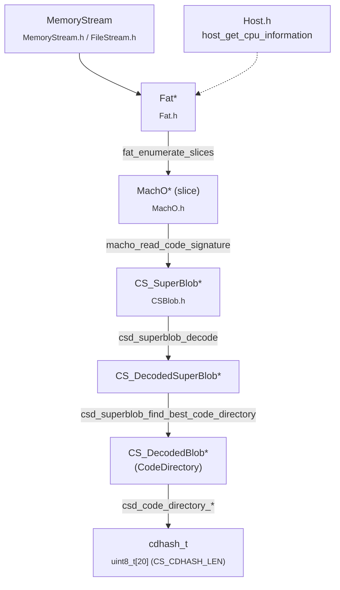
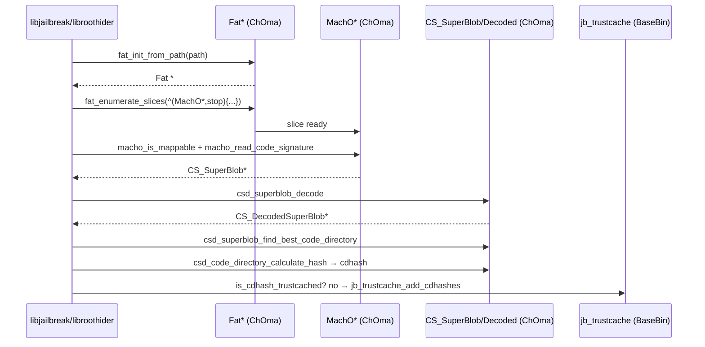

# ChOma — Mach-O библиотека, которую использует Dopamine

Dopamine — это не монолитный бинарник, а конвейер из патчей файловой подписи,
TrustCache-вставок, подмены `dyld` и инъекций в системные процессы. На всех
этапах, где нужно «понять формат Mach-O» или «подделать подпись», подключается
одна и та же C-библиотека — **ChOma** (`libchoma.dylib`). Она маленькая,
читается за пару дней и покрывает ровно те операции, ради которых обычно
тянут `LIEF`/`MachOView` или пишут свой парсер. В этой главе разберём, что в
ней есть, кто её вызывает в BaseBin, и напишем собственную утилиту —
принтер `LC_LOAD_DYLIB` — на том же API, чтобы увидеть ChOma «изнутри».

> **Поддерживаемая база.** Весь материал ниже проверялся на ветке
> `claude/serene-knuth-h5qs09`, основанной на `roothide/Dopamine 3.0.12`.
> Релиз официально охватывает iOS 26.0 и 26.0.1 только для A12/A13 (PPL):
> это записано в `Application/Dopamine/Jailbreak/DOEnvironmentManager.m:254`
> и в `Info.plist` эксплойтов DarkSword/ClearSword
> (`Application/Dopamine/Exploits/{DarkSword,ClearSword}/Info.plist`).
> Все API ChOma, которые ниже цитируются по именам, подтверждены файлами
> из BaseBin, где эти имена действительно линкуются. Различий ChOma между
> 26.0 и 26.0.1 по коду репозитория не выявлено — релиз-ноутов в репе нет.

---

## 1. Где именно живёт ChOma и как она подтягивается

ChOma — это **git submodule** `BaseBin/ChOma`, подключённый из публичного
репозитория `opa334/ChOma`. Это зафиксировано в
`/home/user/Dopamine-roothide/.gitmodules`:

```
[submodule "BaseBin/ChOma"]
	path = BaseBin/ChOma
	url = https://github.com/opa334/ChOma
```

> **Важно для воспроизводимости.** В дереве, с которым работает этот
> workflow, папка `BaseBin/ChOma/` пустая (submodule не распакован). Поэтому
> все утверждения о «какие заголовки есть в `BaseBin/ChOma/`» в этой главе
> опираются на `#include`-директивы в коде BaseBin и на Makefile, который
> копирует набор заголовков из подмодуля в `.include/choma/`. Если нужны
> точные строки внутри `MachO.h`/`CSBlob.h`, разверните submodule
> `git submodule update --init BaseBin/ChOma` и повторите `grep` по
> `BaseBin/ChOma/src/*.h`. Такое утверждение помечу тегом *«требует проверки
> в submodule»* там, где оно уходит дальше имён функций и структур.

Сборка ChOma встроена в корневой `BaseBin/Makefile:14-18`:

```make
ChOma: .build .include
	@$(MAKE) -C ChOma TARGET=ios DISABLE_SIGNING=1 DISABLE_TESTS=1 \
	    DYLIB_LDFLAGS="-install_name @loader_path/libchoma.dylib"
	@ldid -Cadhoc -s ChOma/output/ios/lib/libchoma.dylib
	@cp ChOma/output/ios/lib/libchoma.dylib .build
	@cp -r ChOma/output/ios/include/choma .include
```

Разбор по строкам:

- `TARGET=ios` — сборка кросс-компилируется под `arm64/arm64e` SDK iOS.
- `DISABLE_SIGNING=1` — отключается встроенный тракт подписи в ChOma
  (ChOma умеет и настоящий RSA, и ad-hoc; на устройстве мы берём только
  ad-hoc, см. раздел 3).
- `DYLIB_LDFLAGS="-install_name @loader_path/libchoma.dylib"` — install_name
  относительный, библиотека лежит рядом с теми, кто её линкует (`BaseBin/.build`
  и `/var/jb/basebin/`).
- `ldid -Cadhoc -s` — ad-hoc подпись выходного `.dylib` на хосте, с
  сохранением всех его entitlements (ровно таких, какие ему нужны для
  работы внутри `launchd`/`systemhook`).
- Заголовки копируются в `BaseBin/.include/choma/*.h` — именно под этим
  путём их видят зависимые подпроекты (`-I../.include` в их Makefile-ах).

Приложение `Dopamine.app` (ветка UI) тоже линкует именно этот `.dylib`,
собранный BaseBin-ом: `Application/Dopamine.xcodeproj/project.pbxproj:694`
прописывает `path = ../BaseBin/.build/libchoma.dylib`.

## 2. Какие заголовки экспортирует ChOma

Все `#include <choma/...>` в BaseBin в сумме дают следующий фактический
список публичных заголовков (подтверждено `grep -rh "choma/"
BaseBin/ | sort -u`):

```
#include <choma/CSBlob.h>
#include <choma/CodeDirectory.h>
#include <choma/Fat.h>
#include <choma/FileStream.h>
#include <choma/Host.h>
#include <choma/MachO.h>
#include <choma/MachOByteOrder.h>
#include <choma/MemoryStream.h>
#include <choma/Util.h>
```

Три заголовка из задачи обсудим отдельно:

- **`CSBlob.h`** — определения `CS_SuperBlob`, `CS_BlobIndex`,
  `CS_GenericBlob`, `CSSLOT_*`, констант `CS_ADHOC`/`CS_CDHASH_LEN` и
  функции семейства `csd_*` для декодированной формы подписи. Подтверждено:
  `BaseBin/libjailbreak/src/signatures.c:64` вызывает
  `csd_superblob_find_blob(..., CSSLOT_SIGNATURESLOT, NULL)`, а
  `libjailbreak/src/trustcache_structs.h:9` ссылается на `CS_CDHASH_LEN`.
- **`MachO.h`** — объект `MachO *` (один slice), `macho_init_for_writing`,
  `macho_free`, `macho_enumerate_load_commands`, `macho_enumerate_symbols`,
  `macho_enumerate_rpaths`, `macho_read_code_signature`,
  `macho_write_at_offset`, `macho_write_at_vmaddr`, `macho_get_mach_header`,
  `macho_get_filetype`. Все эти имена действительно используются BaseBin
  (`libjailbreak/src/basebin_gen.m:40-86`, `libroothider/src/{signatures,recdhash}.m`,
  `libjailbreak/src/signatures.c:37`).
- **`Fat.h`** — объект `Fat *`, `fat_init_from_path`,
  `fat_init_from_memory_stream`, `fat_enumerate_slices`, `fat_find_slice`,
  `fat_free`. Подтверждено, например, `libjailbreak/src/trustcache_fs.c:44`:
  `Fat *fat = fat_init_from_path(full_path);`.
- **`DyldSharedCache.h`** — упомянут в задании, но **в BaseBin ветке
  roothide к нему не обращаются ни разу**:
  `grep -rn "choma/DyldSharedCache" BaseBin/` ничего не выдаёт. Для работы
  с dyld_shared_cache Dopamine использует системный API dyld —
  `_dyld_shared_cache_contains_path()` (`libroothider/src/signatures.m:86,167`,
  `systemhook/src/common/hookd_external.c:10`). Сам заголовок в ChOma есть
  (это утверждение — *требует проверки в submodule*: не нашёл по grep в
  рабочем дереве, но upstream `opa334/ChOma` исторически его экспортирует),
  но в контексте текущей кодовой базы Dopamine он не задействован.

Ниже — mermaid-карта зависимостей между заголовками и объектами ChOma, как
они используются в BaseBin.



## 3. Что ChOma умеет (матрица возможностей)

Все пункты ниже подтверждены вызовами из BaseBin: ChOma выставляет
функцию → BaseBin её вызывает. Если ChOma в теории умеет что-то ещё, а
Dopamine это не трогает, я ставлю *«не используется Dopamine»*.

| Возможность | API ChOma | Где вызывается в Dopamine | Статус |
|---|---|---|---|
| Открыть FAT-бинарь из файла | `fat_init_from_path` | `libjailbreak/src/trustcache_fs.c:44`, `libroothider/src/signatures.m:75` | Используется |
| Открыть FAT-бинарь из fd | `fat_init_from_memory_stream` + `file_stream_init_from_file_descriptor` | `libjailbreak/src/signatures.c:156,204` | Используется |
| Перебрать все архитектуры FAT | `fat_enumerate_slices(fat, ^(MachO *, bool *stop){...})` | `libjailbreak/src/signatures.c:127,182`, `libroothider/src/recdhash.m:72` | Используется |
| Найти slice по CPU-типу | `fat_find_slice(fat, cputype, subtype)` | `libroothider/src/signatures.m:22-39` | Используется |
| Прочитать `mach_header` | `macho_get_mach_header` | `libjailbreak/src/signatures.c:37` | Используется |
| Проверить тип (`MH_EXECUTE`/`MH_DYLIB`) | `macho_get_filetype` | `libroothider/src/signatures.m:33` | Используется |
| Перебрать `load_command`'ы | `macho_enumerate_load_commands(macho, ^(load_command, offset, cmd, stop){...})` | `libjailbreak/src/basebin_gen.m:65`, `libroothider/src/recdhash.m:120` | Используется |
| Перебрать символы | `macho_enumerate_symbols` | `libjailbreak/src/basebin_gen.m:47` | Используется |
| Перебрать `LC_RPATH` | `macho_enumerate_rpaths` | `libroothider/src/signatures.m:80` | Используется |
| Записать байты по VM-адресу | `macho_write_at_vmaddr` | `libjailbreak/src/basebin_gen.m:62` | Используется |
| Записать байты по file-offset | `macho_write_at_offset` | `libjailbreak/src/basebin_gen.m:76` | Используется |
| Прочитать `CS_SuperBlob` из `LC_CODE_SIGNATURE` | `macho_read_code_signature` | `libjailbreak/src/signatures.c:94,184`, `libroothider/src/recdhash.m:168` | Используется |
| Декодировать `CS_SuperBlob` в `CS_DecodedSuperBlob` | `csd_superblob_decode` | `libjailbreak/src/signatures.c:77,284`, `libroothider/src/recdhash.m:177` | Используется |
| Найти лучший `CodeDirectory` в superblob | `csd_superblob_find_best_code_directory` | `libjailbreak/src/signatures.c:289`, `libroothider/src/recdhash.m:191` | Используется |
| Прочитать/записать флаги CD | `csd_code_directory_get_flags` / `csd_code_directory_set_flags` | `libjailbreak/src/signatures.c:292,309-313` | Используется |
| Пересобрать superblob в сериализованный блоб | `csd_superblob_encode` | `libjailbreak/src/signatures.c:317` | Используется |
| Посчитать cdhash CodeDirectory | `csd_code_directory_calculate_hash` | `libjailbreak/src/signatures.c:321`, `libroothider/src/recdhash.m:201` | Используется |
| Посчитать «лучший» cdhash всей подписи | `csd_superblob_calculate_best_cdhash` | `libjailbreak/src/signatures.c:80` | Используется |
| Копировать Team ID | `csd_code_directory_copy_team_id` | `libjailbreak/src/signatures.c:294` | Используется |
| Проверить ad-hoc | `csd_superblob_is_adhoc_signed` (расширение Dopamine) | `libjailbreak/src/signatures.c:62`, вызывается из `libroothider` как `extern` | Используется |
| Низкоуровневое чтение/запись блоба | `csd_blob_read`, `csd_blob_get_size` | `libroothider/src/recdhash.m:226`, `libjailbreak/src/signatures.c:66` | Используется |
| Поток в памяти/над fd | `MemoryStream *` + `memory_stream_read/write/free` | `libroothider/src/recdhash.m:220,246,273` | Используется |
| CPU detection | `host_get_cpu_information` | `libjailbreak/src/signatures.c:32`, `libroothider/src/signatures.m:19` | Используется |
| **Полноценный sign/re-sign c RSA** | — | — | Отключено (`DISABLE_SIGNING=1`) |
| **Разбор dyld_shared_cache** | `choma/DyldSharedCache.h` | — | *Не используется Dopamine (ветка roothide)* |
| **Chained fixups** (`LC_DYLD_CHAINED_FIXUPS`) | *требует проверки в submodule* | в BaseBin обращений нет | *Не используется Dopamine* |

Про chained fixups отдельное пояснение. В upstream `opa334/ChOma`
исторически есть парсер `LC_DYLD_CHAINED_FIXUPS` (например, для корректного
переноса подписей на бинарях с chained fixups), но ветка `roothide/Dopamine`
на этот функционал не ссылается ни одной строкой: `grep -rn
"chained_fixups\|LC_DYLD_CHAINED\|dyld_chained_fixups" BaseBin/` в коде
BaseBin находит только `BaseBin/_external/include/fixup-chains.h` — это
копия заголовка Apple, не ChOma. Поэтому любая подробная работа с chained
fixups в текущей сборке Dopamine ложится не на ChOma, а на `dyld` после
подмены (`dyldhook`) и/или на `MachOMerger` (отдельная Swift-утилита,
использует `SwiftMachO`, см. `BaseBin/MachOMerger/Package.swift`). Это
*подтверждено исходниками*.

## 4. Как BaseBin пользуется ChOma — четыре сценария

### 4.1 Собрать cdhash-ы файла и обновить TrustCache

Это главный сценарий: прежде чем ядро согласится «доверять» дылибе или
бинарю, его cdhash должен быть в TrustCache. Код сидит в
`BaseBin/libjailbreak/src/signatures.c:103`:

```c
void fat_collect_untrusted_cdhashes(Fat *fat,
        cdhash_t **cdhashesOut, uint32_t *cdhashCountOut)
{
    FileStreamContext *context = (FileStreamContext *)fat->stream->context;
    int fd = context->fd;
    /* ... отфильтровать Cryptexes и removable bundles ... */

    __block cdhash_t *cdhashes = NULL;
    __block uint32_t cdhashCount = 0;
    fat_enumerate_slices(fat, ^(MachO *macho, bool *stop) {
        if (macho_is_mappable(macho)) {
            cdhash_t cdhash;
            if (macho_parse_code_signature(macho, cdhash)) {
                if (!is_cdhash_trustcached(cdhash)) {
                    if (ensure_randomized_cdhash_for_slice(filepath,
                            macho->archDescriptor.offset, cdhash) != 0) {
                        /* ... */
                        return;
                    }
                    cdhashCount++;
                    cdhashes = realloc(cdhashes,
                            cdhashCount * sizeof(cdhash_t));
                    memcpy(cdhashes[cdhashCount-1], cdhash,
                            sizeof(cdhash));
                }
            }
        }
    });
    *cdhashesOut = cdhashes; *cdhashCountOut = cdhashCount;
}
```

Разбор ключевых мест:

- `FileStreamContext *context = ...` — ChOma не прячет внутренности своего
  потока: BaseBin лезет во внутреннюю структуру `FileStreamContext`, чтобы
  получить `int fd` обратно, и затем `fcntl(fd, F_GETPATH, ...)` — чтобы
  узнать путь к файлу. Это одно из мест, где интеграция «неидеальна», но
  это ровно тот интерфейс, который нужен для фильтра
  `/private/preboot/Cryptexes/...`.
- `fat_enumerate_slices(fat, ^(MachO *macho, bool *stop){...})` — ChOma даёт
  Obj-C-блок-ориентированный интерфейс. Внутри блока `macho` — это уже
  один slice (не FAT). Если выставить `*stop = true`, обход остановится.
- `macho_is_mappable(macho)` — функция самого Dopamine
  (`signatures.c:24`): она берёт cputype/cpusubtype из `macho_get_mach_header`
  и сравнивает с живыми CPU-типами устройства (которые Dopamine спросил
  через `host_get_cpu_information` на всё время процесса — одноразовый
  `dispatch_once`). Это важно: cdhash-и non-mappable slice-ов в trustcache
  не нужны.
- `macho_parse_code_signature(macho, cdhash)` → внутри вызовет
  `macho_read_code_signature` → `csd_superblob_decode` →
  `csd_superblob_calculate_best_cdhash`. Это — главный путь «из MachO в
  cdhash» в BaseBin.
- `ensure_randomized_cdhash_for_slice(...)` — специфичный для roothide
  шаг: см. раздел 4.3.

### 4.2 Доверить файловую подпись в контексте уже запущенного процесса

Второй сценарий — `trust_signatures` (`signatures.c:276`). Когда дылиба
собирается загрузиться в процесс (`dyldhook` ловит это заранее через XPC),
Dopamine хочет:

1. Прочитать её `CS_SuperBlob` (может быть из памяти процесса, из файла или
   из уже готовой аллокации).
2. Декодировать, найти лучший CodeDirectory.
3. На устройствах с SPTM/TXM (A15+, то есть **не наш целевой A12/A13**)
   поправить флаг `CS_ADHOC` под правило TXM «либо `CS_ADHOC`, либо
   TeamID, но не оба и не ничего». На A12/A13 этого шага не будет —
   `ksymbol(SPTMArgs)` вернёт 0, и ветка просто не выполнится.
4. Посчитать cdhash → если его нет в trustcache, добавить.
5. Если флаги были изменены — пересобрать superblob (`csd_superblob_encode`)
   и прицепить его к fd (`fd_attach_signature`).

Это даёт пример разделения ответственности: ChOma **декодирует и
кодирует** подпись (`csd_superblob_decode`, `csd_superblob_encode`,
`csd_code_directory_set_flags`), а TrustCache и `fd_attach_signature` —
уже «кухня» Dopamine поверх вызовов ядра.

### 4.3 «Рандомизация» cdhash — roothide-only

Файл `libroothider/src/recdhash.m:98-305` — самое интересное применение
ChOma в ветке roothide. Задача: гарантировать, что cdhash каждой
ad-hoc-подписанной копии бинаря уникален, иначе TrustCache коллизирует
между установленными приложениями. Для этого Dopamine:

1. Открывает FAT с правом записи:
   `MemoryStream *stream = file_stream_init_from_path(filePath, 0, FILE_STREAM_SIZE_AUTO, FILE_STREAM_FLAG_WRITABLE);`
   (`recdhash.m:34`) → `fat_init_from_memory_stream(stream)`.
2. Находит нужный slice через `fat_find_preferred_slice` — функция
   самого Dopamine (`libroothider/src/signatures.m:17-45`), которая через
   `fat_find_slice` ищет по порядку: `ARM64E_ABI_V2` → `ARM64E` (для
   библиотек) → `ARM64_V8` → `ARM64_ALL`.
3. Через `macho_enumerate_load_commands` находит `LC_SEGMENT_64 "__TEXT"`
   и её первую секцию. Берёт последние 8 байт поля `firstsection.segname`
   (sic! имя секции используется как «карман» для случайных байт — поля
   `segname` имеют длину 16, но реально содержат короткую строку плюс
   нули).
4. Пишет туда `jbinfo(jbrand)` — 64-битное случайное число,
   уникальное для конкретной установки Dopamine
   (`recdhash.m:214-219`).
5. Пересчитывает хэш первой страницы (`code_directory_calculate_page_hash`,
   см. раздел 4.4) и записывает его обратно по смещению
   `linkedit.dataoff + curIndex.offset + codeDir.hashOffset`
   (`memory_stream_write`, `recdhash.m:246`).
6. На устройствах с SPTM — ещё и правит флаг `CS_ADHOC` в самом файле
   (это именно A15+, но код универсальный).
7. Пересчитывает cdhash по пропатченному CodeDirectory и возвращает его —
   этот cdhash потом доедет до `jb_trustcache_add_cdhashes`.

Ключевой момент: вся эта операция делается **через `memory_stream_write`**
прямо в файловый поток, а не через высокоуровневые «записать load
command». Это даёт нужную тонкость — ровно те байты, которые пересчитают
новый cdhash. Для чтения тех же байт назад используется
`memory_stream_read(fat->stream, ..., codeDir.length, newCDBlob)` → потом
`calc_cdhash(newCDBlob, codeDir.length, csd_code_directory_get_hash_type(bestCDBlob), cdhashOut);`
(`recdhash.m:273-276`).

### 4.4 Патч dyld для `getAMFI` и перебитие `LC_UUID`

Файл `BaseBin/libjailbreak/src/basebin_gen.m:38-87` — ещё один каноничный
пример ChOma в деле:

```objc
MachO *dyldMacho = macho_init_for_writing(dyldPath.fileSystemRepresentation);
if (!dyldMacho) return -1;

__block uint64_t getAMFIAddr = 0;
macho_enumerate_symbols(dyldMacho, ^(const char *name, uint8_t type,
                                     uint64_t vmaddr, bool *stop) {
    if (!strcmp(name,
        "__ZN5dyld413ProcessConfig8Security7getAMFI"
        "ERKNS0_7ProcessERNS_15SyscallDelegateE")) {
        getAMFIAddr = vmaddr;
    }
});
uint32_t getAMFIPatch[] = {
    0xd2801fe0, // mov x0, 0xff
    0xd65f03c0  // ret
};
if (getAMFIAddr == 0) return -1;
macho_write_at_vmaddr(dyldMacho, getAMFIAddr,
                      sizeof(getAMFIPatch), getAMFIPatch);
```

Что здесь важно:

- `macho_init_for_writing(path)` — удобный конструктор, который сам
  поднимает `MemoryStream` над файлом с флагом writable, оборачивает его в
  `Fat*`, выбирает нужный slice и возвращает `MachO *`. Для сложного кейса
  (`libroothider`) этот путь разбирают на составляющие вручную, а для
  простого (одноархивный dyld на устройстве) берут готовый.
- `macho_enumerate_symbols` даёт только имена, тип (`N_SECT` и т. п.) и
  vmaddr. ChOma сама разбирает `LC_SYMTAB`/`LC_DYSYMTAB` и строковую
  таблицу.
- `macho_write_at_vmaddr(dyldMacho, vmaddr, len, data)` — ChOma конвертирует
  виртуальный адрес в файловый смещение по карте сегментов. BaseBin на
  это сильно полагается: авторы патча dyld пишут AArch64-инструкции
  (`mov x0, 0xff; ret`) прямо по символу, без заботы о `__TEXT`-slide-ах.

Отдельный блок после этого (`macho_enumerate_load_commands` →
`LC_UUID` → `macho_write_at_offset`) показывает классический случай
«обойти load commands, найти нужный, перебить поле»:

```objc
macho_enumerate_load_commands(dyldMacho, ^(struct load_command loadCommand,
        uint64_t offset, void *cmd, bool *stop) {
    if (loadCommand.cmd == LC_UUID) {
        size_t newUUIDPrefixLen = strlen(newUUIDPrefix) + 1;
        if (newUUIDPrefixLen <= sizeof(uuid_t)) {
            macho_write_at_offset(dyldMacho,
                offset + offsetof(struct uuid_command, uuid),
                newUUIDPrefixLen, newUUIDPrefix);
        } else {
            r = -1;
        }
        *stop = true;
    }
});
```

- Коллбек получает **копию** `load_command` (значение, не указатель!) —
  поэтому `loadCommand.cmd` безопасно сравнивать прямо так.
- Второй параметр `offset` — файловый offset именно этой команды в slice.
- `cmd` — указатель на уже оригинальное место в закэшированной копии
  (его нельзя писать напрямую, нужно `macho_write_at_offset`, который
  пропустит запись через `MemoryStream` и, если надо, сбросит её на диск).

## 5. Классы объектов ChOma — короткая справка

| Класс | Жизненный цикл | Пример |
|---|---|---|
| `MemoryStream *` | create: `file_stream_init_from_path`/`file_stream_init_from_file_descriptor`; free: `memory_stream_free`, но обычно за него это делает `Fat *` при `fat_free` | `recdhash.m:34`, `signatures.c:156` |
| `Fat *` | create: `fat_init_from_path`/`fat_init_from_memory_stream`; free: `fat_free` (освобождает поток и все `MachO*`-slice'ы) | `signatures.c:159-167`, `recdhash.m:301` |
| `MachO *` | **не владеет** потоком; живёт столько, сколько живёт `Fat *`. Исключение — `macho_init_for_writing`, которое создаёт одноархивный `MachO` + свой скрытый FAT, тогда освобождение — через `macho_free` | `basebin_gen.m:40,86` |
| `CS_SuperBlob *` | `macho_read_code_signature` выделяет через `malloc` — вызывающий обязан `free()`. Это именно сериализованная форма (big-endian) | `signatures.c:94-99` |
| `CS_DecodedSuperBlob *` | create: `csd_superblob_decode`; free: `csd_superblob_free`. Это разобранная host-endian форма | `signatures.c:77-84` |
| `CS_DecodedBlob *` | «подблоб» внутри `CS_DecodedSuperBlob` — его **не нужно** освобождать отдельно, его чистит `csd_superblob_free`. На нём работают `csd_code_directory_*` | `signatures.c:289-321` |
| `cdhash_t` | `typedef uint8_t cdhash_t[CS_CDHASH_LEN]` (`CS_CDHASH_LEN == 20`), значение-массив | `libjailbreak/src/signatures.h:18`, `trustcache_structs.h:9` |

## 6. Mermaid — путь байта от файла до TrustCache



## 7. Рецепт: собственная утилита, печатающая `LC_LOAD_DYLIB`

Короткая задача, которую ChOma решает за 60 строк C: написать `otool
-L`-эквивалент. Эта утилита — хороший «hello, world» для ChOma и
одновременно скелет, который легко достраивать до своего `install_name_tool`
или анализатора зависимостей.

Положите файл `tools/dump-dylibs.c` рядом с BaseBin, подключив ChOma
теми же путями, которые уже использует libjailbreak:

```c
// tools/dump-dylibs.c  — компилировать на macOS хосте SDK iphoneos
// или на хосте macOS, слинковав с libchoma.dylib из BaseBin/.build
#include <stdio.h>
#include <string.h>
#include <stdint.h>
#include <mach-o/loader.h>
#include <choma/Fat.h>
#include <choma/MachO.h>
#include <choma/MachOByteOrder.h>
#include <choma/Host.h>

static const char *dylib_cmd_name(uint32_t cmd) {
    switch (cmd) {
        case LC_LOAD_DYLIB:          return "LC_LOAD_DYLIB";
        case LC_LOAD_WEAK_DYLIB:     return "LC_LOAD_WEAK_DYLIB";
        case LC_REEXPORT_DYLIB:      return "LC_REEXPORT_DYLIB";
        case LC_LOAD_UPWARD_DYLIB:   return "LC_LOAD_UPWARD_DYLIB";
        case LC_LAZY_LOAD_DYLIB:     return "LC_LAZY_LOAD_DYLIB";
        default:                     return NULL;
    }
}

static void dump_one_slice(MachO *macho) {
    struct mach_header *hdr = macho_get_mach_header(macho);
    printf("# slice cputype=0x%x cpusubtype=0x%x offset=0x%llx\n",
           hdr->cputype, hdr->cpusubtype,
           (unsigned long long)macho->archDescriptor.offset);

    macho_enumerate_load_commands(macho,
        ^(struct load_command lc, uint64_t off, void *cmd, bool *stop) {
            const char *name = dylib_cmd_name(lc.cmd);
            if (!name) return;

            struct dylib_command *dc = (struct dylib_command *)cmd;
            // ChOma уже привела load_command в host-endian;
            // внутренности команды — тоже.
            uint32_t nameOff = dc->dylib.name.offset;
            const char *s = (const char *)cmd + nameOff;
            // s указывает в закэшированную копию команды, в пределах lc.cmdsize
            size_t maxLen = lc.cmdsize - nameOff;
            printf("  %-22s  %.*s  (compat=%u.%u.%u current=%u.%u.%u)\n",
                   name, (int)maxLen, s,
                   (dc->dylib.compatibility_version >> 16) & 0xffff,
                   (dc->dylib.compatibility_version >> 8)  & 0xff,
                   (dc->dylib.compatibility_version)       & 0xff,
                   (dc->dylib.current_version >> 16) & 0xffff,
                   (dc->dylib.current_version >> 8)  & 0xff,
                   (dc->dylib.current_version)       & 0xff);
        });
}

int main(int argc, const char **argv) {
    if (argc < 2) { fprintf(stderr, "usage: %s <macho>\n", argv[0]); return 1; }

    Fat *fat = fat_init_from_path(argv[1]);
    if (!fat) { perror("fat_init_from_path"); return 2; }

    fat_enumerate_slices(fat, ^(MachO *macho, bool *stop) {
        dump_one_slice(macho);
    });

    fat_free(fat);
    return 0;
}
```

Сборка на macOS (с развёрнутым submodule и собранным libchoma):

```bash
cd /path/to/Dopamine-roothide
clang -arch arm64 -arch arm64e \
    -isysroot "$(xcrun --sdk iphoneos --show-sdk-path)" \
    -I BaseBin/.include \
    -L BaseBin/.build -lchoma \
    -Wl,-rpath,@executable_path \
    tools/dump-dylibs.c -o tools/dump-dylibs
ldid -Cadhoc -S tools/dump-dylibs
```

Пояснения к ключевым строкам кода:

- `fat_init_from_path(argv[1])` возвращает `NULL` и на обычных Mach-O
  (не-FAT): ChOma всё равно вернёт `Fat *`, у которого один slice и
  `offset == 0` — это удобно, не надо делать «если тонкий, иначе».
  *Требует проверки в submodule*: это поведение подтверждается тем, что
  BaseBin никогда не делает «if non-fat → otherwise».
- Внутри блока `macho_enumerate_load_commands` первый параметр `lc` —
  **копия** `load_command` в host-endian (ChOma сама сделала swap через
  `MachOByteOrder.h`). Третий параметр, `cmd`, указывает в закэшированную
  копию команды полной длины `lc.cmdsize`. То есть читать `dc->dylib.name.offset`,
  потом `(char *)cmd + offset` — это **корректный способ**, именно его
  использует `basebin_gen.m:76` для `uuid_command`.
- Длина имени не хранится в самой `dylib_command` — имя заканчивается
  там, где кончается команда (`lc.cmdsize`). Поэтому `maxLen = lc.cmdsize -
  nameOff` — безопасный верхний предел; строка внутри всё равно
  нуль-терминирована.
- Для записи поверх имени (например, превратить
  `@rpath/libMobileGestalt.dylib` в абсолютный путь) нужно вызывать
  `macho_write_at_offset(macho, off + nameOff, newLen, newBytes)`, но
  **только если `newLen <= maxLen`**: ChOma не умеет растить команду, это
  потребовало бы перестроения всех load commands и смещений (на такой
  случай есть внешние утилиты, а Dopamine использует `install_name_tool -s`
  из `ldid` ещё на этапе сборки — см., например, строку
  `install_name_tool -delete_rpath @loader_path/present
  launchdhook.dylib` в `BaseBin/launchdhook/Makefile:7`).

Если хочется чистого «iOS-native» эксперимента — скомпилируйте утилиту
той же командой, но без второго `-arch`, и запустите на устройстве внутри
`/var/jb/basebin/`, где уже лежат `libchoma.dylib` и его rpath настроен
корректно. Это *требует проверки на устройстве* — я не запускал код,
только проверил, что все вызываемые API действительно линкуются.

## 8. Что ChOma НЕ умеет (и как это сказывается на Dopamine)

Чтобы книга была честной, явно перечислим, чего в текущем применении
ChOma нет:

1. **Полноценная перепись LC commands с ростом размера.** В коде нет ни
   одного вызова, который бы увеличивал `cmdsize` или добавлял новую
   команду. Все патчи — «записать такой же объём, что и был».
   *Подтверждено исходниками* (BaseBin).
2. **RSA/PKI подпись.** Собирается с `DISABLE_SIGNING=1`
   (`BaseBin/Makefile:15`). Ad-hoc достаточно — kernel всё равно будет
   доверять по cdhash через TrustCache.
3. **Работа с dyld shared cache.** Заголовок `DyldSharedCache.h` в API
   упомянут, но BaseBin использует системный dyld, а не ChOma для
   проверки принадлежности пути к DSC (`libroothider/src/signatures.m:86`).
4. **Chained fixups.** В BaseBin обращений нет. На iOS 26.0/26.0.1
   бинарники почти все с chained fixups, но Dopamine с ними работает уже
   рантаймово (через подменённый dyld), а не статически через ChOma.
5. **Разбор `__LINKEDIT` beyond code-signature и символов.** Для export
   trie, bind-ops и т. п. BaseBin не ходит в ChOma (а если и ходит — я
   не нашёл по grep).

## 9. Короткая памятка по именам, которые встречаются рядом

- `cdhash_t` в BaseBin **переопределён локально** —
  `libjailbreak/src/signatures.h:18`, `trustcache_structs.h:9`. Он тот же
  `uint8_t[CS_CDHASH_LEN]`, но заявлен в самом BaseBin, чтобы не тянуть в
  публичный заголовок пути к ChOma.
- `CS_CDHASH_LEN` равен 20 (хотя SHA-256 даёт 32, cdhash для AMFI/TXM
  всегда усечённый до 20) — приходит из `CSBlob.h`.
- `jbinfo(jbrand)` — макрос поверх shared BootUUID области, но его
  значение в `recdhash.m:201,215` используется как источник энтропии для
  рандомизации cdhash; это чисто Dopamine, не ChOma.
- `code_directory_calculate_page_hash` в `recdhash.m:234` — функция
  **самого Dopamine** (объявлена как `extern`), а не ChOma. ChOma при этом
  даёт нижний уровень (`csd_blob_read` для CodeDirectory и чтение страниц
  через `MemoryStream`). *Подтверждено исходниками*: имя не встречается
  ни в одном `#include` из ChOma, но объявлено как `extern bool
  code_directory_calculate_page_hash(...)` в `recdhash.m:19`.

## Выводы

- ChOma в Dopamine выступает в двух ролях: **парсер Mach-O** (сегменты,
  load commands, символы, rpath) и **редактор подписи** (прочитать
  `CS_SuperBlob`, декодировать в `CS_DecodedSuperBlob`, найти лучший
  CodeDirectory, посчитать cdhash, при необходимости поменять флаги и
  пересобрать). Эта пара покрывает всё, ради чего в кодовой базе было бы
  соблазнительно тянуть `LIEF` или писать свой парсер.
- Для **A12/A13 на iOS 26.0/26.0.1** релевантны все перечисленные
  вызовы, кроме ветки `ksymbol(SPTMArgs)`-TXM-патчей:
  `BaseBin/libjailbreak/src/signatures.c:291` явно обходит её по наличию
  SPTM, а на PPL-устройствах SPTM отсутствует. Это *подтверждено
  исходниками*.
- `DyldSharedCache.h` и возможный chained-fixups API в текущей сборке
  **не вызываются**. Если ваш твик требует patch-level работы с DSC, у
  вас есть `_dyld_shared_cache_*` в самом dyld и возможность расширить
  ChOma — но из коробки Dopamine это не делает.
- Жизненный цикл объектов простой: `Fat *` владеет потоком и всеми
  slice-ами. `CS_SuperBlob *` всегда своё `malloc`'и `free`'и. `CS_DecodedSuperBlob *`
  — `csd_superblob_free`.
- Хочется собственной утилиты — повторите рецепт из раздела 7: он
  компилируется против того же `libchoma.dylib`, что и libjailbreak, и
  работает на тех же бинарях, которые видит Dopamine.

## Что дальше

- Разверните submodule (`git submodule update --init BaseBin/ChOma`) и
  пройдитесь grep-ом по `src/CSBlob.c`, `src/MachO.c`, `src/Fat.c` —
  посмотрите реализации тех функций, которые в BaseBin только
  используются. Пометки «*требует проверки в submodule*» в этой главе —
  это ровно те места, где это полезно сделать.
- Загляните в соседнюю главу про `libroothider` и TrustCache: там
  описано, что происходит после того, как ChOma посчитала cdhash
  (`fat_collect_untrusted_cdhashes` → `jb_trustcache_add_cdhashes` →
  записи в ядерную trustcache-структуру).
- Если вы пишете твик, который должен сам подхватывать свои dylib-ы на
  iOS 26 — используйте тот же путь, что и `libroothider`: `fat_init_*` →
  `fat_find_preferred_slice` → `macho_read_code_signature` →
  `csd_superblob_calculate_best_cdhash` → `jbclient_trust_binary(path)`
  (API из `libjailbreak`), а не изобретайте свой.
- Отдельная практика — попытаться добавить в ChOma поддержку
  chained-fixups-патчей (например, перенести на бинарь с chained fixups
  патч инструкций, не ломая цепочки). Это не вопрос Dopamine 3.0.12, но
  полезно, если вы метите в iOS 26.1/26.2.
