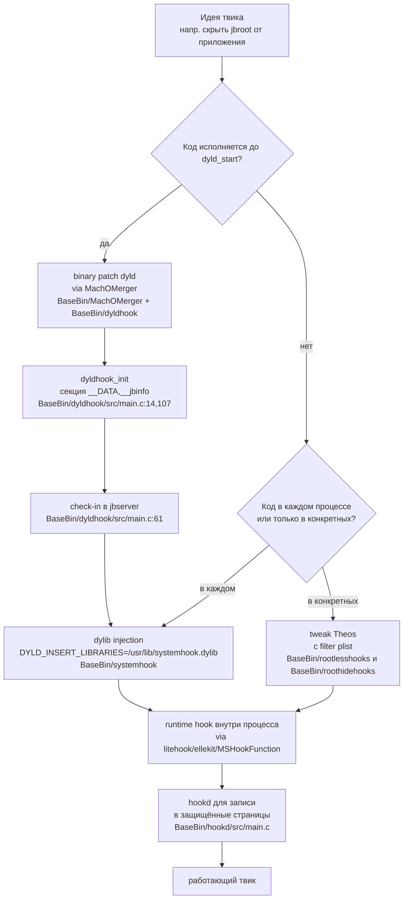

# Глава I.1. Патч, runtime-хук, тwик и binary patch — что чем отличается

Из этой главы читатель узнает, как разложить любую задачу по модификации iOS на пять ясно разграниченных примитивов (патч исходного кода, патч бинарника, инъекция dylib, рантайм‑хук, твик), какой из них в какой ситуации уместен, как каждый из них воплощён в коде Dopamine RootHide 3.0.12 и чем ситуация на iOS 26.0/26.0.1 для A13 отличается от старых джейлбрейков. К концу главы вы должны уметь по формулировке «надо сделать X» без подсказки сказать, какой из пяти примитивов тут нужен и в какой файл репозитория смотреть, чтобы увидеть пример.

Эта глава закрывает терминологический разрыв, который обычно мешает читать документацию по iOS-джейлбрейкам. Прежде чем в последующих главах мы начнём собирать первый твик (tweak) под iOS 26.0/26.0.1 на A13, нужно договориться о понятиях: что считается патчем исходного кода (source patch), чем от него отличается патч бинарный (binary patch), что такое инъекция динамической библиотеки (dylib injection), что происходит, когда говорят про перехват в рантайме (runtime hook), и, наконец, где во всей этой системе находится тwик как единица распространения. Разделы ниже опираются на реально существующий код репозитория Dopamine RootHide: для каждого механизма указан конкретный модуль из каталога `BaseBin/`, который этот механизм воплощает. Это не академическая классификация, а рабочая карта инструментов.

Поддерживаемые версии и устройства задаются в самом Dopamine. Строка пользовательского описания собрана в `Application/Dopamine/Jailbreak/DOEnvironmentManager.m:254` и для процессоров A12 (CPUFAMILY_ARM_VORTEX_TEMPEST) и A13 (CPUFAMILY_ARM_LIGHTNING_THUNDER) возвращает значение `@"iOS 15.0 - 18.7.1, 26.0 - 26.0.1 (A12/A13, PPL)"`. Диапазон 19.0–26.0.1 для эксплойтов DarkSword и ClearSword, а также конкретные сборки `23B5044l`, `23B5059e`, `23B5064e` зафиксированы в `Application/Dopamine/Exploits/DarkSword/Info.plist` и в `Application/Dopamine/Exploits/ClearSword/Info.plist`. Везде в книге, когда речь идёт про «iOS 26 на A13», подразумевается именно эта комбинация; на iOS 26 с SPTM (A14 и выше) описанные приёмы, подтверждённые исходниками Dopamine 3.0.12 roothide, напрямую неприменимы.

## Зачем вообще нужно пять понятий

Любой достаточно сложный программный продукт для iOS собирается из нескольких механизмов одновременно; наивная модель «я напишу один твик» в практике быстро превращается в «я написал один твик, одну dylib‑инъекцию, один binary patch системного демона и одну правку исходников самого джейлбрейка». Если смешивать эти уровни в голове, при отладке будет непонятно, где именно сидит ошибка: ваш код в принципе не загрузился? Загрузился, но хук не поставился? Поставился, но хукается не та функция? Байт пропатчен, но подпись отвалилась? Пять аккуратно разведённых понятий дают пять отдельных мест, куда посмотреть, и обычно четыре из пяти оказываются посмотрены за минуты.

Поэтому следующий раздел сознательно начинается с определений, а не с кода. Мы примем, что читатель умеет писать на C и Objective‑C, но ни разу не собирал ни одного твика; что он знает про dynamic linker, но смутно представляет особенности iOS; что он слышал «Mobile Substrate» и «Theos», но не отличает их по технической роли. К концу раздела эти позиции должны стать ясными — не как заученные формулы, а как рабочий словарь.

## Пять понятий, которые путают

### Source patch — патч исходного кода

Самый простой из пяти механизмов и единственный, который не требует никаких джейлбрейк‑специфичных навыков.

По существу source patch — это изменение в исходном тексте программы с последующей пересборкой. Применительно к iOS это редкий сценарий: исходники системных компонентов недоступны, а патчить собственный проект (например, добавить фичу в чужой open-source клиент мессенджера) никакого джейлбрейка не требует. Патчи исходного кода в экосистеме Dopamine встречаются по отношению к компонентам, которые собираются из открытых репозиториев — например, в `BaseBin/_external/modules/` лежат отщеплённые от апстрима либы (`litehook`, `ChOma` и прочие), и Dopamine держит собственные форки с правками. Если вы читаете коммит в `BaseBin/systemhook/src/main.c` и видите изменение `+`/`-` в исходнике — это source patch. Для твикостроения этот тип интересен только как средство модифицировать сами джейлбрейк-утилиты, но не прикладные приложения.

### Binary patch — патч готового бинарного файла

Прежде чем перейти к определению, подчеркнём важную деталь: binary patch — это не всегда «я открыл hex‑редактор и поменял байт». Это и генерация нового Mach‑O, который заменит оригинальный, и вставка новой load‑команды, и даже дописывание секции кодовой подписи. Общий признак — изменение файла на диске до того, как он когда‑либо попадёт в адресное пространство.

Binary patch — это точечная правка уже скомпилированного Mach-O без обращения к исходникам. На диске меняются конкретные байты: один опкод заменяется на другой, строка таблицы символов переписывается, в бинарник вклеивается новая секция, в заголовок дописывается команда загрузки. После такой правки файл обычно нужно либо повторно подписать (ldid, codesign), либо подготовить так, чтобы подпись не проверялась (adhoc-подпись плюс amfi-обход, trust cache и так далее — обо всём этом в последующих главах).

Технические требования к инжектируемой dylib жёстче, чем к обычной. Dyld — это специальный Mach‑O: он не линкуется с libSystem, у него собственный `_start`, он сам реализует необходимые ему syscalls через `svc 0x80`. Инструмент `MachOMerger` требует, чтобы впаиваемая dylib была собрана с `-fno-stack-protector -fno-stack-check -fno-builtin -D_FORTIFY_SOURCE=0` и имела самодостаточные символы — любые внешние зависимости приведут к падению dyld на старте процесса. Это требование проверяется в `BaseBin/dyldhook/Makefile` правилом `UNDEF=$$(nm -u -j $@ ...)` и в `BaseBin/systemhook/Makefile:10-21` для `roothider_inline.o`: если `nm -u` что‑то выдал, сборка не проходит. Подобные ограничения — часть «цены» binary‑патча dyld; они не действуют на обычные тwики.

Классический пример в репозитории — то, что Dopamine делает с самим `dyld`. В каталоге `BaseBin/MachOMerger/` лежит отдельный Swift-инструмент, назначение которого описано в `BaseBin/MachOMerger/README.md`: «Merge two MachO binaries into one. The only supported use case at this moment is merging a dylib into dyld». Вторая строка там же требует, чтобы инжектируемая dylib была скомпилирована с ключами `-Xlinker -add_split_seg_info -Xlinker -no_auth_data`. Это настоящий binary patch: берётся системный `dyld` (загрузчик), берётся наш `dyldhook.dylib` (его исходник — `BaseBin/dyldhook/src/`), и в итоге на устройстве лежит один слитый Mach-O, у которого в разделе `__DATA` появляется чужая секция `__jbinfo` (объявлена в `BaseBin/dyldhook/src/main.c:14` директивой `__attribute__((section("__DATA,__jbinfo")))`), а в точке входа — наш `dyldhook_init` (`BaseBin/dyldhook/src/main.c:107`).

Два подводных камня у binary patch, которые часто вызывают часы ошибок у новичков. Первый — это кодовая подпись. Любой пропатченный Mach‑O теряет исходную подпись Apple, и amfi откажется его запускать. На iOS 26 это обойти ещё сложнее, чем на 15: SPTM/PPL ужесточили проверки, и просто подложить файл в `/usr/bin/` не выйдет. Dopamine решает это через собственный trust cache и adhoc‑подпись (через `ldid -S` или `codesign --sign -`); бинарник прописывается в собственную таблицу «доверенных» на устройстве, которую `amfid` считает валидной благодаря хуку в `rootlesshooks`/`roothidehooks`. Второй подводный камень — path translation: Dopamine‑дистрибутив живёт не в `/`, а под `jbroot` (о чём подробно будет в главе I.2), и путь, по которому binary patch физически лежит, не совпадает с путём, по которому его видит целевое приложение.

Для прикладного твикостроения прямое изменение байтов — крайняя мера. К нему прибегают, когда:

- нужная функция не экспортируется и не найдена другими способами, но известно её смещение в бинарнике приложения;
- приложение запускается до того, как джейлбрейк успевает что-либо проинжектировать, и других точек входа у нас нет;
- защита приложения активно противодействует рантайм-правкам (проверяет текстовые страницы на W^X, валидирует подписи mach_header), а переписать байты в не-executable копии безопаснее.

Контрпример: если задача — «добавить кнопку в системное приложение Настройки», binary patch не нужен. Settings грузится после userspace-ребута, в его адресное пространство уже вставилась `systemhook.dylib`, и подойдёт обычный runtime hook. Если же задача — «изменить поведение `dyld` до запуска процесса-жертвы», binary patch оказывается единственным вариантом, потому что к моменту выполнения `dyld_start` у нас ещё нет никаких своих библиотек в памяти (не подтверждено исходниками: альтернативные схемы — через kernel-патч `vm_map_entry` на `__TEXT dyld` — упоминаются в сторонней литературе, но в коде Dopamine 3.0.12 roothide не присутствуют).

### Dylib injection — инъекция динамической библиотеки

Инъекция — операция «вклеивания» вашей скомпилированной динамической библиотеки в адресное пространство процесса, который вы к этому не писали, не компилировали и, скорее всего, не контролируете. Это сердце iOS‑твикостроения последних пятнадцати лет: без инъекции ваш код просто не получит шанса исполниться в чужом процессе.

С точки зрения механики инъекция — это внедрение вашей `.dylib` в адресное пространство чужого процесса. Сам механизм не изменяет ни исходники, ни байты целевого бинарника; он лишь требует, чтобы в момент старта процесса (или уже после старта) загрузчик `dyld` подхватил дополнительный образ, вызвал его инициализаторы и дал ему исполниться наравне с кодом приложения.

У iOS есть ровно две категории путей для инъекции:

1. **До запуска процесса**, через переменную окружения `DYLD_INSERT_LIBRARIES`. Dopamine использует именно её. В `BaseBin/systemhook/src/common/common.c:155` стоит комментарий «Insert "DYLD_INSERT_LIBRARIES=/usr/lib/systemhook.dylib" into all binaries spawned», а ниже, в `BaseBin/systemhook/src/common/common.c:322`, виден реальный `envbuf_setenv(&envc, "DYLD_INSERT_LIBRARIES", newLibraryInsert)`. Хук на `posix_spawn`/`execve` расставляется в `BaseBin/systemhook/src/main.c:437-440` вызовами `litehook_hook_function(__posix_spawn, __posix_spawn_hook)` и `litehook_hook_function(__execve, __execve_hook)`. Этот же механизм используется и для самозатягивания джейлбрейка через `launchd`: в `BaseBin/launchdhook/src/main.m:213` после перезапуска userspace явно выполняется `setenv("DYLD_INSERT_LIBRARIES", JBROOT_PATH("/basebin/launchdhook.dylib"), 1)`.
2. **В уже запущенный процесс**, через task-порты и `mach_vm_write` / `thread_create_running`. Классический инструмент такого типа в Dopamine — `opainject`. Его исходники в репозитории на ветке `claude/serene-knuth-h5qs09` пусты (каталог `BaseBin/opainject/` присутствует, но на момент чтения не содержит `.c`-файлов), однако сам инструмент собирается и используется — об этом говорят упоминания в `BaseBin/libroothider/src/jailbreakd.c:151` («here we can't wait for jailbreakd to initialize since opainject will suspend all other threads») и в `BaseBin/Makefile:12`, где `opainject` объявлен в списке `subprojects`. Факт отсутствия исходников в этой ветке не подтверждён как намеренный; требует проверки на устройстве A13 с iOS 26.0/26.0.1, что в итоговом `basebin.tar` действительно оказывается рабочий бинарь `opainject`.

Инъекция сама по себе ничего не меняет в поведении целевого приложения. Она лишь даёт исполняющийся контекст — конструкторы и инициализаторы вашей dylib. Что они дальше делают, это следующий уровень.

### Dylib injection: три важных уточнения

Перед формальным переходом к runtime‑хукам стоит прояснить три момента, которые обычно опускают в документации.

Во‑первых, `DYLD_INSERT_LIBRARIES` на iOS работает не везде. Платформенные бинарники с подписью Apple по умолчанию игнорируют эту переменную, если у них нет специального entitlement на отладку. Dopamine обходит это, потому что сам джейлбрейк отключает в ядре валидацию кода и подменяет часть amfi‑проверок (это тема части III книги); для прикладного автора важно то, что без джейлбрейка попытка «просто экспортировать переменную» не сработает. То есть `DYLD_INSERT_LIBRARIES` в контексте твика — это уже доступная вам возможность, обеспеченная низлежащей инфраструктурой Dopamine, а не трюк, который работает «как в macOS».

Во‑вторых, инъекция не гарантирует порядка относительно статических зависимостей целевого бинарника. Фреймворки, с которыми приложение линкуется напрямую, загружаются раньше, их `+load`‑методы Objective‑C выполнятся до вашего конструктора. Для большинства тwиков это несущественно, но если вы хотите хукать `+load` чужого фреймворка, это уже невозможно: вас позвали слишком поздно. На этот случай есть обходной путь через `dyldhook`, однако писать прикладные тwики на уровне `dyldhook` непрактично — это общий слой джейлбрейка, а не плагин.

В‑третьих, инъекция стоит памяти. Каждый процесс в системе получит ваш `.dylib` в собственное адресное пространство (с общими страницами кода благодаря shared cache и `__TEXT`, но с отдельными `__DATA`‑страницами на процесс). Если вы хукаете специфическую функцию в SpringBoard, нет смысла инжектироваться в `cfprefsd`; поэтому твики Theos почти всегда снабжают plist‑фильтром по `Bundles` или `Executables`, и `systemhook.dylib` при spawn‑е читает этот фильтр через `libroothider` и решает, грузить ли вас.

### Runtime hook — перехват в адресном пространстве процесса

Runtime hook — тот самый механизм, который большинство новичков в твикостроении называет «написанием твика». На практике это замена поведения функции, метода или виртуального вызова в том процессе, где уже исполняется ваш код. Фактическая правка происходит в оперативной памяти, не на диске; таблицы символов, страницы кода или цепочки `objc_msgSend` переписываются «на лету». Чтобы такой перехват вообще стал возможен, кто-то должен был доставить ваш код в процесс — то есть сначала произошла dylib injection, а затем ваш инициализатор выполнил hook. Эти два понятия часто путают: инъекция — доставка, хук — действие.

В Dopamine рантайм-хуки живут в двух местах. Первое — универсальная `systemhook.dylib`, которая исполняется в каждом процессе, куда её вставила `DYLD_INSERT_LIBRARIES`. Второе — так называемые базовые хуки конкретных демонов, собираемые как твики Theos (о них ниже).

Вот как systemhook хукает `sandbox_apply` в libsystem_sandbox. Код в `BaseBin/systemhook/src/main.c:94-103`:

```c
void *(*dyld_dlsym_orig)(void *dyld, void *handle, const char *name);
void *dyld_dlsym_hook(void *dyld, void *handle, const char *name)
{
	if (handle == gLibSandboxHandle && !strcmp(name, "sandbox_apply")) {
		// We abuse the fact that libsystem_sandbox will call dlsym to get the sandbox_apply pointer here
		// Because we can just return a different pointer, we avoid doing instruction replacements
		return sandbox_apply_hook;
	}
	__attribute__((musttail)) return dyld_dlsym_orig(dyld, handle, name);
}
```

Это рантайм-хук без модификации кода. Трюк в том, что libsystem_sandbox получает адрес `sandbox_apply` через `dlsym` при первом использовании. Dopamine перехватывает сам `dlsym` в dyld и подменяет возвращаемое значение; никакие инструкции в libsystem_sandbox не переписываются, никакой `W^X`-защищённой страницы не трогаем. Это важная культурная установка: инструментальная правка кода (branch stub, trampoline) — не единственный путь. Подмена косвенных указателей часто чище, безопаснее на PPL-железе и устойчивее к jailbreak-детекту.

Для случаев, когда без правки указателей dyld не обойтись, в systemhook есть вспомогательная функция `dyld_hook_routine` (`BaseBin/systemhook/src/main.c:68-87`). Фрагмент:

```c
int dyld_hook_routine(void **dyld, int idx, void *hook, void **orig, uint16_t pacSalt)
{
	if (!dyld) return -1;

	uint64_t dyldPacDiversifier = ((uint64_t)dyld & ~(0xFFFFull << 48)) | (0x63FAull << 48);
	void **dyldFuncPtrs = ptrauth_auth_data(*dyld, ptrauth_key_process_independent_data, dyldPacDiversifier);
	if (!dyldFuncPtrs) return -1;

	if (vm_protect(mach_task_self_, (mach_vm_address_t)&dyldFuncPtrs[idx], sizeof(void *), false, VM_PROT_READ | VM_PROT_WRITE) == 0) {
		uint64_t location = (uint64_t)&dyldFuncPtrs[idx];
		uint64_t pacDiversifier = (location & ~(0xFFFFull << 48)) | ((uint64_t)pacSalt << 48);

		*orig = ptrauth_auth_and_resign(dyldFuncPtrs[idx], ptrauth_key_process_independent_code, pacDiversifier, ptrauth_key_function_pointer, 0);
		dyldFuncPtrs[idx] = ptrauth_auth_and_resign(hook, ptrauth_key_function_pointer, 0, ptrauth_key_process_independent_code, pacDiversifier);
		vm_protect(mach_task_self_, (mach_vm_address_t)&dyldFuncPtrs[idx], sizeof(void *), false, VM_PROT_READ);
		return 0;
	}

	return -1;
}
```

Ключевые места: во‑первых, диверсификатор `0x63FA`, применяемый к dyld-таблице, — это внутренний PAC‑контракт dyld; значение прочитано из кода, но PAC‑дискриминатор для конкретного индекса (`pacSalt`) задаётся вызывающей стороной и его смысл — соглашение dyld, подтверждения в самом исходнике Dopamine нет. Во‑вторых, индекс в таблице (`idx`) — это тоже внутренний контракт dyld, в коде Dopamine ссылок на конкретные символические имена нет (не подтверждено исходниками, какие именно индексы соответствуют каким dyld‑функциям на iOS 26.0/26.0.1; требует проверки на устройстве A13 с iOS 26.0/26.0.1). В‑третьих, страница делается `RW`, пишется, возвращается в `R` — это и есть «ручной» runtime hook с учётом PAC.

Для «обычных» функций вне dyld используется `litehook_hook_function` — обёртка над заменой инструкций с генерацией батута. Пример вызова в `BaseBin/systemhook/src/main.c:437-439`:

```c
if (__builtin_available(iOS 16.0, *)) {
	litehook_hook_function(__posix_spawn, __posix_spawn_hook);
	litehook_hook_function(__execve,      __execve_hook);
}
```

Этот стиль хука требует, чтобы страница с кодом стала перезаписываемой — иначе никак не разместить `ldr`/`br` на свою функцию. На iOS 26 (iOS 19 ABI в терминологии Dopamine, см. `__builtin_available(iOS 19.0, *)` в `BaseBin/systemhook/src/main.c:406`) правка таких страниц обёрнута через `hookd`, системный демон из `BaseBin/hookd/`. Процитирую комментарий из того же файла: «On iOS 26+, hooks have to be applied through hookd». Технически это Mach-IPC сообщение в отдельный привилегированный процесс, который и выполняет `vm_protect` + запись (см. `BaseBin/hookd/src/main.c`, функция `apply_hook`). Это существенная архитектурная перемена по сравнению со старыми (iOS 14/15) образцами — там хук обычно сам обходил PPL прямым вызовом ядерной операции; на iOS 26.0/26.0.1 такой путь не работает, и всякий код, который вы встретите в чужих статьях про iOS 14/15, следует воспринимать как аналогию, а не как действующий рецепт.

Чтобы понять, насколько Dopamine расходится с «устаревшими» описаниями, достаточно посмотреть на один фрагмент. В `BaseBin/systemhook/src/main.c:437-449` установка хуков на `__posix_spawn`/`__execve` ветвится по версии iOS:

```c
if (__builtin_available(iOS 16.0, *)) {
    litehook_hook_function(__posix_spawn, __posix_spawn_hook);
    litehook_hook_function(__execve,      __execve_hook);
}
else {
    // On iOS 15 there is a way to hook posix_spawn and execve without doing instruction replacements
    void **posix_spawn_with_filter = litehook_find_dsc_symbol("/usr/lib/system/libsystem_kernel.dylib", "_posix_spawn_with_filter");
    void **execve_with_filter      = litehook_find_dsc_symbol("/usr/lib/system/libsystem_kernel.dylib", "_execve_with_filter");

    *posix_spawn_with_filter = __posix_spawn_hook_with_filter;
    *execve_with_filter      = __execve_hook;
}
```

Разбор. На iOS 15 ядро предоставляло пару символов `_posix_spawn_with_filter`/`_execve_with_filter` в shared cache, которые можно было подменить обычной записью указателя — чистый pointer substitution. На iOS 16+ Apple их удалили (комментарий в коде прямо об этом говорит), и Dopamine вынужден перейти на instruction replacement через `litehook_hook_function`. На iOS 26 ситуация ещё хуже: эта запись в кодовые страницы требует обходить PPL через `hookd`. То есть сам «хук posix_spawn» формально одно и то же действие на всех iOS, но техника выполнения на A13 с iOS 26 — третье поколение этой техники в проекте, и каждое поколение требует отдельного низкоуровневого знания.

### Два стиля runtime‑хуков: pointer substitution и instruction replacement

На практике вы встретите два принципиально разных типа runtime‑хуков. Понимание их различий сэкономит часы отладки.

**Pointer substitution** — замена указателя. Если целевая функция вызывается через косвенный указатель (запись в таблице импорта, слот в структуре, результат `dlsym`, `objc_msgSend`‑диспетчер Objective‑C, Swift witness table), её можно перехватить, не трогая кодовые страницы. Пример выше с `dyld_dlsym_hook` — именно такой случай: libsystem_sandbox получает `sandbox_apply` через `dlsym`, нам достаточно вернуть другой указатель. Objective‑C `method_exchangeImplementations` — другой пример; он меняет IMP‑указатель в метод‑структуре класса, кодовые страницы `main executable` при этом не изменяются.

Плюсы pointer substitution: не нужен ни `vm_protect` на `__TEXT`, ни `hookd`, ни разбор ARM64‑инструкций. Хук выживает любые проверки целостности кода (code signing enforcement, `cs_blob` на уровне ядра), потому что сам код он не трогал. Минус один — пойманы только те вызовы, которые проходят через подменённый указатель. Прямой `bl _sandbox_apply` где‑нибудь в коде, скомпилированном со статическим линком, вы не поймаете.

**Instruction replacement** — замена инструкций. На вход даётся адрес функции (`__posix_spawn`, `__CFCopyHomeDirURLForUser`), генерируется трамплин: несколько инструкций в начале функции сохраняются в отдельный буфер, вместо них пишется `ldr xN, [pc, #imm]; br xN` (с учётом PAC‑требований на arm64e) или аналог. Через оригинальный «slide» вызов возможен, если батут корректно восстанавливает регистры и исполняет вытесненные инструкции. Это то, что делают `MSHookFunction` в MobileSubstrate/ellekit и `litehook_hook_function` внутри Dopamine.

Плюсы instruction replacement: ловите вообще все вызовы, независимо от того, откуда они пришли. Минусы серьёзные. Во‑первых, нужно уметь корректно переносить arm64/arm64e‑инструкции (относительные ветвления становятся недействительными после переноса; PAC‑ключи для указателей на возврат требуют аккуратной работы). Во‑вторых, страницы `__TEXT` надо сделать записываемыми, а на iOS 26.0+ это невозможно сделать своим `vm_protect` из‑за PPL — приходится обращаться к `hookd` (`BaseBin/systemhook/src/main.c:429-433`). В‑третьих, instruction replacement виден любому коду, который сверяет текст функции с эталонным; это главная зацепка для детектеров джейлбрейка в приложениях банков.

Выбор между этими стилями — не вопрос вкуса. Там, где pointer substitution работает, применяйте его: он проще, безопаснее, прячется от детекта. Instruction replacement оставляйте на случаи, когда у подменяемой функции нет косвенной точки вызова, которой вы могли бы завладеть.

### Tweak — тwик как единица поставки

Этот пункт мы разбираем последним, потому что без предыдущих четырёх его трудно обсуждать: твик — это не отдельный технический механизм, а формат. Фактически это dylib (одна или несколько), сопровождающая её `.plist` со списком целевых процессов (filter), опциональные ресурсы и `control`‑файл для менеджера пакетов (на iOS это обычно `.deb` под dpkg). Внутри dylib чаще всего лежит рантайм‑хук, но может лежать и просто код, добавляющий Objective‑C‑категорию, или обработчик уведомлений, или код, целиком заменяющий поведение приложения. Теос (Theos) — это сборочная система, по умолчанию ожидающая от вас именно такой формат.

У Dopamine в репозитории есть минимум два настоящих твика в прямом смысле Theos:

- `BaseBin/rootlesshooks/` — твик с `TWEAK_NAME = rootlesshooks`, `THEOS_PACKAGE_SCHEME = rootless`, инъектируется в `lsd cfprefsd`. Исходники `.x` используют Logos (`%hook`, `%orig`, `%hookf`), пример — `BaseBin/rootlesshooks/SpringBoard.x`:

```objc
%hook XBSnapshotContainerIdentity

- (NSString *)snapshotContainerPath
{
	NSString *path = %orig;
	if([path hasPrefix:@"/var/mobile/Library/SplashBoard/Snapshots/"] && ![self.bundleIdentifier hasPrefix:@"com.apple."]) {
		return JBROOT_PATH_NSSTRING(path);
	}
	return path;
}

%end
```

Это каноническая форма тwика: `%hook` — перехват Objective‑C‑метода, `%orig` — вызов оригинала. Logos во время сборки разворачивает её в вызовы ellekit (на Dopamine RootHide именно он играет роль MobileSubstrate — см. `BaseBin/launchdhook/Makefile:7`: `LDFLAGS += -lellekit`). Файл `BaseBin/_external/basebin/fallback/CydiaSubstrate.framework/CydiaSubstrate` подтверждает, что символическое имя «CydiaSubstrate» сохраняется для совместимости со старыми тwикerами, но физически обслуживается ellekit (требует проверки на устройстве A13 с iOS 26.0/26.0.1, что форк ellekit в поставке 3.0.12 корректно обрабатывает все нужные PAC‑ключи iOS 26).

- `BaseBin/roothidehooks/` — твик с `TWEAK_NAME = roothidehooks`, `THEOS_PACKAGE_SCHEME = roothide`, целевые процессы `lsd cfprefsd backboardd runningboardd SpringBoard` (`BaseBin/roothidehooks/Makefile:2`). Внутри — тоже `.x`‑файлы, но с добавлением C‑хуков через MobileSubstrate‑совместимое API. Фрагмент `BaseBin/roothidehooks/src/pathhook.x`:

```objc
MSImageRef coreFoundationImage = MSGetImageByName("/System/Library/Frameworks/CoreFoundation.framework/CoreFoundation");
void* _CFCopyHomeDirURLForUser_ptr = MSFindSymbol(coreFoundationImage, "__CFCopyHomeDirURLForUser");
if(_CFCopyHomeDirURLForUser_ptr)
{
	MSHookFunction(_CFCopyHomeDirURLForUser_ptr, (void *)&new__CFCopyHomeDirURLForUser, (void **)&orig__CFCopyHomeDirURLForUser);
}
```

Здесь уже не Objective‑C, а чистая C‑функция (`__CFCopyHomeDirURLForUser`). `MSFindSymbol` ищет её по имени в образе `CoreFoundation.framework`, `MSHookFunction` ставит трамплин. Этот же код во всех смыслах — runtime hook; то, что он упакован как tweak Theos, лишь определяет, как его деплоить (в составе `basebin`, инсталлируется в `/basebin`, см. `BaseBin/roothidehooks/Makefile`: `roothidehooks_INSTALL_PATH = /basebin`).

Коротко про Logos. Это препроцессор Theos, принимающий `.x`‑ и `.xm`‑файлы, которые представляют собой «Objective‑C плюс несколько директив». Директива `%hook ClassName` вместе с методами внутри блока разворачивается в C‑код, который на фазе `+load` или `init`‑конструктора делает `method_exchangeImplementations` для указанных селекторов; `%orig` подставляется как вызов сохранённого IMP; `%hookf(ret, name, args...)` разворачивается в `MSHookFunction`. Фактически Logos ничего не изобретает — он лишь прячет шаблонный код method swizzling и C‑хука за декларативным синтаксисом. Это важно, потому что любой `.x`‑файл в репозитории Dopamine (`BaseBin/rootlesshooks/SpringBoard.x`, `BaseBin/roothidehooks/src/pathhook.x` и так далее) можно мысленно развернуть в чистый Objective‑C+C и увидеть, какую конкретно операцию из нашей таксономии он делает.

Главное о тwиках: тwик — это упаковка. Внутри обычно runtime hook, но «быть твиком» и «быть хуком» — не синонимы. Твик может ничего не хукать (например, просто регистрирует URL‑scheme), а runtime‑хук может жить вне твика (как в `systemhook.dylib`, которая не твик, а инфраструктурная dylib джейлбрейка).

### Что такое tweak loader и как он отбирает ваш твик

Между `systemhook.dylib` и вашим твиком стоит ещё один слой — tweak loader, в Dopamine RootHide его роль играет ellekit (на диске — `/basebin/.jbroot/usr/lib/libellekit.dylib`, см. `BaseBin/_external/lib/libellekit.tbd` и ссылку в `BaseBin/launchdhook/Makefile:7` `LDFLAGS += -lellekit`). Он задумывался как замена MobileSubstrate, но предоставляет совместимый C‑API `MSHookFunction`, `MSFindSymbol`, `MSGetImageByName`, что подтверждено наличием соответствующих символов в `BaseBin/_external/basebin/fallback/CydiaSubstrate.framework/CydiaSubstrate` (бинарный файл в репозитории содержит эти имена).

Задача loader'а — пройти по каталогу установленных тwиков, для каждого прочитать plist‑фильтр, сопоставить его с текущим процессом и, если совпало, dlopen‑нуть соответствующую dylib. Фильтр умеет по минимуму три вещи: Bundles (сопоставление по бандл‑идентификатору), Executables (по имени исполняемого файла) и Classes (твик грузится, если в процессе загружен Objective‑C‑класс с указанным именем). Для автора прикладного твика фильтр — часть контракта: без него ваш код будет грузиться во все процессы без разбора, со всей сопутствующей нагрузкой и возможными падениями.

Отдельно подчеркну различие между tweak loader и `systemhook`: первый управляет тем, какие твики грузить, второй — тем, в какие процессы вообще инжектироваться. Они не взаимозаменяемы. `systemhook` работает в родителе, по пути исполняемого; tweak loader — в самом целевом процессе, по его бандлу. Если `systemhook` решил не инжектировать (например, в `amfid`), tweak loader туда не попадёт в принципе; если инжектировал, но ни один фильтр не совпал — tweak loader загрузится и выйдет, не загрузив ни одного твика.

### Pointer Authentication и зачем он меняет весь разговор

A12/A13 — это процессоры с arm64e и аппаратным Pointer Authentication (PAC). На этих процессорах код не может просто взять указатель и прыгнуть по нему: любой «защищённый» указатель должен быть сначала аутентифицирован через `AUT*`‑инструкции, иначе `blraa`/`braa` вернёт испорченное значение и процесс упадёт в `EXC_BAD_ACCESS`. Для твикостроителя это значит две принципиальные вещи.

Первое. Когда вы перехватываете функцию, которая вызывается через PAC‑защищённый указатель (почти все косвенные вызовы в современном iOS таковы), ваш батут должен возвращать корректно подписанный указатель на оригинал, а не «сырой» адрес. Иначе первый же `%orig` упадёт. В Dopamine это видно в `dyld_hook_routine` (`BaseBin/systemhook/src/main.c:68-87`): пара вызовов `ptrauth_auth_and_resign` снимает подпись одного ключа и ставит подпись другого, чтобы и батут, и оригинал оставались валидными с точки зрения PAC. Внешний автор, использующий `MSHookFunction`, не пишет этот код сам — ellekit делает за него, — но знать, что он нужен, обязательно.

Второе. PAC‑дискриминаторы часто являются внутренним контрактом конкретной функции или ABI. В случае dyld‑таблицы Dopamine использует диверсификатор `0x63FA` для самой таблицы и позволяет вызывающему указывать `pacSalt` для конкретного индекса (`BaseBin/systemhook/src/main.c:72, 78`). Это соглашение dyld, не публично документированное, и его значение для каждой конкретной функции в dyld на iOS 26 в исходниках Dopamine прямо не выписано (не подтверждено исходниками: соответствие индексов именам функций — внутренний контракт dyld). Если вы хукаете dyld‑функцию, которой нет в коде Dopamine, вам придётся эмпирически определить `pacSalt`, а это уже уровень глубже, чем «просто твик».

### Жизненный цикл инъекции в деталях

Чтобы «инъекция» не оставалась абстракцией, пройдём шаг за шагом по тому, что происходит, когда любой процесс рождается на устройстве с установленным Dopamine RootHide. Это нужно для двух следующих глав, иначе невозможно будет обсуждать, где именно твик должен размещать свой код инициализации.

Шаг первый. Родительский процесс вызывает `posix_spawn` (или `execve`). В пространстве родителя уже исполняется `systemhook.dylib`, потому что родитель, в свою очередь, тоже когда-то был порождён этой цепочкой. Хук на `__posix_spawn` установлен через `litehook_hook_function` (`BaseBin/systemhook/src/main.c:438`) и ведёт в `__posix_spawn_hook`, оттуда — в `posix_spawn_hook_shared` (`BaseBin/systemhook/src/common/common.c:371`), оттуда — в `spawn_exec_hook_common` (`BaseBin/systemhook/src/common/common.c:159`).

Шаг второй. В `spawn_exec_hook_common` вычисляется конфигурация `kSpawnConfig` для целевого бинарника (`BaseBin/systemhook/src/common/common.c:178`). Это бит‑маска флагов `kSpawnConfigTrust` и `kSpawnConfigInject`. Если первый флаг установлен — бинарник прописывается в trust cache (`BaseBin/systemhook/src/common/common.c:182`), чтобы amfi не отверг его подпись. Если второй — Dopamine добавит в окружение `DYLD_INSERT_LIBRARIES`. Решение «инжектировать или нет» принимается по пути исполняемого файла, его подписи и флагам из `libroothider` (конкретный список правил — тема отдельной главы, здесь важно только то, что это решение существует и не универсально; системные демоны вроде `amfid` или `syslogd` могут быть исключены).

Шаг третий. Если инъекция требуется, из буфера окружения читается существующий `DYLD_INSERT_LIBRARIES` (`BaseBin/systemhook/src/common/common.c:185`). Если в нём уже есть `HOOK_DYLIB_PATH` (это макрос, разворачивающийся в `/usr/lib/systemhook.dylib`), ничего не делаем. Иначе формируется новая строка, в начало которой приписывается наш путь, двоеточием присоединяются чужие записи (`BaseBin/systemhook/src/common/common.c:316-321`):

```c
char newLibraryInsert[strlen(HOOK_DYLIB_PATH) + (existingLibraryInserts ? (strlen(existingLibraryInserts) + 1) : 0) + 1];
strcpy(newLibraryInsert, HOOK_DYLIB_PATH);
if (existingLibraryInserts) {
    strcat(newLibraryInsert, ":");
    strcat(newLibraryInsert, existingLibraryInserts);
}
envbuf_setenv(&envc, "DYLD_INSERT_LIBRARIES", newLibraryInsert);
```

Ключевое: порядок важен. `systemhook.dylib` ставится первой, значит её конструкторы вызовутся раньше любого стороннего insert‑ом dylib. Это нужно, потому что уже из этих конструкторов Dopamine хочет снять со стороннего кода возможность встрять в check‑in и переинициализировать среду.

Шаг четвёртый. Если `_SafeMode` или `_MSSafeMode` присутствуют и роль процесса не предполагает твиков, Dopamine, наоборот, отменяет инъекцию (`BaseBin/systemhook/src/common/common.c:352-353`). Это та самая кнопка «safe mode», знакомая по старым джейлбрейкам: пользователь нажимает её, чтобы загрузить SpringBoard без твиков, и переменные окружения выставляются таким образом, чтобы `systemhook` снял сам себя. Поскольку логика живёт в родителе, достаточно установить `_MSSafeMode=1` один раз, и дочерние процессы родятся «чистыми».

Шаг пятый. Управление передаётся настоящему `posix_spawn` (`BaseBin/systemhook/src/common/common.c:356`). Ядро создаёт процесс, но вместо прямого прыжка в `_start` целевого бинарника оно сначала отображает в его память `dyld` — а это уже не стандартный dyld, а слитый `MachOMerger`‑ом Mach‑O с нашей секцией `__DATA,__jbinfo` и нашим `dyldhook_init` в точке входа. Это именно тот binary patch, о котором шла речь выше.

Шаг шестой. `dyldhook_init` исполняется до того, как сам `dyld_start` увидит кого бы то ни было. Он выполняет `mach_init_4real` (`BaseBin/dyldhook/src/main.c:95`), выставляет `mach_task_self_`, затем читает `envp` родителя и ищет `DYLD_INSERT_LIBRARIES` с подстрокой `/systemhook` (`BaseBin/dyldhook/src/main.c:203-215`). Если её нет — выходит без всякой инициализации, процесс остаётся «негёрнутый» и видит обычный dyld. Если есть — вызывает `dyldhook_perform_checkin` (`BaseBin/dyldhook/src/main.c:51`), отправляющий Mach‑сообщение в `jbserver` и получающий назад `jbRootPath`, `bootUUID` и список sandbox‑расширений, которые должны быть consumed в этом процессе (`BaseBin/dyldhook/src/main.c:61-68`). Эти значения сохраняются в той самой секции `__jbinfo`, которую мы впаяли в dyld на уровне binary patch.

Шаг седьмой. `dyld_start` исполняется как обычно. Он находит `/usr/lib/systemhook.dylib`, подгружает её, зовёт её конструктор. В конструкторе `systemhook.dylib` первой же операцией читает `__jbinfo` из dyld (`BaseBin/systemhook/src/main.c:383`), подхватывает уже готовые jbroot/sandbox‑расширения и приступает к расстановке хуков: `sandbox_apply` (через `dyld_dlsym_hook`), `ptrace`, `__posix_spawn` и `__execve` через `litehook_hook_function`, плюс на iOS 26 обёртка `litehook_hook_memory_hookd` через внешний демон `hookd`. С этой точки процесс становится «джейлбрейкнутым изнутри»: любой его следующий `spawn` родит нового ребёнка, и цикл повторится.

Такая реализация в сумме задействует все пять механизмов из нашей классификации. Binary patch — на уровне dyld. Dylib injection — через `DYLD_INSERT_LIBRARIES`, подставляемый в родителе. Runtime hook — внутри каждого процесса, двумя разными способами (`dyld_dlsym_hook` без правки инструкций и `litehook_hook_function` с правкой через `hookd`). Source patch — на уровне самого Dopamine, где каждая правка кода `systemhook` или `dyldhook` в репозитории есть обычное изменение исходника. Tweak — как упаковка Theos‑модуля, в котором поверх всего этого будет написан ваш собственный код.

## Таблица «ситуация → подходящий инструмент»

| Ситуация | Инструмент | Почему именно он | Пример в репозитории |
|---|---|---|---|
| Нужно поменять поведение системы ДО `dyld_start` первого процесса | binary patch загрузчика + MachOMerger | До исполнения `dyld` нет никакого «процесса», куда можно было бы инжектировать | `BaseBin/dyldhook/`, `BaseBin/MachOMerger/` |
| Нужно, чтобы код исполнялся в каждом новом процессе | dylib injection через `DYLD_INSERT_LIBRARIES` | Переменная окружения наследуется через `posix_spawn`/`execve` | `BaseBin/systemhook/src/common/common.c:155,322` |
| Нужно, чтобы код исполнялся в `launchd` (pid 1) после userspace‑ребута | dylib injection + самовосстановление `DYLD_INSERT_LIBRARIES` | `launchd` стартует первым и передаёт `environ` следующему `launchd` | `BaseBin/launchdhook/src/main.m:213` |
| Нужно поменять поведение конкретного Objective‑C‑метода | runtime hook через Logos `%hook` в твике | `%hook` — короткая и читаемая форма method swizzling | `BaseBin/rootlesshooks/SpringBoard.x` |
| Нужно поменять поведение C‑функции в системной либе | runtime hook через `MSHookFunction` или `litehook_hook_function` | Символ находится через `MSFindSymbol`/`litehook_find_symbol`, затем ставится трамплин | `BaseBin/roothidehooks/src/pathhook.x`, `BaseBin/systemhook/src/main.c:437` |
| Нужно поменять поведение dyld‑экспортируемой функции внутри уже запущенного процесса | подмена указателя в dyld‑таблице с учётом PAC | Минимальное вмешательство, не трогает W^X‑страницы | `BaseBin/systemhook/src/main.c:68-87` |
| Нужно инжектироваться в уже работающий процесс (нет возможности его перезапустить) | post‑launch injection через task‑порт | `DYLD_INSERT_LIBRARIES` не действует задним числом | `BaseBin/opainject/` (см. ссылки, исходники в этой ветке пусты) |
| Нужно изменить байты приложения, которое мы не можем перезапустить | binary patch установочного пакета + повторная подпись | Правка в памяти не выживет между запусками | конкретного примера в репо нет; требует проверки на устройстве |

Таблица рабочая, но не исчерпывающая: граница между runtime hook и binary patch становится тоньше, когда ваш хук сохраняет изменения на диск (как делает `hookd` в части persistent‑изменений dyld, см. `BaseBin/hookd/src/main.c`). Там, где по архитектуре PPL нельзя писать в кодовые страницы напрямую, хук фактически превращается в череду мелких binary‑патчей отдельных страниц; в коде это оформлено как `litehook_hook_memory_hookd` (`BaseBin/systemhook/src/main.c:430`).

## Как это соединяется в Dopamine RootHide

Один взгляд на то, как перечисленные механизмы работают вместе на iOS 26.0/26.0.1, A13:



Пояснения к схеме. Первый вопрос — надо ли вмешаться до старта dyld. Если да, у вас остаётся только путь через `MachOMerger`: dylib из `BaseBin/dyldhook/` вклеивается в сам загрузчик, после чего при каждом запуске процесса сначала исполняется `dyldhook_init` (функция `BaseBin/dyldhook/src/main.c:107`), которая выполняет регистрацию через `jbclient_mach_process_checkin` (`BaseBin/dyldhook/src/main.c:61`) и только затем передаёт управление настоящему `dyld_start`. Если же вмешиваться до dyld не требуется, вопрос сужается до «во всех процессах» или «в выбранных». Для «всех» в поставке уже есть `systemhook.dylib` — она инжектируется через `DYLD_INSERT_LIBRARIES` во всё, что порождают `posix_spawn`/`execve` (`BaseBin/systemhook/src/common/common.c:155-322`). Для «выбранных» применяют стандартные тwики Theos с plist‑фильтрами, как `rootlesshooks` и `roothidehooks`. И в том и в другом случае сам перехват функций внутри процесса — это runtime hook, который на iOS 26.0+ периодически должен ходить к `hookd`, чтобы тот через Mach‑IPC поменял права страниц и записал в них трамплин (`BaseBin/systemhook/src/main.c:405-433`).

## Jailbreak detection и выбор уровня

Разделение на пять механизмов имеет не только архитектурный, но и практический смысл: приложения с детектом джейлбрейка (банковские, корпоративные, DRM‑клиенты) проверяют каждый уровень по‑своему. Автор твика, который хочет пройти мимо детекта, должен понимать, какой из его следов виден извне.

Source patch не создаёт следов на уровне целевого приложения в принципе — это ваш исходный код, он никак не влияет на то, что увидит детектор. Binary patch целевого бинарника виден: детектор может прочитать свой собственный `__TEXT` и сравнить CDHash с ожидаемым (`__restrict_hashsym_table`‑трюк в современных банках); patched Mach‑O отличит мгновенно. Dylib injection видна через `_dyld_image_count` + `_dyld_get_image_name`: достаточно пробежать список загруженных образов и найти там подозрительные пути (`/usr/lib/systemhook.dylib`, `/basebin/*`). Runtime hook виден по сверке первых инструкций защищённых функций: если инструкции не совпадают с ожидаемыми, значит кто‑то поставил трамплин. Tweak как таковой невидим — виден либо дылиб, которую он загрузил, либо хук, который он поставил.

Это объясняет, почему детекторы джейлбрейка редко ограничиваются одной проверкой, а twikер, желающий остаться незамеченным, выбирает самый дешёвый по следам уровень вмешательства. Pointer substitution не оставляет следов на `__TEXT`, значит проверка «сверить первые 16 байт функции» ничего не выдаст; при этом сам факт загрузки вашей dylib всё ещё виден в списке образов — на этот случай в Dopamine есть `rootlesshooks`/`roothidehooks`, которые перехватывают системные пути и dyld‑вызовы, чтобы спрятать «запрещённые» имена образов.

## Что делает Dopamine на iOS 26.0+ сверх классической модели

До iOS 26 (ABI 19.0 в терминологии кода, см. проверку в `BaseBin/systemhook/src/main.c:406`) распространённая модель рантайм‑хуков была такой: ваша dylib, попав в адресное пространство, самостоятельно звала `vm_protect`, делала страницу `RW`, писала трамплин, возвращала страницу в `RX`. На A12/A13 это ломается не в самой `vm_protect`, а раньше — на PPL‑ограничениях, не позволяющих обычному процессу иметь `RW`‑страницы, которые когда‑либо были `RX`. Dopamine обходит это через выделенный системный демон `hookd`.

Соответствующая механика видна в двух местах. В `BaseBin/systemhook/src/main.c:429-433` при обнаружении iOS 26 выставляется:

```c
if (process_requires_hookd()) {
    litehook_hook_memory = litehook_hook_memory_hookd;
    litehook_hook_function(mach_vm_protect, mach_vm_protect_fixed);
    init_hookd_external_support();
}
```

То есть указатель `litehook_hook_memory`, через который litehook фактически делает запись, подменяется на вариант, работающий через IPC‑канал. Параллельно хукается `mach_vm_protect`, чтобы приложения, пытающиеся защищать свою память от правок, не могли отменить наши трамплины. На стороне `hookd` функция `apply_hook` (`BaseBin/hookd/src/main.c`) принимает Mach‑сообщение, извлекает task‑порт клиента, выполняет `vm_protect(taskPort, vmaddr, size, false, VM_PROT_READ | VM_PROT_WRITE | VM_PROT_COPY)` и пишет данные. Такой «нотариус» существует именно для того, чтобы единая привилегированная точка выполняла все рискованные операции с кодовыми страницами.

Для автора твика это означает одну практическую вещь: ваш хук на iOS 26 физически исполняется не вами. Между вашим `MSHookFunction` и реальным патчем кода находится ещё один демон, через который летит Mach‑IPC. Если `hookd` падает или не запущен, ваши хуки не ставятся. Если `hookd` помечен в sandbox как недоступный из вашего процесса (например, вы хукаете из приложения, у которого нет jbroot‑расширения), запись не произойдёт. Это ещё одна причина проверять статус джейлбрейка через `jbclient_process_checkin` в начале своего кода, прежде чем звать `MSHookFunction` в надежде, что всё само отработает.

## Пара контрпримеров, чтобы закрепить

Чтобы различия стали ощутимыми, пройдём через типичные промахи, которые приводят начинающих к потере дня‑другого.

Контрпример номер один. Начинающий автор твика пишет на бумаге: «хочу пропатчить SpringBoard, чтобы изменить иконку на home‑экране». В голове у него — binary patch SpringBoard.app, но это неверный выбор. SpringBoard запускается `launchd`, его `posix_spawn` проходит через хук systemhook, в его адресное пространство вставится `systemhook.dylib`, затем Theos‑твик с `Filter={ Bundles = ("com.apple.springboard"); }` подхватится и выполнит `%hook SBIconView`. Корректный путь — именно твик, а не правка байт `SpringBoard` на диске.

Параллельно с правильным ответом поясним, что происходит в этом случае с точки зрения source patch: его тут вообще нет. Исходники SpringBoard нам недоступны и в репозитории их нет, значит менять мы можем только то, что живёт в адресном пространстве SpringBoard уже после запуска. Это роль runtime hook. Поведение SpringBoard как бинарного файла при этом не изменится ни на один байт.

Контрпример номер два. Автор пишет: «мне нужно, чтобы моя логика крутилась в `launchd` до того, как в системе появятся другие процессы». Твика Theos тут мало: `launchd` не является целью стандартных тwик‑фильтров, его `DYLD_INSERT_LIBRARIES` формируется до того, как tweak loader успевает что‑либо сказать. В Dopamine эту задачу решает отдельный компонент — `launchdhook.dylib`, который вставляется в среду `launchd` при первом удачном старте джейлбрейка и затем сам поддерживает свой `DYLD_INSERT_LIBRARIES` между userspace‑ребутами (`BaseBin/launchdhook/src/main.m:213`). Поведение «из коробки» для чужого твика эту схему не повторит; попытка создать твик с фильтром по `launchd` не работает — обычный tweak loader туда не инжектируется.

Контрпример номер три. Автор говорит: «я пропатчу `/usr/bin/launchctl`, чтобы он игнорировал мой демон». В попытке он сделает binary patch утилиты, подпишет её adhoc и подложит в `/usr/bin/`. Это не сработает по трём причинам: во‑первых, в Dopamine RootHide системный `/usr/bin/launchctl` остаётся нетронутым, а джейлбрейк живёт в своём `jbroot` (глава I.2), и путь, по которому вы положили файл, может оказаться невидим для системы; во‑вторых, amfi не доверяет вашей подписи без явного добавления в trust cache; в‑третьих, задачу «игнорировать мой демон» решает `watchdoghook` (`BaseBin/watchdoghook/`) или фильтр в `jbserver_domains.h`, то есть правильный уровень вмешательства — не binary patch системной утилиты, а runtime‑хук в её адресном пространстве либо правка данных конфигурации. Выбирать binary patch нужно, когда других точек нет; здесь они есть.

Контрпример номер четыре. Автор думает: «iOS 14 так делали, значит и на iOS 26 на A13 так же». В коде Dopamine на iOS 26 отдельная ветка `if (__builtin_available(iOS 19.0, *))` (`BaseBin/systemhook/src/main.c:406`) включает маршрут через `hookd` и устанавливает `litehook_hook_memory = litehook_hook_memory_hookd`. На iOS 14/15 этот путь не нужен, потому что на A12/A13 PPL‑ограничения на исполняемые страницы были иные, и запись в них делалась другими приёмами. Любой рецепт в стиле «на iOS 15 я просто вызвал `vm_protect` и записал» на iOS 26 исполнится только внутри `hookd`‑сервиса или не исполнится вовсе. Приводить iOS 14/15 как рабочий пример для iOS 26 нельзя: это аналогия, не копия.

Контрпример номер пять. Автор решает «я просто подложу dylib в системную `/usr/lib/`, и приложение подхватит её при следующем запуске». На iOS это не работает по двум причинам: во‑первых, системный `/usr/lib/` в rootless/roothide режиме read‑only и смонтирован отдельно от jbroot, положить туда файл нельзя без модификации монтирования (не подтверждено исходниками: детали монтирования описаны в главе I.2); во‑вторых, даже если положить, dyld не грузит произвольные библиотеки «по имени» — он грузит только те, что указаны в LC_LOAD_DYLIB или в `DYLD_INSERT_LIBRARIES`. То есть «просто положить рядом» не является самостоятельным механизмом, нужен путь из нашей таксономии.

## Рабочий сценарий: от идеи до инсталлированного твика

Чтобы читатель увидел, как перечисленные понятия сцепляются в конкретный проект, пройдём один небольшой сценарий целиком. Пусть задача формулируется так: «при открытии приложения Фото я хочу, чтобы в его заголовочной панели появлялся текст с текущим временем в UTC».

Этап первый — выбор механизма. Код исполняется до dyld_start? Нет: нам достаточно, чтобы хук был активен к моменту отрисовки заголовка. Код во всех процессах? Нет: только в `com.apple.mobileslideshow`. Значит, binary patch и универсальный `systemhook` нам не подходят. Правильный выбор — твик Theos, с plist‑фильтром по бандл‑идентификатору.

Этап второй — выбор точки хука. В публичной документации iOS процесс рендеринга навбара не описан через фиксированный селектор, но навбар — это UIKit `UINavigationBar`, в который слайды подкладывают `UINavigationItem`. Для рабочего примера мы выберем метод `-[UINavigationItem setTitle:]` как универсальную точку входа. Это Objective‑C‑метод, значит он хукается через `%hook` Logos, без обращения к `MSHookFunction` или litehook. Это pointer substitution (меняется IMP в метод‑таблице), что хорошо: ничего в `__TEXT` переписывать не нужно, `hookd` для этого хука не нужен.

Этап третий — упаковка. Файл `Tweak.x`:

```objc
#import <UIKit/UIKit.h>

%hook UINavigationItem
- (void)setTitle:(NSString *)title
{
    NSDateFormatter *df = [NSDateFormatter new];
    df.dateFormat = @"HH:mm 'UTC'";
    df.timeZone = [NSTimeZone timeZoneWithAbbreviation:@"UTC"];
    NSString *stamp = [df stringFromDate:[NSDate date]];
    %orig([NSString stringWithFormat:@"%@ (%@)", title ?: @"", stamp]);
}
%end
```

Разбор ключевых мест. `%hook UINavigationItem` — директива Logos, порождающая код method swizzling на фазе предобработки. `%orig(...)` — вызов оригинальной реализации; Logos при сборке подставит сюда сохранённый ранее IMP. Этот твик будет грузиться только в `Photos.app`, если plist‑фильтр содержит `{ Bundles = ("com.apple.mobileslideshow"); }` — это конвенция tweak loader, не Dopamine‑специфика.

Этап четвёртый — Makefile Theos:

```make
TARGET := iphone:clang:latest:15.0
ARCHS = arm64 arm64e
THEOS_PACKAGE_SCHEME = roothide

include $(THEOS)/makefiles/common.mk

TWEAK_NAME = PhotosClock
PhotosClock_FILES = Tweak.x
PhotosClock_FRAMEWORKS = UIKit

include $(THEOS_MAKE_PATH)/tweak.mk
```

Этап пятый — что в этот момент сделает инфраструктура Dopamine. Твик соберётся как `.dylib`, упакуется в `.deb` с правильным путём инсталляции (под roothide‑схемой это `~/Library/MobileSubstrate/DynamicLibraries/` относительно `jbroot`). При запуске Photos произойдёт следующее: `launchd` вызовет `posix_spawn` для `MobileSlideShow`, хук в родителе добавит в среду `DYLD_INSERT_LIBRARIES=/usr/lib/systemhook.dylib`, dyld загрузит `systemhook.dylib`, та в своём конструкторе прочитает tweak loader (ellekit) из basebin, ellekit пройдёт по списку установленных твиков, прочитает их plist‑фильтры и загрузит `PhotosClock.dylib` только потому, что бандл подходит под фильтр. Внутри `PhotosClock.dylib` конструктор, сгенерированный Logos, вызовет `class_replaceMethod` на `UINavigationItem`, и дальше любой `setTitle:` будет проходить через нашу обёртку.

Ни в одной точке этого потока не понадобился binary patch целевого приложения. Ни одной инструкции в `__TEXT` мы не переписали. `hookd` в сценарий не вовлечён, потому что весь хук — чистый pointer substitution. Это то состояние, к которому стоит стремиться во всех прикладных задачах; дорогие механизмы (binary patch, instruction replacement через hookd) оставляйте на случаи, когда дешёвые не работают.

## Подпись, trust cache и почему без них всё разваливается

Любой из четырёх механизмов из нашей таксономии (кроме source patch) приводит к появлению кода, у которого нет корректной подписи Apple. Для dylib‑инъекции — это ваш `.dylib`. Для binary patch — пересобранный Mach‑O. Для runtime hook — записанный в чужой `__TEXT` трамплин. Для tweak — те же `.dylib`. Без джейлбрейка этот код запуститься не сможет: ядро проверяет подпись при маппинге страниц, amfi (AppleMobileFileIntegrity) проверяет её ещё раз при `posix_spawn`, Trusted Execution на SPTM‑железе проверит её при любой попытке сделать страницу исполняемой.

Dopamine решает эту проблему двумя слоями. Нижний — отключение ряда проверок в ядре через эксплойт (это тема части II книги). Верхний — собственная таблица «доверенных подписей», куда Dopamine прописывает хеши подписей своих и ваших бинарников. Таблица именуется trust cache и представляет собой список из 20‑байтовых CDHash‑ов, которые ядро проверяет быстрее, чем полноценную подпись. Код вокруг trust cache лежит в `BaseBin/libjailbreak/src/codesign.m` и соседних файлах; практически для автора твика важно знать два факта.

Первый — для простой dylib, собранной Theos и adhoc‑подписанной `ldid -S`, никаких дополнительных действий не требуется: при первом `posix_spawn`‑хуке `systemhook` увидит её по пути и прольёт в trust cache автоматически. См. комментарий «Ensure the binary about to be spawned and all of it's dependencies are trust cached» в `BaseBin/systemhook/src/common/common.c:154`.

Второй — для бинарного файла, который вы положили в произвольное место файловой системы вручную (не через `dpkg`), автоматика не сработает, пока какой‑то процесс не попытается его запустить. Пока попытка не произошла, в trust cache его нет. Если ваш твик порождает дочерний процесс через `fork`+`execve`, а дочерний бинарник не входит в apple‑подписанные и не инсталлирован стандартно, вы увидите EPERM от `execve`. Это один из самых частых источников недоумения у новичков. Решение — либо инсталляция через `dpkg`, либо явный вызов `jbclient_trust_binary` из `BaseBin/libjailbreak/`.

## Явная маркировка непроверенных мест

Чтобы читатель не принимал оговорки за равные утверждения, перечисляю отдельно то, что в этой главе осталось неподтверждённым:

- Конкретные PAC‑дискриминаторы для внутренних dyld‑функций на iOS 26.0/26.0.1 (`BaseBin/systemhook/src/main.c:68-87`): смысл `pacSalt` виден из структуры кода, но реальное соответствие индексов функциям — внутренний контракт dyld, в исходниках Dopamine отсутствует. Требует проверки на устройстве A13 с iOS 26.0/26.0.1.
- Содержимое `BaseBin/opainject/` в ветке `claude/serene-knuth-h5qs09` на момент чтения пусто; факт, что в финальный `basebin.tar` всё равно попадает рабочий `opainject`, следует из `BaseBin/Makefile`, но прямого исходника на этой ветке нет (не подтверждено исходниками в текущей рабочей копии).
- Корректность работы форка ellekit в составе Dopamine 3.0.12 roothide на iOS 26.0 vs 26.0.1 — не подтверждено исходниками, различий между 26.0 и 26.0.1 в этом месте проекта не выявлено.
- Различий между 26.0 и 26.0.1 для схемы «source patch — binary patch — injection — runtime hook — tweak» в коде Dopamine 3.0.12 roothide не выявлено. Эксплойты DarkSword и ClearSword перечисляют билды `23B5044l`, `23B5059e`, `23B5064e` (`Application/Dopamine/Exploits/DarkSword/Info.plist`), но это уровень эксплуатации ядра, а не классификации твик‑механизмов.

## Таксономия ещё раз, в сжатом виде

Если потерять этот текст и запомнить одну страницу, вот эта:

- **Source patch** — вы меняете `.c`/`.m`/`.swift` и пересобираете. Применимо к джейлбрейк‑инфраструктуре, а не к системным приложениям.
- **Binary patch** — вы меняете уже скомпилированный Mach‑O до того, как он попадёт в память. Нужны adhoc‑подпись и trust cache. В Dopamine применяется к dyld через `MachOMerger`; в прикладных задачах — редко.
- **Dylib injection** — вы добавляете свою `.dylib` в адресное пространство целевого процесса. Основной путь на iOS — `DYLD_INSERT_LIBRARIES`, работающий благодаря хуку `__posix_spawn` в `systemhook`. Альтернатива — post‑launch injection через task‑порты (`opainject`‑стиль).
- **Runtime hook** — вы меняете поведение функции/метода в памяти уже загруженного процесса. Два стиля: pointer substitution (безопаснее) и instruction replacement (универсальнее). На iOS 26 всё, что требует правки `__TEXT`‑страниц, проходит через `hookd`.
- **Tweak** — упаковка. Технически — одна или несколько `.dylib` плюс plist‑фильтр плюс deb‑метаданные. Внутри обычно runtime hook, но может быть что угодно.

Знание, какой из пяти уровней за что отвечает в Dopamine RootHide, превращает отладку из гадания в поиск в известных местах: не загружается dylib — смотрим `systemhook` и `DYLD_INSERT_LIBRARIES`; хук стоит, но не вызывается — смотрим фильтр tweak loader и соответствует ли бандл; хук вызывается, но не влияет — проверяем, что мы попали в правильный селектор и что `%orig` действительно отработает оригинал.

## Выводы

Пять понятий — source patch, binary patch, dylib injection, runtime hook, tweak — покрывают весь спектр доступных сегодня средств для модификации iOS. Они различаются по моменту вмешательства во времени (до компиляции, до запуска процесса, во время запуска, после запуска), по области действия (локально в вашем проекте, глобально во всей системе, в одном приложении) и по сложности установки (от простого `make install` до собственного binary‑патча dyld). Не бывает ситуации, в которой уместны все пять одновременно для одной задачи; задача автора — выбрать ровно тот уровень, который достаточен. Они упорядочиваются по шкале «насколько рано и насколько глубоко» мы вмешиваемся: от переписывания самого загрузчика (binary patch dyld), через вставку своей dylib в каждый процесс (DYLD_INSERT_LIBRARIES), через перехват конкретной функции уже в памяти (runtime hook) и до оформления всего этого как переустанавливаемого пакета (tweak). В Dopamine RootHide 3.0.12 на A13 все пять уровней существуют одновременно и каждый имеет своё воплощение: `BaseBin/MachOMerger` + `BaseBin/dyldhook` для binary‑патча dyld, `BaseBin/systemhook` для универсальной инъекции и общих рантайм‑хуков, `BaseBin/launchdhook` для особого случая pid 1, `BaseBin/rootlesshooks` и `BaseBin/roothidehooks` для адресных твиков в стиле Theos, `BaseBin/hookd` как сервис, без которого рантайм‑правки на iOS 26 просто не доедут до защищённых страниц. Если вы знаете, какое из этих мест трогать для конкретной задачи, половина работы уже сделана.

Отдельно подчеркнём: iOS 26.0 и iOS 26.0.1 в коде Dopamine 3.0.12 трактуются как единый целевой диапазон. Строка в `DOEnvironmentManager.m:254` объединяет их; Info.plist эксплойтов перечисляет оба как часть одного `DPSupportedRanges` (`Application/Dopamine/Exploits/DarkSword/Info.plist:30-35`, аналогично `ClearSword/Info.plist`). Это значит, что для автора твика различий в API, через который он взаимодействует с джейлбрейком, между 26.0 и 26.0.1 не выявлено: все пять механизмов работают одинаково в обеих версиях. Это может измениться, если Apple выпустит 26.0.2 с патчем конкретной функции, которую вы хукаете, но на уровне классификации, который мы обсуждаем, таких различий в репозитории не видно.

Выбор инструмента почти всегда определяется двумя вопросами: «нужно ли, чтобы код исполнялся до dyld_start» и «во всех процессах или в выбранных». Ответы на них ведут вас по дереву решений, оформленному выше в виде Mermaid‑схемы. Остальные вопросы — какой API хука использовать (Logos `%hook`, `MSHookFunction`, `litehook_hook_function`, `dyld_hook_routine`), какую подпись проставлять, какой путь установки выбрать — надстраиваются поверх первичного выбора механизма.

## Что дальше

В главе I.2 мы разберём внутреннюю геометрию Dopamine RootHide: что такое `jbroot`, зачем нужны `/basebin`, `/rootfs`, как `JBROOT_PATH_NSSTRING` из `BaseBin/rootlesshooks/SpringBoard.x` транслирует системные пути в джейлбрейковую вселенную, и почему эта трансляция обязательна для твиков под rootless/roothide. Это даст необходимый фундамент, чтобы в главе I.3 собрать первый минимальный тwик — Objective‑C‑хук метода SpringBoard, подписать его локально и перенести на устройство. Главу I.4 мы отведём под binary patch как инструмент: соберём учебный пример модификации системной утилиты с последующей подписью через `ldid` и регистрацией в trust cache. Главы II.1–II.3 будут посвящены подробному разбору `systemhook.dylib` и `launchdhook.dylib` — тому самому слою, через который проходят все остальные тwики, и без понимания которого на iOS 26.0/26.0.1 вы будете чинить симптомы, не видя причин.
