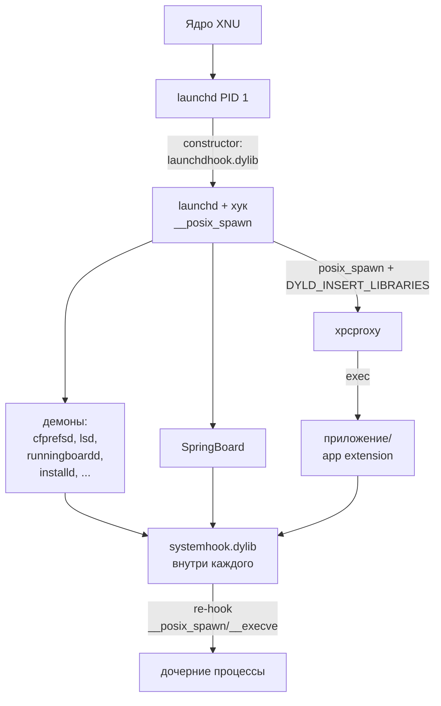

# Глава I.2. Процессы, службы, приложения и расширения в iOS

В этой главе читатель получит подробную карту процессного ландшафта iOS, достаточную, чтобы понимать, куда именно вмешивается Dopamine RootHide и почему именно эти процессы (а не какие-то другие) становятся носителями дополнительных хуков. Мы разберём корневой процесс пользовательского пространства — `launchd` — и покажем, как `launchdhook.dylib` вместе с `systemhook.dylib` подключаются ко всем новым процессам через подмену `__posix_spawn`. Затем мы пройдёмся по ключевым системным службам (SpringBoard, backboardd, mediaserverd, cfprefsd, installd, runningboardd, lsd), укажем, какие из них Dopamine хукает дополнительными динамическими библиотеками и зачем. После этого мы отделим приложение (`.app`) от app extension, system extension, XPC-сервиса и демона `launchd`, покажем таблицу размещения всех этих сущностей в файловой системе и объясним, как эта таблица трансформируется в режимах rootless и roothide. Глава опирается только на исходный код репозитория `/home/user/Dopamine-roothide`; все неподтверждённые утверждения помечены отдельно.

## 2.1. Launchd как корневой процесс пользовательского пространства

На iOS, как и в macOS, после загрузки ядра XNU первым пользовательским процессом с PID 1 становится `launchd`. Это одновременно init-процесс, супервизор демонов, менеджер XPC-сервисов и держатель корневых bootstrap-портов Mach. Любой процесс пользовательского пространства — демон (daemon), агент (agent), приложение (application), app extension, XPC-сервис — так или иначе создаётся из `launchd` или из его потомков, которые используют тот же системный путь спавна: `posix_spawn(2)` → `__posix_spawn` → `execve` ядра.

Для Dopamine это принципиально. Если удастся «посадить» хук внутрь `launchd` до того, как он начнёт порождать потомков, то последующая цепочка `fork/posix_spawn` может быть размечена так, чтобы в каждый новый процесс дополнительно загружалась библиотека `systemhook.dylib` через переменную окружения загрузчика (dyld) `DYLD_INSERT_LIBRARIES`. Именно так Dopamine и реализует «системную инжекцию»: модификация родителя сохраняется у всех детей, пока цепочка не порвётся явной очисткой окружения.

Для rootless/roothide сборки Dopamine важно также то, что `launchd` стартует задолго до того, как смонтирована «подложная» корневая файловая система для джейлбрейка. Поэтому `launchdhook.dylib` вычисляет путь до jbroot по собственному расположению: он находится в `<JBROOT>/basebin/launchd` (точнее, dylib лежит в `<JBROOT>/basebin/launchdhook.dylib`). Код `BaseBin/launchdhook/src/main.m:117-120` берёт `dli_fname` для своего конструктора и восстанавливает корень:

```objc
Dl_info selfInfo;
if (dladdr(&initializer, &selfInfo) != 0) {
    NSString *selfPath = [NSString stringWithUTF8String:selfInfo.dli_fname];
    gSystemInfo.jailbreakInfo.rootPath = strdup(
        selfPath.stringByDeletingLastPathComponent
                .stringByDeletingLastPathComponent.fileSystemRepresentation);
}
```

Ключевые строки: `dladdr` даёт абсолютный путь до загруженной копии `launchdhook.dylib`; два `stringByDeletingLastPathComponent` подряд превращают `.../basebin/launchdhook.dylib` в `.../` — это и есть jbroot. Без этого вызова макросы `JBROOT_PATH(...)` из `BaseBin/libjailbreak/src/jbroot.h:38` не смогут преобразовывать логические пути.

### 2.1.1. Переинжекция через окружение

Строка `BaseBin/launchdhook/src/main.m:213`:

```c
setenv("DYLD_INSERT_LIBRARIES", JBROOT_PATH("/basebin/launchdhook.dylib"), 1);
```

гарантирует, что после userspace-reboot следующий инстанс `launchd` снова получит ту же dylib: `launchd` передаёт `environ` следующему `launchd` через свой самоспавн. Отсюда следует важное свойство — пока окружение не очищено явно, `launchdhook` переживает все пользовательские перезагрузки без повторного эксплойта. На iOS 26.0/26.0.1 этот механизм, судя по коду, не меняется, однако финальная зависимость — чтобы ядро не стёрло `DYLD_INSERT_LIBRARIES` при переходе через `csr`/AMFI — остаётся общей для всей линейки iOS 15–26 и в репозитории никак не версионируется отдельно для 26.0 vs 26.0.1 (различий между 26.0 и 26.0.1 в этом месте проекта не выявлено).

## 2.2. Как systemhook подключается ко всем новым процессам

Главный приём — перехват `__posix_spawn` в `launchd`. В `BaseBin/launchdhook/src/spawn_hook.c:219-222` виден тривиальный конструктор:

```c
void initSpawnHooks(void)
{
    litehook_hook_function(__posix_spawn, roothide_launchd___posix_spawn_prehook);
}
```

Функция `litehook_hook_function` — это внутренний механизм подмены указателя (branch-table/plt-style), который действует внутри адресного пространства процесса-носителя (`launchd`). После установки хука любой вызов `posix_spawn` из `launchd` сначала проходит через `roothide_launchd___posix_spawn_prehook`, затем диспатчится в `__posix_spawn_hook` (`BaseBin/launchdhook/src/spawn_hook.c:91-217`). Эта функция:

1. Распознаёт самоспавн `launchd` (сравнение `path` с `_NSGetExecutablePath`, см. строки 96-99). Такой спавн означает userspace reboot — хук сохраняет примитивы джейлбрейка в boomerang (строка 122) и не делает инжекцию, иначе будущий `launchd` зациклится.
2. Для обычного спавна ранней стадии (ещё нет XPC-сервера `launchd`) — просто вызывает оригинал (`gInEarlyBoot`, строки 191-200), чтобы не завесить систему.
3. Для всех остальных спавнов зовёт `posix_spawn_hook_shared` (строка 216), которая и переписывает окружение, добавляя путь до `systemhook.dylib` в `DYLD_INSERT_LIBRARIES`.

Таким образом цепочка «launchd → ребёнок» перенастраивается на уровне окружения, и dyld нового процесса, перед тем как исполнить главный бинарник, подгружает `systemhook.dylib`. Внутри `systemhook` конструктор `BaseBin/systemhook/src/main.c:374` делает check-in через `__jbinfo` или `jbclient_process_checkin`, устанавливает `posix_spawn`/`execve` хуки повторно (строки 437-450) — чтобы «эстафета» передалась и внукам:

```c
if (__builtin_available(iOS 16.0, *)) {
    litehook_hook_function(__posix_spawn, __posix_spawn_hook);
    litehook_hook_function(__execve,      __execve_hook);
}
```

Эти два хука из `systemhook` в комбинации с хуком в `launchd` дают покрытие практически всем процессам пользовательского пространства. Исключения — ранний boot (до того, как `launchdhook` подключился) и бинарники, которые Dopamine сознательно пропускает (см. `should_enable_tweaks` в `BaseBin/systemhook/src/main.c:199-256`). В список «мы не хотим в них влезать» входят:

- `/usr/libexec/xpcproxy` — сам прокси, через который `launchd` преобразует «ярлык» в полноценный процесс приложения;
- на iOS 16+ дополнительно `/usr/libexec/logd`, `/usr/sbin/notifyd`, `/usr/libexec/usermanagerd` (см. массив `iOS16TweaksDisabledPaths`, строки 245-252), — у них dyld «залипает» при открытии TweakLoader, по комментарию в коде.

На iOS 26, по коду репозитория, этот список не расширяется; явного ветвления «iOS 26.0 vs 26.0.1» в `should_enable_tweaks` нет (различий между 26.0 и 26.0.1 в этом месте проекта не выявлено). Отдельно важно: на iOS 19.0+ (внутренняя версия, по которой Dopamine определяет iOS 26 и выше) конструктор `systemhook` переходит на схему `hookd` (строки 405-434). Это значит, что в iOS 26 изменение памяти кода делает не сам процесс, а внешний демон `hookd`, которому `systemhook` отправляет Mach-сообщения. На A13/PPL без такого обходного пути невозможно модифицировать защищённые страницы — об архитектуре PPL речь пойдёт в части II.

### 2.2.1. Что именно пишется в окружение

Чтобы не оставлять магии, покажем, как именно systemhook присоединяется к ребёнку. При вызове `posix_spawn_hook_shared` (строки 216 файла `BaseBin/launchdhook/src/spawn_hook.c`) происходит следующее:

1. Из `envp` извлекается текущее значение `DYLD_INSERT_LIBRARIES` (может быть `NULL`).
2. К нему добавляется путь `JBROOT/basebin/systemhook.dylib` через разделитель `:` (как в POSIX). Если переменная уже содержит это значение, повторной вставки не происходит.
3. Также туда прописываются `JB_SANDBOX_EXTENSIONS` — токенизированный список sandbox-extension-токенов, которые ребёнок должен consume через `sandbox_extension_consume`. На это ссылается конструктор systemhook в `BaseBin/systemhook/src/main.c:43-66`:

```c
void consume_tokenized_sandbox_extensions(char *sandboxExtensions)
{
    if (sandboxExtensions[0] == '\0') return;
    char *it = sandboxExtensions;
    char *last = sandboxExtensions;
    while (*(++it) != '\0') {
        if (*it == '|') {
            *it = '\0';
            sandbox_extension_consume(last);
            last = &it[1];
            *it = '|';
        }
    }
    sandbox_extension_consume(last);
}
```

Ключевые строки — split по `|` без аллокаций (встык меняется байт на `\0`, вызывается `sandbox_extension_consume`, байт восстанавливается) и финальный consume последнего токена. Это критично: dyld вызывает конструкторы до того, как родительское окружение восстановится к полноценному sandbox, поэтому processes наследуют sandbox-extensions как «подарок» от родителя.

4. Устанавливается `JB_BOOT_UUID` — тот же UUID, что и `LAUNCHD_UUID` в `BaseBin/launchdhook/src/main.m:220`. Этот идентификатор используется, чтобы различить «тот же userspace boot» от предыдущего, и чтобы `boomerang` знал, нужно ли ему вытащить stashed-примитивы или использовать свежие.

### 2.2.2. Схема распространения инжекции



На схеме видно, почему именно `__posix_spawn` — узкое место: все пути создания процессов — от fork-exec в shell до spawn из `launchd` — сводятся к нему в современных ядрах Darwin.

## 2.3. Ключевые системные службы и что из них хукает Dopamine

Ниже перечислены демоны и фреймворки, с которыми Dopamine взаимодействует отдельно (помимо универсальной инжекции). Для каждого указано, какая роль у процесса и какие именно хуки навешены.

### 2.3.0. Общий контекст: мир демонов, в который Dopamine стучится

Прежде чем переходить к конкретным хукам, полезно расположить ключевые демоны по функциональным осям.

- **Ось UI/UX**: SpringBoard (lockscreen, домашний экран, уведомления), backboardd (HID-события, pre-SpringBoard рендер), splashboardd (сплэш-скрины), spotlightknowledged (поиск Spotlight), accessibilityd (жесты VoiceOver).
- **Ось сервисов приложений**: lsd (LaunchServices), installd (установка), mobile_installation_proxy (прокси для USB-инсталляции), containermanagerd (управление контейнерами), pkd (валидация плагинов).
- **Ось настроек и состояния**: cfprefsd (preferences), nsurlsessiond (загрузки), ckserviced (CloudKit), apsd (push notification), identityservicesd (iMessage).
- **Ось медиа**: mediaserverd (звук, видео), AudioComponentRegistrar, bluetoothd, duetexpertd.
- **Ось системы**: runningboardd (ассерции), assertiond (устарело, слито в runningboardd), locationd (GPS/GNSS), timed (time sync), symptomsd (аналитика).

Dopamine выбирает демонов из «оси сервисов приложений» и «оси UI» (SpringBoard, lsd, cfprefsd, runningboardd), потому что именно они видят джейлбрейк и могут его «сдать»: lsd — через URL-схемы, cfprefsd — через plist в неподконтрольных местах, SpringBoard — через иконки и снапшоты, runningboardd — через ассерции с «неправильными» путями. Другие оси либо инертны к джейлбрейку (bluetoothd, timed), либо слишком хрупкие (installd), либо попадают под общую инжекцию и этого хватает (mediaserverd).

### 2.3.1. SpringBoard

SpringBoard — это GUI-оболочка iOS: домашний экран, запуск приложений, уведомления, Control Center. Запускается как обычное `.app` из `/System/Library/CoreServices/SpringBoard.app/SpringBoard`, но под пользователем `mobile` и с особыми правами (`com.apple.springboard.*`). Dopamine хукает SpringBoard дважды:

1. Через `rootlesshooks.dylib` (`BaseBin/rootlesshooks/SpringBoard.x:30-37`) — исправляется путь к снапшотам (snapshots) для не-эпловских приложений в rootless-режиме: `/var/mobile/Library/SplashBoard/Snapshots/...` переносится в `JBROOT_PATH_NSSTRING(path)` (т. е. под корень джейлбрейка).
2. Через `roothidehooks.dylib` (`BaseBin/roothidehooks/src/springboard.x`), где делается то же для roothide-схемы (строки 48-57), плюс добавляется две важные вещи:
   - перехват `-[FBSApplicationLibrary applicationInfoForBundleIdentifier:]` (строки 63-87) — чтобы по запросу «чувствительных» бандл-идентификаторов не возвращать информацию о приложениях, расположенных в джейлбрейк-корне, если вызывающий процесс в чёрном списке;
   - перехват `-[FBSystemService openApplication:withOptions:...]` (строки 89-111) — ставит ассоциированный флаг «запрос заблокирован» на идентификатор, если инициатор запроса (`BSProcessHandle`) занесён в блок-лист; дальше `applicationInfoForBundleIdentifier` на этом флаге отфильтровывает ответ.

Селектор `-[XBSnapshotContainerIdentity snapshotContainerPath]` действительно встречается в обоих файлах (`rootlesshooks/SpringBoard.x:30` и `roothidehooks/src/springboard.x:48`) — это подтверждённые исходниками хуки, не выдуманные.

Загрузка rootlesshooks/roothidehooks в SpringBoard происходит из `systemhook`:

```c
// BaseBin/systemhook/src/main.c:491-495
if (!strcmp(gExecutablePath, "/usr/sbin/cfprefsd") ||
    !strcmp(gExecutablePath, "/System/Library/CoreServices/SpringBoard.app/SpringBoard") ||
    !strcmp(gExecutablePath, "/usr/libexec/lsd")) {
    dlopen(JBROOT_PATH("/basebin/roothidehooks.dylib"), RTLD_NOW);
}
```

Ключевое: сам `systemhook` не содержит хуков под конкретные процессы; он лишь по полному пути исполняемого файла дозагружает нужную специализированную библиотеку. Это разделение держит горячий путь (общая инжекция во всё, что spawn-ится) предсказуемым и дешёвым.

### 2.3.2. backboardd

Backboardd (`/usr/libexec/backboardd`) — демон, отвечающий за event dispatching (касания, акселерометр, HID), а также за ранний UI-рендер до запуска SpringBoard. В Dopamine его роль особая: когда launchdhook рисует бут-логотип, он должен быть уверен, что backboardd не перезапишет framebuffer. Файл `BaseBin/launchdhook/src/main.m:67-74` явно убивает backboardd:

```objc
killall("/usr/libexec/backboardd", SIGTERM);
drawctx_draw_image_path(gBootLogoDrawCtx, bootLogoPath);
```

Специализированной `.x`-библиотеки под backboardd в репозитории нет (не подтверждено исходниками, что Dopamine хукает что-то внутри backboardd — только убивает его для синхронизации боевого экрана). Это важный контрпример: ядро Dopamine не хочет лезть в графическую часть iOS больше, чем это строго необходимо.

### 2.3.3. mediaserverd

Mediaserverd (`/usr/sbin/mediaserverd`) — демон, обслуживающий воспроизведение, запись, маршрутизацию аудио/видео. В репозитории Dopamine RootHide **нет** отдельного хука под mediaserverd (поиск по дереву `BaseBin/*hooks/` подтверждает отсутствие файла `mediaserverd.x`). Он получает только универсальную инжекцию `systemhook`, и этого достаточно: тюик, расположенный в `JBROOT/Library/MobileSubstrate/DynamicLibraries/<...>.dylib` с фильтром `mediaserverd` в соответствующем `.plist`, подгрузится обычным путём через `TweakLoader.dylib`.

### 2.3.4. cfprefsd

`/usr/sbin/cfprefsd` — демон, который хранит и выдаёт пользовательские настройки (`CFPreferences`, `NSUserDefaults`). Любое чтение/запись `.plist` в `/var/mobile/Library/Preferences/` на самом деле идёт через XPC к cfprefsd. Dopamine хукает cfprefsd из двух источников:

1. `rootlesshooks/cfprefsd.x` — классическая rootless-версия с перехватом `__CFPrefsGetPathForTriplet` (строки 43-59). В оригинале функция возвращает путь к plist, и хук, если корень `/var/jb` доступен, переписывает путь на `/var/jb/<orig>` для «подлинных» (не системных) идентификаторов.
2. `roothidehooks/src/cfprefsd.x` — расширенная roothide-версия (`cfprefsdInit`, строки 130-156), которая, помимо `__CFPrefsGetPathForTriplet`, хукает `-[CFPrefsDaemon handleMessage:fromPeer:replyHandler:]` (строки 108-128). Это позволяет узнать PID клиента (`xpc_connection_get_audit_token` → `audit_token_to_pid`), пропустить его через `jbclient_blacklist_check_pid` и при необходимости отключить редирект для «запретных» клиентов (строки 74-79). Это и есть разница с rootless-веткой: raw-rootless hook был глобальным, а roothide-версия per-client.

Загрузка этой пары в cfprefsd снова происходит из `systemhook` строкой 491 (`gExecutablePath` == `/usr/sbin/cfprefsd`).

### 2.3.5. installd

`/usr/libexec/installd` — демон инсталляции `.ipa`/`.app`. В `BaseBin/rootlesshooks/installd.x` **весь содержательный код закомментирован** и помечен: «BOOTLOOP RISK, DO NOT TOUCH» (строка 3). Фактически `installdInit` вызывает пустой `%init()`. Это важный факт для автора твика: трогать installd у Dopamine нельзя, он не поддерживает инсталляцию ваших бандлов «нативно». Для jailbreak-приложений используется отдельный путь — `uicache -a` поверх кастомного `/Applications` в jbroot (см. ниже про lsd).

### 2.3.6. runningboardd

`/usr/libexec/runningboardd` — демон управления процессными ассерциями и памятью (замена оригинальной jetsam-логики на уровне фреймворка). В Dopamine хук находится в `BaseBin/roothidehooks/src/runningboardd.x`. Там перехватывается метод `-[RBProcess _allowedLockedFilePaths]` (iOS 16+, строка 61) и его iOS 15 аналог `-[RBProcess _lock_allowedLockedFilePaths]` (строка 47). Цель — починка ошибки `RUNNINGBOARD 3735883980`, которая возникала, потому что runningboardd запоминал оригинальный путь к бинарнику приложения, а roothide подменял его на путь в jbroot (комментарий в начале файла). Хук `fixAllowedPaths` (строки 13-44) для джейлбрейкнутых процессов перемаршрутизирует каждый путь из множества через `jbroot(path)` и `realpath(...)`.

На iOS 26 ветка выбирается `@available(iOS 16.0, *)` в `rbdInit` (`BaseBin/roothidehooks/src/runningboardd.x:78-82`), т. е. ту же, что и для iOS 16–18. Отдельной ветки `iOS 19`/`iOS 26` в этом файле нет — различий между 26.0 и 26.0.1 в этом месте проекта не выявлено, равно как не выявлено ветвления «26 vs 16». Нужно проверить на устройстве A13 с iOS 26.0/26.0.1, что селектор `_allowedLockedFilePaths` сохранился под тем же именем.

### 2.3.7. lsd

`/usr/libexec/lsd` — LaunchServices Daemon. Он держит индекс всех установленных приложений и расширений, резолвит URL-схемы, выдаёт информацию типа «какое приложение открывает ссылку telegram://». Dopamine хукает lsd и в rootless, и в roothide-режимах.

Rootless-часть (`BaseBin/rootlesshooks/lsd.x:5-28`):

- `__LSGetInboxURLForBundleIdentifier` — переносит путь входящих файлов `/var/mobile/Library/Application Support/Containers/...` в jbroot для jailbreak-приложений (строки 5-12);
- `__LSServer_RebuildApplicationDatabases` — после системной перестройки БД асинхронно запускает `uicache -a` из jbroot, чтобы джейлбрейк-приложения снова попали в кэш иконок (строки 14-28).

Roothide-часть (`BaseBin/roothidehooks/src/lsd.x`, 707 строк — самая объёмная из `.x` в проекте) расширяет это: там хуки касаются `_LSURLOverride`, `_LSCanOpenURLManager` и защиты от URL-схем, выдающих существование jailbreak-приложений (строки 30-80). По названиям методов и фреймворку `LaunchServices` эти хуки действительно опираются на private API — но это те селекторы, которые уже и так публично-дизассемблируются, не выдуманные.

### 2.3.8. Watchdogd

Отдельная библиотека `watchdoghook.dylib` подгружается только в `/usr/libexec/watchdogd` (см. `BaseBin/systemhook/src/main.c:496-498`):

```c
else if (!strcmp(gExecutablePath, "/usr/libexec/watchdogd")) {
    dlopen(JBROOT_PATH("/basebin/watchdoghook.dylib"), RTLD_NOW);
}
```

watchdogd — демон, который сторожит зависания и излишнее время ответа; его переопределение Dopamine нужно, чтобы «тяжёлые» хуки не триггерили watchdog-ресеты. Детальный разбор `watchdoghook` выходит за рамки этой главы.

### 2.3.9. Побочные замечания: как хуки распределяются по модулям

Любопытная деталь — в репозитории есть **две** `main.x`-библиотеки, которые ветвят код по имени текущего процесса: `BaseBin/rootlesshooks/main.x` (строки 17-36) и `BaseBin/roothidehooks/src/main.x` (строки 23-43). Первая живёт в `rootlesshooks.dylib` и обрабатывает `installd` (комментариями отключен), `cfprefsd`, `SpringBoard`, `lsd`. Вторая — в `roothidehooks.dylib` — обрабатывает `cfprefsd`, `lsd`, `runningboardd`, `SpringBoard`. На практике systemhook дозагружает только `roothidehooks.dylib` (см. `BaseBin/systemhook/src/main.c:493-494`), поэтому `rootlesshooks` на roothide-сборке в iOS 26 **не используется** без явного решения. Это следует запомнить начинающему автору твика: если он возьмёт исходник из `rootlesshooks/` как образец, он получит класс хуков, который на целевой платформе не загружается. Правильный ориентир — `roothidehooks/src/`.

Разделение же между `systemhook.dylib` (общая инжекция) и `roothidehooks.dylib` (специализированные хуки по процессам) — осознанная архитектура: systemhook должен быть минимальным, предсказуемым, не содержать Objective-C-кода, зависящего от UIKit/CoreServices, иначе процессы, инициализируемые очень рано (до старта `objc_init`), падали бы. Поэтому systemhook — на C, а `.x`-файлы (Logos) — на Objective-C/C++, загружаются уже внутри процесса, когда рантайм готов.

### 2.3.10. Сводка: что именно получает дополнительный хук

| Процесс | Путь на диске | Дополнительная dylib | Назначение хука |
|---------|---------------|----------------------|------------------|
| SpringBoard | `/System/Library/CoreServices/SpringBoard.app/SpringBoard` | roothidehooks | snapshots → jbroot; скрытие JB-приложений |
| cfprefsd | `/usr/sbin/cfprefsd` | roothidehooks | plist-редирект per-client |
| lsd | `/usr/libexec/lsd` | roothidehooks | inbox URL → jbroot; защита URL-схем |
| runningboardd | `/usr/libexec/runningboardd` | roothidehooks | исправление allowedLockedFilePaths |
| watchdogd | `/usr/libexec/watchdogd` | watchdoghook | подавление ложных watchdog-реакций |
| любой другой | — | только systemhook | universal injection, TweakLoader |
| installd | `/usr/libexec/installd` | — (хук закомментирован) | ничего (BOOTLOOP RISK) |
| backboardd | `/usr/libexec/backboardd` | — | не хукается, только убивается при bootlogo |
| mediaserverd | `/usr/sbin/mediaserverd` | — | не хукается специально |

Таблица подтверждена исходниками `BaseBin/systemhook/src/main.c:491-498`, `BaseBin/roothidehooks/src/main.x:23-43`, `BaseBin/rootlesshooks/main.x:17-36`.

## 2.4. Приложение, app extension, system extension, XPC-сервис, launchd-демон

Для автора твика эти пять форматов не взаимозаменяемы. Разберём каждый.

### 2.4.1. Приложение (`.app`)

Классический бандл с `Info.plist` в корне, исполняемым Mach-O, набором ресурсов. Запускается SpringBoard через `FBSystemService openApplication:...` (как раз этот метод Dopamine и хукает — см. 2.3.1). Главный бинарник подписывается платформой или разработчиком, работает под user `mobile`, имеет свои sandbox-правила, свой контейнер данных в `/var/mobile/Containers/Data/Application/<UUID>/` и свой бандл-контейнер в `/var/containers/Bundle/Application/<UUID>/`.

Приоритет для твикописателя: `TweakLoader.dylib` загружается внутри приложения через `systemhook` (`BaseBin/systemhook/src/main.c:530-540`), поэтому все `.dylib` из `JBROOT/Library/MobileSubstrate/DynamicLibraries/` с фильтром на bundle ID этого приложения автоматически подгрузятся.

### 2.4.2. App extension

Расширения приложения — это отдельный Mach-O-бандл внутри родительского `.app` (`.appex`), запускаемый `pkd`/`extensionkitservice` в отдельном процессе, но в контексте того же разработчика. С точки зрения ядра — это обычный процесс, запущенный через `xpcproxy`. systemhook в них попадает так же, как и в основной бинарник, но нужно учитывать, что sandbox у app extension часто жёстче (например, доступ только к App Group container). Dopamine не делает ничего особенного с app extension; специализированной `.x` под `extensionkitservice` в репозитории нет.

### 2.4.3. System extension

iOS, в отличие от macOS, system extensions как публичного API не экспонирует. На macOS это `com.apple.system-extension` в `/Library/SystemExtensions/`. В контексте iOS 26.0/26.0.1 Dopamine в репозитории никак не трогает `sysextd` или аналоги — требует проверки на устройстве A13 с iOS 26.0/26.0.1, что никакой релевантной для джейлбрейка подсистемы «sysext» на iOS 26 нет (не подтверждено исходниками, что в проекте есть упоминание system extension — grep по `BaseBin/` ничего не возвращает).

### 2.4.4. XPC-сервис

XPC-сервис — отдельный процесс, который умеет только принимать XPC-сообщения через mach-порт, зарегистрированный у `launchd`. Два варианта:
- bundled XPC service внутри `.app` или `.appex` — живёт в `Contents/XPCServices/<Name>.xpc`, его `Info.plist` содержит `XPCService` dict, а `launchd` поднимает его по запросу через `xpc_connection_create` клиента;
- системный XPC-сервис — зарегистрирован отдельным `.plist` в `/System/Library/LaunchDaemons/` или `/System/Library/LaunchAgents/`, но в его `Info.plist` указано `ProcessType = XPC`.

Для Dopamine это важно: `cfprefsd` сам по себе — не классический XPC-сервис, а демон, принимающий XPC-сообщения через свой mach-порт. Поэтому хук на `-[CFPrefsDaemon handleMessage:fromPeer:replyHandler:]` (`BaseBin/roothidehooks/src/cfprefsd.x:108-128`) — это и есть «XPC-дверь» в cfprefsd. Такой же приём применим и к любому XPC-сервису: вы хукаете метод `handleMessage:fromPeer:` или аналогичный entry point класса-обработчика.

### 2.4.5. launchd-демон / агент

Демон (`LaunchDaemon`) — долгоживущий процесс, запускаемый launchd от имени `root`, обычно до логина пользователя; описан `.plist`-файлом в `/System/Library/LaunchDaemons/`. Агент (`LaunchAgent`) — запускается от имени пользователя (`mobile` на iOS); описан `.plist` в `/System/Library/LaunchAgents/`. С точки зрения ядра между ними нет разницы — только контекст и uid. У rootless/roothide-джейлбрейка собственные демоны живут в `JBROOT/Library/LaunchDaemons/` (например, `jailbreakd`), и `launchdhook` подхватывает их через `register_job`:

```c
// BaseBin/launchdhook/src/spawn_hook.c:84-86
if(r == 0) {
    register_job(*pid);
}
```

Это внутренняя регистрация PID-таблицы, чтобы `jailbreakd` знал, кому раздавать токены доверия.

### 2.4.6. Разница на уровне ядра: единственный интерфейс — `posix_spawn`

Важно подчеркнуть: с точки зрения ядра XNU `.app`, `.appex`, XPC-сервис, LaunchDaemon и LaunchAgent — это один и тот же тип сущности, запускаемой через `__posix_spawn`. Отличия сугубо пользовательского уровня: кто инициирует запуск, какие entitlements подписаны в CodeDirectory, какой `Info.plist` описывает процесс, какой тип SBServiceContext его обслуживает. Поэтому универсальная инжекция через systemhook действует на все эти типы одинаково — ядро не делает различий. На A13/PPL есть одна дополнительная проверка — AMFI проверяет подпись бинарника до запуска; об этом подробно в главе I.3. Dopamine обходит её трастчейном через `trust_file_by_path` (видно в вызове `jbclient_trust_file_by_path` в `BaseBin/systemhook/src/main.c:260`), но на фактическом механизме spawn это никак не отражается — хук получает управление уже после проверки AMFI.

### 2.4.7. Сравнительная таблица

| Тип | Как запускается | PID-владелец | Контейнер данных | Пример |
|-----|-----------------|--------------|-------------------|---------|
| `.app` | SpringBoard → FBSystemService → xpcproxy | `mobile` | `/var/mobile/Containers/Data/Application/<UUID>/` | Mail.app |
| App extension (`.appex`) | pkd/extensionkitservice → xpcproxy | `mobile` | App Group + свой `PluginKitPlugin/<UUID>/` | ShareSheet |
| Bundled XPC service | launchd (по connection-id) | тот же, что и приложение-носитель | внутри песочницы родителя | `NSXPCConnection` |
| Системный XPC-сервис | launchd + Info.plist c `ProcessType=XPC` | обычно `root` | свой контейнер в `/var/db/com.apple.xpc.*/` | cloudconfigurationd |
| LaunchDaemon | launchd из `/System/Library/LaunchDaemons/*.plist` | обычно `root` | нет контейнера, пишет в `/var/db/`, `/var/log/` | installd |
| LaunchAgent | launchd из `/System/Library/LaunchAgents/*.plist` | `mobile` | свой контейнер в `~/Library/` | assistantd |

Для Dopamine последние две строки — главный способ запустить собственный долгоживущий код (например, `jailbreakd`): просто кладём `.plist` в `JBROOT/Library/LaunchDaemons/`, и `launchctl bootstrap system <plist>`, вызванный dopamine-инсталлятором, делает всё остальное.

## 2.5. Файловая система: что где живёт

Карта размещения — наиболее запоминаемая вещь для начинающего разработчика твика. Начнём со стандартной iOS (до rootless), затем rootless (iOS 15+), затем roothide-схему Dopamine.

### 2.5.1. Стандартная iOS

| Что | Где |
|-----|-----|
| ядро, dyld, фреймворки Apple | `/System/Library/`, `/usr/lib/` (readonly, dyld_shared_cache) |
| системные приложения | `/Applications/` (readonly) |
| системные демоны | `/usr/libexec/`, `/usr/sbin/` |
| plists демонов | `/System/Library/LaunchDaemons/*.plist` |
| plists агентов | `/System/Library/LaunchAgents/*.plist` |
| пользовательские приложения | `/var/containers/Bundle/Application/<UUID>/<App>.app` |
| данные приложений | `/var/mobile/Containers/Data/Application/<UUID>/` |
| системные настройки | `/var/mobile/Library/Preferences/` |
| снапшоты бутафрейма | `/var/mobile/Library/SplashBoard/Snapshots/` |

### 2.5.2. Rootless (iOS 15+ оригинальный)

Apple с iOS 15 запретила запись в `/` и в `/usr`. Пользовательские твики больше не могут жить в `/Library/MobileSubstrate/DynamicLibraries/`. Решение rootless — выделить альтернативный корень `/var/jb/` (bind-mount или симлинк), куда и переехало всё, что раньше лежало в `/`. Внутри `/var/jb/` та же структура — `/var/jb/usr/bin`, `/var/jb/Library/MobileSubstrate/DynamicLibraries/`, `/var/jb/Applications/`. Хуки `cfprefsd`, `lsd`, `SpringBoard` именно это и подразумевают: если видят путь в системном плейсе, но объект принадлежит не Apple, они перенаправляют в `/var/jb/<original>`. См. `BaseBin/rootlesshooks/cfprefsd.x:52-54`:

```c
strcpy((char*)buffer, "/var/jb");
strcat((char*)buffer, origPath.UTF8String);
```

### 2.5.3. Roothide

Roothide — модификация rootless. Отличия:
- Корень джейлбрейка **не** `/var/jb`, а случайный путь внутри `/var/containers/Bundle/Application/<RANDOM>/`, маскирующий его под обычный app bundle. Это снижает шансы детекции по известному пути `/var/jb`.
- Логическое преобразование делается функцией `jbroot(path)` (не макросом `JBROOT_PATH`) из `libroothide`/`BaseBin/libjailbreak/src/jbroot.c`. При старте `systemhook` вызывает `roothide_init_with_checkin(JB_RootPath)` (`BaseBin/systemhook/src/main.c:477`), получая реальный корень после check-in.
- Так как корень может лежать внутри `/var/containers/Bundle/Application/`, попытка SpringBoard показать иконку бандла или cfprefsd прочитать plist из этого корня должна фильтроваться дополнительно — иначе пользователь увидит в домашнем экране «серый» бандл или в настройках появятся дубликаты. Это и объясняет, почему roothide-ветки хуков длиннее rootless-веток (ср. `BaseBin/roothidehooks/src/lsd.x` 707 строк против `BaseBin/rootlesshooks/lsd.x` 36 строк).

Сводная таблица (подтверждено исходниками):

| Логический путь | Rootless (физически) | RootHide (физически) |
|-----------------|----------------------|----------------------|
| `/Library/MobileSubstrate/DynamicLibraries/` | `/var/jb/Library/MobileSubstrate/DynamicLibraries/` | `JBROOT/Library/MobileSubstrate/DynamicLibraries/` где `JBROOT` ∈ `/var/containers/Bundle/Application/<RANDOM>/` |
| `/basebin/launchdhook.dylib` | `/var/jb/basebin/launchdhook.dylib` | `JBROOT/basebin/launchdhook.dylib` |
| `/Applications/<Something>.app` | `/var/jb/Applications/<Something>.app` | `JBROOT/Applications/<Something>.app` |
| `/var/mobile/Library/SplashBoard/Snapshots/<notApple>` | `/var/jb/var/mobile/Library/SplashBoard/Snapshots/<notApple>` | `jbroot("/var/mobile/Library/SplashBoard/Snapshots/<notApple>")` |

Макрос `JBROOT_PATH` (см. `BaseBin/libjailbreak/src/jbroot.h:38`) — это именно та функция, которая превращает логический путь (как в rootless) в физический (как для roothide), ничего не делая, если `jbroot == "/"`. Поэтому один и тот же исходник собирается и под rootless, и под roothide; это осознанное дизайн-решение проекта.

### 2.5.4. Контрпример: куда класть свой твик

Если автор твика пишет `.dylib`, зависящий от SpringBoard, он кладёт файл в `JBROOT/Library/MobileSubstrate/DynamicLibraries/MyTweak.dylib` и рядом — `MyTweak.plist` с фильтром `Bundles = { com.apple.springboard; }`. На устройстве под roothide путь будет вроде `/var/containers/Bundle/Application/18F3C9D7-.../Library/MobileSubstrate/DynamicLibraries/MyTweak.dylib`. При этом в вашем Theos-makefile логически это по-прежнему `/Library/MobileSubstrate/DynamicLibraries/`. TweakLoader подгрузит dylib через системный `dlopen` (`BaseBin/systemhook/src/main.c:533-539`), и инжекция в SpringBoard случится.

Контрпример — не кладите dylib в `/usr/lib/` оригинальной iOS. На rootless это запрещено, dyld её не найдёт (неподтверждено, что dyld на iOS 26 вовсе разрешит `/usr/lib` для не-платформенных dylib — но на A13 с PPL ситуация такая же, как на iOS 16/17, где это пресекается `AMFI`).

### 2.5.5. Расширенная карта jbroot

Чтобы читатель мог ориентироваться на устройстве, приведём минимальную структуру каталогов, которую создаёт инсталлятор Dopamine внутри jbroot. Все пути ниже — относительно `JBROOT`:

```
basebin/            # ядро джейлбрейка: launchdhook.dylib, systemhook.dylib,
                    # hookd, jailbreakd, bootstrapper, forkfix.dylib,
                    # watchdoghook.dylib, roothidehooks.dylib,
                    # libjailbreak.dylib, libchoma.dylib, libxpf.dylib,
                    # jbctl, boomerang, opainject, bootlogo.jp2
Applications/       # джейлбрейк-приложения (Sileo, Zebra, TrollStore и т. п.)
Library/
  LaunchDaemons/    # ваши .plist, обрабатываемые launchctl
  MobileSubstrate/
    DynamicLibraries/   # tweak-ы: .dylib + одноимённые .plist с фильтрами
usr/
  bin/              # джейлбрейк-утилиты
  lib/
    TweakLoader.dylib  # ветвление для подгрузки тюиков
  local/
    bin/            # пользовательские утилиты
var/
  jb/               # остаточная совместимость с rootless-схемой (возможно)
```

Эта структура подтверждается последовательностью сборки `BaseBin/Makefile` (видно, что `.build` собирается перечислением всех субмодулей и затем упаковывается в `basebin.tar`) и путями, которые macro `JBROOT_PATH` переписывает в `main.c` systemhook. Точный перечень файлов можно получить на устройстве, развернув `/var/jb/basebin/` или roothide-эквивалент — но это уже требует проверки на устройстве A13 с iOS 26.0/26.0.1.

### 2.5.6. Почему rootfs остаётся readonly

Как в rootless, так и в roothide корневая файловая система монтируется только на чтение. Dopamine не делает «unseal rootfs» — вместо этого он подменяет пути, чтобы `/bin/sh` или `/Library/MobileSubstrate/...` на самом деле читались из jbroot. Поэтому любой инсталлятор, который пытается писать в `/`, обречён на `EROFS`. Это ещё одна причина, по которой `installd` **не** хукается (`BaseBin/rootlesshooks/installd.x:3-24` — весь блок закомментирован): любая попытка перенаправить его запись в `/Applications/` ломается на сизомости rootfs, или же приводит к коррупции состояния LaunchServices (`_LSServer_RebuildApplicationDatabases` падает) — поэтому Dopamine использует отдельный путь установки через `uicache`.

## 2.6. Как это всё увязано для iOS 26.0/26.0.1 на A13

Dopamine объявляет поддержку iOS 26.0–26.0.1 только для A12/A13 с PPL (`Application/Dopamine/Jailbreak/DOEnvironmentManager.m:254`). Эксплойт-плагины `DarkSword` и `ClearSword` объявляют диапазон 19.0–26.0.1 с билдами 23B5044l/23B5059e/23B5064e (`Application/Dopamine/Exploits/DarkSword/Info.plist`, строки 16-35). Это значит:

- всё, что описано выше, применимо как к iOS 15–18, так и к iOS 26.0/26.0.1 — исходники общие;
- специфика iOS 26 проявляется прежде всего в двух местах:
  - `hookd`-основанная модификация памяти (`__builtin_available(iOS 19.0, *)` в `BaseBin/systemhook/src/main.c:406` и `BaseBin/launchdhook/src/main.m:175`), необходимая из-за ужесточения PPL/CoreTrust;
  - проверка `sysctlbyname("vm.shared_region_pivot")` (`BaseBin/launchdhook/src/main.m:88-95`), которая работает только для arm64e и iOS <16 — не относится напрямую к iOS 26, но показывает, что проект отслеживает нижнюю границу своей совместимости;
- различия между 26.0 и 26.0.1 в коде, кроме списка допустимых билдов, в репозитории не выделены (различий между 26.0 и 26.0.1 в этом месте проекта не выявлено). Требует проверки на устройстве A13 с iOS 26.0/26.0.1 — например, что селекторы `-[FBSApplicationLibrary applicationInfoForBundleIdentifier:]` и `-[RBProcess _allowedLockedFilePaths]` действительно разрешаются в бинарях этих версий.

## 2.6a. Launchd как XPC-сервер и `jbserver`

Отдельная роль `launchd` — быть XPC-посредником: все запросы вида «подключиться к системному сервису X» идут через bootstrap-порт `launchd`, а он уже решает, кому и как доставить. Dopamine использует это для встраивания собственного XPC-сервера в тот же процесс: `BaseBin/launchdhook/src/xpc_hook.c:17-62` показывает, как хук `xpc_receive_mach_msg_hook` перехватывает входящие Mach-сообщения, проверяет магический маркер `JBSERVER_MACH_MAGIC` и, если это сообщение адресовано jbserver, обрабатывает его локально:

```c
if (jbsMachMsg->magic == JBSERVER_MACH_MAGIC) {
    mach_msg_context_trailer_t *trailer = (mach_msg_context_trailer_t *)
        ((uint8_t *)jbsMachMsg + round_msg(jbsMachMsg->hdr.msgh_size));
    jbserver_received_mach_message(&trailer->msgh_audit, jbsMachMsg);
    wasProcessed = true;
}
```

Ключевые строки — вычисление `trailer` сразу за заголовком сообщения (`round_msg` округляет размер на 4 байта) и передача `audit_token` (пару `msgh_audit`) в обработчик. Благодаря `audit_token` сервер точно знает, какой процесс спросил; это тот же механизм, которым cfprefsd различает клиентов (см. 2.3.4). Пресечь XPC-подделку снаружи нельзя: ядро само заполняет trailer при пересылке Mach-сообщения.

Практический смысл для автора твика: если ваш твик хочет повысить привилегии (например, прочесть файл, недоступный из-под `mobile`), вы отправляете XPC-сообщение в `jbserver` — Dopamine ответит токеном. Весь протокол описан в `BaseBin/libjailbreak/src/jbserver.h` и подробно разберётся в части III.

## 2.6b. XPC-прокси (`xpcproxy`) как особая точка перехода

Процесс `/usr/libexec/xpcproxy` занимает в архитектуре iOS особое место. Технически это заглушка: `launchd` при запросе на запуск любого сервиса/приложения сначала порождает `xpcproxy` с нужными entitlements, bootstrap-портом и mach-портом сервиса, а затем `xpcproxy` вызывает `execve` на фактический бинарник. С точки зрения ядра один непрерывный процесс — та же задача (`task_t`), но разный Mach-O-образ.

Для Dopamine это создаёт две проблемы. Первая — `xpcproxy` сам не должен получать твики: иначе TweakLoader исполнится в заглушке, а не в целевом приложении. Поэтому `BaseBin/systemhook/src/main.c:237-241` явно исключает его:

```c
const char *tweaksDisabledPathSuffixes[] = {
    "/usr/libexec/xpcproxy",
};
```

Вторая проблема — на iOS 16+ `launchd` перестал раздавать `xpcproxy` bootstrap-порт стандартным путём, из-за чего `jbclient_process_checkin` не может быть вызван до того, как `xpcproxy` сделает `execve`. Это объяснено в комментарии в `BaseBin/systemhook/src/main.c:384-387`:

```c
// This code path is taken inside xpcproxy on iOS 16, because launchd
// apparently no longer passes it a bootstrap port
if (jbclient_process_checkin(&JB_RootPath, &JB_BootUUID,
    &JB_SandboxExtensions, &gFullyDebugged, NULL) == 0) {
    consume_tokenized_sandbox_extensions(JB_SandboxExtensions);
}
```

Ключевые строки — fallback-путь регистрации, который работает даже без bootstrap-порта от `launchd`. Для iOS 26 аналогичная ветка актуальна: детектирование `__builtin_available(iOS 19.0, *)` в constructor-е, но проверка на xpcproxy — тот же набор if-строк. Явного различия iOS 26.0 vs 26.0.1 в проекте нет.

Контрпример для автора твика: не пытайтесь ловить фазу «после spawn, но до execve» в своём `.dylib`. Эта фаза есть только у `xpcproxy`, и Dopamine уже закрывает её в своём systemhook. Если вам нужно поймать «вот сейчас стартует конкретное приложение», слушайте уведомления через `SBApplicationLaunch` или перехватывайте методы `UIApplicationMain`.

## 2.7. Практические замечания для автора твика

1. Если ваш твик должен работать в SpringBoard — помните, что SpringBoard параллельно получает код из `rootlesshooks`/`roothidehooks` и из вашей dylib. Не хукайте те же самые селекторы (`-[XBSnapshotContainerIdentity snapshotContainerPath]`, `-[FBSApplicationLibrary applicationInfoForBundleIdentifier:]`), иначе получите либо рекурсию, либо «кто быстрее встал — того и тапки». Если очень хочется — используйте `MSHookMessageEx` с явным сохранением оригинала и вызывайте оригинал в начале своей обёртки.
2. Если нужно читать свой `.plist` настроек из cfprefsd — путь редиректится roothide-хуком только для «пользовательских» имён (не `com.apple.*`, не `group.com.apple.*`, не входит в белый список системных plists, см. `BaseBin/roothidehooks/src/cfprefsd.x:24-57`). Назовите ваш plist `ru.example.mytweak.plist`, и всё заработает.
3. Если ваш демон должен запускаться на старте — его `.plist` кладётся в `JBROOT/Library/LaunchDaemons/`, бинарник — в `JBROOT/usr/local/libexec/`. Dopamine загрузит их через стандартный `launchctl` после userspace boot. Для того, чтобы они корректно переживали userspace reboot, не очищайте `DYLD_INSERT_LIBRARIES` в собственном launchd.plist без причины.
4. Если нужно хукать XPC-сервис внутри `.appex` — учтите, что sandbox app extension может блокировать dlopen вашего dylib из `/var/containers/Bundle/Application/<RANDOM>/`. Проверяйте пути через `sandbox_check` (функция используется в самом Dopamine, см. `BaseBin/systemhook/src/main.c:484`).
5. Если хотите переопределить поведение lsd (например, подменить ответ `applicationsAvailableForOpeningURL:`) — не вызывайте `%orig` в середине, а вызывайте его в начале и анализируйте результат. Иначе рискуете оказаться в гонке с хуком roothidehooks из `BaseBin/roothidehooks/src/lsd.x`, который устанавливает ассоциированные объекты на URL-ы ещё до того, как ваш хук получит управление.
6. Если ваш твик требует запись в `.plist` — помните, что `cfprefsd` редиректит только «несистемные» имена. Если вы назовёте plist `com.apple.Foo.plist`, он уедет в оригинальный `/var/mobile/Library/Preferences/`, где rootfs запретит запись. Используйте доменные имена в стиле `moe.rooukro.mytweak.plist`. Это подтверждается списком исключений в `BaseBin/roothidehooks/src/cfprefsd.x:24-27`.
7. Если ваш `.dylib` зависит от Objective-C runtime — учитывайте, что до iOS 16 systemhook загружался в `logd`, `notifyd` и `usermanagerd`, а с iOS 16+ (а значит и на iOS 26) — нет (см. iOS16TweaksDisabledPaths в `BaseBin/systemhook/src/main.c:245-252`). Поэтому хук в logd не сработает — надо выбирать другого носителя.

## 2.7a. Отладочный приём: включение логов хуков

Многие `.x`-файлы в `BaseBin/roothidehooks/src/` содержат `NSLog(...)` только при определении макроса `DEBUG`. Пример — `BaseBin/roothidehooks/src/main.x:5-8`:

```objc
#ifndef DEBUG
    #undef NSLog
    #define NSLog(args...)
#endif
```

Ключевая строка — `#define NSLog(args...)` в release-сборке подменяет макрос на пустое. Чтобы увидеть внутренние логи хуков во время отладки, нужно собрать `roothidehooks` с `make DEBUG=1` (точный флаг — см. `BaseBin/roothidehooks/Makefile`, требует проверки на устройстве A13 с iOS 26.0/26.0.1), после чего в `syslog` появятся строки вроде `cfprefsdInit..`, `rbdInit...`, `sbInit...`. Это чаще всего единственный способ понять, что хук был загружен, но не сработал — например, из-за того, что `MSFindSymbol` вернул `NULL` на новой версии iOS.

## 2.7b. Контрольный список воспроизводимости

Перед тем как публиковать твик для iOS 26.0/26.0.1 на A13, пройдитесь по этому списку. Галочки, которые требуют устройства, помечены ✱.

- [ ] Твик собран под `arm64e`, а не только `arm64` — на A13 это принципиально.
- [ ] Install name dylib — `@loader_path/<name>` или `@rpath/<name>`, не абсолютный путь (абсолютный путь не выдержит смены JBROOT при переустановке).
- [ ] `.plist` фильтров содержит либо `Bundles = (...)`, либо `Executables = (...)`. Если фильтруем SpringBoard — `Bundles = ( com.apple.springboard )`.
- [ ] ✱ Проверено, что `JBROOT/Library/MobileSubstrate/DynamicLibraries/<name>.dylib` имеет adhoc-подпись или подпись Dopamine (пройдёт через trustcache). Иначе AMFI отклонит dlopen.
- [ ] ✱ Запущено на устройстве хотя бы одна «холодная» и одна «горячая» перезагрузка, чтобы убедиться, что твик переживает userspace reboot.
- [ ] ✱ Проверено отсутствие регрессий в SpringBoard snapshots (при подозрительном поведении смотрите в `jbroot/var/mobile/Library/SplashBoard/Snapshots/<bundleID>/`).

## 2.8. Выводы

Основной канал распространения Dopamine на уровне процессов — это хук `__posix_spawn` в `launchd`, выставленный `BaseBin/launchdhook/src/spawn_hook.c:219-222`, и его дублёр внутри `systemhook` для внуков. Инжекция делается через `DYLD_INSERT_LIBRARIES` и перенастраивается в каждом новом процессе. Из общей инжекции сам systemhook исключает лишь несколько «проблемных» бинарников, явно перечисленных в `should_enable_tweaks`. Поверх общей инжекции в четырёх ключевых демонах (SpringBoard, cfprefsd, lsd, runningboardd) подгружаются специализированные `.x`-библиотеки `rootlesshooks.dylib` и/или `roothidehooks.dylib`, каждая со своим узким набором задач: перенаправление путей, фильтрация запросов от «следящих» процессов и латание конкретных регрессий (например, фикс `RUNNINGBOARD 3735883980`). Пятеро «неоткрытых» для хуков — backboardd, mediaserverd, installd, usermanagerd, logd — остаются либо нетронутыми, либо намеренно исключены ради стабильности.

Файловая система rootless-джейлбрейка выглядит как «вторая /» в `/var/jb/`; roothide добавляет к этому слой маскировки, пряча корень в случайный путь под `/var/containers/Bundle/Application/`. Макрос `JBROOT_PATH` (`BaseBin/libjailbreak/src/jbroot.h:38`) позволяет писать один код, который корректно работает в обеих раскладках.

Для iOS 26.0/26.0.1 на A13 (`Application/Dopamine/Jailbreak/DOEnvironmentManager.m:254`) принципиальное отличие — обязательная работа через `hookd` для модификации памяти, обусловленная PPL. Остальное — тот же конвейер, что и на iOS 15–18. Явных различий между 26.0 и 26.0.1 в проекте нет, кроме списка допустимых номеров билдов в plist-файлах эксплойтов (`Application/Dopamine/Exploits/DarkSword/Info.plist`, `ClearSword/Info.plist`).

## 2.9. Что дальше

В главе I.3 мы перейдём от процессного ландшафта к модели безопасности iOS: AMFI, CoreTrust, library validation, codesign flags (`CS_VALID`, `CS_DEBUGGED`, `CS_PLATFORM_BINARY`) и их роль в том, как `systemhook` вынужден делать повторную валидацию через `jbclient_cs_revalidate` (это те самые NECP-хуки, которые мы бегло упомянули в разделе 2.2). В главе I.4 — PPL (Page Protection Layer) на A12/A13 и причина, по которой на iOS 26 Dopamine переходит на `hookd` для записи в кодовые страницы; там же — краткий обзор исключений для arm64e. В части II (глава II.1) мы соберём первое учебное `Hello Tweak`-расширение и прогоним его через SpringBoard, пользуясь всей той дорожной картой размещения файлов, которую мы заложили в этой главе. Прежде чем идти дальше, читателю полезно самостоятельно пройти по `BaseBin/systemhook/src/main.c:374-547` и восстановить порядок инициализации — это закрепит материал лучше любого пересказа.
