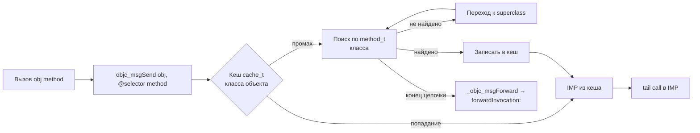
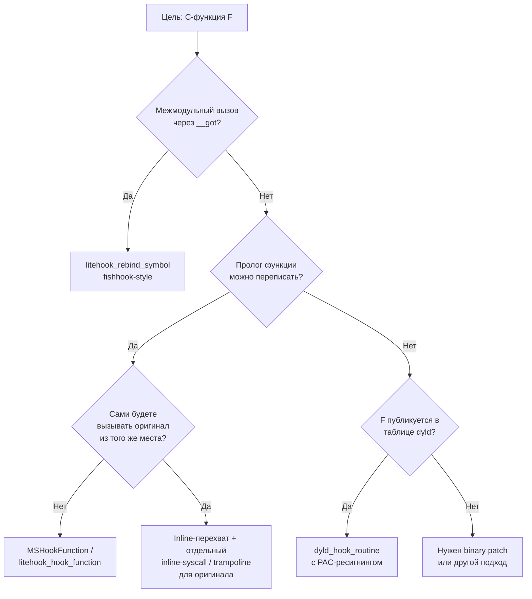

# Глава I.3. Objective-C runtime, C-функции, Swift — границы перехвата

В этой главе читатель получит рабочее понимание трёх семантически разных слоёв iOS-кода, в которые приходится вмешиваться при разработке патчей и твиков под Dopamine RootHide: динамический рантайм Objective-C, низкоуровневые C-функции и Swift. Для каждого слоя мы разберём, почему перехват (hook) в нём возможен или невозможен, какой из инструментов репозитория Dopamine 3.0.12 roothide — Logos/Mobile Substrate, `litehook`, подмена записей в таблице указателей `dyld` — применяется и почему именно он. Разбираем на подтверждённых исходниках из `/home/user/Dopamine-roothide`; каждое утверждение сопровождается ссылкой «путь:строка». Текст рассчитан на программиста, знакомого с C/Objective-C, но ещё не писавшего iOS-твики под iOS 26.0/26.0.1 на A13 (PPL, подтверждено в `Application/Dopamine/Jailbreak/DOEnvironmentManager.m:254`).

## 3.1. Как устроен message dispatch в Objective-C

Objective-C — это C с динамической диспетчеризацией сообщений. Каждый вызов метода `[obj method:arg]` при компиляции превращается в вызов функции `objc_msgSend(obj, @selector(method:), arg)` или одной из её вариаций (`objc_msgSendSuper` при вызове `[super method]`, `objc_msgSend_stret` для возврата составной структуры на классическом ABI, `objc_msgSend_fpret` для возврата float на x86_64; на arm64 последние две свёрнуты в один `objc_msgSend`). Этот `objc_msgSend` — не математическая функция, а поисковая процедура: она берёт у объекта указатель на класс (`isa`), по классу находит таблицу методов (`method_t` array), в таблице по селектору (SEL — обычно уникализированная C-строка) находит реализацию (IMP — указатель на функцию), и прыгает по ней хвостовым вызовом (tail call). Если ничего не нашлось, движется вверх по цепочке суперклассов, а в самом конце падает в `_objc_msgForward` для forwarding-механизма (`forwardInvocation:`).

Внутри `objc_msgSend` на arm64 есть ещё один слой — кеш методов (`cache_t`). Чтобы не искать линейно по таблицам методов на каждом сообщении, рантайм держит в самом классе хеш-таблицу «селектор → IMP» и сначала проверяет её. Промах по кешу стоит дороже и ведёт к медленному пути (slow path) со спуском по иерархии классов и, при первом попадании, записью в кеш. На arm64e указатели кеша также подписаны PAC (`ptrauth_key_process_dependent_data` с дискриминатором на основе адреса кеш-слота) — но это внутренняя кухня `libobjc`, нам в неё лезть не придётся: метод-свизлинг не трогает кеш напрямую, а только таблицу методов, и рантайм сам инвалидирует кеш, когда замечает изменение в `method_t`.

Схематически месседж-диспатч можно изобразить так:



Из схемы видно место, куда можно встроиться: единственная «честная» точка — заменить IMP в `method_t`, после чего рантайм при следующем промахе кеша возьмёт в кеш уже новый адрес. Инвалидация кеша при изменении `method_t` — ответственность рантайма, пользовательский код в неё не лезет.

С точки зрения ассемблера на arm64 вызов `[obj method]` обычно выглядит как:

```
LDR  X0, [SP, #OFFSET_OBJ]  ; загрузить self
ADRP X1, lselref@PAGE       ; адрес селектора в __TEXT,__objc_selrefs
LDR  X1, [X1, lselref@PAGEOFF]
BL   _objc_msgSend
```

Селектор берётся из секции `__TEXT,__objc_selrefs`, которая связана с `__objc_methname` и уникализируется dyld на этапе загрузки (чтобы в разных dylib один и тот же текст `"length"` ссылался на один и тот же `SEL`). Это и есть основание, на котором стоит method swizzling: селектор — глобальная константа в адресном пространстве, таблица методов класса — глобальная таблица в `__DATA`, рантайм сам приводит их в соответствие.

Ключевое следствие — методы в Objective-C не разрешаются во время сборки. В исполняемом Mach-O нет прямого вызова по адресу `-[NSString length]`; есть только константа-селектор `"length"` в секции `__TEXT,__objc_methname` и обращение к `objc_msgSend`, который этот селектор потом развернёт через runtime. Классы и методы на любом участке программы можно пересобирать на лету: добавить метод (`class_addMethod`), заменить IMP существующему методу (`method_setImplementation`), поменять местами две реализации (`method_exchangeImplementations`), подменить сам класс объекта (`object_setClass` — трюк, которым пользуется KVO). Весь публичный API живёт в `<objc/runtime.h>`, не требует privileged прав и исторически был доступен даже из песочницы приложения.

На этом свойстве и построен метод-свизлинг (method swizzling) — тривиальный способ перехвата сообщения:

```objc
#import <objc/runtime.h>

@implementation NSString (MyHook)

+ (void)load
{
    Method orig = class_getInstanceMethod(self, @selector(length));
    Method swiz = class_getInstanceMethod(self, @selector(my_length));
    method_exchangeImplementations(orig, swiz);
}

- (NSUInteger)my_length
{
    NSUInteger original = [self my_length]; // после обмена это настоящий -length
    return original + 1;
}

@end
```

Разберём: `class_getInstanceMethod` ищет `Method` по селектору, `method_exchangeImplementations` атомарно подменяет IMP в двух `method_t`. После обмена вызов `[s length]` попадает в `-[NSString my_length]`, а внутри `[self my_length]` попадает в оригинальную IMP, которая осталась жить под именем `my_length`. Это работает ровно потому, что `objc_msgSend` каждый раз заново читает IMP из таблицы — никакого кеша, который нужно было бы инвалидировать, у клиента нет (у рантайма внутри — есть, и он сам справляется с его инвалидацией при модификации классов). Никаких манипуляций с кодовой подписью, VM-правами, PAC-подписями указателей здесь не возникает: мы не трогаем ни одной страницы `__TEXT`, мы меняем поле в структуре в сегменте `__DATA`.

Технически метод-свизлинг — это один из вариантов рантайм-хука из главы I.1, и единственный, который можно сделать «честно» через публичный API без MachOMerger, без `vm_protect` и без PAC-ресигнинга. Именно поэтому высокоуровневый DSL Logos из набора Theos (макросы `%hook`, `%end`, `%orig`, `%init`) при компиляции разворачивается в похожий код: `MSHookMessageEx(cls, @selector(sel), (IMP)newIMP, (IMP*)&origIMP)` из Mobile Substrate под капотом сводится к той же цепочке `class_getInstanceMethod` → `method_setImplementation` плюс аккуратная обработка `super`-реализаций и наследования.

Чтобы не запутаться с терминологией, зафиксируем ещё две детали. Первая: `method_exchangeImplementations` оперирует парой **уже зарегистрированных** методов. Если у класса не было метода с селектором `my_length` — обмен не состоится, нужно сначала `class_addMethod`. Logos это берёт на себя, вам как автору твика об этом думать не придётся. Вторая: обмен — операция локальная по объектам, но глобальная по классу. После обмена **все** экземпляры `NSString` в процессе получат наш `-length`, в том числе те, что уже существовали до загрузки нашей dylib. Это свойство — одновременно сила (ничего не нужно пересоздавать) и опасность (можно нарушить инвариант, который держал старый код).

### 3.1.1. Разворачивание Logos: `%hook` против `%hookf`

Logos — препроцессор поверх Objective-C/C, и его макросы разворачиваются в стандартный код ещё до clang. Это важно понимать, потому что отладочные ошибки часто возникают именно на уровне макроразворота. Коротко:

- `%hook ClassName` + `-/+ selector` разворачивается в генерацию функции `_logos_method$ClassName$selector(...)` и в код инициализации, который делает `MSHookMessageEx(ClassName, @selector(selector), ..., ...)`. То есть обязательно нужен класс с нужным селектором в целевом процессе.
- `%hookf(ret, func, args...)` разворачивается в `MSHookFunction(func, ..., ...)` — это inline-перехват C-функции, никакого рантайма Objective-C не задействуется, нужен только адрес символа.
- `%orig(args)` в теле `%hook` — обращение к сохранённой `IMP` оригинала, но компилятор при этом сам подставит `self` и `_cmd`, которые невидимы для автора. Внутри `%hookf` `%orig` раскрывается в вызов сохранённого функционального указателя.
- `%init(group)` в конструкторе — финальный шаг: до него Logos ничего в рантайм не ставит; `%init` в точке запуска создаёт `Method`-записи и подменяет `IMP`. Поэтому `%hook` можно писать «статически», а активируется он строго в момент `%init`.

Знание этого разворота ускоряет диагностику: если `%hook` «не работает», в 9 случаях из 10 проблема — либо класс отсутствует в процессе, либо `%init(group)` для этой группы хуков просто не был вызван.

Ещё одна деталь, которую начинающие часто упускают, — это tagged pointers. На arm64 часть «объектов» (мелкие NSNumber, короткие NSString) не являются настоящими объектами в куче, а закодированы прямо в указателе: верхние биты содержат тип, нижние — значение. `objc_msgSend` на таких указателях работает иначе — у него есть отдельный fast path для tagged, который дёргает регистр класса не из `isa`, а по таблице классов tagged-типов. Это ограничение свизлинга: вы можете подменить метод `-length` в классе `NSString`, но вызовы `-length` на tagged-NSString (`__NSCFConstantString` часто таковые) могут идти в обход вашего хука. На практике для `-length` это не наблюдается, рантайм всё равно спустится по иерархии, но для редких приватных методов — вполне возможно. Это один из тех случаев, когда «метод свизлится, но не всегда».

Пример из репозитория. В `BaseBin/rootlesshooks/SpringBoard.x:28-39` реализован хук Objective-C-метода, который редиректит путь к снимкам приложения:

```objc
%hook XBSnapshotContainerIdentity

- (NSString *)snapshotContainerPath
{
    NSString *path = %orig;
    if ([path hasPrefix:@"/var/mobile/Library/SplashBoard/Snapshots/"]
        && ![self.bundleIdentifier hasPrefix:@"com.apple."]) {
        return JBROOT_PATH_NSSTRING(path);
    }
    return path;
}

%end
```

Что здесь важно: внешнее объявление `@interface XBSnapshotContainerIdentity` в начале файла (`BaseBin/rootlesshooks/SpringBoard.x:23-26`) не является заголовком SDK, этот класс приватный. Но нам и не нужен настоящий заголовок: `%hook` опирается на то, что в SpringBoard уже есть зарегистрированный в рантайме класс `XBSnapshotContainerIdentity` с селектором `snapshotContainerPath`. Logos ищет их по имени через `objc_getClass`/`sel_registerName`, а наше объявление `@interface` нужно только компилятору, чтобы разрешить ссылки на `-[self bundleIdentifier]`. Если класса в целевом процессе не окажется, `%init(SpringBoard)` в `springboardInit()` (`BaseBin/rootlesshooks/SpringBoard.x:68-71`) молча пропустит инициализацию группы. Это важное свойство метод-свизлинга: он реализуется как регистрация в живом рантайме, а значит, безопасен к разночтениям между версиями iOS — класс либо есть, либо нет, это проверяемо.

### Что это даёт практически

Любой Objective-C-метод любого класса — публичного или приватного — перехватывается тривиально. На iOS 26.0/26.0.1 это ровно так же, как на любой предыдущей версии: ABI `objc_msgSend` и структура `method_t` в основной рантайм-библиотеке `/usr/lib/libobjc.A.dylib` стабильны уже много лет. Единственный класс сложностей — приватные селекторы, которые разработчики Apple пропустили через `@objc(name)` на Swift или через скрытие в `_logos_`-подобные пространства, но это редкость. Поэтому в наборе `BaseBin/rootlesshooks/` и `BaseBin/roothidehooks/` подавляющее большинство файлов — именно Logos (`.x`) с `%hook`-блоками: это и есть единственный верный выбор, когда цель — Objective-C-метод.

Нередкий вопрос новичка: «а почему тогда вообще существуют остальные техники, если Objective-C такой удобный?» Ответ прост: не всё в iOS написано на Objective-C. Ядерные syscalls, часть системных демонов, значительные куски `libsystem_*`, `dyld`, `libxpc` целиком — это чистый C или C++. SwiftUI-приложения на пользовательском уровне всё меньше опираются на Objective-C-методы (хотя `UIKit`/`AppKit`/`Foundation` под ними всё ещё живут). Так что Objective-C-хук — обязательный инструмент, но не единственный.

## 3.2. C-функции: fishhook и inline-перехват

C-функции — другая история. У функции `read()`, `fcntl()`, `malloc()`, `posix_spawn()` нет никаких таблиц методов и селекторов. На этапе компиляции компилятор знает конкретный символ, линкер сопоставляет ему запись в таблице импортов Mach-O, а `dyld` при загрузке процесса эту запись разрешает в абсолютный адрес функции в памяти. Любая попытка перехватить такую функцию распадается на два принципиально разных подхода.

Три родственные операции `method_setImplementation`, `method_exchangeImplementations` и `class_replaceMethod` различаются семантикой, важной при построении надёжного твика. `method_setImplementation` просто пишет новый `IMP` в существующий `method_t` и возвращает старый — простая и дешёвая операция, но она не создаёт нового селектора, в который можно было бы вызвать «оригинал». Если нужен доступ к оригиналу — его адрес сохраняется в отдельной переменной (как у `MSHookFunction` для C-функций). `method_exchangeImplementations` меняет местами `IMP` в двух `method_t`, после чего один селектор ссылается на второй и наоборот — удобно для read-swap-apply, но требует, чтобы оба метода уже существовали. `class_replaceMethod` работает как `method_setImplementation` для существующего метода и как `class_addMethod` для нового; это обобщение, с которым работают почти все современные свизлинг-библиотеки.

Отдельно про `+load` и `+initialize`. `+load` вызывается рантаймом ровно один раз на класс/категорию в момент загрузки dylib — до `main()`, после загрузки всех зависимостей, но до большинства инициализаторов `__attribute__((constructor))`. Это самое раннее надёжное место поставить свой свизлинг на классы, которые объявлены в этой же dylib или в её зависимостях. `+initialize`, в отличие от `+load`, вызывается рантаймом **лениво** — при первом сообщении классу — и наследуется. Поэтому ставить хуки в `+initialize` рискованно: если никто не отправил сообщение классу, хук так и не встанет. Logos по умолчанию активирует `%init(group)` вручную в вашем конструкторе — то есть вы сами выбираете момент, обычно `__attribute__((constructor))` в вашей dylib.

### 3.2.1. Перехват по-символьно: fishhook, lazy/non-lazy pointer section, REBASE/BIND

Mach-O-формат импортирует функции не как ссылки на абсолютные адреса, а как ссылки на слоты в особых секциях — `__DATA,__got` (non-lazy pointers) и `__DATA,__la_symbol_ptr` (lazy pointers). Каждый слот — это 8-байтовый указатель, который во время загрузки dyld заполняет настоящим адресом нужной функции. Процесс заполнения зашит в LC_DYLD_CHAINED_FIXUPS (или в LC_DYLD_INFO на старых цепочках): сначала «REBASE» подвигает все встроенные указатели на величину ASLR-слайда, затем «BIND» импортирует внешние символы по имени из нужной dylib. Этот перечень операций читается прямо в коде dyld — поэтому его можно воспроизвести самостоятельно и переписать слоты с нашими адресами.

Отдельная тонкость — dyld shared cache (DSC). Для экономии памяти и времени загрузки Apple собирает подавляющее большинство системных dylib в один большой файл-кэш `dyld_shared_cache_arm64e` (iOS 15+) / `dyld_shared_cache_arm64` (на не-PAC), который mmap-ится во все процессы. Внутри DSC символы уже «связаны» между собой: вызов из `libxpc` в `libdispatch` на этапе сборки кэша превращён в прямую ссылку, минуя `__got`. Это ещё одна причина, почему ребинд не видит внутрикэшевых вызовов. Чтобы найти символ **внутри** DSC, Dopamine использует функцию `litehook_find_dsc_symbol("/usr/lib/system/libdyld.dylib", "__ZN5dyld45gDyldE")` (`BaseBin/systemhook/src/main.c:463`): она открывает кэш, находит в нём нужную dylib, разбирает её таблицу символов, учитывает slide — и возвращает адрес, по которому можно уже ставить inline-хук или читать содержимое, как в случае с `gDyld`.

Такой подход и реализует библиотека fishhook (Facebook), а в Dopamine её идейный клон называется `litehook` и живёт в `BaseBin/_external/modules/litehook/`. Непосредственный исходник подключается через subrepository (на момент чтения этой ветки каталог пуст, но заголовочный файл `litehook.h` подключается через `-I../_external/modules/litehook/src` в `BaseBin/systemhook/Makefile:4`). Начиная с iOS 15 Apple полностью перевела импорты на новый формат `LC_DYLD_CHAINED_FIXUPS`: вместо отдельных REBASE/BIND-опкодов в бинарнике лежат цепочки (chains), где каждый 8-байтовый слот содержит упакованную информацию о своём типе (rebase/bind), следующем слоте в цепочке и для rebase — целевом смещении, для bind — индексе в таблице импортов. Любая fishhook-подобная библиотека на iOS 15+ (включая litehook) обязана уметь парсить этот формат; старый `LC_DYLD_INFO` остался только для совместимости с бинарями, собранными SDK до iOS 15, и у системных dylib на iOS 26 его уже нет. Это внутренняя деталь, но знание её нужно, когда вы отлаживаете собственный ребинд и видите, что символ «не ловится»: возможно, вы читаете не ту секцию.

Ключевая функция litehook — `litehook_rebind_symbol`. Пример использования в `BaseBin/launchdhook/src/daemon_hook.m:81-85`:

```objc
void initDaemonHooks(void)
{
    xpc_dictionary_get_value_orig = xpc_dictionary_get_value;
    litehook_rebind_symbol(LITEHOOK_REBIND_GLOBAL,
                           xpc_dictionary_get_value,
                           (void *)xpc_dictionary_get_value_hook,
                           NULL);
}
```

Разбор: до вызова мы запоминаем оригинальный адрес `xpc_dictionary_get_value` в переменной `xpc_dictionary_get_value_orig` (это важный шаг — после ребинда любой наш внутренний вызов по символу уже уйдёт в хук, и ссылка на оригинал будет нужна отдельно). Затем `litehook_rebind_symbol` обходит все образы Mach-O, загруженные в процесс, во всех их таблицах `__DATA,__got` ищет слоты, которые изначально резолвились в `xpc_dictionary_get_value`, и переписывает их на `xpc_dictionary_get_value_hook`. Флаг `LITEHOOK_REBIND_GLOBAL` указывает, что переписать нужно во всех образах, а не только в одном (есть и локальный вариант, когда нужно хукнуть вызов только из конкретной dylib). Такой же приём применяется в `BaseBin/launchdhook/src/xpc_hook.c:67` для `xpc_receive_mach_msg`, в `BaseBin/launchdhook/src/jetsam_hook.c:26` для `memorystatus_control`, в `BaseBin/launchdhook/src/ipc_hook.c:48` для `sandbox_check_by_audit_token`.

У символьного перехвата четыре ограничения, которые важно понимать:

1. **Внутри «своей» dylib ребинд не действует.** Если `libxpc.dylib` сама вызывает `xpc_dictionary_get_value` где-то внутри себя, этот вызов будет прямым (ветвление `bl` на соседний символ), а не через `__got`-слот, и наш хук его не увидит. Fishhook/litehook по дизайну перехватывает только межмодульные вызовы.
2. **Нужно, чтобы вызываемый символ действительно импортировался через таблицу.** Статически слинкованная функция, inline-подстановка, функция, вызываемая по глобальному указателю (`gFoo()`), ребиндом не ловится.
3. **Нужно, чтобы цель уже была загружена в адресное пространство к моменту ребинда.** Если библиотека загружается позже через `dlopen`, её `__got`-слоты будут инициализированы без нашего участия. `litehook_rebind_symbol` в Dopamine это обходит за счёт того, что ставится из конструктора `systemhook.dylib` / `launchdhook.dylib` — то есть до пользовательского кода, но после всех prebound-зависимостей; для `dlopen`-загружаемых библиотек нужен либо хук на `dlopen`, который прогоняет цикл ребинда ещё раз, либо флаг `LITEHOOK_REBIND_GLOBAL`, если он учитывает поздние образы (требует проверки на устройстве A13 с iOS 26.0/26.0.1).
4. **На arm64e указатель в GOT подписан PAC.** Это тот же `ptrauth_key_process_independent_code`, что и в таблице dyld из раздела 3.2.3. Корректный ребинд должен снять подпись у оригинала (чтобы запомнить его в универсальном виде) и поставить новую у нашего хука. Если библиотека ребинда это не делает — на arm64e вы получите падение в первой же точке вызова. `litehook` обрабатывает это внутри себя, но при самостоятельной реализации fishhook-style хука на arm64e про PAC нужно помнить.

### 3.2.2. Inline-перехват: trampoline в начало функции

Второй подход — переписать первые инструкции самой функции на безусловный переход в наш код. Это inline hook. На arm64 он выглядит как последовательность вроде:

```
LDR X16, [PC, #8]   // грузим цель из литерала
BR  X16             // прыжок
.quad hook_address  // наш хук
```

Чтобы вернуться к оригиналу, нужно сохранить затёртые инструкции куда-то в отдельный «батут» (trampoline) и перед `RET` перейти обратно на то место, откуда мы прыгнули. Это уже тонкий инструмент: нужен корректный декодер arm64, корректный учёт PC-relative инструкций (`ADR`/`ADRP`, `B`/`BL`, `LDR Xt, label`), поддержка pointer authentication на arm64e, корректная работа с `VM_PROT_WRITE` на W^X-страницах. Всё это умеет Mobile Substrate (`MSHookFunction`), и в Dopamine он активно используется там, где функция экспортируется, но не через PLT: `BaseBin/launchdhook/src/roothider.m:124-125`:

```objc
MSHookFunction(&__sysctl,       (void *) __sysctl_hook,       &__sysctl_orig);
MSHookFunction(&__sysctlbyname, (void *) __sysctlbyname_hook, &__sysctlbyname_orig);
```

Здесь передаётся прямой адрес символа, а не слот импортa — Substrate переписывает первые байты самой функции в `/usr/lib/system/libsystem_kernel.dylib` и запоминает старое начало. То же самое — в `BaseBin/roothidehooks/src/pathhook.x:36-42`, где хукается приватная функция CoreFoundation:

```objc
MSImageRef coreFoundationImage = MSGetImageByName(
    "/System/Library/Frameworks/CoreFoundation.framework/CoreFoundation");
void *_CFCopyHomeDirURLForUser_ptr = MSFindSymbol(
    coreFoundationImage, "__CFCopyHomeDirURLForUser");
if (_CFCopyHomeDirURLForUser_ptr) {
    MSHookFunction(_CFCopyHomeDirURLForUser_ptr,
                   (void *)&new__CFCopyHomeDirURLForUser,
                   (void **)&orig__CFCopyHomeDirURLForUser);
}
```

`MSGetImageByName` возвращает дескриптор уже загруженной dylib, `MSFindSymbol` ищет непубличный символ по имени из таблицы символов этого образа (nlist), и дальше `MSHookFunction` ставит батут. Это рабочий способ хукать внутренние функции, которые fishhook/litehook по описанной причине пропустит.

Разберём на полном примере, как такой хук укладывается в архитектуру твика. Файл `BaseBin/rootlesshooks/cfprefsd.x` целиком посвящён перенаправлению plist-файлов настроек, которые `cfprefsd` готов писать в системные пути. Логика перенаправления собрана в `preferencePlistNeedsRedirection` (`BaseBin/rootlesshooks/cfprefsd.x:4-41`): если plist уже лежит в контейнере приложения или в `/var/jb`, или имя начинается с `com.apple.`, перенаправления не требуется; остальное — наше. Сам хук выглядит так (`BaseBin/rootlesshooks/cfprefsd.x:43-59`):

```objc
%hookf(BOOL, _CFPrefsGetPathForTriplet,
       CFStringRef bundleIdentifier, CFStringRef user,
       BOOL byHost, CFStringRef path, UInt8 *buffer)
{
    BOOL orig = %orig(bundleIdentifier, user, byHost, path, buffer);

    if (orig && buffer && !access("/var/jb", F_OK)) {
        NSString *origPath = [NSString stringWithUTF8String:(char *)buffer];
        BOOL needsRedirection = preferencePlistNeedsRedirection(origPath);
        if (needsRedirection) {
            strcpy((char *)buffer, "/var/jb");
            strcat((char *)buffer, origPath.UTF8String);
        }
    }

    return orig;
}
```

Что происходит на уровне разворота Logos. Макрос `%hookf(BOOL, _CFPrefsGetPathForTriplet, ...)` разворачивается в объявление пары — указатель `original__CFPrefsGetPathForTriplet` и наша функция-замена — плюс запись в таблицу инициализации Logos, которая активируется в `%init`. В инициализаторе `cfprefsdInit` (`BaseBin/rootlesshooks/cfprefsd.x:61-67`):

```objc
void cfprefsdInit(void)
{
    MSImageRef coreFoundationImage = MSGetImageByName(
        "/System/Library/Frameworks/CoreFoundation.framework/CoreFoundation");
    if (coreFoundationImage) {
        %init(_CFPrefsGetPathForTriplet =
              MSFindSymbol(coreFoundationImage, "__CFPrefsGetPathForTriplet"));
    }
}
```

Здесь `%init(_CFPrefsGetPathForTriplet = …)` — специальная форма Logos: мы передаём адрес символа как параметр инициализации. Это нужно, потому что `__CFPrefsGetPathForTriplet` приватный, его нельзя импортировать линкером напрямую; адрес приходится искать в рантайме, и Logos даёт для этого аккуратный синтаксис. После `%init` Mobile Substrate подменит пролог функции на батут, и все последующие вызовы `_CFPrefsGetPathForTriplet` — хоть из других функций CoreFoundation, хоть из прикладного кода, вызывающего через PLT — пройдут через наш хук.

Этот пример полезен тем, что показывает три важных свойства разом: (а) `%hookf` для C-функций — это inline-перехват, а не метод-свизлинг; (б) приватные символы ищутся через `MSFindSymbol` и передаются в `%init` через именованный параметр; (в) буфер, в который пишет оригинал, можно модифицировать уже после вызова `%orig` — это удобный pattern «call original then patch output», который работает только для хуков, где сам возврат — не главный результат.

У Dopamine есть и собственная инкарнация inline-хука. В `BaseBin/systemhook/src/main.c:438-439` под iOS 16+ пути posix_spawn и execve перехватываются `litehook_hook_function`, а не ребиндом:

```c
litehook_hook_function(__posix_spawn, __posix_spawn_hook);
litehook_hook_function(__execve,      __execve_hook);
```

Разница с ребиндом принципиальная: `__posix_spawn` — это оболочка над прямым syscall через `svc 0x80`, которую сами `posix_spawn` и семейство вызывают через локальный `bl`, а не через GOT-слот. Поэтому ребинд бесполезен — нужен именно inline-перехват. Чтобы хук не привязывался к себе же (рекурсия), оригинальная последовательность инструкций должна быть доступна как inline-syscall.

Здесь легко запутаться с модельными понятиями, разберёмся. У обычной функции в libsystem_kernel.dylib вроде `__posix_spawn` в прологе лежит `MOV X16, #sysnum; SVC 0x80; B.CC done; ...` — всего несколько инструкций, и из них ровно эти несколько переписывает inline-хук. Если бы Dopamine после переписывания хотел всё-таки «пойти в оригинал», ему бы пришлось либо восстановить затёртые байты (невозможно, пока хук активен), либо иметь копию этих байт в батуте и прыгать на батут. Dopamine выбирает другой путь: собственная копия пролога написана руками на ассемблере в отдельном символе `___posix_spawn_inline`, и системный вызов идёт через неё. Это и реализовано в `BaseBin/systemhook/src/common/inline.S:1-24`:

```asm
.macro DEF_SYSCALL name, num, err_func
.global \name
\name\():
	mov x16, #\num
	svc 0x80
	b.cc \name\()_done
#ifdef __arm64e__
	pacibsp
#endif
	stp x29, x30, [SP, #-0x10]!
	mov x29, sp
	bl \err_func
	mov sp, x29
	ldp x29, x30, [sp], 0x10
#ifdef __arm64e__
	retab
#endif
\name\()_done:
	ret
.endm

DEF_SYSCALL _ptrace_inline,        0x1a, _cerror
DEF_SYSCALL ___execve_inline,      0x3b, _cerror_nocancel
DEF_SYSCALL ___posix_spawn_inline, 0xf4, _cerror
```

Ключевые моменты: `svc 0x80` — это BSD-syscall; номера 0x1a/0x3b/0xf4 — это `SYS_ptrace`, `SYS_execve`, `SYS_posix_spawn` соответственно. На arm64e есть `pacibsp`/`retab` — тот самый pointer authentication: прологовая аутентификация регистра кадра. Без PAC-подписи возврата через `retab` ядро бы вернуло процесс с невалидным LR, и это было бы падение с кодом `EXC_BAD_ACCESS, kPACAuthenticationFailure`. Хук в `__posix_spawn_hook` (`BaseBin/systemhook/src/main.c:258-261`) далее при необходимости отдаст управление `__posix_spawn_inline`, который ровно свалится в syscall, не трогая переписанный пролог, — и мы не поймаем сами себя. Такая аккуратная пара «хук + inline-syscall» — обязательный приём, когда хукается тот же самый код, через который хочется делать «оригинальный» вызов.

Заметим, что проверка самодостаточности этого куска кода зашита в сборку. В `BaseBin/systemhook/Makefile:15-21` после компиляции `roothider_inline.o` вызывается `nm -u -j`: если в объектнике остались неопределённые символы, Makefile прерывает сборку с сообщением «FAIL: ... has undefined symbols». Это гарантия того, что код inline-syscall-обёрток не потянет за собой `libSystem` или `_cerror`, которые к моменту переписывания пролога ещё могут быть не инициализированы. Такая «статическая» проверка — часть культуры дисциплины вокруг inline-хуков в коде Dopamine, и повторить её у себя в сборочной системе — хорошая практика.

### 3.2.3. Короткий ликбез по PAC (arm64e)

Прежде чем разбирать подмену указателя в таблице dyld, зафиксируем модель PAC — pointer authentication code. На устройствах A12/A13 (и выше) каждый адрес, которому доверено управление потоком, может быть подписан: верхние 16 бит (не используемые для адресации) заменяются на подпись, вычисленную ключом процесса и дискриминатором (как правило — адрес слота, куда указатель будет лежать, плюс произвольная 16-битная «соль»). Инструкции `PACIA`/`PACIB`/`PACDA`/`PACDB` ставят подпись (на коде I-ключами, на данных D-ключами, A/B — разные ключи), а `AUTIA`/`AUTIB`/`AUTDA`/`AUTDB` снимают: при провале аутентификации верхние биты адреса портятся, и первое же разыменование даёт `EXC_BAD_ACCESS` с «кривым» адресом.

У arm64e есть 4 основных ключа: `IA`/`IB` (code) и `DA`/`DB` (data). Их задача — разводить разные классы «значимых» указателей, чтобы, например, подпись виртуальной функции не прошла в роли подписи возвратного адреса. Отдельно есть «process independent» варианты (`ptrauth_key_process_independent_code` → ключ `IA` с общей для процессов «солью»), которые используются для указателей в кэше dyld — чтобы один и тот же `dyld_shared_cache` работал во всех процессах, он не может подписывать указатели процесс-зависимым ключом.

Дискриминатор строится как 64-битное число: верхние 16 бит — произвольная «соль» (обычно задаётся прямо в инструкции `PACIA`), нижние 48 бит — обычно адрес слота. Такая схема делает подпись «фиксированной только для этого слота»: если переместить указатель в другой слот с другим адресом, подпись не пройдёт. На это и опирается PAC-aware подмена: нужно воспроизвести ту же схему дискриминатора, которую использовал dyld, и подписать свой указатель так же.

### 3.2.4. Специальный случай: таблица указателей внутри dyld (PAC-aware подмена)

На iOS 15+ `dyld` экспортирует наружу не функции по именам, а структуру с указателями на свои методы (API-таблица). Таблица лежит в сегменте `__DATA` самого dyld; её адрес — внутри `__ZN5dyld45gDyldE` (или `__ZN5dyld45gAPIsE` на некоторых сборках). При этом каждая запись таблицы на arm64e подписана ключом `ptrauth_key_process_independent_code` с дискриминатором, который зависит и от адреса слота, и от «соли» (PAC salt) — вторых 16 бит дискриминатора.

Если просто записать туда наш указатель, при разыменовании dyld упадёт на `AUT*` с `BRK #0xC470` (PAC failure). Поэтому нужен ресигнинг — считать оригинальный указатель по правилам слота, пересобрать подпись для нашего указателя по тем же правилам. Это реализовано в `BaseBin/systemhook/src/main.c:68-87`:

```c
int dyld_hook_routine(void **dyld, int idx, void *hook, void **orig, uint16_t pacSalt)
{
    if (!dyld) return -1;

    uint64_t dyldPacDiversifier = ((uint64_t)dyld & ~(0xFFFFull << 48)) | (0x63FAull << 48);
    void **dyldFuncPtrs = ptrauth_auth_data(*dyld,
                                            ptrauth_key_process_independent_data,
                                            dyldPacDiversifier);
    if (!dyldFuncPtrs) return -1;

    if (vm_protect(mach_task_self_, (mach_vm_address_t)&dyldFuncPtrs[idx],
                   sizeof(void *), false, VM_PROT_READ | VM_PROT_WRITE) == 0) {
        uint64_t location = (uint64_t)&dyldFuncPtrs[idx];
        uint64_t pacDiversifier = (location & ~(0xFFFFull << 48))
                                | ((uint64_t)pacSalt << 48);

        *orig = ptrauth_auth_and_resign(dyldFuncPtrs[idx],
                                        ptrauth_key_process_independent_code, pacDiversifier,
                                        ptrauth_key_function_pointer, 0);
        dyldFuncPtrs[idx] = ptrauth_auth_and_resign(hook,
                                        ptrauth_key_function_pointer, 0,
                                        ptrauth_key_process_independent_code, pacDiversifier);
        vm_protect(mach_task_self_, (mach_vm_address_t)&dyldFuncPtrs[idx],
                   sizeof(void *), false, VM_PROT_READ);
        return 0;
    }
    return -1;
}
```

Разбор. Сначала аутентифицируется сам указатель на таблицу (`*dyld`) ключом `data` с дискриминатором `0x63FA00000000 | (адрес & маска)` — это разблокирует указатель на массив. Затем для элемента `[idx]` вычисляется персональный дискриминатор: верхние 16 бит берутся из `pacSalt` (вызывающий знает его: он захардкожен в dyld по номеру слота), нижние 48 бит — адрес слота. Правами на запись помечается ровно 8 байт (размер указателя); `ptrauth_auth_and_resign` одной атомарной операцией снимает старую подпись и ставит нашу (сначала для оригинала — чтобы запомнить его в универсальном виде; затем для нового значения — чтобы положить его в слот с «правильной» для dyld подписью). После записи страница возвращается в `VM_PROT_READ`.

Используется это в `BaseBin/systemhook/src/main.c:466` и `:470`:

```c
dyld_hook_routine(*gDyldPtr, 17, (void *)&dyld_dlsym_hook,
                  (void **)&dyld_dlsym_orig, 0x839D);
...
dyld_hook_routine(*gAPIsPtr, 16, (void *)&dyld_dlsym_hook,
                  (void **)&dyld_dlsym_orig, 0x839D);
```

Константы `17`/`16` — индексы `dlsym` в соответствующих таблицах `gDyld` и `gAPIs` (разные версии dyld собирают таблицу в разном порядке). PAC-соль `0x839D` взята из бинарника самого dyld — поиск её значения по разборке дизассемблером — отдельная задача, которую Dopamine делал заранее для каждой поддерживаемой версии iOS. Для iOS 26.0/26.0.1 PAC-соль в коде одинаковая с 15.x (`0x839D`), однако подтверждения разборкой самого dyld из этих сборок у нас на уровне исходников нет — требует проверки на устройстве A13 с iOS 26.0/26.0.1, если захочется форкнуть этот механизм.

Такой «PAC-aware ресигнинг указателя в таблице» — отдельный способ перехвата, который не совпадает ни с ребиндом (мы не ищем GOT-слот ни в одной dylib), ни с inline-хуком (мы не переписываем код). Он работает ровно потому, что dyld сам опубликовал наружу свою таблицу диспетчеризации.

Важный частный случай той же техники — ситуация, когда `jbclient_mach_hookd_send_msg` живёт внутри самого dyld (это новая оптимизация именно для iOS 26). В `BaseBin/systemhook/src/main.c:417-420` код сначала пытается найти этот символ через `litehook_find_symbol(get_dyld_mach_header(), "_jbclient_mach_hookd_send_msg")`, и только если не нашёл, подставляет собственную inline-реализацию (`BaseBin/systemhook/src/main.c:423-427`). Это демонстрирует, что сам dyld теперь служит контейнером не только для оригинальных системных функций, но и для вспомогательных процедур Dopamine, которые туда были впаяны через MachOMerger. Для нас это ещё одна «ручка», куда можно подложить хук, и ещё одна «ручка», откуда можно забрать оригинальную реализацию без inline-сисколов.

### 3.2.5. Схема выбора: что чем ловить



## 3.3. Swift: имена, стабильность, границы перехвата

Swift на уровне ABI сильно отличается от C и Objective-C. Разберём три свойства, из-за которых большую часть Swift-кода нельзя хукать теми же средствами, что и обычный C.

### 3.3.1. Name mangling

Swift кодирует в имени символа тип, модуль, generic-параметры, calling convention. Функция `MyModule.doThing(x: Int) -> Int` превращается в что-то вроде `$s8MyModule7doThing1xS2i_tF` (mangling-схема описана в Apple's Swift ABI docs). Это уже делает поиск символа «просто по имени» хрупким: достаточно изменить сигнатуру — поменяется mangle, и ребинд перестанет видеть символ. На iOS есть `swift-demangle` для разборки, но перенос mangle через версии Swift гарантируется только для «ABI-stable» интерфейсов — то есть системных dylib. Для прикладного кода mangle меняется от сборки к сборке.

На практике, если вы хотите убедиться, что символ ещё жив в бинарнике приложения, нужная последовательность — выгрузить таблицу символов командой `nm -gU TargetApp.app/TargetApp`, прогнать её через `xcrun swift-demangle` и найти ваш символ по человекочитаемому имени. Это даст вам mangled-строку, которую можно использовать в `dlsym` или `MSFindSymbol`. Проблема в том, что при следующей сборке приложения тот же метод может получить другую строку, если автор добавит перегрузку или generic-параметр: `nm` вам вернёт уже другой mangle. Поэтому любой твик, завязанный на конкретный Swift-символ прикладного приложения, обречён на регулярную «починку mangles» при обновлениях цели.

### 3.3.2. Нет стабильного selector

У метода Swift-класса нет селектора, если его явно не выставить в `@objc` (и тем самым положить в метаклассы Objective-C runtime). Это означает, что `method_exchangeImplementations` вообще неприменим: таблицы методов в формате `method_t` для чисто-Swift классов нет. Диспетчеризация Swift-методов идёт либо через v-table в структуре класса (виртуальные методы), либо через witness-таблицу (методы протокола), либо прямым вызовом (final, @inline). Для хука v-table пришлось бы переписывать поле в структуре класса, предварительно разобравшись в её внутреннем раскладе, который к тому же меняется между мажорными версиями Swift. Для witness-table — ещё хуже: таблица собирается в момент создания конформанса.

Чтобы читатель видел масштаб проблемы, приведём пример различий. Для класса `class Foo { func bar() }` в Swift на arm64e:

- Если `bar()` не final и не `@objc`, вызов пройдёт через v-table: инструкция `LDR x16, [x8, #offset]`, где `x8` — это class metadata указатель объекта, а `#offset` — смещение слота `bar` в v-table. Этот `#offset` компилятор выбирает исходя из порядка объявления методов в классе; при добавлении нового метода в начало класса все offsets сдвигаются. То есть ваш «перехват по offset'у» ломается от перестановки методов.
- Если `bar()` помечен `final`, вызов становится прямым `BL _mangled_bar_symbol` — но inlining может превратить его в тело функции прямо в вызывающем, и тогда отдельного символа не будет вообще.
- Если `bar()` помечен `@objc`, параллельно обычному Swift-вызову создаётся запись в Objective-C рантайме с селектором `"bar"` и obj-c IMP, которая внутри дёргает Swift-реализацию. Для него работает классический method swizzling.

### 3.3.3. Closure, inlined, generic

Closure в Swift транслируется в анонимный partial-apply-символ; его имя содержит хеш и может меняться при каждой пересборке. `@inlinable`/`@_transparent` функции попадают в вызывающий модуль прямо инструкциями — их символа в бинарнике вызывающего нет совсем. Generic-функции конкретизируются либо через runtime-specialization (один символ на всех с runtime-переключением по типу), либо через mono-морфизацию (один символ на каждую реализацию). В обоих случаях хукать по имени почти бесполезно: цель либо отсутствует, либо расщепляется на N вариантов.

Ещё одна тонкость — вызов методов класса идёт через v-table, которая на arm64e подписана PAC с per-slot-дискриминатором, аналогично таблицам диспетчеризации dyld. То есть даже если вы вычислили адрес слота v-table и захотели переписать его на свой указатель, вам понадобится корректный ресигнинг — а дискриминатор зашит в код `libswiftCore.dylib` на уровне инструкций `BLRAA`, и подобрать его можно только разборкой конкретного вызывающего места. Для прикладного твика это неподъёмно: в отличие от dyld, где одна общая PAC-соль на слот и она не меняется между процессами, v-table-дискриминатор привязан к контексту вызова.

### 3.3.4. Что всё-таки можно хукать в Swift

Практический диапазон того, что реально ловится:

- **Публичные `@_cdecl`-функции.** Экспортируются с C-ABI и обычным именем; хукаются ребиндом или inline-хуком как обычная C-функция.
- **Методы, помеченные `@objc`.** Регистрируются в Objective-C рантайме, получают селектор, хукаются Logos/`method_exchangeImplementations` как любой Objective-C-метод.
- **Экспортированные через ABI-stable dylib Swift-функции с известным mangle.** Их можно найти через `nm` + `swift-demangle`; дальше — `MSHookFunction` на адрес после `dlsym` с mangled-именем. Это редкий сценарий.

В репозитории Dopamine Swift используется только в собственных инструментах — `BaseBin/MachOMerger/Sources/MachOMerger/main.swift` и `BaseBin/idownloadd/src/idownloadd/*.swift`. Это код джейлбрейка, не целей атаки, и хуков в Swift-слое Dopamine 3.0.12 roothide не ставит нигде; попыток перехвата Swift-кода чужих приложений в коде репозитория не найдено. Для прикладного твикинга SwiftUI-приложений (а их на iOS 26 всё больше) это означает: вы будете либо хукать нижележащий Objective-C-слой (`UIKit`/`SwiftUICore`/вызываемые из Swift C-функции), либо работать на уровне binary patch конкретной Swift-функции по известному смещению. Прямой method-swizzling чистого Swift-метода без `@objc` не подтверждён исходниками Dopamine и в практике считается неработающим.

Отдельное замечание про `MachOMerger`. То, что он написан на Swift, — не случайность. Эта утилита запускается не на устройстве, а на хосте разработчика (macOS), читает два Mach-O (целевой `dyld` и инжектируемую `dyldhook.dylib`), собирает из них один файл и записывает результат. Swift здесь удобен для парсинга бинарного формата (сильная типизация, `withMemoryRebound`, `Data`), и так как исполняться он будет на macOS с полноценным рантаймом Swift, никаких ограничений, обсуждаемых в этом разделе, на него не распространяется. Это пример корректного места для Swift в экосистеме твикостроения — хост-tooling, а не целевой код.

## 3.4. Таблица выбора техники перехвата

Сводная таблица, которая конденсирует всё сказанное выше. Колонка «Инструмент в Dopamine» ссылается на реальные вхождения в репозитории.

| Цель перехвата | Техника | Инструмент в Dopamine | Файл-пример |
|---|---|---|---|
| Objective-C instance/class method (публичный или приватный класс) | Method swizzling через `objc_msgSend`-таблицы | Logos `%hook`/`%hookf` поверх Mobile Substrate | `BaseBin/rootlesshooks/SpringBoard.x:28-39` |
| Приватная функция C внутри фреймворка (не экспортируется напрямую) | `MSFindSymbol` + inline hook | Mobile Substrate | `BaseBin/roothidehooks/src/pathhook.x:36-42`, `BaseBin/rootlesshooks/cfprefsd.x:63-65` |
| C-функция, импортируемая другими dylib через `__got` | REBASE/BIND-переписывание слотов импорта | `litehook_rebind_symbol` | `BaseBin/launchdhook/src/daemon_hook.m:84`, `.../xpc_hook.c:67`, `.../jetsam_hook.c:26`, `.../ipc_hook.c:48` |
| C-функция-syscall-обёртка, вызываемая внутри своей же dylib | Inline-патч пролога + отдельный inline-syscall как «честный оригинал» | `litehook_hook_function` + `inline.S` | `BaseBin/systemhook/src/main.c:438-439` + `BaseBin/systemhook/src/common/inline.S:22-24` |
| Указатель-член таблицы `dyld` (`gDyld`/`gAPIs`) | PAC-aware подмена указателя с ресигнингом | `dyld_hook_routine` | `BaseBin/systemhook/src/main.c:68-87`, `:466`, `:470` |
| `mach_vm_protect` в контексте, где нельзя оставлять свой код в чужом адресе | Проксирование через `hookd` (отдельный демон) | `litehook_hook_memory_hookd` | `BaseBin/systemhook/src/main.c:429-433`, `BaseBin/launchdhook/src/main.m:175-181` |
| Swift-метод без `@objc`, без `@_cdecl` | Не стоит пытаться; binary patch по смещению в бинарнике приложения | — | не подтверждено исходниками Dopamine |
| Swift closure, generic-specialization, `@_transparent`-функция | Не стоит пытаться | — | не подтверждено исходниками Dopamine |
| Код внутри самого dyld до старта процесса | Binary patch dyld через MachOMerger | `BaseBin/MachOMerger` + `BaseBin/dyldhook/` | см. `BaseBin/dyldhook/src/main.c` (глава I.1) |

Отдельная строка про `hookd` — это ответ на тот самый вопрос из `BaseBin/systemhook/src/main.c:405-416`: на iOS 26+ (`__builtin_available(iOS 19.0, *)` в этом коде соответствует iOS 26 по внутренней нумерации Dopamine) любое `vm_protect` потенциально опасно, поэтому хуки протаскиваются через отдельный daemon-процесс, который сам правит страницы. Это тот же inline-хук, просто с внешним «ассистентом», и это нововведение именно под iOS 26. Разницы между 26.0 и 26.0.1 в этом месте проекта не выявлено.

### 3.4.1. Проверка применимости: как решать, какой инструмент выбрать

Прежде чем лезть в редактор твика, разумно пройтись по короткому чеклисту, который экономит часы отладки. Задача: вы хотите перехватить функцию X в процессе Y.

1. **Определите язык.** Если X — метод Objective-C-класса или `@objc` Swift-метода, идёте в раздел 3.1. Если X — C-функция (включая оболочки над syscalls), идёте в раздел 3.2. Если X — чистый Swift (не `@objc`, не `@_cdecl`) — остановитесь и подумайте, не удастся ли перехватить вызываемую из X Objective-C-функцию или C-функцию ниже уровнем.
2. **Если это C-функция, определите, откуда идёт вызов.** Если вас интересуют вызовы «извне» — из других dylib, прикладного кода — попробуйте сначала ребинд (`litehook_rebind_symbol`): он самый дешёвый, не требует `vm_protect`, легко откатывается. Если вас интересуют и внутренние вызовы функции внутри её же dylib, или функция живёт в DSC и доступна только по адресу — inline-хук (`MSHookFunction` / `litehook_hook_function`).
3. **Если это inline-хук, подумайте о рекурсии.** Если ваш хук внутри вызывает оригинал через те же пути, которые вы и перехватили, нужен отдельный «неперехваченный» путь: inline-syscall на ассемблере, экспорт функции из другого образа через `litehook_find_symbol`, или ссылка на сохранённый до хука адрес.
4. **Если это arm64e, оцените PAC.** Все указатели в GOT и всех таблицах диспетчеризации системных dylib подписаны. `litehook_rebind_symbol` и `litehook_hook_function` берут это на себя; при самостоятельной реализации нужно руководствоваться `BaseBin/systemhook/src/main.c:68-87` как шаблоном.
5. **Проверьте, что цель уже загружена.** `MSGetImageByName`/`litehook_find_symbol` могут вернуть `NULL`, если dylib ещё не подтянулась. Для надёжности либо ставьте хук в `+load` соответствующей библиотеки, либо проверяйте возврат и дублируйте инициализацию через `dlopen`-хук.

Этот чеклист — не исчерпывающий алгоритм, а грубый фильтр. Он отсеивает большинство ошибок класса «я ставлю не тот тип хука». Детали вроде обработки конкурентного доступа к таблице методов, корректного «восстановления» хука при `dlclose`, многопоточной инициализации обсуждаются в отдельных главах во второй части книги.

### 3.4.2. Пример компоновки техник в одном процессе

В реальном коде Dopamine все четыре техники — Logos, ребинд, inline-хук, PAC-aware подмена указателя dyld — часто сочетаются в одном процессе. Классический образец — конструктор `systemhook` (`BaseBin/systemhook/src/main.c:374-547`):

- Сначала (`BaseBin/systemhook/src/main.c:437-440`) ставятся inline-хуки на `__posix_spawn` и `__execve` в libsystem_kernel.
- Затем (`:456`) ставится inline-хук на `__fcntl`, причём замена указывает не на нашу функцию, а на `__fcntl` из dyld — то есть мы просто «перенаправляем» вызов из dyld_shared_cache в dyld, чтобы включить bypass library validation.
- Затем (`:466` или `:470`) делается PAC-aware подмена `dlsym` в таблице dyld, которая в свою очередь перехватывает вызов `dlsym(libsandbox, "sandbox_apply")`, подсовывая вместо настоящей `sandbox_apply` наш `sandbox_apply_hook`.
- И только после этого, если `/basebin/.safe_mode` отсутствует (`:201`), подгружается `TweakLoader.dylib` (`:533-539`), который уже сам методом свизлинга поднимет пользовательские твики из `/var/jb/Library/MobileSubstrate/DynamicLibraries/*.dylib`.

Такая слоистость — норма, а не исключение. Правильно спроектированный twик обычно сам тоже выбирает смешанную стратегию: Logos — для Objective-C-методов целевого приложения, `MSFindSymbol`+`MSHookFunction` — для его приватных C-функций, иногда `litehook_rebind_symbol` — для «глобальных» символов из системных dylib. Главное — осознанно выбирать технику под цель, а не хватать первую попавшуюся.

## 3.5. Контрпримеры: когда «обычный» хук не сработает

Три реальных ловушки, в которые попадают новички.

**Первая.** Попытка хукнуть `-[NSString length]` через fishhook. Это Objective-C-метод, он не импортируется ни в один `__got`-слот — вместо вызова функции компилятор генерирует `bl _objc_msgSend` с селектором `"length"` в литерале. Ребиндить тут нечего. Правильный инструмент — метод-свизлинг.

**Обратная ситуация.** Попытка хукнуть `strcmp` через `%hook`. У `strcmp` нет класса и селектора; `%hook` его не возьмёт. Нужен `%hookf(int, strcmp, const char *a, const char *b) { ... }` — это Logos-макрос, который разворачивается именно в inline hook (`MSHookFunction`), а не в метод-свизлинг. Пример — `BaseBin/rootlesshooks/SpringBoard.x:41-66` на `fcntl` и `BaseBin/rootlesshooks/cfprefsd.x:43-59` на `_CFPrefsGetPathForTriplet`.

**Третья.** Попытка хукнуть вызов из `libxpc.dylib` в её же экспортируемую функцию `xpc_dictionary_get_value` через `litehook_rebind_symbol`. Внутри `libxpc.dylib` этот вызов будет прямым `bl` на свой же символ, а не через GOT. Ребинд не поможет; нужен inline hook внутри самой `libxpc.dylib`. В Dopamine для `xpc_dictionary_get_value` это считается приемлемым (`BaseBin/launchdhook/src/daemon_hook.m:84` — именно ребинд), потому что хук нужен для вызовов «снаружи», из `launchd` и других процессов, а внутренний взгляд `libxpc` на эту функцию никого не интересует. Если бы интересовал — пришлось бы ставить inline hook.

**Четвёртая.** Попытка хукнуть Swift-метод чистым `method_exchangeImplementations`. У чистого Swift-класса в Objective-C рантайме может вовсе не быть никаких методов — ни селекторов, ни `method_t`. Вызов `class_getInstanceMethod(cls, @selector(...))` вернёт `NULL`, обмен не состоится, и ваш твик будет молча ничего не делать. Если же метод помечен `@objc` или класс унаследован от `NSObject`, часть методов попадает в Objective-C-рантайм и свизлинг для них работает — но проверять это нужно для **каждого** конкретного метода, а не для класса целиком.

**Пятая.** Попытка inline-перехвата функции, которая уже кем-то переписана. Если на устройство ранее был установлен другой твик, вставивший свой батут в начало той же функции, ваш `MSHookFunction` поверх его батута, скорее всего, работает: Substrate умеет распознавать уже стоящий hook и выстраивать цепочку. Но `litehook_hook_function` таких гарантий не даёт — он может переписать те же байты, не сохранив чужого батута, и чужой твик сломается. Отладочный симптом — чужой твик, который «только что работал», внезапно падает после установки вашего. Правильная практика: внутри одного процесса все inline-хуки на одну функцию должны ставиться одним и тем же механизмом, а если они ставятся из разных dylib — порядок инициализации должен быть предсказуемым.

## 3.6. hookd и инверсия управления: inline-хук «через внешнего ассистента»

Отдельно разберём, что меняется на iOS 26, которое Dopamine внутренне называет iOS 19.0 (`__builtin_available(iOS 19.0, *)` — так в коде обозначена именно 26-я линейка, см. `BaseBin/systemhook/src/main.c:406` и `BaseBin/launchdhook/src/main.m:175`). Проблема, которую решает hookd, формулируется так: любой наш inline-хук внутри процесса-жертвы требует одной операции с ядерной привилегией — временно сделать страницу с кодом записываемой. На iOS 15–18 это делалось прямым вызовом `vm_protect`/`mach_vm_protect` в своём процессе. На iOS 26 добавилась практическая опасность: если жертва сама вызывает `vm_protect` на нашей странице (например, снимает `VM_PROT_EXECUTE`, пытаясь защититься от RWX), наш собственный код начинает ломаться.

Решение — вынести все такие операции во внешний демон `hookd`, и в целевом процессе лишь посылать ему mach-сообщения. Переключение задано строками `BaseBin/systemhook/src/main.c:429-433`:

```c
if (process_requires_hookd()) {
    litehook_hook_memory = litehook_hook_memory_hookd;
    litehook_hook_function(mach_vm_protect, mach_vm_protect_fixed);
    init_hookd_external_support();
}
```

Что здесь делается: сначала `litehook_hook_memory` — глобальный указатель внутри litehook, задающий «как именно изменять страницы кода», — переставляется на реализацию, которая не трогает `vm_protect` напрямую, а отправляет сообщение hookd. Затем сам `mach_vm_protect` в текущем процессе хукается на `mach_vm_protect_fixed`, чтобы и чужие вызовы `vm_protect` на нашу память не могли ничего сломать. И только после этого ставится мост внешней поддержки. При этом сами высокоуровневые API (`litehook_hook_function`, `litehook_rebind_symbol`) не меняются — они по-прежнему принимают пару «старый адрес / новый адрес», но под капотом операция записи делается уже hookd. Для автора твика эта оптимизация прозрачна; знать о ней нужно только для правильной диагностики, если что-то пошло не так: падение в `mach_msg` при попытке поставить хук — это именно hookd не ответил.

## 3.7. Что происходит при неудачном хуке: как это выглядит в crash log

Поскольку в книге мы постоянно упоминаем «если не ресигнить PAC, будет падение», имеет смысл один раз показать, как эти падения опознаются.

- Невалидная PAC-подпись указателя кода: сигнал `EXC_BAD_ACCESS (SIGSEGV)`, в адресе доступа — старший байт обычно `0x40..0x7F` (это признак того, что в адрес «залипли» лишние биты подписи). На arm64e kernel при отработке `AUT*` помещает ошибочный адрес в поле `Fault Address`. В crash log это легко отличить от обычного `nil`-разыменования.
- Падение в `brk #0xC470` или `brk #0xC471`: ARM64 ptrauth намеренно выбрасывает `BRK` при провале проверки подписи, если это настроено. Такое пойдёт в crash reporter с кодом `EXC_BREAKPOINT`.
- Повреждение GOT без ресигнинга на arm64e: симптом — падение в произвольной функции, стек вызовов «обрезан» (ptrauth не прошёл при `BLRAA`).
- Переписанный пролог не восстанавливает `x16/x17` корректно: функция возвращает мусор, бывает «тихое» неправильное поведение — приложение не падает, но ведёт себя странно. Хуже всего, если хук сработал, но оригинал не был корректно сохранён и теперь вызывает сам себя — рекурсия, стек-переполнение, падение в точке далеко от места ошибки.

Это не исчерпывающий справочник, а список маркеров, по которым можно быстро понять «ошибся с PAC» или «ошибся с восстановлением пролога». Для глубокого разбора потребуется глава про отладку, которая появится позже.

## 3.8. Разница между 26.0 и 26.0.1 в этом слое

Диапазон поддержки `19.0`–`26.0.1` c билдами `23B5044l` / `23B5059e` / `23B5064e` зафиксирован в `Application/Dopamine/Exploits/DarkSword/Info.plist` и `Application/Dopamine/Exploits/ClearSword/Info.plist`. На уровне кода хуков, который разбирался в этой главе, различий между 26.0 и 26.0.1 в проекте не выявлено: та же `dyld_hook_routine`, та же PAC-соль, та же `litehook_rebind_symbol`, тот же набор сисколов 0x1a/0x3b/0xf4. Разница между двумя билдами 26.0.1 (`23B5059e` и `23B5064e`) и 26.0 (`23B5044l`) сосредоточена в эксплойт-подсистеме и в вопросах `jbroot`-mapping, но не в технике перехвата. Поэтому всё сказанное применимо к обеим версиям без оговорок — при условии, что устройство принадлежит к A12/A13 (PPL).

## 3.9. Про TweakLoader и порядок инициализации

Одна практическая деталь, которая важна для понимания всей картины, — как именно пользовательский твик попадает в процесс. В `BaseBin/systemhook/src/main.c:530-540` видно, что `systemhook` в самом конце своего конструктора делает `dlopen(JBROOT_PATH("/usr/lib/TweakLoader.dylib"), RTLD_NOW)`. То есть `TweakLoader.dylib` подгружается не напрямую через `DYLD_INSERT_LIBRARIES`, а второй ступенью — изнутри `systemhook`. Это важно по двум причинам.

Первая: к моменту, когда ваш твик начинает выполняться, уже сделаны все систем-ворды хуки (посимвольные ребинды, PAC-aware подмены указателей dyld, inline-перехваты posix_spawn/execve, подмена `dlsym`). Это значит, что все ваши вызовы в `MSGetImageByName`, `MSFindSymbol`, `MSHookFunction` идут поверх уже активной инфраструктуры Dopamine; видимость символов DSC гарантирована (dyld-хук на `dlsym` поднял `sandbox_apply` и прочее), `vm_protect` безопасен (через hookd или напрямую, в зависимости от версии iOS).

Вторая: порядок загрузки твиков `TweakLoader` определяет сам, обычно по алфавиту файлов в `/var/jb/Library/MobileSubstrate/DynamicLibraries/*.dylib`. Если ваш твик зависит от того, что хук другого твика на ту же функцию встал раньше или позже, вам придётся либо указывать это через `Filter`-plist (поле `Priority`), либо проектировать твик так, чтобы он не зависел от порядка. Для method swizzling порядок обычно не критичен (обменяться IMP можно много раз подряд, и последний выигрывает), для inline-хуков — критичен.

## Выводы

Первое. Objective-C-метод всегда хукается тривиально: селектор + IMP + таблица методов, всё публично в `<objc/runtime.h>`. Logos `%hook` — это удобный DSL над `MSHookMessageEx`, который делает ровно то же самое. Никаких усилий на обход кодовой подписи, PAC или W^X.

Второе. C-функция требует различения двух случаев: межмодульный вызов — fishhook-style (`litehook_rebind_symbol`), внутримодульный или адрес прямого вызова — inline hook (`MSHookFunction` / `litehook_hook_function`). Отдельный третий случай — подмена указателя в опубликованной таблице dyld с ресигнингом PAC (`dyld_hook_routine`). Если целевой код вас же вызывает в цикле, нужен ещё inline-syscall как «настоящий оригинал», и в Dopamine он выписан на ассемблере (`BaseBin/systemhook/src/common/inline.S`).

Третье. Swift в основной массе — зона binary patch, а не рантайм-хука. Исключения: `@_cdecl`-функции, `@objc`-методы, экспортируемые Swift-функции системных dylib с известным mangle. Остальное — closure, generic, inline — на уровне символов не ловится.

Четвёртое. На iOS 26 добавлен промежуточный daemon `hookd`, через который `systemhook` и `launchdhook` протаскивают любые модификации памяти (`BaseBin/systemhook/src/main.c:405-433`). Это не меняет сути техник, но меняет кодовый путь: раньше `vm_protect` звался напрямую, теперь — через mach-сообщение внешнему процессу.

## Что дальше

В следующей главе I.4 мы перейдём от теории перехвата к практике Theos: установим toolchain, разберём структуру твика, соберём первый hello-world под iOS 26.0 и покажем, как подключить к нему `jbroot`-пути и готовые заголовки Dopamine. Глава I.2 про процессное устройство iOS даст контекст, в каком именно процессе должен сработать ваш хук, а глава I.1 задала терминологическую рамку, в которой все обсуждаемые здесь перехваты — это именно runtime hook, а не binary patch и не source patch, за одним исключением — PAC-aware подмены указателя в таблице dyld, которую логично относить к runtime hook, но с биномиальным уклоном в сторону binary patch dyld, собранного через MachOMerger (см. главу I.1).
