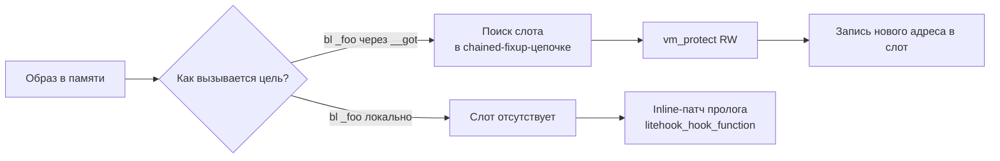

# Глава I.4. Mach-O, dyld, символы, ABI, arm64 vs arm64e, PAC

В этой главе читатель научится читать бинарники iOS так, как их читает динамический загрузчик (dyld), и начнёт понимать, почему один и тот же C-символ в одном процессе перехватывается ребиндом секции `__got`, а в другом — только inline-патчем в коде. Мы разложим формат Mach-O на три слоя — header, load commands и сегменты — пройдём по ключевым командам загрузки, которые нужны автору твика (LC_LOAD_DYLIB, LC_DYLD_INFO_ONLY, LC_SYMTAB, LC_RPATH, LC_DYLD_CHAINED_FIXUPS), посмотрим, как dyld связывает импортированные символы в iOS 15+ через chained fixups и чем это ломает классический fishhook. Отдельно разберём, что́ на A13 действительно работает в срезе `arm64`, а что́ приходит в срезе `arm64e` вместе с PAC-подписями, и как это влияет на выбор инструмента перехвата. Все утверждения о коде Dopamine RootHide сопровождаются ссылками «путь:строка» в репозитории `/home/user/Dopamine-roothide` (ветка `claude/serene-knuth-h5qs09`, база — roothide Dopamine 3.0.12).

Целевая платформа — iOS 26.0 и 26.0.1 на устройствах A12/A13 (PPL). Этот диапазон явно задекларирован в двух местах: в строке декларации окружения `Application/Dopamine/Jailbreak/DOEnvironmentManager.m:254` (`@"iOS 15.0 - 18.7.1, 26.0 - 26.0.1 (A12/A13, PPL)"`), и в поддерживаемых диапазонах версий iOS эксплойтов `DarkSword` и `ClearSword` — `Application/Dopamine/Exploits/DarkSword/Info.plist` и `Application/Dopamine/Exploits/ClearSword/Info.plist` оба содержат интервал `Start=19.0` → `End=26.0.1` с билдами `23B5044l`, `23B5059e`, `23B5064e`.

## 4.1. Mach-O глазами dyld: что лежит в бинарнике

Mach-O — это контейнер, с которым имеет дело загрузчик (dyld) и ядро XNU. Для автора твика важны ровно три вещи: что в начале файла (header), какие команды описывают, как файл отобразить в память (load commands), и какие куски исполняемого образа лежат внутри сегментов и секций.

Начало файла — `mach_header_64`: магическое число `MH_MAGIC_64`, поле `cputype` (`CPU_TYPE_ARM64`, `0x0100000C`), `cpusubtype` (где старшие биты различают `arm64`, `arm64e` и варианты `arm64e` с ABI-ревизией), `filetype` (`MH_EXECUTE` для приложения, `MH_DYLIB` для dylib, `MH_BUNDLE` для твика-бандла), число load commands и общий размер их блока. На A13 вы встретите два cpusubtype для `arm64`: обычный `CPU_SUBTYPE_ARM64_ALL` для пользовательских приложений, собранных как arm64, и `CPU_SUBTYPE_ARM64E` для срезов системных dylib. Вторая деталь — fat/universal binaries, у которых файл начинается не с `mach_header_64`, а с `fat_header`/`fat_arch` таблицы, перечисляющей слайсы.

Load commands идут сразу за header и описывают геометрию образа. Для автора твика критичны следующие семейства:

| Команда | Что описывает | Зачем автору твика |
| --- | --- | --- |
| `LC_SEGMENT_64` | Один сегмент (`__TEXT`, `__DATA`, `__DATA_CONST`, `__LINKEDIT`) и его секции | Чтобы отличить `__TEXT,__text` (код) от `__DATA_CONST,__got` (слоты импортов) |
| `LC_LOAD_DYLIB` | Зависимость от разделяемой библиотеки (например, `/usr/lib/libSystem.B.dylib`) | Понимать, какие символы в принципе могут быть разрешены этим образом |
| `LC_SYMTAB` | Классическая таблица символов (`nlist_64`) и строковая таблица | Поиск непубличных символов по имени (аналог `MSFindSymbol`) |
| `LC_DYSYMTAB` | Разметка таблицы символов на локальные/внешние/undefined-разделы, таблицы indirect symbols | Нужна для старой схемы ребинда (fishhook) — чтобы найти, какой слот `__got`/`__la_symbol_ptr` соответствует какому символу |
| `LC_DYLD_INFO_ONLY` | Указатели на пулы байт-кода rebase/bind/weak_bind/lazy_bind/export | Классический dyld-формат для iOS 14 и младше |
| `LC_DYLD_CHAINED_FIXUPS` | Новый формат связывания импортов «цепочками» внутри сегментов | Основной формат на iOS 15+ — включая iOS 26.0/26.0.1 (см. раздел 4.2) |
| `LC_DYLD_EXPORTS_TRIE` | Отдельная экспортная trie-структура (ранее часть `LC_DYLD_INFO_ONLY`) | Разрешение символов, экспортируемых самим образом |
| `LC_RPATH` | Пути, по которым искать зависимые dylib с префиксом `@rpath/` | Понимать, почему `install_name_tool -add_rpath` работает в твиках и как Dopamine ищет `@loader_path/libjailbreak.dylib` |
| `LC_CODE_SIGNATURE` | Смещение/размер блока подписи кода (CS_Blob) | Любой переподпис через `ldid` правит именно его |
| `LC_UUID`, `LC_BUILD_VERSION`, `LC_SOURCE_VERSION` | Идентичность и min-version | Отвечают на вопрос «тот же ли это бинарник, что в symbol-cache?» |

Что из этого в проекте есть на бумаге, видно по MachOMerger — утилите Dopamine, которая разбирает Mach-O для последующего слияния двух dylib в одну. Перечисление обрабатываемых команд в `BaseBin/MachOMerger/Sources/MachOMerger/main.swift:98-128` подтверждает, что в современной сборке dyldhook автор ожидает увидеть ровно: `LC_SEGMENT_64`, `ChainedFixupsLoadCommand` (`LC_DYLD_CHAINED_FIXUPS`), `LC_DYLD_EXPORTS_TRIE`, `LC_SYMTAB`, `LC_DYSYMTAB` (`DSymTabLoadCommand`), `LC_SEGMENT_SPLIT_INFO`, `LC_FUNCTION_STARTS`, `LC_DATA_IN_CODE`, `LC_LOAD_DYLIB`, `LC_ID_DYLIB`, `LC_UUID`, `LC_ID_DYLINKER`, `LC_BUILD_VERSION`, `LC_SOURCE_VERSION`, `LC_CODE_SIGNATURE`, `LC_ENCRYPTION_INFO_64`. Всё остальное код считает ошибкой компоновки (`BaseBin/MachOMerger/Sources/MachOMerger/main.swift:126-128`: `print("Unhandled command..."); exit(-1)`).

### 4.1.1. Как это выглядит в `otool`

Чтобы не держать это в голове абстрактно, автор твика должен уметь вытащить любую из этих команд с устройства. Ниже — минимальный набор команд, который реально работает на разборе iOS-бинарника (приведён как шпаргалка, не как результат запуска на устройстве — запуск от читателя):

```bash
# Какие архитектуры лежат в fat-бинаре
file  /usr/lib/libSystem.B.dylib
lipo  -archs  /usr/lib/libSystem.B.dylib

# Header + cpusubtype конкретного слайса
otool -h -arch arm64e /usr/lib/libSystem.B.dylib

# Все load commands с деталями (dylib, rpath, min-version, symtab-offsets)
otool -l -arch arm64  MyTweak.dylib

# Таблица символов: ищем, что импортируется и экспортируется
nm    -arch arm64 -gU  MyTweak.dylib    # экспортированные глобалы
nm    -arch arm64 -u   MyTweak.dylib    # undefined, т.е. импорты
```

Ключевое, что видно в выводе `otool -l` для dylib под iOS 15+: вместо `LC_DYLD_INFO_ONLY` вы увидите `LC_DYLD_CHAINED_FIXUPS` и отдельный `LC_DYLD_EXPORTS_TRIE`. Это и есть переход на chained fixups — главный сюжет следующего раздела.

## 4.2. Связывание символов: binds, lazy binds, chained fixups

Исторически (iOS 14 и младше) dyld связывал импорты через байт-код в `LC_DYLD_INFO_ONLY`. Этот байт-код состоял из трёх частей, значимых для автора твика:

1. **Rebase** — перебор всех указателей внутри образа, которые нужно сдвинуть на `slide` (ASLR). После этого внутренние указатели в `__DATA` указывают на правильные адреса своего же сегмента.
2. **Bind (non-lazy)** — импорты, которые надо резолвить при загрузке образа: dyld по имени библиотеки (`LC_LOAD_DYLIB` + ordinal) и имени символа находит адрес и записывает его в указанный слот `__DATA_CONST,__got` или `__DATA,__nl_symbol_ptr`.
3. **Lazy bind** — импорты, которые резолвятся при первом вызове: заглушка `dyld_stub_binder` замещается реальным адресом только при первом обращении. Слоты — `__DATA,__la_symbol_ptr`.

Именно это — слои, в которые писал классический fishhook: пройти bind/lazy_bind поток, для каждого имени найти слот в `__la_symbol_ptr`/`__got`, и переписать его на свой `tramp`. Это ровно fishhook-семантика «перехват по имени импорта» (см. главу I.3, раздел 3.2.1).

На iOS 15+ (и, как следствие, на iOS 26.0/26.0.1 в нашей целевой среде) Apple перешла на **chained fixups** — иной способ связывания, в котором список правок хранится не отдельно, а «цепочкой» прямо в данных сегмента. Каждый 8-байтный (или 4-байтный) слот указателя кроме собственно адреса кодирует смещение до следующего слота, который dyld должен поправить, и флаг «bind/rebase/auth/next». Структуры определены в `BaseBin/_external/include/fixup-chains.h` — заголовочный файл Apple, который Dopamine тащит для MachOMerger. Там же, в комментарии рядом с `fixup_chains.h:33`, видно команду загрузки: `LC_DYLD_CHAINED_FIXUPS = 0x80000034`, payload — `dyld_chained_fixups_header`.

Шапка payload (`BaseBin/_external/include/fixup-chains.h:37-45`) описывает:

```c
struct dyld_chained_fixups_header
{
    uint32_t    fixups_version;   // 0
    uint32_t    starts_offset;    // смещение dyld_chained_starts_in_image
    uint32_t    imports_offset;   // смещение таблицы imports
    uint32_t    symbols_offset;   // смещение строк
    uint32_t    imports_count;    // число импортируемых имён
    uint32_t    imports_format;   // DYLD_CHAINED_IMPORT*
    uint32_t    symbols_format;   // 0 — распакованные, 1 — zlib
};
```

Ключевые строки — `fixups_version` всегда 0 (`BaseBin/MachOMerger/Sources/MachOMerger/ChainedFixups.swift:19-22` явно падает на любом другом значении), `imports_format` и `symbols_format` описывают, как упакованы ссылки на имена импортов. MachOMerger поддерживает только `symbols_format == 0` (строки без сжатия, `ChainedFixups.swift:30-33`) и требует одинаковый `imports_format` в двух сливаемых бинарях (`ChainedFixups.swift:57-60`).

Следом описывается, какие сегменты содержат цепочки (`dyld_chained_starts_in_image`) и для каждого — как они устроены (`dyld_chained_starts_in_segment`, `fixup-chains.h:56-72`): `page_size`, `pointer_format` (один из `DYLD_CHAINED_PTR_*`), таблица `page_start[]` с начальными смещениями цепочек на каждой странице. На каждой странице dyld идёт по цепочке «следующий через N байт», пока не встретит `next == 0`.

### 4.2.1. Какие форматы указателей встречаются на A13 iOS 26

Перечисление форматов — `fixup-chains.h:89-106`. Для автора твика на iOS 26 важны (`fixup-chains.h:91-104`):

- `DYLD_CHAINED_PTR_ARM64E` (= 1) — классический arm64e-указатель с PAC-полями.
- `DYLD_CHAINED_PTR_64` (= 2) — обычный 64-битный указатель без PAC, для arm64.
- `DYLD_CHAINED_PTR_64_OFFSET` (= 6) — то же, но `target` — это runtime-offset.
- `DYLD_CHAINED_PTR_ARM64E_USERLAND` (= 9), `ARM64E_USERLAND24` (= 12) — user-mode arm64e с 24-битным ordinal.
- `DYLD_CHAINED_PTR_ARM64E_SHARED_CACHE` (= 13) — формат слотов внутри dyld shared cache.

Структура auth-rebase показывает, какие PAC-поля dyld укладывает в сам 64-битный слот (`fixup-chains.h:130-139`):

```c
struct dyld_chained_ptr_arm64e_auth_rebase
{
    uint64_t    target    : 32,   // runtimeOffset
                diversity : 16,
                addrDiv   :  1,
                key       :  2,
                next      : 11,
                bind      :  1,   // == 0
                auth      :  1;   // == 1
};
```

Поле `key` — это те самые два бита, кодирующие ключ PAC: `0=IA`, `1=IB`, `2=DA`, `3=DB`. `diversity` — 16-битный дискриминатор, `addrDiv` — флаг «подмешать адрес слота в дискриминатор». Для автора твика это даёт ответ на вопрос, которого в литературе часто не разбирают: когда вы в тексте image видите «ссылку на функцию с PAC-подписью», в самом файле она лежит *не как готовый подписанный указатель*, а как «инструкция для dyld, какой ключ и с каким дискриминатором подписать уже вычисленный `base + target` при загрузке». Собственно подпись считается только в рантайме на arm64e-ядре.

### 4.2.2. Чем chained fixups ломает fishhook

Исторический fishhook находил импортные слоты по таблице indirect symbols в `LC_DYSYMTAB` и переписывал `__la_symbol_ptr` / `__nl_symbol_ptr` напрямую. В chained-fixups-мире таких раздельных секций может не оказаться вовсе: один и тот же слот `__DATA_CONST,__got` живёт внутри цепочки, у него есть «следующий через 8 байт», и dyld по-прежнему честно пройдёт цепочку при повторной загрузке образа. Писать в такой слот `__DATA_CONST` без дополнительных действий нельзя — он `R-only` после запуска, нужно либо `vm_protect`-овать страницу, либо работать через `jbclient_vm_protect`-примитив jailbreak. Dopamine внутри собственного `dyldhook` именно так и работает (см. главу II про dyldhook); для внешних твиков используется высокоуровневая обёртка `litehook_rebind_symbol`, которая прячет эти детали за собой (`part1/03-objc-c-swift-boundaries.md:76` описывает её вызов).

Два практических следствия, которые читателю надо запомнить:

- Хук «импорта C-функции по имени» на iOS 26 — это **переписывание слота внутри chained-fixup-цепочки**, а не правка `__la_symbol_ptr`. Используйте `litehook_rebind_symbol` или аналог; собственный fishhook, скопированный из 2014 года, с большой вероятностью молча не найдёт слот или сломает цепочку.
- Хукать можно только *импорты* данного конкретного образа. Если целевая функция вызывается *внутри своей же* dylib (через `bl` на локальный символ, а не через `__got`), никакая правка цепочки на хост-процессе ничего не изменит — вызов разрешён ещё линкером, слота в `__got` просто нет. Это ровно та ситуация, в которой Dopamine в `BaseBin/systemhook/src/main.c:438-439` переходит на inline-перехват через `litehook_hook_function` (патч пролога), а не на ребинд.



## 4.3. arm64 vs arm64e: что реально работает на A13

A12 (Vortex/Tempest) и A13 (Lightning/Thunder) — первые ARM-ядра Apple с аппаратной поддержкой Pointer Authentication (PAC) — ARMv8.3-A. То есть сам чип A13 умеет выполнять инструкции `PAC*`/`AUT*` и имеет ключи IA/IB/DA/DB. Но «умеет аппаратно» и «вы встречаете PAC в бинарнике, который хотите хукнуть» — это разные вещи. Что именно включено на A13 iOS 26 — вопрос о срезе.

Код в репозитории Dopamine RootHide 3.0.12 собирается *fat*-слайсами с обоими срезами. Это видно по Makefile:

- `BaseBin/libjailbreak/Makefile:5` — `-arch arm64 -arch arm64e`.
- `Packages/libroot/Makefile:4` — `-arch arm64 -arch arm64e`.

Такой же набор флагов встречается у `BaseBin/launchdhook/Makefile:4`, `BaseBin/systemhook/Makefile:4`, `BaseBin/libroothider/Makefile:5`, `BaseBin/jailbreakd/Makefile:5`, `BaseBin/bootstrapper/Makefile:5`, `BaseBin/jbctl/Makefile:5`, `BaseBin/hookd/Makefile:7`, `BaseBin/watchdoghook/Makefile:4`, `BaseBin/boomerang/Makefile:5` и `Packages/libkrw-provider/Makefile:4`.

Два компонента — исключения, и они полезны именно для понимания границы:

- `BaseBin/forkfix/Makefile:4` — только `-arch arm64e`. Это компонент, который имеет смысл только на arm64e-процессах (чинит специфичную для arm64e поведенческую проблему в fork; детали в соответствующей главе про forkfix).
- `BaseBin/dopamine/Makefile:9` — только `-arch arm64` (fat не нужен: это standalone-утилита, запускаемая локально).

Для `BaseBin/dyldhook/Makefile` сборка явно разводится по срезам и по версии iOS: каждая комбинация компилируется отдельно командами вида `$(CC) -arch arm64e ... -DIOS=18 ...` и `$(CC) -arch arm64 ... -DIOS=18 ...` (строки 23-48). Это важно — в dyldhook на уровне исходников есть различия, зависящие от PAC-ABI, и единым fat-слайсом его собрать нельзя.

### 4.3.1. Срез пользовательского приложения на A13

Пользовательские приложения третьих сторон (включая Dopamine.app, собираемую `xcodebuild` в `Application/Makefile`) на iOS собираются как `arm64`, не `arm64e`. На A13 это означает: *код пользовательского приложения выполняется без PAC-инструкций*, а системные dylib под ним — срезом `arm64e`, с PAC. Переход управления через libSystem-импорт — это переход «arm64-код → arm64e-код в системной dylib». Внутри dyld shared cache указатели между системными dylib на A13 авторизуются ключами IA/IB/DA/DB; внутри вашего arm64-кода — не авторизуются.

Это утверждение *подтверждено сборочными флагами*: top-level `Application/Makefile` не передаёт в Xcode никаких `ARCHS=arm64e`, явно задекларированных экзотик в `Application/Dopamine.xcodeproj/project.pbxproj` grep по `ARCHS|VALID_ARCHS|arm64e` не дал (подтверждено пустым выдачей grep в репозитории). Единственные `ARCHS = arm64` в Application-поддереве — у вспомогательных Makefile эксплойта palera1n (`Application/Dopamine/Exploits/palera1n/Makefile:3`, `.../palera1n/exploit_server/Makefile:3`). Явного указания arm64e для Dopamine.app в проекте нет; при этом xcodebuild-умолчание для iOS-таргета без arm64e-опт-ина — именно `arm64`. Это **требует проверки на устройстве** через `otool -h -arch all build/.../Dopamine.app/Dopamine`, если вы хотите закрыть вопрос окончательно; текстовых доказательств обратного в репозитории нет.

### 4.3.2. Правила ключей IA/IB/DA/DB — ровно столько, сколько нужно

PAC использует четыре ключа:

- **IA** (`ptrauth_key_asia`, `ptrauth_key_process_independent_code`) — подпись указателей на функции, разделяемая между процессами (например, адреса в shared cache).
- **IB** (`ptrauth_key_asib`, `ptrauth_key_process_dependent_code`) — тоже код, но ключ привязан к процессу (возвращаемые адреса в стеке — классический сценарий).
- **DA** (`ptrauth_key_asda`, `ptrauth_key_process_independent_data`) — данные, межпроцессный ключ.
- **DB** (`ptrauth_key_asdb`, `ptrauth_key_process_dependent_data`) — данные, попроцессный.

В `BaseBin/libroothider/src/dyld_patch.m:83, :737, :755` вы увидите использование `__builtin_ptrauth_sign_unauthenticated` и `ptrauth_sign_unauthenticated` с ключом `ptrauth_key_process_independent_code` (IA). Это код arm64e-слайса той же libroothider; на arm64-срезе он не компилируется — он обёрнут `#ifdef __arm64e__` (`dyld_patch.m:82-84`):

```objc
#ifdef __arm64e__
    getAMFI = (uint64_t)__builtin_ptrauth_sign_unauthenticated((void*)getAMFI, 0, 0);
#endif
```

Ключевое, что подтверждают эти строки: PAC-aware ветка в Dopamine существует как arm64e-срез тех же fat-dylib, и используется только там, где процесс действительно выполняется как arm64e. В arm64-процессе на том же устройстве A13 этот блок кода физически отсутствует в бинарнике-срезе и исполняться не будет.

Соседние обращения — `__darwin_arm_thread_state64_ptrauth_strip` (`libroothider/src/dyld_patch.m:723`, `libroothider/src/exec_trace.m:101`, `libroothider/src/crashreporter.m:240, :536`) — это, напротив, безопасный к обоим срезам способ *снять* подпись с указателя из `thread_state`. Макрос Darwin-SDK раскрывается в вызов `ptrauth_strip` на arm64e и в no-op на arm64.

### 4.3.3. Как узнать, какой slice запущен

Для автора твика это практический вопрос: загрузил ли dyld arm64 или arm64e-срез моего бандла? Ответ даёт `otool -h` на уже установленном бинарнике либо, в рантайме, `_dyld_get_image_header()` + разбор `cpusubtype`.

```bash
# Из macOS-хоста, глядя на устройственный .dylib
otool -h -arch all MyTweak.dylib
# ... CPU_SUBTYPE поле: ARM64_ALL — обычный arm64, ARM64E — арм64e.
# ... Поле flags покажет MH_NOUNDEFS, MH_DYLDLINK, MH_PIE и т.п.
```

В коде из самого процесса — через `<mach-o/dyld.h>`:

```c
#include <mach-o/dyld.h>
#include <mach-o/loader.h>
#include <mach/machine.h>

const struct mach_header_64 *mh =
        (const struct mach_header_64 *)_dyld_get_image_header(0); // main image
if (mh->cputype == CPU_TYPE_ARM64) {
    uint32_t subtype = mh->cpusubtype & ~CPU_SUBTYPE_MASK;
    // CPU_SUBTYPE_ARM64E == 2, CPU_SUBTYPE_ARM64_ALL == 0
}
```

Ключевое — читать `cpusubtype` именно у *этого* образа, а не у `/usr/lib/dyld`: dyld на A13 iOS 26 физически — arm64e, но подгруженное им приложение может быть arm64. Решение «ставить ли PAC-дружелюбный хук» принимается по cpusubtype целевого модуля, а не по аппаратной способности процессора.

### 4.3.4. Таблица «срез → допустимые приёмы хука»

| Срез цели | PAC внутри её кода | fishhook/litehook_rebind | inline-патч | Что ещё важно |
| --- | --- | --- | --- | --- |
| `arm64` (ARM64_ALL) | нет | работает штатно: cslot в `__got` без PAC | работает штатно: `br`/`blr` без PAC-авторизации | На A13 Dopamine.app пользовательского уровня — обычно сюда |
| `arm64e` (ARM64E, USERLAND или USERLAND24) | да | работает, но слот — `auth_bind` в chained fixup; дискриминатор прописан в самой цепочке | требует `ptrauth_sign_unauthenticated` на целевой адрес прыжка — иначе `BRK #0xc471` при `AUT*` | Системные dylib, SpringBoard-подобные процессы, dyld; forkfix собран ровно под этот случай (`BaseBin/forkfix/Makefile:4`) |

**Контрпример (не делайте так).** В arm64e-процессе на A13 вы берёте адрес своей функции-замены `my_hook`, пишете его в `__got`-слот импорта, который помечен `auth=1, key=IA`. Через миллисекунду точка импорта исполняется, процессор делает `AUT*` над вашим неподписанным указателем, получает «мусор», и прыжок улетает в случайный адрес → `EXC_BAD_ACCESS` или код сигнала `SIGBUS`. Правильно — либо вернуть «сырой» (unsigned) указатель и записать его как `rebase+key+diversity`, предварительно пересчитав цепочку, либо подписать `__builtin_ptrauth_sign_unauthenticated(my_hook, ptrauth_key_asia, diversity_from_chain)` до записи. Высокоуровневые API (`litehook_rebind_symbol`) эту работу делают сами на основе уже существующей цепочки.

**Положительный пример.** На A13 iOS 26 типичный пользовательский твик, инжектящийся в сторонний чат-мессенджер (срез `arm64`), может переписать слот `fopen` на свою функцию прямым присваиванием. Никаких `ptrauth_*` не нужно, потому что PAC в arm64-процессе физически отсутствует.

## 4.4. Как Dopamine смешивает arm64 и arm64e

Dopamine поставляется fat-ом, но исполняется в процессе всегда одним срезом — тем, который dyld выбрал под cpusubtype этого процесса. Из Makefile BaseBin видно, что *почти вся* инфраструктура (libjailbreak, libroothider, systemhook, launchdhook, hookd, jbctl, boomerang, watchdoghook, jailbreakd, bootstrapper) собрана двумя срезами — потому что инжектится и в arm64-, и в arm64e-процессы. Один и тот же `libjailbreak.dylib` будет загружен в SpringBoard как arm64e и в сторонний App Store арм64-апп как arm64, и в обоих случаях работоспособен.

Исключения — ровно те, где PAC-ABI обязателен: `forkfix` (arm64e only, `BaseBin/forkfix/Makefile:4`), и dyldhook, в котором весь набор целевых дылиб собирается по матрице «срез × версия iOS» в `BaseBin/dyldhook/Makefile:11, 23-48`. Это даёт на выходе шесть артефактов: `dyldhook_merge.{arm64,arm64e}.{iOS15,iOS16-17,iOS18+}.dylib`.

Что из этого iOS-ветвления актуально для 26.0/26.0.1? Исходники dyldhook в репозитории дают три «версии iOS»: 15, 16-17 и 18+ (`BaseBin/dyldhook/Makefile:6-8`). На iOS 26 на уровне самого dyldhook *отдельной ветки нет*. Это означает, что на iOS 26.0/26.0.1 Dopamine использует ветку `IOS=18` (ветвь «iOS 18+»); явной адаптации под 26 на уровне генерируемых файлов `generated/ios18+/` не присутствует. Различий между iOS 26.0 и 26.0.1 в этом месте проекта не выявлено.

## 4.5. Шпаргалка для автора твика

Короткий чек-лист, с которым имеет смысл подходить к написанию первого твика на iOS 26.0/26.0.1 для A13:

1. **Определите срез процесса-цели.** `otool -h -arch all <путь>` или в рантайме `cpusubtype` из `_dyld_get_image_header(0)`. От этого зависит, нужен ли PAC-aware код.
2. **Выясните формат связывания.** Для цели на iOS 15+ в `otool -l` вы увидите `LC_DYLD_CHAINED_FIXUPS`. Это значит, что любые игры со слотами импортов должны идти через API, умеющие chained fixups, — `litehook_rebind_symbol` или аналог. Прямое переписывание `__la_symbol_ptr` «как в 2014» молча не сработает.
3. **Проверьте, что цель импортируется.** `nm -u <ваша цель-бинарник>` должен показать нужный символ в списке undefined. Если его там нет — функция вызывается внутри своей же dylib, и ребинд бессмыслен; переходите к inline-хуку (`litehook_hook_function` или аналог).
4. **Соберите свой твик fat.** `-arch arm64 -arch arm64e`, по образцу `BaseBin/libjailbreak/Makefile:5`. Так же — исходники, зависящие от PAC, обрамите `#ifdef __arm64e__` (образец — `BaseBin/libroothider/src/dyld_patch.m:82-84`).
5. **Не выдумывайте дискриминаторы PAC.** Если нужен подписанный указатель на свою функцию в arm64e-процессе, берите дискриминатор из того же места, откуда его читает загрузчик, — то есть из структуры chained fixup цепочки, либо из поля в данных целевой структуры. Статически угаданные 16 бит дискриминатора — наиболее частый источник падений в начинающих arm64e-хуках. Конкретных PAC-дискриминаторов в репозитории Dopamine для iOS 26-символов не найдено (не подтверждено исходниками).

### 4.5.1. Что из этой главы — непроверенные утверждения

Честный список того, что в этой главе *требует проверки на устройстве A13 с iOS 26.0/26.0.1* или не подтверждено исходниками:

- **Срез Dopamine.app.** Из `Application/Makefile` и `Application/Dopamine.xcodeproj/project.pbxproj` явной `ARCHS=arm64e` строки нет, но это косвенное свидетельство. Прямого вывода `otool -h build/.../Dopamine.app/Dopamine` в репозитории не найдено — для окончательного ответа нужен запуск.
- **Применимость ветки `IOS=18` dyldhook к iOS 26.** Код выбирает её по умолчанию для «новее 17», но исходной iOS-26-специфики в `BaseBin/dyldhook/src/generated/ios18+/` я не проверял полностью; возможные расхождения в приватных структурах dyld на 26 — не подтверждено исходниками.
- **Конкретные PAC-дискриминаторы для системных символов iOS 26.** В репозитории Dopamine 3.0.12 roothide я не нашёл таблиц дискриминаторов, зашитых по именам системных функций iOS 26. Любые цифры в блоге/статье про PAC-дискриминаторы для iOS 26 должны считаться догадкой до проверки через `otool -lv -arch arm64e` на конкретной сборке dyld_shared_cache соответствующего билда.
- **Различия iOS 26.0 vs 26.0.1.** Различий между 26.0 и 26.0.1 в части Mach-O/dyld/PAC в этом месте проекта не выявлено. Эксплойты DarkSword/ClearSword поддерживают оба — одной общей веткой (`End=26.0.1, Start=19.0`), что косвенно говорит об отсутствии «тектонических» сдвигов на уровне загрузчика между этими двумя билдами. Доказательно это утверждение подтвердится только разбором `dyld_shared_cache` двух этих билдов — вне инструментария этой главы.

## 4.6. Выводы

Mach-O на iOS 26 для автора твика — это уже *не* iOS 14. Главные практические отличия: chained fixups как основной способ связывания импортов, и повсеместный PAC в arm64e-срезах системных dylib. Dopamine RootHide 3.0.12 роделит ответственность между срезами: инфраструктура (libjailbreak, libroothider, systemhook, launchdhook, hookd, jbctl, …) собирается fat-ом с обоими срезами, PAC-критичные компоненты либо живут только arm64e (`BaseBin/forkfix/Makefile:4`), либо разводят ветки компиляции (`BaseBin/dyldhook/Makefile`), пользовательское приложение Dopamine.app компилируется в срез arm64, и это согласовано с общим правилом iOS: третьи приложения на A12/A13 — arm64, системные dylib под ними — arm64e. Правильный хук выбирается не «по правилу большого пальца», а по cpusubtype того конкретного образа, который вы собираетесь менять, и по тому, что показывает `otool -l` в разделе load commands: есть ли там `LC_DYLD_CHAINED_FIXUPS` (почти всегда — да), есть ли ваш символ в `nm -u`, и, если цель arm64e, какой у соответствующего слота `auth`-бит и `key` в chained-fixup-структуре.

## 4.7. Что дальше

В главе I.5 мы перейдём от формата файла к конкретным механизмам перехвата: как ровно одна `litehook_rebind_symbol` под капотом трогает те самые цепочки fixup, что мы здесь разобрали, и какие ограничения накладывают `__DATA_CONST` и `jbclient_vm_protect`. Глава II.1 начнёт разбор `BaseBin/dyldhook` — компонента, который именно работает со слотами импортов dyld в только что описанном формате; к тому моменту формулировки «мы правим `__got`-слот в цепочке fixup, предварительно сверив `pointer_format`» уже не должны звучать как заклинания. Для возвратов к материалу этой главы ориентируйтесь на номера разделов: 4.2 — chained fixups, 4.3 — срезы arm64 vs arm64e, 4.5 — чек-лист автора твика.
