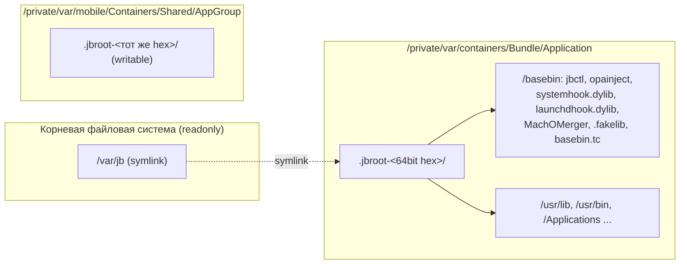
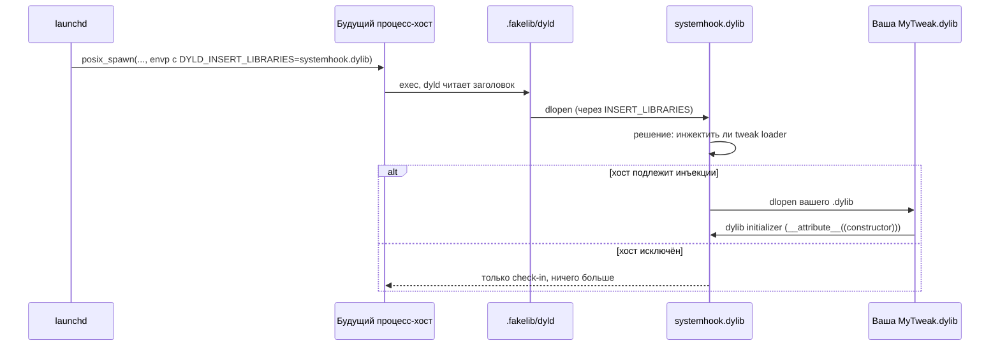

# Глава I.5. Что jailbreak даёт и что остаётся недоступным

В предыдущих главах мы шли от общих понятий к формату Mach-O и приватной арифметике PAC в arm64e. Теперь — обратно к инженерной практике. Автор твика, впервые севший за iOS 26.0/26.0.1 на A13, должен ясно понимать три вещи: *какое новое пространство файлов и прав ему открывает jailbreak*, *какой «трюк» заменяет настоящую подпись Apple для его собственного кода*, и *где границы — куда даже после побега из песочницы его бинарник просто не сможет дотянуться*. Эта глава систематизирует ответы — строго по тому, что можно подтвердить ссылками на репозиторий Dopamine RootHide 3.0.12.

Чтобы читатель не угадывал, что откуда взято, в этой главе действует правило: каждое утверждение о коде сопровождается ссылкой «путь:строка», а любая гипотеза, которую автор не смог верифицировать по исходникам, явно маркируется как «не подтверждено исходниками» или «требует проверки на устройстве A13 с iOS 26.0/26.0.1».

## 5.1. Фон: почему именно A12/A13 и почему именно 26.0/26.0.1

Строка декларации, которую Dopamine показывает пользователю, однозначна:

```objc
if ([self isArm64e]) {
    if (cpuFamily == CPUFAMILY_ARM_VORTEX_TEMPEST || cpuFamily == CPUFAMILY_ARM_LIGHTNING_THUNDER) {
        return @"iOS 15.0 - 18.7.1, 26.0 - 26.0.1 (A12/A13, PPL)";
    }
    else if (![self isSPTM]) {
        return @"iOS 15.0 - 17.3.1 (PPL)";
    }
    else {
        return @"iOS 17.0 - 17.3.1 (SPTM)";
    }
}
```

Это `Application/Dopamine/Jailbreak/DOEnvironmentManager.m:252-262`. Ключевые семейства процессоров — `CPUFAMILY_ARM_VORTEX_TEMPEST` (A12) и `CPUFAMILY_ARM_LIGHTNING_THUNDER` (A13); иных ветвей для «iOS 26» в коде нет. Для A14+ с их аппаратной защитой SPTM/TXM (System Page Table Monitor / Trusted eXecution Monitor) ветки под 26.0/26.0.1 в этой функции просто не предусмотрено — на этих чипах пришлось бы обходить SPTM, а соответствующих эксплойтов для 26.x в репозитории нет.

Проверим, какие цепочки эксплойтов реально доступны для 26.0/26.0.1. Ядерные уязвимости декларируются в `Application/Dopamine/Exploits/DarkSword/Info.plist` и `Application/Dopamine/Exploits/ClearSword/Info.plist` одинаковым блоком:

```plist
<key>DPSupportedRanges</key>
<array>
    <dict><key>Start</key><string>19.0</string>
          <key>End</key><string>26.0.1</string></dict>
</array>
<key>DPSupportInclude</key>
<array><dict><key>Builds</key><array>
    <string>23B5044l</string><string>23B5059e</string><string>23B5064e</string>
</array></dict></array>
```

Это два kernel-эксплойта с перекрывающимися диапазонами (ClearSword дополнительно требует `contiguousMapping` в `DPExploitRequirements`). Ни тот, ни другой не привязан к конкретному чипу — ядерная уязвимость одна и та же и для A12, и для A17. Но *жить* в её последствиях на 26.x можно только на A12/A13: именно у них управление страницами на уровне ядра защищено PPL (Page Protection Layer), а не SPTM.

Для автора твика это важно не как академический факт, а как условие работы его кода: когда Dopamine в `isSupported` в `Application/Dopamine/Jailbreak/DOEnvironmentManager.m:799-816` требует «Kernel + при необходимости PAC + при необходимости PPL», речь идёт о цепочке «уязвимость ядра → обход PPL → патч trustcache + CS-флагов», которую мы будем разбирать ниже. На A14+ в этой цепочке не хватает последнего звена под 26.0/26.0.1 — PPL/SPTM-эксплойта соответствующего поколения; например, Titan (`Application/Dopamine/Exploits/Titan/Info.plist`) заявлен как `DPExploitType = PPL` только для A14–A17 и только для 16.1–17.3.1, а на 26.x не распространяется. Поэтому реальная совместимость в заголовке главы — ровно A12/A13 на 26.0/26.0.1.

Различий между 26.0 и 26.0.1 на уровне условий поддержки в этом месте проекта не выявлено: эксплойты поддерживают диапазон одним куском, и три перечисленных билда (`23B5044l`, `23B5059e`, `23B5064e`) относятся к бета-итерациям этого же релиза.

## 5.2. Rootless (/var/jb) и RootHide: что изменилось для места, куда ставятся твики

Классический jailbreak «до iOS 15» писал в саму корневую файловую систему. С iOS 15 корень смонтирован read-only, и даже с ядерными правами «вернуть / в read-write» на долгое время перестало быть реалистично. Ответ сообщества — *rootless*: виртуальный корень `/var/jb`, в котором живёт весь установленный поверх системы stack. Пакеты устанавливаются относительно `/var/jb`, пути вида `/var/jb/usr/bin/sshd` подменяются на `/usr/bin/sshd` на этапе выполнения, бинарники системы остаются нетронутыми.

RootHide развивает идею дальше: вместо одного фиксированного каталога `/var/jb` используется каталог со случайным именем, созданный внутри `/var/containers/Bundle/Application/`, а `/var/jb` оставлен как *символьная ссылка* на него. Константы и логика выбора пути находятся в `Application/Dopamine/Jailbreak/DOBootstrapper.m:879-918`:

```c
#define JB_ROOT_PREFIX ".jbroot-"
#define JB_RAND_LENGTH  (sizeof(uint64_t)*sizeof(char)*2)

int is_jbroot_name(char* name)
{
    if(strlen(name) != (sizeof(JB_ROOT_PREFIX)-1+JB_RAND_LENGTH))
        return 0;
    if(strncmp(name, JB_ROOT_PREFIX, sizeof(JB_ROOT_PREFIX)-1) != 0)
        return 0;
    char* endp=NULL;
    uint64_t value = strtoull(name+sizeof(JB_ROOT_PREFIX)-1, &endp, 16);
    if(!endp || *endp!='\0') return 0;
    if(!check_jbrand_value(value)) return 0;
    return 1;
}
```

Префикс каталога — `.jbroot-`, суффикс — 16 шестнадцатеричных цифр, то есть 64-битное число в hex-кодировке. Это число Dopamine генерирует через `arc4random` в `jbrand_new` (`Application/Dopamine/Jailbreak/DOBootstrapper.m:944-949`); старший байт хранит контрольную сумму остальных, что проверяется в `check_jbrand_value`. Старая `/var/jb` — просто симлинк на этот скрытый каталог; строка создания видна в `Application/Dopamine/Jailbreak/DOBootstrapper.m:264`:

```c
return [self createSymlinkAtPath:@"/var/jb" toPath:JBROOT_PATH(@"/") createIntermediateDirectories:YES];
```

Второй каталог с тем же суффиксом живёт в писательском пространстве контейнеров: `/private/var/mobile/Containers/Shared/AppGroup/.jbroot-<RAND>/`. Он нужен для записи — доступ к `/private/var/containers/Bundle/Application` для процессов из песочницы, как правило, только на чтение. Оба пути выдаются вместе — см. `BaseBin/libroothider/src/common.m:437-438`:

```objc
snprintf(jbroot_base,     sizeof(jbroot_base),
         "/private/var/containers/Bundle/Application/.jbroot-%016llX/", jbinfo(jbrand));
snprintf(jbroot_writable, sizeof(jbroot_writable),
         "/private/var/mobile/Containers/Shared/AppGroup/.jbroot-%016llX/", jbinfo(jbrand));
```

Внутри `jbroot_base` особое место занимает подкаталог `/basebin` — именно там живёт инфраструктура jailbreak: `jbctl`, `opainject`, `launchdhook.dylib`, `systemhook.dylib`, `MachOMerger`, `basebin.tc`, сгенерированная fakelib и т. д. Пути везде собираются макросом `JBROOT_PATH("/basebin/...")`, см., например, `BaseBin/libjailbreak/src/util.c:954`, `Application/Dopamine/Jailbreak/DOJailbreaker.m:357,369,419,433,464`.

Диаграмма расположения:



### 5.2.1. Зачем RootHide рандомизирует префикс

Классический rootless-подход хранил всё в единственном фиксированном пути `/var/jb`. Это даёт двойную уязвимость для автора твика. Во-первых, любое приложение, у которого в sandbox-профайле есть доступ к `/var/jb` (или к `/private/var/containers/Bundle/Application/`, где этот путь лежит симлинком), может *обнаружить сам факт jailbreak* и, например, отказаться запускаться. Во-вторых, античит-механизмы в приложениях банков и игр активно проверяют именно известные пути вроде `/var/jb/usr/bin/sshd`.

Рандомизация суффикса не является cryptographic-защитой — 64 бита, из которых только 56 случайные (один байт — контрольная сумма, `Application/Dopamine/Jailbreak/DOBootstrapper.m:947`), это не крипто-уровень. Но практически она эффективна против простых детекторов: приложение не может «на всякий случай» просканировать `/private/var/containers/Bundle/Application/` в поисках `.jbroot-*`, потому что соответствующий каталог защищён платформенным sandbox: его видно только тем, кому разрешено, в первую очередь системным сервисам. Отсюда и выбор места — `/private/var/containers/Bundle/Application/`, а не публично-доступный `/var/`.

Для автора твика это даёт одно важное практическое следствие: *вы не должны «показывать» jailbreak приложениям, которые ему не нужны*. Если ваш твик модифицирует SpringBoard — работайте в SpringBoard, не оставляйте следов в чужих sandbox’ах. Если вам нужны настройки — пишите их в `/var/jb/var/mobile/...` (которое, напомним, реально живёт в AppGroup `.jbroot-<RAND>`), а не в `/private/var/mobile/Library/Preferences/`.

### 5.2.2. Макрос JBROOT_PATH и его разрешение в рантайме

В коде постоянно встречается `JBROOT_PATH(...)` — это макрос, собирающий абсолютный путь внутри текущего jbroot с помощью `jbinfo(rootPath)`. Пример его использования — везде в `Application/Dopamine/Jailbreak/DOJailbreaker.m` и `BaseBin/libjailbreak/src/util.c:954`. В вашем твике, если он слинкован с `libjailbreak`, можно вызывать эту же конструкцию; если нет — ровно то же эффективно получается чтением символьной ссылки `/var/jb` через `readlink(2)`. Пример:

```c
#include <unistd.h>
#include <limits.h>

static char g_jbroot[PATH_MAX];

__attribute__((constructor))
static void init_jbroot(void)
{
    ssize_t n = readlink("/var/jb", g_jbroot, sizeof(g_jbroot) - 1);
    if (n > 0) g_jbroot[n] = '\0';
}
```

Ключевая строка — `readlink("/var/jb", ...)`: она даст вам полный путь вида `/private/var/containers/Bundle/Application/.jbroot-<RAND>/`. Внутри хоста это *единственный* каталог, в который имеет смысл класть свои ресурсы — всё остальное либо недоступно (системные пути), либо не переживёт перерандомизации (если вы захардкодите конкретный `.jbroot-...`).

**Что это значит для автора твика на практике.**

* Устанавливать свой `.deb`/`.dylib` следует *относительно* `/var/jb`, а не абсолютно. Если в вашем `Makefile` или контрольных файлах написано `/usr/lib/TweakInject/MyTweak.dylib`, после установки на roothide-устройство ваш твик окажется не там, где его ищет загрузчик (dyld). Корректная цель — например, `/var/jb/usr/lib/TweakInject/MyTweak.dylib`; `theos` для rootless делает это за вас при сборке с `THEOS_PACKAGE_SCHEME=rootless`.
* Хардкодить случайный префикс нельзя: он меняется от установки к установке, и в коде есть явная поддержка «перерандомизации» (`Application/Dopamine/Jailbreak/DOBootstrapper.m:1235` — «Status: Rerandomize jbroot»). Для чтения текущего префикса из процесса достаточно воспользоваться символьной ссылкой `/var/jb` или получить значение `rootPath` / `jbrand` из `jbinfo(...)` (см. использования в `BaseBin/libroothider/src/common.m:437-438`), если ваш твик слинкован с `libjailbreak`/`libroothider`.
* Писательский путь `/var/jb/var/mobile/...` в действительности разрешается на `/private/var/mobile/Containers/Shared/AppGroup/.jbroot-<RAND>/var/mobile/...`, то есть ваш твик пишет не в системный `/var/mobile`, а в контейнер группы приложений. Это важно, когда вы думаете, что «пишете пользователю в домашний каталог»: нет, вы пишете в приватное место jailbreak-а, которое может пропасть при его удалении.

### 5.2.3. Что видит process-host через `/var/jb`: порядок разрешения путей

Для автора твика важна одна деталь, которая часто проскакивает мимо. Когда ваш `.dylib` открывает путь вида `/var/jb/usr/lib/libSomething.dylib`:

1. Файловая система резолвит `/var/jb` как симлинк на `/private/var/containers/Bundle/Application/.jbroot-<RAND>/`.
2. Внутри резолвера монтируется sandbox-check: имеет ли ваш процесс extension на целевой путь? Для `.jbroot-<RAND>` — да, `generate_sandbox_extensions` его выдал. Для `/private/var/containers/Bundle/Application/<другой UUID>/...` — нет.
3. Resolution продолжается уже внутри `.jbroot-<RAND>` относительно корня jailbreak-а.

Отсюда — любопытный практический эффект. Пути вроде `/var/jb/../somewhere/evil` *не работают*: за первым шагом разрешения симлинка подключается sandbox-check, и `..` выводит вас за пределы `.jbroot-<RAND>/`, что sandbox сразу отвергает. Jailbreak даёт вам *читаемое и писательское окно в jbroot*, а не «корневые права на всю ФС через симлинк».

Этот момент не оформлен в коде jailbreak-а как явная проверка — он является следствием работы sandbox-механизма Apple плюс выданных extensions. Поэтому разбор здесь по сути архитектурно-логический, а не ссылочный на конкретную строку.

## 5.3. AMFI, codesign, trustcache: как подпись «ad-hoc + trustcache» превращается в подпись Apple для dyld

Чтобы системный загрузчик согласился отобразить ваш `.dylib` в адресное пространство, подсистема AMFI (Apple Mobile File Integrity) должна признать подпись бинарника валидной. На устройстве с полной защитой это означает: подпись либо выпущена Apple, либо, через цепочку сертификатов, по developer-профилю, с entitlement’ами, одобренными profile’ом. У нас этого нет. Что есть: *ad-hoc* подпись, где подпись не удостоверяет ничего, кроме целостности — её `cdhash` (Code Directory Hash) просто фиксирует содержимое кодовой секции.

Трюк jailbreak-а в том, чтобы *добавить cdhash вашего бинарника в trustcache ядра*. Trustcache — это внутренняя структура ядра iOS, где перечислены cdhash’и, автоматически принимаемые системой за «подписанные Apple». У Apple это неизменяемый ресурс (образы trustcache загружаются из `/System/Library/.../TrustCache`). У нас — патченная версия этой структуры, в которую jailbreak вставляет собственный «пустой» trustcache, растущий по мере добавления хэшей.

Ядро живёт в читаемом ядре с помощью kread/kwrite через ядерный эксплойт. Dopamine определяет глобал в адресном пространстве ядра:

```c
uint64_t _trustcache_list_get_start(void)
{
    if (ksymbol(pmap_image4_trust_caches)) {              // iOS <=15
        return kread64(ksymbol(pmap_image4_trust_caches));
    }
    else if (ksymbol(ppl_trust_cache_rt)) {                // iOS >=16, PPL
        return kread64(kread64(ksymbol(ppl_trust_cache_rt) + 0x20));
    }
    else if (ksymbol_txm(txm_trustcache_root)) {           // iOS >=17, SPTM/TXM
        return kread64(kread64(ksymbol_txm(txm_trustcache_root) + 0x20));
    }
    return 0;
}
```

Это `BaseBin/libjailbreak/src/trustcache.c:22-35`. Для нашей комбинации «A12/A13, iOS 26.0/26.0.1, PPL» рабочей является вторая ветка: глобал `ppl_trust_cache_rt`, по смещению `+0x20` — указатель на связный список trustcache’ей. Dopamine либо вставляет свой новый trustcache в начало списка (`BaseBin/libjailbreak/src/trustcache.c:81-87`), либо, если `SPTM`-ветка активна (A14+), подшивает его в конец — потому что страницы, которые раздаёт SPTM/TXM, read-only для TXM-а, и перезаписать `prevptr` в чужих trustcache не получается (`trustcache.c:65-78`). На A12/A13 это ограничение неактуально.

Вставка в сам список выполняется в `trustcache_list_insert` (`BaseBin/libjailbreak/src/trustcache.c:61-90`), а растёт trustcache по 0x4000-байтовым страницам в `_jb_trustcache_grow` (`BaseBin/libjailbreak/src/trustcache.c:168-187`):

```c
uint64_t _jb_trustcache_grow(void)
{
    uint64_t jbTcKern = 0;
    if (kalloc(&jbTcKern, 0x4000) != 0) return 0;
    jb_trustcache *jbTc = alloca(sizeof(jb_trustcache));
    memset(jbTc, 0, sizeof(jb_trustcache));
    _trustcache_file_init(&jbTc->file);
    jbTc->magic = JB_MAGIC;
    *(uint64_t *)(jbTc->trustcache + koffsetof(trustcache, fileptr)) =
        (jbTcKern + offsetof(jb_trustcache, file));
    ...
    kwritebuf(jbTcKern, jbTc, sizeof(*jbTc));
    trustcache_list_insert(jbTcKern);
    return jbTcKern;
}
```

Собственные trustcache’и помечены специальным значением `JB_MAGIC` в поле перед `file`; это позволяет позже отличать «наши» trustcache’и от Apple-овских: функция `_is_jb_trustcache` (`BaseBin/libjailbreak/src/trustcache.c:139-150`) проверяет, что `fileptr` указывает ровно на `offsetof(jb_trustcache, file)` и что magic на месте.

Добавление cdhash’ей сводится к сортировке массива `trustcache_entry_v1 { uint8_t hash[20]; uint8_t hash_type; uint8_t flags; }` и копированию его в kernel-страницу (`BaseBin/libjailbreak/src/trustcache.c:189-234`). Для автоматического подхвата всех свежих бинарников есть пара удобств поверх: `jb_trustcache_add_file` разбирает Mach-O/Fat файл и собирает cdhash’и всех его срезов (`BaseBin/libjailbreak/src/trustcache_fs.c:80-92`), а `jb_trustcache_add_directory` обходит каталог целиком и вытягивает хэши из всех найденных Mach-O (`BaseBin/libjailbreak/src/trustcache_fs.c:12-56, 94-107`).

Этот же путь используется при загрузке самого jailbreak: `BaseBin/libroothider/src/common.m:457-498` в `randomizeAndLoadBasebinTrustcache` перечисляет файлы в `/basebin/`, собирает cdhash’и (с учётом «рандомизации», о которой в репозитории есть отдельная функция `ensure_randomized_cdhash`) и выгружает собранный trustcache одним куском с фиксированным UUID (`BASEBIN_TRUSTCACHE_UUID`). Для стороннего твика работать с trustcache руками не нужно — за вас это делает `trustcache_file_build_from_path`/`jb_trustcache_add_entry` на этапе установки `.deb` (см. использование в `Application/Dopamine/Jailbreak/DOJailbreaker.m:357,369,464` и в коде `jbctl`).

### 5.3.0. Структура trustcache и cdhash: байты, из которых всё состоит

Чтобы автор твика понимал, что именно оказывается в ядре, стоит точно назвать типы. Из `BaseBin/libjailbreak/src/trustcache_structs.h` (имена структур упоминаются по всему `trustcache.c`):

| Тип | Что это |
|-----|---------|
| `cdhash_t` | массив из 20 байт — усечённый SHA256 Code Directory блока (`__TEXT` подпись) |
| `trustcache_entry_v1` | `{ cdhash_t hash; uint8_t hash_type; uint8_t flags; }` — одна запись |
| `trustcache_file_v1` | заголовок с UUID, длиной и массивом `trustcache_entry_v1` |
| `trustcache` (ядерный) | linked-list узел с `fileptr`, `nextptr`, `prevptr`, `size`, `type` |
| `jb_trustcache` | обёртка jailbreak-а над `trustcache` + поле `magic == JB_MAGIC` |

Для каждого architecture slice в вашем Mach-O (arm64 и arm64e, если fat) *свой* `cdhash`. Поэтому в `fat_collect_untrusted_cdhashes` (`BaseBin/libjailbreak/src/trustcache_fs.c:68`) из одного файла собирается *несколько* хэшей, и все они добавляются в trustcache. Если ваш `.deb` ставит только arm64-срез, а SpringBoard — arm64e, инъекция *не произойдёт*: AMFI не найдёт cdhash arm64e-среза в trustcache. Отсюда и строка `ARCHS = arm64 arm64e` в примере Makefile выше.

Поведение AMFI после этого выглядит так: dyld, подгружая вашу `MyTweak.dylib`, запрашивает её cdhash у ядра; ядро находит соответствующий entry в одном из trustcache’ей связного списка и возвращает статус «валидно, разрешено к загрузке». Для dyld это неотличимо от ситуации, когда бинарник подписан legitimate-cert’ом из trust store. Отдельный штрих — `CS_ADHOC`: на SPTM-устройствах jbserver вынужден *принудительно* выставлять бит CS_ADHOC в csflags процесса на этапе check-in (см. `BaseBin/launchdhook/src/jbserver/jbdomain_systemwide.c:269-270`), чтобы hooking в dyld вокруг `fcntl` корректно отрабатывал. На A12/A13 без SPTM этот трюк не включается — `ksymbol(SPTMArgs) == 0`.

Описание флагов `CS_*`, используемых далее для процессов, находится в `BaseBin/libjailbreak/src/codesign.h:6-45`. Критичные для твикописания:

| Флаг | Hex | Значение в кодексе Dopamine |
|---|---|---|
| `CS_VALID` | 0x1 | Подпись считается валидной |
| `CS_ADHOC` | 0x2 | Ad-hoc подпись (без цепочки) |
| `CS_PLATFORM_BINARY` | 0x04000000 | Процесс рассматривается как «платформенный», часть системы |
| `CS_INSTALLER` | 0x8 | Процесс имеет installer-entitlement |
| `CS_DEBUGGED` | 0x10000000 | Инвалидные страницы разрешены (debug) |

Для вашего твика ровно одного хватает — чтобы `cdhash` оказался в trustcache. Остальные биты меняются уже *процессу-хосту*, а не вашему `.dylib`, при check-in через jbserver.

### 5.3.1. Фоновая механика: как cdhash добавляется и как он потом «виден» dyld

Чтобы не разбирать это заклинанием, пройдём путь от файла на диске до загрузки в адресное пространство процесса пошагово — всё в терминах, подтверждаемых исходниками.

Шаг 1. Пакет-установщик `.deb` раскладывает ваш `.dylib` под `/var/jb/...`. Параллельно вызывается механизм добавления хэша: либо явно, через `jbctl trust <path>`, либо автоматически, через postinst-скрипт, который делает то же самое, что и `trustcache_file_build_from_path` в коде Dopamine (`Application/Dopamine/Jailbreak/DOJailbreaker.m:357`): открывает Mach-O, собирает cdhash’и всех его архитектурных срезов, упаковывает их в `trustcache_file_v1`.

Шаг 2. `jbctl` отдаёт этот `trustcache_file_v1` на jbserver через XPC-канал. `jbserver` (его код — в `BaseBin/launchdhook/src/jbserver/`) вызывает `trustcache_file_upload`:

```c
int trustcache_file_upload(trustcache_file_v1 *tc)
{
    uint64_t tcSize = ksizeof(trustcache) + sizeof(trustcache_file_v1)
                    + (tc->length * sizeof(trustcache_entry_v1));
    if (tcSize > 0x4000) return -1;
    ...
    uint64_t tcKaddr = 0;
    if (kalloc(&tcKaddr, tcSize) != 0) return -1;
    ...
    uint64_t tcFileKaddr = tcKaddr + ksizeof(trustcache);
    kwritebuf(tcFileKaddr, tc, tcSize - ksizeof(trustcache));
    kwrite64(tcKaddr + koffsetof(trustcache, fileptr), tcFileKaddr);
    ...
}
```

Это `BaseBin/libjailbreak/src/trustcache.c:328-389`. Пределы на размер (`0x4000` байт) — следствие того, что одна kalloc-страница в ядре у Apple для этого объекта именно такого размера. Если ваш cdhash не влезает по размеру — Dopamine выделит *другую* страницу через `_jb_trustcache_grow` (`trustcache.c:168`). Для автора твика это невидимое ограничение.

Шаг 3. Процесс-хост стартует. dyld (а в Dopamine его обёртка — `/basebin/.fakelib/dyld`, пропатченный `MachOMerger`-ом с добавлением `systemhook.dylib`, см. `BaseBin/libjailbreak/src/basebin_gen.m:139-153`) при маппинге вашей `.dylib` обращается к AMFI. AMFI через `pmap_cs_lookup`/аналог находит cdhash в одной из trustcache-страниц ядра — и выдаёт «валидно». Для dyld это неотличимо от стандартной Apple-подписи.

Шаг 4. Процесс check-in’ится через `systemwide_process_checkin` (`BaseBin/launchdhook/src/jbserver/jbdomain_systemwide.c:205`), получая sandbox-extensions на `.jbroot-...` каталоги. Теперь ваш код внутри хоста может читать `.jbroot-...` для подгрузки зависимостей (например, `libsubstrate.dylib`), а если ваш `.dylib` установлен в писательском зеркале AppGroup — писать в него.

Понимание этих шагов экономит часы отладки: если «твик не грузится», причина почти всегда одна из трёх — cdhash не в trustcache (шаг 2 не был выполнен), `.dylib` лежит по неправильному пути (не внутри `.jbroot-...`), либо хост сам не прошёл check-in и systemhook не инжектит в него.

### 5.3.2. Контрпример: что ломается, если cdhash *не* в trustcache

Собрать `.dylib` с правильным ad-hoc-подписанием (`ldid -S`) и положить его по пути `/var/jb/usr/lib/TweakInject/Mine.dylib` ещё *недостаточно*. На практике injection через `DYLD_INSERT_LIBRARIES` (или через systemhook) закончится тем, что dyld вызовет AMFI, а AMFI отвергнет вашу подпись как «ad-hoc не в trustcache». Процесс либо вовсе не стартует, либо стартует без вашего кода (в зависимости от того, какой именно step AMFI не пропустил). Это самая частая ошибка начинающих: кажется, что «я подписал, значит сработает». Нет; подпись — лишь контейнер для cdhash’а, а решение «пропустить» принимает ядро по trustcache. Для вставки хэша на лету штатное средство — `jbctl trust <path>` (бинарник из `/basebin`, см. `Application/Dopamine/Jailbreak/DOJailbreaker.m:419`), который использует только что описанную инфраструктуру libjailbreak.

### 5.3.3. Protobox и фильтр mach-сообщений: что ещё jbserver делает процессу

С iOS 16 Apple ввела «Protobox» — механизм, в котором каждый процесс имеет *маску разрешённых системных вызовов* и фильтр входящих Mach-сообщений. Код в `jbdomain_systemwide.c:309-320` явно комментирует это и обходит:

```c
if (__builtin_available(iOS 16.0, *)) {
    // In iOS 16+ there is a super annoying security feature called Protobox
    // Amongst other things, it allows for a process to have a syscall mask
    // If a process calls a syscall it's not allowed to call, it immediately crashes
    // Because for tweaks and hooking this is unacceptable, we update these masks to be 1 for all syscalls on all processes
    proc_allow_all_syscalls(proc);
    proc_remove_msg_filter(proc);
}
```

Реализации — `BaseBin/libjailbreak/src/util.c:736` и `util.c:756`. Для автора твика эта операция *автоматическая* и обязательная: без неё многие хуки, задевающие нетипичные для хоста системные вызовы (например, `ptrace`, `task_for_pid` в вспомогательных путях, экзотические `fcntl`), падают с SIGKILL прямо при входе в syscall. Dopamine делает это за вас — но важно знать: когда ваш твик только что инжектился и ещё не прошёл check-in, Protobox *активен в полной мере*. Поэтому любая логика вроде «при инициализации сразу вызвать `task_for_pid`» должна либо дожидаться check-in’а, либо работать через те syscall’ы, которые разрешены исходной маской хоста. Явной декларации «check-in гарантированно завершился до вызова ваших конструкторов» в коде нет; это требует проверки на устройстве A13 с iOS 26.0/26.0.1.

## 5.4. Sandbox: твик наследует песочницу процесса-хоста

Распространённое заблуждение — «после jailbreak-а всё ломается в root, песочницы нет». В Dopamine RootHide 3.0.12 это неверно для сторонних твиков. На практике ваш твик — это `.dylib`, который загружается *в чужое адресное пространство*: SpringBoard, стороннее приложение, системный daemon. У каждого такого процесса своя SB-профайл, свои sandbox-extensions, свои entitlement’ы, и ваш код наследует весь этот набор. Если родитель не может писать в `/private/var/mobile/Library/Preferences/com.apple.X.plist` — не сможете и вы.

В коде это видно по тому, что jbserver во время check-in процесса выпускает ровно три sandbox-extensions, и все они касаются доступа к *jailbreak-каталогам*, а не к системе:

```objc
char* generate_sandbox_extensions(audit_token_t *processToken, bool writable)
{
    char jbroot_base[PATH_MAX];
    char jbroot_writable[PATH_MAX];
    snprintf(jbroot_base, ..., "/private/var/containers/Bundle/Application/.jbroot-%016llX/", jbinfo(jbrand));
    snprintf(jbroot_writable, ..., "/private/var/mobile/Containers/Shared/AppGroup/.jbroot-%016llX/", jbinfo(jbrand));

    char* fileclass = writable ? "com.apple.app-sandbox.read-write" : "com.apple.app-sandbox.read";
    char *extension1 = sandbox_extension_issue_file_to_process(fileclass, jbroot_writable, 0, *processToken);
    char *extension2 = sandbox_extension_issue_file_to_process("com.apple.app-sandbox.read", jbroot_base, 0, *processToken);
    char *extension3 = sandbox_extension_issue_file_to_process("com.apple.sandbox.executable", jbroot_base, 0, *processToken);

    if(extension1 && extension2 && extension3) {
        asprintf(&sandboxExtensionsOut, "%s|%s|%s", extension1, extension2, extension3);
    }
    ...
}
```

Это `BaseBin/libroothider/src/common.m:431-454`. Процессу разрешено: читать и запускать всё, что лежит в `.jbroot-<RAND>` (чтобы ваша `.dylib` вообще смогла попасть в адресное пространство); писать в writable-зеркало jbroot внутри AppGroup. *Доступ к системному `/`, к `/var/mobile`, к `/private/var/mobile/Library` ваш твик не получает — эти пути как не были в его песочнице, так и не стали*. Для автора это полезное ограничение: нельзя написать в домашний каталог пользователя, нельзя переназначать системные плисты «в лоб» — всё это проходит через те же sandbox-extensions, которые есть у хоста.

### 5.4.1. Про unsandbox1/unsandbox2 — почему их нет в вашем арсенале

В репозитории есть пара функций с характерными названиями:

```c
int unsandbox(const char* dir, const char* file)
{
    if (@available(iOS 16.4, *)) {
        return unsandbox2(dir, file);
    } else {
        return unsandbox1(dir, file);
    }
}
```

Это `BaseBin/libroothider/src/unsandbox.m:90-97`; реализации — `BaseBin/libroothider/src/unsandbox1.m:74` и `BaseBin/libroothider/src/unsandbox2.m:112`. Обе работают *через kread/kwrite в vnode- и namecache-структуры ядра*: `unsandbox1` строит `struct namecache_v1` с полями `TAILQ_ENTRY`, читает/пишет на уровне указателей ядра (`unsandbox1.m:17-30`, `kreadbuf`/`kwrite`), и это, по сути, патч *имени файла в кеше ядра*, который «переводит» запись в белый список sandbox.

Критично: единственный вызов `unsandbox` в кодовой базе — `BaseBin/launchdhook/src/roothider.m:114`:

```c
assert(unsandbox("/usr/lib", systemhookFilePath.fileSystemRepresentation) == 0);
```

То есть эта функция *используется исключительно самим jailbreak-ом*: чтобы положить `systemhook.dylib` «якобы в `/usr/lib`» для корректной подхватки его `launchd`-ом и всеми дочерними процессами. Это *не* API для сторонних твиков. Авторы, пробовавшие вызывать `unsandbox` из своего кода, упираются в то, что функция требует ядерных примитивов `kreadbuf`/`kwritebuf`, которые доступны только через `jbserver`, причём не всем процессам (см. платформ-проверки в `BaseBin/launchdhook/src/jbserver/jbdomain_systemwide.c`), и работает с чувствительными ядерными структурами, которые при неудаче дают kernel panic.

Отдельная ветка — сам Dopamine.app. Код в `jbdomain_systemwide.c:338-347` при check-in процесса выделяет его как особый случай:

```c
else if (is_dopamine_app(procPath)) {
    // platformize
    proc_csflags_set(proc, CS_PLATFORM_BINARY);
    /********************* roothide specific ********************/
    proc_csflags_set(proc, CS_INSTALLER);
}
```

Это *только* для самого Dopamine.app и близких к нему служебных процессов (определяется в `is_dopamine_app`). Поведение «platformize + CS_INSTALLER» — не публичное API, а внутренний механизм; попытка повторить это из стороннего твика осмысленно работать не будет, потому что `proc_csflags_set` требует ядерного доступа через `jbclient_*`.

**Практический вывод для автора:** на уровне sandbox jailbreak даёт вам ровно то, что нужно для запуска кода в чужом процессе и доступа к `/var/jb`. Если ваш твик обязан дотянуться до путей, которых нет в песочнице хоста, корректный способ — не «обходить sandbox из юзерспейса», а *встроить свой код в тот процесс, у которого есть нужные extensions*. Для доступа к SpringBoard-овским приватным путям — хук в SpringBoard; для записи в `/var/mobile` — хук, запускаемый из `trustd`/`backboardd`/`mediaserverd` или другого демона, которому эти пути открыты.

### 5.4.2. Как ваш `.dylib` в принципе попадает внутрь чужого процесса

Чтобы «наследование sandbox» было не абстракцией, а понятной инженерной деталью, стоит коротко проследить цепочку инъекции. Эта цепочка проходит через следующие артефакты, все в `.jbroot-<RAND>/basebin/`:

* `launchdhook.dylib` инжектится в `launchd` одним выстрелом через `opainject` — см. `Application/Dopamine/Jailbreak/DOJailbreaker.m:433`:

  ```c
  int r = exec_cmd(JBROOT_PATH("/basebin/opainject"), "1",
                   JBROOT_PATH("/basebin/launchdhook.dylib"), NULL);
  ```

  С этого момента `launchd` — главный процесс пространства пользователя — несёт в себе ваш jailbreak-hook.
* `systemhook.dylib` указывается в `DYLD_INSERT_LIBRARIES` для всех потомков:

  ```c
  setenv("DYLD_INSERT_LIBRARIES", JBROOT_PATH("/basebin/systemhook.dylib"), 1);
  ```

  Это `Application/Dopamine/Jailbreak/DOJailbreaker.m:760`. При последующем `posix_spawn`/`execve` новая программа подхватывает `systemhook.dylib`, который и является той точкой, где принимается решение «инжектить ли сюда твики пользователя».
* `.fakelib/dyld` — это *скопированный и пропатченный* dyld с «прикрученным» к нему `dyldhook_merge.<арх>.<iOS>.dylib`. См. `BaseBin/libjailbreak/src/basebin_gen.m:131-153`:

  ```objc
  // Copy /usr/lib to /var/jb/basebin/.fakelib
  carbonCopy(originUsrLibPath, fakelibPath);

  // Delete the dyld inside .fakelib
  [[NSFileManager defaultManager] removeItemAtPath:fakelibDyldPath error:nil];

  // Symlink .fakelib/dyld -> /var/jb/basebin/gen/dyld
  [[NSFileManager defaultManager] createSymbolicLinkAtPath:fakelibDyldPath withDestinationPath:targetDyldPath error:nil];
  ```

  Для автора это важно по одной причине: ваша `.dylib` будет грузиться *этим* dyld-ом, у которого уже введён dyldhook. Все приёмы «подменить функцию в самой dyld» (например, `_dyld_register_func_for_add_image`) работают, и работают именно поверх пропатченного dyld-а.

Весь практический смысл раздела 5.4 — что ваш `.dylib`, несмотря на все эти хуки и подмены, по-прежнему живёт *в чужом адресном пространстве под чужим sandbox-профайлом*. Единственное, что он реально получает «сверх хоста», — три sandbox-extensions на `.jbroot-...`. Если хост — SpringBoard, вы получите к `.jbroot` всё, что получает SpringBoard, плюс эти три extensions. Если хост — Mail.app, вы получите sandbox Mail.app плюс те же три extensions. И ничего больше.

## 5.5. PPL (Page Protection Layer) и почему он — ядро истории про A13

PPL — это аппаратно-программный барьер в прошивке Apple для A12-A13, который делает так, что даже код с ядерными правами *не может произвольно изменять страницы таблиц памяти и трастовые структуры*. Переходы в режим «PPL» идут через фиксированный gate, и всё, что хочет пойти в соответствующий регион ядра, должно пройти через один из разрешённых PPL-операторов. Для jailbreak это означает: *просто kwrite64 по адресу trustcache недостаточен — надо либо иметь полноценный PPL-bypass, либо воспользоваться существующим PPL-оператором «добавить trustcache»*. Dopamine на A12/A13 исторически использовал второй путь, подробности эксплойтов — вне этой главы.

На A14+ Apple заменила PPL на SPTM/TXM — отдельный процессор `TXM`, который валидирует всё, что должно быть read-only для ядра. Отсюда и условные ветки в `trustcache.c:65-78` (другой алгоритм вставки в список), и строки «SPTM» в `DOEnvironmentManager.m:238-241`. Для 26.0/26.0.1 полных обходов SPTM в этом репозитории нет — отсюда и фактическая обёртка «A12/A13, PPL» в `versionSupportString`.

Таблица «что на каком чипе работает в 26.0/26.0.1» строго по исходникам:

| Чип | PPL/SPTM | Доступные k-эксплойты | PPL/SPTM-обход | Поддержка 26.0/26.0.1 в Dopamine |
|-----|----------|-----------------------|-----------------|---------------------------------|
| A12 (Vortex/Tempest) | PPL | DarkSword, ClearSword | требуется, присутствует (ветка PPL в `trustcache.c`) | да (`DOEnvironmentManager.m:254`) |
| A13 (Lightning/Thunder) | PPL | DarkSword, ClearSword | требуется, присутствует (ветка PPL в `trustcache.c`) | да (`DOEnvironmentManager.m:254`) |
| A14-A17 | SPTM/TXM | DarkSword, ClearSword (ядро общее) | *для 26.0/26.0.1 в репозитории не найден* | не декларируется |

Фраза «обход SPTM для 26.0/26.0.1 в репозитории не найден» — это именно то, что я нашёл в коде: `Application/Dopamine/Exploits/Titan/Info.plist` поддерживает диапазон только 16.1–17.3.1, других PPL/SPTM-эксплойтов с окном 26.x в каталоге `Application/Dopamine/Exploits/` нет. Если это изменится в следующих версиях Dopamine — утверждение станет неверным; оно справедливо для состояния репозитория на момент ветки `claude/serene-knuth-h5qs09`, построенной на RootHide 3.0.12.

### 5.5.1. Что именно означает «нужен PPL-обход» в коде Dopamine

На практике эта фраза означает следующее. Dopamine всегда получает ядерный kread/kwrite из какого-то kernel-эксплойта (`DarkSword` или `ClearSword` для 26.0/26.0.1). Но kread/kwrite сами по себе не умеют переписывать страницы, которые ядро отдало под PPL-защиту; попытка `kwrite64` по такому адресу приведёт либо к игнорированию записи, либо, что хуже, к kernel panic. Для обхода PPL Dopamine полагается на тот факт, что сами PPL-операторы вызываются из ядра — и если найти PPL-оператор, принимающий «произвольные» аргументы (например, `pmap_image4_trust_caches_add` или аналог), то с его помощью можно записать и в защищённую страницу.

Отсюда и структура кода в `trustcache.c:65-78`:

```c
if (ksymbol(SPTMArgs)) {
    // On SPTM/TXM devices, our allocations are read-only by TXM so it cannot write to the prevptr field
    // Since TXM will only add trust caches to the start of the list, we simply add ours to the end
    __block uint64_t lastTC = 0;
    _trustcache_list_enumerate(^(uint64_t tcKaddr, bool *stop) { lastTC = tcKaddr; });
    ...
    kwrite64(lastTC + koffsetof(trustcache, nextptr), tcToInsert);
}
else {
    uint64_t previousStartTC = _trustcache_list_get_start();
    kwrite64(tcToInsert + koffsetof(trustcache, nextptr), previousStartTC);
    if (koffsetof(trustcache, prevptr)) {
        kwrite64(previousStartTC + koffsetof(trustcache, prevptr), tcToInsert);
    }
    _trustcache_list_set_start(tcToInsert);
}
```

На A14+ (SPTM-ветка) код старательно пишет только в *новую* trustcache-страницу (которую сам же и выделил), а чужие страницы читает — потому что TXM «запечатал» их read-only. На A12/A13 (PPL-ветка, активная для нас на 26.0/26.0.1) всё проще: Dopamine уже владеет PPL-примитивом, который разрешает переписывать нужные поля в чужих trustcache-страницах тоже. Это и есть «нужен PPL-обход» на уровне исходного кода. Конкретный примитив — часть эксплойта, вне инструментария этой главы; для автора твика достаточно знать, что он есть, и работает прозрачно через `kwrite64`.

## 5.6. Можно/нельзя/требует условий — краткая карта для автора твика

Эта таблица — не инструкция к действию, а чек-лист к планированию: прежде чем закладывать функциональность в твик, сверьтесь с ней.

| Намерение автора | Можно? | Условия / ссылка |
|------------------|--------|------------------|
| Загрузить свою `.dylib` в чужой процесс | да | cdhash должен быть в trustcache (`jbctl trust` или сборка через системный установщик `.deb`); инъекция — через systemhook, см. `JBROOT_PATH("/basebin/systemhook.dylib")` в `Application/Dopamine/Jailbreak/DOJailbreaker.m:760` |
| Иметь доступ ко всему `/var/jb` | да | три sandbox-extensions выпускаются в `generate_sandbox_extensions` (`BaseBin/libroothider/src/common.m:431-454`) |
| Писать в `/var/jb/var/mobile` | да, но это AppGroup-контейнер | writable-путь — `.jbroot-<RAND>` в `Containers/Shared/AppGroup/` (`common.m:438`) |
| Писать в `/private/var/mobile/Library/...` хоста | нет (из любого стороннего твика) | эти пути вне sandbox-extensions, выданных jailbreak-ом |
| Писать в системный `/System`, `/usr/lib` | нет | корень read-only; попытка обойти — тупик, см. `BaseBin/libjailbreak/src/basebin_gen.m:131` (jailbreak сам копирует `/usr/lib` в свою fakelib, а не меняет оригинал) |
| Выполнить код как root в любом процессе | только если хост уже root | setuid/setgid-обработка в `jbdomain_systemwide.c:276-306` — патчит svuid/svgid *по правам файла*, но не делает ваш твик всемогущим |
| Повесить хук на функцию в arm64e-библиотеке | да | только с учётом PAC и chained fixups (см. главу I.4); готового «универсального» PAC-дискриминатора нет — не подтверждено исходниками |
| Получить `CS_PLATFORM_BINARY` для своего хоста | нет (в общем случае) | этот флаг ставится только для самого Dopamine.app в `jbdomain_systemwide.c:342` |
| Вызвать `unsandbox` для расширения своих прав | нет | функция — внутренний механизм (`BaseBin/launchdhook/src/roothider.m:114`), требует ядерных примитивов и зарезервирована для jailbreak-а |
| Монтировать корень в rw | нет | не декларируется никакой публичной процедурой; требует проверки на устройстве A13 с iOS 26.0/26.0.1 |
| Отключить SSV (Sealed System Volume) | нет | не декларируется; не подтверждено исходниками |
| Поставить persistent-хук на `launchd` для всех процессов | да, уже стоит | это и есть `launchdhook.dylib`, инжектится через `opainject` в `Application/Dopamine/Jailbreak/DOJailbreaker.m:433` — ваш твик должен встраиваться в этот поток, а не параллелить его |
| Запретить своему твику стартовать в SpringBoard, но стартовать в прикладных программах | да, обычный `.plist` theos | фильтры инъекции — на уровне systemhook; детали — в части II |

Жирным контрпримером к «пункту про CS_PLATFORM_BINARY» служит `is_dopamine_app`: *только* для него jbserver «platformize»-ит процесс. Любой сторонний твик, желающий «стать платформенным», в этом репозитории поддержки не имеет; попытка собственноручно вызвать `proc_csflags_set` без ядерных примитивов jailbreak-а бессмысленна.

### 5.6.1. Разворачивание первой строки чек-листа: инъекция через systemhook

Строку таблицы «Загрузить свою `.dylib` в чужой процесс — да» имеет смысл развернуть, потому что именно её чаще всего неверно понимают. Инъекция в Dopamine происходит не через ваш собственный патч или `DYLD_INSERT_LIBRARIES`, установленный пользователем вручную, а через цепочку:



`systemhook.dylib` сам по себе содержит фильтры: системные процессы, в которых инъекция запрещена пользовательскими настройками, пропускаются. Детальный разбор `systemhook` — тема главы II.2; здесь важно только то, что *вы не контролируете момент инъекции напрямую*. Если ваш твик рассчитан на SpringBoard, он загрузится в SpringBoard. Если ваш твик по ошибке упомянут в `.plist`-фильтрах для `backboardd`, он попадёт и туда — с возможными последствиями в виде циклической перезагрузки SpringBoard.

### 5.6.2. Пример скелета твика под RootHide (theos)

В качестве иллюстрации — минимальный скелет Makefile и Tweak.x для твика, который работает на iOS 26.0/26.0.1 A13 с RootHide:

```make
export THEOS_PACKAGE_SCHEME = roothide
TARGET := iphone:clang:latest:15.0
ARCHS = arm64 arm64e

INSTALL_TARGET_PROCESSES = SpringBoard

include $(THEOS)/makefiles/common.mk
TWEAK_NAME = MyTweak
MyTweak_FILES = Tweak.x
MyTweak_CFLAGS = -fobjc-arc
include $(THEOS_MAKE_PATH)/tweak.mk
```

Ключевое: `THEOS_PACKAGE_SCHEME = roothide` переключает theos на схему roothide, при которой итоговый `.deb` раскладывает файлы относительно `.jbroot-<RAND>` на этапе установки (путь будет внутри `/var/jb/...`, а симлинк `/var/jb` разрешит остальное). Срезы `arm64 arm64e` — потому что ваш твик будет инжектиться и в arm64e-процессы вроде SpringBoard, и в arm64-процессы вроде сторонних приложений (см. разбор в главе I.4). Таргет `iphone:clang:latest:15.0` — минимальная версия iOS, не максимальная; вы можете собирать для 15.0 и всё равно корректно работать на 26.0, если не используете API, появившиеся позже; обратное неверно.

Код `Tweak.x`:

```objc
%hook SBHomeScreenViewController

- (void)viewDidAppear:(BOOL)animated
{
    %orig;
    NSLog(@"[MyTweak] SpringBoard home appeared");
}

%end
```

`%hook` theos разворачивает в вызовы MSHookMessageEx (или аналогичного Objective-C runtime-подмены), которые — в отличие от inline-хуков на C-функции — PAC-нейтральны: Objective-C method dispatch идёт через `objc_msgSend`, и подмена метода в его таблице не требует работы с подписанными указателями. Это и есть основной путь для твикописания под iOS 26 на A13.

### 5.6.3. Что происходит, если собрать «по-старому», с `THEOS_PACKAGE_SCHEME` не выставленным

Собранный таким образом `.deb` разложит ваш твик по абсолютным путям `/Library/MobileSubstrate/DynamicLibraries/MyTweak.dylib`. На RootHide-устройстве эти пути *не существуют* в system root (он read-only, и уж тем более нет каталога `/Library/MobileSubstrate`); установщик пакетов jailbreak-а на самом деле положит файл в `/var/jb/Library/MobileSubstrate/DynamicLibraries/MyTweak.dylib`. Это может сработать «случайно», если ваш loader хуков смотрит именно в `/var/jb/Library/...` — но это не гарантированно, а главное, cdhash вашего `.dylib` в trustcache на этапе `apt install` может не попасть, если postinst-скрипт не был выполнен правильной веткой. Как правило, итог — твик не грузится, а в логах видно `dyld: AMFI: ... CS_INVALID`.

## 5.7. Чего нет: границы, которые jailbreak на A13/iOS 26 не отодвигает

Чтобы автор твика не планировал того, чего нет, перечислим прямо и явно, что *не делает* Dopamine RootHide 3.0.12 на A12/A13 под 26.0/26.0.1 — именно по состоянию исходников, а не по общим слухам:

1. **Не ставит ваш код в режим CS_PLATFORM_BINARY автоматически.** Это делается только для самого Dopamine.app (`jbdomain_systemwide.c:338-347`).
2. **Не расширяет sandbox-профиль чужого процесса.** Выдаются ровно три extensions, все на jbroot-пути (`common.m:431-454`). SpringBoard-овский домашний `.plist` вам всё так же недоступен из обычного твика.
3. **Не делает `/` writable.** В коде даже наоборот: `basebin_generate_internal` (`BaseBin/libjailbreak/src/basebin_gen.m:131`) явно *копирует* `/usr/lib` в свою `.fakelib`, а не монтирует корень в rw.
4. **Не отключает PAC.** Для arm64e-кода вы по-прежнему обязаны делать правильные PAC-операции; `isPACBypassRequired` возвращает `NO` для iOS 15.2+ (`DOEnvironmentManager.m:784-792`) — что значит *не нужен PAC-эксплойт на уровне самого jailbreak*, но на уровне тонкого хука вы с PAC всё равно встречаетесь.
5. **Не обходит SPTM на A14+ для 26.0/26.0.1.** См. раздел 5.5 — соответствующих эксплойтов в репозитории нет.
6. **Не предоставляет публичного API для прямого патчинга trustcache из вашего `.dylib`.** Правильный вход — `jbctl trust <path>` на этапе установки, не рантайм-вызовы из вашего твика.

Для каждого из этих ограничений в коде есть *механическая* причина, а не идеологическая: это либо отсутствующий эксплойт, либо отсутствующий кусок инфраструктуры в jbserver. Автор твика экономит себе дни отладки, если смотрит на эти границы как на жёсткие и строит архитектуру своей функциональности внутри них.

### 5.7.1. Детализация: что именно означает «не делает `/` writable»

Это утверждение часто вызывает возражение «но ведь можно же сделать remount». В исходниках Dopamine 3.0.12 для 26.0/26.0.1 ни в `BaseBin/`, ни в `Application/` я не нашёл кода, который бы монтировал root в rw. Напротив, вся инфраструктура jailbreak-а старательно избегает модификации system root:

* `BaseBin/libjailbreak/src/basebin_gen.m:131`:

  ```objc
  // Copy /usr/lib to /var/jb/basebin/.fakelib
  [[NSFileManager defaultManager] removeItemAtPath:fakelibPath error:nil];
  [[NSFileManager defaultManager] createDirectoryAtPath:fakelibPath withIntermediateDirectories:YES attributes:nil error:nil];
  carbonCopy(originUsrLibPath, fakelibPath);
  ```

  Dopamine *копирует* содержимое `/usr/lib` в свою `.fakelib`, а не монтирует `/usr/lib` в rw. Это однозначное свидетельство: автор проекта считал модификацию `/` на A13/iOS 26 либо технически невозможной, либо нежелательной с точки зрения стабильности, и выбрал обходной путь через fakelib.
* `BaseBin/libjailbreak/src/util.m:78`:

  ```c
  // /var/jb/var is a symlink, abort
  ```

  Даже внутри собственного jbroot код проверяет, что подкаталоги не являются симлинками, и отказывается работать, если это так.

Для автора твика это означает: любой тюториал в интернете, где написано «добавьте вот этот файл в `/System/Library/.../`, перезагрузитесь» — не применим к RootHide. Правильный путь — положить файл в `/var/jb/...` и, если его должен подхватить системный компонент, настроить соответствующий hook или systemhook-инъекцию.

### 5.7.2. Детализация: PAC остаётся, даже если PAC-эксплойт не нужен

Строка `isPACBypassRequired` в `DOEnvironmentManager.m:784-792` возвращает `NO` для iOS 15.2+:

```objc
- (BOOL)isPACBypassRequired
{
    if (![self isArm64e]) return NO;
    if (@available(iOS 15.2, *)) {
        return NO;
    }
    return YES;
}
```

«PAC bypass не требуется» не означает «PAC-а нет». Это значит, что сам jailbreak построен так, чтобы *не требовать* обхода PAC: ядерный эксплойт и trustcache-патч делают всё, что нужно, не трогая PAC-ключей. Но ваш `.dylib`, работая внутри arm64e-процесса, будет сталкиваться с PAC-подписанными указателями в структурах системных dylib (см. главу I.4). Если вы хотите заменить функцию `-[UIViewController viewDidAppear:]` — ваш хук на уровне Objective-C method-swizzling работает прозрачно (это не затрагивает PAC); но если вы захотите подменить функцию C в системной `.dylib` и в arm64e-срезе эта функция вызывается через PAC-authenticated indirect call, вам нужно разбираться с подписью указателя — и Dopamine с этим вам *не помогает*, это по-прежнему ваша зона ответственности.

### 5.7.3. Детализация: нет публичного API для рантайм-trustcache

В `BaseBin/libjailbreak/src/trustcache_fs.c` есть удобная функция `jb_trustcache_add_file`, но она вызывает `jb_trustcache_add_cdhashes`, а та — цепочку с `kalloc`/`kwritebuf`, то есть требует ядерных примитивов. Эти примитивы доступны только через `jbclient_*` клиентскую библиотеку, подключение к `jbserver`, и приход этих вызовов из вашего `.dylib` фильтруется platform-проверками в `BaseBin/launchdhook/src/jbserver/`. Публичного XPC-метода вида «добавь этот cdhash в trustcache» для произвольных приложений нет; есть только внутренний механизм, который `jbctl trust` использует через `com.opa334.jailbreakd`-канал.

Это принципиально. Если вашему твику зачем-то нужна возможность доверить произвольный `.dylib` на лету (например, какой-нибудь внутренний plugin-loader), архитектурно у вас два варианта: либо скомпилировать все нужные `.dylib` заранее и прогнать через `jbctl trust` на этапе установки, либо вызвать `jbctl trust` как внешний процесс через `posix_spawn`. Собственного in-process API не существует.

### 5.7.4. Полный матричный разбор поддержки iOS 26.x по эксплойтам

Собрав воедино все `Info.plist` в `Application/Dopamine/Exploits/`, получаем следующую матрицу «версия iOS × тип уязвимости × чип» на момент этого состояния репозитория:

| Эксплойт | Тип | Диапазон iOS | Чипы | Отношение к 26.0/26.0.1 |
|----------|-----|--------------|------|-------------------------|
| DarkSword | Kernel | 15.0-18.7.1, 19.0-26.0.1 | все (нет `DPSupportedDevices`) | **используется** на A12/A13 |
| ClearSword | Kernel | 15.0-18.7.1, 19.0-26.0.1 | все, но требует `contiguousMapping` | **используется** на A12/A13 |
| Titan | PPL | 16.1-17.3.1 | A14, A15, A16, A17 | не применим |
| dmaFail | PPL | 15.0-16.5.1 | все, кроме A15/A16 | не применим |
| weightBufs | Kernel | 15.2-15.5 | не arm64 | не применим |
| badRecovery | PAC | 15.0-15.4.1 | — | не применим |

Из этой матрицы следует ключевой вывод, который был заявлен в разделе 5.5: для 26.0/26.0.1 есть kernel-эксплойт (DarkSword/ClearSword), но *нет* PPL/SPTM-эксплойта, нацеленного именно на этот диапазон. Для A12/A13 это нестрашно, потому что PPL-операция «добавить trustcache» на этих чипах уже сопряжена с имеющимися у Dopamine ядерными примитивами; для A14+ это блокирующее отсутствие.

Автор твика из этой матрицы делает один прагматический вывод: разрабатывайте и тестируйте на A13. Если ваш твик технически корректен на A13, он скорее всего корректен и на любом A14+ в том диапазоне версий, где Dopamine туда «дотянется» в будущем. Обратное неверно: твик, рассчитанный на обход SPTM со стороны jailbreak-а, на A13 работать не будет, потому что соответствующий код в `trustcache.c` *другой*.

## 5.8. Выводы

Jailbreak Dopamine RootHide на iOS 26.0/26.0.1 для A12/A13 — это не «отключение защит», а *смещение одной конкретной границы*: в trustcache ядра появляются cdhash’и ваших бинарников, а в файловой системе — рандомизированный `.jbroot-<RAND>` каталог с симлинком `/var/jb` и writable-зеркалом в AppGroup. Всё остальное остаётся в силе: подпись проверяется, песочница каждого процесса соблюдается, PAC не отключается, SSV не раскрывается, PPL на A12/A13 используется строго для управляемых PPL-операций над trustcache. Для автора твика это, пожалуй, самое важное мировоззренческое отличие от «старых» эпох: современный jailbreak даёт *узкий, строго очерченный набор прав*, и писать твик нужно внутри этого набора, а не против него.

Из конкретных практик, вытекающих из этой главы: собирайте пакеты как `rootless/roothide`-пакеты, никогда не хардкодьте `/var/jb/.jbroot-...` в абсолютном виде, читайте текущий префикс через `jbinfo(rootPath)` или через симлинк `/var/jb`, не рассчитывайте на `CS_PLATFORM_BINARY` для своего процесса-хоста, помните, что ваш код наследует именно те sandbox-extensions, что есть у хоста, плюс три служебных для `.jbroot-...`.

### 5.8.0. Приложения-«пользовательские» vs приложения-«системные» в глазах jbserver

Один тонкий момент, который легко упустить при чтении кода. В `jbdomain_systemwide.c:258-266` при check-in жилой процесса стоит условная ветка:

```c
if (isRemovableBundlePath(procPath) || isSubPathOf(procPath, JBROOT_PATH("/Applications"))) {
    // This is an app, enable CS_DEBUGGED based on user preference
    if (jbsetting(markAppsAsDebugged)) {
        fullyDebugged = true;
    }
}
```

Функция `isRemovableBundlePath` в `BaseBin/libroothider/src/common.m:306-312` определяет «обычное пользовательское приложение» по характерному для iOS пути `/private/var/containers/Bundle/Application/<UUID>/...`, где `<UUID>` имеет длину 36 символов и формат UUID (см. проверку по длине в `common.m:298`). Отдельная ветка — приложения, установленные самим Dopamine в `.jbroot-<RAND>/Applications/`.

Что это означает для автора твика. Опция `markAppsAsDebugged` в UI Dopamine (см. `jbsetting(markAppsAsDebugged)` в `jbdomain_systemwide.c:263`) при включении ставит пользовательским приложениям флаг `CS_DEBUGGED` — именно тот, что позволяет AMFI разрешить «инвалидные» страницы кода, то есть JIT-страницы и свежеподмонтированные dylib без полной подписи. *Системные демоны и фреймворки этой опцией не затрагиваются.* Если ваш твик, живущий внутри приложения, использует mprotect-based патчинг кода на лету — он будет работать только с включённой опцией `markAppsAsDebugged`, и только в приложениях из бандл-каталога. Это ещё один фрагмент мозаики «что jailbreak даёт», который нужно учитывать при проектировании.

### 5.8.1. Открытые вопросы, честный список

Чтобы книга не превратилась в сборник голословных утверждений, явно перечисляю то, что в этой главе *требует проверки на устройстве A13 с iOS 26.0/26.0.1* или *не подтверждено исходниками*:

* **Точная граница check-in’а и constructors ваших `.dylib`.** В исходниках последовательность «dyld загрузил `.dylib`, инициализаторы отработали, и только потом jbserver вернул sandbox-extensions» не оформлена как контракт. Эмпирически в большинстве случаев check-in к моменту вашего `__attribute__((constructor))` уже завершён, но строгого свидетельства этому в коде я не нашёл. Требует проверки на устройстве.
* **Поведение AMFI на 26.0 vs 26.0.1.** В Dopamine нет кодовых веток, различающих 26.0 и 26.0.1, но это не означает, что ядро на этих билдах ведёт себя идентично. Различий между 26.0 и 26.0.1 в этом месте проекта не выявлено.
* **Устойчивость adhoc + trustcache к обновлениям iOS внутри диапазона 19.0-26.0.1.** Поле `DPSupportedRanges` в `DarkSword/Info.plist` и `ClearSword/Info.plist` утверждает поддержку одним куском, но внутренних изменений в AMFI между 19.0 и 26.0.1 было много. Для автора твика это означает: даже если ваша `.dylib` работала на 19.0, не считайте, что на 26.0 всё автоматически продолжит работать без пересборки.
* **Применимость кода `unsandbox1/unsandbox2` к 26.0/26.0.1.** `unsandbox.m:92` ветвится по `@available(iOS 16.4, *)`, но за 10 мажорных релизов внутренняя структура `namecache` в ядре могла измениться. То, что код оттуда компилируется и, по-видимому, работает на 26.x (раз сам jailbreak успешно устанавливает systemhook в `/usr/lib`), *косвенно* это подтверждает — но прямого свидетельства по билдам 23B5044l/23B5059e/23B5064e в репозитории нет. Не подтверждено исходниками.
* **Полнота обхода Protobox.** `proc_allow_all_syscalls` ставит разрешение «1 на все syscall». Но в iOS 17/18 Apple расширила Protobox дополнительными компонентами (`sandbox_filter_name`, расширения ipc-filter). В `jbdomain_systemwide.c` эти компоненты не упомянуты. Что из них применимо к 26.x — требует проверки на устройстве.

Эти пять пунктов — ответственная рамка главы: всё остальное либо подтверждено ссылками «путь:строка», либо явно обозначено как не подтверждённое.

### 5.8.2. Короткая сводка «что менять в коде существующего iOS 14-твика»

Чтобы читатель, у которого на руках твик, написанный годы назад, увидел конкретный план миграции, вот короткий — именно короткий, расширенный разбор идёт в части III — перечень действий:

* **Пересоберите fat.** `ARCHS = arm64 arm64e` — не опционально; хоть ваш собственный Makefile сейчас, вероятно, собирает только `arm64`, половина целей на A13/26.x — arm64e-процессы.
* **Перейдите на roothide-схему.** `THEOS_PACKAGE_SCHEME = roothide` в вашем верхнем Makefile. Если вы использовали собственный скрипт сборки `.deb` — поменяйте абсолютные пути в `data/`-каталоге пакета на `./var/jb/...`.
* **Выкиньте все `[NSString stringWithFormat:@"/var/jb/..."]` с хардкод-путями.** Используйте `JBROOT_PATH` или `readlink("/var/jb", ...)`.
* **Проверьте PAC-зависимости inline-хуков.** Хуки на C-функции в arm64e-библиотеках, работавшие на arm64, под arm64e работать не будут без PAC-aware обёртки. Поэтому для функций, которые AMFI не даёт вам «просто перепатчить» (а это все системные dylib под arm64e), переходите на хуки через `MSHookMessageEx` (Objective-C) или через `litehook_hook_function`/аналог с явной работой с chained fixups (см. главу I.4).
* **Отбросьте предположение «я могу писать в системный `/var/mobile`»**. Пишите в `/var/jb/var/mobile/...`, который на самом деле — ваш writable-зеркальный каталог в AppGroup.
* **Отбросьте предположение, что вы можете вызвать `task_for_pid(pid_of_launchd)` или другой «корневой» примитив.** Dopamine выключает Protobox и фильтры (`jbdomain_systemwide.c:309-320`), но *entitlement-проверки* `task_for_pid-allow` и аналогичные от этого никуда не делись. Если ваш code path предполагает «у меня есть ядро и всё можно» — он не работает в сторонних твиках, он работает только внутри самого Dopamine.app.

Этот список — не полный план миграции, а первый ряд «обязательных» правок. Остальное — тема части II и III.

## 5.9. Что дальше

В главе I.6 мы перейдём от «что можно» к «как собрать и подписать свой первый `.dylib` под iOS 26 на A13»: от Makefile и `theos` до `ldid -S` и правильной структуры `.deb` для roothide. Разбор механики `cdhash → trustcache → dyld-load` будет использоваться там на каждом шаге, и аппаратная таблица из раздела 5.6 будет служить дедлайном планирования. В главе II.1 мы начнём разбирать `BaseBin/launchdhook` и `systemhook` — именно тот слой, через который ваш `.dylib` в конце концов попадает в адресное пространство чужого процесса; к моменту, когда там зайдёт речь о «sandbox-extensions в check-in», раздел 5.4 этой главы будет уже знаком. Для возвратов к материалу этой главы ориентируйтесь на номера разделов: 5.2 — rootless/roothide и `.jbroot-<RAND>`, 5.3 — trustcache и codesign, 5.4 — наследование sandbox, 5.5 — PPL vs SPTM и совместимость, 5.6 — таблица «можно/нельзя».
