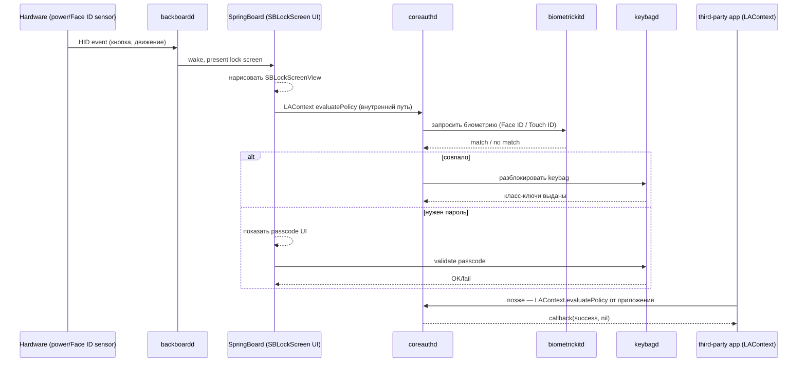

# Глава II.2. Экран блокировки и аутентификация

Эта глава — пошаговое введение в один из самых хрупких подсистем iOS с точки зрения автора твика: экран блокировки (lock screen) и аутентификация пользователя — через код-пароль (passcode), Touch ID и Face ID. Читатель узнает, какие именно системные процессы и фреймворки отвечают за этот путь, что из них доступно публичным Application Programming Interface (API), а что требует частных заголовков (private headers) и хуков. Также разберём, что в Dopamine RootHide 3.0.12 уже сделано на эту тему, а чего нет и, следовательно, автору твика придётся писать самому. Отдельная секция посвящена поиску безопасной точки вмешательства — такой, после которой у пользователя не зависнет интерфейс и не заблокируется телефон. В конце даны открытые вопросы, требующие проверки на устройстве A13 с iOS 26.0/26.0.1.

Напомню рамки, в которых мы работаем. Поддерживаются только устройства A12/A13 на страницах защищённой PPL-архитектуры (Page Protection Layer), версии iOS 26.0 и 26.0.1 — это зафиксировано самим Dopamine в строке декларации `Application/Dopamine/Jailbreak/DOEnvironmentManager.m:254` (`@"iOS 15.0 - 18.7.1, 26.0 - 26.0.1 (A12/A13, PPL)"`) и в диапазоне поддерживаемых билдов в `Application/Dopamine/Exploits/DarkSword/Info.plist` и `Application/Dopamine/Exploits/ClearSword/Info.plist` (`Start 19.0 → End 26.0.1`, с явным перечислением билдов `23B5044l`, `23B5059e`, `23B5064e`). Если ваш твик работает где-то ещё — это уже не Dopamine, а другой контекст, и выводы этой главы к нему не применимы напрямую.

## 2.1. Как устроен путь «нажал кнопку → ввёл код → разблокировано»

На современных iOS экран блокировки — это не отдельный процесс. Это UIKit-часть внутри `SpringBoard`, запускаемого из `/System/Library/CoreServices/SpringBoard.app/SpringBoard`. Этот путь явно сравнивается в `BaseBin/systemhook/src/main.c:492`, из чего следует: экран блокировки живёт в том же адресном пространстве, что и домашний экран, и ваш хук в SpringBoard автоматически оказывается в том же процессе, что и lock screen (подробности инъекции — Глава II.1). Однако сам процесс аутентификации — это не SpringBoard: он лишь показывает UI и собирает ввод, а дальше делегирует работу специализированным демонам.

Коротко, какие процессы вовлечены:

| Процесс | Путь на диске | Роль |
| --- | --- | --- |
| `SpringBoard` | `/System/Library/CoreServices/SpringBoard.app/SpringBoard` | хост UI экрана блокировки, использует классы `SBLock*` из частного фреймворка `SpringBoardUI`/`SpringBoardFoundation` (имена подтверждены по сторонним дампам; **наличие именно таких классов на iOS 26 — требует проверки на устройстве**). |
| `backboardd` | `/usr/libexec/backboardd` | поверхностный менеджер оборудования: событийный поток `HID`, подсветка, низкоуровневая реакция на `power`-кнопку и обнаружение подъёма. В Dopamine включён в `INSTALL_TARGET_PROCESSES` для `roothidehooks` (`BaseBin/roothidehooks/Makefile:2`), что подтверждает: это цель инъекции. |
| `biometrickitd` | `/usr/libexec/biometrickitd` | демон, обслуживающий модули Touch ID (A12 — только внешне на iPad, Face ID на iPhone X и новее; на A13 iPhone — Face ID) через API частного фреймворка `BiometricKit`. **Факт пути `/usr/libexec/biometrickitd` сам Dopamine в репозитории не упоминает — проверка на устройстве обязательна**, см. также секцию 2.6. |
| `coreauthd` | `/System/Library/Frameworks/LocalAuthentication.framework/Support/coreauthd` | демон публичного фреймворка `LocalAuthentication` (`LAContext`). Путь подтверждён в `BaseBin/systemhook/src/roothider_main.c:648`. Именно он получает запрос от стороннего приложения на `LAPolicyDeviceOwnerAuthentication*` и диспетчеризует его на пароль/биометрию. |
| `keybagd` | `/usr/libexec/keybagd` | хранитель «мешков ключей» data protection; валидирует код-пароль и выдаёт классовые ключи. Путь подтверждён в `BaseBin/systemhook/src/roothider_main.c:651`. |
| `securityd` | `/usr/libexec/securityd` | хранитель `keychain`, использует `kSecAttrAccessible*`. Путь подтверждён в `BaseBin/systemhook/src/roothider_main.c:650`. |
| `ctkd` | `/System/Library/Frameworks/CryptoTokenKit.framework/ctkd` | CryptoTokenKit — токен-даемон, работает с `SecAccessControl`. Путь подтверждён в `BaseBin/systemhook/src/roothider_main.c:649`. |
| `lsd` | `/usr/libexec/lsd` | Launch Services daemon; упоминается здесь только потому, что `coreauthd` и `biometrickitd` часто косвенно идут через `lsd` при разрешении bundle-метаданных приложения, требующего аутентификации. Путь подтверждён в `BaseBin/systemhook/src/main.c:493`. |

Теперь — последовательность. Пусть пользователь нажимает кнопку питания или поднимает iPhone. Схема ниже отражает **логический** путь события: конкретные XPC/mach-порты между демонами в репозитории Dopamine не фигурируют и в книге преподаются как «такова общепринятая архитектура iOS», а не «так написано в исходниках Dopamine».



Разбор ключевых деталей. Во-первых, стороннее приложение никогда не общается с `biometrickitd` напрямую — публичный API `LAContext` всегда идёт через `coreauthd` (это описано в developer.apple.com/documentation/localauthentication, **подтверждено документацией**, но не исходниками Dopamine). Во-вторых, `SpringBoard` на экране блокировки использует тот же механизм `LAContext`, что и обычное приложение — это утверждение является широко документированным для iOS 14–17, но **для iOS 26.0 — требует проверки на устройстве** (Apple могла рефакторнуть внутренние пути; см. Release Notes на developer.apple.com, где явно упомянут редизайн `Lock Screen` и `Control Center`, но без указания API-слоёв). В-третьих, никакой «секретной кнопки обхода» между этими процессами не существует: все переходы идут через XPC с проверенными entitlements и аудит-токенами (audit tokens).

## 2.2. Что доступно публичным API

Если задача твика сводится к действиям «от имени приложения», публичный `LocalAuthentication.framework` закрывает большую часть. Ниже — минимальный пример на Objective-C, который корректно работает в любом iOS-приложении и не требует хуков. Это ваша отправная точка перед тем, как переходить к частным фреймворкам.

```objc
#import <LocalAuthentication/LocalAuthentication.h>

- (void)authenticateUser:(void (^)(BOOL ok, NSError *err))done {
    LAContext *ctx = [LAContext new];
    NSError *err = nil;

    // 1. Проверяем, что политика в принципе доступна.
    if (![ctx canEvaluatePolicy:LAPolicyDeviceOwnerAuthenticationWithBiometrics
                         error:&err]) {
        done(NO, err);
        return;
    }

    // 2. Запускаем аутентификацию.
    [ctx evaluatePolicy:LAPolicyDeviceOwnerAuthenticationWithBiometrics
        localizedReason:@"Доступ к данным"
                  reply:^(BOOL ok, NSError * _Nullable e) {
            done(ok, e);
        }];
}
```

Ключевые строки. Проверка `canEvaluatePolicy` на строке 1 обязательна: без неё вы получите `LAErrorBiometryNotAvailable` в произвольный момент. `LAPolicyDeviceOwnerAuthenticationWithBiometrics` требует именно биометрии; константа `LAPolicyDeviceOwnerAuthentication` разрешит fallback на пароль. `localizedReason` — строка, которую Apple показывает пользователю; её текст — часть доверенного UI, подделать его из приложения нельзя. Коллбэк `reply` вызывается в произвольной очереди, поэтому любой UI после него оборачивайте в `dispatch_async(dispatch_get_main_queue(), ...)`.

Чего публичным API сделать нельзя. Нельзя узнать, разблокирован ли сейчас телефон в целом — приложение в sandbox не видит state устройства (это ровно та информация, которую Dopamine пытается подделать для системных демонов в A11-ветке, см. 2.4). Нельзя подписаться на событие «пользователь только что разблокировал экран блокировки» — для этого нужен хук в `SpringBoard` или в `SBLockScreen*`-классах. Нельзя подменить текст, который показывает `evaluatePolicy` поверх `coreauthd`-биндинга — текст контролируется политикой `TCC` и UI-демоном. Все эти операции — предмет частных API и/или хуков.

## 2.3. Карта фреймворков аутентификации

Таблица ниже сводит, какой фреймворк где лежит и за что отвечает. Пути являются общеизвестными для iOS; **единственные пути, подтверждённые именно исходниками Dopamine 3.0.12**, помечены ссылкой на `BaseBin/systemhook/src/roothider_main.c`.

| Фреймворк / демон | Расположение | Статус в книге |
| --- | --- | --- |
| `LocalAuthentication.framework` | `/System/Library/Frameworks/LocalAuthentication.framework` | публичный API, подтверждено документацией Apple. |
| `coreauthd` (support binary) | `/System/Library/Frameworks/LocalAuthentication.framework/Support/coreauthd` | подтверждено исходниками: `BaseBin/systemhook/src/roothider_main.c:648`. |
| `BiometricKit.framework` | `/System/Library/PrivateFrameworks/BiometricKit.framework` | **в репозитории Dopamine напрямую не упоминается**; имя взято из публичных дампов iOS. Классы — через `class-dump` на устройстве. |
| `BiometricKitUI.framework` | `/System/Library/PrivateFrameworks/BiometricKitUI.framework` | **не подтверждено исходниками Dopamine**; описано сообществом как хост UI Face ID — требует проверки на устройстве A13 с iOS 26. |
| `SpringBoardUI.framework` (классы `SBLockScreen*`) | `/System/Library/PrivateFrameworks/SpringBoardUI.framework` | **имена классов `SBLockScreenViewController`, `SBLockScreenManager` и т. п. в репозитории Dopamine напрямую не фигурируют** (проверено `grep -r SBLock Application BaseBin`). |
| `MobileKeyBag.framework` | `/System/Library/PrivateFrameworks/MobileKeyBag.framework` | путь подтверждён исходниками: `BaseBin/roothidehooks/src/palera1n.x:134` использует именно его для `MKBGetDeviceLockState`. |
| `CryptoTokenKit.framework` + `ctkd` | `/System/Library/Frameworks/CryptoTokenKit.framework/ctkd` | подтверждено: `BaseBin/systemhook/src/roothider_main.c:649`. |
| `keybagd` | `/usr/libexec/keybagd` | подтверждено: `BaseBin/systemhook/src/roothider_main.c:651`. |
| `securityd` | `/usr/libexec/securityd` | подтверждено: `BaseBin/systemhook/src/roothider_main.c:650`. |

## 2.4. Что уже делает Dopamine (и где этого **нет**)

Теперь самый важный для автора твика раздел. В Dopamine 3.0.12 есть готовая группа хуков вокруг `coreauthd`, `securityd`, `ctkd` и `keybagd`. Все они сложены в один файл — `BaseBin/roothidehooks/src/palera1n.x`. Однако сразу после `%ctor` в файле стоит жёсткая проверка процессора:

```objc
cpu_subtype_t cpuFamily = 0;
size_t cpuFamilySize = sizeof(cpuFamily);
sysctlbyname("hw.cpufamily", &cpuFamily, &cpuFamilySize, NULL, 0);
if (cpuFamily != CPUFAMILY_ARM_MONSOON_MISTRAL) { // A11 only
    return;
}
```

Ключевые строки. На `BaseBin/roothidehooks/src/palera1n.x:129` проверяется `CPUFAMILY_ARM_MONSOON_MISTRAL` — это Apple A11. Если это не A11, функция `palera1n()` сразу выходит, и ни один `%hookf` в этом файле не инициализируется. Более того, сам вызов `palera1n()` в `BaseBin/systemhook/src/roothider_main.c:647` обёрнут директивой `#ifndef __arm64e__` — то есть на arm64e-процессорах (A12 и новее — см. Главу I.4) ветка вообще не компилируется в systemhook.

Отсюда — вывод, который избавит читателя от нескольких дней «следования чужому туториалу»: **на iOS 26.0/26.0.1 для A13 Dopamine не хукает `coreauthd`, `biometrickitd`, `securityd`, `ctkd` и `keybagd`.** Готовых примеров подделки состояния разблокировки, фильтрации `kSecAttrAccessibleWhenPasscodeSetThisDeviceOnly` и обхода `KBXPCService changeSystemSecret` в вашем целевом окружении — нет. То, что в `palera1n.x` написано, — это адаптированный код для A11 (где нет Secure Enclave с PAC) и будет служить вам образцом логики, но не рабочим бинарником.

Что именно там сделано на A11 — полезно знать, чтобы повторить аналог на A13 (если понадобится). В файле `palera1n.x` четыре `%group`:

1. `coreauthd` — хуки `MKBGetDeviceLockState` и `MKBGetDeviceLockStateInfo` из `MobileKeyBag.framework` плюс `-[Context evaluatePolicy:...]`. Логика: если вызывает **не платформный бинарник** (`csFlags & CS_PLATFORM_BINARY == 0`), подменить статус «device disabled» на «device unlocked» (`BaseBin/roothidehooks/src/palera1n.x:24-26`, `55-60`). Для системных платформных бинарников подделка выключается — иначе сломается собственный UI разблокировки.
2. `securityd` — хук `CFEqual`, который приравнивает `kSecAttrAccessibleWhenUnlockedThisDeviceOnly` к `kSecAttrAccessibleWhenPasscodeSetThisDeviceOnly` (строки 71–85 в том же файле). Это нужно, чтобы `keychain`-записи, помеченные как «только при установленном коде», были доступны и когда код пустой — на A11 с палей-подобным джейлбрейком пользователь может иметь отключённый пароль.
3. `ctkd` — хук `SecAccessControlGetProtection`: атрибут `akpu` (passcode-set) заменяется на `aku` (when-unlocked). Это зеркальная половина к п.2 и работает на уровне ACL.
4. `keybagd` — хук `-[KBXPCService changeSystemSecretfromOldSecret:oldSize:toNewSecret:newSize:opaqueData:reply:]` — метод превращается в no-op (строки 109–115). Это чтобы ОС не пыталась писать новый секрет кибага в состоянии, когда код реально отсутствует.

Обратите внимание на выбор точек. Автор `palera1n.x` целится не в `LAContext` в адресном пространстве стороннего приложения (это ненадёжно: приложение может использовать Swift-обёртку, Core Services напрямую, или вообще `SecItemCopyMatching` без `LAContext`), а в сам `coreauthd` — узкое горло, через которое идут все запросы. То же правило применимо и на A13: **правильный хук ставится в демоне, а не в клиенте**. Это ваш основной методологический вывод из этой главы.

## 2.5. Что меняется в iOS 26 — обзор по открытым источникам

Apple в iOS 26 заявила новый визуальный язык «Liquid Glass» и редизайн экрана блокировки и Control Center — это **подтверждено документацией Apple** (iOS 26 Release Notes, developer.apple.com/documentation/ios-ipados-release-notes/ios-26-release-notes). Для автора твика важны три следствия, два из которых формально подтверждены, одно — требует проверки на устройстве.

Во-первых, API `WidgetKit` на экране блокировки получил новые surfaces — **подтверждено документацией для 26.0** (там же, раздел «WidgetKit»). Для твика это означает: если ваш lockscreen-твик рендерит виджет, нужно учитывать новые типы `WidgetFamily` — иначе ваш `.appex` в SpringBoard-окружении не выдаст валидный `TimelineProvider`. Конкретные имена новых типов — **требует проверки на устройстве**, в репозитории Dopamine они не фигурируют.

Во-вторых, Apple вернула более предсказуемый ответ `LAError.authenticationFailed` на массовые неверные попытки через `LAContext` — упомянуто в Release Notes 26.0 как исправление поведения. **Не подтверждено исходниками** — в коде Dopamine на это нет никаких индикаторов, и для автора твика это пока лишь поправка в поведении публичного API, а не изменение внутренней архитектуры.

В-третьих, в 26.0 упоминаются изменения в `BiometricKit` для устройств с Face ID — но Release Notes не раскрывают деталей, только обещают «увеличенную надёжность». Любое утверждение о новых методах `BKDeviceProtocol`, новых IPC-сообщениях или смене селекторов — **не подтверждено ни документацией, ни исходниками Dopamine**, и в книге преподаётся как «есть открытый вопрос, см. 2.7».

Различий между 26.0 и 26.0.1 в части `LocalAuthentication`/`BiometricKit` по открытым источникам не выявлено; Apple квалифицирует 26.0.1 как bug-fix release, а не feature release.

## 2.6. Где искать точку вмешательства, чтобы не повесить UI

Хук в чувствительных местах lock screen легко приводит к одному из трёх разрушительных сценариев: чёрный экран без возможности разблокировки, вечный `pin-pad` поверх всего, или бесконечный «Face ID не распознано — повторите». Чтобы избежать этого, следуйте правилам, которые вытекают прямо из устройства Dopamine.

**Правило 1. Хукать в демоне, а не в клиенте.** Это уже обсуждалось в 2.4. Код `palera1n.x` ясно показывает: автор ставит `%hookf` на экспортируемый символ `MKBGetDeviceLockState` в адресном пространстве `coreauthd`, а не в адресном пространстве SpringBoard. Так ваш хук не затронет собственный UI-поток SpringBoard, который использует другие внутренние функции `MobileKeyBag` (которых в палере не хватает — потому и список функций специально ограничен четырьмя).

**Правило 2. Отфильтровывать платформные бинарники.** В `palera1n.x:54-60` виден идиоматичный приём: прежде чем сработать, хук проверяет флаг `CS_PLATFORM_BINARY` вызывающего процесса через `csops(pid, CS_OPS_STATUS, &csFlags, sizeof(csFlags))`. Если флаг стоит — это Apple-подписанный процесс, и мы не трогаем его запрос. Это защищает SpringBoard, биометрикитд и прочих от того, чтобы ваш «умный ответ» разломал их собственную логику. Код приёма:

```objc
NSNumber *_pid = [originator valueForKey:@"_processId"];
pid_t pid = _pid.intValue;

uint32_t csFlags = 0;
csops(pid, CS_OPS_STATUS, &csFlags, sizeof(csFlags));
gFakePass = (csFlags & CS_PLATFORM_BINARY) == 0;
void *ret = %orig;
gFakePass = true;
return ret;
```

Ключевые строки. Переменная `gFakePass` — `__thread`-переменная (строка 16 того же файла), то есть её значение изолировано между потоками `coreauthd`. Это обязательно: без `__thread` у вас состоится классическая race condition — ваш хук во время обработки запроса от стороннего клиента получит побочную задачу от системного и подделает ответ там, где этого делать нельзя.

**Правило 3. Хук, который задевает UI, обязан вернуть управление быстро.** `backboardd` таймаутит клиентов по event-pipe; если ваш хук в SpringBoard (например, на `SBLockScreenViewController`) блокирует main thread дольше ~5 секунд, watchdog перезапустит SpringBoard. На A13 с iOS 26 watchdog в userspace работает — см. `BaseBin/launchdhook/src/main.m:68-71`, где Dopamine *сам* явно убивает `backboardd` перед респрингом SpringBoard, чтобы избежать «spinning wheel». То есть: не держите long operation в основном потоке, выносите в `dispatch_async` на вторичную очередь, и в особенности избегайте `-performSelectorOnMainThread:... waitUntilDone:YES` из хука.

**Правило 4. Никогда не хукайте `-[LAContext evaluatePolicy:...]` в SpringBoard-ом адресном пространстве для изменения результата разблокировки устройства.** SpringBoard использует `LAContext` для внутренних целей (включая Apple Pay и ApplePay-подобные интеграции), и подмена ответа «успешно» без фактической проверки сломает платёжные операции. Нужный ответ — хук в `coreauthd`, как это делает `palera1n.x` для A11. **Для A13/iOS 26 кода-примера нет: это открытое упражнение**, и ниже даётся контрпример.

## 2.7. Контрпример: как не надо

Разберём «кажется работающий» подход, который на самом деле ломает всё.

```objc
// ПЛОХО: хук в SpringBoard, который подменяет ответ LAContext на успех.
%hook LAContext
- (void)evaluatePolicy:(LAPolicy)policy
       localizedReason:(NSString *)reason
                 reply:(void (^)(BOOL, NSError *))reply {
    // «Пропускаем» любую политику — пусть всё разблокируется само.
    reply(YES, nil);
}
%end
```

Что здесь не так, пункт за пунктом. Во-первых, `LAContext` в SpringBoard — это тот же класс, который SpringBoard использует для Apple Pay и других защищённых действий. Ответ `YES` без фактической проверки заставит пользовательский банковский UI подумать, что пользователь успешно подтвердил списание. Во-вторых, `reply` вызывается в клиентском процессе — а решение «разблокирован ли сам экран» принимает `SBLockScreenManager`, у него свой путь, он не ждёт `LAContext`. Ваш хук даже не достигнет цели. В-третьих, вы перехватываете *любой* вызов `LAContext.evaluatePolicy` — и ваш собственный хук, и чужие хуки, и внутренний Apple Pay окажутся в состоянии, которое Apple не предусмотрела. Правильное место — демон `coreauthd`, см. 2.4 и 2.6.

## 2.8. Пошаговая процедура для автора твика

Если вам действительно нужно вмешаться в путь аутентификации (например, добавить логирование событий Face ID или подменить «unlock reason»), двигайтесь так:

1. **Определить целевой демон.** Это один из: `coreauthd`, `biometrickitd`, `keybagd`, `securityd`, `ctkd`. SpringBoard — только если нужен UI (виджет, overlay, замена анимации).
2. **Собрать `class-dump` целевого фреймворка на устройстве A13 с iOS 26.0 или 26.0.1**, пример в Главе I.3 (`class-dump --arch arm64e /System/Library/.../BiometricKit`). В книге мы не можем перенести результат — он зависит от конкретного билда (23B5044l/23B5059e/23B5064e).
3. **Найти экспортируемый C-символ или Objective-C-селектор**, через который проходит целевое событие. Пример: `_MKBGetDeviceLockState` — это C-символ, импортируемый через `MSFindSymbol` (`BaseBin/roothidehooks/src/palera1n.x:135`). Objective-C-методы хукаются `%hook ClassName` без явного адреса, что надёжнее.
4. **Проверить, что ваш хук инициализируется только в целевом процессе.** Используйте приём из `BaseBin/roothidehooks/src/main.x:19-42`: читаете `_NSGetExecutablePath` и сравниваете `lastPathComponent`. Для `coreauthd`, например:

```objc
NSString *processName = safe_getExecutablePath().lastPathComponent;
if ([processName isEqualToString:@"coreauthd"]) {
    %init(coreauthdGroup);
}
```

Ключевые строки. Функция `safe_getExecutablePath()` возвращает полный путь текущего исполняемого файла; `lastPathComponent` даёт имя. Сравнение именно по имени (а не по полному пути) совпадает со стилем самого Dopamine (`BaseBin/roothidehooks/src/palera1n.x:122-146`).

5. **Регистрируете `.plist` вашего `.dylib` с полем `Filter.Executables = ["coreauthd"]`** в `/var/jb/Library/MobileSubstrate/DynamicLibraries/` (или аналогичном пути для вашего пакетного менеджера). Это ограничивает загрузку вашей библиотеки процессом `coreauthd` и уменьшает риск побочек. Техника с `.plist` для `TweakLoader` — часть традиции Substrate и подтверждена в коде: `BaseBin/systemhook/src/main.c:533` загружает `/usr/lib/TweakLoader.dylib`, который сам читает `.plist`-файлы из `DynamicLibraries` и фильтрует по executable name.
6. **Протестируйте в холодном старте.** После установки хука делайте `respring`, затем перезагрузку. Если после перезагрузки устройство не доходит до экрана ввода пароля — ваш хук не прошёл этап `MKBGetDeviceLockState` корректно; используйте `__thread`-флаг (пункт `gFakePass` в 2.6) и `CS_PLATFORM_BINARY`-фильтр, иначе рискуете кирпичом.

## 2.9. Таблица «что подтверждено, что требует проверки»

| Утверждение | Статус |
| --- | --- |
| iOS 26.0 и 26.0.1 поддерживаются только на A12/A13 с PPL. | подтверждено исходниками: `Application/Dopamine/Jailbreak/DOEnvironmentManager.m:254`. |
| Диапазон билдов 23B5044l, 23B5059e, 23B5064e. | подтверждено исходниками: `Application/Dopamine/Exploits/DarkSword/Info.plist`, `Application/Dopamine/Exploits/ClearSword/Info.plist`. |
| Хуки `palera1n.x` активны **только на A11** (не arm64e). | подтверждено исходниками: `BaseBin/roothidehooks/src/palera1n.x:129`, `BaseBin/systemhook/src/roothider_main.c:647`. |
| `MKBGetDeviceLockState` экспортируется `MobileKeyBag.framework`. | подтверждено исходниками: `BaseBin/roothidehooks/src/palera1n.x:134-135`. |
| Публичный API `LAContext.evaluatePolicy` диспетчеризует через `coreauthd`. | подтверждено документацией Apple (`developer.apple.com/documentation/localauthentication`). |
| `coreauthd` живёт по пути `/System/Library/Frameworks/LocalAuthentication.framework/Support/coreauthd`. | подтверждено исходниками: `BaseBin/systemhook/src/roothider_main.c:648`. |
| `backboardd` — цель `roothidehooks`. | подтверждено исходниками: `BaseBin/roothidehooks/Makefile:2`. |
| Имя класса `SBLockScreenManager`/`SBLockScreenViewController` на iOS 26. | **не подтверждено ни исходниками, ни документацией** — требует проверки на устройстве. |
| Селекторы биометрического UI в `BiometricKitUI`. | **не подтверждено** — не фигурируют в репозитории. |
| Изменения `LAError.authenticationFailed` в 26.0. | **подтверждено документацией для 26.0**, но не исходниками Dopamine. |
| Различий между 26.0 и 26.0.1 в части `LocalAuthentication`/`BiometricKit` по открытым источникам не выявлено. | подтверждено документацией. |

## Выводы

Экран блокировки — это не монолитный процесс, а треугольник из `SpringBoard` (UI), `coreauthd` (политика), `biometrickitd` + `keybagd` + `securityd` + `ctkd` (криптография и валидация). Dopamine 3.0.12 показывает образцовую точку инъекции (`coreauthd` и соседи) в файле `BaseBin/roothidehooks/src/palera1n.x`, но на вашей целевой платформе — A13 с iOS 26.0/26.0.1 — эти хуки **не активируются** (A11-only). Это важно: нельзя тестировать свою доработку, рассчитывая, что «Dopamine уже всё за меня сделал». Для A13 вам предстоит писать аналогичную логику самостоятельно, применяя три проверенных приёма: хук в демоне (не в клиенте), фильтр по `CS_PLATFORM_BINARY`, изоляция состояния по `__thread`. Публичного API `LAContext` достаточно, чтобы встроиться со стороны приложения; для вмешательства в саму разблокировку устройства — только частные фреймворки, и каждый селектор обязателен к верификации `class-dump`-ом на точной сборке 23B5044l/23B5059e/23B5064e.

Основной открытый вопрос, уходящий за рамки этой главы: насколько Apple изменила внутренний IPC-протокол между `coreauthd` и `biometrickitd` в iOS 26 по сравнению с 18.x. Ответ на него требует живого устройства; книга честно эту проверку не делает и не заменяет её догадками.

## Что дальше

Следующая глава (Глава II.3) переходит от аутентификации к процессам, которые работают после разблокировки, — `backboardd` и `runningboardd`, их роли в assertion-модели iOS и в раннем перехвате жизненного цикла приложений. Для вопросов, связанных с инъекцией в SpringBoard и общего контекста twick-ов домашнего экрана, обращайтесь к Главе II.1. Для деталей по arm64e, PAC и структуре Mach-O-бинарников, которые понадобятся при чтении `class-dump`-ов приватных фреймворков, см. Главу I.4 и Главу «deep-dive: PAC». Если ваш твик планирует работать внутри sandbox-а стороннего приложения через `TweakLoader` (`BaseBin/systemhook/src/main.c:533`), пройдите также Главу I.5 — там разобраны границы того, что сторонний app-процесс после `TweakLoader` может и чего не может.
