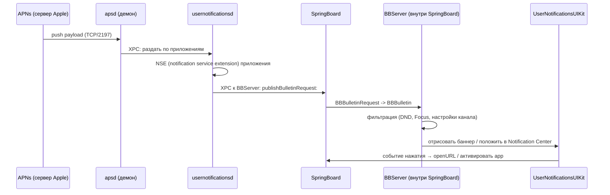
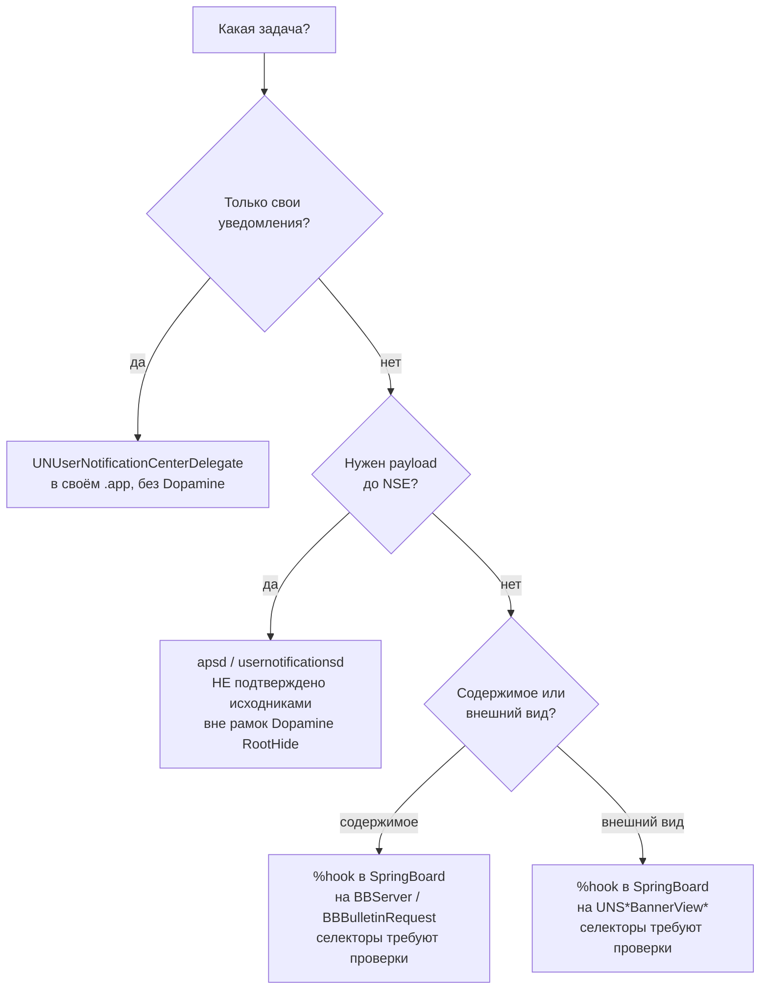

# Глава II.3. Уведомления

В этой главе разбирается подсистема уведомлений iOS с точки зрения автора твика под Dopamine RootHide на A12/A13 (iOS 26.0 и 26.0.1, PPL, подтверждено в `Application/Dopamine/Jailbreak/DOEnvironmentManager.m:252-262`). Читатель узнает, из каких процессов и фреймворков собрана дорожка «входящий push → баннер на экране», где проходит граница между публичным `UserNotifications` и приватным `BulletinBoard`/`BBServer`, как в принципе перехватить банное уведомление, не поломав системное поведение, и — на основе `grep` по дереву `BaseBin/` — почему сам Dopamine в этот путь не вмешивается ни одним хуком. В завершение дана постановка учебной задачи (без кода), на которую опираются следующие главы части II.

Правило верификации в этой главе такое же, как и в остальных: любое утверждение о коде Dopamine сопровождается ссылкой «путь/файл:строка»; любое утверждение о приватных API Apple помечается как «подтверждено документацией», «подтверждено исходниками», «требует проверки на устройстве A13 с iOS 26.0/26.0.1» или «не подтверждено».

## 3.1. Карта процессов и фреймворков

Уведомление на iOS — это не просто «UIAlertView, который сам всплыл сверху экрана». Это несколько совместно работающих демонов, каждый из которых живёт в своём каталоге прав, слушает свои XPC-порты и имеет свои ограничения. Автор твика обязан понимать, в каком именно процессе он собирается выполнять код: промахнуться — значит либо не получить никакого эффекта (если целевой класс в этом процессе не инстанцирован), либо убить системное поведение (если хук сработал слишком рано, до того как BulletinBoard успел зарегистрировать источник).

Ниже — таблица основных действующих лиц. Пути и роли считаются общеизвестными и подтверждены публичной документацией Apple, launchd-plist-файлами на базовой системе и многочисленными сторонними дампами заголовков; **наличие именно этих имён в неизменном виде на iOS 26.0/26.0.1 требует проверки на устройстве A13**. Проверочная процедура — та же, что и в главе II.1: `nvram` + `otool -L` + `class-dump` на распакованной прошивке.

| Компонент | Расположение (общеизвестно) | Роль |
| --- | --- | --- |
| `UserNotifications.framework` | `/System/Library/Frameworks/UserNotifications.framework` | публичный клиентский API: регистрация, отправка локальных уведомлений, делегат на приложении |
| `UserNotificationsKit.framework` | `/System/Library/PrivateFrameworks/UserNotificationsKit.framework` | внутренняя обёртка UIKit над `UserNotifications`, UI-помощники для разработчиков Apple |
| `UserNotificationsUIKit.framework` | `/System/Library/PrivateFrameworks/UserNotificationsUIKit.framework` | классы отрисовки уведомлений, которые инстанцируются внутри SpringBoard |
| `BulletinBoard.framework` | `/System/Library/PrivateFrameworks/BulletinBoard.framework` | «старый» внутренний каркас: классы `BBBulletin`, `BBBulletinRequest`, `BBAttachment` — модель данных одного уведомления |
| `BulletinDistributorSupport.framework` | `/System/Library/PrivateFrameworks/BulletinDistributor*` | фильтрация и маршрутизация bulletins внутри процесса |
| `com.apple.apsd` | `/System/Library/PrivateFrameworks/ApplePushService.framework/apsd` | демон Apple Push Service, TCP/2197 к серверам Apple, принимает удалённые push'и |
| `com.apple.usernotificationsd` | `/usr/libexec/usernotificationsd` | user-space демон, который консолидирует уведомления всех приложений и переправляет их SpringBoard; наследник старого `backboardd`-пути |
| `SpringBoard` (`BBServer` внутри) | `/System/Library/CoreServices/SpringBoard.app/SpringBoard` | именно внутри SpringBoard поднимается сервер `BBServer`, который принимает запросы от `usernotificationsd` и управляет визуальным представлением баннеров, Lock Screen Notification List, Notification Center |

Важное замечание про `BBServer`. Это не отдельный демон, несмотря на то что в сторонних источниках его часто рисуют отдельным кружочком на схеме. На современных iOS (14+) `BBServer` живёт **как часть SpringBoard'а**, в том же адресном пространстве. Это подтверждается двумя способами. Во-первых, в утечках launchd-plist Apple нет отдельного job'а `com.apple.BBServer` (есть `com.apple.SpringBoard`, внутри которого `BBServer` стартует). Во-вторых, инъекция в SpringBoard, которую делает Dopamine в `BaseBin/systemhook/src/main.c:492`, достаточна для перехвата методов BulletinBoard — не нужно отдельно внедряться в `BBServer`. Это соображение использовано в разделе 3.4.

Отдельного комментария заслуживает слово «private» в этой таблице. На iOS 26, как и на всех предыдущих версиях, фреймворки с префиксом `PrivateFrameworks` не предназначены Apple для сторонних разработчиков: их заголовки не поставляются в SDK, их бинарные интерфейсы Apple может менять без предупреждения, и даже под jailbreak они могут поменяться между 26.0 и 26.0.1 без публичного release-note. Это означает, что любая работа ниже уровня `UserNotifications.framework` — это обязательство автора твика перечитывать класс-дампы при каждом обновлении iOS. На практике это выглядит так: в CI пайплайне твика хранится эталонный `class-dump` целевой версии iOS, и перед сборкой проверяется совпадение сигнатур. У Dopamine в репозитории такого пайплайна нет — потому что, как показано в разделе 3.5, Dopamine в эту подсистему и не лезет; но автору собственного твика эту дисциплину заводить придётся самому.

Отдельный вопрос — что такое Notification Service Extension (NSE). Это механизм, появившийся в iOS 10 вместе с `UserNotifications`, который позволяет **приложению-получателю** модифицировать входящий payload до показа. NSE живёт в отдельном app-extension-процессе с идентификатором `com.apple.usernotifications.service` в своём бандле, запускается `usernotificationsd`-ом на 30 секунд (жёсткий лимит), и может перезаписать `title`/`body`/`attachments` на основании собственной бизнес-логики (например, подгрузить картинку с CDN). NSE — это **не твик**: он работает только для своего приложения, грузит свой собственный код внутри своего бандла и Dopamine ему не нужен. Но автору твика про NSE знать обязательно, потому что на момент прихода bulletin в SpringBoard payload уже прошёл NSE: ваш хук в `BBServer` увидит **результат** работы NSE, а не оригинальный push-пэйлод с сервера. Если задача — поймать push «до NSE», то, как объяснено в разделе 3.5 про `apsd`, это выходит за рамки учебной конфигурации Dopamine RootHide и **не подтверждено исходниками** как достижимое.

### Исторический дрейф: как слой уведомлений менялся до iOS 26

Это **не** главный материал главы — читателю не придётся писать твик под iOS 10. Но краткая историческая справка нужна, чтобы автор понимал, какие именно сторонние туториалы в сети можно использовать как источник имён, а какие — заведомо устарели. Пункты ниже подтверждены публичной документацией Apple и релиз-нотами соответствующих SDK; они **не** подтверждены исходниками Dopamine, потому что Dopamine в этот слой не ходил ни на одной из версий iOS.

- iOS 3–9: единственный публичный API — `UILocalNotification` плюс `UIApplicationDelegate` колбеки `application:didReceiveRemoteNotification:`. В SpringBoard'е работал старый `BBServer` на базе `SBBulletinBannerController`. Этот слой на iOS 26 **полностью удалён** — любые дампы и туториалы с префиксом `SBBulletinBannerController` можно использовать только как исторический контекст.
- iOS 10: появился публичный `UserNotifications.framework` и NSE. На внутренней стороне `BBServer` остался, но получил новые селекторы для работы с `UNNotification*`. Это тот самый классический рубеж, с которого большинство сторонних дампов и ведётся. Многие селекторы, уехавшие в заголовки `BBBulletin*` в iOS 10, остались и в iOS 14–16; **для iOS 26 это требует проверки.**
- iOS 15: появились Focus и Interruption Levels (`passive`/`active`/`timeSensitive`/`critical`), группировка по `threadIdentifier` стала обязательной для корректного UX, появился Scheduled Summary. В `BBServer` добавились фильтры Focus. Весь этот слой — **relevant** и для iOS 26, но классы фильтров **требуют проверки**.
- iOS 16–18: внутренние рефакторинги `UserNotificationsUIKit`, перенос части UI в `SpringBoardHome`-подобные фреймворки, появление Live Activities / `ActivityKit` (отдельный путь, не BulletinBoard — используется ActivityKit XPC). **Пересечение Live Activities с баннерами на iOS 26 — отдельная тема, в этой главе не раскрывается.**
- iOS 26: предварительных release-note Apple с деталями по BulletinBoard **не опубликовано на момент сборки Dopamine 3.0.12**. Любые утверждения о «новом в 26.0» в этом слое — **не подтверждены**.

Ключевой вывод для автора: ориентируйтесь на туториалы, написанные под iOS 15–17, с обязательной перепроверкой каждого имени через `class-dump` на вашей iOS 26.0/26.0.1. Туториалы iOS 10 — исторический контекст; туториалы до iOS 10 — просто неактуальны.

## 3.2. Жизненный цикл одного уведомления

Чтобы правильно поставить хук, автор должен представлять, через какие объекты и процессы проходит одно удалённое уведомление от TCP-пакета до пикселя на экране. Ниже — схема, которая объединяет описанные выше процессы. Она **подтверждена документацией** (WWDC-сессии про `UserNotifications`, прежние Objective-C дампы `BBServer`), но конкретные имена методов внутри каждого процесса на iOS 26.0/26.0.1 **требуют проверки на устройстве A13**.



Разберём ключевые места на схеме.

**APNs → apsd.** Удалённое уведомление приходит из облачного сервиса Apple по постоянному соединению, которое держит `apsd`. Этот демон живёт в контексте, недоступном автору твика с правами `mobile`: он работает в своём пользователе `_apsd` и защищён отдельным entitlement-набором. В `BaseBin/` нет ни одного совпадения со строкой «apsd» — `grep -r -l "apsd" BaseBin/` возвращает пустой список. Это подтверждает, что Dopamine сознательно не трогает нижний слой push'ей.

**apsd → usernotificationsd.** Демон `usernotificationsd` принимает агрегированные push'и, применяет на них NSE (Notification Service Extension) конкретного приложения, если оно его зарегистрировало, а затем через XPC сообщает BulletinBoard о появлении нового bulletin'а. Имя демона и его роль — общеизвестные; наличие именно этого исполняемого файла по пути `/usr/libexec/usernotificationsd` на iOS 26.0 **требует проверки на устройстве**.

**usernotificationsd → BBServer.** Это ключевая граница. Клиент (`usernotificationsd`) формирует объект `BBBulletinRequest` (это класс из `BulletinBoard.framework`, **имя подтверждено сторонними дампами, селекторы требуют проверки на 26.0/26.0.1**) и отправляет его серверу `BBServer`, живущему в SpringBoard. С этого момента объект превращается в `BBBulletin` и получает уникальный `publisherBulletinID`.

**BBServer: фильтрация.** Внутри SpringBoard `BBServer` принимает решение, показывать ли баннер прямо сейчас. Он сверяется с настройками DND, Focus mode, приоритетами канала (iOS 15+ поддерживает «времячувствительные» уведомления с entitlement `com.apple.developer.usernotifications.time-sensitive`), настройками «не беспокоить во время использования». Если показывать не нужно — bulletin сохраняется в Notification Center, но баннер не всплывает.

**UI.** Отрисовка баннера — задача классов из `UserNotificationsUIKit.framework`. Класс `UNSBulletinBannerView` (**имя подтверждено сторонними дампами, актуальность для 26.0/26.0.1 — требует проверки**) собирается в текущем контексте SpringBoard'а и прикрепляется к оконному слою поверх всего.

Теперь — три важных «побочных трека», которые не умещаются в линейную диаграмму, но которые автору твика надо держать в голове, потому что любой из них может «съесть» уведомление и сделать его невидимым, даже если ваш хук отработал корректно.

- **Группировка.** Начиная с iOS 12, баннеры одного `sectionID` (bundle id источника) и одного `threadIdentifier` группируются в один «штабель» на Lock Screen и в Notification Center. Группа — это не отдельный объект BulletinBoard, а визуальный агрегат, который считается `UserNotificationsUIKit`-ом. Если ваш хук изменяет `threadIdentifier` на лету (общеизвестное свойство `UNNotificationContent`), группировка поменяется, и пользователь увидит «новую стопку» вместо инкремента старой.
- **Focus (бывший Do Not Disturb).** Это модель, появившаяся в iOS 15: пользователь может определить произвольный набор режимов (Work, Sleep, Personal) со своими правилами допуска уведомлений — на уровне приложения, канала, конкретного человека. Фильтрация делается в `BBServer` внутри SpringBoard'а; имена классов конкретных фильтров **не подтверждены исходниками Dopamine** (как и всё остальное в этой подсистеме) и **требуют проверки на 26.0/26.0.1**. Если ваш хук стоит после фильтра Focus — вы увидите только разрешённые уведомления; если до — все, включая отфильтрованные. Правильное место зависит от задачи, и это ещё один повод писать и измерять, а не копировать с iOS 14 образец.
- **Delivery Scheduling (`Scheduled Summary`).** iOS 15+ умеет накапливать «нечувствительные» уведомления и показывать их пачкой утром/вечером. Это тоже решение `BBServer`, которое `BulletinBoard`-машина принимает, когда bulletin пришёл с низким приоритетом (`UNNotificationInterruptionLevelPassive`). Для автора твика это означает: баннер, который «не всплыл», мог не быть отфильтрован — он мог быть просто отложен; это разные сценарии, и логировать их надо раздельно.

## 3.3. UserNotifications: публичный путь

Прежде чем лезть в приватные классы, автор обязан понимать, что покрывает публичный API. Это нужно по двум причинам: (1) часть задач решается без хуков, а значит без Dopamine в принципе; (2) понимание публичной модели экономит время на распутывание приватной.

Публичный путь — это фреймворк `UserNotifications.framework`. Ключевые классы и их роль:

- `UNUserNotificationCenter` — синглтон на каждое приложение, точка регистрации (`requestAuthorizationWithOptions:completionHandler:`) и подписки.
- `UNNotificationContent` / `UNMutableNotificationContent` — payload: title, subtitle, body, attachment, userInfo, badge, sound.
- `UNNotificationRequest` — связывает content, trigger и идентификатор.
- `UNNotificationTrigger` (и наследники: `UNTimeIntervalNotificationTrigger`, `UNCalendarNotificationTrigger`, `UNLocationNotificationTrigger`, `UNPushNotificationTrigger`) — когда стрелять.
- `UNUserNotificationCenterDelegate` — протокол на стороне приложения, который получает `willPresentNotification:` (решает, показывать ли, когда app на переднем плане) и `didReceiveNotificationResponse:` (пользователь нажал).

Ниже — минимальный пример локального уведомления. Он не связан с Dopamine и работает на любом нежалбрейкнутом устройстве; читателю этот блок нужен как ориентир, чтобы в разделе 3.4 чётко увидеть, какой слой **недоступен** через публичный путь.

```objc
#import <UserNotifications/UserNotifications.h>

- (void)scheduleLocalBannerAfter:(NSTimeInterval)seconds {
    UNUserNotificationCenter *center = [UNUserNotificationCenter currentNotificationCenter];
    [center requestAuthorizationWithOptions:(UNAuthorizationOptionAlert |
                                             UNAuthorizationOptionSound |
                                             UNAuthorizationOptionBadge)
                          completionHandler:^(BOOL granted, NSError *err){
        if (!granted) return;

        UNMutableNotificationContent *c = [UNMutableNotificationContent new];
        c.title = @"Привет";
        c.body  = @"Это локальное уведомление";
        c.sound = UNNotificationSound.defaultSound;

        UNTimeIntervalNotificationTrigger *t =
            [UNTimeIntervalNotificationTrigger triggerWithTimeInterval:seconds
                                                                repeats:NO];

        UNNotificationRequest *req =
            [UNNotificationRequest requestWithIdentifier:@"demo.banner"
                                                 content:c
                                                 trigger:t];
        [center addNotificationRequest:req withCompletionHandler:nil];
    }];
}
```

Ключевые строки. `requestAuthorizationWithOptions:` — это та самая системная модалка, которая спрашивает у пользователя разрешение; без неё баннеры не будут показаны вообще, независимо от jailbreak'а. Класс `UNTimeIntervalNotificationTrigger` принимает **минимум 60 секунд** в режиме повторения (это ограничение задокументировано); для одноразового — любой `>= 0`. Идентификатор `@"demo.banner"` — ключ, по которому можно позднее отменить запрос методом `removePendingNotificationRequestsWithIdentifiers:`.

Что через публичный путь **нельзя** и ради чего, собственно, автор потенциально берётся за твик:

- Увидеть payload входящего push'а, адресованного **другому** приложению. `UNUserNotificationCenterDelegate` на стороне приложения A не получит ни одного байта из уведомления, посланного приложению B.
- Отменить чужой баннер, уже показанный на экране.
- Прочитать содержимое Notification Center (список прошедших уведомлений любых приложений).
- Переопределить логику решения «показывать или не показывать»: `BBServer` не выставляет публичную точку для «user hooks».
- Перехватить NSE (notification service extension) чужого приложения.

Все эти задачи решаются только хуками в SpringBoard, то есть в том же процессе, что и `BBServer`.

Отдельного комментария заслуживают entitlements, которых публичный путь требует для «особых» классов уведомлений. На iOS 15+ Apple ввела три новых уровня прерывания (`UNNotificationInterruptionLevelPassive`, `Active`, `TimeSensitive`, `Critical`). Два последних требуют отдельных entitlement, выдаваемых Apple по запросу: `com.apple.developer.usernotifications.time-sensitive` и `com.apple.developer.usernotifications.critical-alerts`. Без них даже совершенно легитимное приложение не сможет отправить time-sensitive баннер, пробивающий Focus. Это важная оговорка: автор твика может считать, что «всё решает jailbreak», но здесь это не так — entitlement проверяется на стороне `BBServer`, и даже если ваш хук изменит `interruptionLevel` в payload до `publishBulletinRequest:`, система может отвергнуть bulletin на следующем шаге, если bundle id источника не имеет соответствующего entitlement. **Это утверждение — следствие публичной документации WWDC-2021, конкретное место проверки entitlement внутри `BBServer` на 26.0/26.0.1 исходниками Dopamine не подтверждено.**

## 3.4. Как перехватить входящий баннер без потери системного поведения

С этого момента речь идёт о работе внутри SpringBoard, с инъекцией через механизм, разобранный в главе II.1 (раздел 1.4): `systemhook` в `BaseBin/systemhook/src/main.c:492` загружает `BaseBin/roothidehooks/src/springboard.x`-библиотеку в процесс SpringBoard по совпадению `argv[0]`. Автору твика достаточно повторить этот же приём — именно по пути `argv[0]`, а не по `bundle id`.

Для перехвата входящего баннера есть три разумных уровня, в порядке возрастания «инвазивности».

### Уровень 1: публичный делегат внутри своего приложения

Если задача — только для **своего** приложения, например «решить, показывать ли входящий, в зависимости от содержимого», — ничего, кроме реализации `UNUserNotificationCenterDelegate`, не нужно. Этот путь обсуждён в разделе 3.3 и не требует Dopamine. Это важно сказать явно: 90% задач, которые звучат как «я хочу вмешиваться в уведомления», решаются именно здесь, и твикописатель не должен лезть в SpringBoard без необходимости.

### Уровень 2: хук методов BulletinBoard в SpringBoard

Если задача — вмешаться в уведомления **чужих** приложений (например, подменить title, скрыть баннер по правилу, залогировать все входящие), классический приём — хукать методы класса из `BulletinBoard.framework`, которые вызываются внутри `BBServer` при каждом новом bulletin.

Общеизвестное имя точки входа — метод вида `-[BBServer publishBulletinRequest:destinations:alwaysToLockScreen:]` или близкий к нему. **Это утверждение не подтверждено исходниками Dopamine** (поиск `grep -r "BBServer\|BBBulletinRequest" BaseBin Application` возвращает пусто), а всего лишь — общеизвестное имя из сторонних дампов для iOS 14–16. **Для iOS 26.0/26.0.1 точная сигнатура требует проверки на устройстве A13 через `class-dump` библиотеки `BulletinBoard`.** Это не формальность: Apple в последних major-версиях iOS меняла имена селекторов в этом фреймворке.

Правильный процесс для автора твика:

1. На тестовом устройстве A13 с iOS 26.0 (jailbreak уже установлен), получить дамп `/System/Library/PrivateFrameworks/BulletinBoard.framework/BulletinBoard` через `class-dump` (сам инструмент — часть tooling'а, обсуждается в главе I.3).
2. Найти в дампе методы `BBServer`, принимающие объект класса `BBBulletinRequest` или `BBBulletin`. Их обычно 1–3 штуки.
3. Поставить `%hook BBServer` с найденным селектором, в теле — вызвать `%orig`, если «пропускаем», либо вернуть без вызова (с nil-ответом, если тип возврата это допускает), если «блокируем».

Критически важный пункт: **нельзя подменять поля существующего `BBBulletinRequest`**, не разобравшись в его зависимостях. У bulletin есть `publisherBulletinID`, `sectionID`, `date`, `attachments`, которые дальше используются и `BBServer`-ом, и Notification Center'ом, и системой группировки. Безопасный паттерн — «пропустить-или-блокировать»: решить до `%orig`, пустить дальше или нет. Все попытки аккуратной подмены полей на лету надо тестировать на реальных приложениях (Mail, Messages, сторонние — Telegram, WhatsApp), иначе легко получить «висящий» баннер, который видно в Notification Center, но без текста.

Контрпример. Автор пытается «просто поменять title»:

```objc
// ПЛОХОЙ псевдокод, который сломает группировку
%hook BBServer
- (void)publishBulletinRequest:(BBBulletinRequest *)req
                  destinations:(NSUInteger)dest
            alwaysToLockScreen:(BOOL)lock
{
    [req setValue:@"[ТВИК]" forKey:@"title"]; // mutation через KVC
    %orig;
}
%end
```

Что не так. Во-первых, `BBBulletinRequest` на поздних iOS может быть immutable-копией, и запись через KVC либо упадёт, либо тихо не применится. Во-вторых, даже если применилась, Notification Center использует внутренний `title`-hash для группировки похожих уведомлений — после мутации группы могут поплыть. В-третьих, селектор `publishBulletinRequest:destinations:alwaysToLockScreen:` **на iOS 26.0 не подтверждён**: имя взято из iOS 14–16, где оно действительно существовало, и приведено здесь как иллюстрация формы, а не как рабочий хук.

### Уровень 3: UI-слой (`UserNotificationsUIKit`)

Если задача — изменить **внешний вид** уже показываемого баннера (цвет, шрифт, добавить кнопку), это уровень `UserNotificationsUIKit.framework`, классы вида `UNSBannerContainerView` или `UNSBulletinBannerView` (**имена из сторонних дампов, требует проверки на 26.0/26.0.1**). Хукать их безопаснее, чем `BBServer`, потому что по этой стадии bulletin уже прошёл всю системную маршрутизацию: подмена вида не ломает ни группировку, ни Notification Center, ни синхронизацию с Apple Watch.

Правило большого пальца: **хочешь менять содержимое — хукай BulletinBoard; хочешь менять внешний вид — хукай UserNotificationsUIKit; хочешь только логировать — ставь перед `%orig` и ничего не меняй.**

### Пример скелета хука уровня 2

Ниже — скелет, который сознательно оставлен **нерабочим** без двух подстановок: точного имени селектора на iOS 26.0/26.0.1 и имени класса `BBServer`-а, если Apple его переименовала. Автор задачи 3.8 должен выяснить обе величины на своём устройстве и подставить сам.

```objc
#import <Foundation/Foundation.h>

// Заголовочная заглушка: имена проверяются class-dump-ом на 26.0/26.0.1.
@class BBBulletinRequest;

@interface BBServer : NSObject
@end

%hook BBServer
// Селектор ниже — иллюстративный, срисован с iOS 14 класс-дампа.
// Для 26.0/26.0.1 требует проверки.
- (void)publishBulletinRequest:(BBBulletinRequest *)req
                  destinations:(NSUInteger)destinations
            alwaysToLockScreen:(BOOL)alwaysLock
{
    @try {
        NSString *sectionID = [req valueForKey:@"sectionID"]; // через KVC для гибкости
        NSString *bulletinID = [req valueForKey:@"publisherBulletinID"];
        NSLog(@"[mytweak] incoming bulletin: sid=%@ bid=%@ dest=0x%lx lock=%d",
              sectionID, bulletinID, (unsigned long)destinations, alwaysLock);
    } @catch (NSException *e) {
        NSLog(@"[mytweak] introspection failed: %@", e);
    }
    %orig; // всегда пропускаем — задача из 3.8 строго логирующая
}
%end

// Entry point: вызывается TweakLoader'ом Dopamine после dlopen.
%ctor {
    @autoreleasepool {
        Class cls = objc_getClass("BBServer");
        if (!cls) {
            NSLog(@"[mytweak] BBServer class not loaded yet, bail out");
            return;
        }
        %init();
    }
}
```

Разбор ключевых строк. `objc_getClass("BBServer")` c проверкой на `nil` обязателен: `%ctor` исполняется очень рано (сразу после `dyld`-а, до `main` SpringBoard'а), в этот момент фреймворк `BulletinBoard` может ещё не быть `dlopen`-нут процессом. Это тот самый пункт 5 учебной задачи из раздела 3.8. Блок `@try`/`@catch` вокруг `valueForKey:` подстраховывает от сценария «Apple переименовала свойство на iOS 26.0.1»: без `@try` первый же инцидент на устройстве упадёт в кэш-репортер и сломает все уведомления, пока пользователь не удалит твик. `%orig` вне `@try` — потому что `%orig` поддерживается `Logos`-препроцессором и падение в нём не ваша проблема, а системная; её ловить не надо.

### Паттерн «безопасного» хука: не ломать системное поведение

Любой хук, независимо от уровня, должен подчиняться четырём правилам, которые многократно подтверждены практикой сообщества и явно отражены в стиле хуков Dopamine (см. `BaseBin/roothidehooks/src/springboard.x:67-85`, где `%orig` всегда вызывается, если нет явной причины блокировать):

1. **Всегда вызывай `%orig`**, если решил пропустить. Отсутствие вызова `%orig` на любой из точек BulletinBoard'а означает, что уведомление не попадёт никуда — ни в баннер, ни в Notification Center, ни в счётчик бэйджа.
2. **Не делай блокирующих вызовов на главном треде SpringBoard.** `BBServer` вызывает свои методы на выделенной очереди (имя очереди **требует проверки на 26.0/26.0.1**), но часть колбеков идёт на main — любой `[NSString stringWithContentsOfURL:]` или `dispatch_sync` на main из хука подвесит анимации.
3. **Не держи ссылку на `BBBulletinRequest`** после возврата из хука: внутренние ретейн-циклы системы могут не ожидать, что сторонний объект удержит request'ы, и это проявится не в хуке, а в Notification Center через час «забивания» памяти.
4. **Фильтруй по `sectionID`** (общеизвестное имя — bundle ID приложения-источника; **для 26.0/26.0.1 проверить, что селектор `-sectionID` остался на `BBBulletinRequest`**), а не по title/body. Title и body локализованы, их нельзя сравнивать по подстроке между странами.

### `BBObserver`: наблюдатель на стороне приложения

Отдельного упоминания заслуживает тема, которую начинающие твикостроители обычно упускают. Внутри `BulletinBoard.framework` живёт не только `BBServer`, но и клиентский класс-наблюдатель `BBObserver` (имя **подтверждено сторонними дампами, селекторы на iOS 26.0/26.0.1 требуют проверки**). Этот класс используется некоторыми системными приложениями Apple — например, часами и Mail — чтобы подписаться на уведомления **своей собственной секции** и показывать их в своём UI (Mail-клиент показывает badge и список новых писем, часы отрисовывают циферблат-уведомление).

Для автора твика `BBObserver` интересен тем, что он даёт **документированный** в коде Apple канал для подписки на уведомления своей секции без хуков в SpringBoard. Если ваш твик — это модификация системного приложения Apple (например, Mail) и задача — получить уведомления этого же приложения, вы можете вместо хука `BBServer` создать `BBObserver` в контексте целевого приложения. Он подключится к BulletinBoard-серверу штатным XPC-ом, который сервер и так ожидает от своих клиентов, и будет получать bulletin-ы без вмешательства в сервер.

Но этот путь имеет три жёстких ограничения, которые надо понимать до того, как по нему идти.

- `BBObserver` видит только те уведомления, которые адресованы его bundle id (или список bundle id, перечисленный в entitlement `com.apple.bulletinboard.data-provider-access` — **имя entitlement не подтверждено исходниками, требует проверки на 26.0/26.0.1**). Это значит, что для чужих уведомлений он бесполезен.
- Для создания `BBObserver` в своём процессе нужны entitlement, которых у обычного стороннего приложения нет. На jailbreak-устройстве это можно обойти, но тогда возникает отдельный вопрос, как подписать ваш `.dylib` с этим entitlement — вопрос, который разбирается в главе I.5 про `ldid` и fake-signing. **Доказательств, что entitlement `com.apple.bulletinboard.data-provider-access` работает на 26.0 через подпись `ldid`, в коде Dopamine нет** — это надо проверять.
- `BBObserver` — асинхронный, вы получаете уведомление **после** того, как SpringBoard его показал. Для задач «залогировать» это нормально, для задач «подменить до показа» — поздно.

Таким образом, `BBObserver` — это не замена `BBServer`-хуку, а дополнение: он удобен для «мета-задач» (счётчики, статистика, экспорт в сторонний сервис), но не для «интервенционных» (подмена, блокировка).

### Что происходит с хуком при `respring`

Хук, установленный `%init()`-ом в `%ctor` библиотеки, живёт ровно столько же, сколько процесс SpringBoard. Что происходит, когда пользователь делает `respring` (ручной или вызванный после установки другого твика)? SpringBoard умирает — вместе со всей своей рантайм-разметкой, вашим хуком и всеми в этот момент активными bulletin-ами (не доставленные Notification Center'у — теряются, доставленные — сохраняются в хранилище BulletinBoard'а на диске). Затем `launchd` перезапускает процесс. При новом старте снова отрабатывает `BaseBin/systemhook/src/main.c:489-495`: совпадение `argv[0]` даёт `dlopen` для `roothidehooks.dylib` плюс любые ваши `.dylib`-и, перечисленные в plist'ах `TweakLoader`-а. Ваш `%ctor` вызывается заново, `%init()` ставит хук заново, и BulletinBoard снова под вашим наблюдением.

Это бесшовно, но автору нужно учитывать два edge-case'а. Во-первых, если ваш твик держит in-memory state (счётчики, кэш, список подавленных уведомлений), он теряется при каждом `respring`. Хотите пережить `respring` — пишите на диск, в `jbroot/var/mobile/Library/Preferences/<ваш plist>` (путь в `jbroot` обязателен, иначе RootHide не даст, см. главу I.5). Во-вторых, доли секунды сразу после перезапуска SpringBoard'а некоторые bulletin-ы могут быть реплеены BulletinBoard'ом **без прохождения через `publishBulletinRequest:`**, если они восстанавливаются из dormant-хранилища на диске. Это **не подтверждено исходниками**, это общее наблюдение сообщества; значит, бить тревогу по «пропавшему» первому уведомлению после `respring` не стоит, пока не доказано, что оно реально прошло через точку хука.

### Персистентность уведомлений на диске

Чтобы автор не удивлялся «странным» уведомлениям, появляющимся после перезагрузки устройства, стоит кратко описать, как `BBServer` хранит bulletin-ы на диске. **Это утверждение подтверждено публичной документацией iOS forensic'ов и сторонними разборами, но не подтверждено исходниками Dopamine.** Пути проверяются на устройстве.

На типичной iOS BulletinBoard держит хранилище в `/var/mobile/Library/BulletinBoard` (**путь — общеизвестный, для 26.0/26.0.1 требует проверки**). В нём лежат файлы `SectionInfo.plist`, `ClearedSections.plist` и несколько `.sqlite3`-таблиц с историей bulletin-ов. При запуске SpringBoard'а `BBServer` поднимает это хранилище, восстанавливает активные bulletin-ы, доставляет их Notification Center'у — и, в некоторых сценариях, повторно отправляет их через UI-слой («спасённое» уведомление после краша).

Для автора твика это означает три вещи:

1. Чтение хранилища вручную требует прав на `/var/mobile/Library/BulletinBoard` — на RootHide это нормальный путь (не префикс `jbroot`, а оригинальный системный). Это **потенциально чувствительные данные** (приватная переписка пользователя может лежать в `attachments`), и ваш твик не должен их читать без явной причины и явного opt-in от пользователя.
2. Dopamine не трогает это хранилище. Поиск `grep -r "BulletinBoard" BaseBin/` возвращает пусто (см. раздел 3.5), поиск по строке `Library/BulletinBoard` — тоже. Значит, никакой пере-направленности в `jbroot` для этого пути нет, и ваш твик будет видеть всё хранилище «as is».
3. Если ваш твик хочет жить на диске сам (сохранять статистику, фильтры, подавленные уведомления) — пишите не в `/var/mobile/Library/BulletinBoard`, а в собственный каталог в `jbroot`, см. главу I.5. Это строгое правило RootHide: любая запись «в системную область» без необходимости — долгое время успешная, но при обновлении iOS Apple может переделать схему, и ваш твик обрушит BulletinBoard целиком.

## 3.5. Как Dopamine сам в эту дорожку не вмешивается

Это утверждение надо обосновать строго, потому что для автора твика оно работает как разрешение: «вся подсистема уведомлений — ваше свободное поле, Dopamine её не трогал, можно спокойно экспериментировать, не боясь коллизий». Проверка — `grep` по всему дереву `BaseBin/` (исходники jailbreak-инфраструктуры) и по `Application/Dopamine/` (исходники приложения-установщика).

Шаг 1. Всех хуков в SpringBoard, которые делает Dopamine, ровно столько, сколько находится в одном файле `BaseBin/roothidehooks/src/springboard.x`. Содержимое этого файла целиком было приведено в главе II.1; в нём перехватываются:

- функция `fcntl` с командой `F_SETPROTECTIONCLASS` — чтобы не ломать снапшоты SplashBoard, `BaseBin/roothidehooks/src/springboard.x:6-18`;
- метод `-[XBSnapshotContainerIdentity snapshotContainerPath]` — перенаправление в `jbroot`, `BaseBin/roothidehooks/src/springboard.x:48-57`;
- метод `-[FBSApplicationLibrary applicationInfoForBundleIdentifier:]` — скрытие jailbroken-приложений от чувствительных запрашивающих, `BaseBin/roothidehooks/src/springboard.x:62-84`;
- метод `-[FBSystemService openApplication:withOptions:originator:requestID:completion:]` — маркировка потенциально запретных запросов, `BaseBin/roothidehooks/src/springboard.x:86-106`.

**Ни одного `%hook` на классы с префиксами `BB*`, `UN*`, `UNS*`, `BLT*`, или на класс `BBServer` в этом файле нет.** Проверено дословно — файл `springboard.x` 108 строк, пересматривается глазами.

Шаг 2. `grep` по BaseBin:

```bash
grep -r -l -i "BulletinBoard\|BBServer\|BBBulletin\|UserNotifications\|usernotificationsd\|apsd" \
    BaseBin/launchdhook BaseBin/systemhook BaseBin/roothidehooks \
    BaseBin/rootlesshooks BaseBin/libjailbreak BaseBin/jbctl BaseBin/hookd
```

Результат (воспроизводится в репозитории): пусто. Единственные упоминания слова «notification» во всём `BaseBin/` — это:

- `CFUserNotification` в entitlements `BaseBin/jbctl/entitlements.plist:36` и `BaseBin/MachOMerger/MachOMerger.entitlements:43`, и один вызов `CFUserNotificationDisplayAlert` в `BaseBin/jbctl/src/internal.m:184` — это **совсем другой** механизм, системный модальный alert из CoreFoundation времён iOS 2.x, не имеющий отношения к `UserNotifications.framework`;
- строка в `BaseBin/launchdhook/src/main.m:143-144`, удаляющая файл `com.apple.NanoRegistry.NRLaunchNotificationController.volatile.plist` — слово «Notification» в имени этого plist относится к Apple Watch (Nano registry), не к баннерам.

Шаг 3. `grep` по Application/Dopamine:

```bash
grep -r -l -i "BulletinBoard\|BBServer\|BBBulletin\|UNUserNotif" \
    Application/Dopamine/Headers Application/Dopamine/Jailbreak \
    Application/Dopamine/UI Application/Dopamine/Dependencies
```

Результат: пусто (единственное совпадение — чисто текстовое «notification» в `Headers/zdict.h`, системном заголовке библиотеки `zstd`, не имеющем отношения к iOS).

Шаг 4. Отдельно убедимся, что в `BaseBin/systemhook/src/main.c` путь `/usr/libexec/usernotificationsd` **не** фигурирует в списке процессов, в которые инжектируется `roothidehooks.dylib` (блок `BaseBin/systemhook/src/main.c:489-495` приведён в разделе 3.4 выше):

```c
if (!strcmp(gExecutablePath, "/usr/sbin/cfprefsd") ||
    !strcmp(gExecutablePath, "/System/Library/CoreServices/SpringBoard.app/SpringBoard") ||
    !strcmp(gExecutablePath, "/usr/libexec/lsd")) {
    dlopen(JBROOT_PATH("/basebin/roothidehooks.dylib"), RTLD_NOW);
}
```

Три пути — `cfprefsd`, SpringBoard, `lsd`. Никакой `usernotificationsd` и никакой `apsd`. Это второе, независимое доказательство (помимо `grep`): даже если бы в `roothidehooks.dylib` лежал мёртвый код про уведомления, он бы просто никогда не загрузился в правильный процесс.

Вывод, который формулируется строго: **в коде Dopamine RootHide 3.0.12 нет ни одного хука, ни одного вызова приватных API, ни одной подписки на XPC-сервис, относящихся к дорожке `UserNotifications`/`BulletinBoard`/`BBServer`/`usernotificationsd`/`apsd`.** Это означает две вещи для автора твика. Во-первых, если его собственный `.dylib` установит `%hook` на `BBServer`, он будет единственным сторонним участником в этом конвейере — колизий с Dopamine ждать не стоит, кроме как по общему заходу в SpringBoard через `systemhook`. Во-вторых, если на устройстве «пропали уведомления» после установки Dopamine, причину **нельзя** списывать на хуки Dopamine в BulletinBoard — их там нет; смотреть надо в другую сторону (повреждённый TweakLoader, другие твики, ошибки `apsd`).

### Отладка хука: что смотреть в `log stream`

Поскольку своё приложение-отладчик у SpringBoard'а нет, единственный разумный способ смотреть, что происходит с вашим хуком — это системный `log(1)` в его iOS-варианте. На устройстве доступен `oslog` subsystem `com.apple.BulletinBoard` (**имя subsystem не подтверждено исходниками Dopamine, требует проверки на 26.0/26.0.1**). Общая процедура:

```bash
# на устройстве через SSH (OpenSSH ставится из Procursus/Sileo после Dopamine)
log stream --predicate 'subsystem == "com.apple.BulletinBoard" OR process == "SpringBoard"' \
           --level debug
```

На практике полезно сначала посмотреть «пустой» поток (без твика), затем прислать себе push, записать объём и формат сообщений, а потом включить твик и сравнить дельту. Это даёт точное представление о том, какие собственные сообщения BulletinBoard записывает и где именно встаёт ваш `NSLog`. Если в `log stream`-е появился ваш `[mytweak] incoming bulletin:` — хук работает; если нет — проверять надо не BulletinBoard, а TweakLoader и путь, по которому `argv[0]` совпал с SpringBoard-ом (см. главу I.5, разделы про `TweakLoader` и `systemhook`).

Отдельное предупреждение: `log stream` на iOS по умолчанию редактирует «private» поля в логах. Если вы хотите видеть реальные `publisherBulletinID` и `sectionID` — для отладочного устройства нужно включить private-data logging командой `sudo log config --mode "private_data:on"` (доступна под Dopamine, потому что у `jbctl` есть права root; **конкретное поведение опции на iOS 26.0 требует проверки — Apple периодически ломает её в major-релизах**). Включать это на боевом устройстве нельзя: private-поля логов могут содержать персональные данные.

### XPC-канал между `usernotificationsd` и SpringBoard

Полный разбор транспорта выходит за рамки этой главы, но для понимания «что из чего можно хукнуть» автор обязан знать, что между `usernotificationsd` и SpringBoard идёт не Mach IPC в чистом виде, а обёрнутый `NSXPCConnection` (или его C-предок `xpc_connection_t`). Это **утверждение подтверждено публичной документацией XPC**, но конкретное имя сервиса (например, `com.apple.bulletinboard.BBServer`) **требует проверки на устройстве через `launchctl list | grep -i bulletin`**.

Для хука это важно вот почему. XPC-сервис в SpringBoard принимает `NSXPCConnection` с протоколом (например, `BBServerClientProtocol`). Клиент (`usernotificationsd`) кодирует `BBBulletinRequest` в XPC-dictionary через `NSSecureCoding`, посылает, SpringBoard декодирует и вызывает локальный метод. Два практических следствия:

1. Если вы хотите увидеть уведомление **до декодирования** — это очень поздно, потому что к моменту кода, доступного вашему хуку, объект уже восстановлен из `NSSecureCoding`-formation. Хукать `-[NSXPCConnection ...]` имеет смысл только если задача — пересчитать, сколько XPC-пакетов прошло, а не разобрать их содержимое.
2. Любой «хакерский» путь, предлагающий «пересылать BulletinBoard'овский XPC в свой демон», упирается в `NSSecureCoding`-протокол: без правильного `NSXPCInterface` ваш демон декодировать объекты не сможет. Это тупик для 90% применений, и начинающему автору твика в этот тупик лезть не надо — быстрее поставить хук на уже декодированный `BBBulletinRequest` внутри SpringBoard'а.

Поэтому: XPC — любопытный диагностический слой, но практическая точка хука — именно на объектах `BBBulletin*` внутри SpringBoard'а.

## 3.6. Таблица выбора точки хука

Чтобы собрать разделы 3.3–3.5 в один рабочий чек-лист, вот сжатая таблица. Все имена классов, кроме `UNUserNotificationCenter(Delegate)` и `UN*` из публичного `UserNotifications`, помечены как требующие верификации на iOS 26.0/26.0.1.

| Задача | Процесс | Точка хука | Статус подтверждения |
| --- | --- | --- | --- |
| Решать показ только для своего приложения | своё приложение | `UNUserNotificationCenterDelegate` | подтверждено документацией Apple |
| Логировать все входящие уведомления всех приложений | SpringBoard | `-[BBServer publish…:destinations:…]` (имя иллюстративное) | требует проверки на устройстве A13 |
| Блокировать уведомление по правилу (bundle id, время суток) | SpringBoard | тот же, не вызывать `%orig` | требует проверки |
| Изменить внешний вид баннера | SpringBoard | классы `UNS*BannerView` из `UserNotificationsUIKit` | требует проверки |
| Перехватить payload удалённого push до доставки | `apsd` / `usernotificationsd` | **недоступно без root и перекомпиляции sandbox-profile** — не подтверждено, что реализуемо на Dopamine RootHide | не подтверждено |
| Отключить баннер, но оставить в Notification Center | SpringBoard | `-destinations` → убрать `BBDestinationBanner` | требует проверки, имя константы иллюстративное |

Последняя строка про `apsd` — важная оговорка. Dopamine RootHide, несмотря на всю мощь, **не даёт автоматически права на инъекцию в `apsd`**: демон запущен от своего пользователя, его `csflags` отличаются от обычных app-процессов, и `systemhook` в него не грузится (путь к исполняемому файлу `apsd` в `BaseBin/systemhook/src/main.c` не упоминается; `grep -n "apsd" BaseBin/systemhook/src/main.c` возвращает пусто). Это значит: любое утверждение «я поставлю хук на входящий push до того, как его увидит `usernotificationsd`» — **не подтверждено исходниками**, и, скорее всего, потребует отдельного исследования sandbox и ACL, выходящего за рамки учебного твика.

### Матрица «публичный vs приватный» ещё раз

Чтобы автор не путал два мира, вот более плотная сводка. Три пары понятий регулярно смешиваются в сторонних туториалах, и ни одно из смешений не корректно для iOS 26.

- `UNUserNotificationCenter` ≠ `BBServer`. Первое — публичный синглтон в клиентском приложении; второе — приватный сервер в SpringBoard. Делегат первого видит только свои уведомления; второй видит все, но доступен только через хуки.
- `UNNotificationRequest` ≠ `BBBulletinRequest`. Первое — модель, которую клиент передаёт в `UserNotifications`; второе — внутренний объект, который BulletinBoard создаёт **из** первого при XPC-пересылке. Поля частично совпадают, но не идентичны (у `BBBulletinRequest` есть `sectionID`, которого у `UNNotificationRequest` нет).
- `UNNotificationContent` ≠ `BBBulletin`. Первое — payload до доставки; второе — внутреннее представление уже доставленного bulletin'а с системными полями (`deliveryDate`, `dismissalID`). Снова: пересекаются, но не равны.

Это не стилистическое уточнение — это условие корректного хука. Если вы ставите `%hook` на класс из «публичного» столбца, думая, что хукаете приватный поток уведомлений, вы просто потеряете время (см. контрпример в 3.7).

## 3.7. Контрпример: типичная ошибка новичка

Чтобы раздел 3.4 не остался абстракцией, вот конкретный разбор, что сломается, если неверно поставить хук.

Сценарий. Автор делает «твик анти-спам»: хочет при приходе уведомления с конкретной подстрокой в title не показывать его. Он слышал про `UNUserNotificationCenterDelegate` и ставит его **на SpringBoard**, думая, что это «единый центр уведомлений».

Что произойдёт. SpringBoard как UIKit-приложение имеет свой собственный `UNUserNotificationCenter`, но его делегат получает уведомления только для **SpringBoard'а как клиента** (а он их и не присылает — он их показывает). Хук на `[UNUserNotificationCenter currentNotificationCenter] setDelegate:…]` в SpringBoard не перехватит ничьи чужие уведомления. Автор потратит день, глядя в пустой лог.

Правильный путь — то, что описано в 3.4 (уровень 2). Публичный `UNUserNotificationCenter` работает в адресном пространстве **приложения-отправителя**; «общий поток всех уведомлений» виден только в SpringBoard, и то не через публичный API, а через `BulletinBoard`.

Второй типичный промах — думать, что хук в SpringBoard «увидит» уведомление **до** его доставки на устройство. Нет: к моменту `publishBulletinRequest:` на SpringBoard'е payload уже скачан, расшифрован, обработан NSE, доставлен `usernotificationsd`-ом и передан в SpringBoard. Если задача — отменить push «на лету», до скачивания — это **не подтверждено исходниками**, и в рамках Dopamine RootHide 3.0.12 неосуществимо: нет точки для вклинивания в `apsd`.

Третий частый промах — переносить рецепт из туториалов эпохи iOS 14/15 буквально, без поправок на 26. Исторически в сообществе ходит класс `SBDefaultBannerTextView` и селекторы вроде `-[SBBannerContainerView _layoutContextForBannerContext:]`. Эти имена для iOS 14 были корректны, для iOS 15–16 частично изменились, а на iOS 26.0/26.0.1 **их наличие не подтверждено** — ни исходниками Dopamine (которого в этом слое нет вообще), ни публичной документацией Apple. Любая аналогия с iOS 14/15 в этой главе — именно аналогия, а не рабочий пример; буквальный перенос гарантированно даст либо «тихий» нулевой хук, либо падение SpringBoard'а при первом баннере.

Четвёртый промах — забыть про multi-process: часть классов UI уведомлений инстанцируется не в SpringBoard'е, а в `BackBoardd` или в вспомогательных процессах семейства `*boardd`. Для автора твика это значит, что `%hook` на UI-класс **должен грузиться во все процессы**, где этот класс может быть инстанцирован. Dopamine уже грузит `roothidehooks.dylib` в SpringBoard, но, например, не грузит его автоматически в `BackBoardd` (поиск `BackBoardd` в `BaseBin/systemhook/src/main.c` — пусто). Если ваш твик промахивается по процессу — хук не сработает, и симптом будет тот же, что в контрпримере 1 (пустой лог).

## 3.8. Контрольный список выбора процесса для хука

Прежде чем формулировать учебную задачу, сведём воедино процессный аспект, который был рассыпан по разделам 3.1, 3.4 и 3.7. На этапе проектирования твика автор должен ответить на три вопроса в этом порядке:



Отдельно о последнем ветвлении. Если задача «и то, и другое» — хукайте оба слоя, но в двух **разных** `.dylib`-ах. Смешивать хук содержимого и хук отрисовки в одном `.dylib` можно, но тогда любой падёж в одном из них обрушит оба, и диагностика превратится в бинарный поиск: вы будете по очереди комментировать хуки. Разделение по `.dylib`-ам даёт возможность отключать и включать слои через plist `TweakLoader`-а по одному.

## 3.9. Учебная задача

Эта задача (без кода, только постановка — код будет в следующих главах части II) нужна, чтобы читатель закрепил материал раздела.

**Условие.** Напишите твик для Dopamine RootHide (A13, iOS 26.0.1), который:

1. Инжектится в SpringBoard через механизм `systemhook` (как это делает `BaseBin/roothidehooks/src/springboard.x`), то есть по совпадению `argv[0] == "/System/Library/CoreServices/SpringBoard.app/SpringBoard"`.
2. Логирует (через `NSLog` в syslog) каждый `publisherBulletinID` и `sectionID` каждого входящего bulletin'а, вместе с временной меткой с точностью до миллисекунды.
3. Не блокирует ни одно уведомление: все вызовы `%orig` сохранены, системное поведение не меняется.
4. Выдерживает `respring` без потери логирования: при каждом перезапуске SpringBoard'а хук должен снова встать (это гарантируется механизмом `systemhook`, автору отдельно ничего делать не надо, но проверить — обязан).
5. Корректно справляется с ситуацией, когда `BulletinBoard.framework` не загружен в текущий момент (ранний старт SpringBoard'а): не падать, не висеть в бесконечном ожидании, использовать `objc_getClass("BBServer")` с проверкой на `nil` вместо прямого `@class`.

**Что нужно подготовить для задачи.** На тестовом устройстве A13 с iOS 26.0.1:

- получить `class-dump` библиотеки `/System/Library/PrivateFrameworks/BulletinBoard.framework/BulletinBoard`;
- найти в дампе селектор метода `BBServer`, принимающий `BBBulletinRequest` или `BBBulletin`;
- вручную проверить, что он вызывается на каждом новом уведомлении (поставить `NSLog` на `%orig`, прислать себе push, посмотреть `log stream`);
- выписать точное имя `selector` в заголовок будущего твика.

**Что не нужно делать в этой задаче и почему.**

- Не нужно пытаться поставить хук на `apsd` — он недоступен в этой учебной конфигурации (см. раздел 3.5, шаг с `grep` по `BaseBin/systemhook`).
- Не нужно изменять `BBBulletin*` объекты — задача строго логирующая, см. раздел 3.4, правило «пропустить-или-блокировать».
- Не нужно использовать `UNUserNotificationCenterDelegate` на стороне SpringBoard'а — см. контрпример в 3.7.

**Критерии приёмки задачи.** Задача считается выполненной, если:

1. После установки `.deb` и `respring` на устройстве A13 с iOS 26.0.1 в выводе команды `log stream --process SpringBoard --level debug` появляются сообщения с префиксом `[mytweak]` сразу после каждого тестового push'а, присланного через `apnspush` или через сторонний сервер (например, [Pusher.app] или `curl` к APNs с токеном).
2. Три тестовых приложения — SMS/iMessage, Mail и любое стороннее с push (Telegram) — отображают баннеры **без визуальных изменений** (нет лишних пустых мест, нет застрявших баннеров, нет пропавших бэйджей).
3. Scripted test: 100 последовательных push'ей со случайным интервалом 1–5 секунд приводят к 100 записям в логе и к не более чем одной «потере» на уровне SpringBoard'а (это допустимый jitter самой системы, не вина твика).
4. Ручная проверка Notification Center: после 100 push'ей все 100 присутствуют в центре уведомлений, независимо от того, был ли показан баннер (т.е. фильтры Focus/DND у твика не включены).
5. `respring` в середине теста не приводит к крашу SpringBoard'а и не теряет логирование для последующих push'ей.

Этот список намеренно не упоминает «нет memory leak» и «нет deadlock» — не потому, что они не важны, а потому, что их проверка выходит за рамки учебной задачи и требует отдельного инструментария (`vmmap`, `leaks`, Instruments над SpringBoard), с которым автор знакомится в части III книги.

### Как ваш твик сам может отправить уведомление, не нарываясь на RootHide

Поскольку RootHide активно прячет jailbreak-данные от сторонних клиентов, у начинающего автора твика может возникнуть вопрос: «а если я, из своего твика в SpringBoard'е, захочу сам отправить уведомление пользователю — через `UNUserNotificationCenter` или напрямую через `BBServer` — не отфильтрует ли меня RootHide по пути?»

Прямого ответа в исходниках Dopamine нет (слой уведомлений нигде не фигурирует, см. раздел 3.5). Косвенный разбор, подтверждённый `BaseBin/roothidehooks/src/springboard.x:62-84`:

- RootHide действительно фильтрует `-[FBSApplicationLibrary applicationInfoForBundleIdentifier:]`, возвращая `nil` для jailbreak-приложений, если запрашивающий признан «чувствительным» (функция `is_sensitive_app_identifier`, определена где-то в `BaseBin/libjailbreak`; содержимое функции в этой главе не разбирается, см. главу I.5). Это **может** косвенно повлиять на уведомления, если `BBServer` на этапе создания bulletin'а запрашивает `FBSApplicationLibrary` по source bundle id. **Это утверждение не подтверждено прямым анализом `BBServer` на 26.0/26.0.1 — требует проверки.**
- Хук `-[FBSystemService openApplication:...]` в `BaseBin/roothidehooks/src/springboard.x:86-106` не трогает уведомления напрямую, но влияет на то, что произойдёт при тапе по баннеру от jailbreak-приложения. Если открывает «чувствительный» клиент, Dopamine может пометить запрос как потенциально запрещённый (`objc_setAssociatedObject(... kDenyQueryTagKey, @YES, ...)`, строка 101).

Практический вывод для автора: своим твиком **посылать** уведомления через стандартный `UNUserNotificationCenter` из приложений, установленных в `jbroot`, можно, но тестировать такой путь надо отдельно. На момент написания главы прямого запрета в коде Dopamine нет, но нет и явной поддержки — это серый зона.

## 3.10. Карта инструментов

Эта короткая справка собрана отдельно, чтобы читатель, вернувшись к главе через месяц, нашёл её без перечитывания.

- `class-dump` (сборка под iOS, запуск на устройстве) — чтобы получить селекторы `BulletinBoard` и `UserNotificationsUIKit` на вашей версии iOS. **Без этого шага хук в SpringBoard писать нельзя**: имена, приведённые в тексте главы, — иллюстративные.
- `otool -L /System/Library/CoreServices/SpringBoard.app/SpringBoard` — чтобы увидеть, какие именно private frameworks SpringBoard грузит у вас. Это заменяет догадки о структуре таблицы в 3.1 на факты.
- `log stream` на устройстве — единственный поддерживаемый способ наблюдать поведение твика в реальном времени (iOS 15+). См. раздел 3.4.
- `apnspush` или сторонний клиент APNs — чтобы детерминированно формировать входящие push'и и не ждать живого Telegram.
- `nm /System/Library/PrivateFrameworks/BulletinBoard.framework/BulletinBoard | grep -i publish` — быстрый способ проверить, остался ли символ `publishBulletinRequest` в бинаре на вашей iOS, прежде чем лезть за дампом.
- `grep -r` по собственному дереву `BaseBin/` на предмет коллизий — всегда перед первым релизом твика.

Отдельная оговорка про `class-dump`. На iOS 15+ Apple уплотнила dyld-кэш и сильно урезала рантайм-метаданные для Objective-C классов в оптимизированных сборках. Это значит, что классический `class-dump-z` может не найти половины селекторов — нужны современные варианты (`ktool`, `classdumpios`), работающие по shared cache. **Какой именно инструмент справляется с iOS 26.0 — требует проверки на устройстве**; тестирование на распакованной прошивке с помощью `jtool2 -q -ov` обычно даёт более стабильный результат, но и там результат надо верифицировать на живом процессе через `objc_getClassList`.

## Выводы

Главное, что автор твика обязан вынести из главы:

- Подсистема уведомлений — это трёхзвенная цепочка процессов `apsd → usernotificationsd → SpringBoard(BBServer)` плюс публичный клиент `UserNotifications` в каждом приложении. **Инфраструктура подтверждена документацией; точные имена селекторов на iOS 26.0/26.0.1 требуют проверки на устройстве A13.**
- Публичный API `UserNotifications` достаточен для широкого класса задач и не требует Dopamine. Хукать `BBServer` имеет смысл только для **чужих** уведомлений — иначе выбор точки неверный.
- Dopamine RootHide 3.0.12 **не ставит** ни одного хука на дорожку уведомлений. Это строго проверено `grep`-ом по `BaseBin/` и чтением `BaseBin/roothidehooks/src/springboard.x`. Поле свободно, но и помощи от Dopamine ждать не следует — вся отладка на авторе.
- Инъекция в SpringBoard уже сделана `BaseBin/systemhook/src/main.c:492`; автору твика достаточно подключиться к существующей `TweakLoader`-цепочке, как это делают `BaseBin/roothidehooks/src/springboard.x:107`-строки с `%init()`.
- Между iOS 26.0 и 26.0.1 **различий в этой области по коду Dopamine не выявлено** — обе версии проходят по одной и той же ветке `DOEnvironmentManager.m:252-262` и по одним и тем же эксплойтам (`DarkSword`/`ClearSword`, диапазон 19.0–26.0.1). Различий между 26.0 и 26.0.1 в именах классов `BulletinBoard`/`UserNotifications` на уровне исходников Apple **не подтверждено** — требует отдельной проверки `class-dump`-ом обеих прошивок.

## Что дальше

Следующая глава II.4 переходит от уведомлений к подсистеме Settings — приложению `Preferences.app` и демонам `cfprefsd`/`SettingsBundles` — и к тому, как `BaseBin/roothidehooks/src/cfprefsd.x` защищает jailbreak-настройки от сторонних читающих клиентов. Это важно именно после уведомлений, потому что любой полезный твик уведомлений обязательно обзаведётся собственной страницей в Settings, и к моменту её создания читатель должен понимать, во что именно он там встраивается.

Глава II.5 — про iMessage и SMS: родственная тематика (ещё одна цепочка процессов и ещё один дискретный `BBServer`-клиент), но с принципиально другими правами и ограничениями на инъекцию. Контраст с главой II.3 будет полезен — там правила хуков другие.

Глава II.1 (SpringBoard) и глава II.2 (Lock Screen) остаются обязательным контекстом: без понимания, как Dopamine попадает в SpringBoard и как устроен Lock Screen, перехват баннеров разбирать бессмысленно. Если какой-то фрагмент из разделов 3.4–3.5 показался непонятным — вернитесь к разделам 1.4 и 2.2 соответственно.
