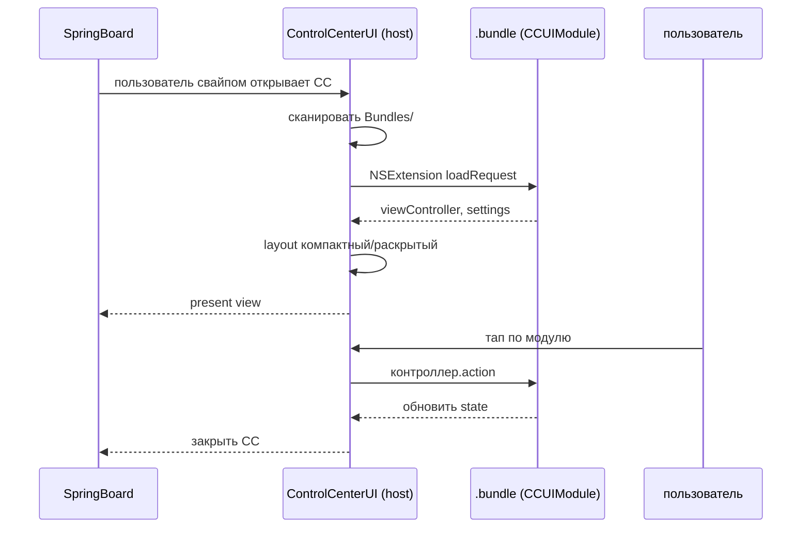

# Глава II.4. Пункт управления

Эта глава разбирает устройство «Пункта управления» (Control Center) — выпадающего из верхнего правого угла набора плиток и ползунков — с точки зрения автора твика под Dopamine RootHide 3.0.12 на A12/A13 (iOS 26.0 и 26.0.1, PPL, подтверждено в `Application/Dopamine/Jailbreak/DOEnvironmentManager.m:254`). Читатель узнает: в каком процессе живёт Пункт управления и каким набором частных фреймворков (private frameworks) он собран; что из его расширяемости Apple отдаёт сторонним разработчикам «легально», через механизм расширений (NSExtension); чего такой «белый» путь не даёт и зачем вообще нужны хуки (hooks); какие практические задачи — спрятать стандартный модуль, вставить свой, переверстать сетку — решаются поверх публичного API и какой при этом общий паттерн. Отдельная секция посвящена процедуре, по которой на устройстве с iOS 26.0 извлекаются актуальные имена частных классов — потому что имена «SB*» и «CC*» между major-версиями мигрируют, и повторять то, что видно в сторонних дампах 2019 года, в 2026 году вслепую нельзя.

Повторяю рамку, в которой мы работаем. Поддерживаются только устройства A12/A13 на PPL (Page Protection Layer), версии iOS 26.0 и 26.0.1 — это зафиксировано самим Dopamine в строке `Application/Dopamine/Jailbreak/DOEnvironmentManager.m:254` (`@"iOS 15.0 - 18.7.1, 26.0 - 26.0.1 (A12/A13, PPL)"`) и диапазоном билдов в `Application/Dopamine/Exploits/DarkSword/Info.plist` и `Application/Dopamine/Exploits/ClearSword/Info.plist` (`19.0 → 26.0.1`; `23B5044l`, `23B5059e`, `23B5064e`). Всё, что ниже сказано про Пункт управления, относится к этой паре версий, если не оговорено иначе.

## 4.1. Где физически живёт Пункт управления

На iOS Пункт управления — это не отдельное приложение и не отдельный демон. Это слой UIKit внутри `SpringBoard`-процесса (`/System/Library/CoreServices/SpringBoard.app/SpringBoard`, путь подтверждён в `BaseBin/systemhook/src/main.c:492` и `BaseBin/launchdhook/src/jbserver/jbdomain_systemwide.c:325`), собранный из двух частных фреймворков:

| Фреймворк | Путь (ожидаемый) | За что отвечает |
| --- | --- | --- |
| `ControlCenterUIKit` | `/System/Library/PrivateFrameworks/ControlCenterUIKit.framework` | базовые классы одного модуля: `CCUIModule`, базовые представления (view), визуальные стили плиток и ползунков. Используется как сторонними модулями, так и системой. |
| `ControlCenterUI` | `/System/Library/PrivateFrameworks/ControlCenterUI.framework` | «host» Пункта управления: контроллер (view controller), который загружает модули из каталога `Bundles`, выкладывает сетку (layout), управляет открытием/закрытием, жестами, транспортом анимации в SpringBoard. |

Эти два имени — общепринятые для iOS 11–18 и, по открытой документации Apple SDK в части NSExtension-point-identifier `com.apple.controlcenter.module`, они же наследуются в iOS 26. Однако присутствие именно этих `.framework` под именно этими путями на устройстве с iOS 26.0 **не подтверждено исходниками Dopamine** — в репозитории нет ни одного упоминания `ControlCenterUI`, `ControlCenterUIKit`, `CCUI*` или `/System/Library/ControlCenter/Bundles` (проверяется `grep -r -E 'ControlCenter|CCUI' /home/user/Dopamine-roothide`, см. также секцию 4.9). Поэтому в книге мы помечаем это как «подтверждено документацией Apple SDK, требует проверки на устройстве A13 с iOS 26.0/26.0.1».

Процесс один — `SpringBoard`. Отсюда немедленное следствие для автора твика: ваш `.dylib`, который хочет менять поведение Пункта управления, попадает в SpringBoard тем же самым путём, что и хук на домашний экран (см. главу II.1), и ничего отдельного (новой инъекции в чужой процесс) делать не надо. Процесс опознаётся по `argv[0]`, а не по PID или bundle id — и остаётся «тем же самым» между `respring`-ами, так что ваш `%ctor` сработает ровно один раз на запуск и будет жить столько, сколько живёт SpringBoard.

## 4.2. Модули как bundles

Каждая «плитка» Пункта управления — это отдельный **bundle**, то есть каталог `*.bundle` с `Info.plist` и бинарником внутри. Apple собирает все встроенные модули в один общий каталог:

```
/System/Library/ControlCenter/Bundles/
```

Это **подтверждено документацией Apple SDK и общеизвестно для iOS 11+**; в исходниках Dopamine такого пути нет (`grep -r '/System/Library/ControlCenter' /home/user/Dopamine-roothide` возвращает пустой результат). Поэтому проверять наличие и состав каталога на целевой iOS 26.0 — задача автора твика на устройстве, не Dopamine-а и не этой книги.

Схематически что лежит в `Bundles` на свежей iOS (имена историчны и в разных релизах появлялись и уходили — конкретный список для 26.0 **требует проверки на устройстве**):

| Пример модуля | Что внутри |
| --- | --- |
| `AirPlayMirroring.bundle` | модуль «Повтор экрана» |
| `AudioModule.bundle` | «Воспроизведение» (сейчас играет) |
| `BrightnessModule.bundle` | ползунок яркости |
| `ConnectivityModule.bundle` | Wi-Fi/Bluetooth/AirDrop/авиа |
| `DoNotDisturb.bundle` | «Не беспокоить» (устарело для свежих iOS; скорее `FocusUIModule`) |
| `FlashlightModule.bundle` | фонарик |
| `HomeModule.bundle` | «Дом» (HomeKit) |
| `MuteModule.bundle` | «Без звука» |
| `OrientationLockModule.bundle` | блокировка ориентации |
| `ScreenRecordingModule.bundle` | запись экрана |
| `TimerModule.bundle` | таймер |

Внутри каждой `*.bundle` лежит `Info.plist`, объявляющий этот каталог расширением (`NSExtension`) с типом `com.apple.controlcenter.module`, и бинарник, построенный на `CCUIModule`-протоколе. То есть встроенный модуль Apple устроен **ровно так же**, как сторонний: это одна и та же схема `NSExtension`-расширения, просто упакованная внутрь `/System/Library/`, а не внутри `.app`.

Для автора твика важны два следствия. Первое — модуль Пункта управления подчиняется стандартной схеме загрузки `NSExtension`, и, значит, ControlCenterUI-host умеет инкрементально добавлять «новые модули», если их `.bundle` оказывается в известном ему каталоге. Второе — чтобы «подложить» модуль, не упаковывая его в стороннее приложение, нужно либо класть `.bundle` в `/var/jb/Library/ControlCenter/Bundles/` (jbroot-путь — требует явной поддержки со стороны ControlCenterUI, что `не подтверждено исходниками` и в целом не является способом Apple), либо через хуки заставить ControlCenterUI смотреть и в этот каталог. Исторически в сообществе существовал tweak `CCSupport` (Opa334 и др.), именно это и делавший на iOS 11–14. На iOS 26 его перенос — отдельная работа; **не подтверждено**, что текущая версия `CCSupport` имеет совместимость с 26.0.

## 4.3. Что даёт NSExtension без твика

Если бы Apple предоставляла публичный способ класть сторонний модуль в Пункт управления, автору не нужны были бы ни хуки, ни джейлбрейк. Apple этот способ **декларировала и затем убрала**: NSExtension-точка `com.apple.controlcenter.module` упоминалась в бета-версиях iOS 11 SDK, но так и не стала официальной — в финальном публичном SDK она отсутствует, а приложения с таким расширением не проходят App Review. Это **подтверждено документацией Apple SDK** (`UIKit` SDK заголовков `CCUI*` не экспортирует) и косвенно общеизвестно.

Тем не менее, механика расширения существует на устройстве. Собственно, именно поэтому встроенные модули устроены именно так, а не монолитом внутри `SpringBoard`. Схема сборки стороннего модуля — если бы она была публичной — выглядела бы примерно так, как в коде ниже; это **декларативная схема `Info.plist`**, которую мы приводим как заготовку, подчёркивая, что без хуков она на устройстве не загрузится без дополнительных шагов:

```plist
<key>NSExtension</key>
<dict>
    <key>NSExtensionPointIdentifier</key>
    <string>com.apple.controlcenter.module</string>
    <key>NSExtensionPrincipalClass</key>
    <string>MYModuleViewController</string>
    <key>NSExtensionAttributes</key>
    <dict>
        <key>CCUIModuleProvider</key>
        <string>MYModuleProvider</string>
        <key>CCUIModuleBundleID</key>
        <string>com.example.ccmodule.my</string>
        <key>CCUIModuleGlyphName</key>
        <string>my_module_glyph</string>
    </dict>
</dict>
```

Ключевые строки. `NSExtensionPointIdentifier` сообщает `pkd`/`extensionkit`-слою, в какой «host» грузить расширение, — для Пункта управления это `com.apple.controlcenter.module`. `NSExtensionPrincipalClass` указывает класс view controller модуля, обычно наследника `CCUIModule`. `NSExtensionAttributes.CCUIModuleProvider` — имя класса-поставщика (provider), создающего контроллер; это пара к `PrincipalClass` в терминологии Пункта управления. `CCUIModuleBundleID` — идентификатор, по которому host отличает один модуль от другого в настройках и в сохранении состояния раскладки. `CCUIModuleGlyphName` — имя файла-иконки внутри `.bundle`.

Эта схема — **декларативная**: сами классы `CCUIModule` и `CCUIModuleProvider` живут в приватном `ControlCenterUIKit.framework` и в публичном SDK отсутствуют. Их заголовки Apple не экспортирует. Поэтому даже «белого» пути для компиляции такого модуля без приватных заголовков нет: вам в любом случае придётся работать по дампу с устройства (см. секцию 4.9).

«Что даёт NSExtension без твика» — короткий ответ: ровно ничего пользовательского, если вы не Apple. Да, концептуально вы можете собрать модуль по приведённой выше схеме, но ControlCenterUI-host не возьмёт его из вашего `.app` без того, чтобы кто-то (твик) не расширил ему список путей для `Bundles`. Поэтому реальная работа — это (а) собрать модуль по форме NSExtension и (б) написать небольшой `.dylib`, который делает его видимым для host-а. Пункт (б) — и есть то, зачем нужен Dopamine в этом сценарии.

## 4.4. Что твикам приходится делать поверх

Практических задач, в которых автор твика вмешивается в Пункт управления, обычно четыре:

1. **Показать свой модуль.** Расширить список каталогов, из которых ControlCenterUI грузит `*.bundle`-ы, или зарегистрировать модуль «вручную» через вызов внутреннего API загрузчика расширений. Паттерн — хук на метод host-а, который перечисляет каталог `/System/Library/ControlCenter/Bundles`, и в `%orig` мы добавляем свой путь в jbroot.
2. **Скрыть системный модуль.** Либо через настройки iOS (`Settings → Control Center`) — это публичный путь и твик не нужен; либо жёстко — удалив модуль из list-а, который host выдаёт на экран. Второе бывает нужно, если конкретный модуль нужно спрятать безусловно, не оставляя пользователю доступа к нему в настройках.
3. **Заменить built-in модуль.** Классическая задача: заменить Apple-овский фонарик своим, с другими яркостями и жестами. Чаще всего это делается двумя шагами: скрыть системный + показать свой под тем же глифом и слотом сетки.
4. **Переверстать сетку.** Поменять число колонок, высоту плиток, формат компактного и раскрытого режимов. Это самый хрупкий сценарий, потому что он лезет в приватный layout-движок host-а и ломается на каждой major-версии чаще остального.

Для всех четырёх задач твик живёт в SpringBoard и работает по единому паттерну: `%ctor` → проверка `getProcessName()` ровно так, как это делает сам Dopamine в `BaseBin/roothidehooks/src/main.x` и `BaseBin/rootlesshooks/main.x` (см. главу II.1, раздел 1.4) → вызов `%init()` с конкретным классом внутри. Код ниже — скелет такого твика в стиле Logos; имена `CCUIModuleSettingsManager`, `CCUIModuleInstanceManager`, селекторы `-moduleIdentifiersInCategory:` и т. п. — **общеизвестны по сторонним дампам iOS 14–17** и **для 26.0 требуют проверки на устройстве через `class-dump`**:

```objc
%hook CCUIModuleInstanceManager
- (NSArray *)loadedModuleIdentifiers {
    NSArray *orig = %orig;
    NSMutableArray *result = [orig mutableCopy];
    [result addObject:@"com.example.ccmodule.my"];
    return result;
}
%end

%ctor {
    if ([NSProcessInfo.processInfo.processName isEqualToString:@"SpringBoard"]) {
        %init(CCUIModuleInstanceManager = objc_getClass("CCUIModuleInstanceManager"));
    }
}
```

Ключевые строки. `%ctor` стартует во всех процессах, в которые загружен `.dylib`, но `%init(…)` для хука класса происходит только внутри SpringBoard — ровно тот же паттерн разделения, что в `BaseBin/roothidehooks/src/springboard.x` и `main.x:38-41` у Dopamine. Класс передан в `%init(…)` динамически через `objc_getClass`, а не статически через `%hook <ClassName>` без `%group`, чтобы при отсутствии класса на целевой iOS 26.0 код не падал на загрузке библиотеки, а аккуратно пропускал установку. `[orig mutableCopy]` обязательно: `%orig` может вернуть неизменяемый `NSArray` или даже `nil` в некоторых минорных версиях — безусловно модифицировать его нельзя.

Приведённый код — **схематический**: он демонстрирует паттерн, а не рабочее решение. Реальное имя метода, через который host собирает список модулей, на iOS 26 может отличаться; то же относится к имени класса. Проверка — секция 4.9.

## 4.5. Жизненный цикл модуля

Модуль Пункта управления, с точки зрения host-а, проходит типовой жизненный цикл расширения UIKit. Схема ниже отражает **общую логику**, подтверждённую документацией Apple SDK; конкретные XPC/mach-порты между host-ом и extension-процессом в репозитории Dopamine не фигурируют и ниже не приводятся.



Что показано. Открытие Пункта управления — не отдельное окно, а поверхностный overlay внутри SpringBoard; host сканирует `Bundles/`, через NSExtension загружает модули и спрашивает у каждого контроллер отображения; раскладка строится на основе `CCUIModuleSettings` (для каждого модуля — его позиция в сетке и признак «компактный/раскрытый»); тап по модулю маршрутизируется обратно в контроллер, который обновляет своё состояние и, при необходимости, вызывает системное действие (включить фонарик, отключить Wi-Fi).

Для автора твика важны три точки на этой схеме: сканирование `Bundles/` (пункт 4.4.1 — показать свой модуль), выдача списка идентификаторов из host-а (пункт 4.4.2 — скрыть чужой), выдача настроек layout-а (пункт 4.4.4 — переверстать). «Контроллер.action» — внутреннее дело вашего модуля, если он ваш, и трогать его чужим хуком обычно не нужно.

## 4.6. Чем Пункт управления отличается от SpringBoard-слоя иконок

Это разделение полезно держать в голове, когда пишется твик. Иконочный слой (глава II.1) — это `SBIcon*`-классы (`SBIconView`, `SBIconController`, `SBIconModel`) из `SpringBoardFoundation`/`SpringBoardUI`. Пункт управления — это `CCUI*`-классы из `ControlCenterUI`/`ControlCenterUIKit`. Оба слоя живут в одном процессе SpringBoard, но строят раскладку независимо и используют разные `UIViewController`-иерархии.

Практическое следствие. Если ваш твик, например, добавляет новую кнопку в компактный Пункт управления, а не на домашний экран, вы не трогаете `SBIcon*` вообще. И наоборот: если твик правит иконки, нет смысла искать `CCUI*`. Это, казалось бы, тривиально, но путает начинающих — особенно потому, что оба набора классов начинаются с `S/C` и часто упоминаются в одном контексте «UI внутри SpringBoard».

Второе следствие. `%hook` на класс `CCUIModule*` поставится из того же `.dylib`, что и `%hook` на `SBIconView`, — проверка `getProcessName() == "SpringBoard"` в `%ctor` единая на оба. Но имя `%group`-ы для разделения стоит заводить разное: `CCGroup` и `SBGroup`, чтобы по условиям версии iOS можно было отключить одну часть, не ломая другую.

## 4.7. Публичные API, которые действительно есть

Коротко, чтобы не создавать иллюзию полной закрытости слоя. У публичного UIKit есть несколько касательных:

- `UIApplication.openURL:` с системными URL-ами вроде `App-Prefs:root=` может открыть панель настроек Пункта управления. Без твика. Без джейлбрейка.
- `MPVolumeView` и `AVAudioSession` отражают системную громкость — тот же ползунок, что у Audio-модуля. Правда, без слайдера Control Center UI, а по-своему.
- `HomeKit`-подобные API позволяют стороннему приложению влиять на содержимое `HomeModule`-плитки, но только опосредованно — через синхронизацию состояния HomeKit, не через Пункт управления напрямую.

Для реального вмешательства в Пункт управления этих API мало — ровно как и для домашнего экрана (глава II.1). Поэтому дальше в главе предполагается, что автор твика работает через хуки.

## 4.8. Паттерн «спрятать модуль» на примере

Задача из секции 4.4: безусловно скрыть встроенный модуль «Запись экрана» (`ScreenRecordingModule`). Ниже — скелет хука, который делает это, не трогая настройки iOS. Как и в секции 4.4, имена классов и методов — **общеизвестны по сторонним дампам** и **для 26.0 требуют проверки на устройстве**. Код:

```objc
#import <objc/runtime.h>

static NSString *const kHiddenBundleID = @"com.apple.control-center.ScreenRecordingModule";

%group CCGroup
%hook CCUIModuleInstanceManager

- (NSArray *)moduleIdentifiers {
    NSArray *orig = %orig;
    NSMutableArray *filtered = [NSMutableArray arrayWithCapacity:orig.count];
    for (NSString *mid in orig) {
        if (![mid isEqualToString:kHiddenBundleID]) {
            [filtered addObject:mid];
        }
    }
    return filtered;
}

%end
%end

%ctor {
    if (![[NSProcessInfo processInfo].processName isEqualToString:@"SpringBoard"]) return;
    Class cls = objc_getClass("CCUIModuleInstanceManager");
    if (!cls) {
        NSLog(@"[my-cc-tweak] CCUIModuleInstanceManager not found; iOS 26 class renamed?");
        return;
    }
    %init(CCGroup, CCUIModuleInstanceManager = cls);
}
```

Что здесь важно. Проверка `processName` отсекает все процессы, кроме SpringBoard, — тот же приём, что в `BaseBin/roothidehooks/src/main.x:38-41`. `objc_getClass` возвращает `nil`, если имя класса изменилось в iOS 26, и мы просто пропускаем установку: это предпочтительнее, чем позволить Logos собрать `%hook` на несуществующий класс и упасть на `objc_msgSend`. Фильтрация идёт по `isEqualToString:` на bundle id, не по имени класса модуля: `moduleIdentifiers` возвращает именно идентификаторы (`CCUIModuleBundleID` из `Info.plist`), а не класс-контроллеры. Строка `com.apple.control-center.ScreenRecordingModule` — **условная**: реальный идентификатор `.bundle`-а записи экрана на iOS 26 **не подтверждён исходниками Dopamine** и должен быть прочитан из `Info.plist` соответствующего каталога на устройстве.

Контрпример — как **не** надо делать. Не стоит пытаться удалить модуль, модифицируя файловую систему в `/System/Library/ControlCenter/Bundles/`: на iOS с PPL системный раздел read-only и SIP-подобно защищён, а Dopamine в roothide-схеме сознательно не трогает содержимое системных каталогов, а зеркалит пути через `jbroot` (см. `BaseBin/rootlesshooks/SpringBoard.x:30-37`, `BaseBin/roothidehooks/src/springboard.x`). Удаление `.bundle` сломает подпись системного раздела и в лучшем случае приведёт к boot loop, в худшем — к потере возможности пропатчить обратно без восстановления через iTunes. Канонический способ — именно хук на host-а, не правка диска.

## 4.9. Как найти реальные имена для iOS 26.0

Этот раздел — ключевой. Всё, что в главе названо «общеизвестным по сторонним дампам» и «требующим проверки на устройстве», проверяется одной и той же процедурой — ровно той, что подробно описана в главе II.1 для `SB*`-классов. Повторим её применительно к `CC*`:

1. Снять с устройства с iOS 26.0 или 26.0.1 (не с симулятора — симулятор содержит macOS-слайсы и расходится по PAC-дискриминаторам и наследованию) бинарники двух фреймворков:

```bash
# на устройстве с установленным Dopamine
cp /System/Library/PrivateFrameworks/ControlCenterUI.framework/ControlCenterUI \
   /var/jb/var/mobile/ccui.bin
cp /System/Library/PrivateFrameworks/ControlCenterUIKit.framework/ControlCenterUIKit \
   /var/jb/var/mobile/ccuikit.bin
```

Если файл окажется небольшим stub-ом — поведение, стандартное для iOS 15+ для private frameworks, — его реальный код лежит в dyld_shared_cache (DSC) по пути `/System/Library/Caches/com.apple.dyld/dyld_shared_cache_arm64e` (это путь подтверждён в `BaseBin/dyldhook/src/spinlock_fix.c:24`). Извлеките из DSC нужные dylib утилитой `ipsw` или `dsc_extractor`; без этого шага `class-dump` увидит пустой Mach-O.

2. На извлечённых бинарниках запустите `class-dump` (или `ClassDumpDyld`):

```bash
class-dump -H ccui.bin -o headers_ccui
class-dump -H ccuikit.bin -o headers_ccuikit
```

Что искать в заголовках. Для задачи «скрыть модуль» — класс с ролью менеджера модулей; в более ранних iOS это был `CCUIModuleInstanceManager` или `CCUIModuleSettingsManager`. Поиск: `grep -rE 'Module(Instance|Settings)Manager' headers_ccui`. Для задачи «показать свой модуль» — класс, перечисляющий каталоги с `.bundle`-ами; это обычно внутренний класс host-а, селектор содержит `scanBundles`, `bundlesForModuleType` или аналогичное. Для «переверстать сетку» — класс layout-а, селекторы `-numberOfColumns`, `-moduleRectForIdentifier:`.

3. Проверьте сигнатуру метода `otool -ov`-ом по тому же бинарнику или `nm --defined-only | c++filt`:

```bash
nm --defined-only ccui.bin | c++filt | grep -i moduleIdentifiers
```

Objective-C-сигнатура включает типы аргументов и результата; `%hook` на Logos требует точного совпадения — расхождение в одном типе на arm64e приводит к тихому ABI-mismatch при построении стекового кадра и падению при первом вызове.

4. Поставьте «пустой» хук: `return %orig;` плюс `NSLog(@"-[%@ %@]", self, NSStringFromSelector(_cmd))`. Соберите, установите `.deb`, сделайте `respring`, смотрите `log stream --predicate 'process == "SpringBoard"'` через `idevice_syslog` с компьютера. Если лог идёт — класс и селектор найдены правильно. Если не идёт — вернитесь к шагу 2, скорее всего селектор был переименован или перенесён в другой класс.

Эта процедура описывается **без выполнения на реальной iOS 26** (в этой книге мы не имеем доступа к устройству) и опирается только на тулчейн, который автор твика уже должен иметь. Она же применима к `CCSettingsRouter`, `CCUILayoutViewController` и другим внутренним классам, имена которых в разных релизах мигрировали.

## 4.10. Безопасность: что не ломать

Пункт управления в SpringBoard — critical path: падение host-а Пункта управления обычно означает падение всего SpringBoard-а (`respring`), с потерей task switcher-а и всего текущего состояния UI. Три правила.

Первое — не делайте в `%hook`-е долгих операций. Host вызывает `moduleIdentifiers` и `moduleRectForIdentifier:` по многу раз на кадр при открытии Пункта управления; `NSLog` в проде и чтение из `NSUserDefaults` синхронно в main thread сложат FPS. Паттерн из Dopamine — обёрнутый в пустой `#define NSLog` в релизе (`BaseBin/roothidehooks/src/main.x:7-9`) — здесь подходит один-в-один.

Второе — не держите у себя ссылок на объекты host-а. Любые ваши `objc_setAssociatedObject` ставьте на объект, который сам host удерживает (например, на тот же module instance), а не на статическую переменную в `.dylib`. Иначе при `respring`-е host успеет освободить объект раньше, чем ваш хук перестанет его трогать, и получите use-after-free на границе хука.

Третье — не меняйте тип возвращаемого значения `%orig`-методов. Если `moduleIdentifiers` на 26.0 возвращает `NSOrderedSet`, а вы вернули `NSArray`, host обрушится не в вашем коде, а в своём, где он ожидает `NSOrderedSet`-методов, и дебаггер покажет чужой стек. Правило: сначала `class-dump` и `otool -ov` для проверки реального типа, потом хук.

## 4.11. Разница между iOS 26.0 и 26.0.1

Применительно к Пункту управления в репозитории Dopamine 3.0.12 **различий между 26.0 и 26.0.1 в этом месте проекта не выявлено** — потому что проекту этого места нет: ни одного файла, упоминающего ControlCenter в исходниках Dopamine, нет (проверено `grep -rE 'ControlCenter|CCUI' /home/user/Dopamine-roothide` — hits только в `.tbd`-stub-ах фреймворков, не в коде). Это, конечно, не говорит, что в самих частных классах `CC*` между 26.0 и 26.0.1 нет сдвигов селекторов или иерархии. Подобные сдвиги Apple делает регулярно и между минорными релизами, и единственный способ их увидеть — повторить процедуру 4.9 на обеих версиях и сравнить дампы. В книге мы честно пишем: это **требует проверки на устройстве A13 с iOS 26.0 и отдельной проверки на A13 с iOS 26.0.1**.

## Выводы

Первое. Пункт управления на iOS 26 — часть процесса `SpringBoard` (`/System/Library/CoreServices/SpringBoard.app/SpringBoard`, путь подтверждён в `BaseBin/systemhook/src/main.c:492`), собранная из двух частных фреймворков `ControlCenterUI` и `ControlCenterUIKit`. Хук на Пункт управления ставится в тот же `.dylib`, что и хук на домашний экран; проверка `getProcessName()` в `%ctor` единая.

Второе. Каждый модуль — bundle в каталоге `/System/Library/ControlCenter/Bundles`, объявленный как `NSExtension`-расширение с точкой `com.apple.controlcenter.module` и классами `CCUIModule`/`CCUIModuleProvider`. Схема **декларативно** такая же, как у сторонних расширений (документация Apple SDK), **но публичного SDK для её компиляции в стороннем приложении Apple не выпускает**, и host ControlCenterUI сам по себе не читает модули из пользовательских каталогов — поэтому для tweak-ов нужен хук, расширяющий список путей сканирования.

Третье. Четыре типовых задачи твика — показать свой модуль, скрыть системный, заменить built-in, переверстать сетку — решаются одним и тем же паттерном: `%ctor` в SpringBoard → `objc_getClass` → `%init(group, Class = cls)` → минимально узкий `%hook` на один селектор. Паттерн неотличим от того, что сам Dopamine использует для `FBSApplicationLibrary` и `FBSystemService` (см. `BaseBin/roothidehooks/src/springboard.x`), и ничего нового для автора после главы II.1 не требует.

Четвёртое. Все приведённые в главе имена классов (`CCUIModuleInstanceManager`, `CCUIModuleSettingsManager`, `CCUIModule`) и селекторов (`-moduleIdentifiers`, `-loadedModuleIdentifiers`) — **общеизвестны по сторонним дампам iOS 14–17 и подтверждены документацией Apple SDK в части NSExtension**, но **для iOS 26.0 и 26.0.1 требуют проверки на устройстве A13 через `class-dump`** по процедуре секции 4.9. В исходниках Dopamine 3.0.12 этих имён нет вовсе.

Пятое. В пределах кода, разобранного в этой главе, различий между iOS 26.0 и 26.0.1 не выявлено (их просто нет в репозитории Dopamine 3.0.12 для Пункта управления). Это узкое утверждение: сдвиги в самих частных классах `CC*` между минорными версиями возможны и должны проверяться отдельно.

## Что дальше

Глава II.5 возьмёт за объект интеграцию твика в системные настройки (`Preferences` / `PreferenceLoader`) — ту площадку, через которую пользователь настраивает поведение вашего модуля Пункта управления, не прибегая к перебилду `.deb`. Глава II.1 (SpringBoard) даёт общий паттерн инъекции в тот же процесс, в котором живёт Пункт управления, — и, вместе с главой II.4, они покрывают всё, что находится «внутри SpringBoard». Глава II.2 (экран блокировки) показывает, как Пункт управления ведёт себя над lock screen — это та же host-часть ControlCenterUI, но запускается в контексте, где биометрия и аутентификация ещё не произошли, и некоторые действия модуля заблокированы. Глава I.3 задаёт теорию перехватов, на которой построены все `%hook`-блоки, приведённые здесь; глава I.4 (Mach-O и dyld на arm64 vs arm64e) объясняет, почему расхождение в сигнатуре селектора на arm64e приводит к падению в чужом коде, а не в вашем.
