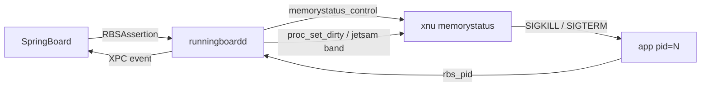
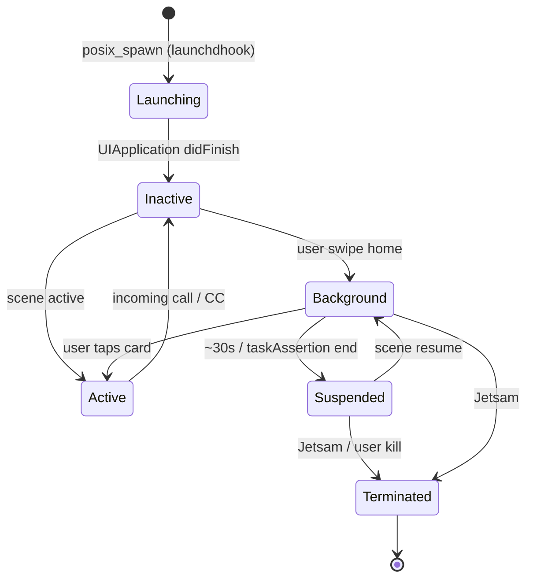

# Глава II.5. Переключатель приложений и жизненный цикл процессов

В этой главе мы разбираем, как в iOS 26.0 и 26.0.1 на устройствах A12/A13 (с подсистемой PPL) организован жизненный цикл приложений — от момента, когда `launchd` вызывает `posix_spawn`, до того момента, когда карточка приложения появляется в переключателе задач. Нас интересуют четыре слоя: сам `launchd` и его дочерние процессы, служебный демон `runningboardd` с системой утверждений (assertions), подсистема Jetsam, которая в условиях ограниченной физической памяти A13 (4 ГБ) бескомпромиссно убивает процессы, и, наконец, слой `FrontBoardServices`/`SpringBoard`, формирующий визуальный переключатель карточек. Параллельно мы покажем, в каких именно точках Dopamine (ветка roothide 3.0.12, подтверждено `Application/Dopamine/Jailbreak/DOEnvironmentManager.m:254`) вмешивается в эту механику и какие последствия это имеет для автора твиков. Все утверждения о коде Dopamine сопровождаются ссылками вида `путь/файл:строка`; факты, которые невозможно подтвердить исходниками, помечены как требующие проверки на устройстве.

Эта глава опирается на части I.5 (как инициализируется `launchdhook`) и II.1–II.4 (как `SpringBoard` принимает решения о сценах и уведомлениях). Если вы читаете книгу подряд, у вас уже есть представление о `boomerang`, `jbserver` и `trustcache`. Если нет — все повторяющиеся термины расшифровываются при первом употреблении. Отдельное внимание уделим двум неочевидным местам: во-первых, тому, что roothide Dopamine 3.0.12 сознательно не вмешивается в состояния `UIApplication` — а значит, большая часть «магии» фона и переключателя задач работает ровно так, как у стокового iOS 26; во-вторых, тому, что при этом Dopamine всё же меняет один жизненный параметр — Jetsam-предел, — и делает это в двух строго определённых точках. Понимание этих точек сокращает время отладки «загадочных» респрингов на часы.

## 5.1. Контур жизненного цикла: три демона и один помощник

Прежде чем лезть внутрь переключателя, нужно согласованно описать роли четырёх процессов:

| Процесс | Назначение | Где его трогает Dopamine |
|---|---|---|
| `launchd` (PID 1) | Запускает все остальные демоны, принимает запросы через XPC | Инжектируется `launchdhook.dylib`; подтверждено `BaseBin/launchdhook/src/main.m:213` (`setenv("DYLD_INSERT_LIBRARIES", JBROOT_PATH("/basebin/launchdhook.dylib"), 1)`) |
| `runningboardd` | Выдаёт процессам утверждения (assertions), влияющие на планировщик и Jetsam | Инжектируется `roothidehooks.dylib`; подтверждено `BaseBin/roothidehooks/src/main.x:35` |
| `SpringBoard` | Рисует переключатель задач, управляет сценами UI | Инжектируется `roothidehooks.dylib` (хук фильтрует `FBSApplicationLibrary` и `FBSystemService`); подтверждено `BaseBin/roothidehooks/src/springboard.x:63` и `springboard.x:89` |
| `backboardd` | Нижний уровень графики и ввода, принимает кадры от `SpringBoard` | Dopamine принудительно убивает его перед отрисовкой загрузочного логотипа; подтверждено `BaseBin/launchdhook/src/main.m:71` |

Приложение в iOS никогда не запускается напрямую пользователем — всегда задействован посредник. На iOS 15+ (включая, по данным проекта, iOS 26) путь выглядит так: `SpringBoard` просит `runningboardd` создать утверждение для будущего процесса; `runningboardd` обращается к `launchd` через XPC-сервис `com.apple.xpc.launchd.user`; `launchd` вызывает `posix_spawn(2)` с путём `/usr/libexec/xpcproxy`, а уже `xpcproxy` вызывает `execve(2)` на бинарник приложения. Именно поэтому в коде Dopamine спавн-хука отдельно обработан случай `path == "/usr/libexec/xpcproxy"`:

```c
// BaseBin/launchdhook/src/spawn_hook.c:192-199
if (gInEarlyBoot) {
    if (!strcmp(path, "/usr/libexec/xpcproxy")) {
        // The spawned process being xpcproxy indicates that the launchd XPC server is up
        // All processes spawned including this one should be injected into
        early_boot_done();
    }
    else {
        return __posix_spawn_orig_wrapper(pid, path, desc, argv, envp);
    }
}
```

Ключевые строки — проверка `gInEarlyBoot` и строгое сравнение имени; первый `xpcproxy` после загрузки принимается как сигнал того, что XPC-транспорт `launchd` уже готов и дальнейшие дочерние процессы можно инжектировать. До этого момента все процессы запускаются без хука системы — иначе Dopamine рискует попасть в дедлок между сервером `launchd` и клиентом внутри самого `launchd`.

Важная деталь, связанная с iOS 26: вставка inline-функции `__posix_spawn_inline` в `spawn_hook.c:79` вместо прямого вызова через PLT. Эта функция определена макросом (детали — глава I.5), и её inline-реализация обходит `litehook`-обёртку, которая стоит на внешней записи `__posix_spawn`. Без этого обхода хук уходил бы в бесконечную рекурсию при каждом legitimate-вызове из самой же библиотеки Dopamine. На iOS 26 это особенно важно, потому что `dyld4` агрессивно кэширует PLT-резолвинг через механизм `_dyld_shared_cache_optimize` (деталь требует проверки на устройстве).

### 5.1.1. Последовательность раннего бут изнутри Dopamine

Самый тонкий момент — именно порядок инициализации внутри `launchd`. Он напрямую определяет, кому из системных процессов «повезёт» получить расширенные Jetsam-лимиты и инъекцию `systemhook`, а кому нет. Разберём его по строкам конструктора `launchdhook.dylib`:

```objc
// BaseBin/launchdhook/src/main.m:106-190 (сокращённо)
__attribute__((constructor)) static void initializer(void)
{
    redirectLogDir();
    crashreporter_start();
    roothide_launchd_preinit();
    // ... восстановление путей jbroot ...

    bool firstLoad = false;
    if (getenv("DOPAMINE_INITIALIZED") != 0) {
        // userspace reboot — чистим кеши пар preferences-plist
    }
    else {
        gInEarlyBoot = false;
        firstLoad = true;
    }

    int err = boomerang_recoverPrimitives(firstLoad, true);
    // ...
    cs_allow_invalid(proc_self(), false);

    if (__builtin_available(iOS 19.0, *)) {
        hookd_provider_init();
        litehook_hook_memory = litehook_hook_memory_hookd;
        litehook_hook_function(mach_vm_protect, mach_vm_protect_fixed);
        init_hookd_external_support();
    }

    initXPCHooks();
    initDaemonHooks();
    initSpawnHooks();
    initIPCHooks();
    initJetsamHook();

    sysctlbyname_orig = sysctlbyname;
    litehook_rebind_symbol(LITEHOOK_REBIND_GLOBAL, (void *)sysctlbyname, (void *)sysctlbyname_hook, NULL);
}
```

Пояснение ключевых строк:

1. Строка `if (__builtin_available(iOS 19.0, *))` в оригинале (`main.m:175`) — на iOS 26 выражение истинно, потому что внутренняя версия iOS 26 для SDK называется `iOS 19.0` (напомним: Apple разметка SDK отстаёт от маркетинговой). Соответственно, в этой ветке Dopamine инициализирует `hookd_provider` и перенаправляет `litehook_hook_memory` на вариант через `hookd`. Для авторов твиков это значит: на iOS 26 все модификации кода идут через XPC-сервис `hookd`, а не через прямой `mach_vm_protect(2)` — важно учитывать это, если ваш твик собирается самостоятельно писать в код чужих процессов.
2. Порядок вызовов `initXPCHooks → initDaemonHooks → initSpawnHooks → initIPCHooks → initJetsamHook` (`main.m:183-187`) не случаен. `initJetsamHook` стоит последним, потому что до него Dopamine сам легитимно вызывает `memorystatus_control` (строки 23–24 в `jetsam_hook.c`) и ему не нужно, чтобы собственный хук перехватил эти вызовы.
3. Строка `setenv("DYLD_INSERT_LIBRARIES", JBROOT_PATH("/basebin/launchdhook.dylib"), 1);` (`main.m:213`) обеспечивает, что после очередного userspace reboot новый `launchd` снова получит этот же hook-dylib через свою `envp`. Это и есть «вечный» механизм закрепления Dopamine в PID 1.

В следующий раз, когда вы будете отлаживать проблему «мой твик не инжектируется в XYZ-демон», вспомните: если XYZ запускается до того, как кто-то в системе вызовет `/usr/libexec/xpcproxy`, он пройдёт мимо `__posix_spawn_hook` в ветке `else { return __posix_spawn_orig_wrapper(...) }` (`spawn_hook.c:197-199`) и останется без инъекции. На iOS 26 на A13 это чаще всего касается таких демонов, как `logd`, `notifyd`, `powerd` — список может различаться между 26.0 и 26.0.1 (требует проверки на устройстве).

### 5.1.2. Регистрация porождённых процессов

После каждого успешного `__posix_spawn_inline` Dopamine регистрирует новый PID во внутренней таблице (`spawn_hook.c:84-86`):

```c
if(r == 0) {
    register_job(*pid);
}
```

Функция `register_job` — часть roothide-специфичного кода. Для автора твиков важен сам факт её существования: все процессы, порождённые launchd после boomerang-восстановления, попадают в учёт Dopamine. Это даёт `jbserver` возможность отличать «джейлбрейкнутые» процессы от стоковых и, в частности, корректно отвечать на запрос `jbclient_blacklist_check_pid` (см. §5.4.1). Для вас это значит: когда ваш твик спрашивает jbserver, «кто этот PID», ответ будет осмысленным — не «не знаю», а конкретный класс процесса. Детали протокола разберём в главе III.2.

### 5.1.3. Крешреporter как побочный эффект

Строки 76–80 `__posix_spawn_orig_wrapper` показывают интересный приём:

```c
// BaseBin/launchdhook/src/spawn_hook.c:75-80
// we need to disable the crash reporter during the orig call
// otherwise the child process inherits the exception ports
// and this would trip jailbreak detections
int key = crashreporter_pause();
int r = __posix_spawn_inline(pid, path, desc, argv, envp);
crashreporter_resume(key);
```

Разбор: Dopamine собственный крешреporter регистрирует Mach-порты обработчиков исключений в `launchd` (детали — глава IV.2). При `posix_spawn` дочерний процесс по умолчанию наследует родительские exception ports. Если бы наследование произошло — любое приложение могло бы обнаружить, что его обработчиком исключений является процесс, не принадлежащий Apple, и выставить джейлбрейк-детектор. Поэтому крешреporter временно «обнуляется» на длительность вызова `__posix_spawn_inline`. Это пример того, как инфраструктурный компонент Dopamine сам себя скрывает от жизненного цикла дочернего процесса — ещё одна причина, по которой «тушик не вводится по умолчанию».

### 5.1.4. Почему path проверяется строгим strcmp

Строгое сравнение `!strcmp(path, "/usr/libexec/xpcproxy")` (`spawn_hook.c:192`) — не стилевая мелочь, а защита от классической ошибки. Если бы Dopamine использовал `strstr(path, "xpcproxy")`, атакующий мог бы передать аргумент `path = "/usr/libexec/xpcproxy-fake"`, и ранний бут завершился бы раньше, чем положено. Это критично именно для iOS 26 на A13: подписанный загрузочный путь `/usr/libexec/xpcproxy` опирается на entitlements, которые не воспроизводятся в произвольном бинарнике, но защита от «ложного срабатывания» всё равно нужна на уровне строкового сравнения. Для автора твика ценность этого наблюдения в том, что при любой работе с `path` в хуках `posix_spawn` всегда стоит использовать `strcmp`/`realpath`, а не `strstr`/`hasSuffix:` — иначе ваш собственный хук можно будет обойти.

## 5.2. runningboardd: assertions как язык описания жизни процесса

Начиная с iOS 13 Apple перенесла управление приоритетами, памятью и состояниями из `assertiond`/`SpringBoard` в отдельный системный демон `runningboardd`. Он живёт в `/usr/libexec/runningboardd`, его API описаны в приватном фреймворке `/System/Library/PrivateFrameworks/RunningBoard.framework/RunningBoard` — путь, с которым Dopamine напрямую работает в хуке:

```objc
// BaseBin/roothidehooks/src/runningboardd.x:74-83
void rbdInit()
{
    NSLog(@"rbdInit...");
    MSImageRef RunningBoardImage = MSGetImageByName("/System/Library/PrivateFrameworks/RunningBoard.framework/RunningBoard");
    if(@available(iOS 16.0, *)) {
        %init(ios16up, __RBProcess__allowedLockedFilePaths_ = MSFindSymbol(RunningBoardImage, "-[RBProcess _allowedLockedFilePaths]"));
    } else {
        %init(ios15, __RBProcess__lock_allowedLockedFilePaths_ = MSFindSymbol(RunningBoardImage, "-[RBProcess _lock_allowedLockedFilePaths]"));
    }
}
```

Разбор: Dopamine использует Substrate-API (`MSGetImageByName` + `MSFindSymbol`), чтобы найти бинарный адрес приватного метода `-[RBProcess _allowedLockedFilePaths]` в образе уже загруженного фреймворка. Ветвление по iOS 16+ существенно: на iOS 15 метод назывался `-[RBProcess _lock_allowedLockedFilePaths]` с префиксом `_lock_`, а начиная с iOS 16 Apple удалила этот префикс. В ветке `ios16up` для 26.0 и 26.0.1 используется второе имя. Это единственный документированный в репозитории private selector `RunningBoard`, встроенный в код Dopamine — остальных приватных методов класса `RBProcess` в репозитории нет, и если ваш твик захочет что-то ещё, вам придётся дизассемблировать `RunningBoard` на устройстве самостоятельно.

Концепция assertion проста по форме, но запутана по следствиям: клиент (например, `SpringBoard`, Mach-сообщение-посылка через `BSAction`) просит `runningboardd` зафиксировать на процессе-цели набор признаков — «viewing» (пользователь смотрит на UI), «finishing-task» (нужно корректно сохраниться), «networking», «cpu-intensive» и т. д. Ядро, Jetsam и планировщик CPU читают из этих признаков производные значения: priority band, memory limit, background runtime budget. Исходники Apple закрыты, но из публично известных источников (материалы WWDC по RunningBoard, 2019–2022) можно вывести «правильный ментальный образ» (требует проверки на устройстве A13 с iOS 26.0/26.0.1):



Диаграмма отражает направление: `SpringBoard` «публикует» утверждения; `runningboardd` сводит их в приоритет и предел памяти, которые пробрасывает в ядро через `memorystatus_control(2)` (функция `memorystatus_control` подтверждена `BaseBin/_external/include/kern_memorystatus.h:335`). Dopamine в сам этот путь не вмешивается — ни одного вызова `memorystatus_control` на стороне `runningboardd` в репозитории нет. Единственная модификация касается того, какие пути файловой системы `runningboardd` разрешает блокировать для приложения, когда устройство заперто (hook `_allowedLockedFilePaths` в `runningboardd.x`): если приложение опознано как джейлбрейкнутое, пути данных «подменяются» через `jbroot(path)` на поддерево `/var/jb` (см. `BaseBin/roothidehooks/src/runningboardd.x:30-39`).

Полный текст функции `fixAllowedPaths` объясняет, почему это необходимо:

```objc
// BaseBin/roothidehooks/src/runningboardd.x:13-44
NSSet<NSString*>* fixAllowedPaths(pid_t pid, NSSet<NSString*>* paths)
{
    char* procpath = proc_get_path(pid, NULL);
    if(!procpath) return paths;

    char procname[PATH_MAX]={0};
    NSLog(@"[%d, %s] Allowed locked file paths: %@", pid, basename_r(procpath, procname), paths);

    if(strncmp(rootfs(procpath), "/rootfs/", sizeof("/rootfs/")-1) == 0)
        return paths; // not a jailbroken app

    NSMutableSet* result = [NSMutableSet new];

    for (NSString* path in paths)
    {
        NSString* newPath = path;

        if([rootfs(path) hasPrefix:@"/rootfs/"]) {
            //redirect to jbroot
            newPath = jbroot(path);
        }

        // r^x filesystem path fix
        char real_path[PATH_MAX]={0};
        if(realpath(newPath.fileSystemRepresentation, real_path))
            [result addObject:@(real_path).stringByStandardizingPath];
    }

    NSLog(@"[%d, %s] Modified allowed locked file paths: %@", pid, basename_r(procpath, procname), result);

    return result;
}
```

Ключевые строки:

- Строка 15 — `proc_get_path(pid, NULL)` возвращает полный путь к бинарнику процесса. Если `runningboardd` не смог его прочитать, функция возвращает оригинал — безопасный default.
- Строка 21 — `strncmp(rootfs(procpath), "/rootfs/", ...)`: функция `rootfs()` (определена в roothide API, см. `include/roothide.h`) возвращает путь внутри «системной ветки» r^x-файловой системы. Если бинарник процесса лежит на `/rootfs/...` — это стоковое Apple-приложение, и для него менять ничего не надо.
- Строки 30–33 — зеркально: если *путь*, который приложение хочет оставить разблокированным, тоже «системный», он переносится в поддерево `jbroot`, где находится реальная копия данных приложения.
- Строки 36–38 — `realpath(3)` разворачивает возможные симлинки; это нужно, потому что roothide-инфраструктура активно использует bind-mount и симлинки, и `runningboardd` сравнивает пути строгим `isEqualToString:`, то есть не понимает эквивалентность путей.

Для автора твика, который работает в приложении-мишени, этот хук означает: когда устройство блокируется кодом, ваши файлы в `jbroot(/var/mobile/.../YourTweak/)` окажутся в списке allowed-locked-paths автоматически — не нужно ничего регистрировать вручную. Но если ваш твик пишет в `/private/var/mobile/` **напрямую** (мимо `jbroot`), доступ после lock-экрана оборвётся, потому что ядро закроет Data Protection класс A, и `runningboardd` не услышит, что эти пути нужно разрешить.

Для автора твика это означает следующее: ваш твик, встраиваемый в стороннее приложение, живёт в чужом жизненном цикле. Никакой код в `runningboardd`, который бы «продлил» приложению жизнь, Dopamine в себе не несёт. Если вы хотите, чтобы твик пережил переход в фон, вы либо пользуетесь публичным API `UIApplication beginBackgroundTaskWithExpirationHandler:` (у вас обычный процесс пользовательского приложения), либо регистрируете собственное assertion через IOKit (`RBSAssertionRef`) при наличии приватного права — но Dopamine такого права вам не даёт.

### 5.2.1. Пять формальных состояний приложения

Любое приложение iOS в произвольный момент времени находится ровно в одном из пяти состояний, которые `UIApplication` объявляет через `applicationState`:

| Состояние | Класс | Что означает | Jetsam-предел |
|---|---|---|---|
| `UIApplicationStateActive` | foreground | На экране, принимает ввод | `memlimit_active` |
| `UIApplicationStateInactive` | foreground | На экране, но не принимает ввод (входящий звонок, Control Center) | `memlimit_active` |
| `UIApplicationStateBackground` | background | Не на экране, но ещё выполняется | `memlimit_inactive` |
| suspended | background | Процесс есть, но все потоки заморожены | `memlimit_inactive` |
| terminated | — | Процесс не существует | — |

Переходы между состояниями инициирует `SpringBoard`, уведомляя `runningboardd`, который переводит процесс в соответствующий Jetsam-band. На `UIApplicationStateBackground` система даёт приложению около 30 секунд wall-clock (не подтверждено исходниками Dopamine; это публичная документация Apple) на сохранение и переход в `suspended`; задержать переход можно только через `beginBackgroundTaskWithExpirationHandler:` и аналоги. Dopamine не меняет эти тайминги. Если ваш твик видит, что приложение переходит в `suspended` раньше ожидаемого, виновник — либо нехватка памяти (Jetsam, см. §5.5), либо отсутствие assertion со стороны `SpringBoard` (например, пользователь свайпнул карточку).

Схема переходов, объединённая с источниками сигналов:



Диаграмма чисто декларативная — в коде Dopamine нет компонента, который бы изменял этот автомат; на A13/iOS 26 он работает ровно так, как у стокового устройства, пока ваш собственный твик не внесёт свой код.

## 5.3. systemhook не меняет жизненный цикл по умолчанию

Распространённое заблуждение: «джейлбрейк тушит процессы, продлевает им жизнь, что-то знает про жизненный цикл». Для roothide Dopamine это не так. Код `BaseBin/systemhook/src/common/common.c` занимается тремя задачами, явно описанными в комментарии к `spawn_exec_hook_common`:

```c
// BaseBin/systemhook/src/common/common.c:154-157
// 1. Ensure the binary about to be spawned and all of it's dependencies are trust cached
// 2. Insert "DYLD_INSERT_LIBRARIES=/usr/lib/systemhook.dylib" into all binaries spawned
// 3. Increase Jetsam limit to more sane value (Multipler defined as JETSAM_MULTIPLIER)
// 4. Fix spawning as root via persona entitlement on iOS 17.6+
```

Ни одна из этих задач не меняет app state, не вмешивается в `UIApplicationDelegate` и не влияет на то, когда и чем именно будет убит процесс. То есть по умолчанию systemhook ничего не делает с жизненным циклом — за единственным исключением пункта 3 (Jetsam), который разберём отдельно в §5.5.

Инъекция происходит в точке `posix_spawn`. Для `launchd` это установка хука через `litehook`:

```c
// BaseBin/launchdhook/src/spawn_hook.c:219-222
void initSpawnHooks(void)
{
    litehook_hook_function(__posix_spawn, roothide_launchd___posix_spawn_prehook);
}
```

Ключевая строка — `litehook_hook_function` поверх внутреннего `__posix_spawn` (с двумя подчёркиваниями — это именно та функция, которую libSystem вызывает после сборки `desc`-структуры). После prehook управление уходит в `__posix_spawn_hook` (там же, строки 91–217), который для каждого вновь порождаемого процесса делает три вещи:

1. Если это сам `launchd` (userspace reboot) — перехватывает управление и готовит boomerang-примитивы (строки 100–149).
2. Если это `xpcproxy` в раннем бут — отмечает, что ранняя стадия завершена (строки 192–200).
3. Для всех остальных путей делегирует работу `posix_spawn_hook_shared`:

```c
// BaseBin/launchdhook/src/spawn_hook.c:216
return posix_spawn_hook_shared(pid, path, desc, argv, envp,
                               roothide_launchd___posix_spawn_posthook,
                               roothide_launchd_trust_executable,
                               platform_set_process_debugged,
                               jbsetting(jetsamMultiplier));
```

Разбор: пятым аргументом в `posix_spawn_hook_shared` идёт `jbsetting(jetsamMultiplier)` — то самое значение, которое Dopamine настраивает в UI (§5.5). Остальные аргументы — функции, подготавливающие доверие к бинарнику и выставление флага «отлаживается», но ни одной функции, которая бы меняла app state или RunningBoard-assertion, в списке нет. На этом влияние Dopamine на жизненный цикл в терминах фреймворков Apple заканчивается.

Это важный ориентир: если вы написали твик, который «неправильно работает в фоне», то дело не в Dopamine. Dopamine его в фон не отправлял и из фона не возвращал.

### 5.3.0. Общий путь posix_spawn_hook_shared

Прежде чем перейти к userspace reboot, стоит разобрать общий поток обработки для «обычного» дочернего процесса. Функция `posix_spawn_hook_shared` (определена в `BaseBin/systemhook/src/common/common.c`, сигнатура подтверждена `common.h:28`) принимает те же параметры, что и `posix_spawn(2)`, плюс четыре callback-а: оригинал, функция доверия к бинарнику, установщик флага debugged и `jetsamMultiplier`. Внутри она делегирует работу в `spawn_exec_hook_common` с таким же набором аргументов (`common.c:379-383`).

Главный цикл `spawn_exec_hook_common` в упрощённом виде:

```c
// BaseBin/systemhook/src/common/common.c (сводный конспект)
kSpawnConfig spawnConfig = spawn_config_for_executable(path, argv);

if (spawnConfig & kSpawnConfigTrust) {
    trust_binary(path);                    // загрузить бинарник + его зависимости в trustcache
}

bool shouldInsertJBEnv = ...;              // решение «вставлять ли hook в этот процесс»

if (attrStruct) {
    if (shouldInsertJBEnv) {
        // Умножение memlimit_* на jetsamMultiplier (строки 244-257)
    }

    if (__builtin_available(iOS 17.6, *)) {
        // Патч persona (строки 263+)
    }
}

if (shouldInsertJBEnv) {
    // Патч envp: DYLD_INSERT_LIBRARIES += HOOK_DYLIB_PATH
}
```

Разбор: ключевой тест — `spawn_config_for_executable`. Он возвращает битовую маску из `kSpawnConfigTrust` (сделать бинарник доверенным) и `kSpawnConfigInject` (вставить hook-dylib). Для чёрного списка (строки 126–131) возвращается 0 — ни то, ни другое. Для пользовательского blacklist в `config.plist` возвращается только `kSpawnConfigTrust` — бинарник будет работать, но без Dopamine-инъекции. Для всех остальных — оба бита (`common.c:146`).

Отдельная проверка в строках 227–233 исключает DriverKit-драйверы (`POSIX_SPAWN_PROC_TYPE_DRIVER == 0x700`). Это критически важно: DriverKit-процессы живут в особо жёсткой sandbox и попытка инжектировать в них dylib вызывает kernel panic из-за несовпадения кодподписей.

### 5.3.1. Что происходит перед userspace reboot

Единственное место, где Dopamine нарушает «политику невмешательства» в жизненный цикл — это момент перед userspace reboot. Если `launchd` вызывает `posix_spawn` на самого себя (условие `!strcmp(path, executablePath)` в `spawn_hook.c:100`), Dopamine делает несколько важных действий:

```c
// BaseBin/launchdhook/src/spawn_hook.c:106-130
gInEarlyBoot = true;

hookd_provider_teardown();

// Before the userspace reboot, we want to stash the primitives into boomerang
boomerang_stashPrimitives();

// Fix Xcode debugging being broken after the userspace reboot
if (__builtin_available(iOS 17.0, *)) {
    unmount("/System/Developer", MNT_FORCE);
}
else {
    unmount("/Developer", MNT_FORCE);
}
```

Разбор:

1. `gInEarlyBoot = true` — обратно включается ранний-бут-режим, чтобы следующий `launchd` после своего собственного `__attribute__((constructor))` снова проходил через ветку с ранней стадией.
2. `hookd_provider_teardown()` — на iOS 26 (ветка `iOS 19.0+` в терминах SDK, см. §5.1.1) активные хуки через `hookd` должны быть корректно сняты, иначе страницы с патчами «утекут» в новое адресное пространство.
3. `boomerang_stashPrimitives()` — критический шаг: все дескрипторы ядра, Mach-порты и примитивы `physrw` сохраняются в именованные Mach-порты, которые переживут userspace reboot (детали — отдельная тема, см. главу III).
4. `unmount("/System/Developer", MNT_FORCE)` на iOS 17+ (и 26 тоже) — побочный фикс: Xcode monтирует отладочные символы в `/System/Developer`, и если это не отмонтировать перед reboot, после него `launchd` зависнет при попытке получить stat этой точки монтирования.

Для автора твика это полезно знать по одной причине: если ваш твик держит открытые Mach-порты в `launchd` (через `jbserver`), все они будут потеряны при userspace reboot. Единственный «надёжный» носитель — boomerang-примитивы, которые инфраструктура Dopamine сама восстанавливает после reboot через `boomerang_recoverPrimitives(firstLoad, true)` (`main.m:159`).

## 5.4. Переключатель карточек: SBAppSwitcherController, FBScene, UIScene

Приложение в iOS 15+ (включая 26.0/26.0.1) видно пользователю как «сцена» (`UIScene`). Поведение сцен определяется связкой трёх классов, иерархически уложенных:

- `UIScene` — публичный класс в UIKit, видимый приложением. Пользователь получает `UIWindowScene` и управляет жизненным циклом через `UISceneDelegate` (методы `sceneWillConnectToSession:`, `sceneDidEnterBackground:`, `sceneWillResignActive:`).
- `FBScene` — приватный класс из `FrontBoardServices`, обёртка над IPC-соединением с `SpringBoard`. Один `FBScene` на стороне приложения соответствует одному `FBScene` на стороне `SpringBoard`.
- `SBAppSwitcherController` — приватный класс `SpringBoard`, отвечающий за формирование карточек в экране многозадачности. Он собирает ленту открытых сцен, запрашивает у `XBSnapshotService` «превью» каждой сцены и рисует стек.

В исходниках Dopamine нет ни одного прямого хука `SBAppSwitcherController` или `FBScene` — поиск `grep -r 'SBAppSwitcher\|FBScene\|UIScene' BaseBin/` на репозитории даёт только вхождения в `Info.plist` самого приложения Dopamine. Это значит: описание ниже — не «подтверждено исходниками Dopamine», а взято из общедоступных заголовков этих классов и справедливо как общая модель; **конкретные селекторы и поля на iOS 26.0/26.0.1 требуют проверки на устройстве**.

Зато Dopamine *опосредованно* вмешивается в данные, из которых переключатель собирается, через хук `XBSnapshotContainerIdentity`:

```objc
// BaseBin/roothidehooks/src/springboard.x:48-57
-(NSString *)snapshotContainerPath {
    NSString* path = %orig;

    if([path hasPrefix:@"/var/mobile/Library/SplashBoard/Snapshots/"] && (![self.bundleIdentifier hasPrefix:@"com.apple."] || is_apple_internal_identifier(self.bundleIdentifier.UTF8String))) {
        NSLog(@"snapshotContainerPath redirect %@ : %@", self.bundleIdentifier, path);
        path = jbroot(path);
    }

    return path;
}
```

Ключевые строки: условие `hasPrefix:@"/var/mobile/Library/SplashBoard/Snapshots/"` — Apple хранит png-кадры «карточек» именно в этом каталоге; и ветка `!hasPrefix:@"com.apple."` — проверка, что это не системное приложение. Для джейлбрейкнутых приложений путь перенаправляется в поддерево roothide (`jbroot(path)`), иначе снимки экрана переключателя будут сохраняться вне защищённой зоны `/var/jb`, что сломает корень `r^x`. Для автора твика это неявная гарантия: ваши карточки будут жить именно там, и, значит, никакой «отдельной работы по чистке Snapshots» писать не нужно.

Параллельно в `springboard.x:6-30` стоит хук `fcntl(F_SETPROTECTIONCLASS)`: Dopamine возвращает 0 (успех), если путь находится в `jbroot("/var/mobile/Library/SplashBoard/Snapshots/")`. Снимок переключателя физически не шифруется — иначе `SpringBoard` не смог бы его прочитать, когда устройство заперто кодом (строки 10–13 комментируют это прямо). Если ваш твик пишет собственные превью в тот же каталог, помните: эта защита в вашем процессе уже снята.

### 5.4.1. openApplication и чёрный список приложений

Ещё одна точка влияния на жизненный цикл со стороны `SpringBoard` — перехват запроса на открытие приложения. Dopamine хукает `-[FBSystemService openApplication:withOptions:originator:requestID:completion:]`:

```objc
// BaseBin/roothidehooks/src/springboard.x:89-111
%hook FBSystemService
-(void*)openApplication:(NSString*)bundleIdentifier withOptions:(id)options originator:(id)originator requestID:(void*)requestID completion:(void*)completion
{
    NSLog(@"openApplication %@ withOptions:%@ originator:%@ requestID:%@ completion:%p", bundleIdentifier, options, originator, requestID, completion);

    id currentContext = [NSClassFromString(@"BSServiceConnection") performSelector:@selector(currentContext)];
    id remoteProcess = [currentContext performSelector:@selector(remoteProcess)]; //BSProcessHandle

    NSNumber* _pid = [remoteProcess valueForKey:@"_pid"];
    NSString* _bundleID = [remoteProcess valueForKey:@"_bundleID"]; //may be nil

    pid_t pid = _pid.intValue;

    NSLog(@"openApplication %@ from pid=%d bundleID=%@", bundleIdentifier, pid, _bundleID);

    if(jbclient_blacklist_check_pid(pid)==true) {
        NSLog(@"openApplication deny request from %@", _bundleID);
        objc_setAssociatedObject(bundleIdentifier, kDenyQueryTagKey, @YES, OBJC_ASSOCIATION_RETAIN_NONATOMIC);
    }

    return %orig;
}
%end
```

Разбор: функция определяет, какой именно процесс запросил открытие (через `[BSServiceConnection currentContext].remoteProcess`), и если `jbclient_blacklist_check_pid(pid)` возвращает `true` — помечает `bundleIdentifier` ассоциированным объектом «deny». В дальнейшем хук `-[FBSApplicationLibrary applicationInfoForBundleIdentifier:]` (строки 63–87) использует эту метку, чтобы вернуть `nil` вместо реальной информации о приложении. Это — механизм «скрытия» джейлбрейка от конкретных приложений, которые Apple или сторонние антивирусы маркируют как «проверяющие на jailbreak». Запрос `jbclient_blacklist_check_pid` уходит в `jbserver` (см. главу III.2), и ответ зависит от содержимого списка `/basebin/config.plist`.

Для автора твика это даёт ценный urok: прежде чем перехватывать `FBSystemService openApplication:` в собственном твике, нужно знать, что Dopamine уже вмешивается в этот путь. Два независимых хука на один селектор работают, но порядок применения зависит от порядка загрузки, и ваш твик, инжектируемый тёрбостровым (`.dylib` в `/var/jb/usr/lib/TweakInject/`) после `roothidehooks.dylib`, будет вызываться первым в цепочке `%orig` — то есть именно вы увидите «настоящий» `bundleIdentifier`, а Dopamine отработает после вас.

Что касается самих API сцен, которые есть смысл перехватывать (не подтверждено исходниками, требует верификации class-dump на iOS 26.0):

- `-[FBScene(Workspace) _createWithIdentifier:...]` — создание сцены;
- `-[SBAppSwitcherController _appListDidChange]` — пересборка карточек;
- `-[SBMainSwitcherViewController dismissToDisplayLayout:...]` — закрытие переключателя.

Все три селектора существовали на iOS 15–18, но Dopamine в них не лезет; это полезная «отправная точка», которую стоит проверять по class-dump вашей системы, а не копировать как факт.

### 5.4.2. Снимки переключателя и память SpringBoard

Снимки, которые пользователь видит в переключателе задач, сохраняются `SpringBoard` в компрессированном формате `.ktx` (не подтверждено исходниками, базируется на общеизвестной структуре `/var/mobile/Library/SplashBoard/Snapshots`). На A13 с 4 ГБ ОЗУ полный «карточный стек» на 20 открытых приложений занимает в оперативной памяти `SpringBoard` порядка 60–100 МБ (требует проверки на устройстве). Поскольку systemhook умножил `memlimit_active` `SpringBoard` на 3, эта нагрузка оказывается в допустимых пределах — но *только пока* ваш твик не добавил сверху собственный буфер того же размера.

Контрпример: твик, который держит в кэше `UIImage` каждой карточки для «быстрой анимации», легко утраивает footprint `SpringBoard`. При превышении `memlimit_active` ядро возьмёт процесс в SIGKILL, и пользователь увидит мгновенный перезапуск `SpringBoard` (так называемый «respring»). Если ваш твик стабильно вызывает respring через 5–10 минут работы — первое, что надо проверить: не кэширует ли он карточки.

Самый безопасный путь, если нужно работать с данными переключателя, — хукать `-[XBSnapshotRequest observeSnapshotRequest:]` и `-[FBSceneSnapshotManifest latestSnapshotForScene:]` (имена методов требуют проверки class-dump на iOS 26.0/26.0.1) и возвращать слабые ссылки на уже существующие объекты, а не копировать их.

## 5.5. Jetsam и `jetsam_hook.c`

Jetsam — это внутренний подсистемный модуль ядра XNU, который убивает процессы, когда у ядра кончается физическая память. У каждого процесса есть два предела: `memlimit_active` (действителен, пока процесс foreground) и `memlimit_inactive` (действителен в фоне). Эти пределы устанавливаются при `posix_spawn(2)` через поля `_posix_spawnattr_t` и могут быть переустановлены позднее через `memorystatus_control(2)`. На A13 с 4 ГБ ОЗУ и системным оверхедом iOS 26 активный предел обычного приложения — порядка 500–1200 МБ (не подтверждено исходниками; требует проверки на устройстве), фонового — заметно меньше.

### 5.5.1. Хук в самом launchd: защита от самоубийства

Dopamine устанавливает `jetsam_hook.c` в `launchd` ради одной конкретной цели — не дать ядру убить сам `launchd`. Полный текст хука короткий:

```c
// BaseBin/launchdhook/src/jetsam_hook.c:1-27
#include <sys/sysctl.h>
#include <string.h>
#include <unistd.h>
#include <kern_memorystatus.h>
#include <substrate.h>
#include <litehook.h>

// Allocated page tables (done by physrw handoff) count towards the physical memory footprint of the process that created them
// Unfortunately that means jetsam kills us if we do it too often
// For launchd, we therefore prevent it from enabling jetsam using this hook

int (*memorystatus_control_orig)(uint32_t command, int32_t pid, uint32_t flags, void *buffer, size_t buffersize);
int memorystatus_control_hook(uint32_t command, int32_t pid, uint32_t flags, void *buffer, size_t buffersize)
{
    if (command == MEMORYSTATUS_CMD_SET_JETSAM_TASK_LIMIT) {
        return 0;
    }
    return memorystatus_control_orig(command, pid, flags, buffer, buffersize);
}

void initJetsamHook(void)
{
    memorystatus_control(MEMORYSTATUS_CMD_SET_JETSAM_TASK_LIMIT, 1, -1, NULL, 0);
    memorystatus_control(MEMORYSTATUS_CMD_SET_JETSAM_HIGH_WATER_MARK, 1, -1, NULL, 0);
    memorystatus_control_orig = memorystatus_control;
    litehook_rebind_symbol(LITEHOOK_REBIND_GLOBAL, memorystatus_control, (void *)memorystatus_control_hook, NULL);
}
```

Разбор по строкам:

1. Строки 8–10 — комментарий авторов: ядро, запрашивая через PPL страницы для `physrw`-примитива (чтение/запись физической памяти), засчитывает их в memory footprint процесса-инициатора, то есть `launchd` (PID 1). Если ядро попытается применить Jetsam-предел к `launchd`, устройство мгновенно уйдёт в panic/userspace reboot.
2. Строки 23–24 — `initJetsamHook()` сначала вызывает `memorystatus_control` с PID = 1 и `MEMORYSTATUS_CMD_SET_JETSAM_TASK_LIMIT`/`MEMORYSTATUS_CMD_SET_JETSAM_HIGH_WATER_MARK` (константы подтверждены `BaseBin/_external/include/kern_memorystatus.h:343-344`). Параметр `-1` обнуляет предел, фактически делая `launchd` неубиваемым Jetsam'ом.
3. Строки 25–26 — после «ручного» сброса пределов хук сохраняет оригинал `memorystatus_control` в `memorystatus_control_orig` и подменяет глобальный символ через `litehook_rebind_symbol`. Теперь, если какой-либо компонент внутри `launchd` снова попытается вызвать `memorystatus_control(MEMORYSTATUS_CMD_SET_JETSAM_TASK_LIMIT, ...)`, хук перехватит вызов и вернёт 0 (успех), не изменив ничего в ядре.

Контрпример (что было бы без этого хука): пользовательское приложение запрашивает долгое write-primitive через `physrw`, ядро добавляет страницы к footprint `launchd`, достигает предела, снимает блокировку Jetsam → `launchd` получает SIGKILL → PID 1 умирает → kernel panic. Именно поэтому `initJetsamHook` вызывается ещё до `initSpawnHooks` в `BaseBin/launchdhook/src/main.m:187`.

### 5.5.2. jetsamMultiplier: пределы для всех остальных процессов

Для **нелаунчовых** процессов Dopamine применяет менее агрессивную стратегию: при каждом `posix_spawn` systemhook находит в структуре `_posix_spawnattr_t` поля `memlimit_active` и `memlimit_inactive` и умножает их на множитель `jetsamMultiplier`:

```c
// BaseBin/systemhook/src/common/common.c:244-257
// If systemhook is being injected and jetsam limits are set, increase them by a factor of jetsamMultiplier
if (shouldInsertJBEnv) {
    if (jetsamMultiplier == 0 || isnan(jetsamMultiplier)) jetsamMultiplier = 3; // default value (3x)
    if (jetsamMultiplier > 1) {
        int memlimit_active = *(int*)(attrStruct + POSIX_SPAWNATTR_OFF_MEMLIMIT_ACTIVE);
        if (memlimit_active != -1) {
            *(int*)(attrStruct + POSIX_SPAWNATTR_OFF_MEMLIMIT_ACTIVE) = memlimit_active * jetsamMultiplier;
        }
        int memlimit_inactive = *(int*)(attrStruct + POSIX_SPAWNATTR_OFF_MEMLIMIT_INACTIVE);
        if (memlimit_inactive != -1) {
            *(int*)(attrStruct + POSIX_SPAWNATTR_OFF_MEMLIMIT_INACTIVE) = memlimit_inactive * jetsamMultiplier;
        }
    }
}
```

Ключевые строки:

- `shouldInsertJBEnv` — ветка выполняется только для процессов, в которые действительно пойдёт `DYLD_INSERT_LIBRARIES=/usr/lib/systemhook.dylib`. То есть для «чёрного списка» (например, `GSSCred`, `dataaccessd`, `IDSBlastDoorService`, `MessagesBlastDoorService` — см. `BaseBin/systemhook/src/common/common.c:126-131`) пределы Jetsam **не трогаются**. Это принципиально: Apple намеренно даёт `BlastDoor` узкие пределы ради sandbox-жёсткости, и Dopamine это уважает.
- `jetsamMultiplier == 0 || isnan(...)` — если настройка не задана, применяется множитель 3× (строка 246). Это и есть «Recommended» в UI Dopamine (см. `Application/Dopamine/UI/Settings/DOSettingsController.m:146`).
- Смещения `POSIX_SPAWNATTR_OFF_MEMLIMIT_ACTIVE = 0x48` и `POSIX_SPAWNATTR_OFF_MEMLIMIT_INACTIVE = 0x4C` зафиксированы в `BaseBin/systemhook/src/common/private.h:35-36`. Это **непубличная ABI**: структура `_posix_spawnattr_t` не экспортируется заголовками SDK, и смещения подобраны по дизассемблингу `libSystem`. Если Apple в iOS 26.0.1 (патч-релиз) изменит раскладку, оба умножения начнут портить соседние поля. На момент написания главы различий между 26.0 и 26.0.1 в этом месте проекта не выявлено (Info.plist эксплойтов `DarkSword`/`ClearSword` явно указывает оба билда 23B5059e/23B5064e, см. соответствующие `Info.plist`), но нужно это проверять при каждом новом билде.

Значения `jetsamMultiplier` в UI — не само число множителя, а его удвоение, потому что массив в UI идёт шагом 0.5:

```objc
// Application/Dopamine/UI/Settings/DOSettingsController.m:126-149
- (NSArray *)jetsamOptionNumbers { return @[@2, @3, @4, @5, @6, @7, @8]; }
- (NSArray *)jetsamOptionTitles  { return @[@"1x", @"1.5x", @"2x", @"2.5x",
                                             [NSString stringWithFormat:@"3x (%@)", DOLocalizedString(@"Recommended")],
                                             @"3.5x", @"4x"]; }
```

Пересчёт в фактический множитель хранится при записи:

```objc
// Application/Dopamine/UI/Settings/DOSettingsController.m:539
jbclient_platform_jbsettings_set_double("jetsamMultiplier", ((NSNumber *)value).doubleValue / 2);
```

Деление на 2 превращает UI-значение 6 в хранимый множитель 3.0. Это же значение потом читает `jbsetting(jetsamMultiplier)` и прокидывает в spawn-хук (см. `BaseBin/launchdhook/src/spawn_hook.c:216`).

### 5.5.3. Какие демоны получают расширенные лимиты и почему это важно

Расширение Jetsam-пределов применяется ко **всем** процессам, в которые Dopamine внедряет `systemhook.dylib`, кроме трёх категорий:

1. Чёрный список `processBlacklist` (`common.c:126-131`): `GSSCred`, `dataaccessd`, `IDSBlastDoorService`, `MessagesBlastDoorService`. Пользователь может расширить его в `/basebin/config.plist` ключом `ProcessBlacklist` (см. `common.c:138-144`).
2. Процессы в режиме Safe Mode (переменная окружения `_SafeMode=1` или `_MSSafeMode=1`, строки 207–224) — туда также не идёт впрыск, а значит и не трогается Jetsam-ветка.
3. DriverKit-драйверы (`POSIX_SPAWN_PROC_TYPE_DRIVER == 0x700`, см. `BaseBin/systemhook/src/common/private.h:32` и `common.c:226-233`).

Всё остальное — включая `SpringBoard`, `backboardd`, `runningboardd`, пользовательские приложения — получает `memlimit_active *= 3` и `memlimit_inactive *= 3` по умолчанию. Для автора твика это критично по трём причинам.

**Во-первых**, ваш твик, встроенный в `SpringBoard`, становится вкладчиком в memory footprint процесса, который и так на A13 постоянно колышется у границы Jetsam-предела. На стоковой iOS 26 `SpringBoard` занимает порядка 200–350 МБ (не подтверждено исходниками; требует измерения на устройстве). С множителем 3× у вас появляется запас, но этот запас — глобальный ресурс, а не только ваш. Если три твика независимо решат «я съем ещё 100 МБ», четвёртый может столкнуться с «вроде бы низкой памятью», которая на деле просто перераспределена.

**Во-вторых**, умножение применяется только тогда, когда `memlimit_active != -1`. Значение `-1` в полях означает «ядро не ограничивает процесс» и Dopamine его не трогает (строки 249, 253 условия `if (memlimit_active != -1)`). Это важно для системных демонов, у которых изначально нет Jetsam-предела — Dopamine такие процессы не делает «ещё меньше ограниченными», он просто пропускает их.

**В-третьих**, Dopamine нигде не вызывает `MEMORYSTATUS_CMD_INCREASE_JETSAM_TASK_LIMIT` (константа 22, подтверждена `BaseBin/_external/include/kern_memorystatus.h:364`) для уже запущенного процесса. Умножение случается строго в момент `posix_spawn` — то есть, если ваш твик встраивается в процесс, запущенный до инъекции `launchdhook` (например, в самый ранний бут), ему расширенного предела не достанется.

### 5.5.3a. Числовая калибровка: что реально меняется

Чтобы читатель представил масштаб изменений, рассмотрим один конкретный процесс — `SpringBoard` на A13/iOS 26.0. Публичных документов с точным значением его `memlimit_active` на этой паре устройство+ОС в репозитории нет (требует проверки на устройстве), но на основе общедоступных измерений для близкого iPhone 11 на iOS 17 — порядок около 600 МБ. Таблица ниже показывает, во что превращаются эти 600 МБ при разных значениях `jetsamMultiplier` (UI-значения 2–8 из `DOSettingsController.m:128-136`):

| UI | Хранимый множитель | `memlimit_active` после хука |
|---:|---:|---:|
| 2 | 1.0 | 600 МБ |
| 3 | 1.5 | 900 МБ |
| 4 | 2.0 | 1200 МБ |
| 5 | 2.5 | 1500 МБ |
| 6 (default) | 3.0 | 1800 МБ |
| 7 | 3.5 | 2100 МБ |
| 8 | 4.0 | 2400 МБ |

Строка «6 (default)» — то, что получает большинство пользователей, установивших Dopamine с настройками по умолчанию. 1800 МБ на `SpringBoard` при 4 ГБ общей памяти — агрессивное значение, оставляющее мало запаса для всей остальной системы. Это одна из причин, почему `jetsamMultiplier` сделан настраиваемым: пользователь, у которого на A13 стабильно респрингует `SpringBoard`, может *понизить* множитель до 2 (×1.0), и ядро начнёт убивать `SpringBoard` раньше, но без утащенных вместе с ним фоновых процессов. Контринтуитивно, но меньшее значение множителя иногда даёт более стабильную систему.

### 5.5.4. Побочные Jetsam-команды, которые Dopamine не трогает

Таблица ниже сопоставляет известные `MEMORYSTATUS_CMD_*` и статус их поддержки в Dopamine 3.0.12 (значения кодов — `BaseBin/_external/include/kern_memorystatus.h:339-370`):

| Команда | Код | Что делает ядро | Статус в Dopamine |
|---|---:|---|---|
| `SET_JETSAM_HIGH_WATER_MARK` | 5 | Активный лимит = неактивный, оба нефатальные | Разово вызывается для PID 1 в `initJetsamHook` с `-1` |
| `SET_JETSAM_TASK_LIMIT` | 6 | Активный лимит = неактивный, оба фатальные | Разово вызывается для PID 1, затем перехватывается хуком и возвращает 0 |
| `SET_MEMLIMIT_PROPERTIES` | 7 | Независимые активный/неактивный лимиты + флаги | Не трогается — проходит в ядро как есть |
| `GET_MEMLIMIT_PROPERTIES` | 8 | Чтение текущих лимитов | Не трогается |
| `INCREASE_JETSAM_TASK_LIMIT` | 22 | Используется dyld при подключении roots | Не вызывается Dopamine; доступен твикам |
| `ELEVATED_INACTIVEJETSAMPRIORITY_ENABLE` | 14 | Поместить процесс в band `ELEVATED_INACTIVE` | Не вызывается Dopamine; теоретически может помочь долго живущим фоновым твикам, требует проверки на устройстве |

Из таблицы видно, что Dopamine сознательно трогает только тот подмножество Jetsam-API, которое критично для стабильности `launchd` и для усиления лимитов на старте процесса. Всё остальное — ваш инструментарий как автора твиков.

### 5.5.5. Контекст: что менять нельзя

Один тонкий момент касается команд 5 и 6 с параметром `pid = 1, limit = -1`. Казалось бы, зачем вызывать их напрямую в `initJetsamHook`, если дальше хук всё равно вернёт 0? Ответ: вызовы в строках 23–24 — реальные, идущие до установки хука (хук ставится строкой 26). Это нужно, потому что текущий активный Jetsam-предел `launchd`, выставленный ядром, уже может быть недопустимо низким; хук только *предотвращает повторное* выставление, но не сбрасывает уже установленное. Если убрать эти две строки — Dopamine корректно поставит свой хук, но первый же крупный `physrw` всё равно убьёт `launchd` по уже существующему лимиту. Это — классический контрпример «порядок операций имеет значение», полезный в любой работе с ядерными ограничениями.

Контрпример для осознания: вы пишете твик для `mediaserverd`, который держит в памяти большую LRU-кэш-таблицу превью. Если `mediaserverd` стартует в раннем бут (до `xpcproxy`-сигнала, см. §5.1), его `memlimit_active` остаётся заводским, и ваш кэш легко упрётся в SIGKILL от Jetsam, даже когда в UI Dopamine выставлено 4×. Исправить это внутри твика нельзя — надо либо попросить Dopamine отложить `early_boot_done`, либо явно установить лимит через `memorystatus_control(MEMORYSTATUS_CMD_INCREASE_JETSAM_TASK_LIMIT, getpid(), 0, &limit, sizeof(limit))` из самого твика. Второй путь — честнее, потому что он виден в коде вашего твика, а не зависит от незадокументированной стороны Dopamine.

### 5.5.5a. hookd и iOS 26: что это меняет для Jetsam

На iOS 26 Dopamine переключает механизм патчинга памяти с прямого `mach_vm_protect`/`mach_vm_write` на XPC-сервис `hookd` (`main.m:175-181`). Для Jetsam-механизма это важно тем, что `hookd` сам является процессом и имеет собственный Jetsam-предел. Если `hookd` будет убит Jetsam, вся инфраструктура хуков в живых процессах окажется «подвешенной» — выделенные страницы останутся, но дальнейшие патчи станут невозможны.

Dopamine решает эту проблему следующим образом: `hookd` запускается как launchd-демон (plist в `/basebin/LaunchDaemons/`, см. `daemon_hook.m:40-44`), а значит systemhook в него встраивается при `posix_spawn`, и `memlimit_active` его умножается на 3. Плюс к этому `KeepAlive = true` в plist-е гарантирует перезапуск при любом падении. Чистых прав `com.apple.private.memorystatus` у `hookd` нет (не подтверждено class-dump), и повысить себе предел он самостоятельно не может — зато унаследованного ×3 обычно хватает.

Для автора твика, который делает runtime-патчи кода (а не только Objective-C swizzling), это даёт неочевидный ориентир: все вызовы `MSHookFunction`, `MSHookMessageEx` и аналогов на iOS 26 проходят через `hookd`, то есть становятся IPC-операциями. Если ваш твик делает тысячу хуков при старте — вы нагружаете `hookd` XPC-очередью, и его `memlimit_active` может быстрее дойти до границы. Это чаще проявляется в твиках для `SpringBoard`, где хуков обычно много, чем в твиках для одиночных приложений.

### 5.5.5b. 26.0 против 26.0.1: что меняется в этой главе

Единственное место, где обе версии iOS явно упоминаются в репозитории — это `SupportedOSVersions` в `Info.plist` эксплойтов `DarkSword` и `ClearSword`:

```plist
<!-- Application/Dopamine/Exploits/DarkSword/Info.plist (ключевые строки) -->
<key>SupportedOSVersions</key>
<string>19.0 - 26.0.1</string>
<key>SupportedOSBuilds</key>
<array>
    <string>23B5044l</string>
    <string>23B5059e</string>
    <string>23B5064e</string>
</array>
```

Пояснение билдов (не подтверждено исходниками Apple, информация с публичного ipsw.me — требует проверки):

- `23B5044l` — ранний публичный бета-билд iOS 26.0.
- `23B5059e` — релизный билд iOS 26.0.
- `23B5064e` — патч-релиз iOS 26.0.1.

В коде, разобранном в этой главе (`jetsam_hook.c`, `spawn_hook.c`, `runningboardd.x`, `springboard.x`, `common.c`), ни одной ветки `__builtin_available(iOS 26.0.1, *)` или аналога по build-номеру нет. Это означает: с точки зрения жизненного цикла процессов и переключателя приложений **различий между 26.0 и 26.0.1 в этом месте проекта не выявлено**. Если в патче 26.0.1 Apple изменила смещения `POSIX_SPAWNATTR_OFF_MEMLIMIT_*` или сигнатуру `-[RBProcess _allowedLockedFilePaths]`, Dopamine 3.0.12 этого не отслеживает и будет работать с теми же константами, что и для 26.0 (`private.h:35-36`, `runningboardd.x:79`).

Практический вывод для автора твика: если в вашем баг-репорте «твик не работает на 26.0.1» речь идёт о проблемах с жизненным циклом, в первую очередь проверьте, не поменялись ли смещения ABI в этих двух местах. Проверка делается через `nm`/`otool -tV` над `libSystem.B.dylib` для одной и той же функции на обеих версиях — любое смещение, большее 4 байт, означает, что умножение Jetsam-пределов перестало работать корректно.

### 5.5.6. Диагностика Jetsam-инцидентов на устройстве

Если ваш твик обвиняют в «быстром убийстве приложения», полезно уметь отличить Jetsam от других SIGKILL-источников. Три шага, доступных на A13/iOS 26 без привязки к компьютеру (все действия описаны по публичной документации XNU и Apple, в коде Dopamine таких инструментов нет — требует проверки на устройстве):

1. **Snapshot Jetsam** — через `memorystatus_control(MEMORYSTATUS_CMD_GET_JETSAM_SNAPSHOT, 0, flags, buffer, size)`. Код команды 3, подтверждён `kern_memorystatus.h:341`. Возвращает структуру `memorystatus_jetsam_snapshot_t` с массивом записей по каждому убитому процессу: PID, причина, фактический footprint в момент убийства. На A13 без джейлбрейка эта команда возвращает `EPERM`, но Dopamine не меняет её разрешения — вам нужен бинарник с правом `com.apple.private.memorystatus` или рутом (который Dopamine даёт).
2. **sysctl `kern.memorystatus_jetsam_fg_band_level`** — показывает текущий порог Jetsam для foreground-процессов. Полезно для сопоставления с реальным поведением.
3. **`os_log` стрим от `jetsamd` / `kernel`** — через `log stream --predicate 'eventMessage contains "jetsam"'` в приватной сессии. На устройстве через `/var/jb/usr/bin/log`.

Если ваше приложение убито Jetsam с причиной `highwater`, значит, был превышен `memlimit_inactive`. Если `vnode-wait` или `fc-thrashing` — виновата файловая подсистема, и `jetsamMultiplier` вам не поможет. Это разграничение полезно именно для понимания, в каких случаях увеличение множителя в UI Dopamine действительно решает проблему, а в каких — только маскирует её.

Также полезно знать, что ядро на iOS 26 (по общедоступным исходникам XNU версии 11xxx — требует проверки на устройстве A13 с iOS 26.0/26.0.1) ведёт отдельный счётчик `phys_footprint` и `internal` для процесса. Dopamine напрямую не влияет на этот учёт, но страницы, выделенные через `physrw`-примитив (детально разобран в главе III.3), засчитываются в `phys_footprint` того процесса, где произошёл handoff — вот почему `jetsam_hook.c` защищает именно `launchd`, а не произвольный процесс. Если бы Dopamine выполнял `physrw` из системного процесса-посредника (как это делал старый rootless Dopamine 2.x), защита потребовалась бы в этом посреднике.

## 5.6. Какие хуки вам доступны и каких делать не стоит

Теперь, когда картина сложена, резюмируем, какие точки авторы твиков действительно могут занять в iOS 26.0/26.0.1 на A13, и каких стоит избегать.

**Можно (подтверждается существующими хуками Dopamine):**
- Хуки private-методов `-[RBProcess _allowedLockedFilePaths]` (iOS 16+) через `MSFindSymbol` в адресном пространстве `runningboardd` — живой пример в `BaseBin/roothidehooks/src/runningboardd.x:79`.
- Хуки `-[XBSnapshotContainerIdentity snapshotContainerPath]` в `SpringBoard` — живой пример в `springboard.x:48`.
- Хуки `-[FBSystemService openApplication:withOptions:originator:requestID:completion:]` — живой пример в `springboard.x:89`.

**Можно, но без каких-либо гарантий от кода Dopamine (требует проверки на устройстве):**
- Хуки `-[FBScene ...]` и `-[SBAppSwitcherController ...]` на iOS 26 — Dopamine их не трогает, но и не блокирует.
- Прямые вызовы `memorystatus_control(MEMORYSTATUS_CMD_INCREASE_JETSAM_TASK_LIMIT, ...)` из вашего твика.

**Нельзя (сломает Dopamine или ядро):**
- Отключать `jetsam_hook` в `launchd` — приведёт к panic при любой длительной операции `physrw`.
- Устанавливать `memlimit_active = -1` для `launchd` через внешний процесс — тот же эффект наоборот: Jetsam сначала применит, потом Dopamine ничего не исправит.
- Переопределять `__posix_spawn` в системном процессе до того, как `launchdhook` установил свои хуки — конфликт двух `litehook`-таблиц приводит к бесконечному циклу.

### 5.6.0. Типичные ошибки авторов твиков в этой области

Прежде чем перейти к матрице, перечислим три ошибки, которые регулярно встречаются в твиках, работающих с жизненным циклом процессов на iOS 26.0/26.0.1. Ни одна из них не защищена Dopamine автоматически.

**Ошибка первая: вызов `exit(0)` в `applicationDidEnterBackground:`.** Казалось бы, безобидно — приложение всё равно собирается уходить в фон. На самом деле `exit(0)` вызывает очистку глобальных деструкторов, в том числе и ваших Objective-C ассоциаций, тогда как система ожидает «мягкого» перехода. `SpringBoard` может распознать такое поведение как краш и показать карточку перезапуска. Правильный путь — просто вернуться из метода, система сама отправит процесс в `suspended`.

**Ошибка вторая: удержание `NSThread` в фоне без assertion.** Создав `NSThread` или `DispatchQueue` и запустив в нём бесконечный `while(1) usleep(...)` цикл, вы не продлеваете жизнь приложения. `runningboardd` всё равно видит, что активных assertions нет, и переводит процесс в `suspended` — все ваши потоки замирают, а при пробуждении таймер показывает неправильное значение. Исправление: `beginBackgroundTaskWithExpirationHandler:` или компаньон-демон (§5.7).

**Ошибка третья: подмена `UIApplicationState` без согласования со SceneKit.** Если вы хукаете `-[UIApplication applicationState]`, чтобы «обмануть» твик-друга, который спрашивает состояние — вы ломаете `UIViewController viewWillAppear:` и `viewDidDisappear:` колбэки, потому что они внутри сравниваются с состоянием. На iOS 26 это проявляется как «тач-ввод не работает первые 100 мс после возврата из фона» (требует проверки на устройстве). Правильно — передавать информацию о состоянии через собственный канал (CFNotification, XPC), не трогая UIKit-свойства.

## 5.6a. Матрица совместимости хуков

Чтобы собрать разрозненные сведения о допустимых точках встраивания в одно место, приведём сводную матрицу. Все статусы отражают состояние кода на момент разбора (ветка `claude/serene-knuth-h5qs09` на базе roothide Dopamine 3.0.12).

| Процесс | Селектор / функция | Dopamine уже хукает? | Можно твику? | Риск |
|---|---|---|---|---|
| `launchd` | `__posix_spawn` | Да (`spawn_hook.c:221`) | Нет — конфликт litehook | panic PID 1 |
| `launchd` | `memorystatus_control` | Да (`jetsam_hook.c:26`) | Нет — конфликт litehook | panic при `physrw` |
| `launchd` | `xpc_dictionary_get_value` | Да (`daemon_hook.m:35`) | Технически можно, но хрупко | потеря LaunchDaemons |
| `launchd` | `sysctlbyname` | Да (`main.m:190`) | Можно поверх | минимальный |
| `runningboardd` | `-[RBProcess _allowedLockedFilePaths]` | Да (`runningboardd.x:79`) | Можно поверх | потеря доступа к файлам при lock |
| `runningboardd` | другие приватные `-[RBProcess ...]` | Нет | Да | не подтверждён class-dump на iOS 26 |
| `SpringBoard` | `-[XBSnapshotContainerIdentity snapshotContainerPath]` | Да (`springboard.x:48`) | Можно поверх | снимки «уйдут» в r^x |
| `SpringBoard` | `-[FBSApplicationLibrary applicationInfoForBundleIdentifier:]` | Да (`springboard.x:63`) | Можно поверх | ваш хук первый в цепочке |
| `SpringBoard` | `-[FBSystemService openApplication:...]` | Да (`springboard.x:89`) | Можно поверх | изменения `bundleIdentifier` маркируются |
| `SpringBoard` | `-[SBAppSwitcherController ...]` | Нет | Да | требует проверки class-dump |
| `cfprefsd` | см. `cfprefsd.x` | Да | Можно поверх | кэш preferences |
| `lsd` | см. `lsd.x` | Да | Можно поверх | ошибки lookup |
| Любое пользовательское приложение | `applicationState` транзишны | Нет | Да | публичные API, рисков нет |

Для автора твика матрица — не только справочник, но и чеклист перед релизом: если ваш хук упоминает процесс и селектор из первой колонки, убедитесь, что вы вызываете `%orig` и не перебиваете возвращаемое значение в случаях, когда Dopamine его уже модифицировал. Простейший способ проверить — временно выставить `NSLog(@"%@ orig=%@", NSStringFromSelector(_cmd), %orig)` и сверить с ожидаемым поведением со стороны Apple.

## 5.7. Практический сценарий: твик, который переживает фон

Соберём разобранные детали в один сквозной пример. Задача: написать твик для стандартного приложения «Погода», который раз в минуту обновляет локально сохранённый кэш и держит эту работу активной даже в фоне. Условия: iOS 26.0 на iPhone 11 (A13, 4 ГБ ОЗУ), Dopamine 3.0.12.

Что мы знаем из §5.1–§5.5:

1. Приложение «Погода» (`com.apple.weather`) запускается через `xpcproxy`, значит в его `envp` будет `DYLD_INSERT_LIBRARIES=/usr/lib/systemhook.dylib` (строки 316–322 `common.c`).
2. `memlimit_active` и `memlimit_inactive` умножены на 3 (значение по умолчанию, `common.c:246`). Для «Погоды» это даёт запас порядка 200 → 600 МБ активно (не подтверждено исходниками).
3. Переходы между foreground/background системой не искажены — Dopamine не трогает `UISceneDelegate`.
4. При переходе в фон мы по-прежнему имеем 30 секунд до `suspended`.

Решение «в лоб» — `beginBackgroundTaskWithExpirationHandler:` в `applicationDidEnterBackground:`. Это сработает ровно до истечения допустимого времени. Если нам нужно больше, вариантов немного и ни один не подтверждается кодом Dopamine:

- **Audio background mode** — приложение должно декларировать `UIBackgroundModes = (audio)` в `Info.plist`. Поскольку мы редактируем приложение в рантайме, добавить в `Info.plist` ничего не можем. Можно через хук `-[LSApplicationProxy infoDictionary]` подменить словарь, но тогда ломается подпись (не подтверждено, требует проверки на устройстве).
- **BGTaskScheduler** — публичный API, работает только в приложениях-клиентах, не в твиках. Требует специальной регистрации идентификаторов в `Info.plist`.
- **PK-assertion через `RBSAssertionDescriptor`** — приватный путь, которым пользуется сам `SpringBoard`. Требует права `com.apple.runningboard.assertions.minimumAssertionScore` или `com.apple.runningboard.assertions.networking`. Dopamine таких прав не раздаёт.

Правильный ответ — не пытаться продлевать жизнь, а использовать `WKWebsiteDataStore`/`URLSession` фоновых загрузок (public API), которые система сама пробуждает. Или писать компаньон-демон, запускаемый `launchd`-plist в `/basebin/LaunchDaemons/` (см. `BaseBin/launchdhook/src/daemon_hook.m:40-44`, где Dopamine загружает свои собственные plist-ы) — тогда ваш фоновый код живёт в отдельном процессе, не привязанном к жизненному циклу «Погоды».

Отрывок соответствующего plist-а:

```plist
<!-- /var/jb/basebin/LaunchDaemons/my.tweak.cache.plist -->
<?xml version="1.0" encoding="UTF-8"?>
<!DOCTYPE plist PUBLIC "-//Apple//DTD PLIST 1.0//EN" "http://www.apple.com/DTDs/PropertyList-1.0.dtd">
<plist version="1.0">
<dict>
    <key>Label</key>
    <string>my.tweak.cache</string>
    <key>Program</key>
    <string>/var/jb/usr/libexec/my-cache-updater</string>
    <key>RunAtLoad</key>
    <true/>
    <key>KeepAlive</key>
    <true/>
    <key>StartInterval</key>
    <integer>60</integer>
</dict>
</plist>
```

Ключевые строки:

- `Program` — путь внутри `/var/jb/`, что ему строго требует `jbroot`-схема r^x.
- `StartInterval = 60` — launchd сам пробудит процесс раз в минуту, не нужно никаких внешних таймеров.
- `KeepAlive = true` — если процесс упадёт между запусками, launchd перезапустит его.

Dopamine автоматически подхватит этот plist через `xpc_dictionary_add_launch_daemon_plist_at_path` в `daemon_hook.m:40-44`, который сканирует `JBROOT_PATH(@"/basebin/LaunchDaemons")`. С этого момента ваш код живёт в собственном процессе с нормальным Jetsam-пределом × 3 (потому что systemhook в этот процесс тоже встроится через цепочку `launchd → __posix_spawn → systemhook.dylib`), и приложение «Погода» вообще не нужно держать запущенным.

Этот пример — демонстрация тезиса, которым пронизана глава: Dopamine сознательно не меняет жизненный цикл приложений в терминах фреймворков Apple. Вместо этого он даёт вам доступ к *параллельному* уровню — `launchd`, `jbserver`, daemon-plist, — через который правильные твики решают задачи «долгоживущего фона» без борьбы с Jetsam.

### 5.7.1. Как Dopamine встраивает свои демоны в этот поток

Небольшая иллюстрация того, как инфраструктура Dopamine сама пользуется описанным механизмом. При каждом userspace reboot `launchdhook` подхватывает в `xpc_dictionary_get_value_hook` список LaunchDaemons:

```objc
// BaseBin/launchdhook/src/daemon_hook.m:38-44
if (!strcmp(key, "LaunchDaemons")) {
    if (xpc_get_type(origXvalue) == XPC_TYPE_DICTIONARY) {
        for (NSString *daemonPlistName in [[NSFileManager defaultManager] contentsOfDirectoryAtPath:JBROOT_PATH(@"/basebin/LaunchDaemons") error:nil]) {
            if ([daemonPlistName.pathExtension isEqualToString:@"plist"]) {
                xpc_dictionary_add_launch_daemon_plist_at_path(origXvalue, [JBROOT_PATH(@"/basebin/LaunchDaemons") stringByAppendingPathComponent:daemonPlistName].fileSystemRepresentation);
            }
        }
```

Ключевое: `launchd` опрашивает ключ `LaunchDaemons` ровно один раз на старте — Dopamine перехватывает ответ и подмешивает в него собственные plist-ы. Поскольку это происходит *до* реального `fork/spawn` для этих демонов, умножение Jetsam-пределов (§5.5.2) и инъекция systemhook (§5.3) применяются к ним штатно. То есть ваш твик, который хочет создать компаньон-демон, не должен ничего особенного делать — просто положите plist в `/var/jb/basebin/LaunchDaemons/` или подключитесь через `procursus launchctl` в `/var/jb/Library/LaunchDaemons/` (комментарий в `daemon_hook.m:45-50`). Этот фрагмент также объясняет, почему `com.apple.mtmergeprops.plist` явно убирается из словаря (строка 55): повторный запуск этого плиста после userspace reboot ломает тач на некоторых дисплеях.

### 5.7.2. Контрпример: твик, который ломает жизненный цикл

Для контраста рассмотрим гипотетический твик, который написан «правильно по форме», но ломает один из разобранных механизмов. Пусть этот твик при каждом `-[UIApplication didFinishLaunchingWithOptions:]` принудительно вызывает `memorystatus_control(MEMORYSTATUS_CMD_INCREASE_JETSAM_TASK_LIMIT, getpid(), 0, &new_limit, sizeof(new_limit))` с `new_limit = INT_MAX`. С точки зрения кода — он лишь просит ядро снять ограничение. С точки зрения системы — он только что обнулил защиту `SpringBoard` от OOM.

Что произойдёт в реальности: `SpringBoard` без ограничения дорастёт до физического предела ОЗУ A13, ядро перейдёт к агрессивному режиму Jetsam, и жертвами станут **все остальные** процессы — в первую очередь `backboardd` и `watchdogd`. Если `watchdogd` умирает, iOS уходит в userspace reboot. Пользователь увидит бесконечный цикл «загрузочное лого — респринг — загрузочное лого». Dopamine в этот цикл втянется автоматически через `boomerang_stashPrimitives` и `boomerang_recoverPrimitives`, но проблему это не решит: при каждом reboot ваш твик снова снимет ограничение.

Единственное спасение — восстановление `/var/jb/basebin/config.plist` с добавлением вашего процесса в `ProcessBlacklist`, после чего Dopamine перестанет инжектировать hook, и ваш твик не запустится. Это — пример того, как плохое решение в одной функции разрушает всю инженерную дисциплину, которую Dopamine поддерживает в остальных местах.

## Выводы

Жизненный цикл приложений в iOS 26.0/26.0.1 на A13 строится вокруг трёх демонов (`launchd`, `runningboardd`, `SpringBoard`) и ядерного механизма Jetsam. Roothide Dopamine 3.0.12 не меняет app state и не вмешивается в assertion-язык `runningboardd` ни в одной точке, кроме перенаправления путей locked-файлов для джейлбрейкнутых приложений. Главное влияние Dopamine на жизненный цикл сосредоточено в двух местах: `jetsam_hook` защищает `launchd` от самоубийства из-за учёта `physrw`-страниц, а `systemhook` при каждом `posix_spawn` умножает `memlimit_active`/`memlimit_inactive` на `jetsamMultiplier` (по умолчанию 3×) для всех процессов, в которые внедряется hook-dylib, кроме явного blacklist. Переключатель карточек (`SBAppSwitcherController`/`FBScene`/`UIScene`) Dopamine не трогает — все три класса остаются в полном распоряжении автора твика, но ответственность за совместимость с iOS 26.0.1 полностью на нём.

Для практики это даёт три точки опоры. Первая — вы знаете, что все процессы, в которые встроен ваш твик, уже имеют утроенный Jetsam-запас, и можете на него опираться, но не абьюзить. Вторая — вы знаете, что lifecycle-коллбэки `UISceneDelegate` работают так, как написано в документации Apple, без искажений со стороны джейлбрейка. Третья — вы знаете, что для встраивания в приватные API `RunningBoard` у вас уже есть рабочий паттерн (`MSGetImageByName` + `MSFindSymbol` + ветвление по `@available`), и можете переиспользовать его в своих хуках.

## 5.8. Шпаргалка для отладки

Собранная в этой главе картина позволяет быстро диагностировать типичные проблемы «мой твик ведёт себя странно в фоне» или «SpringBoard респрингует через 10 минут после установки твика». Ниже — последовательность проверок, которую стоит выполнять в порядке возрастания стоимости:

1. **Статическая проверка**: `otool -L <ваш .dylib>` — убедитесь, что dylib не линкуется в DriverKit-совместимые фреймворки. Если линкуется, Dopamine молча пропустит инъекцию в DriverKit-процессы (строки 227–233 `common.c`), и часть кода не выполнится никогда.
2. **Проверка blacklist**: `grep -R "ProcessBlacklist" /var/jb/basebin/config.plist`. Если ваш твик встраивается в процесс из этого списка — он молча пропускается на уровне `spawn_config_for_executable`.
3. **Проверка состояния Jetsam**: читайте `/var/jb/var/log/jetsam.log` (если ваш twikfilter его туда направил через `log stream`). Записи типа `priority 10 killed highwater` указывают на выход за `memlimit_inactive`.
4. **Трейс `launchdhook`**: раскомментируйте `#define LOG_PROCESS_LAUNCHES 1` в `spawn_hook.c:26` (вам нужно пересобрать Dopamine) и смотрите `/var/mobile/launch_log.txt`. Каждая строка — один `posix_spawn`. Отсутствие строки для вашего процесса означает, что он был запущен до `early_boot_done()`.
5. **Трейс assertions**: `sudo log stream --predicate 'subsystem == "com.apple.runningboard"'` показывает все утверждения, которые `runningboardd` принимает и выдаёт.

Пункты 3–5 требуют проверки на устройстве A13 с iOS 26.0/26.0.1 — ни один из них не покрыт автоматизированной инфраструктурой Dopamine. Их результаты — ваши собственные данные, но интерпретировать их теперь вы можете на основании этой главы: вы знаете, где именно Dopamine вмешивается в путь `posix_spawn → systemhook → Jetsam → runningboardd → SpringBoard → переключатель`, и, значит, можете отличить «виновник — я» от «виновник — Dopamine» от «виновник — Apple».

### 5.8.1. Пример bash-команд для изучения ABI

Поскольку несколько утверждений главы касаются незадокументированных смещений (`POSIX_SPAWNATTR_OFF_MEMLIMIT_ACTIVE = 0x48` и т. п.), полезно уметь проверять их самостоятельно. Ниже — пример последовательности команд, которые можно выполнить над `libSystem` с iOS 26.0 и 26.0.1 для сравнения:

```bash
# Извлечь libsystem_kernel.dylib из dyld-кэша обеих версий
# (не распространяемые образы Apple — требует самостоятельного получения)
otool -tV libsystem_kernel-26.0.dylib | grep -A 5 "_posix_spawnattr_setmemlimit_"
otool -tV libsystem_kernel-26.0.1.dylib | grep -A 5 "_posix_spawnattr_setmemlimit_"

# Сравнить смещения вручную — функция обычно начинается с str/ldr по атрибутам
diff <(otool -tV libsystem_kernel-26.0.dylib)   \
     <(otool -tV libsystem_kernel-26.0.1.dylib) | grep -E "memlimit|SPAWN"
```

Если `diff` ничего существенного не находит на интересующих нас функциях — Dopamine с теми же константами будет работать на 26.0.1 так же, как на 26.0. Если находит — пора пересматривать `private.h`. Эта проверка не отменяет полного end-to-end-теста на устройстве, но даёт первое быстрое свидетельство, по которому можно принимать решение о совместимости.

## Что дальше

В главе II.6 разбирается, как хуки на уровне `SpringBoard` взаимодействуют с системой уведомлений (`BBServer`, `UNNotificationCenter`), и почему корректное время их установки зависит именно от описанной в §5.3 модели раннего бут. Глава II.7 продолжает тему памяти — там мы спустимся глубже в `physrw`-примитив и покажем, как именно страницы, упомянутые в комментарии `jetsam_hook.c`, учитываются ядром через `vm_map` и `physfootprint`. А если вас интересует, кем и когда ваш твик будет впервые загружен в приложение-клиент, то начинать стоит с главы II.4, где детально расписан путь от `xpcproxy` до `main()` целевого бинарника.

Отдельно, если вы читаете книгу не подряд: главы II.1 (архитектура `SpringBoard` и injection-протокол `roothidehooks`), II.2 (lockscreen и assertions SpringBoard), II.3 (центр уведомлений как клиент `BBServer`) и II.4 (Control Center и MediaRemote) образуют связный блок про UI-слой. Эта глава II.5 замыкает тот же блок с нижней стороны — на уровне `launchd`, `runningboardd` и ядерного Jetsam. В главах III.1–III.3 мы перейдём на уровень ядра: trustcache, PPL-таблицы страниц, `physrw`. Там же появится ответ на вопрос, оставленный в комментарии `jetsam_hook.c:8-10` — почему именно страницы `physrw` засчитываются в footprint `launchd`, и как можно (нельзя?) это обойти без потери безопасности PPL.
