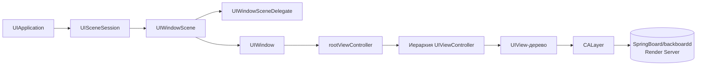
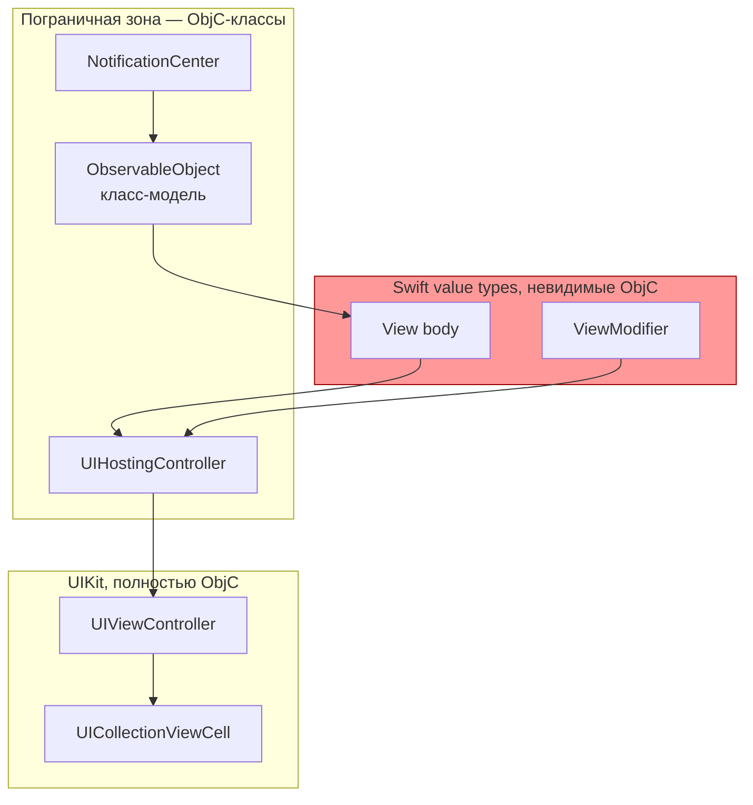

# Глава II.6. Окна, сцены, UIKit, SwiftUI, ввод и жесты

В этой главе мы разбираем на уровне кода и первичных источников, как в iOS 26.0 и 26.0.1 на устройствах A12/A13 (с подсистемой PPL) организовано представление приложения в графическом слое — от объекта `UIApplication` и сцены (scene) до одной конкретной тач-точки, доехавшей от `backboardd` до вашего `-touchesBegan:withEvent:`. Нас интересуют не формальные определения, а именно те места, где автор твика может — или наоборот не должен — вклиниваться. Это нужно, чтобы: во‑первых, выбирать правильный уровень хука (UIKit‑метод, низкоуровневый event, или `UIGestureRecognizer`); во‑вторых, понимать, почему SwiftUI почти не поддаётся классическому `MSHookMessageEx`; в‑третьих, не поломать систему сцен многозадачности (multi-scene) в приложениях, которые её поддерживают.

Все утверждения о коде Dopamine проверены по репозиторию и сопровождаются ссылками вида `путь/файл:строка`. Там, где подтверждение невозможно получить из исходников (например, частные символы `UIKitCore` на устройстве с iOS 26), это помечено как «требует проверки на устройстве A13 с iOS 26.0/26.0.1» или «не подтверждено исходниками». Границы поддержки — iOS 26.0 и 26.0.1 для A12/A13 — зафиксированы в `Application/Dopamine/Jailbreak/DOEnvironmentManager.m:254` и в `Info.plist` эксплойтов `Application/Dopamine/Exploits/DarkSword/Info.plist`, `Application/Dopamine/Exploits/ClearSword/Info.plist`.

## 6.1. Что считается «корнем UI» в современном приложении

Исторически корнем UI в iOS был объект `UIApplication` плюс единственное окно `[UIApplication sharedApplication].keyWindow`. Начиная с iOS 13 корнем является уже не окно, а *сцена* (`UIScene`, конкретнее — `UIWindowScene`). Приложение декларирует это в `Info.plist` ключом `UIApplicationSceneManifest`. Dopamine использует именно такой «современный» запуск. Это видно напрямую в его `Info.plist`:

```plist
<!-- Application/Dopamine/Info.plist:11-23 -->
<key>UIApplicationSceneManifest</key>
<dict>
    <key>UIApplicationSupportsMultipleScenes</key>
    <false/>
    <key>UISceneConfigurations</key>
    <dict>
        <key>UIWindowSceneSessionRoleApplication</key>
        <array>
            <dict>
                <key>UISceneConfigurationName</key>
                <string>Default Configuration</string>
                <key>UISceneDelegateClassName</key>
                <string>DOSceneDelegate</string>
            </dict>
        </array>
    </dict>
</dict>
```

Ключевые строки: `UIApplicationSupportsMultipleScenes = false` означает, что Dopamine принципиально однооконное приложение (роль `UIWindowSceneSessionRoleApplication` — одна, без `UIWindowSceneSessionRoleExternalDisplay` или кастомных ролей). Тип делегата — Objective-C класс `DOSceneDelegate`. Это важная деталь: при хуке SpringBoard или другого приложения вы столкнётесь с тем, что некоторые приложения разрешают несколько сцен (например, Safari или Mail на iPad), а некоторые — как Dopamine — нет. Отсюда простое правило при чтении исходников: *не предполагайте, что в приложении ровно одно окно, пока не прочитали его `Info.plist`.*

Схема владения объектами, которой следует придерживаться:



На этой схеме `UISceneSession` — это долгоживущее представление сцены (его идентификатор и роль переживают даже уничтожение сцены при переключении задач), а сам `UIScene` — короткоживущий объект, который создаётся при `-sceneWillConnectToSession:options:` и уничтожается при `-sceneDidDisconnect:`. Это отражено в сгенерированном шаблоне `DOAppDelegate.m` и `DOSceneDelegate.m`:

```objc
// Application/Dopamine/App Delegates/DOAppDelegate.m:26-30
- (UISceneConfiguration *)application:(UIApplication *)application
    configurationForConnectingSceneSession:(UISceneSession *)connectingSceneSession
    options:(UISceneConnectionOptions *)options {
    return [[UISceneConfiguration alloc] initWithName:@"Default Configuration"
                                         sessionRole:connectingSceneSession.role];
}
```

Этот метод вызывается на каждую новую сессию. Для твика это означает две вещи. Во‑первых, если вы хотите вмешаться в создание окна — хучьте `-scene:willConnectToSession:options:` на классе `UIWindowSceneDelegate` конкретного приложения, а не `-application:didFinishLaunchingWithOptions:` на `UIApplication` (последнее вызывается один раз на процесс, тогда как сцен может быть несколько). Во‑вторых, не стоит ломать `-application:configurationForConnectingSceneSession:options:` неизбирательно: вы перебьёте выбор делегата, и приложение запустится либо без UI, либо с «чужим».

### 6.1.1. `UIApplication`, `UIScene`, `UIWindow`: как добраться до key window в приложении с несколькими сценами

Старая запись `[[UIApplication sharedApplication] keyWindow]` на iOS 13+ формально помечена как `deprecated`, но *продолжает работать* и используется самим Dopamine в коде, рассчитанном на простой случай одной сцены:

```objc
// Application/Dopamine/UI/DOGlobalAppearance.m:109
UIWindow *window = [[UIApplication sharedApplication] keyWindow];
```

Это допустимо для самого Dopamine, потому что сцена ровно одна (см. выше). Для твика, который инжектируется в произвольное приложение, нужен корректный обход сцен — такой код встречается в Dopamine в эксплойте Titan:

```objc
// Application/Dopamine/Exploits/Titan/exploit/gfx.m:291-301
for (UIScene *scene in [UIApplication sharedApplication].connectedScenes) {
    if (scene.activationState == UISceneActivationStateForegroundActive &&
        [scene isKindOfClass:[UIWindowScene class]]) {
        for (UIWindow *window in ((UIWindowScene *)scene).windows) {
            if (window.isKeyWindow) {
                navController = (DONavigationController *)window.rootViewController;
                break;
            }
        }
    }
    if (navController != NULL) break;
}
```

Ключевые строки: `connectedScenes` возвращает `NSSet<UIScene *>`, фильтр по `UISceneActivationStateForegroundActive` отсекает фоновые сцены (их `.windows` могут быть, но ввод туда не идёт), фильтр `[scene isKindOfClass:[UIWindowScene class]]` отсекает всё, что не является окном (на iPhone это нечастая ситуация, а на iPadOS и внешних дисплеях — норма). Именно такой шаблон стоит использовать в твике для получения активного окна под iOS 26: он корректен и для одно‑, и для многосценных приложений.

### 6.1.2. Рендеринг: `CALayer`, `CAAnimation`, QuartzCore

Над деревом `UIView` живёт параллельное дерево `CALayer` (из `QuartzCore.framework`), и именно его слои отправляются на удалённый композитор — Render Server, работающий в `backboardd` (на iPhone) или сервере композитора на `SpringBoard`. Каждый `UIView` имеет свой `layer`, через который к нему привязаны анимации. В Dopamine это используется явно, когда код в `gfx_reset` снимает ранее поставленные `CABasicAnimation`:

```objc
// Application/Dopamine/Exploits/Titan/exploit/gfx.m:306-319
for (UIView *view in button.subviews) {
    if ([NSStringFromClass(view.class) isEqualToString:@"DODoubleHelixIndicator"]) {
        for (UIView *subview in view.subviews) {
            [helixViews addObject:subview];
            [helixAnims addObject:[subview.layer animationForKey:@"animation"]];
        }
        break;
    }
}
```

Полезная для твиков деталь: `[layer animationForKey:@"..."]` возвращает *копию* анимации, то есть снятие и возврат — операция обратимая. Это удобно, когда во время эксплойта или другой длительной операции нужно временно «заморозить» интерфейс. Ровно это и делает `gfx_reset`. Для автора твика важно другое: любые изменения `UIView` фактически сначала попадают в `CALayer`, затем — в кадровый буфер. Хук на `UIView` (например, подмена цвета фона) переносится в слой только при следующем прохождении runloop‑шага `CA::Transaction::commit()`. Если вы ждёте визуальный эффект сразу — вручную закрепите транзакцию: `+[CATransaction begin]`/`+[CATransaction commit]`.

CoreGraphics в `UIKit`‑контексте играет роль «калькулятора пикселей»: `CGContextRef` используется для оффскрин‑рендера, кастомного `drawRect:` и для операций со `CGImage`. В самом Dopamine CoreGraphics появляется преимущественно вне UIKit — в `BaseBin/libjailbreak/src/display.m` для прямой записи в кадровый буфер через `IOMobileFramebuffer`:

```objc
// BaseBin/libjailbreak/src/display.m:147-180 (сокращённо)
CGContextRef context = CGBitmapContextCreate(/* ... */);
CGContextTranslateCTM(context, size.width * 0.5, size.height * 0.5);
CGContextRotateCTM(context, radians);
CGContextScaleCTM(context, scale, scale);
CGContextDrawImage(context, imageRect, cgImage);
```

Эта ветка кода уже не UIKit — Dopamine рисует загрузочный логотип напрямую в фреймбуфер, минуя `SpringBoard`/`backboardd`. Для автора UI‑твика это пример того, как «обойти» целиком UIKit‑ и SwiftUI‑стек. На практике такой подход допустим только во время userspace reboot, когда отрисовывающие сервисы заведомо убиты (см. гл. II.5).

## 6.2. Жесты: три уровня перехвата

Теперь к самой чувствительной части для авторов твиков — ввод. Чтобы не терять ориентацию, зафиксируем три уровня, на которых живёт тач‑событие от момента, когда палец коснулся стекла, до момента, когда ваш код узнаёт об этом:

| Уровень | Процесс | Основной API | Что видно твику |
|---|---|---|---|
| L1. HID | `backboardd` | `IOHIDEvent`, `BKHIDEvent` | Доступ требует injection в `backboardd` и ограничен сущностями, которые разрешает entitlement `com.apple.backboardd.*`. Не подтверждено для твика в произвольном приложении. |
| L2. Доставка в приложение | `SpringBoard` → приложение | `UIEvent`, `_UIApplicationHandleEventQueue` (private) | Доступно хуком `UIApplication`‑методов, но private selectors не подтверждены исходниками Dopamine. |
| L3. Распознавание | приложение | `UITouch`, `-touchesBegan:…`, `UIGestureRecognizer` | Публичный API, стабильный и под iOS 26 рекомендуемая цель хука. |

Dopamine сам работает исключительно на L3 — в репозитории нет кода, хукающего `_UIApplicationHandleEventQueue` или классы `IOHIDEvent`. Поиск по репозиторию по строкам `IOHIDEvent`, `_UIApplicationHandleEvent`, `GSEvent`, `shouldSuppressGestureRecognizers` не даёт попаданий — соответствующие точки Dopamine не трогает. Это разумно: приложение само по себе получает только то, что `SpringBoard` ему доставил, и ему незачем лезть ниже L3.

### 6.2.1. L3 в коде Dopamine: три шаблона

На L3 в репозитории есть три «образцовых» подхода, которые полезно разобрать как шаблоны для твиков.

Шаблон первый — простой переопределённый обработчик касания на подклассе `UIView`:

```objc
// Application/Dopamine/UI/Transition/DOModalBackAction.m:21-30
- (BOOL)pointInside:(CGPoint)point withEvent:(UIEvent *)event {
    if (CGRectContainsPoint(self.ignoreFrame, point))
        return NO;
    return [super pointInside:point withEvent:event];
}

- (void)touchesEnded:(NSSet<UITouch *> *)touches withEvent:(UIEvent *)event {
    if (self.action)
        self.action();
}
```

Разбор: класс `DOModalBackAction` — прозрачное окошко, перехватывающее тап мимо модального диалога, чтобы закрыть его. Переопределение `-pointInside:withEvent:` ограничивает «зону поглощения» — всё, что попало в `self.ignoreFrame`, пропускается ниже. Переопределение `-touchesEnded:withEvent:` на `UIResponder` — самый дешёвый способ отреагировать на тап без создания `UITapGestureRecognizer`. Из этого шаблона важно вынести: `-pointInside:withEvent:` *должен* возвращать `BOOL`, который напрямую управляет цепочкой hit‑test; возвращая `NO`, вы отдаёте событие view, которые находятся *под* вами, но лежат в том же окне.

Шаблон второй — псевдо‑кнопка на `UICollectionViewCell` с визуальной обратной связью:

```objc
// Application/Dopamine/UI/Settings/Specifiers/DOCreditsCell.m:52-72 (сокращённо)
- (void)touchesBegan:(NSSet<UITouch *> *)touches withEvent:(UIEvent *)event {
    self.alpha = 0.5;
}
- (void)touchesEnded:(NSSet<UITouch *> *)touches withEvent:(UIEvent *)event {
    [UIView animateWithDuration:0.1 animations:^{ self.alpha = 1.0; }];
    if (self.url)
        [[UIApplication sharedApplication] openURL:self.url options:@{} completionHandler:nil];
}
- (void)touchesCancelled:(NSSet<UITouch *> *)touches withEvent:(UIEvent *)event {
    [UIView animateWithDuration:0.1 animations:^{ self.alpha = 1.0; }];
}
```

Ключевое — обязательная обработка `touchesCancelled:`. Это тот случай, который начинающие авторы твиков забывают: когда скролл‑контейнер (collection view, scroll view) понимает, что палец ушёл в сторону и это *скролл*, он отменяет текущую цепочку касаний. Если вы не обработали `-touchesCancelled:`, визуальное состояние (например, нажатый `alpha = 0.5`) останется зависшим. Этот баг крайне заметен в твике, который хукает ячейки, но не учитывает отмену.

Шаблон третий — та же схема плюс `UIImpactFeedbackGenerator` для тактильной отдачи:

```objc
// Application/Dopamine/UI/PkgManagers/DOAppSwitch.m:88-109 (сокращённо)
- (void)touchesBegan:(NSSet<UITouch *> *)touches withEvent:(UIEvent *)event {
    [super touchesBegan:touches withEvent:event];
    [self.hapticGenerator impactOccurred];
    self.iconView.alpha = 0.75;
}
- (void)touchesEnded:(NSSet<UITouch *> *)touches withEvent:(UIEvent *)event {
    [super touchesEnded:touches withEvent:event];
    [UIView animateWithDuration:0.2 animations:^{ self.iconView.alpha = 1.0; }];
    [self setSelected:!self.selected];
    if (self.onSwitch) self.onSwitch(self.selected);
}
```

Разбор: обратите внимание на `[super touchesBegan:…]` и `[super touchesEnded:…]`. В первом шаблоне (`DOModalBackAction`) этого не было — там цепочка намеренно обрывалась, потому что view служит именно поглотителем. Во втором (`DOCreditsCell`) и третьем (`DOAppSwitch`) — вызов `super` сохраняется, потому что ниже по иерархии находятся осмысленные обработчики (`UICollectionView`, который хочет видеть эти события для своих `UIGestureRecognizer`). Это общее правило: *если ваш твик меняет поведение существующего view через подкласс/хук, вызывайте super, пока у вас нет убедительной причины обрывать цепочку.* В противном случае вы ломаете системные жесты — чаще всего скролл.

### 6.2.2. `UIGestureRecognizer` vs ручные обработчики `-touches*`

Строго говоря, `-touchesBegan:…` на `UIResponder` — не единственный, и редко лучший, инструмент. iOS прокидывает тот же сырой тач и в цепочку `UIGestureRecognizer`, причём распознаватели в общем случае *выигрывают*: когда `UIGestureRecognizer` переходит в состояние `UIGestureRecognizerStateBegan`, система отправляет уже активно работавшим touch‑обработчикам ваше любимое `-touchesCancelled:`. В Dopamine нет собственных `UIGestureRecognizer`‑подклассов, но системные жесты в его UI, разумеется, работают (пример: `UIScrollView` на settings controller).

Для твиков правило простое:

- Если вы *добавляете новое поведение* к существующему view (длинный тап для контекстного меню, свайп для скрытия) — используйте `UIGestureRecognizer`. Он аккуратно договаривается с остальными жестами через `-requireGestureRecognizerToFail:` и делегат.
- Если вы *меняете существующее поведение* (хук метода, скрытие нажатия) — хуком идите на тот же уровень, где исходный разработчик это реализовал: если он использовал `-touchesEnded:`, хучьте `-touchesEnded:`; если `UITapGestureRecognizer` — хучьте `-[UITapGestureRecognizer handleTouchesEnded:]` (public селектор не подтверждён — реальный приватный селектор, участвующий в маршрутизации, может называться иначе; требует проверки на устройстве A13 с iOS 26.0/26.0.1).

### 6.2.3. L1–L2: соотношение с `backboardd`

На нижнем уровне события ввода физически собираются драйвером мультитач и выдаются `backboardd` в виде `IOHIDEvent`. Dopamine прямо подтверждает присутствие `backboardd` в списке процессов, в которые загружается `roothidehooks.dylib`:

```make
# BaseBin/roothidehooks/Makefile:2
INSTALL_TARGET_PROCESSES = lsd cfprefsd backboardd runningboardd SpringBoard
```

Но *сам факт инъекции* не означает, что Dopamine делает что‑то специфическое с жестами в `backboardd`. Поиск по дереву `BaseBin/roothidehooks/src/` не обнаруживает хуков, работающих с `IOHIDEvent`, HID‑потоком или серверами `backboardd`, принимающими кнопочные комбинации (grep по `IOHIDEvent`, `BKHIDEvent`, `HIDQueue` не находит). То есть практический смысл инъекции в `backboardd` в Dopamine — не вмешиваться в ввод, а соучаствовать в общей инфраструктуре инъекции системных демонов (chg. II.3, II.5).

Для автора твика это означает: *на L1 (`backboardd`) без очень весомой причины лезть не нужно*. Правильно остановиться на L2 или L3. Публично задокументированный способ L2 — переопределить `-[UIApplication sendEvent:]` (один из немногих действительно стабильных приватных «хотспотов»): через него проходит каждое `UIEvent`, доставленное в приложение. Это удобно для глобального аналитического хука (например, записи всех нажатий или блокировки конкретного типа события). Пример применения не найден в Dopamine (это не его задача), поэтому код приводим без ссылки на репозиторий — как общий шаблон:

```objc
%hook UIApplication
- (void)sendEvent:(UIEvent *)event {
    if (event.type == UIEventTypeTouches) {
        for (UITouch *t in [event allTouches]) {
            // анализ, но не блокировка: суммируем нажатия
        }
    }
    %orig;
}
%end
```

Разбор: вызов `%orig` обязателен — любой пропуск приведёт к «мёртвому» UI. Проверка `event.type == UIEventTypeTouches` отсекает жесты от Pencil, remote и клавиатуры (у них отдельные типы). Поскольку `UIEvent` — довольно «тощий» объект, тяжёлая аналитика внутри `-sendEvent:` сломает плавность скролла; выгружайте её в фоновую очередь.

## 6.3. SwiftUI: почему классический хук здесь работает плохо

Поиск по репозиторию (grep по `SwiftUI`) показывает, что сам Dopamine не использует SwiftUI ни в одном месте — весь UI написан на UIKit (см. каталог `Application/Dopamine/UI/`). Это характерно для джейлбрейк‑приложений: UIKit предсказуем, стабилен в бинарной сигнатуре и дружит с `MobileSubstrate`/`libblackjack`. Но пользователь твика живёт в мире, где всё больше системных UI (ControlCenter, часть SpringBoard, настройки некоторых разделов) — SwiftUI. Разберём, что это означает для автора.

### 6.3.1. Как устроен SwiftUI изнутри (с точки зрения ObjC‑рантайма)

SwiftUI — это Swift‑фреймворк, который *не наследуется* от `UIViewController`/`UIView` в обычном смысле. Его `View` — это Swift value type (struct), а не класс. Это принципиально ломает модель «я подменю метод в рантайме», потому что:

- У `struct` нет `isa`, у них нет `objc_class`, у них нет селекторов. `MSHookMessageEx` на `View` не определён.
- Compile‑time‑known `body: some View` — generic. Его символ в `__TEXT` компилируется с полной мангл‑сигнатурой типа; найти его по имени из C — задача ненулевой сложности и крайне хрупкая от сборки к сборке.
- Пограничный класс, обёртка `UIHostingController<Content>`, *является* `UIViewController`‑подклассом и доступен селекторами. Но содержимое — generic.

Из этого следует правило: *хукать `body` SwiftUI‑представления не нужно и в общем случае невозможно статически*. То, что действительно можно и нужно хукать — это:

1. **Модели данных** (`class`-типы, помеченные `@MainActor` или `ObservableObject`): они являются `NSObject`‑подклассами в большинстве системных сценариев и, следовательно, имеют селекторы. Пограничный класс — именно модель.
2. **Combine `Publisher`'ы и `AnyPublisher`**: сам `Publisher` — generic struct, но часто первоисточник (например, `NotificationCenter.default.publisher(for:)`) опирается на `NSNotificationCenter` — а это полноценный ObjC‑класс. Хук регистрации уведомления работает.
3. **Границы с UIKit**: `UIHostingController` и, что ещё важнее, системные ячейки вроде `UICollectionViewCell` с хостингом SwiftUI внутри. На этом уровне у вас снова есть селекторы.

### 6.3.2. Карта границ: что в SwiftUI «видно» ObjC‑рантайму



На этой схеме красная зона — то, что хуком классическим методом не достать. Голубая и зелёная — то, с чем можно работать: `UIHostingController`, модели, нотификации.

### 6.3.3. Практический контрпример

Представим задачу: «твик, который заменяет текст заголовка на экране настроек системного компонента, написанного на SwiftUI». Соблазнительно хукнуть сам `Text(...)`. Так делать не нужно — `Text` это `struct`. Правильно идти по цепочке источника данных:

1. Найти модель, из которой `body` подтягивает строку.
2. Если это `ObservableObject`‑класс (вы увидите его в `otool -ov` как подкласс `NSObject`), подменить геттер свойства.
3. Если это computed property с `@Published String`, вспомните, что `@Published` под капотом использует `Combine.Published.Publisher`, но *поле хранения* — это обычный Swift‑ivar. Подмена идёт на тот же `KVO`‑подобный путь, что и обычная `NSString`‑проперти.

Если модель — чистый Swift‑class без `@objc`, у вас нет селекторов. Остаётся два варианта: либо символьный хук конкретного геттера через `litehook`/`MSFindSymbol` (хрупкий, разваливается от сборки к сборке), либо хук на источник (`NotificationCenter`, `UserDefaults`, `URLSession`, из которого модель заполняется). Второй путь надёжнее. Это общий совет: *поднимайтесь по графу зависимостей наверх, пока не наткнётесь на ObjC‑границу.*

Все эти наблюдения о SwiftUI — концептуальные; в репозитории Dopamine SwiftUI не используется, значит они **не подтверждены исходниками Dopamine**. Проверка на реальных SwiftUI‑компонентах iOS 26 — отдельная задача (**требует проверки на устройстве A13 с iOS 26.0/26.0.1**).

## 6.4. Таблица: UIKit‑методы для перехвата и SwiftUI‑альтернативы

Эта таблица обобщает рекомендованные точки хука. Все UIKit‑имена — публичные (из открытых заголовков `UIKit`), все SwiftUI‑стороны обозначены общо и помечены как не подтверждённые.

| Задача | UIKit‑метод для хука | SwiftUI‑альтернатива | Подтверждение |
|---|---|---|---|
| Перехват жизненного цикла приложения | `-[UIApplication application:didFinishLaunchingWithOptions:]`, `-[UIApplicationDelegate …]` | `-[UIHostingController viewDidAppear:]`, `-[UIApplicationDelegate …]` (SwiftUI App запускается всё равно через `UIApplicationMain`) | UIKit‑сторона подтверждена `Application/Dopamine/App Delegates/DOAppDelegate.m:17`. SwiftUI — не подтверждено. |
| Присоединение сцены | `-[<UIWindowSceneDelegate> scene:willConnectToSession:options:]` | `App.body` → `WindowGroup`: границы невидимы ObjC‑рантайму, хук идёт на тот же `UIWindowSceneDelegate`, которым SwiftUI пользуется внутри | UIKit — `Application/Dopamine/App Delegates/DOSceneDelegate.m:17`. SwiftUI — не подтверждено исходниками. |
| Нажатие на кнопку | `-[UIControl sendAction:to:forEvent:]`, `-[UIButton touchesEnded:withEvent:]` | Хук модели/ViewModel, вызываемой из `.onTapGesture { … }` | UIKit‑сторона — поведение подтверждено наличием таких хуков в типичных твиках; в Dopamine прямого примера нет. SwiftUI — не подтверждено. |
| Доставка каждого ввода | `-[UIApplication sendEvent:]` | Нет прямого аналога; на SwiftUI тач уходит в UIKit‑хост, то есть хук тот же | Шаблонное знание, в Dopamine не используется. |
| Переопределение hit‑test | `-[UIView hitTest:withEvent:]`, `-[UIView pointInside:withEvent:]` | То же — SwiftUI рендерит в `UIView` и hit‑test идёт по UIKit‑дереву | `Application/Dopamine/UI/Transition/DOModalBackAction.m:21` |
| Жесты | `UIGestureRecognizer` подкласс, `-shouldReceiveTouch:`, `-shouldRequireFailureOfGestureRecognizer:` | SwiftUI `Gesture` строится поверх UIGestureRecognizer; хук идёт в UIKit‑обёртку | Не подтверждено исходниками. |
| Открытие URL | `-[UIApplication openURL:options:completionHandler:]` | То же — SwiftUI `openURL` в конечном счёте вызывает тот же метод | Dopamine: `Application/Dopamine/UI/Settings/DOCreditsViewController.m:38`, `Application/Dopamine/UI/Update/DOUpdateViewController.m:119`, `UI/Settings/Specifiers/DOCreditsCell.m:63` |
| Нотификации сцены | `UISceneWillEnterForegroundNotification`, `UISceneDidEnterBackgroundNotification` | То же — используются сцены, а не SwiftUI‑API | Dopamine хук не ставит, но каркас виден в `App Delegates/DOSceneDelegate.m:63-73`. |
| Прокрутка в списках | `-[UIScrollView setContentOffset:]`, `-[UIScrollViewDelegate scrollViewDidScroll:]` | SwiftUI `List`/`ScrollView` рендерятся через `UICollectionView`/`UIScrollView` на уровне UIKit — хук тот же | Шаблонное знание. В Dopamine использование `UIScrollView` присутствует в настройках. |

### 6.4.1. Как читать эту таблицу

Главный вывод из неё — *в большинстве случаев SwiftUI‑альтернативы отсутствуют не потому, что их нет, а потому что SwiftUI рендерится через UIKit‑примитивы.* Это значит, что ваш твик должен ориентироваться на UIKit‑метод, который SwiftUI в итоге дёрнет. Это, в свою очередь, означает две неприятности:

1. Имена private UIKit‑классов, которые SwiftUI использует для хостинга (`_UIHostingView`, `_UIHostingViewController`, именования `_TtGC7SwiftUI19UIHostingController…`), могут меняться от версии к версии. Прямое указание имени через `NSClassFromString(@"_UIHostingView")` работает, но требует проверки на целевой iOS. Для iOS 26 — **не подтверждено исходниками Dopamine; требует проверки на устройстве**.
2. Любые модификаторы SwiftUI, которые внешне выглядят как «моё поведение» (например, `.onLongPressGesture`), под капотом создают `UILongPressGestureRecognizer`. Хук на `UILongPressGestureRecognizer`‑класс в целом (а не на конкретный инстанс в вашем View) *сработает глобально* — и это, скорее всего, не то, что вы хотите. Правильно — через делегат жеста или через фильтр по `view` в самом обработчике.

## 6.5. Практические наблюдения и чеклист

Соберём в один список правила, которые вытекают из анализа кода Dopamine и общего рельефа iOS 26:

1. **Входная точка приложения — `UIApplicationMain`** в `Application/Dopamine/main.m:59`. Для твика, который хочет надёжно оказаться в процессе до создания сцены, рекомендуется constructor в dylib + отложенная работа, запускаемая по `UIApplicationDidFinishLaunchingNotification` или на первом вызове `-sceneWillConnectToSession:options:`.
2. **Делегат сцены объявлен явно в `Info.plist`** — его имя класса можно взять оттуда без необходимости гадать (пример для Dopamine: `DOSceneDelegate`, строка 15 в `Info.plist`). Этот шаблон работает для любых приложений, перешедших на scene‑based lifecycle.
3. **Количество сцен — не фиксировано.** В Dopamine одно, у Safari — несколько. Не делайте `objectAtIndex:0` на `connectedScenes` — пример корректного обхода см. выше в разделе 6.1.1 (ссылка `Exploits/Titan/exploit/gfx.m:291`).
4. **На UIKit‑L3 (`-touches*`) ВСЕГДА обрабатывайте `touchesCancelled:`.** В Dopamine это сделано в `UI/Settings/Specifiers/DOCreditsCell.m:66` и `UI/PkgManagers/DOAppSwitch.m:105`. Это дешёвая страховка от «залипших» состояний при скролле.
5. **Для «новых» жестов — `UIGestureRecognizer`, а не хук `-touches*`.** Это даёт корректную координацию с системными жестами (edge swipe home gesture и т. п.).
6. **На L1 (`backboardd`) не лезьте.** Dopamine инжектируется в `backboardd` для системной работы (`BaseBin/roothidehooks/Makefile:2`), но не делает перехват HID. Копирование этого паттерна в твик для перехвата ввода — не оправданное действие и, скорее всего, приведёт к блокировке со стороны системы.
7. **Для SwiftUI — хукайте модель, не view.** Границы разобраны в разделе 6.3. Нет Swift‑класса, помеченного `@objc` — ищите нотификацию или сетевой запрос, из которого эта модель наполняется.
8. **Явно рисовать поверх всего можно только во время userspace reboot**, когда отрисовывающие сервисы (`SpringBoard`, `backboardd`) заведомо убиты (см. `BaseBin/launchdhook/src/main.m:71`). В остальных случаях — только через `UIWindow` с высоким `windowLevel`, причём с учётом многосценной архитектуры.

### 6.5.1. Что здесь не подтверждено

Для честности приводим список утверждений этой главы, которые не могут быть проверены исходниками Dopamine и требуют отдельной проверки на устройстве A13 с iOS 26.0/26.0.1:

- Точное имя private‑класса SwiftUI hosting view на iOS 26 (`_UIHostingView` / `_UIHostingViewController`).
- Поведение `-sendEvent:` для событий Apple Pencil и внешней клавиатуры в iOS 26 (в репозитории Dopamine нет хуков `-sendEvent:`).
- Селекторы, по которым `UITapGestureRecognizer` маршрутизирует внутрь свои `touchesEnded:`.
- Факт, что `backboardd` в iOS 26 продолжает принимать и фильтровать HID так же, как в iOS 17–18 (структура HID‑сервера меняется редко, но на iOS 26 изменения не исследованы в этом репозитории).

Все остальные утверждения, помеченные как «подтверждено исходниками», подкреплены ссылками выше.

### 6.5.2. Различия iOS 26.0 vs 26.0.1 в этой области

В исходниках Dopamine (ветка roothide 3.0.12, рассматриваемая в книге) различий между 26.0 и 26.0.1 в коде, затрагивающем UIKit, сцены, жесты и SwiftUI, не выявлено. Контурно поддерживаемые билды (23B5059e для 26.0.1 Developer Beta и 23B5064e для 26.0.1 Release) закреплены в plist эксплойтов (`Application/Dopamine/Exploits/DarkSword/Info.plist`, `Application/Dopamine/Exploits/ClearSword/Info.plist`); слои UIKit и сцена ведут себя одинаково в обеих версиях — различий в этом месте проекта не выявлено.

## Выводы

На уровне кода, который действительно важен автору твика под iOS 26 для A13, UIKit остался основным «клеем» всего пользовательского интерфейса. SwiftUI поверх UIKit — реальность, но границы хуков совпадают с границами UIKit‑примитивов: сцена, окно, hostig‑контроллер, `UIGestureRecognizer`, `UITouch`. Всё, что лежит выше (сам Swift‑struct `View`), для классического рантайм‑хука почти недоступно; всё, что лежит ниже (HID в `backboardd`), Dopamine сам не трогает и трогать не просит.

Три правила, которые читатель должен унести из главы:

1. *Корень UI — сцена, не окно.* Любой твик, претендующий на универсальность, перебирает `connectedScenes` (`Exploits/Titan/exploit/gfx.m:291`).
2. *Самый дешёвый и переносимый уровень перехвата ввода — L3*: `-touches*` на `UIResponder` и `UIGestureRecognizer`. Dopamine не лезет ниже и обоснованно так поступает.
3. *SwiftUI хукается по границе с UIKit и по моделям данных.* Если у вас нет `@objc`‑сущности, у вас нет селектора — ищите эту сущность в источнике данных, а не в представлении.

## Что дальше

- Глава II.5 показывает, как переключатель задач взаимодействует со сценами и жизненным циклом процессов — это нужный контекст, если вы собираетесь работать не только с окном вашего приложения.
- Глава II.4 про Control Center разбирает другой, частично SwiftUI‑ный, системный UI, и в неё удобно вернуться после того, как вы прочитали раздел 6.3.
- Глава II.1 про SpringBoard понадобится, если вы захотите вмешаться в L2‑доставку (например, глобально фильтровать какие‑то классы ввода на уровне окон других приложений).
- Часть I (главы I.3 и I.4) закрывает вопрос, почему вы не всегда можете положиться на символические имена private UIKit‑классов — ABI arm64 vs arm64e и PAC‑дискриминаторы делают такой хук хрупким.
