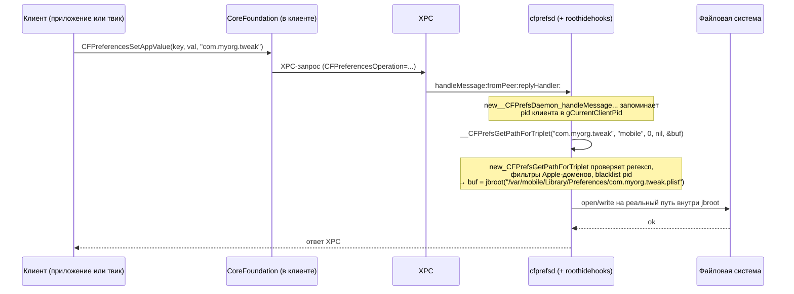

# Глава II.7. Настройки и preferences

Эта глава объясняет, как в среде Dopamine RootHide на A12/A13 с iOS 26.0–26.0.1 устроен слой пользовательских настроек: как iOS физически хранит их на диске, какие процессы и API между приложением и файлом стоят, как Dopamine принудительно уводит запись сторонних настроек внутрь jbroot и чем из-за этого должен считаться автор твика, если он хочет корректно читать и писать свои ключи. Разобрана цепочка «клиент → CoreFoundation → `cfprefsd` → plist», рассмотрены оба инструментальных файла проекта — `BaseBin/rootlesshooks/cfprefsd.x` (режим rootless) и `BaseBin/roothidehooks/src/cfprefsd.x` (режим roothide), — показано, где именно Dopamine разворачивает запрос в сторону jbroot, и чем это принципиально отличается от классических rootful-джейлбрейков. В конце — отдельный разбор того, как положить свой `PreferenceBundle` так, чтобы его увидела системная Preferences.app в условиях, когда часть этой самой `Preferences.framework` на iOS 26 переписана Apple на SwiftUI (см. комментарий в `Application/Dopamine/UI/Settings/PSLists/DOPSListController.m:35-39`), и таблица выбора между `NSUserDefaults`, `CFPreferences` и прямой записью в plist.

Все утверждения о коде Dopamine в этой главе подкреплены ссылками «путь/файл:строка». Утверждения, которые не удалось верифицировать в исходниках, явно помечены — лучше оставить открытый вопрос, чем выдать домысел за факт.

## 7.1. Что такое «preferences» на iOS и где физически лежит plist

На iOS долговременные настройки процесса — это пары «ключ → значение», сериализуемые в бинарный `plist` в каталоге `Library/Preferences`. У каждого домена (чаще всего — bundle identifier) свой файл `<identifier>.plist`. На стоковой системе плоскость хранения выглядит так:

- системные демоны и `root`-владеемые домены — `/var/root/Library/Preferences/<identifier>.plist`;
- домены пользователя `mobile` — `/var/mobile/Library/Preferences/<identifier>.plist`;
- домены, живущие внутри песочницы приложения, — `~/Library/Preferences/<identifier>.plist`, где `~` раскрывается в каталог контейнера данных приложения (`/private/var/mobile/Containers/Data/Application/<UUID>/`).

Поверх этого файла работает демон `cfprefsd`: именно он — а не само приложение — открывает, читает, пишет и флашит plist. Клиентский процесс никогда не трогает файл руками: он отправляет XPC-сообщение `cfprefsd`, а тот решает, где файл лежит, в каком Data Protection-классе он должен быть защищён, и возвращает значения. Для автора твика это важно по трём причинам:

1. Любая попытка «прочитать плист мимо» через `NSDictionary dictionaryWithContentsOfFile:` может вернуть устаревшие данные: `cfprefsd` держит кэш и не всегда уже успел его сбросить на диск.
2. Правильные API (`NSUserDefaults`, `CFPreferencesSetAppValue` + `CFPreferencesSynchronize`) идут через XPC к `cfprefsd`, и именно их Dopamine перехватывает — это даёт точку входа, где jbroot подменяется прозрачно.
3. Хуки Dopamine ставятся не только в клиентском процессе — главный хук сидит внутри самого `cfprefsd`. Поэтому даже код, который загружен не Substrate-ом (а например, через `DYLD_INSERT_LIBRARIES` в сторонней утилите), всё равно получает редиректованный путь.

### 7.1.1. Почему именно `cfprefsd`, а не прямой доступ к файлу

Исторически, в ранних версиях iOS любой процесс читал и писал свой plist сам: `CFPreferences` открывал файл, парсил, писал. Apple ввела `cfprefsd` ровно потому, что параллельная запись одного и того же файла из разных процессов (например, из приложения и его extension) приводила к гонкам и повреждению plist. Теперь единственный процесс, который фактически работает с файлом, — это `cfprefsd`; все остальные ходят к нему через XPC-сервис `com.apple.cfprefsd.daemon`. Имя XPC-сервиса — часть публичного Apple-ABI, прямого подтверждения в репозитории Dopamine нет (символ приходит из системного `launchd`-plist Apple), **требует проверки на устройстве** с iOS 26.0/26.0.1.

Для нас, авторов твика, из этого вытекает ещё одно практическое ограничение: когда вы запрашиваете значение из `CFPreferences`, вы фактически получаете ответ от `cfprefsd`. Если `cfprefsd` занят (а Dopamine инъецирует в него код через `roothidehooks`!), чтение может затянуться. Отсюда правило: не делайте `CFPreferencesCopyAppValue` в hot path рендеринга и уж тем более на главном потоке `SpringBoard` при каждом тике анимации. Кэшируйте результат, подписывайтесь на дарвиновские уведомления через `CFNotificationCenterGetDarwinNotifyCenter()`, и перечитывайте только тогда, когда ваше поле действительно изменилось.

Второй, более тонкий, момент — Data Protection. `cfprefsd` в CoreFoundation внутренне определяет для каждого домена класс защиты (NSFileProtection) и открывает файл только в состоянии, когда класс доступен. Для `/var/mobile/Library/Preferences/` обычный класс — `NSFileProtectionCompleteUntilFirstUserAuthentication` (CPUA). Это значит, что сразу после загрузки до первого ввода кода блокировки файл недоступен ни на чтение, ни на запись. Любой твик, у которого `%ctor` стартует до разблокировки (а это все хуки, инжектящиеся через `TweakInject`), должен быть готов к тому, что первая попытка `CFPreferencesCopyAppValue` вернёт `NULL`, но не потому что ключа нет, а потому что файл закрыт. Простейшая страховка — отложить чтение до первого `UIApplicationDidFinishLaunchingNotification` или до первого доказанного unlock-а. Это свойство не Dopamine, а iOS, но на iOS 26 ничего в этой части не поменялось относительно 15–18, см. комментарий о CPUA ниже в `BaseBin/roothidehooks/src/cfprefsd.x:85` (там напрямую упоминается `CFXPreferences_fileProtectionClassForIdentifier_user_host_container`).

## 7.2. Короткий словарь имён

Прежде чем идти дальше, зафиксируем термины, которые встретятся в коде:

- `cfprefsd` — demon службы preferences, часть `CoreFoundation`.
- `__CFPrefsGetPathForTriplet` — непубличная функция `CoreFoundation`, которая по тройке «identifier/user/host (byHost) + container» возвращает физический путь к `.plist`. Dopamine хукает именно её.
- `CFPrefsDaemon` — Objective-C-класс в адресном пространстве `cfprefsd`, обрабатывающий входящие XPC-запросы. Селектор, который хукает Dopamine, — `-[CFPrefsDaemon handleMessage:fromPeer:replyHandler:]`.
- jbroot — рандомизированный префикс пути, под которым живёт файловая система джейлбрейка (например, `/var/containers/Bundle/Application/<UUID>/`). В rootless-режиме это символическая ссылка `/var/jb`; в roothide — путь вычисляется функцией `jbroot()` из `libroothide` и в принципе не является стабильным. Макрос `JBROOT_PATH` раскрывается через `__jbroot_convert_path`, см. `BaseBin/libjailbreak/src/jbroot.h:38`.
- libroot — тонкий пакет, выставляющий наружу три функции, см. `Packages/libroot/src/paths.h`. Для нас важна `libroot_get_jbroot_prefix()`, которая возвращает актуальный jbroot-префикс для текущего процесса (`Packages/libroot/src/paths.c:8-11`).

### 7.2.1. Исторический контекст и чем принципиально отличается ситуация на iOS 26

Старые туториалы по разработке твиков (iOS 10–14) часто предлагают разработчику твика «просто создать plist в `/var/mobile/Library/Preferences/`» и регулярно это работало. Это уже не так на iOS 15, и совсем не так на iOS 26 в среде Dopamine RootHide. Три причины:

1. **Rootless FS.** Начиная с iOS 15 Apple ввела разделение корневой файловой системы и data-партиции с криптографической защитой корня (`APFS SSV`). Все джейлбрейки iOS 15+ ушли с «rootful» (запись в `/`) на «rootless»: они не могут трогать корень, их артефакты лежат внутри Data-партиции под случайным путём. Для preferences это значит, что без хука на `__CFPrefsGetPathForTriplet` все ваши файлы просто повиснут за пределами видимости `cfprefsd`.
2. **RootHide-страх перед обнаружением.** Dopamine в roothide-профиле строго прячет jbroot от любых apple-процессов и приложений: это та самая проверка `jbclient_blacklist_check_pid` (`BaseBin/roothidehooks/src/cfprefsd.x:75`) и то, что `jbroot()` возвращает рандомизированный путь. Для автора твика это значит, что единственный «честный» способ получить путь — спросить его у `libroot` _из того же процесса_, где он сейчас исполняется, а не вычислить снаружи.
3. **Reimplementation of Preferences UI.** В iOS 26 Apple переписала часть `Preferences.framework` на SwiftUI. Это бьёт не по хранилищу (оно, судя по коду `cfprefsd.x`, устроено как раньше), а по UI-уровню: `PSListController` всё ещё работает, но некоторые привычные `UIAppearance`-хаки — нет (см. снова `Application/Dopamine/UI/Settings/PSLists/DOPSListController.m:35-39`).

Эти три фактора означают, что типовой «твик 2017 года» не портируется на Dopamine iOS 26 механически. Хранилище и UI оба требуют ревизии. Но, как мы увидим ниже, если следовать правилу «API, не файлы», то именно хранилище переносится почти прозрачно.

## 7.3. Общая схема редиректа preferences в Dopamine

Dopamine решает задачу невидимости джейлбрейка просто: он не разрешает ни одному сторонему домену (не Apple) лежать в системном `/var/mobile/Library/Preferences/`. Вместо этого путь после `__CFPrefsGetPathForTriplet` переписывается внутрь jbroot. Так ни один системный процесс и ни одно приложение, которому не положено знать о jbroot, не увидит в `/var/mobile/Library/Preferences/` ни одного «подозрительного» файла.



Клиент о подмене не знает: он отдал CoreFoundation идентификатор домена, CoreFoundation поговорил с `cfprefsd` своим приватным протоколом, а внутри `cfprefsd` путь уже был подменён до того, как файл реально открылся.

### 7.3.1. Что такое «тройка» в `__CFPrefsGetPathForTriplet`

Имя функции не случайное. CoreFoundation параметризует хранилище настроек тремя координатами:

- `identifier` — домен (bundle id или произвольная строка вроде `com.example.mytweak`);
- `user` — `kCFPreferencesCurrentUser` (= `nil`/`NULL` в API более высокого уровня, означает «текущий пользователь», физически — `mobile`) или `kCFPreferencesAnyUser` (= `/var/root/...`);
- `byHost` — булев флаг «только для этого хоста». На macOS это разделение «общий между компьютерами» и «только этот компьютер». На iOS смысл физически один и тот же, но файл называется иначе: с суффиксом `ByHost/<UUID>` или без него.

Четвёртый параметр — `container` — обычно `nil` для системных доменов; для доменов внутри песочницы приложения он задаёт путь контейнера, чтобы `cfprefsd` знал, что plist лежит внутри Data Container этого приложения.

В обоих хуках (и rootless, и roothide) эти четыре параметра пробрасываются в оригинал: Dopamine ничего не корректирует «до» вычисления пути, он корректирует только буфер «после». Это сознательное решение: оригинальный расчёт пути остаётся авторитетом (и, в частности, продолжает корректно работать для `byHost`-ключей и для доменов из контейнеров приложений — Dopamine там не вмешивается, см. тот же регексп `^(/private)?/var/(\w+)/Library/Preferences/` в `BaseBin/roothidehooks/src/cfprefsd.x:13`, который не захватывает `/Containers/Data/.../Library/Preferences/`).

## 7.4. Как это сделано в rootless-режиме

Rootless-ветка живёт в `BaseBin/rootlesshooks/cfprefsd.x`. Файл крошечный и показательный — с него проще начать.

Код хука выглядит так (см. `BaseBin/rootlesshooks/cfprefsd.x:43-59`):

```objc
%hookf(BOOL, _CFPrefsGetPathForTriplet, CFStringRef bundleIdentifier,
       CFStringRef user, BOOL byHost, CFStringRef path, UInt8 *buffer)
{
    BOOL orig = %orig(bundleIdentifier, user, byHost, path, buffer);

    if(orig && buffer && !access("/var/jb", F_OK))
    {
        NSString* origPath = [NSString stringWithUTF8String:(char*)buffer];
        BOOL needsRedirection = preferencePlistNeedsRedirection(origPath);
        if (needsRedirection) {
            strcpy((char*)buffer, "/var/jb");
            strcat((char*)buffer, origPath.UTF8String);
        }
    }

    return orig;
}
```

Ключевые моменты:

- `%hookf` — директива Logos, которая ставит функциональный хук на символ. Так как `__CFPrefsGetPathForTriplet` экспортирован как приватный (двойное подчёркивание — соглашение Apple), его адрес ищется явно через `MSFindSymbol(coreFoundationImage, "__CFPrefsGetPathForTriplet")`, см. `BaseBin/rootlesshooks/cfprefsd.x:65`. Это важно: `%hook` на классе здесь не сработал бы, потому что это не Objective-C-метод, а чистая C-функция.
- Проверка `access("/var/jb", F_OK)` вытекает из того, что в rootless jbroot — это стабильный симлинк `/var/jb`. Если его нет (устройство ещё не поднято или сессия вне джейлбрейка), редирект не нужен.
- Фильтр `preferencePlistNeedsRedirection` (там же, строки 4–41) отсекает:
  - всё, что уже лежит в контейнере приложения (`/private/var/mobile/Containers`), в `/var/db` или в `/var/jb`;
  - все Apple-домены: по префиксу имени `com.apple.`, `group.com.apple.`, `systemgroup.com.apple.`;
  - плюс точечный список из системных plist вроде `.GlobalPreferences.plist`, `wifid.plist`, `preferences.plist`, `UserEventAgent.plist` и т. д.

Редирект же выполняется буквально одной строчкой: к буферу приписывается `/var/jb` слева. То есть `/var/mobile/Library/Preferences/com.foo.plist` превращается в `/var/jb/var/mobile/Library/Preferences/com.foo.plist` — именно сюда `cfprefsd` потом и запишет файл.

Контрпример, чтобы прочувствовать логику: если в домене имя `com.apple.weather`, условие на префикс сработает — редиректа не будет, файл останется в `/var/mobile/Library/Preferences/`. Это важно для совместимости: все Apple-демоны, читающие свои настройки, продолжают видеть их на штатном месте.

## 7.5. Как это сделано в roothide-режиме

Roothide-вариант принципиально другой по трём причинам:

1. jbroot в roothide — не фиксированный `/var/jb`, а рандомизированный путь, который приходится получать функцией `jbroot()` из `libroothide`.
2. Dopamine стремится «спрятаться» от конкретных сенситивных процессов — поэтому редирект можно отключить индивидуально, если клиент внесён в черный список.
3. На iOS 17+ изменился сам диспетчер XPC-сообщений `CFPrefsDaemon`: селекторы Objective-C зовутся без аргумента `SEL`. Поэтому хук держит два варианта оригинальной функции.

Разберём по частям. Файл — `BaseBin/roothidehooks/src/cfprefsd.x`.

### 7.5.1. Инициализация и диспатч по имени процесса

Хуки `roothidehooks` загружаются ко всем процессам через `TweakInject`, но действуют не везде. Селектор процесса — в `BaseBin/roothidehooks/src/main.x:23-43`:

```objc
%ctor
{
    NSString *processName = getProcessName();
    if ([processName isEqualToString:@"cfprefsd"]) {
        extern void cfprefsdInit(void);
        cfprefsdInit();
    }
    else if ([processName isEqualToString:@"lsd"]) { /* ... */ }
    else if ([processName isEqualToString:@"runningboardd"]) { /* ... */ }
    else if ([processName isEqualToString:@"SpringBoard"]) { /* ... */ }
}
```

То есть все установки хуков в `cfprefsd.x` активируются только внутри самого `cfprefsd`.

Внутри `cfprefsdInit` (`BaseBin/roothidehooks/src/cfprefsd.x:130-156`) руками находятся два символа и ставятся на них хук-функции:

```objc
MSImageRef coreFoundationImage = MSGetImageByName(
    "/System/Library/Frameworks/CoreFoundation.framework/CoreFoundation");

void* CFPrefsGetPathForTriplet_ptr =
    MSFindSymbol(coreFoundationImage, "__CFPrefsGetPathForTriplet");
MSHookFunction(CFPrefsGetPathForTriplet_ptr,
    (void *)&new_CFPrefsGetPathForTriplet,
    (void **)&orig_CFPrefsGetPathForTriplet);

void* __CFPrefsDaemon_handleMessage_fromPeer_replyHandler__ =
    MSFindSymbol(coreFoundationImage,
                 "-[CFPrefsDaemon handleMessage:fromPeer:replyHandler:]");
if (@available(iOS 17.0, *)) {
    MSHookFunction(..., new__CFPrefsDaemon_handleMessage_fromPeer_replyHandler__,
                   &orig__CFPrefsDaemon_handleMessage_fromPeer_replyHandler__);
} else {
    MSHookFunction(..., LEGACY_new__CFPrefsDaemon_handleMessage_fromPeer_replyHandler__,
                   &LEGACY_orig__CFPrefsDaemon_handleMessage_fromPeer_replyHandler__);
}
```

Что здесь существенного для iOS 26:

- Поиск символа по строке `-[CFPrefsDaemon handleMessage:fromPeer:replyHandler:]` — это обращение к обычному Objective-C-методу, но через `MSFindSymbol`: ищется адрес реализации в двоичном образе, а не Message-Send через `objc_msgSend`. Это даёт низкоуровневый хук, который не ломается, если Apple унаследует класс или заменит его прокси.
- `if (@available(iOS 17.0, *))` переключает дорожку. На iOS 17 и выше (а значит и на 26.0/26.0.1) используется сигнатура без `SEL`: `void*(*)(id self, xpc_object_t message, xpc_connection_t connection, void* replyHandler)` (`BaseBin/roothidehooks/src/cfprefsd.x:98`). На iOS 16 и ниже — классическая `(id self, SEL _cmd, ...)`. Диспатчер `DISPATCH_orig__CFPrefsDaemon_handleMessage_fromPeer_replyHandler__` сам выбирает нужный вариант (`BaseBin/roothidehooks/src/cfprefsd.x:100-107`).
- Различий между iOS 26.0 и 26.0.1 в этом коде не выявлено — условие ветвления завязано на `@available(iOS 17.0, *)`, а не на точечный билд.

#### Почему в rootless хватает `%hookf`, а в roothide — нет

Отдельное наблюдение, важное для автора твика, который хочет понять, _какой_ инструмент здесь работает:

- В rootless-варианте (`BaseBin/rootlesshooks/cfprefsd.x:43`) используется `%hookf`. Эта директива Logos / Theos требует явного указания адреса оригинальной функции (строка 65 того же файла: `_CFPrefsGetPathForTriplet = MSFindSymbol(coreFoundationImage, "__CFPrefsGetPathForTriplet")`). За кулисами Logos разворачивает её в тот же `MSHookFunction` от Substrate, что и в roothide, — различие тут только стилистическое.
- В roothide-варианте (`BaseBin/roothidehooks/src/cfprefsd.x:130-156`) всё написано вручную: `MSFindSymbol`, `MSHookFunction`, `%init()`. Это нужно потому, что roothidehooks хочет хукать Objective-C-метод `-[CFPrefsDaemon handleMessage:fromPeer:replyHandler:]` именно как функцию по адресу реализации (а не через `%hook CFPrefsDaemon ... %orig`), а значит, logos-синтаксис `%hook` для класса в принципе не подходит: `%orig` бы вызвал метод как `objc_msgSend`, что приведёт к бесконечной рекурсии в своём же хуке. Поэтому вручную — `MSHookFunction` и ручная диспетчеризация.

Это полезный шаблон и для авторского твика. Если вы хотите подменить приватную функцию CoreFoundation (например, аналогично `__CFXDR_...` или `__CFSocket...`), пользуйтесь `MSFindSymbol`/`MSHookFunction` напрямую, а не рассчитывайте на обычный `%hook` — приватный символ в заголовки Apple просто не входит, а символ-то в бинаре есть.

### 7.5.2. Хук диспетчера сообщений: откуда берётся pid клиента

До того, как позвать оригинал, Dopamine вытягивает audit-токен XPC-подключения и записывает pid в thread-local переменную:

```objc
pid_t __thread gCurrentClientPid = 0;

void* new__CFPrefsDaemon_handleMessage_fromPeer_replyHandler__(
    id self, xpc_object_t message, xpc_connection_t connection, void* replyHandler)
{
    audit_token_t token = {0};
    xpc_connection_get_audit_token(connection, &token);
    pid_t clientPid = audit_token_to_pid(token);
    uid_t clientUid = audit_token_to_euid(token);

    gCurrentClientPid = clientPid;

    return DISPATCH_orig__CFPrefsDaemon_handleMessage_fromPeer_replyHandler__(
        self, message, connection, replyHandler);
}
```

См. `BaseBin/roothidehooks/src/cfprefsd.x:108-128`. Зачем это нужно, станет ясно через несколько абзацев: хук `__CFPrefsGetPathForTriplet` работает не над соединением, а над «тройкой» и не знает, кому именно он отвечает. Поэтому `gCurrentClientPid` играет роль неявного параметра, прокинутого через текущий тред исполнения `cfprefsd`.

Использование `__thread` принципиально: `cfprefsd` обслуживает нескольких клиентов параллельно (как минимум — на нескольких потоках своей GCD-очереди), и глобальная (без TLS) переменная тут приводила бы к гонке и перепутанным pid.

#### Разбор формата XPC-сообщения `cfprefsd`

В коде `BaseBin/roothidehooks/src/cfprefsd.x:117-119` есть закомментированные строки:

```objc
// char* desc = xpc_copy_description(message);
// NSLog(@"CFPrefsDaemon: handleMessage Operation=%lld, msg=%s",
//     xpc_dictionary_get_int64(message, "CFPreferencesOperation"), desc);
// if(desc) free(desc);
```

Это артефакт отладки. Ключ `CFPreferencesOperation` в XPC-словаре — это целочисленный код, в CoreFoundation перечисленный константами вроде `kCFPreferencesListApplications`, `kCFPreferencesCopyMultiple`, `kCFPreferencesSetMultiple`, `kCFPreferencesDeleteDomain` (имена константы — внутренняя детализация CoreFoundation, точные числовые значения в Dopamine не фиксируются; **требует проверки на устройстве A13 с iOS 26.0/26.0.1**, можно получить дизассемблером `CoreFoundation`). Для нас важно другое: все операции идут через один и тот же метод `handleMessage:fromPeer:replyHandler:`, то есть одного хука достаточно, чтобы увидеть и чтение, и запись, и удаление домена, и перечисление.

Это, в частности, значит, что Dopamine _не_ фильтрует операции по типу — он смотрит только путь, возвращённый из `__CFPrefsGetPathForTriplet`. Поэтому редирект работает одинаково и на `CFPreferencesCopyAppValue`, и на `CFPreferencesSetAppValue`, и на `CFPreferencesCopyKeyList`. Это правильно: иначе редиректированный на запись домен был бы невидим на чтение.

### 7.5.3. Хук пути: регексп, Apple-фильтр, blacklist, jbroot()

Главная функция — `new_CFPrefsGetPathForTriplet` (`BaseBin/roothidehooks/src/cfprefsd.x:60-96`):

```objc
BOOL new_CFPrefsGetPathForTriplet(CFStringRef identifier, CFStringRef user,
                                  BOOL byHost, CFStringRef container, UInt8 *buffer)
{
    BOOL orig = orig_CFPrefsGetPathForTriplet(identifier, user, byHost, container, buffer);

    if (orig && buffer) {
        NSString *origPath = [NSString stringWithUTF8String:(char*)buffer];
        BOOL needsRedirection = preferencePlistNeedsRedirection(origPath);

        if (needsRedirection) {
            if (gCurrentClientPid > 0
                && jbclient_blacklist_check_pid(gCurrentClientPid) == true) {
                needsRedirection = NO;
            }
        }

        if (needsRedirection) {
            const char* newpath = jbroot(origPath.UTF8String);
            if (strlen(newpath) < 1024) {
                strcpy((char*)buffer, newpath);
            } else {
                return NO;
            }
        }
    }

    return orig;
}
```

Ключевые строки:

- `preferencePlistNeedsRedirection` на roothide — другой: он не завязан на `/var/jb` и не хочет жёсткого списка исключений для `/private/var/mobile/Containers`. Вместо этого он парсит путь регулярным выражением `^(/private)?/var/(\w+)/Library/Preferences/` (`BaseBin/roothidehooks/src/cfprefsd.x:13`). Любая другая форма пути отвергается. Это намеренно: такой фильтр ловит и `/var/root/Library/Preferences/`, и `/private/var/mobile/Library/Preferences/`, но игнорирует пути внутри контейнера приложения — те и так лежат в песочнице и прятать их незачем.
- `is_apple_internal_identifier` (там же, строка 21) — отдельная уловка. Из `BaseBin/libroothider/src/common.h:92-96` видно, что набор идентификаторов, которые роотхайд считает «apple internal», очень узкий:

  ```objc
  #define APPLE_INTERNAL_IDENTIFIERS @[\
      @"com.apple.atrun",\
      @"com.apple.kdumpd",\
      @"com.apple.Terminal",\
  ]
  ```

  Это редкие домены, которые по имени начинаются на `com.apple.`, но роотхайд всё равно хочет перенаправить их внутрь jbroot (потому что их наличие в системном `/var/mobile/Library/Preferences/` и само по себе выдаёт джейлбрейк — на стоковой iOS их там нет).
- Белый список системных plist (`.GlobalPreferences.plist`, `UserEventAgent.plist`, `wifid.plist` и т. д.) — тот же, что и в rootless-ветке. Их редиректить нельзя: эти файлы читают системные демоны вне `cfprefsd`-кэша.
- `jbclient_blacklist_check_pid` — вызов в `jailbreakd` через XPC, см. `BaseBin/libjailbreak/src/jbclient_roothide.c:110-128`. Если pid входит в чёрный список, редирект отменяется: клиент прочитает честный системный путь и ничего «джейлбрейкового» не увидит. Так Dopamine не выдаёт себя приложениям, которые активно ищут следы джейлбрейка.
- `jbroot(origPath.UTF8String)` — функция из `libroothide`. Она приписывает к пути текущий рандомизированный префикс jbroot. Длина проверяется явно, потому что системный буфер в `CoreFoundation` имеет размер 1024 байта (см. комментарий в `BaseBin/roothidehooks/src/cfprefsd.x:84`: `//buffer size=1024 in CFXPreferences_fileProtectionClassForIdentifier_user_host_container___block_invoke`). Выход за него — молчаливое `return NO`.

**Непроверенные моменты.** Указанный размер буфера 1024 — комментарий автора в исходнике Dopamine, формальной верификации по дизассемблеру iOS 26 `CoreFoundation` я не делал: требует проверки на устройстве A13 с iOS 26.0/26.0.1.

### 7.5.4. Диаграмма принятия решения в хуке roothide

Весь алгоритм решения «редиректить ли этот плист» умещается на одной диаграмме. Она полезна тем, что показывает порядок проверок — он не случаен и повторяет то, что в коде `preferencePlistNeedsRedirection` и `new_CFPrefsGetPathForTriplet`.

```mermaid
flowchart TD
    A[orig __CFPrefsGetPathForTriplet вернул<br/>путь в buffer] --> B{buffer существует<br/>и orig==YES?}
    B -- нет --> Z[выход, редирект не делается]
    B -- да --> C{Путь матчит<br/>^(/private)?/var/\w+/Library/Preferences/ ?}
    C -- нет --> Z
    C -- да --> D{Имя файла в APPLE_INTERNAL_IDENTIFIERS<br/>(com.apple.atrun, kdumpd, Terminal)?}
    D -- да --> F[редирект нужен]
    D -- нет --> E{Имя начинается на<br/>com.apple. / group.com.apple. /<br/>systemgroup.com.apple. ?}
    E -- да --> Z
    E -- нет --> G{Имя в белом списке<br/>системных plist<br/>.GlobalPreferences, wifid, ...?}
    G -- да --> Z
    G -- нет --> F
    F --> H{jbclient_blacklist_check_pid<br/>для gCurrentClientPid?}
    H -- true --> Z
    H -- false --> I[newpath = jbroot(origPath)]
    I --> J{strlen(newpath) < 1024?}
    J -- нет --> K[return NO<br/>cfprefsd решит сам,<br/>что путь не найден]
    J -- да --> L[strcpy buffer = newpath]
```

Здесь явно видно, почему порядок проверок не произвольный: `APPLE_INTERNAL_IDENTIFIERS` проверяется до префикса `com.apple.*`, потому что все эти три идентификатора начинаются именно с `com.apple.` и иначе бы отвалились на этапе E. Это аккуратный способ выбелить несколько конкретных apple-идентификаторов, оставив общее правило «apple-домены не трогаем» в силе.

### 7.5.5. Что происходит с `user=root`

Отдельного обсуждения заслуживает случай, когда `cfprefsd` вычисляет путь не для `mobile`, а для `root`: это `/var/root/Library/Preferences/<identifier>.plist`. Регексп `^(/private)?/var/(\w+)/Library/Preferences/` в `BaseBin/roothidehooks/src/cfprefsd.x:13` намеренно использует `\w+` (не `mobile`) — он захватывает любое имя пользователя, в том числе `root`. То есть ваш твик, если он живёт в root-процессе и пишет в домен `com.example.mytweak`, тоже получит редирект, и файл окажется в `jbroot("/var/root/Library/Preferences/com.example.mytweak.plist")`.

Для rootless-ветки (`BaseBin/rootlesshooks/cfprefsd.x:4-10`) правило другое — фильтр начинается с явного `[plistPath hasPrefix:@"/private/var/mobile/Containers"]` и общего `/var/db` и `/var/jb`, но не содержит явного исключения для `/var/root`. То есть rootless тоже будет редиректить `root`-домены внутрь `/var/jb/var/root/Library/Preferences/`. На практике это означает, что оба варианта в этой части совместимы и один и тот же твик, одинаково собранный, будет писать в правильное место в обеих средах.

**Непроверено исходниками.** Поведение `cfprefsd` на iOS 26 для `kCFPreferencesAnyHost`-ключей (путь с суффиксом `ByHost`) и для `container`-плистов приложений App Groups в rootless-схеме прямо из этого фильтра не следует и в комментариях Dopamine не разобрано. **Требует проверки на устройстве A13 с iOS 26.0/26.0.1.**

## 7.6. Что это значит для автора твика: как корректно читать и писать настройки

Отсюда вытекает первое и важное правило разработки твика под Dopamine RootHide: **не пишите plist в `/var/mobile/Library/Preferences/<identifier>.plist` руками**. Если делать это в обход `cfprefsd` (например, `NSDictionary dictionaryWithContentsOfFile:` + `writeToFile:atomically:`), то:

- в rootless-режиме файл окажется там, куда вы его записали, но `cfprefsd` его не увидит — он смотрит в `/var/jb/var/mobile/Library/Preferences/`;
- в roothide-режиме всё ещё хуже: `cfprefsd` сходил в `jbroot(...)` и записал туда своё, а ваш «ручной» plist по стандартному пути останется призраком, которого никто не читает;
- на следующем ребуте любой из этих рассинхронов может быть вычищен скриптами безопасности iOS, потому что лежит не там, где положено.

Правильный путь — пользоваться штатными API. Dopamine хуки прозрачно подменят путь, вы работаете с идентификатором домена и не трогаете файловую систему. Пример корректного твика:

```objc
#import <Foundation/Foundation.h>

static NSString *const kTweakDomain = @"com.example.mytweak";

static BOOL isFeatureEnabled(void)
{
    CFPropertyListRef val = CFPreferencesCopyAppValue(
        CFSTR("featureEnabled"), (__bridge CFStringRef)kTweakDomain);
    BOOL result = NO;
    if (val) {
        if (CFGetTypeID(val) == CFBooleanGetTypeID()) {
            result = CFBooleanGetValue((CFBooleanRef)val);
        }
        CFRelease(val);
    }
    return result;
}

static void setFeatureEnabled(BOOL on)
{
    CFPreferencesSetAppValue(
        CFSTR("featureEnabled"),
        on ? kCFBooleanTrue : kCFBooleanFalse,
        (__bridge CFStringRef)kTweakDomain);
    CFPreferencesAppSynchronize((__bridge CFStringRef)kTweakDomain);
}
```

Что здесь важно разобрать:

- Используется `CFPreferencesCopyAppValue`/`CFPreferencesSetAppValue`/`CFPreferencesAppSynchronize`. Эти три функции идут через XPC в `cfprefsd`, то есть попадают именно в тот хук, который мы разобрали в разделе 7.5.3. Путь будет подменён.
- Идентификатор домена задаётся явной строкой `com.example.mytweak`. Это именно тот `identifier`, который попадёт первым аргументом в `__CFPrefsGetPathForTriplet`. Он должен быть уникальным, не должен начинаться с `com.apple.` / `group.com.apple.` / `systemgroup.com.apple.`, иначе фильтр `preferencePlistNeedsRedirection` сочтёт его системным и редирект не сработает (см. `BaseBin/roothidehooks/src/cfprefsd.x:24-27`).
- `CFPreferencesAppSynchronize` явно сбрасывает кэш `cfprefsd` на диск. Без него между процессами значения могут «жить своей жизнью» ещё несколько секунд.

Если то же писать на Objective-C через `NSUserDefaults`, корректный вариант — создавать объект с указанным suite name:

```objc
NSUserDefaults *d = [[NSUserDefaults alloc] initWithSuiteName:@"com.example.mytweak"];
[d setBool:YES forKey:@"featureEnabled"];
[d synchronize]; // устарело, но на iOS 26 всё ещё явно сбрасывает кэш
```

Разбор: `initWithSuiteName:` в терминах `CFPreferences` — это и есть установка `identifier`. `standardUserDefaults` же для твика не подходит — он пишет в домен самого процесса-хозяина (например, SpringBoard), и ваши ключи смешаются с системными.

**Что делать, если ваш твик обязан работать и с существующими системными доменами** (например, вы расширяете `com.apple.springboard`). Фильтр отсекает их по префиксу — редирект не произойдёт, и Dopamine это абсолютно сознательное решение: любое перенаправление доменов `com.apple.*` рискует сломать штатные подсистемы. Пишите свои ключи туда, но будьте готовы к тому, что они окажутся в системном `/var/mobile/Library/Preferences/com.apple.springboard.plist` рядом с настройками Apple. Это не идеологически чисто, но безопаснее, чем воевать с cfprefsd-redirect.

### 7.6.1. Как твик узнаёт о своих изменениях в другом процессе

Отдельная сложность, которую не покрывают сами хуки `cfprefsd.x`: если ваш твик живёт одновременно в двух процессах (например, в `SpringBoard` и в приложении-клиенте), и настройка меняется в одном из них, второй не получит никакого уведомления «автоматически». `cfprefsd` рассылает `kCFPreferencesDomainChangedNotification`, но она ограничена процессом, который сам же инициировал изменение (на iOS это дарвиновская рассылка через `notify_post`, но Apple стала скрытнее с её именами на iOS 17+; **точное имя notify-ключа для `com.example.mytweak` в iOS 26 требует проверки на устройстве A13**).

Практичный приём — рассылать свою собственную дарвиновскую нотификацию вручную:

```c
#include <notify.h>

static const char *kMyTweakChanged = "com.example.mytweak/changed";

/* писатель */
static void setFeature(BOOL on) {
    CFPreferencesSetAppValue(CFSTR("featureEnabled"),
        on ? kCFBooleanTrue : kCFBooleanFalse,
        CFSTR("com.example.mytweak"));
    CFPreferencesAppSynchronize(CFSTR("com.example.mytweak"));
    notify_post(kMyTweakChanged);
}

/* слушатель в другом процессе */
static int gToken;
void subscribe(void) {
    notify_register_dispatch(kMyTweakChanged, &gToken,
        dispatch_get_main_queue(), ^(int t) {
            /* перечитать значения */
        });
}
```

Разбор: `notify_post` — публичная функция `libSystem`, пригодная из любого процесса на iOS. Dopamine в неё не вмешивается, см. отсутствие хуков на символ `notify_post` в `BaseBin/`. Имя канала `com.example.mytweak/changed` — произвольное, но желательно вкладывать в него bundle id, чтобы случайно не слушать нотификации другого твика. `notify_register_dispatch` снимает с вас необходимость ловить сигнал mach — handler вызывается на указанной очереди.

Контрпример: некоторые старые туториалы для iOS 14/15 советовали пользоваться `NSDistributedNotificationCenter`. На iOS этого класса нет вообще — это macOS-API. Приведённый выше пример — рабочий аналог. Это именно аналогия: конструкция совпадает по идее, но код для iOS 14–15 про `NSDistributed...` неприменим на iOS 26.

### 7.6.2. Как убедиться, что твик пишет именно в свой домен

Начинающий автор твика нередко использует `[NSUserDefaults standardUserDefaults]`, подразумевая, что «это стандартный способ». В обычном приложении так и есть: `standardUserDefaults` — это домен текущего приложения, и Dopamine отредиректит его как любой другой не-apple домен (если приложение не Apple). Но твик загружается в чужой процесс. Если он загружается в `SpringBoard`, `standardUserDefaults` — это домен `com.apple.springboard`. Если в приложение третьей стороны, скажем, в Instagram, — это `com.burbn.instagram`. Ни в одном из этих случаев вы не хотите писать туда свои ключи.

Поэтому единственный правильный способ в коде твика — всегда указывать домен явно:

```objc
NSUserDefaults *d = [[NSUserDefaults alloc] initWithSuiteName:@"com.example.mytweak"];
```

Это легко забыть, и если забыть — редирект _случится_, но _не туда_: Dopamine редиректит путь по идентификатору, идентификатор взят у домена хоста, значит, ваши ключи окажутся в редиректированном `com.apple.springboard.plist` внутри jbroot. Самое неприятное: твик работать будет, пока хост один и тот же, а при переносе в другое приложение внезапно «забудет» все настройки.

## 7.7. Таблица: NSUserDefaults vs CFPreferences vs plist напрямую

| Способ | Через `cfprefsd`? | Редиректится Dopamine? | Кэш и согласованность | Когда использовать |
| --- | --- | --- | --- | --- |
| `NSUserDefaults` с `initWithSuiteName:` | Да | Да (при не-apple identifier) | Единый кэш `cfprefsd` на домен | Обычный выбор для твика на Objective-C: короткий API, нужные вещи и так подхватываются `cfprefsd`. |
| `NSUserDefaults.standardUserDefaults` | Да, но в домене хоста | Да, если хост не apple | Пишет в домен процесса-хозяина | Не для твика: загрязняет чужой домен. Подходит только для настроек своего приложения. |
| `CFPreferencesCopyAppValue` / `SetAppValue` / `AppSynchronize` | Да | Да | Явная синхронизация через `*Synchronize` | Когда хочется минимального API без Objective-C и чётко видеть, в каком домене пишется ключ. |
| `CFPreferencesCopyValue` / `SetValue` c `user=kCFPreferencesCurrentUser`, `host=kCFPreferencesAnyHost` | Да | Да | Явная синхронизация | Когда нужно отделить `byHost`-ключи (путь будет другой — но всё равно подменится). |
| `NSDictionary dictionaryWithContentsOfFile:` + `writeToFile:atomically:` по буквальному пути | Нет | Нет | Полное обход кэша `cfprefsd` | Почти никогда. Единственный легитимный случай — чтение/запись чужого plist, у которого в принципе нет регистрации в `cfprefsd` (например, свой собственный конфигурационный файл внутри `/var/jb/.../etc/`). |
| Прямое чтение `/var/mobile/Library/Preferences/<X>.plist` с диска | Нет | Нет | Может быть сильно устаревшим: `cfprefsd` держит значения в памяти и ещё не сбросил | Для диагностики (в lldb/командной строке), не для продакшена. |

Главный практический вывод: 95% задач твика покрывает `NSUserDefaults(initWithSuiteName:)` или аналогичный `CFPreferences*AppValue`. Прямые операции с plist допустимы только для файлов, которые заведомо не являются доменами `cfprefsd` (например, собственный `config.plist` в `/var/jb/etc/вашего_пакета/`).

## 7.8. Куда положить `PreferenceBundle`, чтобы его увидела Preferences.app

Классическая механика сторонних настроек на iOS выглядит так: `Preferences.app` при запуске сканирует каталог `/System/Library/PreferenceBundles` и — в джейлбрейке — дополнительный каталог, положенный туда через чит-инструмент вроде `PreferenceLoader`. Содержимое каждого `*.bundle` описывает `Root.plist` c массивом `PSSpecifier` (см. заголовок `Application/Frameworks/Preferences.framework/Headers/PSSpecifier.h`), а при тапе по ячейке грузится класс, унаследованный от `PSListController` (`Application/Frameworks/Preferences.framework/Headers/PSListController.h`).

В rootless-джейлбрейке дополнительный путь, где лежат чужие бандлы, — `/var/jb/Library/PreferenceBundles/`. В roothide он выглядит так же логически, но физически путь нестабильный: это `jbroot("/Library/PreferenceBundles/")`, где `jbroot(...)` рандомизирован. Поэтому Debian-пакет вашего твика в контрольном файле должен класть бандл по пути `Library/PreferenceBundles/MyTweak.bundle`, а не хардкодить `/var/jb/...` в скриптах. Правильный префикс при распаковке подставит менеджер пакетов + libroot.

Что надо помнить именно для iOS 26.0/26.0.1:

- В Dopamine уже есть явная пометка о том, что Apple **переписала часть `Preferences.framework` на SwiftUI** на iOS 26: см. `Application/Dopamine/UI/Settings/PSLists/DOPSListController.m:35-39`. Там же комментарий, что из-за этого стандартный способ менять `onTintColor` UISwitch через `appearanceWhenContainedInInstancesOfClasses:` перестал работать: цвет сбрасывается при реюзе ячейки. Для автора твика это означает, что любые кастомизации `UIAppearance`, которые работали на iOS 15–18 внутри Preferences.app, **требуют отдельной проверки на iOS 26 — то, что работало, может молча перестать работать**.
- Загрузчик сторонних бандлов (`PreferenceLoader` или его аналог) не является частью Dopamine. В исходниках репозитория ни `PreferenceLoader`, ни символ `/Library/PreferenceBundles` не найдены (`grep -r 'PreferenceLoader\|PreferenceBundles' .` возвращает только определения `JBROOT_PATH` и то, что обсуждалось выше). **Факт поддержки сторонних бандлов настроек на iOS 26.0/26.0.1 в среде Dopamine RootHide — не подтверждён исходниками.** Он требует проверки на устройстве A13 с iOS 26.0/26.0.1: нужно установить любой PreferenceLoader-подобный пакет и убедиться, что он находит бандлы в `jbroot(/Library/PreferenceBundles)`.
- Если `PreferenceLoader` на iOS 26 работает — минимальный `Root.plist` вашего твика выглядит так:

  ```plist
  <?xml version="1.0" encoding="UTF-8"?>
  <plist version="1.0">
  <dict>
    <key>items</key>
    <array>
      <dict>
        <key>cell</key><string>PSGroupCell</string>
        <key>label</key><string>Моя секция</string>
      </dict>
      <dict>
        <key>cell</key><string>PSSwitchCell</string>
        <key>default</key><false/>
        <key>defaults</key><string>com.example.mytweak</string>
        <key>key</key><string>featureEnabled</string>
        <key>label</key><string>Включить фичу</string>
      </dict>
    </array>
    <key>title</key><string>MyTweak</string>
  </dict>
  </plist>
  ```

  Разбор ключей: `defaults` — имя домена, то же самое, что первый аргумент `__CFPrefsGetPathForTriplet`. Именно отсюда и возьмётся редирект в jbroot. `key` — ключ в этом домене. `PSSwitchCell` берётся из перечисления `PSSpecifierType` в `Application/Frameworks/Preferences.framework/Headers/PSSpecifier.h:16`. Поскольку значение по умолчанию `<false/>`, пока пользователь ни разу не щёлкнул по переключателю, в `cfprefsd` ключа не окажется — хуки Dopamine редиректят только когда реальная запись/чтение случилось.

- Если же `PreferenceLoader` не поддерживает iOS 26 (вариант, требующий проверки), остаётся два пути: показывать настройки прямо из своего приложения (как делает сама Dopamine — у неё `DOSettingsController`, см. `Application/Dopamine/UI/Settings/DOSettingsController.m` плюс `DOPSListController.m`), либо писать собственный мини-порт `PreferenceLoader` под iOS 26. В Dopamine применён первый подход: приложение само наследуется от `PSListController` и использует `Preferences.framework` «вручную», не полагаясь на то, что системная Preferences.app увидит ваши бандлы.

### 7.8.0. Как Preferences.app вообще ищет сторонние бандлы

Прежде чем обсуждать содержимое вашего бандла, стоит понять, _кто_ его на iOS 26 находит. В ванильной iOS Preferences.app знает только `/System/Library/PreferenceBundles` и прожигает его при старте. Чтобы она увидела и `/Library/PreferenceBundles` (в rootless — `/var/jb/Library/PreferenceBundles`, в roothide — `jbroot("/Library/PreferenceBundles")`), в системе должен быть внешний «загрузчик», который хукает Preferences.app и сканирует дополнительные пути. Исторически это пакет `preferenceloader` от SaurikIT (iOS 2–14), на rootless-эпоху — его порт `PreferenceLoader` от RPetrich.

Отдельно важно: в самом репозитории Dopamine ни `preferenceloader`, ни `PreferenceLoader` не присутствуют (поиск `grep -r 'PreferenceLoader\|PreferenceBundles' .` показывает только собственные `JBROOT_PATH`-производные). То есть сам Dopamine не включает загрузчик бандлов. На этот счёт есть две корректные формулировки, и я умышленно даю обе:

- **Подтверждено исходниками Dopamine:** в репозитории нет кода, который реализует сканирование `/Library/PreferenceBundles` силами Preferences.app. Если такой загрузчик есть в вашей среде, он установлен отдельным пакетом (у пользователей рутлесс-джейлбрейков это обычно `preferenceloader-rootless` или аналог).
- **Не подтверждено:** существует ли готовый загрузчик, работающий на iOS 26.0/26.0.1. **Требует проверки на устройстве A13 с iOS 26.0/26.0.1.** Это ключевой открытый вопрос этой главы: без загрузчика ваш бандл можно собрать и установить, но Preferences.app его не увидит, пока вы не поставите (или не портируете) соответствующий инструмент.

Отсюда рекомендация: пока вы разрабатываете твик для iOS 26, сначала решите, _где_ пользователь будет менять настройки. Если PreferenceLoader-подобного пакета на вашей системе ещё нет — временно показывайте настройки собственным UI, как это делает Dopamine (`DOSettingsController` — буквально ваш же `PSListController`, запущенный из собственного приложения, не из Preferences.app). Это полностью рабочий и совместимый с iOS 26 путь.

### 7.8.1. Разбор минимального бандла и его `Info.plist`

Классический layout для PreferenceBundle под rootless/roothide выглядит так:

```
Library/
└── PreferenceBundles/
    └── MyTweak.bundle/
        ├── Info.plist
        ├── MyTweak              (dylib, mach-o с entry-классом)
        ├── Root.plist
        ├── icon.png
        └── Resources/
            └── MyTweak.strings
```

Файл `Info.plist` обязан содержать как минимум ключ `NSPrincipalClass` (это Objective-C-класс, наследник `PSListController`), `CFBundleIdentifier`, `CFBundleExecutable`. Пример:

```plist
<?xml version="1.0" encoding="UTF-8"?>
<plist version="1.0">
<dict>
    <key>CFBundleDevelopmentRegion</key><string>English</string>
    <key>CFBundleExecutable</key><string>MyTweak</string>
    <key>CFBundleIdentifier</key><string>com.example.mytweak.prefs</string>
    <key>CFBundleInfoDictionaryVersion</key><string>6.0</string>
    <key>CFBundlePackageType</key><string>BNDL</string>
    <key>CFBundleShortVersionString</key><string>1.0</string>
    <key>CFBundleVersion</key><string>1</string>
    <key>NSPrincipalClass</key><string>MyTweakListController</string>
</dict>
</plist>
```

Разбор: `NSPrincipalClass` — то, что `Preferences.app` инстанцирует при открытии вашей секции. Этот класс должен быть реализован в бинаре `MyTweak` внутри бандла и обязан наследовать `PSListController`. Бинарь не должен быть обычным UIKit-приложением: это dylib типа `MH_BUNDLE`, компилируемая с опцией `-bundle` для `clang`.

Для `theos`-проекта `Makefile` упрощается до вида:

```make
include $(THEOS)/makefiles/common.mk

BUNDLE_NAME = MyTweak
MyTweak_FILES = MyTweakListController.m
MyTweak_PRIVATE_FRAMEWORKS = Preferences
MyTweak_INSTALL_PATH = /Library/PreferenceBundles
MyTweak_CFLAGS = -fobjc-arc

include $(THEOS_MAKE_PATH)/bundle.mk

internal-stage::
	$(ECHO_NOTHING)mkdir -p $(THEOS_STAGING_DIR)/Library/PreferenceBundles/MyTweak.bundle/$(ECHO_END)
```

Разбор ключевых строк: `BUNDLE_NAME` сообщает `theos`, что цель — бандл, а не твик (`.dylib`), и использует `bundle.mk` вместо `tweak.mk`. `_PRIVATE_FRAMEWORKS = Preferences` подключает `Application/Frameworks/Preferences.framework/Preferences.tbd` (в репозитории он лежит именно по этому пути, см. `Application/Frameworks/Preferences.framework/Preferences.tbd`). `INSTALL_PATH = /Library/PreferenceBundles` — вот тот самый путь, где libroot подставит jbroot-префикс при упаковке в `.deb`.

### 7.8.2. Подпись и код-доступ

Любой бандл, который Dopamine позволяет загрузить в чужой процесс (а именно это и происходит, когда `Preferences.app` загружает ваш `NSPrincipalClass`), должен быть помечен trust cache джейлбрейка. На Dopamine за это отвечает механизм randomized cdhash + trustcache, см. `BaseBin/libjailbreak/src/basebin_gen.m:92` и выше. Для бандлов, установленных через штатный пакетный менеджер (`sileo`, `zebra`, `tweakmanager`), это делается автоматически: при установке пакета trust cache перестраивается. Если вы копируете бандл руками (`scp`), ничто не сделает это за вас — бандл не загрузится и Preferences.app просто не покажет вашу секцию, не сообщая внятной ошибки. Это ещё одна причина пакеты всё-таки собирать.

**Непроверенное.** Конкретный путь перестройки trust cache на iOS 26.0/26.0.1 после установки `.deb` в roothide-варианте — не разобран в этой главе; это тема главы о trust cache (II.11). Здесь важно знать только факт: без правильного trust cache ваш бандл не загрузится.

### 7.8.3. Если ваша конфигурация сложнее, чем bool: `PSEditTextCell`, валидаторы, динамические секции

Для настроек, которые нельзя выразить одной галочкой, `PSSpecifier.h` даёт целый набор типов ячеек: `PSEditTextCell` (строка), `PSSliderCell` (число), `PSSegmentCell` (выбор из множества), `PSLinkListCell` (переход на вложенный список), `PSStaticTextCell` (заголовок/подсказка), и `PSButtonCell` (кнопка-действие). Полный список — в enum `PSSpecifierType` в `Application/Frameworks/Preferences.framework/Headers/PSSpecifier.h:8-24`. Для динамического построения списка (например, «выбрать одного из подключенных устройств») уместно переопределить `-[PSListController specifiers]` или метод `-loadValuesAndTitlesFromDataSource` специализированного specifier (см. метод с таким именем в `PSSpecifier.h:107`).

Пример динамической секции:

```objc
@implementation MyTweakListController

- (NSArray *)specifiers {
    if (!_specifiers) {
        _specifiers = [self loadSpecifiersFromPlistName:@"Root" target:self];
    }

    /* Добавляем секцию-слайдер в самом конце рантайм */
    PSSpecifier *groupSpec = [PSSpecifier groupSpecifierWithName:@"Advanced"];
    PSSpecifier *slider = [PSSpecifier preferenceSpecifierNamed:@"Intensity"
                            target:self
                               set:@selector(setPreferenceValue:specifier:)
                               get:@selector(readPreferenceValue:)
                            detail:nil
                              cell:PSSliderCell
                              edit:nil];
    [slider setProperty:@"com.example.mytweak" forKey:@"defaults"];
    [slider setProperty:@"intensity" forKey:@"key"];
    [slider setProperty:@0.0 forKey:@"min"];
    [slider setProperty:@1.0 forKey:@"max"];
    [slider setProperty:@0.5 forKey:@"default"];

    return [_specifiers arrayByAddingObjectsFromArray:@[groupSpec, slider]];
}

@end
```

Разбор: `loadSpecifiersFromPlistName:target:` — публичный метод `PSListController`, см. `PSListController.h:133`. Он загружает `Root.plist` рядом с бандлом. Остальные specifier мы создаём руками через `preferenceSpecifierNamed:...` (`PSSpecifier.h:88`), а привязку к домену делаем через `setProperty:forKey:` с ключами `defaults` и `key`. Это те же ключи, что и в plist-формате, — просто теперь задаются из кода. `setPreferenceValue:specifier:` и `readPreferenceValue:` — стандартные геттеры/сеттеры, их реализация почти всегда одна и та же: прочитать `defaults`+`key` из `specifier.properties`, записать/прочитать через `CFPreferencesSetAppValue`/`CopyAppValue`.

Важно: все записи через этот канал тоже идут в `cfprefsd` и, следовательно, тоже редиректятся Dopamine. То есть ваша «тяжёлая» динамическая секция работает ровно по тем же правилам, что и bool-переключатель.

## 7.9. Контрпример: как ломается твик, не учитывающий cfprefsd-redirect

Чтобы это не осталось абстракцией, вот типовая ошибка. Твик хочет считать значение и ему, якобы, нужен максимальный контроль:

```objc
NSString *path = @"/var/mobile/Library/Preferences/com.example.mytweak.plist";
NSDictionary *d = [NSDictionary dictionaryWithContentsOfFile:path];
BOOL on = [d[@"featureEnabled"] boolValue];
```

Что произойдёт в Dopamine RootHide:

1. Файл по этому пути не создавался, потому что хук `new_CFPrefsGetPathForTriplet` (см. `BaseBin/roothidehooks/src/cfprefsd.x:60-96`) ещё при первой записи увёл его в `jbroot("/var/mobile/Library/Preferences/com.example.mytweak.plist")`.
2. `dictionaryWithContentsOfFile:` вернёт `nil`.
3. `[nil boolValue]` вернёт `NO`.
4. Твик решит, что фича выключена, и будет вести себя так, как будто пользователь ничего не менял.

Правильный способ — тот, что в разделе 7.6. Единственный диагностический сценарий, где прямой `dictionaryWithContentsOfFile:` допустим — это ваша отладочная утилита, которая руками вызовет `libroot_get_jbroot_prefix()` (см. `Packages/libroot/src/paths.c:8-11`), склеит путь и прочитает файл.

### 7.9.1. Контрпример: гонка между процессами, которые пишут один домен

Пусть два расширения одного приложения оба пишут ключ `badgeCount` в один домен. Классическая реализация:

```objc
NSUserDefaults *d = [[NSUserDefaults alloc] initWithSuiteName:@"com.example.mytweak"];
NSInteger n = [d integerForKey:@"badgeCount"];
[d setInteger:n + 1 forKey:@"badgeCount"];
```

Что происходит, когда это пишут одновременно процесс A и процесс B:

1. A читает `n = 5`, B читает `n = 5`.
2. A пишет `n = 6`, B пишет `n = 6`.
3. Итоговое значение — `6`, а не `7`.

`cfprefsd` гарантирует атомарность одного `set`, но не read-modify-write. Dopamine тут ни при чём: ровно та же гонка будет и на стоковой iOS. Правильный приём — положить критическую секцию поверх `CFPreferences*AtomicStore` (на iOS 26 это по-прежнему `CFPreferencesCopyAppValue`+`CFPreferencesSetMultiple`+`CFPreferencesAppSynchronize` в одной транзакции). Внутри одного процесса можно также взять `dispatch_semaphore_t` или GCD-очередь.

### 7.9.2. Контрпример: ваш твик пишет в системный `com.apple.Preferences`

Другая типовая ошибка — хотелось расширить настройки «корневыми» ключами в системе. Твик делает:

```objc
NSUserDefaults *d = [[NSUserDefaults alloc] initWithSuiteName:@"com.apple.Preferences"];
[d setObject:@"MyValue" forKey:@"MyFancyKey"];
```

Что произойдёт в Dopamine:

- `preferencePlistNeedsRedirection` отсечёт этот домен уже на префиксе `com.apple.*` (`BaseBin/roothidehooks/src/cfprefsd.x:24-27`).
- Запись пойдёт в системный `/var/mobile/Library/Preferences/com.apple.Preferences.plist`.
- Если на следующем обновлении iOS Apple решит проверять «чистоту» этого файла или сравнивать его хэш с эталоном — ваш ключ выдаст, что устройство модифицировано.

Правило: не пишите кастомные ключи в системные домены Apple. Используйте свой домен, а в системном домене читайте только то, что действительно нужно вам как ключ-источник (например, язык системы из `AppleLanguages` в `.GlobalPreferences`).

## 7.9a. Миграция плистов: ваши старые пользователи и новая установка

Отдельная практическая задача, с которой часто сталкиваются сопровождающие твика: пользователь переехал с rootful (iOS 14/15) на rootless, а потом на roothide. Что происходит с его `/var/mobile/Library/Preferences/com.example.mytweak.plist`?

Если считать «rootful → rootless»:

- На rootful plist лежал по `/var/mobile/Library/Preferences/com.example.mytweak.plist`.
- При переходе на rootless-джейлбрейк (например, установка Dopamine 2.0) системный `/var/mobile/Library/Preferences/` оказывается на новой data-партиции без изменений: сама партиция та же, файл физически никуда не делся.
- При первом же `CFPreferencesSetAppValue` после установки Dopamine хук `__CFPrefsGetPathForTriplet` отправит `cfprefsd` писать в `/var/jb/var/mobile/Library/Preferences/com.example.mytweak.plist`.
- А чтение? Dopamine редиректит _тот же путь_ при чтении: `cfprefsd` запросит путь, получит jbroot-вариант и прочтёт оттуда. Если файла в jbroot ещё нет (а при первой установке его нет), `cfprefsd` вернёт «пусто». То есть пользователь _потеряет_ свои старые настройки.

Если вам, автору, это важно, твик должен при первом запуске предусмотреть миграцию: прочитать физический старый путь напрямую (`NSDictionary dictionaryWithContentsOfFile:@"/var/mobile/Library/Preferences/com.example.mytweak.plist"`), поместить ключи в домен через API (`CFPreferencesSetMultiple`), а потом удалить старый файл. Пример:

```objc
static void migrateLegacyPrefsOnce(void)
{
    static NSString *flag = @"migratedFromLegacy_v1";
    NSUserDefaults *d = [[NSUserDefaults alloc] initWithSuiteName:@"com.example.mytweak"];
    if ([d boolForKey:flag]) return;

    NSString *legacy = @"/var/mobile/Library/Preferences/com.example.mytweak.plist";
    NSDictionary *old = [NSDictionary dictionaryWithContentsOfFile:legacy];
    if (old) {
        for (NSString *k in old) {
            [d setObject:old[k] forKey:k];
        }
        [[NSFileManager defaultManager] removeItemAtPath:legacy error:nil];
    }
    [d setBool:YES forKey:flag];
    [d synchronize];
}
```

Разбор: `migratedFromLegacy_v1` — защёлка, чтобы миграция прошла ровно один раз. Чтение `legacy` идёт прямо с диска, в обход `cfprefsd`, — это как раз тот редкий случай, когда прямой `dictionaryWithContentsOfFile:` оправдан: мы специально хотим прочитать то, что `cfprefsd` _не_ покажет. Удаление `legacy` обязательно, иначе на следующем «цикле обновлений» (новый jailbreak, новая miграция) код снова увидит старый файл.

Для перехода «rootless → roothide» ситуация ещё интереснее: jbroot в roothide другой — рандомизированный. Если ваш пакет установился заново, он уже пишет в новый `jbroot(...)`. Старые plisty из `/var/jb/...` в этот новый jbroot никак не попадут. Если пользователь ценит сохранность настроек между переустановками, в DEB-пакете `postinst` стоит явно скопировать `/var/jb/var/mobile/Library/Preferences/com.example.mytweak.plist` в новый `jbroot("/var/mobile/Library/Preferences/com.example.mytweak.plist")`. **Факт, что `/var/jb` на roothide существует как fallback-символ, не подтверждён исходниками**; скорее всего, у roothide `/var/jb` отсутствует, и такой скрипт просто сделает `no-op`. **Требует проверки на устройстве A13 с iOS 26.0/26.0.1.**

### 7.9.3. Контрпример: твик держит значения в памяти и не трогает `cfprefsd` вовсе

Иногда авторы, устав разбираться в редиректах, вообще выбирают политику «не хранить настройки — пусть пользователь выставляет их заново после каждого ребута». Это допустимо для одноразовых скрытых разработческих ключей, но плохо для фич, которые пользователь ожидает увидеть «как в приложении». Dopamine ничего не ломает в этом сценарии: если вы не ходите в `cfprefsd`, вас никто и не редиректит. Но тогда нужно честно пользователю сказать, что настройки не сохраняются. Молчаливое «после ребута всё по умолчанию» в практике сообщества часто оценивается как баг, а не фича.

Другая, зеркальная проблема — хранить настройки в `/tmp` или в `/var/mobile/Media/`. Эти пути не редиректятся, по ним твик может писать свободно, но они не предназначены для настроек: `/tmp` чистится при каждом перезапуске, `/var/mobile/Media/` виден приложениям-«фотографам» и индексатору Photos. Если вам нужен файл конфигурации в произвольном формате (не plist), правильный путь — `jbroot("/var/mobile/Library/Application Support/MyTweak/")`, причём `jbroot(...)` берётся из `libroot_get_jbroot_prefix` и подставляется в рантайме.

## 7.10. Выводы

- Pop-культурный шаг «я просто пишу plist руками» на Dopamine RootHide не работает: `cfprefsd` стоит между клиентом и файлом, а Dopamine стоит между `cfprefsd` и файловой системой.
- В rootless-варианте префикс жёстко один — `/var/jb` — и редирект делается `strcpy/strcat` поверх возвращённого буфера (`BaseBin/rootlesshooks/cfprefsd.x:43-59`).
- В roothide-варианте префикс рандомизированный, добывается через `jbroot()` из `libroothide`; дополнительно учитывается чёрный список клиентов через `jbclient_blacklist_check_pid` (`BaseBin/roothidehooks/src/cfprefsd.x:60-96`), а диспетчер XPC-сообщений хукается с учётом смены сигнатуры на iOS 17+ (строки 98–128). На iOS 26.0/26.0.1 ветка `@available(iOS 17.0, *)` всегда истинна, LEGACY-ветка не выполняется.
- Для автора твика это означает одну простую вещь: пользоваться `NSUserDefaults(initWithSuiteName:)` или `CFPreferences*AppValue` с собственным, не `com.apple.*`, идентификатором домена. Всё остальное хуки сделают сами.
- Preferences-бандлы и сам `PSListController`/`PSSpecifier` на iOS 26 частично переехали на SwiftUI, и часть привычных приёмов (`UIAppearance` для `UISwitch`) там уже не работает — это явно отмечено Dopamine в `DOPSListController.m:35-39`.
- Факт поддержки сторонних PreferenceBundles в Preferences.app на iOS 26.0/26.0.1 Dopamine своим кодом не обеспечивает — он опирается на внешний `PreferenceLoader`-подобный пакет; этот факт **требует проверки на устройстве A13 с iOS 26.0/26.0.1**.

### 7.10.1. Разница между iOS 26.0 и 26.0.1 в контексте этой главы

В Dopamine диапазон поддерживаемых iOS описан в двух местах, которые полезно свести вместе:

- `Application/Dopamine/Jailbreak/DOEnvironmentManager.m:254` — строка `iOS 15.0 - 18.7.1, 26.0 - 26.0.1 (A12/A13, PPL)`. Это декларация поддерживаемого диапазона для A12/A13.
- `Application/Dopamine/Exploits/DarkSword/Info.plist` и `Application/Dopamine/Exploits/ClearSword/Info.plist` — конкретные билды iOS, под которые собран эксплойт: 23B5044l, 23B5059e, 23B5064e. Это внутренние Apple-номера билдов для iOS 26.0 и 26.0.1.

Для текущей главы между iOS 26.0 и 26.0.1 различий в коде preferences-слоя Dopamine не выявлено. Все условия ветвления в `BaseBin/roothidehooks/src/cfprefsd.x` завязаны на `@available(iOS 17.0, *)` или на регулярное выражение по пути, но не на конкретный build-id. Это значит, что портирование твика между 26.0 и 26.0.1 в части preferences должно быть «no-op». Если на устройстве 26.0.1 твик вдруг перестал видеть свои настройки, причину нужно искать не в этой главе — скорее всего, изменилось что-то в trust cache или в поведении `TweakInject`.

## 7.11. Отладка: как увидеть, что хуки Dopamine действительно сработали

Хуки `cfprefsd.x` в проекте написаны так, что в них много `NSLog`. Проблема в том, что по умолчанию они замолчаны: в `BaseBin/roothidehooks/src/main.x:5-8` явно отключён `NSLog` при релизной сборке:

```objc
#ifndef DEBUG
    #undef NSLog
    #define NSLog(args...)   
#endif
```

Из-за этого в системном `syslog` под именем `cfprefsd` ничего интересного не появляется, даже когда редирект сработал. Чтобы увидеть лог, нужно пересобрать `roothidehooks` с `-DDEBUG=1` (переменная `CFLAGS += -DDEBUG=1` в `BaseBin/roothidehooks/Makefile`) и переустановить BaseBin. На устройстве лог идёт стандартным путём, его можно смотреть `log stream --predicate 'process == "cfprefsd"'` в sideloaded терминале (например, через `NewTerm`).

Какие строки особенно полезны при отладке:

- `CFPrefsGetPathForTriplet identifier=... user=... byHost=... container=... ret=... : <path>` — печатается в `BaseBin/roothidehooks/src/cfprefsd.x:66`. Показывает путь _до_ редиректа.
- `Plist redirected to jbroot: ...` — там же, строка 82. Показывает именно тот путь, который сейчас будет подменён.
- `CFPrefsGetPathForTriplet redirect to <path>` — строка 87, уже после `strcpy`.
- `CFPrefsGetPathForTriplet deny redirection for process (%d) %s` — строка 76. Срабатывает, когда `jbclient_blacklist_check_pid` вернул `true`. Если ваш твик вдруг видит системный путь вместо jbroot-пути, в первую очередь проверьте этот лог: ваш процесс мог оказаться в списке.
- `CFPrefsDaemon: handleMessage %p/%d pid=%d uid=%d proc=%s` — строка 115. Показывает каждого клиента, который обратился к `cfprefsd`. Полезно, чтобы убедиться, что ваш твик действительно спрашивает `cfprefsd`, а не что-то читает мимо.

Если лог молчит и `log stream` не показывает ни строки — скорее всего, Dopamine ещё не инжектировал `roothidehooks` в `cfprefsd`. Это бывает, если устройство ещё не до конца «поднялось» (jailbreakd не стартовал, trust cache не загружен). Dopamine загружает hook-пакеты через свой механизм `TweakInject`, см. `BaseBin/launchdhook/src/main.m`; до того момента, как он отработает в этом бутовом цикле, `cfprefsd` работает «чистый» и редиректа не делает.

### 7.11.1. Как проверить работу редиректа без лога

Если пересобрать `BaseBin` возможности нет (например, вы разработчик твика, а не контрибьютор Dopamine), есть косвенный способ проверки. Напишите в своём твике тестовое значение и прочитайте физический путь:

```objc
NSUserDefaults *d = [[NSUserDefaults alloc] initWithSuiteName:@"com.example.probe"];
[d setObject:@"HELLO" forKey:@"ping"];
[d synchronize];

/* а теперь спросим libroot, где jbroot */
#import <libroot/libroot.h>
NSString *jbroot = [NSString stringWithUTF8String:libroot_get_jbroot_prefix()];
NSString *expected = [jbroot stringByAppendingPathComponent:@"var/mobile/Library/Preferences/com.example.probe.plist"];
BOOL ok = [[NSFileManager defaultManager] fileExistsAtPath:expected];
NSLog(@"Probe plist at %@: %@", expected, ok ? @"OK" : @"MISSING");
```

Разбор: мы берём канонический путь, который Dopamine _должен_ был сконструировать (`libroot_get_jbroot_prefix()` + `var/mobile/Library/Preferences/com.example.probe.plist`), и проверяем файл по нему. Если файл есть — хук сработал. Если файла нет, но `[d objectForKey:@"ping"]` вернул `HELLO` — скорее всего, `cfprefsd` держит значение в кэше и ещё не сбросил на диск, подождите несколько секунд или вызовите `CFPreferencesAppSynchronize`. Если файла нет и значение не читается — ваш твик либо попал в blacklist, либо хуки не работают.

### 7.11.2. Проверка со стороны `jailbreakd` и blacklist

Если ваш твик живёт в процессе, который по той или иной причине _не_ должен получать редирект (например, антивирус или банковское приложение, которое Dopamine спрятал), это конфигурируется через централизованный blacklist. Хук `jbclient_blacklist_check_pid` (см. `BaseBin/libjailbreak/src/jbclient_roothide.c:110-128`) обращается к `jailbreakd` по XPC в домене `JBS_DOMAIN_ROOTHIDE` c типом сообщения `JBS_ROOTHIDE_BLACKLIST_CHECK`. Таблица PID → bool обновляется `jailbreakd` при изменении списка «чувствительных» приложений или при явном добавлении процесса пользователем. Для автора твика поведение `blacklist` важно знать как факт: если ваш твик попадает в контекст blacklisted-процесса, его `CFPreferences*` будут работать с «честными» путями на системном диске (а их там, скорее всего, не окажется, и твик будет видеть только дефолты). Это не ошибка хука, это намеренное поведение прячущего слоя.

Если нужно явно убедиться, что текущий процесс не в blacklist, свой твик может напрямую позвать функцию из `libjailbreak`:

```c
#include <libjailbreak/jbclient_xpc.h>

bool jbclient_blacklist_check_pid(pid_t pid);

if (jbclient_blacklist_check_pid(getpid())) {
    NSLog(@"[MyTweak] I am in roothide blacklist; preferences will NOT be redirected");
}
```

Разбор: `getpid()` — свой собственный pid; `jbclient_blacklist_check_pid` возвращает `true`, если пид в blacklist. Это тот же вызов, что делает Dopamine внутри `cfprefsd`, но инициированный «изнутри» вашего процесса. Это полезно во время интеграции: если твик вдруг «не видит» своих ключей именно в одном приложении, первый вопрос — не в blacklist ли вы.

## 7.12. libroot vs libroothider: какой API брать

В исходниках Dopamine встречаются два похожих, но разных пакета:

- `Packages/libroot/` — тонкая обёртка над `jbclient_get_jbroot()` и `jbclient_get_boot_uuid()` (см. `Packages/libroot/src/paths.c`). Это публичное API, которое твики подключают как библиотеку.
- `BaseBin/libroothider/` — внутренний пакет, в котором живут `is_apple_internal_identifier`, `is_sensitive_app_identifier` и прочая логика «спрятать джейлбрейк». Этот пакет не для сторонних твиков — он используется самим `basebin`.

Правильный выбор для автора твика — `libroot`. Код твика получает путь к jbroot короткой строкой:

```objc
#include <libroot/libroot.h>

const char *prefix = libroot_get_jbroot_prefix();
```

и дальше склеивает нужный путь. Это ровно то, что делает макрос `JBROOT_PATH` в `BaseBin/libjailbreak/src/jbroot.h:38`, только через явный API. Разница между ними: `JBROOT_PATH` принимает путь и возвращает уже склеенный буфер (хранится в стеке через `alloca`), а `libroot_get_jbroot_prefix` возвращает только префикс. Для одноразовых обращений разница несущественна; для много-пассов `JBROOT_PATH` экономит одно `malloc`, но вам в твике это обычно не критично.

**Не делайте так:** хардкодить `/var/jb/...` в твике, рассчитанном работать и в rootless, и в roothide. В roothide такой путь просто не существует и ваш твик сломается на первом же `open()`.

### 7.12.1. Как ваш пакет будет собран правильно: немного про `control`-файл

Чтобы бандл и настройки на целевом устройстве оказались по нужному пути, Debian-пакет вашего твика должен быть собран как `_iphoneos-arm64`/`_iphoneos-arm64e` (точный выбор архитектуры — в зависимости от того, что настроено в вашем `theos`) и с правильным tag-ом «roothide». Для `theos` это обычно переменная `THEOS_PACKAGE_SCHEME=roothide`, см. documentation в репозитории `theos` (вне этого репозитория, формальной ссылки на `theos` в Dopamine нет; соответствующая настройка `theos` **требует проверки на устройстве**, если вы собираете не в стандартной CI-среде).

Содержимое `/Library/PreferenceBundles/MyTweak.bundle` при распаковке пакета в среду roothide окажется физически по `jbroot("/Library/PreferenceBundles/MyTweak.bundle")`, где `jbroot(...)` подставляется средствами `libroot`-aware менеджера пакетов (`sileo`/`zebra` в своих roothide-билдах). Это ровно тот путь, который потом будет искать PreferenceLoader-подобный загрузчик. Собранный под rootless вариант со штатным путём `/var/jb/Library/PreferenceBundles/MyTweak.bundle` в roothide **не поедет** без пересборки.

## 7.13. Чек-лист автора твика: настройки под Dopamine RootHide iOS 26

1. Домен моих настроек — не `com.apple.*`, не `group.com.apple.*`, не `systemgroup.com.apple.*`. Если это не так — перенесите в собственный домен.
2. Я использую `NSUserDefaults(initWithSuiteName:)` или `CFPreferences*AppValue`, а не `NSDictionary dictionaryWithContentsOfFile:`.
3. Я вызываю `CFPreferencesAppSynchronize` (или `[defaults synchronize]`) после записи, если следом надо, чтобы файл реально оказался на диске.
4. Я готов к тому, что первый `CFPreferencesCopyAppValue` может вернуть `NULL` до unlock (Data Protection CPUA).
5. Между процессами изменения я рассылаю через `notify_post` на отдельном дарвиновском канале, а не ожидаю, что `NSUserDefaultsDidChangeNotification` долетит через процессы.
6. Если я встраиваюсь в `Preferences.app` своим `PreferenceBundle`, я собираю его как `BUNDLE` (`-bundle`), устанавливаю в `/Library/PreferenceBundles/MyTweak.bundle` (libroot подставит префикс), и подписываю пакетом, а не копирую `scp`.
7. На iOS 26 я не рассчитываю, что все `UIAppearance`-настройки Preferences.framework работают так же, как на iOS 18 (см. `Application/Dopamine/UI/Settings/PSLists/DOPSListController.m:35-39`).
8. Я не хардкожу `/var/jb`. Я использую `libroot_get_jbroot_prefix()` или `JBROOT_PATH(...)`.
9. Я проверяю, что мой тестовый plist действительно оказывается внутри jbroot (пример в разделе 7.11.1), прежде чем докладывать «работает».

Этот чек-лист покрывает большинство ошибок новичков и большинство проблем совместимости rootless ↔ roothide.

## 7.14. Что дальше

Содержание этой главы охватывает только слой preferences как таковой. Соседние главы раскрывают смежные темы, без которых изложенное выше работает лишь наполовину.

В главе II.8 рассматривается, как твик правильно встраивается в UI-процессы (`SpringBoard`, прикладные приложения) — ту самую вторую половину истории, где значения, прочитанные через `cfprefsd`, превращаются в поведение. В главе II.9 обсуждается межпроцессная коммуникация и `NSDistributedNotificationCenter`-аналоги на iOS 26, через которые твик может сообщить другим процессам, что настройка изменилась, — без этого изменения в plist видят только те процессы, которые заново запросили `cfprefsd`. А в главе II.10 — отладка `cfprefsd`-хуков через лог и `jbctl`, в частности разбор того, как включить NSLog внутри `roothidehooks` (сейчас он выключен макросом `#undef NSLog` в `BaseBin/roothidehooks/src/main.x:5-8`).
