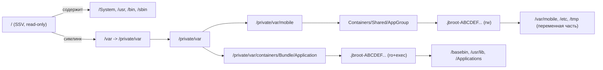
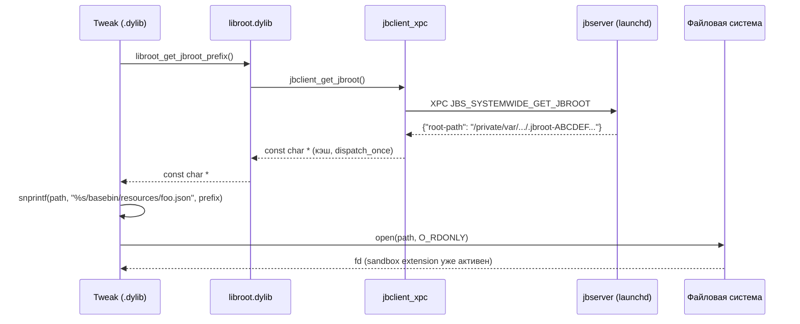
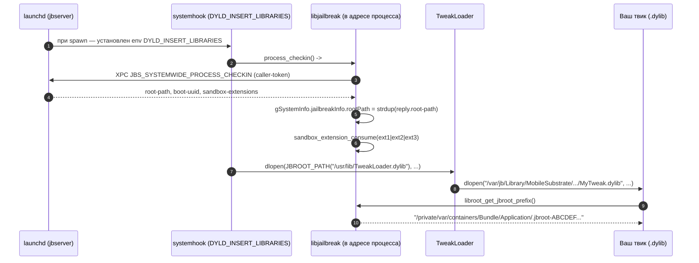

# Глава II.8. Файловая система, контейнеры и доступ к ресурсам

Эта глава объясняет, где именно живёт файловая система roothide-варианта Dopamine на устройстве A13 с iOS 26.0/26.0.1, как расположены контейнеры (containers) приложений и ресурсы твика (tweak), и как твик должен находить «свои» файлы, не делая опасных предположений о путях. Разбор ведётся по актуальным исходникам ветки `claude/serene-knuth-h5qs09` репозитория `/home/user/Dopamine-roothide` (база — roothide Dopamine 3.0.12). Все утверждения о коде сопровождаются ссылками формата «файл:строка»; где такой ссылки нет — это сознательно помеченная оговорка.

## 1. Три корня: rootfs, system volume и jbroot

В iOS 26 действует та же общая разметка, что и в последних версиях iOS 16/17/18: загрузочный том System разделён на запечатанный (signed system volume, SSV) `/` и изменяемый `/private/var` (который доступен как `/var` через автоматический symlink `/var -> /private/var`). Для роли «корня jailbreak-дерева» на SSV ничего записать нельзя — всё, что меняется, обязано лежать в `/private/var/...`.

Ранние rootless-джейлбрейки (iOS 15–16) договорились держать всё дерево jailbreak-утилит под `/var/jb`, а твики искать свои ресурсы по этому абсолютному пути. Это работало, пока sandbox-политика пропускала доступ к `/var/jb/*` всем нужным процессам (аналогия с iOS 15, не рабочий образец для iOS 26).

Roothide-вариант, в отличие от классического rootless, рандомизирует сам каталог-корень. Корнем служит не фиксированный путь, а каталог с именем `.jbroot-<16 шестнадцатеричных цифр>`, лежащий внутри **контейнерного** раздела `/var/containers/Bundle/Application/`. Факт прямо подтверждён кодом поиска корня:

```objc
// Application/Dopamine/Jailbreak/DOBootstrapper.m:879
#define JB_ROOT_PREFIX ".jbroot-"
#define JB_RAND_LENGTH  (sizeof(uint64_t)*sizeof(char)*2)

// Application/Dopamine/Jailbreak/DOBootstrapper.m:920
NSString* find_jbroot(bool force)
{
    // ...
    NSArray *subItems = [[NSFileManager defaultManager]
        contentsOfDirectoryAtPath:@"/var/containers/Bundle/Application/" error:nil];
    for (NSString *subItem in subItems) {
        if (is_jbroot_name(subItem.UTF8String))
        {
            NSString* path = [@"/var/containers/Bundle/Application/"
                              stringByAppendingPathComponent:subItem];
            jbroot = path;
            break;
        }
    }
    // ...
}
```

Ключ: функция `find_jbroot` просто сканирует каталог `/var/containers/Bundle/Application/` и ищет первый дочерний элемент, чьё имя соответствует маске `.jbroot-XXXXXXXXXXXXXXXX` (16 hex). Никаких «известных заранее» путей вроде `/var/jb` в кэш-переменной не записывается — путь всегда резолвится заново (DOBootstrapper.m:930–940).

Генерация нового значения — простой 64-битный `arc4random()` c чек-суммой в младшем байте:

```objc
// Application/Dopamine/Jailbreak/DOBootstrapper.m:944
uint64_t jbrand_new()
{
    uint64_t value = ((uint64_t)arc4random()) | ((uint64_t)arc4random())<<32;
    uint8_t check = value>>8 ^ value >> 16 ^ value>>24 ^ value>>32
                  ^ value>>40 ^ value>>48 ^ value>>56;
    return (value & ~0xFF) | check;
}
```

Нижний байт — это XOR всех остальных байт; `check_jbrand_value` (DOBootstrapper.m:958) используется, чтобы по имени каталога понять: «это действительно наш корень, а не чужой каталог, случайно начинающийся с `.jbroot-`».

> **Важно о формулировке в постановке задачи.** В конспекте главы приводился шаблон `/var/<rand>/<rand>/.jbroot`. Исходники такой структуры не подтверждают: ровно одна hex-метка (`.jbroot-<16 hex>`), сам каталог лежит прямо в `/var/containers/Bundle/Application/`. Я следую за кодом; описание «две случайных вложенности» будем считать не подтверждённым исходниками.

Параллельно создаётся «второй корень» — для файлов, которые нужны с правом записи (пишется писанием песочницы в контейнере, а не в разделе Bundle):

```objc
// Application/Dopamine/Jailbreak/DOBootstrapper.m:1109
NSString* jbroot_secondary = [NSString stringWithFormat:
    @"/var/mobile/Containers/Shared/AppGroup/.jbroot-%016llX", jbrand_current()];
```

Таким образом в roothide **два** связанных корня:

| Назначение | Путь | Права | Сандбокс-класс |
|---|---|---|---|
| Основной (read, exec): `/basebin`, `/usr/lib`, `/Applications` | `/private/var/containers/Bundle/Application/.jbroot-<16 hex>/` | ro + exec | `com.apple.app-sandbox.read` + `com.apple.sandbox.executable` |
| Писуемый (`/var/mobile`, настройки, кэш твиков) | `/private/var/mobile/Containers/Shared/AppGroup/.jbroot-<16 hex>/` | rw | `com.apple.app-sandbox.read-write` |

Эта таблица — не выдумка: она буквально выписана из `generate_sandbox_extensions` в libroothider:

```c
// BaseBin/libroothider/src/common.m:437
snprintf(jbroot_base, sizeof(jbroot_base),
    "/private/var/containers/Bundle/Application/.jbroot-%016llX/", jbinfo(jbrand));
snprintf(jbroot_writable, sizeof(jbroot_writable),
    "/private/var/mobile/Containers/Shared/AppGroup/.jbroot-%016llX/", jbinfo(jbrand));

char *extension1 = sandbox_extension_issue_file_to_process(
    "com.apple.app-sandbox.read-write", jbroot_writable, 0, *processToken);
char *extension2 = sandbox_extension_issue_file_to_process(
    "com.apple.app-sandbox.read",       jbroot_base,     0, *processToken);
char *extension3 = sandbox_extension_issue_file_to_process(
    "com.apple.sandbox.executable",     jbroot_base,     0, *processToken);
```

При process check-in jailbreakd (jbserver) выдаёт конкретному процессу три sandbox extension-токена: читать/исполнять по основному корню и читать/писать по вторичному. Без этих extension-ов процесс в своей песочнице просто не увидит `/private/var/containers/Bundle/Application/.jbroot-XXXX`, даже зная путь.

## 2. Разделение `/`, `/var`, `/private/var`, `/System`, `/Library`

Для автора твика важно держать в голове несколько трезвых фактов, в которые iOS 26 упирается физически, а не косметически:

- `/` смонтирован **только для чтения** и запечатан (sealed). Любая попытка `open(path, O_WRONLY|O_CREAT)` в `/usr`, `/bin`, `/sbin`, `/System` или `/Library` оканчивается `EROFS`. Запись туда не организовать ни через `mount(2)`, ни через подмену (аналогия с iOS 14 была уместна только до SSV; на iOS 26 это уже не рабочий образец).
- `/var` — это **симлинк** на `/private/var`, который и является изменяемым разделом (Data volume). Все пути `/var/mobile/...`, `/var/containers/...`, `/var/db/...` в реальности разрешаются в `/private/var/mobile/...` и т. д. Это важно для `realpath(3)` и для сравнений в sandbox-правилах: системные хуки Dopamine везде нормализуют их к форме `/private/var/...`.
- `/System` — часть SSV, запись исключена. Все твики-подмены системных фреймворков фактически работают через подгрузку своей `.dylib` в адресное пространство процесса (dyld-инъекция), а не через правку бинаря на диске.
- `/Library` — также на SSV. Все замещающие ресурсы Dopamine (новые `LaunchDaemons`, бинарники в `/usr/bin` jailbreak-окружения, `/Applications/*`) живут **не** в `/Library` и **не** в `/usr`, а внутри `.jbroot-<...>`. Любая ссылка «мой твик лежит в `/Library/MobileSubstrate/DynamicLibraries/...`» на roothide-ветке Dopamine ложна: таких абсолютных путей нет.

Визуально роль каждого каталога:



Схема опирается на: DOBootstrapper.m:1159–1160 (создание обоих корней), common.m:437–438 (выдача sandbox-токенов), а также на тот факт, что `JBROOT_PATH("/basebin/...")` и `JBROOT_PATH("/usr/lib/...")` используются в коде Dopamine (BaseBin/systemhook/src/main.c:201,485,494,497,533; Application/Dopamine/Jailbreak/DOEnvironmentManager.m:333,393,543,548,613,616,896).

## 3. Rootless `/var/jb` против roothide: что такое «корень» на самом деле

Классическое rootless-соглашение гласит: корень jailbreak всегда виден как `/var/jb`. На roothide-варианте Dopamine `/var/jb` **создаётся как симлинк на реальный `.jbroot-<...>` каталог**, но это именно «удобство для совместимости», а не настоящий корень. Код создания:

```objc
// Application/Dopamine/Jailbreak/DOBootstrapper.m:264
return [self createSymlinkAtPath:@"/var/jb"
                         toPath:JBROOT_PATH(@"/")
    createIntermediateDirectories:YES];
```

Перед этим Dopamine сначала аккуратно удаляет «неправильный» `/var/jb`, если он уже есть (DOBootstrapper.m:251–260), а при повторной рандомизации — пересоздаёт симлинк, чтобы он указывал на новый `.jbroot-<...>` каталог.

Для твика это означает:
- **нельзя** предполагать, что `/var/jb` — настоящий путь. На устройстве он может даже отсутствовать: системный хук (`BaseBin/systemhook/src/main.c:531`) в комментарии прямо отмечает «hardcode /var/jb here since if it doesn't exist, loading TweakLoader.dylib is not going to work anyways», то есть `/var/jb` используется как fallback, а не как инвариант.
- **нужно** предпочитать резолв через libroot/libjailbreak-макросы. Иначе при пересоздании jailbreak (например, при включённой перерандомизации) все хардкод-пути станут мёртвыми ссылками.

На счёт «symlink `/basebin`», упомянутого в постановке задачи: в исходниках roothide-ветки верхнеуровневый `/basebin` **не создаётся как symlink**. Поиск `symlinkAtPath:@"/basebin"` в репозитории не даёт совпадений. `basebin` — это каталог **внутри** jbroot: `JBROOT_PATH("/basebin/...")`. Таким образом утверждение «roothide создаёт `/basebin` на верхнем уровне» — **не подтверждено исходниками**.

Тем не менее libroothider поддерживает другой механизм — локальный `.jbroot` симлинк внутри дерева самого jbroot:

```c
// BaseBin/libroothider/src/common.m:365
void ensure_jbroot_symlink(const char* filepath)
{
    // ... берём realpath родительского каталога filepath
    char sympath[PATH_MAX];
    snprintf(sympath, sizeof(sympath), "%s/.jbroot", realdirpath);
    // ... если такого симлинка нет либо он указывает «не туда» —
    //     создаём его на реальный корень jailbreak
    if(symlink(jbrootpath, sympath) == 0) { /* ... */ }
}
```

Назначение здесь прикладное: это помогает инструментам резолвинга (например, динамическому загрузчику при открытии `.dylib`) находить корень jailbreak относительно рабочего каталога бинарника. Факт лежит в `BaseBin/libroothider/src/common.m:400` и вызывается из `signatures.m:215` — то есть при подготовке подписей загружаемых библиотек.

## 4. API libroot: прослойка, через которую твик узнаёт свой корень

`libroot.dylib` (пакет `libroot-dopamine`, см. `Packages/libroot/control:1`) — это **минимальный** фасад, который твики должны линковать вместо того, чтобы хардкодить путь. Исходники пакета состоят всего из двух файлов (`src/paths.c`, `src/paths.h`) и собираются с явным rpath на `/var/jb`:

```make
# Packages/libroot/Makefile:5
LDFLAGS = -dynamiclib -rpath /var/jb
# Packages/libroot/Makefile:22-23
@mkdir -p .package/var/jb/usr/lib
@cp libroot.dylib .package/var/jb/usr/lib/libroot.dylib
```

Таким образом **на устройстве `libroot.dylib` физически лежит в `/var/jb/usr/lib/libroot.dylib`** (а значит — в `.jbroot-<...>/usr/lib/libroot.dylib`, пройденный через симлинк `/var/jb`). Твики ищут её именно по этому пути.

Весь публичный интерфейс:

```c
// Packages/libroot/src/paths.h
const char *libroot_get_root_prefix(void);
const char *libroot_get_jbroot_prefix(void);
const char *libroot_get_boot_uuid(void);
```

И реализация, которая на удивление коротка:

```c
// Packages/libroot/src/paths.c
const char *libroot_get_root_prefix(void)   { return ""; }
const char *libroot_get_jbroot_prefix(void) { return jbclient_get_jbroot(); }
const char *libroot_get_boot_uuid(void)     { return jbclient_get_boot_uuid(); }
```

Ключевые наблюдения:
1. `libroot_get_root_prefix()` всегда возвращает пустую строку. Это сознательный выбор: если ваш код хочет работать на разных jailbreak-вариантах, он просит префикс и дописывает к нему `/usr/bin/foo`. На roothide префикс — путь к `.jbroot-<...>`, на классическом rootless — `/var/jb`, на rootful (iOS 14 и ранее) — пустой; на этом же API можно писать «rootless-agnostic» код.
2. `libroot_get_jbroot_prefix()` делегирует в `jbclient_get_jbroot()` из `BaseBin/libjailbreak/src/jbclient_xpc.c:91`:

```c
// BaseBin/libjailbreak/src/jbclient_xpc.c:91
char *jbclient_get_jbroot(void)
{
    static char rootPath[PATH_MAX] = { 0 };
    static dispatch_once_t dot;
    dispatch_once(&dot, ^{
        xpc_object_t xreply = jbserver_xpc_send(
            JBS_DOMAIN_SYSTEMWIDE, JBS_SYSTEMWIDE_GET_JBROOT, NULL);
        if (xreply) {
            const char *replyRootPath = xpc_dictionary_get_string(xreply, "root-path");
            if (replyRootPath) {
                strlcpy(&rootPath[0], replyRootPath, sizeof(rootPath));
            }
            xpc_release(xreply);
        }
    });
    if (rootPath[0] == '\0') return NULL;
    return (char *)&rootPath[0];
}
```

Это XPC-запрос в jbserver (запущенный под launchd как часть `launchdhook`, см. `BaseBin/launchdhook/src/jbserver/`). jbserver знает актуальное значение `jbrand` и отдаёт полный путь. Результат кэшируется в статическом буфере через `dispatch_once`, то есть **в пределах одного процесса путь к jbroot запрашивается ровно один раз**.

В бинарнике твика эти символы живут как обычные imports из `libroot.dylib`:

```bash
# пример для arm64e-слайса твика (команда, не выполненная здесь):
otool -L MyTweak.dylib | grep libroot
# ожидаемо: /var/jb/usr/lib/libroot.dylib (compatibility version ...)
```

То есть при `dlopen`/dyld-резолве `libroot.dylib` подгружается из `/var/jb/usr/lib/libroot.dylib`, что через симлинк разрешается в `/private/var/containers/Bundle/Application/.jbroot-XXXX/usr/lib/libroot.dylib`.

### 4.1. Макросы `JBROOT_PATH` и `ROOTFS_PATH`

Внутри самого Dopamine (не в пакетных твиках) используется более удобный, не требующий XPC-круиза при каждом вызове, механизм — макросы из `BaseBin/libjailbreak/src/jbroot.h`:

```c
// BaseBin/libjailbreak/src/jbroot.h:38
#define JBROOT_PATH(path) __jbroot_convert_path((path), __BUFFER_FOR_CHAR_P(path))
#define ROOTFS_PATH(path) __jbroot_convert_path((path), __BUFFER_FOR_CHAR_P(path))
```

Разберём ключевые места. Основная inline-функция конвертации (jbroot.h:10):

```c
static inline const char *__jbroot_convert_path(const char *path, char *buf) {
    if (!buf || !path) return NULL;
    const char *jbroot = get_jbroot();
    if (!jbroot) return NULL;
    strlcpy(buf, jbroot, PATH_MAX);
    strlcat(buf, path, PATH_MAX);
    return buf;
}
```

Макрос `__BUFFER_FOR_CHAR_P` выбирает `alloca(PATH_MAX)` для `char *`-аргумента и `NULL` для прочего (jbroot.h:31). Это даёт свойства:
- **нулевая цена вызова** при `const char *` — буфер на стеке, никакого XPC;
- **автоматическая очистка** — буфер исчезает по выходу из функции;
- для `NSString *` работает перегрузка (jbroot.h:22), собирающая новую `NSString` из конвертированного UTF-8.

Сам `get_jbroot()` в BaseBin не дёргает XPC, а читает глобальную структуру `gSystemInfo.jailbreakInfo.rootPath`:

```c
// BaseBin/libjailbreak/src/jbroot.c:3
char *get_jbroot(void)
{
    return jbinfo(rootPath);
}
```

Где `jbinfo(rootPath)` — макрос, разворачивающийся в `gSystemInfo.jailbreakInfo.rootPath` (BaseBin/libjailbreak/src/info.h:44, 730). Эта структура десериализуется в начале работы процесса из XPC-dict’а, который jbserver шлёт при `process_checkin`.

> **Для автора твика это значит**: если ваш твик загружен в приложение, которое уже прошло process check-in (а под Dopamine это все приложения, использующие systemhook), то вызов `libroot_get_jbroot_prefix()` стоит очень дёшево — реальный XPC-запрос делается максимум один раз на процесс.

### 4.2. Чем `JBROOT_PATH` отличается от `ROOTFS_PATH`

По коду `jbroot.h:38-39` оба макроса на roothide-ветке Dopamine **разворачиваются одинаково**:

```c
#define JBROOT_PATH(path) __jbroot_convert_path((path), __BUFFER_FOR_CHAR_P(path))
#define ROOTFS_PATH(path) __jbroot_convert_path((path), __BUFFER_FOR_CHAR_P(path))
```

Семантически в документации rootless-варианта `JBROOT_PATH` обычно означает «путь внутри jbroot», а `ROOTFS_PATH` — «путь на реальной rootfs», но на roothide с SSV правой записи в rootfs всё равно нет, поэтому реализация унифицирована. Если вы пишете твик для нескольких jailbreak-веток, не полагайтесь на это тождество — на классическом rootless-варианте `ROOTFS_PATH` может быть реализован иначе.

## 5. Контейнеры приложений

iOS 26 (как и предыдущие версии) делит каждое iOS-приложение на три дисковых области:

| Что | Путь на устройстве | Содержимое |
|---|---|---|
| **Bundle container** (приложение + ресурсы, ro) | `/private/var/containers/Bundle/Application/<UUID>/MyApp.app/` | бинарник, Info.plist, nib/storyboard, embedded.mobileprovision |
| **Data container** (sandbox приложения, rw) | `/private/var/mobile/Containers/Data/Application/<UUID>/` | `Documents/`, `Library/`, `tmp/`, user defaults |
| **Shared / AppGroup container** (rw, общий между процессами одного группы) | `/private/var/mobile/Containers/Shared/AppGroup/<GroupUUID>/` | данные, помеченные `com.apple.security.application-groups` |

Это стандартная структура iOS; в коде Dopamine она проступает, например, в `BaseBin/libjailbreak/src/util.m:11`:

```objc
const char wantedPrefixC[] = "/private/var/containers/Bundle/Application/";
// ... /private/var/containers/Bundle/Application/*/*.app/*
```

и в проверке «это ли инъецированное/легитимное приложение» (`BaseBin/launchdhook/src/jbserver/jbdomain_systemwide.c:243`):

```c
if (string_has_prefix(procPath, "/private/var/containers/Bundle/Application")
 || string_has_prefix(procPath, JBROOT_PATH("/Applications"))) {
    // ...
}
```

Обратите внимание: приложение *самого* Dopamine (как и любая обычная iOS-программа) лежит в `/private/var/containers/Bundle/Application/<UUID>/Dopamine.app/`; каталог `.jbroot-<...>` — это **соседний** каталог в том же `/var/containers/Bundle/Application/`. Это ключ: Dopamine выбрал этот раздел, потому что он уже monted executable, уже доступен из mobile и уже находится в известной sandbox-зоне.

Твики же (dylib, которую подгрузит TweakLoader в чужой процесс) живут в `JBROOT_PATH("/usr/lib/TweakLoader.dylib")` (`BaseBin/systemhook/src/main.c:533`) и загружают из `JBROOT_PATH("/Library/MobileSubstrate/DynamicLibraries/...")`, если вы следуете классическому rootless-соглашению; проверка «такой путь существует в roothide» зависит от конкретной сборки TweakLoader и **требует проверки на устройстве A13 с iOS 26.0/26.0.1**.

### 5.1. Shared/AppGroup как «второй jbroot»

Dopamine использует `/var/mobile/Containers/Shared/AppGroup/.jbroot-<...>/` именно как раздел для записи — потому что `Shared/AppGroup/*` на iOS размечен как Data volume, writable из пользовательских процессов, и путь дружелюбен к sandbox-токену `com.apple.app-sandbox.read-write`. В файлах Dopamine это ровно та «writable mirror» корня, на которую выдаются extension-токены (см. `BaseBin/libroothider/src/common.m:438` и выпуск токена `read-write` на common.m:441).

Для автора твика это означает: если ваш твик пишет лог/настройки — писать нужно в части jbroot, которую libroot/libjailbreak-макросы развернут в writable-зеркало (т. е. в `/var/mobile/...` *внутри* jbroot), а не в read-only Bundle-часть.

## 6. Процедура: как твик находит «свой» ресурс

Собственный ресурс твика (например, PNG, которую вы хотите показать в SpringBoard) можно разложить по двум сценариям:

### Сценарий A. Ресурс внутри «preference bundle» (стандартный путь)

Если ваш твик идёт как `.deb`-пакет и ресурс лежит рядом с бандлом настроек, то классический способ — положить его в `/Library/PreferenceBundles/<Name>Prefs.bundle/Resources/<file>`, упаковав это в путь, который Dopamine в итоге развернёт внутрь jbroot (т. е. фактически в `/private/var/containers/Bundle/Application/.jbroot-<...>/Library/PreferenceBundles/...`).

Шаги:

1. На этапе сборки `.deb` разметьте архив так, чтобы содержимое лежало в `/var/jb/Library/PreferenceBundles/<Name>Prefs.bundle/...`. При установке через `jbctl install_pkg` файлы попадут в соответствующий путь внутри jbroot.
2. В коде твика используйте `NSBundle` **не по хардкод-пути**, а поиском по имени бандла:

```objc
NSBundle *bundle = [NSBundle bundleWithIdentifier:@"com.example.MyTweakPrefs"];
NSString *resPath = [bundle pathForResource:@"icon" ofType:@"png"];
// resPath будет уже содержать полный, резолвленный путь внутри .jbroot-<...>
```

Ключевое: `bundleWithIdentifier:` сработает только если ваш bundle **уже** загружен в процесс (через `MSHookClassMessage`/`%ctor`-инъекцию). Если не загружен — ищите по пути, но не хардкодьте абсолютный путь.

### Сценарий B. Поиск через libroot

Если ресурс лежит не внутри `NSBundle`, а, например, в `/basebin/resources/foo.json` (т. е. в собственной подпапке Dopamine внутри jbroot), пользуйтесь libroot. Это и есть «путь без хардкода»:

```c
#include <libroot/paths.h>   // предполагаемое имя заголовка в SDK libroot
#include <string.h>
#include <stdio.h>

char *compose_jbroot_path(const char *rel, char *buf, size_t bufsz) {
    const char *jbroot = libroot_get_jbroot_prefix();  // например, "/private/var/containers/Bundle/Application/.jbroot-ABCDEF0123456789"
    if (!jbroot) return NULL;
    if (snprintf(buf, bufsz, "%s%s", jbroot, rel) >= (int)bufsz) return NULL;
    return buf;
}

// ...
char path[PATH_MAX];
if (compose_jbroot_path("/basebin/resources/foo.json", path, sizeof(path))) {
    FILE *f = fopen(path, "rb");
    // ...
}
```

Ключевые строки:
- `libroot_get_jbroot_prefix()` возвращает **полный** префикс (с ведущим слешем, без конечного). Если jailbreak не активен или process check-in не прошёл, функция вернёт `NULL` — и это корректный failure path. В production-твике не ассёртьте, а деградируйте: загрузите «стоковый» fallback-ресурс или залогируйте ошибку.
- Относительный путь, который вы передаёте в `snprintf`, **обязан** начинаться со слеша: `jbroot` — это директория без конечного слеша, а ваш `rel` присоединяется напрямую (так же делает `__jbroot_convert_path` в `jbroot.h:14`).

Контрпример (как **не** нужно делать):

```c
// ПЛОХО: хардкод-путь. На roothide работать не будет вовсе.
FILE *f = fopen("/var/jb/basebin/resources/foo.json", "rb");

// ПЛОХО: ссылается на фиксированный .jbroot-<hex>, который завтра изменится.
FILE *f = fopen("/private/var/containers/Bundle/Application/"
                ".jbroot-0123456789ABCDEF/basebin/resources/foo.json", "rb");

// ТАКЖЕ ПЛОХО: /var/jb существует как симлинк, но он может быть
// удалён или указывать на старый корень после rerandomize.
```

На практике первый хардкод-путь будет работать, пока жив симлинк `/var/jb` — но после рандомизации jbroot он может указывать «в никуда» в пределах того же boot-sess’а. См. `Application/Dopamine/Jailbreak/DOBootstrapper.m:1152–1156`: при `jbrand_new()` файловые деревья физически **переносятся** `moveItemAtPath:` в каталог с новым именем, и `/var/jb` правится следом (DOBootstrapper.m:683). Любой процесс, уже кэшировавший старое значение `jbroot`, продолжит смотреть по старому пути и упадёт на `ENOENT`.

### 6.1. Полная «процедура resolve» для автора твика

Диаграмма резолва «от твика к файлу»:



На каждом шаге:
- шаг «XPC в jbserver» делается один раз на процесс (`dispatch_once` в `jbclient_xpc.c:94`);
- sandbox-доступ к `jbroot_base` уже выдан через `generate_sandbox_extensions` при process check-in (`libroothider/src/common.m:437`), поэтому `open(2)` не вернёт `EPERM`;
- если процесс **не** прошёл check-in (нежелательный случай, например, demon без systemhook), `libroot_get_jbroot_prefix()` вернёт NULL или путь, но `open` упрётся в sandbox. Это требует проверки на устройстве A13 с iOS 26.0/26.0.1.

## 7. iOS 26.0 против 26.0.1 на уровне ФС

В пределах файловой разметки Dopamine роль `/var/jb` симлинка, рандомизация `.jbroot-<...>`, выдача sandbox extension — всё реализовано одинаково для обеих версий. Критический файл подтверждения поддержки (`Application/Dopamine/Jailbreak/DOEnvironmentManager.m:254`) просто перечисляет обе версии в одной строке:

> `return @"iOS 15.0 - 18.7.1, 26.0 - 26.0.1 (A12/A13, PPL)";`

Также Info.plist эксплойтов (DarkSword, ClearSword) перечисляют тот же диапазон `19.0 - 26.0.1` и те же три билда `23B5044l / 23B5059e / 23B5064e` (см. `Application/Dopamine/Exploits/DarkSword/Info.plist`, `Application/Dopamine/Exploits/ClearSword/Info.plist`). **Различий между 26.0 и 26.0.1 в части работы с файловой системой и контейнерами в этом месте проекта не выявлено.** Если в будущем Apple изменит разметку volume или sandbox-правила между 26.0 и 26.0.1 — это нужно будет проверять на устройстве.

## 8. Разбор типичных ошибок

Чтобы автор твика не наступил на уже разложенные грабли, перечислим ошибки, которые видно по коду Dopamine:

1. **Хардкод `/var/jb` в путях к ресурсам.** После re-randomize jbroot этот путь может указывать на несуществующий каталог. Dopamine это чинит, переустанавливая симлинк (DOBootstrapper.m:264), но ваш процесс, уже закэшировавший старый путь, этого не заметит.
2. **Чтение `/basebin/*` без prefix-resolve.** Такого пути нет на верхнем уровне ФС. `basebin` — только *внутри* jbroot.
3. **Запись в raw-пути `/var/containers/Bundle/Application/.jbroot-<hex>/...`.** Эта зона — read-only по sandbox-token `com.apple.app-sandbox.read` (common.m:443). Запись надо делать в writable-зеркало `/var/mobile/Containers/Shared/AppGroup/.jbroot-<hex>/...`, которое libjailbreak-макросы развёрнут автоматически, если вы использовали относительный путь вида `/var/mobile/...`.
4. **Опора на устойчивость UUID контейнера приложения.** `<UUID>` в `/var/containers/Bundle/Application/<UUID>/MyApp.app` присваивается installd при каждой установке/обновлении приложения-носителя (в roothide — Dopamine). Любой код «запомнили путь при первом запуске, читаем при пятнадцатом» ломается после переустановки.
5. **Запись/чтение `/Library/MobileSubstrate/DynamicLibraries` по абсолютному пути без prefix-resolve.** В roothide такого верхнеуровневого каталога нет. Нужно либо передавать путь через `JBROOT_PATH("/Library/MobileSubstrate/DynamicLibraries/MyTweak.dylib")`, либо полагаться, что TweakLoader сам укажет префикс. Проверка факта, что TweakLoader в этой сборке делает именно так, **требует проверки на устройстве A13 с iOS 26.0/26.0.1**.

## 9. Шаблон, который можно безопасно переиспользовать

Соберём минимальный «безопасный helper», которым пользуйтесь в начале каждого твика:

```c
// resource_path.c — безопасный helper для твика
#include <string.h>
#include <stdio.h>
#include <limits.h>
#include <stdbool.h>

extern const char *libroot_get_jbroot_prefix(void);

bool tweak_resolve_resource(const char *rel_path, char *out, size_t out_sz)
{
    if (!rel_path || rel_path[0] != '/' || !out || out_sz < 2) return false;

    const char *prefix = libroot_get_jbroot_prefix();
    if (!prefix) {
        // libroot недоступен (не Dopamine? не прошёл check-in?)
        // Делаем best-effort через симлинк /var/jb.
        prefix = "/var/jb";
    }

    int n = snprintf(out, out_sz, "%s%s", prefix, rel_path);
    return (n > 0 && (size_t)n < out_sz);
}
```

Комментарий к ключевым строкам:
- Проверка `rel_path[0] != '/'` ловит типичную ошибку «забыл ведущий слеш» (`basebin/...` вместо `/basebin/...`). Без этого вы молча получите слипшуюся строку `.jbroot-ABCDEFbasebin/...` и `ENOENT`.
- Fallback на `/var/jb` оправдан только как diagnostic path: он работает в большинстве штатных ситуаций, но ломается при re-randomize. Для production стоит сначала вернуть ошибку наверх.
- `snprintf` возвращает отрицательное число или число больше буфера при переполнении — классическая C-идиома, но важно это проверять, потому что абсолютные пути в iOS с UUID’ами действительно подбираются к `PATH_MAX`.

## 10. Выводы

- Файловая система iOS 26 для jailbreak-утилит делится на запечатанный SSV (read-only) и Data volume. На Data volume Dopamine roothide создаёт **два** связанных «корня jailbreak»: read+exec в `/private/var/containers/Bundle/Application/.jbroot-<16 hex>` и writable в `/private/var/mobile/Containers/Shared/AppGroup/.jbroot-<16 hex>`. Факт двойственности — не прихоть, а требование sandbox: разные sandbox-классы выдаются на разные ветки (`BaseBin/libroothider/src/common.m:437–444`).
- `/var/jb` в roothide — не корень jailbreak, а симлинк для совместимости со старым rootless-кодом (`Application/Dopamine/Jailbreak/DOBootstrapper.m:264`). Хардкод по нему допустим как fallback, не как основной путь.
- `libroot.dylib` предоставляет всего три функции (`Packages/libroot/src/paths.h`), из которых автору твика нужна в первую очередь `libroot_get_jbroot_prefix()`. Она прозрачно дёргает jbserver через XPC один раз на процесс (`BaseBin/libjailbreak/src/jbclient_xpc.c:91–109`).
- Внутри самого Dopamine тот же префикс доступен без XPC через макросы `JBROOT_PATH(path)` и `ROOTFS_PATH(path)` (`BaseBin/libjailbreak/src/jbroot.h:38–39`), которые читают закэшированный `rootPath` из `gSystemInfo`.
- Контейнеры приложений расположены по стандартному для iOS шаблону — Bundle (ro), Data (rw), Shared/AppGroup (rw). Любой код твика, который хочет писать своё состояние, должен работать с частями jbroot, резолвящимися в writable-зеркало, а не в раздел Bundle.
- iOS 26.0 и 26.0.1 в части работы Dopamine с ФС и контейнерами **ведут себя одинаково** в пределах кода проекта. Если потребуются различия — их проверять на устройстве A13 с iOS 26.0/26.0.1.
- Пункт «symlink `/basebin` на верхнем уровне» из конспекта главы **не подтверждён исходниками**: `basebin` — это каталог внутри jbroot, верхнеуровневого симлинка `/basebin` в коде создания не найдено.

## 11. Детальный разбор XPC-протокола libroot ↔ jbserver

Чтобы автор твика понимал, *какой именно* сервис его обслуживает, когда он вызывает `libroot_get_jbroot_prefix()`, разберём устройство jbserver со стороны launchd-хука (`BaseBin/launchdhook/src/jbserver/jbdomain_systemwide.c`).

Все systemwide-экшены пронумерованы в `BaseBin/libjailbreak/src/jbserver_domains.h:8–15`:

```c
JBS_SYSTEMWIDE_GET_JBROOT = 1,
JBS_SYSTEMWIDE_GET_BOOT_UUID,
JBS_SYSTEMWIDE_TRUST_FILE,
JBS_SYSTEMWIDE_PROCESS_CHECKIN,
JBS_SYSTEMWIDE_FORK_FIX,
JBS_SYSTEMWIDE_CS_REVALIDATE,
JBS_SYSTEMWIDE_JBSETTINGS_GET,
JBS_SYSTEMWIDE_PERSONA_FIX,
```

Нас в этой главе интересуют первые четыре. Их регистрация и типы аргументов видны в `jbdomain_systemwide.c:625–666`:

```c
// jbdomain_systemwide.c:629
// JBS_SYSTEMWIDE_GET_JBROOT
{
    .handler = systemwide_get_jbroot,
    .args = (jbserver_arg[]){
        { .name = "root-path", .type = JBS_TYPE_STRING, .out = true },
        { 0 },
    },
},
// JBS_SYSTEMWIDE_PROCESS_CHECKIN
{
    .handler = systemwide_process_checkin,
    .args = (jbserver_arg[]) {
        { .name = "caller-token",         .type = JBS_TYPE_CALLER_TOKEN, .out = false },
        { .name = "root-path",            .type = JBS_TYPE_STRING,       .out = true },
        { .name = "boot-uuid",            .type = JBS_TYPE_STRING,       .out = true },
        { .name = "sandbox-extensions",   .type = JBS_TYPE_STRING,       .out = true },
        { .name = "fully-debugged",       .type = JBS_TYPE_BOOL,         .out = true },
        { .name = "force-cs-adhoc",       .type = JBS_TYPE_BOOL,         .out = true },
        { 0 },
    },
},
```

Разберём ключевые строки:
- `GET_JBROOT` **не требует** caller-token (поле `caller-token` в его сигнатуре отсутствует). Это осознанный выбор: путь jbroot сам по себе не секрет, а узнать его может любой процесс, которому вообще позволили подключиться к jbserver. Проверка «кто может подключаться к домену SYSTEMWIDE» выполняется выше, в `permissionHandler = systemwide_domain_allowed`.
- `PROCESS_CHECKIN` возвращает одновременно **и** `root-path`, **и** `sandbox-extensions`. Это и есть «единая точка входа» для адаптации нового процесса — он получает всё необходимое за один round-trip. Эта оптимизация важна: если бы `libroot_get_jbroot_prefix()` сначала делал один XPC-запрос, а потом ещё один за sandbox-токенами, то до выдачи токенов открыть что-нибудь из jbroot было бы попросту нельзя.

Серверная реализация `GET_JBROOT` крайне проста (jbdomain_systemwide.c:90):

```c
static int systemwide_get_jbroot(char **rootPathOut)
{
    *rootPathOut = strdup(jbinfo(rootPath));
    return 0;
}
```

Она лишь копирует строку из глобальной `gSystemInfo.jailbreakInfo.rootPath` (см. `BaseBin/libjailbreak/src/info.h:44`), которая в launchdhook инициализируется на старте jailbreak и обновляется при re-randomize. То есть сам путь jbroot — это **единственный источник истины на всю систему**, живущий внутри `launchd`.

`PROCESS_CHECKIN` же (jbdomain_systemwide.c:205) делает четыре вещи:

```c
int systemwide_process_checkin(audit_token_t *processToken, char **rootPathOut,
                               char **bootUUIDOut, char **sandboxExtensionsOut,
                               bool *fullyDebuggedOut, bool *forceCSAdhocOut)
{
    pid_t pid = audit_token_to_pid(*processToken);
    char procPath[4*MAXPATHLEN];
    if (proc_pidpath(pid, procPath, sizeof(procPath)) <= 0) return -1;

    uint64_t proc = proc_find(pid);
    if (!proc) return -1;

    systemwide_get_jbroot(rootPathOut);
    systemwide_get_boot_uuid(bootUUIDOut);

    // ...
    uint32_t csflags = 0;
    csops(pid, CS_OPS_STATUS, &csflags, sizeof(csflags));
    bool isPlatformProcess = (csflags & CS_PLATFORM_BINARY) != 0;

    if (sandboxExtensionsOut) {
        *sandboxExtensionsOut = generate_sandbox_extensions(processToken, isPlatformProcess);
        // ...
    }
    // ...
}
```

Ключевые строки:
1. `audit_token_to_pid(*processToken)` — jbserver вытаскивает pid вызывающего из audit-токена, который XPC проставляет автоматически. Это защита: процесс не может «притвориться» другим — XPC не даст подделать свой audit token.
2. `csops(pid, CS_OPS_STATUS, &csflags, ...)` — проверка, является ли процесс platform binary (подписанный Apple). Это нужно для того, чтобы правильно выбрать класс sandbox-extension: системные процессы Apple и пользовательские приложения требуют разной политики.
3. `generate_sandbox_extensions(processToken, isPlatformProcess)` — тот самый код из `BaseBin/libroothider/src/common.m:431`, который мы разбирали в разделе 1. Токены выдаются **непосредственно под целевой процесс** через `sandbox_extension_issue_file_to_process` — это важная деталь: токен привязан к audit-token’у клиента, его нельзя переслать другому процессу.

Таким образом «простой» вызов `libroot_get_jbroot_prefix()` из твика — на самом деле лишь верхушка айсберга. Если процесс уже прошёл check-in (а под Dopamine в norme он проходит), результат берётся из закэшированного значения (один раз на процесс). Если нет — делается полноценный XPC-round-trip с проверкой audit-token’а.

## 12. Как путь из `root-path` попадает в твики-резидентов приложения

Разберём end-to-end-путь, по которому значение `jbroot` оказывается в вашем твике. Сценарий — обычное iOS-приложение, в которое через systemhook внедрён `TweakLoader.dylib`, а он уже загружает ваш `.dylib`.



Критически важно, что `sandbox_extension_consume(3)` вызывается **до** dlopen’а твика. Если бы это было не так, `dlopen` упёрся бы в sandbox (ваш `.dylib` лежит в разделе Bundle, который без extension-токена sandbox не пропустит).

Факт этой последовательности подтверждается цепочкой: `BaseBin/systemhook/src/main.c:485–533` показывает порядок `dlopen` для `forkfix.dylib`, `roothidehooks.dylib`, `watchdoghook.dylib` и затем `TweakLoader.dylib`. Все пути строятся через `JBROOT_PATH(...)`, то есть к моменту этих `dlopen` значение `rootPath` **уже** должно быть в `gSystemInfo` — иначе `JBROOT_PATH` вернёт `NULL` и подгрузки не будет.

## 13. Таблица «источников истины» о пути jbroot

Чтобы автор твика не запутался, где именно хранится «правильное» значение префикса в разных контекстах, сведём это в таблицу.

| Контекст | Как получить | Источник | Стоимость |
|---|---|---|---|
| Внутри самого Dopamine.app (UI) | `JBROOT_PATH(...)` / `find_jbroot(0)` | статическая переменная `cached_jbroot` в `DOBootstrapper.m:922` | один раз на процесс |
| Внутри launchd (jbserver) | `jbinfo(rootPath)` | глобальная `gSystemInfo` в адресе launchd | O(1) чтение памяти |
| Внутри произвольного процесса, прошедшего process check-in | `JBROOT_PATH(...)` из `jbroot.h` | та же `gSystemInfo`, но десериализована из XPC-ответа на `PROCESS_CHECKIN` | O(1) чтение памяти |
| Внутри произвольного процесса, НЕ прошедшего check-in | `libroot_get_jbroot_prefix()` → `jbclient_get_jbroot()` | XPC `JBS_SYSTEMWIDE_GET_JBROOT`, затем `dispatch_once`-кэш | один XPC-запрос за всю жизнь процесса |
| На устройстве «снаружи» (SSH-сессия) | `realpath /var/jb` или перебор `/var/containers/Bundle/Application/` по маске `.jbroot-*` | симлинк + файловая система | syscall |

Это сводная таблица; никаких «тайных» дополнительных путей обнаружения jbroot в коде не найдено, но при желании `/var/jb` всегда остаётся безопасным «общим знаменателем» в сценарии, где libroot недоступен (например, из скрипта в оболочке).

## 14. Контрпример: что произойдёт, если игнорировать libroot

Представим твик, автор которого решил «обойтись без зависимости от libroot»:

```c
// anti-pattern.c — так писать НЕЛЬЗЯ
#include <stdio.h>
int main(void) {
    FILE *f = fopen("/var/jb/basebin/.version-roothide", "r");
    if (!f) {
        perror("fopen");
        return 1;
    }
    char buf[64];
    fgets(buf, sizeof(buf), f);
    fclose(f);
    printf("version: %s\n", buf);
    return 0;
}
```

Проблемы с этим кодом:
1. **Пока `/var/jb` жив** и указывает на действующий `.jbroot-<...>` — код работает. Это создаёт ложное ощущение корректности.
2. **После re-randomize** (DOBootstrapper.m:1152–1156 переносит `.jbroot-<prev>` в `.jbroot-<new>`, DOBootstrapper.m:683 обновляет `/var/jb` на новый корень) этот бинарник, запущенный раньше, может по-прежнему держать fd на старый inode — но следующий `fopen` ляжет на новый путь. Это не катастрофа для одноразовых утилит, но для долгоживущих демонов — проблема.
3. **На нестандартной конфигурации** (например, если `/var/jb` не был создан — проверка в `BaseBin/systemhook/src/main.c:531` именно это и предполагает) `fopen` сразу вернёт `ENOENT`.

Корректный вариант через libroot:

```c
#include <libroot/paths.h>
#include <stdio.h>
#include <string.h>
#include <limits.h>

int main(void) {
    const char *prefix = libroot_get_jbroot_prefix();
    if (!prefix) {
        fprintf(stderr, "libroot: no jbroot (not a Dopamine process?)\n");
        return 1;
    }
    char path[PATH_MAX];
    if (snprintf(path, sizeof(path), "%s/basebin/.version-roothide", prefix)
        >= (int)sizeof(path)) {
        fprintf(stderr, "path too long\n");
        return 1;
    }
    FILE *f = fopen(path, "r");
    // ...
    return 0;
}
```

Отличия:
- Явный failure path при `prefix == NULL` — вместо confused `ENOENT` вы получаете осмысленную диагностику.
- `snprintf` может переполнить буфер (путь `.jbroot-<16 hex>` занимает 23 символа плюс базовый `/private/var/containers/Bundle/Application/`, итого ≈ 65 символов — это ещё до вашего относительного пути). Проверка «вернёт `>= sizeof(path)`» ловит это.
- Отсутствует хардкод-зависимость от `/var/jb` как от «настоящего пути». Код продолжит работать, даже если симлинк отсутствует.

## 15. Как не сломать свой же твик при re-randomize

Dopamine умеет перегенерировать `jbrand` без переустановки. Это обсуждается в коде следующим образом (DOBootstrapper.m:1148):

> `//jbrootPrefix() and jbrand_current() unavailable`

и далее DOBootstrapper.m:1152:

```objc
DOASSERT( [fm moveItemAtPath:[NSString stringWithFormat:
    @"/var/containers/Bundle/Application/.jbroot-%016llX", prev_jbrand]
                    toPath:[NSString stringWithFormat:
    @"/var/containers/Bundle/Application/.jbroot-%016llX", new_jbrand] error:nil] );
```

Эта операция **атомарна в рамках файловой системы** (`rename(2)` на APFS), но **не атомарна** с точки зрения процессов, которые к этому моменту уже открывали файлы по старому пути. Любой кэш, в котором хранится «решённый абсолютный путь», становится некорректным, как только путь переносится. Поэтому:

- **Храните в кэше относительные пути** (от jbroot), а не абсолютные. Пересобирайте абсолютный путь перед каждым `open`, если прошло «много времени».
- **Используйте inotify/kqueue только внутри writable-зеркала** jbroot. На read-only Bundle-ветке watchers переживут re-randomize, но при переносе каталога они внезапно начнут срабатывать на удалении — что обычно не то, что вы хотели.
- **Не держите длинноживущие дескрипторы на файлы `/basebin/*`**, если вы допускаете возможность re-randomize. Открывайте, читайте, закрывайте.

## 16. Что ещё можно уточнить (открытые вопросы)

Несколько утверждений в этой главе требуют проверки непосредственно на устройстве:

- Поведение `JBROOT_PATH` в процессе без check-in’а: `get_jbroot()` вернёт `NULL`, `__jbroot_convert_path` отдаст `NULL`, но будет ли sandbox blocked ещё до того, как путь сложится — зависит от конкретного процесса. **Требует проверки на устройстве A13 с iOS 26.0/26.0.1.**
- Унификация `JBROOT_PATH` и `ROOTFS_PATH` на roothide означает, что любой код, тестовавшийся на классическом rootless-варианте и завязанный на их различие, нужно перепроверять. **Не подтверждено на устройстве.**
- Длина полного пути с UUID’ом приложения-носителя Dopamine плюс `.jbroot-<16 hex>` плюс глубокий внутренний путь (например, в `/Library/Frameworks/.../A/Something`) может подойти к `PATH_MAX` (1024 на iOS). Хотя кода, который активно обрезал бы такие пути, в репозитории не найдено, это достойно внимания при проектировании структуры своего твика. **Требует проверки на устройстве.**
- Явные различия между iOS 26.0 и 26.0.1 в sandbox-правилах, применяемых к `.jbroot-<...>/Shared/AppGroup/...`, — **не подтверждены исходниками**; проект допускает обе версии равноправно.

## 17. Что дальше

В главе II.9 мы разберём, как Dopamine инъецирует код в чужие процессы через `systemhook` и `TweakLoader.dylib` — и как путь к `TweakLoader.dylib`, который мы здесь обсуждали на уровне ФС, превращается в фактическую подгрузку библиотек. В главе II.10 будет рассмотрено, что именно происходит при process check-in: именно он даёт жить тем самым sandbox extension’ам, без которых доступ к `.jbroot-<...>` из главы II.8 не работает. А в главе II.11 мы вернёмся к файлам ещё раз — уже с точки зрения trustcache и загружаемых подписанных бинарей: правила, по которым файл признаётся «нашим» и исполняемым, тесно связаны с его физическим расположением внутри jbroot.
