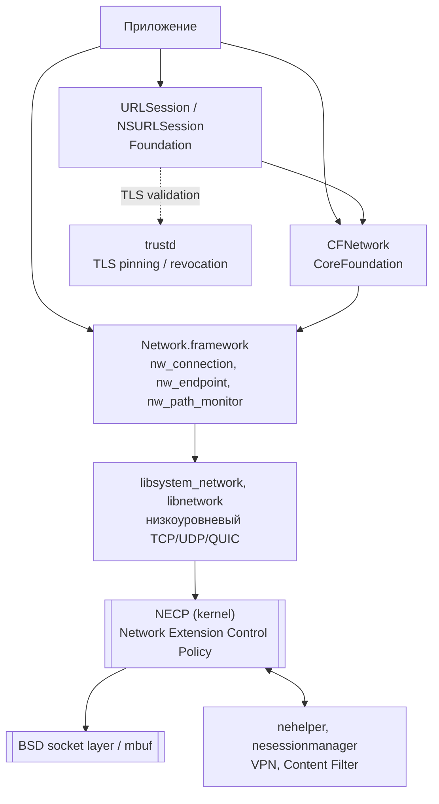
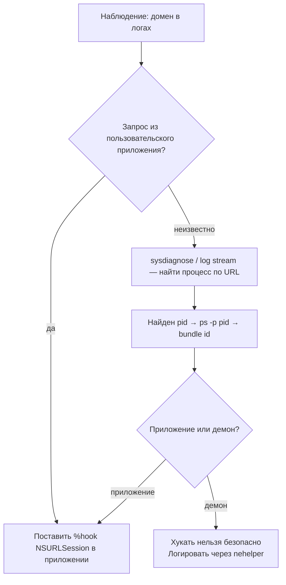

# Глава II.9. Сеть и фоновые задачи

Эта глава — о том, где именно в iOS 26 на A13 проходит путь сетевого запроса от строчки `URLSession.dataTask(with:)` до выхода байтов в радиомодуль, какие из этих уровней автор твика может перехватывать разумно, а какие — только с большим риском сломать систему. Отдельно рассматриваем NECP (Network Extension Control Policy) — тот редкий кусок ядра, из-за которого Dopamine на A13 ставит собственные хуки в каждом процессе, и показываем, как это уже решено за нас в `BaseBin/systemhook`.

## 1. Карта уровней сети в iOS 26

Сеть в iOS — это слоёный пирог. Схема ниже показывает, через какие слои приложение-клиент проходит на пути вверх (вызов API) и вниз (данные от ядра) в iOS 26. Прямоугольники с одной рамкой — публичные frameworks из iOS SDK, с двойной — ядерные подсистемы (XNU), стрелками показан вызывающий поток.



Важные свойства этого стека, которые пригодятся дальше в книге:

- `URLSession` — Objective-C-обёртка, у неё стабильные публичные селекторы и прямые делегаты, легко свизлить.
- `Network.framework` — C-API в стиле `nw_connection_t` с блоковыми коллбэками. Хукать его сложнее, потому что API построен не на классах, а на opaque-типах и блоках, но именно сюда поступают запросы, которые НЕ идут через `URLSession` (например, собственные HTTP-клиенты, QUIC, websockets приложений).
- Любой запрос — через `URLSession` или через `Network.framework` — рано или поздно упирается в NECP, который проверяет политику сетевого доступа процесса. NECP — это **единственное** место в ядре iOS 16+, где делается проверка `CS_VALID` на вызывающем процессе (подтверждается комментарием в `BaseBin/systemhook/src/main.c:124–125`). Эта деталь определяет, почему Dopamine на A13 вынужден хукать NECP syscalls в каждом процессе — об этом ниже.

## 2. Что из этого разумно хукать

Таблица «что хукать, что не стоит» для автора стороннего твика. «Безопасно» означает — метод не ломает другие приложения и не рушит системную сервисную службу. «Рискованно» означает — работает, но требует аккуратности. «Не стоит» — почти всегда ломает что-то.

| Что перехватить | Как | Статус | Комментарий |
|---|---|---|---|
| `URLSession dataTaskWithRequest:completionHandler:` | Objective-C swizzle через Logos `%hook NSURLSession` | Безопасно | Самая частая точка перехвата. Классы и методы стабильны от iOS 7. |
| `URLSession downloadTask`, `uploadTask`, `webSocketTask` | То же, `%hook` | Безопасно | Отдельные методы — каждый свой; swizzle по всем, если нужен полный охват. |
| `URLSessionConfiguration` → `HTTPAdditionalHeaders` | `%hook NSURLSessionConfiguration` | Безопасно | Простой способ подменить User-Agent. |
| `CFNetwork` C-функции | fishhook / ellekit | Рискованно | Работает, но многие вызовы `CFNetwork` живут внутри Foundation и не проходят через PLT процесса — fishhook их не видит. |
| `nw_connection_start`, `nw_connection_send`, `nw_connection_receive` | fishhook / ellekit | Рискованно | API построен на блоках, подмена блок-коллбэка требует хранить его копию с правильным retain. |
| `connect(2)`, `send(2)`, `recv(2)` на уровне syscalls | litehook / ellekit | Не стоит | Эти вызовы берут в оборот и Dopamine (внутри `systemhook`), и системные библиотеки — twik может оказаться в цикле. |
| `necp_*` syscalls | — | **Не делай** | Уже перехвачены самим Dopamine в `systemhook`, твик не должен это дублировать. См. раздел 4 этой главы. |
| TLS: `SecTrustEvaluate` | `%hookf SecTrustEvaluate` | Рискованно | «SSL pinning bypass» — скользкий этический вопрос; технически — да; этически — только в собственном приложении для unit-тестов. |

Правило большое: **хукай максимально высоко в стеке**. Чем ниже слой — тем шире разброс поведения, тем больше шансов упустить edge-case (QUIC vs HTTP/2 vs WebSocket vs HTTP/3), тем больше шансов на падение системного процесса.

## 3. URLSession — минимальный рабочий swizzle

Начнём с базового рецепта: твик, который для **собственного приложения** логирует все запросы `URLSession.dataTask(with:)`. Код полностью рабочий, собирается через Theos с `THEOS_PACKAGE_SCHEME=roothide`.

Файл `Tweak.xm`:

```objc
#import <Foundation/Foundation.h>
#import <os/log.h>

static os_log_t gNetLog;

%ctor {
    gNetLog = os_log_create("com.example.nettrace", "url");
    os_log(gNetLog, "nettrace loaded in %{public}s", [[NSProcessInfo processInfo].processName UTF8String]);
}

%hook NSURLSession

- (NSURLSessionDataTask *)dataTaskWithRequest:(NSURLRequest *)request
                            completionHandler:(void (^)(NSData *, NSURLResponse *, NSError *))handler
{
    os_log(gNetLog, "dataTask -> %{public}@", request.URL.absoluteString);
    return %orig(request, handler);
}

- (NSURLSessionDataTask *)dataTaskWithURL:(NSURL *)url
                        completionHandler:(void (^)(NSData *, NSURLResponse *, NSError *))handler
{
    os_log(gNetLog, "dataTask (URL) -> %{public}@", url.absoluteString);
    return %orig(url, handler);
}

%end
```

Разбор ключевых строк:

- `%ctor` — конструктор дылиба, вызывается однажды после загрузки в процесс. В нём создаём лог-handle и фиксируем сам факт загрузки — это бесценно при диагностике «а точно ли мой твик вообще загрузился?».
- `%hook NSURLSession` ... `%end` — Logos превращает это в метод-свизлинг через `method_setImplementation`. Детали — в главе I.3 и шпаргалке по синтаксису Logos.
- `%orig(request, handler)` — вызов оригинальной реализации с теми же аргументами. Без этого вызова любая работа сети в приложении прекращается.
- `os_log` вместо `NSLog` — последнее на iOS 26 всё ещё работает, но попадает в единую подсистему `log` и может быть агрессивно фильтровано. Собственный subsystem и category видно командой `log stream --predicate 'subsystem == "com.example.nettrace"'` на хост-машине с подключённым устройством.

Filter plist `com.example.MyTweak.plist` для одного приложения:

```xml
<?xml version="1.0" encoding="UTF-8"?>
<!DOCTYPE plist PUBLIC "-//Apple//DTD PLIST 1.0//EN" "http://www.apple.com/DTDs/PropertyList-1.0.dtd">
<plist version="1.0">
<dict>
    <key>Filter</key>
    <dict>
        <key>Bundles</key>
        <array>
            <string>com.example.testbed</string>
        </array>
    </dict>
</dict>
</plist>
```

Почему именно `Bundles`, а не `Executables` — в главе IV.3. Коротко: `Bundles` работает и для расширений (`.appex`), которые делят bundle id с основным приложением.

## 4. Почему твик НЕ должен хукать NECP, и что уже делает Dopamine

Этот раздел — главный технический сюжет главы и причина, по которой её вообще стоит прочитать до того, как начинать хукать сеть.

### 4.1. Что такое NECP

NECP (Network Extension Control Policy) — это подсистема ядра XNU, через которую проходит каждое созданное или проверяемое сетевое подключение. Приложение открывает NECP-сессию, кладёт туда политику (разрешено ли приложению ходить в сеть, через какой интерфейс, какой Network Extension обслуживает), и ядро её принимает в учёт при создании сокета.

NECP-syscalls, которые нас интересуют (их пять):

| Номер | Имя | Что делает |
|---|---|---|
| `SYS_necp_match_policy` | `necp_match_policy` | Проверить политику против набора параметров |
| `SYS_necp_open` | `necp_open` | Открыть NECP-дескриптор для клиента |
| `SYS_necp_client_action` | `necp_client_action` | Операции над NECP-клиентом (add, update, remove) |
| `SYS_necp_session_open` | `necp_session_open` | Открыть сессию для NetworkExtension |
| `SYS_necp_session_action` | `necp_session_action` | Операции над сессией |

### 4.2. Зачем Dopamine это хукает

Корень проблемы: в iOS 16+ код обработки этих пяти syscalls в ядре **проверяет флаг `CS_VALID` вызывающего процесса**. Это единственное место в XNU, где `CS_VALID` вообще проверяется для юзерского процесса. Все другие флаги codesign (`CS_PLATFORM_BINARY`, `CS_HARD`, `CS_RESTRICT`) проверяются в других контекстах, а `CS_VALID` — только здесь.

Теперь посмотрим на реальный код `BaseBin/systemhook/src/main.c:123–156`:

```c
#ifndef __arm64e__

// The NECP subsystem is the only thing in the kernel that ever checks CS_VALID on userspace processes (Only on iOS >=16)
// In order to not break system functionality, we need to readd CS_VALID before any of these are invoked

int necp_match_policy_hook(uint8_t *parameters, size_t parameters_size, void *returned_result)
{
    jbclient_cs_revalidate();
    return syscall(SYS_necp_match_policy, parameters, parameters_size, returned_result);
}

int necp_open_hook(int flags)
{
    jbclient_cs_revalidate();
    return syscall(SYS_necp_open, flags);
}

int necp_client_action_hook(int necp_fd, uint32_t action, uuid_t client_id,
                            size_t client_id_len, uint8_t *buffer, size_t buffer_size)
{
    jbclient_cs_revalidate();
    return syscall(SYS_necp_client_action, necp_fd, action, client_id, client_id_len,
                   buffer, buffer_size);
}
/* ... аналогично necp_session_open_hook, necp_session_action_hook ... */
```

Разбор на пальцах:

1. **`#ifndef __arm64e__`**. Этот блок компилируется только для arm64. На arm64e (A14+) ядро, по-видимому, валидирует codesign иначе, и этот трюк там не нужен (в проекте для arm64e есть другой путь — через `csops` hook ниже в файле). Для нас это означает: **именно на A13, именно на iOS 26 — эти хуки активны**. Это тот самый момент, когда «целевая среда A13» перестаёт быть абстракцией.

2. **`jbclient_cs_revalidate()`**. Это клиент-часть jbserver (объявление — в `BaseBin/libjailbreak/src/jbclient_xpc.c`, сервер — в `BaseBin/launchdhook`). Она просит привилегированный компонент jailbreak переустановить флаг `CS_VALID` в структуре кредов процесса. После этого ядро, увидев вызывающий процесс, пройдёт проверку.

3. **`syscall(SYS_necp_*, ...)` вместо прямого имени функции**. Прямой вызов `necp_match_policy` ушёл бы в libsystem и, что хуже, в наш же хук — бесконечная рекурсия. Через `syscall(2)` минуется весь userland-слой, вызов делается напрямую в ядро, с номером из `<sys/syscall.h>`. Это тот же приём «уходим мимо своего хука», который разбирается в главе о `inline_svc.*` и в шпаргалке по PAC.

4. **Регистрация хуков** находится в том же файле `main.c:514–520` (вызовы `litehook_hook_function(...)`). `litehook` — миниатюрная библиотека хуков из `BaseBin/_external/modules/litehook`, Dopamine использует её вместо substrate/substitute для внутренних задач.

### 4.3. Что это значит для автора твика

Три следствия, которые полезно помнить:

1. **Не ставь свои хуки на `necp_*`**. Если наложить свой fishhook/litehook поверх уже существующего, порядок вызова будет непредсказуемым: твой хук может не вызвать `jbclient_cs_revalidate` и отправит в ядро процесс без `CS_VALID` — соединения приложения просто перестанут открываться.
2. **Не удивляйся «лишнему» IPC в трейсах**. Если ты собираешь профайлер и видишь, что на каждый `URLSession.dataTask` где-то под капотом проходит XPC-обмен с `jailbreakd` — это нормально, именно так работает `jbclient_cs_revalidate` для NECP.
3. **Если нужен сетевой трейс — ставь его на `URLSession` или `nw_connection_*`, не на syscalls**. Высокоуровневый свизлинг не трогает ветку NECP и не конфликтует с Dopamine.

Это по сути самое важное практическое знание всей главы для автора стороннего твика.

## 5. Как найти процесс, который отправляет запрос

Частая задача исследования: «я вижу в журнале обращение к хосту `api.example.com`, но не знаю, какое приложение/расширение/демон его сделало». Алгоритм, воспроизводимый на устройстве с установленным Dopamine:



Практические инструменты на хосте, подключённом к устройству через USB:

- `log stream --predicate 'eventMessage CONTAINS "api.example.com"'` — показывает лог-записи, где упомянут домен; из них часто виден `process:` и `pid:`.
- `tcpdump` на интерфейсе `pktap` (`sudo tcpdump -i pktap --no-promisc -k`) — вместе с пакетом показывает имя процесса-отправителя. Делается не на устройстве, а на macOS с подключённым iPhone через `rvictl`.
- Поиск по строкам в бинарнике: `strings -a /path/to/app | grep api.example` — тривиально, но часто этого достаточно, чтобы отбросить гипотезу «это system daemon».

## 6. Фоновые задачи и жизненный цикл

Сетевые запросы редко живут отдельно от жизненного цикла процесса. iOS 26 даёт три основные точки входа:

- **BackgroundTasks (`BGTaskScheduler`)** — для периодических task'ов. Публичное API, не требует хуков для своего приложения.
- **URLSession в фоне** (`backgroundSessionConfigurationWithIdentifier:`) — для долгих загрузок/выгрузок, пережив жизненный цикл приложения; обслуживается демоном `nsurlsessiond`.
- **Push-driven wake** — приложение просыпается от silent push, обрабатывает его в `-application:didReceiveRemoteNotification:fetchCompletionHandler:`.

Для автора твика это выглядит так:

| Цель | Способ |
|---|---|
| Логировать все BG-таски в своём приложении | `%hook` на `-[BGTaskScheduler submitTaskRequest:error:]` |
| Логировать все скачивания в background session | `%hook` на `-[NSURLSession downloadTaskWithRequest:]` + `URLSessionDelegate` методы |
| Логировать входящие silent push | `%hook` на `-[AppDelegate application:didReceiveRemoteNotification:fetchCompletionHandler:]` |

Что осознанно **нельзя** делать: подавлять уведомления другим приложениям на уровне apsd. Это требует хуков в системном демоне (`apsd`, `usernotificationsd`), риск огромный, а эффект — отключение push у половины приложений устройства.

## 7. Что подтверждено исходниками, а что — нет

Это общее для всех глав Части II напоминание. Проверить/непроверить:

- Подтверждено исходниками: пять NECP syscalls, перехваченных Dopamine, их имена, тот факт, что блок активен только для `#ifndef __arm64e__`, и причина — проверка `CS_VALID` в ядре. Ссылки: `BaseBin/systemhook/src/main.c:123–156` и `main.c:514–520`.
- Подтверждено документацией Apple: публичные API `URLSession`, `BGTaskScheduler`, `Network.framework`; поведение `backgroundSessionConfigurationWithIdentifier:` в iOS 15+.
- Требует проверки на устройстве: конкретные селекторы private frameworks `CFNetwork` в iOS 26 (структура неэкспортных символов меняется между минорными релизами), поведение `nsurlsessiond` на A13 iOS 26.0 vs 26.0.1.
- Не подтверждено / данных недостаточно: конкретные internal-поля `nw_connection_t` на iOS 26 — у `Network.framework` нет публичного заголовка на эти поля, и подтвердить их можно только через class-dump на устройстве.

## 8. Выводы

Главный тезис главы: сетевой стек iOS 26 иерархически слоёный, и правильный уровень вмешательства — тот, который даёт автору твика нужное наблюдение с наименьшим риском. Для подавляющего большинства задач это `URLSession` или высокоуровневые методы Objective-C/Swift приложения, не syscalls.

Отдельно важно знать и не трогать: NECP-слой в iOS 26 на A13 (arm64, не arm64e) уже обработан самим Dopamine через хуки в `systemhook`, которые делают `jbclient_cs_revalidate()` перед каждым NECP syscall. Это нужно, чтобы ядерная проверка `CS_VALID` не отбрасывала процессы, оживлённые jailbreak-эксплойтом. Авторский твик, попытавшийся повторить эту логику, рискует сломать работу всей сети в хост-процессе.

## 9. Что дальше

- Для глубокого разбора формата NECP-пакетов — глава III.5 (разбор `systemhook`) и Deep-dive о `inline_svc.*`.
- Для перехвата `URLSession` в собственном приложении с рабочим кодом — рецепт Cookbook №2 и №13.
- Для фоновых задач — глава «Переключатель приложений и жизненный цикл процессов» II.5.
- Для диагностики «твик не ловит мои сетевые вызовы» — глава VII.1.
