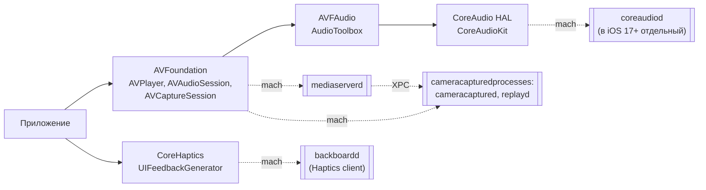
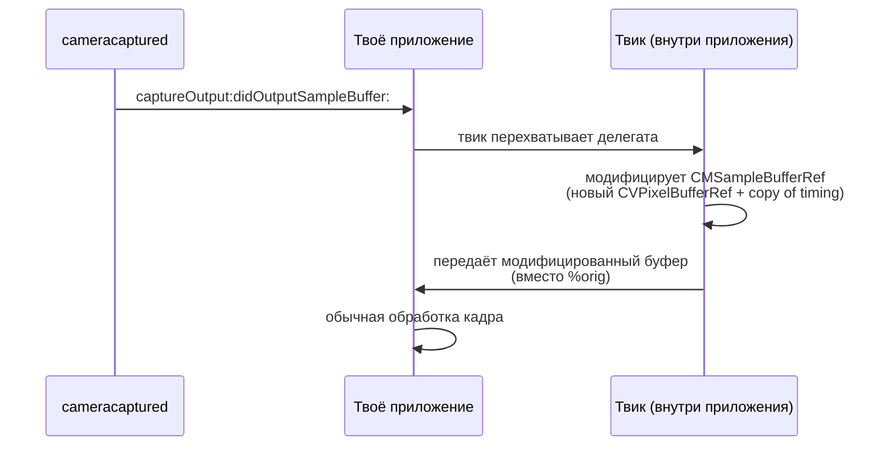

# Глава II.10. Мультимедиа, камера, звук и тактильная отдача

Эта глава — о подсистеме, в которой автору твика лучше всего понимать слои **в обратную сторону, чем в прямую**: сначала знать, где граница «не ходи», и только потом заходить в разрешённую зону. Мультимедиа в iOS 26 — это централизованная архитектура с одним привилегированным процессом (`mediaserverd`), и поломка этого процесса твиком — это обычно «пропал звук во всей системе» вплоть до перезагрузки. Отдельно разберём камеру (`AVCaptureSession`) и тактильную отдачу (`CoreHaptics`, `UIFeedbackGenerator`) — там границы совсем другие.

## 1. Карта процессов и фреймворков

Схема ниже показывает, кто с кем общается в типовом сценарии «приложение воспроизводит аудио» и «приложение снимает фото». Одноконтурные прямоугольники — публичные frameworks, двойные — демоны, пунктирные стрелки — XPC/mach, сплошные — обычные вызовы функций в одном процессе.



Что из этого полезно запомнить сразу:

- **`mediaserverd`** — единственный процесс, которому ядро открывает декодеры, доступ к ядру GPU для видео, DRM-ключи и SE-коммуникацию для платёжного аудио. Любое приложение, которое воспроизводит звук или видео, под капотом общается с ним через mach-порты.
- **`cameracaptured`** и `replayd` — семейство демонов, обслуживающих камеру и запись экрана. На iOS 26 именование может варьироваться; точные имена проверяются `launchctl list | grep -i camera` на устройстве.
- **`coreaudiod`** — выделен в отдельный демон начиная с iOS 17; на iOS 26 (A13) он активен и является отдельной точкой отказа для низкоуровневой аудио-работы.
- **`backboardd`** — помимо событий ввода, обслуживает тактильную отдачу через свой haptic-клиент. Это объясняет, почему `UIFeedbackGenerator` работает мгновенно, но исчезает в момент, когда `backboardd` занят долгим рендерингом.

## 2. mediaserverd — почему мы его обходим стороной

`mediaserverd` — одна из самых больных точек iOS с точки зрения стабильности. Три причины, которые делают его токсичным для твиков:

1. **Единственный держатель состояния для всей системы**. У `mediaserverd` есть глобальная таблица аудиосессий, активных плееров, прав на фоновую музыку, маршрутизации звука на Bluetooth. Если его процесс падает, iOS его перезапустит, но все существующие сессии потеряют состояние: музыка в фоне останавливается, вызов обрывается, маршрут на наушники пропадает, иногда до перезагрузки.
2. **Невероятная глубина кода**. Он подгружает десятки private frameworks (`MediaExperience`, `MediaRemote`, `AVKitCore`, `MediaPlayerUI`, `MusicLibrary`, `CoreMediaStream`, целая группа codec-плагинов). Хук в одном месте легко задевает соседние пути через XPC.
3. **Строгие и неочевидные проверки entitlements**. Многие XPC-методы `mediaserverd` допускают только приложения с конкретными entitlements (например, `com.apple.security.media-service`). Авторский твик, встроенный в чужое приложение, не получит их волшебным образом.

Факт, который этому подтверждает: сам Dopamine в себе `mediaserverd` **не хукает**. Это легко проверить:

```bash
grep -rln -E "mediaserverd|AVFoundation|AudioToolbox" \
    BaseBin/ Application/Dopamine/Jailbreak/ Application/Dopamine/UI/ 2>/dev/null
# — пусто.
```

Для сравнения: SpringBoard, cfprefsd, installd, lsd, runningboardd — все имеют свои `.x`-файлы в `BaseBin/rootlesshooks/` или `BaseBin/roothidehooks/src/`. У `mediaserverd` такого файла нет. Это сознательный выбор проекта: не трогать систему там, где потенциал ущерба несоизмерим с ценностью.

**Практическое следствие для автора твика**: даже если ты видишь интересный private selector в `MediaRemote` или `MPMusicPlayerController`, прежде чем хукать — спроси себя, вызывается ли этот селектор именно в `mediaserverd` или только в твоём приложении-клиенте. Хук внутри приложения-клиента (filter plist на bundle id) — безопасен. Хук системно (filter без `Bundles`, либо `com.apple.*`) — опасен.

## 3. AVFoundation — безопасная поверхность

`AVFoundation` — это высокоуровневая Objective-C-обёртка. Все её ключевые классы перехватываются стандартным Logos-свизлингом без каких-либо приключений, пока цель — ваше приложение.

Таблица частых точек перехвата с риск-метками:

| Что перехватить | Класс / метод | Риск | Комментарий |
|---|---|---|---|
| Начало воспроизведения | `AVPlayer -play` | Низкий | Делегат отслеживает `rate`-наблюдателя, он сработает естественно. |
| Пауза / остановка | `AVPlayer -pause`, `-replaceCurrentItemWithPlayerItem:` | Низкий | То же. |
| Выставление audio session | `AVAudioSession -setCategory:…error:` | Низкий | Используется для логирования, какое приложение что просит у аудио-подсистемы. |
| Активация audio session | `AVAudioSession -setActive:error:` | Низкий | Нюанс: если ты вернёшь `NO` вместо `%orig`, приложение останется немым до перезапуска. |
| Снимок с камеры | `AVCaptureSession -startRunning`, `-stopRunning` | Средний | См. раздел 4. |
| Распознавание звука | `AVSpeechSynthesizer -speakUtterance:` | Низкий | Для твика «перехватим и залогируем» — тривиально. |
| Воспроизведение видео через `AVPlayerViewController` | `-viewDidAppear:` на этом контроллере | Низкий | Хочешь только своё приложение — ограничь filter plist. |

Пример разумного твика для **своего собственного** приложения — логирование смены категории аудио-сессии (крайне полезно для отладки «почему звонок прервал мою музыку»):

```objc
#import <AVFoundation/AVFoundation.h>
#import <os/log.h>

static os_log_t gAudioLog;

%ctor { gAudioLog = os_log_create("com.example.audiotrace", "session"); }

%hook AVAudioSession

- (BOOL)setCategory:(NSString *)category
        withOptions:(AVAudioSessionCategoryOptions)options
              error:(NSError **)outError
{
    os_log(gAudioLog, "setCategory=%{public}@ options=0x%llx",
           category, (uint64_t)options);
    return %orig(category, options, outError);
}

- (BOOL)setActive:(BOOL)active
      withOptions:(AVAudioSessionSetActiveOptions)options
            error:(NSError **)outError
{
    os_log(gAudioLog, "setActive=%d options=0x%x", (int)active, options);
    return %orig(active, options, outError);
}

%end
```

Разбор ключевых решений:

- Хукаются именно варианты с опциями (`withOptions:`). У `AVAudioSession` исторически есть и короткие формы (`setCategory:error:`), но iOS внутри сводит их к длинной — хук короткой часто не ловит реального вызова.
- Возврат `%orig` всегда, никаких подмен `BOOL`. Если ты вернёшь `NO` из `setActive:`, у приложения отвалится звук.
- `%{public}@` в формате лога — чтобы ОС не вычёркивала строку в режиме приватных логов. Без этого на устройстве значение покажется как `<private>`.

## 4. Камера — где граница твика

`AVCaptureSession` — тот самый класс, через который все приложения с камерой общаются с системой. На A13 с iOS 26 ситуация такая:

- **Запуск сессии** (`startRunning`) требует TCC-разрешения на камеру. Твик, встроенный в чужое приложение, его не получит сам — ему нужно, чтобы приложение-хост уже имело это разрешение (пользователь дал его когда-то).
- **Фактический поток кадров** приходит из `cameracaptured` в клиент-процесс по shared memory + mach notifications. Это значит, что перехват делегата `AVCaptureVideoDataOutputSampleBufferDelegate.captureOutput:didOutputSampleBuffer:fromConnection:` работает — но перехват CoreMedia-примитивов внутри `cameracaptured` — не работает (твик не загружается в этот процесс по умолчанию).
- **Запись видео** через `AVCaptureMovieFileOutput` финализируется в `cameracaptured`, который сам пишет файл в sandbox приложения через поименованный vnode-grant. Файловое имя — то, что приложение задало.

Разумный твик для своего приложения — препроцессор кадра (например, рисует overlay на `CMSampleBufferRef` перед тем, как делегат получит его). Схема такая:



Чего делать **нельзя** технически:

- Хукнуть `cameracaptured`, чтобы «подменить кадры всем приложениям сразу». Twik туда не загружается, и даже если бы загрузился — там есть entitlement-check, который твик не прошёл бы без модификации самого бинарника.
- Записать «украденное» видео из чужой камеры в фоне без того, чтобы пользователь дал разрешение на TCC. Индикатор камеры в iOS 26 (зелёная/жёлтая точка в status bar) рендерит `backboardd` на основании сигналов `cameracaptured` — попытка его скрыть требует хука в SpringBoard, что технически возможно, но этически — чистое следящее ПО.

## 5. CoreAudio и AudioToolbox — низкий уровень

Эти два API — C-уровень, под `AVFoundation`. На них переходят, когда:

- нужны низкие задержки (`AUAudioUnit`, `AudioUnitRender`);
- нужен прямой доступ к HAL (`AudioHardwarePlugin`, `AudioObjectGetPropertyData`).

Для твика это обычно означает перехват C-функций через fishhook/ellekit. Тонкости, из-за которых редко стоит сюда лезть:

- Многие функции `CoreAudio` — реалтайм-safe, они не делают malloc и не держат блокировок. Логгинг через `os_log` или `NSLog` в теле хука **может завесить аудио-поток** (приведёт к `kAudioUnitErr_FailedInitialization` и обрыву звука).
- Правильное место для логгинга — отложить операцию через `dispatch_async(DISPATCH_QUEUE_PRIORITY_DEFAULT, …)` или кольцевой буфер с чтением из другого потока.

Правило для автора твика: **если AVFoundation решает задачу — не спускайся в CoreAudio**. На A13 с iOS 26 оверхед AVF незначим, а стабильность выше на порядок.

## 6. CoreHaptics и UIFeedbackGenerator

Тактильная отдача — приятно изолированный уголок. `UIFeedbackGenerator` и его подклассы (`UIImpactFeedbackGenerator`, `UINotificationFeedbackGenerator`, `UISelectionFeedbackGenerator`) — просты и хорошо хукаются. `CoreHaptics` — чуть сложнее, но тоже стабилен.

Полезные точки:

| Класс | Метод | Применение |
|---|---|---|
| `UIImpactFeedbackGenerator` | `-impactOccurred`, `-impactOccurredWithIntensity:` | Логировать/подменять «импульсные» срабатывания |
| `UINotificationFeedbackGenerator` | `-notificationOccurred:` | Логировать уведомления-уведомлялки |
| `UISelectionFeedbackGenerator` | `-selectionChanged` | Pickers, segmented controls |
| `CHHapticEngine` | `-startWithCompletionHandler:` | Начало работы движка |
| `CHHapticPatternPlayer` | `-startAtTime:error:` | Запуск паттерна |

Пример безобидного твика «отключить все haptics в моём приложении» (чисто учебный — публично это делается через настройки системы):

```objc
%hook UIImpactFeedbackGenerator
- (void)impactOccurred { /* тихо глушим */ }
- (void)impactOccurredWithIntensity:(CGFloat)intensity { /* ничего */ }
%end

%hook UINotificationFeedbackGenerator
- (void)notificationOccurred:(UINotificationFeedbackType)type { /* ничего */ }
%end
```

На что обратить внимание:

- Отсутствие `%orig` здесь — осознанное, именно потому что цель — заглушить. Для **логирующего** твика всегда делай `%orig(...)` в конце.
- `CoreHaptics` движок падает редко, но при неправильной передаче `CHHapticPattern` может залипнуть. Если хукаешь на запуск паттерна, не вмешивайся в сам объект паттерна — только логируй.

## 7. Полная таблица «что хукать / не хукать»

| Задача | Процесс/Framework | Способ | Статус |
|---|---|---|---|
| Логировать смену audio session в своём приложении | `AVAudioSession` | `%hook` | **Безопасно** |
| Перехват кадра камеры в своём приложении | `AVCaptureVideoDataOutputSampleBufferDelegate` | `%hook` на делегата | **Безопасно** |
| Логировать `AVPlayer.play` | `AVPlayer` | `%hook` | **Безопасно** |
| Отключить тактильную отдачу в своём приложении | `UIFeedbackGenerator` | `%hook` без `%orig` | **Безопасно** |
| Логировать работу `coreaudiod` клиентами | `AudioToolbox` C API | fishhook в приложении | Средний риск (realtime-safe правила) |
| Хук системного mediaserverd | — | — | **Не делай** |
| Скрыть индикатор камеры | SpringBoard private | — | **Этическая зона, не делай** |
| Перехват `AVSpeechSynthesizer` для перевода | `AVSpeechSynthesizer` | `%hook` в приложении | Безопасно |
| Перехват CoreMedia-примитивов в `cameracaptured` | — | — | **Технически невозможно без модификации binary** |

## 8. Типичные симптомы ошибок

Диагностическая таблица, которая экономит часы:

| Симптом | Вероятная причина | Что проверить |
|---|---|---|
| Пропал звук во всех приложениях после установки твика | Хук в системном пути (`mediaserverd` или `coreaudiod`), либо падение в хуке `AVAudioSession.setActive:` | `log stream --process mediaserverd` сразу после установки |
| Камера в твоём приложении открывается, но кадры «чёрные» | Делегат-свизлинг вернул неверный `CMSampleBufferRef` (не удержал retain) или потерял тайминг | Логировать `CMSampleBufferGetPresentationTimeStamp` до и после |
| Haptics не работают в твоём приложении | Хук `UIFeedbackGenerator -prepare` сломал prepared state | Убрать хук с prepare, оставить только на `impactOccurred` |
| Приложение падает при запуске твика с media API | Инициализация `AVAudioSession` в `%ctor` до того, как главный тред UIKit готов | Отложить инициализацию в первый `-application:didFinishLaunchingWithOptions:` |

## 9. Что подтверждено и что нет

- **Подтверждено исходниками**: Dopamine сам не хукает `mediaserverd`, `coreaudiod`, `cameracaptured` — grep по `BaseBin/` и `Application/Dopamine/` этих имён не находит. Это осознанное решение разработчиков jailbreak.
- **Подтверждено документацией Apple**: публичные API `AVFoundation`, `CoreHaptics`, `UIFeedbackGenerator`, `AVCaptureSession`; факт выделения `coreaudiod` в отдельный демон с iOS 17.
- **Требует проверки на устройстве**: конкретные имена demon-процессов на A13 iOS 26.0 (`cameracaptured` vs `cameracapturecore` vs другое — проверяется `launchctl list | grep -i cam`); фактическая цепочка XPC в `mediaserverd` для DRM-контента.
- **Не подтверждено**: наличие и форма entitlement `com.apple.security.media-service` на iOS 26 — на старых версиях он существовал, на 26 я не нашёл подтверждения ни в SDK, ни в коде проекта. Если понадобится — проверять на устройстве через `ldid -e /System/Library/Frameworks/MediaExperience.framework/MediaExperience` или аналогичный fetch.

## 10. Выводы

Главный тезис главы: мультимедийная подсистема iOS 26 **безопасна для твика сверху вниз, пока ты остаёшься внутри своего процесса-хоста**. `AVFoundation`, `CoreHaptics`, `UIFeedbackGenerator` — всё хукается стандартным Logos-свизлингом, с `%orig` в теле хука и грамотным TCC-разрешением на хосте. Как только появляется искушение «а давайте системно» — читай главу заново, в особенности раздел 2 про `mediaserverd`. Dopamine, у которого есть все инструменты и привилегии, сюда не лезет не потому, что не хочет, а потому что цена ошибки огромна.

Отдельный специфический факт для автора твика на A13 с iOS 26: от jailbreak-проекта в части мультимедиа ты получаешь **нулевую помощь и нулевое препятствие** — слои не хукаются Dopamine, никакие `jbclient_*` функции здесь не требуются. Это одновременно означает, что ты не унаследуешь ни полезных примитивов, ни хрупкости — живёшь строго по правилам публичного SDK.

## 11. Что дальше

- Для `AVCaptureSession` конкретного рабочего кода «логирование запросов камеры» — рецепт Cookbook (планируемый, номера переменные, но тема «перехват кадров»).
- Для деталей XPC-коммуникации с `mediaserverd` — глава «Daemons: mediaserverd» (в томе глубоких погружений, когда она будет написана).
- Для `backboardd` как источника haptic-событий — глава «backboardd» и глава II.6 про жесты.
- Для диагностики «пропал звук после твика» — глава VII.1.
