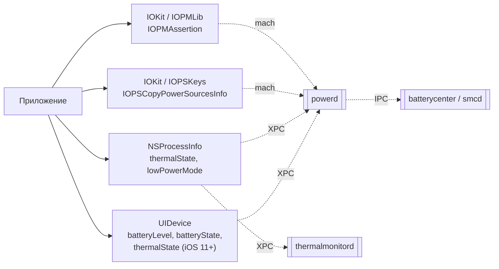

# Глава II.11. Питание, батарея, тепловое состояние

Эта глава — о подсистеме, где граница публичного SDK намеренно жёсткая: Apple даёт в точности столько, сколько надо для адаптации приложения к состоянию питания, и ни битом больше. Автор твика, работающий на iOS 26 (A13), получает интересный набор возможностей ровно в том же публичном слое — всё, что ниже, живёт в `powerd`, `thermalmonitord` и IOKit, и доступ туда стоит ценой либо специальных entitlements, либо хуков в системных демонах.

## 1. Карта подсистемы

Прямой публичный путь, который видит приложение:



Три важные детали:

- **`UIDevice.batteryLevel`** и **`UIDevice.batteryState`** требуют включить `isBatteryMonitoringEnabled = YES`, иначе приложение видит `-1.0` и `UIDeviceBatteryStateUnknown`. Многие авторы твиков забывают, из-за чего «мой хук не ловит нужное значение» на самом деле означает «приложение не включило мониторинг».
- **`NSProcessInfo.thermalState`** — четыре значения (`nominal`, `fair`, `serious`, `critical`). Подписка на `NSProcessInfoThermalStateDidChangeNotification` даёт события при изменении, без polling.
- **`IOPMAssertion`** (из IOKit/IOPMLib) — публичный API, но часто используется неверно. Это **утверждения**, которые просят систему не засыпать/не гасить экран; если забыть `IOPMAssertionRelease`, приложение будет держать систему проснувшейся до своего завершения.

## 2. Что из этого разумно хукать

Таблица «что хукать для своего приложения» (filter plist на bundle id):

| Задача | Что хукать | Риск | Примечание |
|---|---|---|---|
| Логировать запросы на уровень батареи | `-[UIDevice batteryLevel]` | Низкий | Хук срабатывает только после `isBatteryMonitoringEnabled = YES` в приложении. |
| Подменить состояние зарядки для теста UI | `-[UIDevice batteryState]` | Низкий | Удобно для скриншотов «на 100%». |
| Форсировать low-power mode для теста | `+[NSProcessInfo processInfo].isLowPowerModeEnabled` | Низкий | Приложение переключится в экономичный режим. |
| Логировать запросы assertions | `IOPMAssertionCreateWithProperties` (C-функция) | Средний | fishhook/ellekit; осторожно с realtime-safe code (см. главу II.10 про аудио). |
| Подменить `thermalState` | `-[NSProcessInfo thermalState]` | Средний | Нотификации `thermalStateDidChange` при этом не триггерятся — надо постить вручную. |
| Хук `powerd` / `thermalmonitord` системно | — | **Не стоит** | Твик туда не попадает без модификации entitlements; падение этих демонов = экран чернеет либо устройство в холодную перезагрузку. |

### 2.1. Пример: твик, подменяющий battery level для теста

Полный рабочий Tweak.xm для **своего** приложения — заставить приложение видеть ровно 42% заряда:

```objc
#import <UIKit/UIKit.h>
#import <os/log.h>

static os_log_t gBatLog;

%ctor { gBatLog = os_log_create("com.example.battery", "fake"); }

%hook UIDevice

- (float)batteryLevel
{
    float real = %orig;
    os_log(gBatLog, "batteryLevel: real=%.2f, forcing=0.42", real);
    return 0.42f;
}

- (UIDeviceBatteryState)batteryState
{
    UIDeviceBatteryState real = %orig;
    // форсируем "не заряжается" — чтобы приложение не искало charger
    return UIDeviceBatteryStateUnplugged;
}

%end
```

Разбор:

- `batteryLevel` возвращает значение от 0.0 до 1.0, или -1.0 если мониторинг не включён. Мы перехватываем независимо от этого и возвращаем 0.42f — приложение, даже забывшее `isBatteryMonitoringEnabled`, увидит нашу подмену, но нотификация `UIDeviceBatteryLevelDidChangeNotification` не придёт сама по себе. Если тест требует события — post'ай его вручную.
- `batteryState` важно вернуть согласованным с уровнем. Если `batteryLevel = 0.42` и одновременно `batteryState = UIDeviceBatteryStateFull`, приложение запутается и может показать странный UI.
- `%orig` вызываем в начале хука и логируем настоящее значение — это общий паттерн: сначала запомни правду, потом подмени.

## 3. IOPMAssertion — ответственность за пробуждение

`IOPMAssertion` — отдельный короткий сюжет, потому что это самое частое место протекания в твиках, работающих с питанием. Схема правильной работы:

```c
#include <IOKit/pwr_mgt/IOPMLib.h>

static IOPMAssertionID gKeepAwake = kIOPMNullAssertionID;

- (void)startWork
{
    IOReturn r = IOPMAssertionCreateWithName(
        kIOPMAssertionTypePreventUserIdleSystemSleep,
        kIOPMAssertionLevelOn,
        CFSTR("com.example.my-tweak: background job"),
        &gKeepAwake);
    if (r != kIOReturnSuccess) {
        gKeepAwake = kIOPMNullAssertionID;
    }
}

- (void)finishWork
{
    if (gKeepAwake != kIOPMNullAssertionID) {
        IOPMAssertionRelease(gKeepAwake);
        gKeepAwake = kIOPMNullAssertionID;
    }
}
```

Правила, которые надо помнить при хукинге:

- Если твик вводит `startWork`-подобный путь, он **обязан** вводить и `finishWork`-путь. Иначе первая активация твика «утечёт» assertion, и устройство будет жить без автоматического усыпления до перезагрузки.
- Имя (`CFSTR(...)`) видно в `pmset -g assertions` на хосте с подключённым устройством — используй распознаваемое имя для своего твика. Это сильно помогает в диагностике «кто мешает устройству заснуть».
- На iOS 26 проект Dopamine не добавляет и не удаляет самостоятельно IOPMAssertion из `BaseBin` — grep это подтверждает:

```bash
grep -rn "IOPMAssertion" BaseBin/ 2>/dev/null
# — пусто
```

Это значит, что любые assertions, которые ты видишь в `pmset -g assertions` после установки твика, — это либо твики, либо приложения, но не сам jailbreak.

## 4. Тепловое состояние и как его читать

На iOS 26 термальный аппарат остался тот же, что был в поздних 18.x: `thermalmonitord` собирает температуры с нескольких сенсоров (SMC), применяет пороги и выставляет глобальное состояние, которое получают приложения через `NSProcessInfo.thermalState`.

Четыре уровня:

| Уровень | Что это значит на A13 | Что ответственно приложение |
|---|---|---|
| `nominal` | Устройство в норме | Можно всё |
| `fair` | Поднялась температура | Снизить частоту обновления экрана, перейти с 60Hz-анимаций на 30 |
| `serious` | Устройство активно охлаждается | Отключить второстепенные задачи, уменьшить графику |
| `critical` | Критический перегрев | Остановить всё, что не нужно для текущего взаимодействия |

Что из этого доступно твику:

- **Чтение** — через `NSProcessInfo` и `NSProcessInfoThermalStateDidChangeNotification`. Публично, работает в любом приложении.
- **Запись** (подмена) — только через `%hook`, и только внутри своего приложения-хоста. Общесистемно подменить температуру нельзя: `thermalmonitord` берёт данные от драйверов, а не от публичного API.

Иногда возникает вопрос «можно ли узнать температуру чипа в градусах?». Публично — нет; `thermalState` даёт только четыре уровня. Чтобы получить градусы, нужны IOKit-запросы к `AppleSMC` или `IOThermalSensor`, которые требуют `com.apple.private.iokit.IOThermalSensor` entitlement. Твик, встроенный в стороннее приложение, его не получает. Хост-процесс с таким entitlement в iOS 26 — это редкие системные приложения (например, Diagnostics.app), в которые встраивание твика бессмысленно и, возможно, невозможно без модификации trustcache со стороны самого Dopamine.

## 5. Низкий уровень энергопотребления (`isLowPowerModeEnabled`)

Low Power Mode (LPM) — отдельная история, потому что это **системный флаг**, который влияет на поведение всех приложений: ограничивается фоновая активность, снижается `UIKit`-анимация, выключается визуальная «избыточность». Публично его можно только читать:

```objc
BOOL lpm = [NSProcessInfo processInfo].isLowPowerModeEnabled;
```

Включить/выключить LPM программно — нельзя публично. Это сделано осознанно и твикам тут приходится работать с ограничением:

- Для **своего приложения** можно сымитировать LPM, подменив возвращаемое значение. Приложение переключится во «внутренний» low-power режим, но сама iOS останется в обычном.
- Для **других приложений** сделать то же без хука в SpringBoard или `powerd` невозможно.

На iOS 26 никаких официальных новых путей включить LPM через SDK не появилось (подтверждено по release notes); если тебе нужно это для автоматических тестов — используй UI-автоматизацию через Shortcuts или Settings.

## 6. Как не ломать систему

Семь коротких правил, которые экономят часы диагностики:

1. **Не хукай `powerd` и `thermalmonitord` системно.** Это демоны-синглтоны; их падение гасит экран или вызывает кернел-паникирование.
2. **Если делаешь `IOPMAssertion*`, парируй его обязательно.** Утечки assertions — главная причина «устройство греется и батарея садится после установки твика».
3. **Не подменяй `thermalState` в `serious`/`critical` в системных приложениях.** iOS в этих режимах принимает защитные меры; подмена приводит к зависанию UI.
4. **Если хукаешь `batteryLevel`, подменяй и `batteryState` согласованно.** Иначе бок UI поведёт себя непредсказуемо.
5. **Чтение градусов через IOKit запрещено для не-entitled приложений.** Не пытайся обойти — это ломает проверку sandbox.
6. **Не держи assertion в фоне без ограничения по времени.** Поставь таймер через `dispatch_source_create` с автоматическим `IOPMAssertionRelease` через, скажем, 30 секунд.
7. **Не считай LPM «просто флагом».** Это агрессивная политика iOS, которая выключает фоновую сеть, ограничивает CPU и т. д. Подмена её значения в своём приложении может нарушить ожидания собственного кода.

## 7. Таблица «интересные API → процесс → разрешения»

| Что ты хочешь узнать | Публичный API | Entitlement | Если недоступно |
|---|---|---|---|
| Уровень батареи (0.0–1.0) | `UIDevice.batteryLevel` | — | нужен `isBatteryMonitoringEnabled` |
| Состояние зарядки | `UIDevice.batteryState` | — | — |
| Температура в градусах | — | `com.apple.private.iokit.IOThermalSensor` | только system apps |
| Thermal state (4 уровня) | `NSProcessInfo.thermalState` | — | — |
| Low Power Mode (чтение) | `NSProcessInfo.isLowPowerModeEnabled` | — | — |
| Low Power Mode (запись) | — | `com.apple.private.lowpowermode` | нет публично |
| Текущий источник питания | `IOPSCopyPowerSourcesInfo` + `IOPSCopyPowerSourcesList` | — | — |
| Детальные показатели (voltage, current) | `IOPSCopyExternalPowerAdapterDetails` | — | ограниченный набор ключей |
| Prevent system sleep | `IOPMAssertionCreateWithName` | — | — |

## 8. Что подтверждено и что нет

- **Подтверждено исходниками**: Dopamine в `BaseBin/` не хукает `powerd`, `thermalmonitord`, `IOPM*`; подтверждается отсутствием результатов в `grep`. Это значит, что ответственность за энергопотребление целиком на авторе твика.
- **Подтверждено документацией Apple**: публичные API `UIDevice`, `NSProcessInfo.thermalState`, `IOPMAssertion*`, `IOPSKeys`.
- **Требует проверки на устройстве**: конкретные значения entitlements для доступа к детальной IOKit-телеметрии на iOS 26.0/26.0.1 — набор именованных entitlements может отличаться от iOS 18.
- **Не подтверждено / неизвестно**: конкретные тепловые пороги в градусах, при которых `thermalState` переключается между уровнями на A13 iOS 26 — это внутреннее знание `thermalmonitord` и его таблиц, недоступное извне.

## 9. Выводы

Главный тезис: подсистема питания/термики — это одно из редких мест в iOS, где **публичный SDK даёт практически всё, что нужно твику**, при условии, что твик встроен в своё приложение-хост. Dopamine сюда не вмешивается, не помогает и не мешает. Это одновременно и преимущество (нет невидимых хуков, которые могли бы перевернуть твои ожидания), и ограничение (нет готовых примитивов, которые делали бы невозможное).

Если твои задачи требуют именно общесистемных эффектов (а не «только внутри моего приложения»), помни: `powerd` и `thermalmonitord` — демоны, падение которых дорого обходится; не пытайся их хукать без очень веской причины и без тщательных тестов.

## 10. Что дальше

- Если нужен низкоуровневый перехват `IOPMAssertionCreate*` — см. главу II.14 про XPC и общие рекомендации по fishhook (пока будут написаны).
- Для разбора entitlements на iOS 26 — глава I.5 и приложение B.
- Для рецепта «логировать батарею в своём приложении целиком» — Cookbook (в разработке).
- Для диагностики «устройство греется после установки твика» — глава VII.1 (симптомы и расследование).
