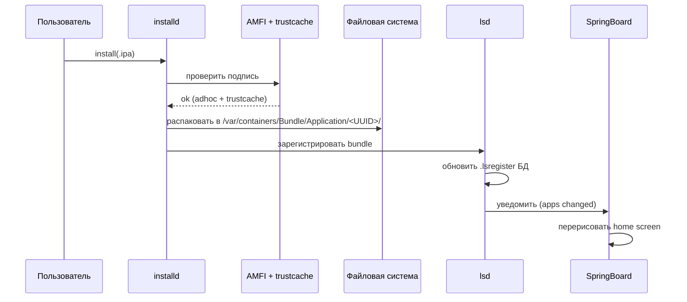
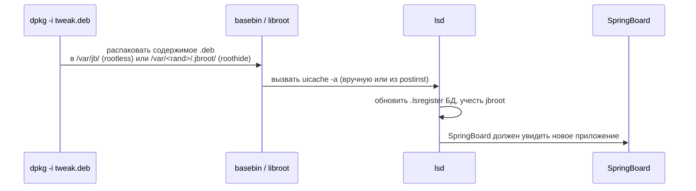

# Глава II.12. Установка приложений, расширения, межслужебное взаимодействие

Эта глава — о подсистеме, где Dopamine особенно активен: установка приложений и регистрация расширений — это именно то место, где rootless + roothide вмешивается в стандартные пути, чтобы приложения из jailbreak-окружения продолжали быть «видимыми» для iOS. Для автора стороннего твика важно понять, что в этой подсистеме уже сделано за нас, и чего мы НЕ должны повторять.

## 1. Два «движка» установки

На iOS 26 (как и на iOS 15+) в системе два тесно связанных движка:

- **`installd`** — демон, принимающий `.ipa`/`.app` и физически раскладывающий их по `/private/var/containers/Bundle/Application/<UUID>/`. Общается с `MobileInstallation.framework`.
- **`lsd`** (Launch Services daemon) — ведёт глобальный реестр установленных приложений и расширений. Регистрирует URL-схемы, UTI, document types.

Схема типового пути установки .ipa через TrollStore / Dopamine jbctl:



Два важных ответвления:

- **Подпись** на jailbroken-устройстве — это adhoc-подпись + добавление cdhash в trust cache. Все детали — в главах III.11 (bootstrap) и Deep-dive о trustcache. С точки зрения `installd` подпись выглядит валидной, потому что AMFI «просит» ядро проверить trust cache.
- **Регистрация в `lsd`** — не всегда прямая. Если приложение уже установлено, `installd` просит `lsd` обновить запись; если новое — создать. Все эти пути проходят через `_LSServer_RebuildApplicationDatabases`.

## 2. Что в этой подсистеме делает Dopamine

### 2.1. `installd` — почти ничего

Файл `BaseBin/rootlesshooks/installd.x` при внимательном прочтении оказывается почти пустым:

```objc
#import <Foundation/Foundation.h>

// BOOTLOOP RISK, DO NOT TOUCH
/*%hook MIGlobalConfiguration
- (NSMutableDictionary *)_bundleIDMapForBundlesInDirectory:(NSURL *)directoryURL
                                             withExtension:(NSString *)extension
                                     loadingAdditionalKeys:(NSSet *)additionalKeys
{ ...
}
%end*/

void installdInit(void)
{
    %init();
}
```

Это критически важный факт для автора твика: разработчики Dopamine когда-то пробовали хукать `MIGlobalConfiguration._bundleIDMapForBundlesInDirectory:` в installd и наткнулись на bootloop (комментарий «BOOTLOOP RISK, DO NOT TOUCH» говорит сам за себя). Хук закомментирован, функция `installdInit()` вызывает пустой `%init()`.

Следствие:

- **На `installd` Dopamine не ставит никаких активных хуков**. Установка приложений работает через стандартный Mobile Installation механизм.
- Автор твика, который попытается наложить свои хуки на `installd`, рискует воспроизвести ту самую ошибку, из-за которой разработчики проекта остановились. Это зона, куда даже самому jailbreak опасно залезать.

### 2.2. `lsd` — активно

Здесь всё интереснее. У Dopamine два слоя хуков в `lsd`:

#### `BaseBin/rootlesshooks/lsd.x` — для rootless

Два активных хука:

- **`_LSGetInboxURLForBundleIdentifier`** — переадресует «входящий ящик» (inbox) не-apple приложений в jbroot-путь. Это нужно, чтобы файлы, пришедшие через "Open in..." в приложения, установленные в rootless, попадали по правильному пути:

```objc
%hookf(NSURL *, _LSGetInboxURLForBundleIdentifier, NSString *bundleIdentifier)
{
    NSURL *origURL = %orig;
    if (![bundleIdentifier hasPrefix:@"com.apple"] &&
        [origURL.path hasPrefix:@"/var/mobile/Library/Application Support/Containers/"]) {
        return [NSURL fileURLWithPath:JBROOT_PATH_NSSTRING(origURL.path)];
    }
    return origURL;
}
```

Разбор:

- `%hookf` — Logos-синтаксис для хука C-функции (с префиксом `__`), а не Objective-C селектора. Имя функции — `__LSGetInboxURLForBundleIdentifier`, задаётся позже в `%init(...)`.
- Фильтр `![bundleIdentifier hasPrefix:@"com.apple"]` — трогаем только пользовательские приложения, оставляем системные в покое.
- `JBROOT_PATH_NSSTRING(origURL.path)` — макрос из `libroot`, он прибавляет случайный префикс jbroot к пути. На выходе: `/var/<rand>/<rand>/.jbroot/var/mobile/Library/Application Support/Containers/...`.

- **`_LSServer_RebuildApplicationDatabases`** — после системного ребилда БД Launch Services запускает `uicache -a`, чтобы заново добавить jailbreak-приложения в иконки:

```objc
%hookf(int, _LSServer_RebuildApplicationDatabases)
{
    int r = %orig;
    dispatch_async(dispatch_get_global_queue(DISPATCH_QUEUE_PRIORITY_DEFAULT, 0), ^{
        const char *uicachePath = JBROOT_PATH_CSTRING("/usr/bin/uicache");
        if (!access(uicachePath, F_OK)) {
            exec_cmd(uicachePath, "-a", NULL);
        }
    });
    return r;
}
```

Разбор:

- `uicache -a` переобновляет иконки на SpringBoard. Без этого после системной перерегистрации приложения из jailbreak «исчезли бы».
- `dispatch_async` — чтобы не блокировать поток-демон. Если бы `exec_cmd` вызывался синхронно, `lsd` на несколько секунд завис бы на обслуживании других клиентов.

#### `BaseBin/roothidehooks/src/lsd.x` — для roothide

Добавлены два расширенных хука, которые помогают скрывать jailbreak от определения через URL-схемы:

- **`_LSURLOverride.initWithOriginalURL:`** — если URL помечен как «блокируемый» (через associated object `kBlockSchemeTagKey`), возвращает `nil`, разрывая цепочку обработки:

```objc
%hook _LSURLOverride
-(id)initWithOriginalURL:(NSURL*)url
{
    NSNumber* tag = objc_getAssociatedObject(url, kBlockSchemeTagKey);
    if(tag && tag.boolValue) {
        NSLog(@"block -[LSURLOverride initWithOriginalURL:] %@", url);
        return nil;
    }
    return %orig;
}
%end
```

- **`_LSCanOpenURLManager.getIsURL:alwaysCheckable:hasHandler:`** — для «помеченных» URL возвращает «ни checkable, ни handler»:

```objc
%hook _LSCanOpenURLManager
-(void*)getIsURL:(NSURL*)url alwaysCheckable:(BOOL*)pCheckable hasHandler:(BOOL*)pHasHandler
{
    BOOL _checkable = NO;
    BOOL _hasHandler = NO;
    void* result = %orig(url, &_checkable, &_hasHandler);
    if(_checkable || _hasHandler) {
        NSNumber* tag = objc_getAssociatedObject(url, kBlockSchemeTagKey);
        if(tag && tag.boolValue) {
            _hasHandler = NO;
            _checkable = NO;
        }
    }
    if(pCheckable) *pCheckable = _checkable;
    if(pHasHandler) *pHasHandler = _hasHandler;
    return result;
}
%end
```

Это ключевой механизм детект-защиты: приложения, вызывающие `canOpenURL:` с jailbreak-схемами (например, `cydia://`, `sileo://`, `zbra://`), не получают положительного ответа.

**Для автора твика это означает:**

1. Если твой твик регистрирует URL-схему, которая выглядит как «jailbreak» (`cydia://`, `sileo://`, `tweak://`, подобное), не удивляйся, что некоторые приложения её «не видят» — это сделано намеренно.
2. Не воспроизводи логику блокировки URL-схем в собственном твике. Dopamine уже этим занимается, параллельный хук создаст конфликт.

## 3. Регистрация своего приложения / твика в системе

Для автора твика часто возникает практическая задача: «я собрал .deb с tweak + helper-приложением, как iOS увидит это приложение?».

Полный цикл:



Три детали, которые ломают это на практике:

1. **Приложения, лежащие в `/Applications`** — классическая цепочка. В rootless + roothide это **не работает**, потому что `/Applications` не писуемо. Приложения должны лежать в `/var/jb/Applications` (rootless) или `/var/<rand>/.jbroot/Applications` (roothide).
2. **`uicache -a`** нужно вызывать после установки — обычно это делается в `postinst`-скрипте .deb. Если забыть, приложение будет «на диске», но без иконки.
3. **`.app` должен быть ad-hoc подписан** и его `CFBundleIdentifier` — уникален в системе.

Для твиков **без собственного приложения** (чисто dylib + filter plist) ни одно из этого не требуется — твик загружается через `DYLD_INSERT_LIBRARIES`, никакая регистрация в `lsd` не нужна.

## 4. Расширения приложений (`.appex`)

Расширения — это subtype приложений, живут внутри `.app`-бандла (`<App>.app/PlugIns/<Ext>.appex`). Основные типы, релевантные для твика на iOS 26:

| Тип расширения | NSExtensionPointIdentifier | Полезно твикам? |
|---|---|---|
| Share Extension | `com.apple.share-services` | Можно хукать, filter по bundle id .appex |
| Action Extension | `com.apple.ui-services` | Аналогично |
| Today Widget (устарел, но жив) | `com.apple.widget-extension` | — iOS 14+ сменил на WidgetKit |
| WidgetKit | `com.apple.widgetkit-extension` | Хукать можно, но SwiftUI внутри часто inline-dispatch — хук не всегда ловит |
| Notification Service | `com.apple.usernotifications.service` | Полезно для перехвата входящих push в своём приложении |
| Notification Content | `com.apple.usernotifications.content-extension` | Аналогично |
| Intents | `com.apple.intents-service` | Для Shortcuts / Siri |
| Keyboard | `com.apple.keyboard-service` | Хуки работают, но подпись entitlement строгая |

Правило: **твик, применяемый к расширению, должен иметь filter plist с bundle id именно `.appex`**, а не хост-приложения:

```xml
<key>Filter</key>
<dict>
    <key>Bundles</key>
    <array>
        <string>com.example.myapp</string>
        <string>com.example.myapp.ShareExt</string>
    </array>
</dict>
```

Расширение — это **отдельный процесс**, запускаемый `runningboardd` по требованию, с собственным адресным пространством. Твик, вставленный в хост-приложение, не окажется автоматически в его расширении — нужно явно перечислить bundle id расширения в filter.

## 5. XPC-службы в приложении

Третий «вид» компонента — внутренний XPC-сервис (`<App>.app/Contents/XPCServices/<Service>.xpc` на macOS; на iOS структура немного другая, но принцип тот же через `NSXPCConnection`). Такие сервисы — это, по сути, выделенные процессы, обслуживающие межсервисные вызовы одного приложения.

Хукаются стандартным Logos-свизлингом с filter на bundle id XPC-сервиса. Пример полезной задачи — логировать все `NSXPCConnection` в своём приложении, чтобы увидеть, какой helper чем занят:

```objc
%hook NSXPCConnection

- (instancetype)initWithServiceName:(NSString *)serviceName
{
    NSLog(@"NSXPCConnection initWithServiceName: %@", serviceName);
    return %orig;
}

- (void)resume
{
    NSLog(@"NSXPCConnection resume: %@ -> %@",
          self.serviceName ?: @"<no name>",
          self.remoteObjectInterface);
    %orig;
}

%end
```

## 6. Таблица «что хукать безопасно»

| Задача | Процесс | Способ | Статус |
|---|---|---|---|
| Логировать установку приложений | `installd` | — | **НЕ хукай** (bootloop risk) |
| Логировать запуски приложений | `SpringBoard` или собственный `lsd`-клиент | `%hook SBApplicationLauncher` | Средний риск |
| Перехватить `canOpenURL:` в своём приложении | `UIApplication` | `%hook` | Безопасно |
| Переподписать своё приложение по-другому | — | ChOma + ldid перед установкой | Безопасно (вне рантайма) |
| Регистрация своего .app | `.deb postinst` + `uicache -a` | — | Безопасно |
| Хук Share Extension | расширение-процесс | filter plist на bundle id `.appex` | Безопасно |
| Блокировать URL-схемы | уже делает Dopamine | — | **НЕ дублируй** |

## 7. Что подтверждено

- **Подтверждено исходниками**:
  - `installd` в Dopamine не хукается активно (`BaseBin/rootlesshooks/installd.x` — закомментированный блок с пометкой «BOOTLOOP RISK, DO NOT TOUCH»).
  - В `lsd` активны `_LSGetInboxURLForBundleIdentifier` и `_LSServer_RebuildApplicationDatabases` (`BaseBin/rootlesshooks/lsd.x`).
  - В roothide-слое добавлены хуки `_LSURLOverride` и `_LSCanOpenURLManager` для скрытия jb-схем (`BaseBin/roothidehooks/src/lsd.x`).
  - `uicache -a` вызывается после ребилда LS БД.
- **Подтверждено документацией Apple**: `NSExtensionPointIdentifier` значения; механизм `UIApplication canOpenURL:`; структура `.appex`.
- **Требует проверки на устройстве**: конкретные пути `/var/mobile/Library/Application Support/Containers/<id>/Documents/Inbox` на iOS 26 (на старых iOS путь варьировался).
- **Не подтверждено**: все ли классы в `BaseBin/roothidehooks/src/lsd.x` присутствуют в iOS 26 с теми же именами — `_LSURLOverride`, `_LSCanOpenURLManager` — класс private, имена могли эволюционировать; поведение проверяется на устройстве через class-dump CoreServices.framework.

## 8. Выводы

Главный тезис: установка и регистрация приложений — зона, где jailbreak уже выполнил неочевидную работу (перенаправление путей `lsd`, запуск `uicache`, скрытие jb URL-схем), и автор твика должен в неё аккуратно встроиться, а не дублировать. Единственный правильный способ сделать своё приложение «видимым» в iOS 26 на jailbreak — положить его в правильный jbroot-путь и дернуть `uicache` в `postinst`. Хуки на `installd` опасны: самим разработчикам Dopamine пришлось от них отказаться после bootloop.

Для расширений и XPC-сервисов — всё по правилам публичного SDK, с одной деталью: filter plist твика должен явно указывать bundle id нужного `.appex` или `.xpc` — наследования от хост-приложения не происходит.

## 9. Что дальше

- Для деталей `uicache`, `jbctl`, `basebin.tar` — глава III.11.
- Для деталей `lsd` как процесса — глава «Daemons: lsd» (в разработке).
- Для расширений и Share Extension с кодом — Cookbook (в разработке).
- Для роли `installd` в полном пайплайне поставки .tipa — глава V.1 про патчи самого jailbreak.
