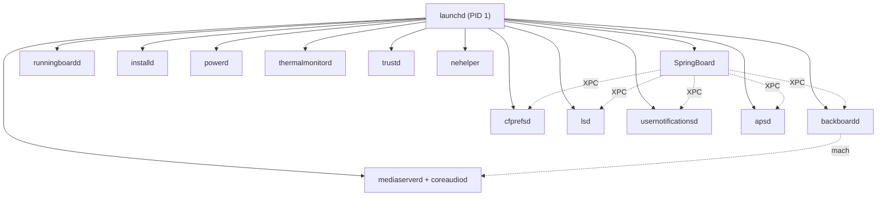
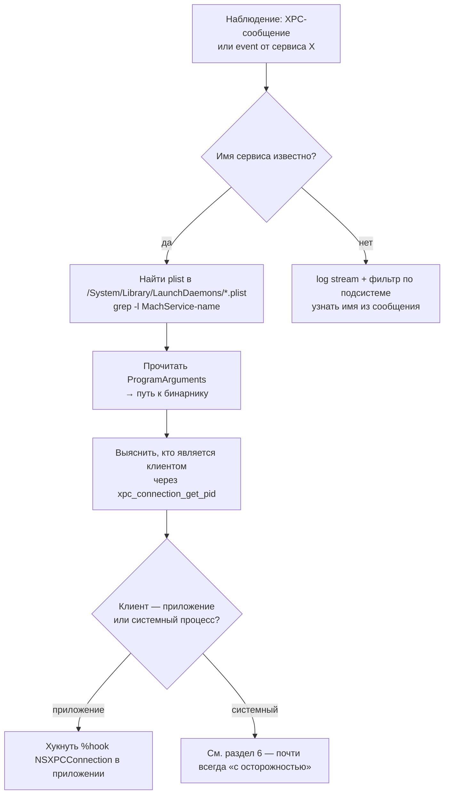

# Глава II.14. Системные процессы и XPC-службы

Эта глава — финальная в Части II, и она занимает особое место: это каркас, на котором держится всё остальное. iOS 26 — это десятки системных демонов и сотни XPC-сервисов, связанных между собой mach-портами. Без карты этой подсистемы автор твика работает вслепую. С картой — видит, в какой из бесчисленных процессов стоит входить, а в какой — нет.

## 1. Что такое «системный процесс» в iOS

Любой фоновый процесс, запускаемый `launchd` по описанию в `/System/Library/LaunchDaemons/*.plist` или `/System/Library/LaunchAgents/*.plist`. Три роли:

- **Daemon** — работает как root, запускается однажды, живёт до перезагрузки. Обслуживает устройство целиком.
- **Agent** — работает в контексте пользователя (на iOS — это `mobile`), запускается при логине.
- **XPC Service** — короткоживущий процесс, запускаемый по запросу. У приложений — свои XPC-сервисы в `<App>.app/XPCServices/*.xpc`.

У каждого есть plist c описанием:

| Ключ в LaunchDaemon plist | Что значит |
|---|---|
| `Label` | Уникальное имя (reverse-DNS, напр. `com.apple.powerd`) |
| `ProgramArguments` | Путь к исполняемому файлу и аргументы |
| `MachServices` | Какие mach-имена порта регистрируются демоном |
| `KeepAlive` | Условия перезапуска |
| `RunAtLoad` | Запустить сразу при загрузке |
| `UserName` | Под каким пользователем |

Клиент обращается через **mach port**: получает порт по имени (`xpc_mach_services`), шлёт сообщение, получает ответ. XPC (как и `xpc_connection_*`) — это обёртка поверх mach, которая делает сериализацию объектов, retry'ы, кредентиалс.

## 2. Карта критичных демонов iOS 26 для автора твика



Таблица «что чем занимается» для двадцати самых значимых:

| Процесс | Назначение | Хукает ли Dopamine? |
|---|---|---|
| `launchd` | PID 1, root of userland | Да — `launchdhook.dylib` в himself |
| `SpringBoard` | UI системы | Да — `rootlesshooks/SpringBoard.x`, `roothidehooks/src/springboard.x` |
| `backboardd` | События, haptics, окна | Нет |
| `runningboardd` | Жизненный цикл | Да — `roothidehooks/src/runningboardd.x` |
| `cfprefsd` | Preferences | Да — `rootlesshooks/cfprefsd.x`, `roothidehooks/src/cfprefsd.x` |
| `installd` | Установка .ipa | Нет (bootloop risk, см. II.12) |
| `lsd` | Launch Services | Да — `rootlesshooks/lsd.x`, `roothidehooks/src/lsd.x` |
| `usernotificationsd` | Доставка уведомлений | Нет |
| `apsd` | APNS | Нет |
| `powerd` | Питание | Нет |
| `thermalmonitord` | Термика | Нет |
| `mediaserverd` | Аудио/видео | Нет (см. II.10) |
| `coreaudiod` | Низкоуровневое аудио (с iOS 17) | Нет |
| `trustd` | TLS, revocation | Нет |
| `nehelper` | NEHelper, VPN | Нет (но NECP syscalls — да, через systemhook) |
| `biometrickitd` | Face ID / Touch ID | Нет |
| `locationd` | CoreLocation | Нет |
| `bluetoothd` | Bluetooth | Нет |
| `wifid` | Wi-Fi | Нет |
| `logd` | Unified logging | Нет |
| любое приложение | через `systemhook.dylib` | Да — везде через `DYLD_INSERT_LIBRARIES` |

Главный вывод из таблицы: **Dopamine сосредоточен на UI/launch/paths-layer** (SpringBoard, lsd, cfprefsd, runningboardd + универсальный systemhook в каждом процессе). Сетевая, медийная, биометрическая, GPS-подсистемы — вне его вмешательства. Это и даёт автору твика ясное разделение: куда можно вкатиться без конфликта, а где придётся работать поверх хуков Dopamine.

## 3. Как инвентаризировать живые процессы на iOS 26

Процедура, воспроизводимая на устройстве с установленным Dopamine:

1. Через SSH:

```bash
# Все работающие процессы, root-owned и user-owned
ps -A
# Иногда с полным именем и путём
ps -A -o pid,user,comm | head -60
# launchd-зарегистрированные
launchctl list | head
# по шаблону
launchctl list | grep -i camera
```

2. Для каждого интересного процесса узнать его путь:

```bash
# Путь исполняемого файла
ps -p <pid> -o comm=
# или
sudo lsof -p <pid> | head -5
```

3. Для изучения, что он использует, — `otool`:

```bash
otool -L /System/Library/PrivateFrameworks/UserNotifications.framework/Support/usernotificationsd
```

4. Для списка mach-сервисов, которые он выставляет:

```bash
plutil -p /System/Library/LaunchDaemons/com.apple.cfprefsd.xpc.daemon.plist
# ищем ключ "MachServices"
```

Этот workflow — главный инструмент на этапе «я хочу хукать что-то в системе, но не знаю, где искать».

## 4. XPC как мост между процессами

Любой запрос «за границу процесса» в iOS — это XPC или сырой mach. XPC идёт в двух вариантах:

- **`xpc_*` C API** (`xpc_connection_create_mach_service`, `xpc_connection_send_message`, `xpc_connection_set_event_handler`). Низкоуровневое, работает со словарями `xpc_object_t`.
- **`NSXPCConnection` Objective-C API** — поверх `xpc_*`, с автоматической сериализацией объектов (через `NSXPCInterface` + `NSCoding`).

Правила для автора твика:

1. **Не создавай «новый» XPC-клиент к системному сервису, не поняв его протокола.** Многие сервисы отбрасывают сообщения с неизвестной структурой или с неподходящей аудит-токен-ролью.
2. **Хукай NSXPCConnection в своём приложении, если нужно подсмотреть, с кем оно общается.** См. рецепт в главе II.12.
3. **Для доступа к jbserver** (сервисы, предоставляемые самим Dopamine) используй `jbclient_*` функции из `BaseBin/libjailbreak/src/jbclient_xpc.c`. Подробности — глава III.4 и шпаргалка по доменам.

### 4.1. Как увидеть XPC-трафик с устройства

На хосте с подключённым устройством:

```bash
# Общий просмотр лога с фильтром по XPC
log stream --predicate 'subsystem == "com.apple.xpc"' --style compact
# В реальном устройстве много шума — лучше фильтровать по процессу
log stream --predicate 'process == "MyApp"' --style compact
```

Для системного процесса, который не твой, нужны entitlements хоста (`com.apple.system.logger`) — Mac это даёт по умолчанию.

### 4.2. Пример перехвата `xpc_connection_send_message` в своём приложении

```objc
#import <xpc/xpc.h>
#import <os/log.h>

static os_log_t gXpcLog;
%ctor { gXpcLog = os_log_create("com.example.xpctrace", "msg"); }

%hookf(void, xpc_connection_send_message, xpc_connection_t connection, xpc_object_t message)
{
    char *desc = xpc_copy_description(message);
    os_log(gXpcLog, "send_message to %{public}s: %{public}s",
           xpc_connection_get_name(connection) ?: "<unnamed>", desc);
    free(desc);
    %orig(connection, message);
}
```

Разбор:

- `%hookf` — хук C-функции. Logos создаёт стандартный trampoline.
- `xpc_copy_description` возвращает тип-описание (словарь ключ-значение) в удобочитаемом виде.
- `free` обязателен — иначе утечки.
- `xpc_connection_get_name` возвращает mach-service-имя (например, `com.apple.cfprefsd.agent`) или `NULL` для анонимных соединений.

Полный Makefile для такого твика есть в главе IV.5.

## 5. jbserver — внутренний XPC-мост Dopamine

Короткий, но важный факт для этой главы: когда ты вызываешь функцию `jbclient_cs_revalidate()` или `jbclient_get_jbroot()` из своего твика, под капотом работает XPC к собственному серверу Dopamine (запущенному внутри `launchdhook` или `jailbreakd`). Соответствующие домены описаны в `BaseBin/libjailbreak/src/jbserver_domains.h`.

Домены (точный список — см. шпаргалку по доменам в приложениях):

- `JBS_DOMAIN_SYSTEMWIDE` — общесистемные операции (например, перевалидация CS_VALID).
- `JBS_DOMAIN_SYSTEMHOOK` — внутренние запросы от `systemhook.dylib`.
- `JBS_DOMAIN_PROCESS` — операции над процессом.
- `JBS_DOMAIN_ROOTHIDE` — специфика roothide (randomized jbroot).

Используй `jbclient_*` без оглядки: именно это публичный API jailbreak для сторонних твиков. Прямое плетение `xpc_connection_create_mach_service` для jbserver — внутренняя магия, которую не стоит повторять.

## 6. Таблица «что хукать безопасно / с осторожностью / никогда»

| Что | Статус |
|---|---|
| XPC в собственном приложении (`NSXPCConnection`, `xpc_connection_*`) | **Безопасно** |
| XPC-сервис как клиент к системным демонам | **С осторожностью** (нужны entitlements, можно сломать семантику) |
| Хук в SpringBoard / cfprefsd / lsd (уже под хуками Dopamine) | **С осторожностью** (не ломай существующие хуки) |
| Хук в `installd` | **Никогда** (bootloop risk) |
| Хук в `mediaserverd` / `coreaudiod` | **Никогда** (теряется звук системно) |
| Хук в `trustd` | **С осторожностью** (SSL pinning bypass — этически скользко) |
| Хук в `biometrickitd` / `locationd` | **С осторожностью** (нет публичного смысла для legitimate твика) |
| Хук в `launchd` (PID 1) | **Внутренний для Dopamine**, твикам туда не ходить |
| Хук в своём XPC-сервисе своего приложения | **Безопасно** (filter plist на bundle id .xpc) |

## 7. Процедура поиска «кто это сделал»

Частый вопрос: «я вижу XPC-сообщение в логе, но не знаю, кто его послал». Алгоритм:



Пара практических деталей:

- Получить PID клиента XPC-соединения можно через `xpc_connection_get_pid(connection)`. На iOS 26 это публично.
- Имя клиента: через `proc_pidpath(pid, buf, sizeof(buf))` из `<libproc.h>`.

## 8. Что подтверждено

- **Подтверждено исходниками**: доменная структура jbserver в `BaseBin/libjailbreak/src/jbserver_domains.h`; хуки в `SpringBoard`, `cfprefsd`, `lsd`, `runningboardd` описаны в `BaseBin/rootlesshooks/*.x` и `BaseBin/roothidehooks/src/*.x`; отсутствие хуков `installd`/`mediaserverd`/`trustd` подтверждено grep'ом.
- **Подтверждено документацией Apple**: `xpc_*` C API, `NSXPCConnection`, формат LaunchDaemon plist, механизм mach ports.
- **Требует проверки на устройстве**: точный список сервисов `launchctl list` на iOS 26.0 и 26.0.1 — он отличается от версии к версии; роль новых демонов в 26 (например, Apple Intelligence-related) не задокументирована в проекте.
- **Не подтверждено**: точный перечень entitlements, которые требуются клиентам каждого private XPC-сервиса в iOS 26 — требует class-dump каждого фреймворка или анализ `ldid -e` на бинарниках клиентов.

## 9. Выводы

Главный тезис Главы II.14 (и, по сути, всей Части II): iOS 26 — это конструкция из десятков системных процессов, связанных XPC и mach-портами. Dopamine с его rootless + roothide хуками занимает **узкую полосу** (launch, UI, paths, prefs, LS) и оставляет **остальное** на попечение автора твика. Это и есть правильная модель чтения карты: «что уже сделано — то не трогаю; что в стороне — свободно моё, если выполняется этика и правила песочницы».

На базе этой карты Часть III спустится в конкретные компоненты Dopamine с ещё большей детализацией — что именно каждый из его файлов `*.x` в rootlesshooks и roothidehooks делает, какие API libjailbreak и libroot легитимно использовать стороннему твику, и как собрать это в полный путь «процесс → подсистема → хук → проверка».

## 10. Что дальше

- Для разборов каждого демона отдельно — главы раздела `daemons/` (SpringBoard, cfprefsd, lsd, runningboardd, mediaserverd и др.).
- Для `jbserver_domains` подробно — глава III.2 (`libjailbreak`) и шпаргалка по доменам.
- Для XPC-клиента в своём приложении полный пример — Cookbook (рецепт XPC-service client).
- Для процедуры «нашёл XPC-сообщение, нашёл процесс» — глава VI.1 (алгоритм исследования).
