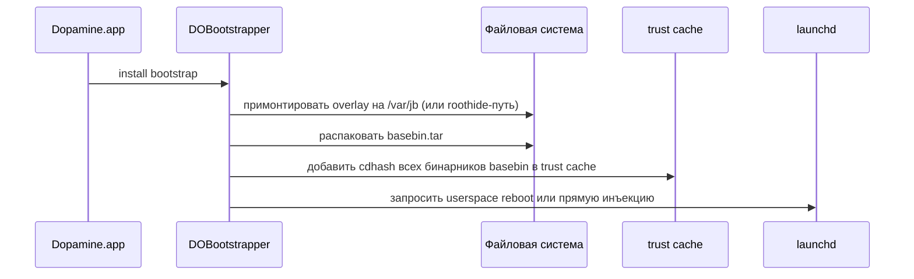

# Глава III.1. Application/Dopamine — приложение-установщик

Это первая глава Части III, и она — не об отдельном компоненте, а о **фасаде** всей системы. `Application/Dopamine` — это iOS-приложение, которое пользователь запускает руками, и которое превращает «обычный iPhone 11» в «устройство с jailbreak». В этой главе разберём, как именно это происходит и какая роль у каждого ключевого класса.

## 1. Общая структура каталога

Содержимое `Application/Dopamine/`:

```
App Delegates/
Assets.xcassets/
Base.lproj/           — локализация
Dopamine.entitlements — entitlements приложения
Exploits/             — все эксплойты (DarkSword, ClearSword, kfd, …)
Extensions/           — iOS extensions приложения
Frameworks/           — пустая на момент разбора
Headers/              — reused headers
Info.plist
Jailbreak/            — главный «мозг» приложения
Resources/
UI/                   — экраны пользователя
<lang>.lproj/         — локализации
main.m                — точка входа
```

Главный класс-мозг — **`DOEnvironmentManager`** в `Application/Dopamine/Jailbreak/DOEnvironmentManager.m`. Это singleton, который знает про состояние системы и управляет жизненным циклом jailbreak-установки. Второй по важности — **`DOExploit`** / **`DOExploitManager`** (выбор эксплойта под устройство). Третий — **`DOBootstrapper`** (разворачивание basebin). Четвёртый — **`DOJailbreaker`** (конечный пользовательский цикл).

## 2. `DOEnvironmentManager`: карта среды

Главный факт: именно здесь явно декларируется поддержка iOS 26 на A13 (`DOEnvironmentManager.m:245–254`):

```objc
- (NSString *)versionSupportString
{
    cpu_subtype_t cpuFamily = 0;
    size_t cpuFamilySize = sizeof(cpuFamily);
    sysctlbyname("hw.cpufamily", &cpuFamily, &cpuFamilySize, NULL, 0);
    
    if ([self isArm64e]) {
        if (cpuFamily == CPUFAMILY_ARM_VORTEX_TEMPEST ||
            cpuFamily == CPUFAMILY_ARM_LIGHTNING_THUNDER) {
            return @"iOS 15.0 - 18.7.1, 26.0 - 26.0.1 (A12/A13, PPL)";
        }
        ...
    }
}
```

Разбор:

- `sysctlbyname("hw.cpufamily", ...)` — чтение чипа устройства из ядра. Это KPI (kernel programming interface), стабильное API.
- `CPUFAMILY_ARM_VORTEX_TEMPEST` — A12 (Vortex + Tempest ядра), `CPUFAMILY_ARM_LIGHTNING_THUNDER` — A13 (Lightning + Thunder). Этот ряд констант определён в `<mach/machine.h>` и остаётся стабильным.
- Строка **именно та** вводная информация, которая стоит на главном экране приложения Dopamine, когда пользователь его открывает. Это декларация: «на этом устройстве поддерживается iOS 15.0–18.7.1 и iOS 26.0–26.0.1».

Что это значит для автора книги/твика: когда вы читаете `DOEnvironmentManager.m:254`, вы читаете **официальную карту поддерживаемых комбинаций**, прямо из исходников проекта. На A14 эта строка будет другая, и путь поддержки в iOS 26 там не декларирован.

Другие методы `DOEnvironmentManager`:

- `-isArm64e` — определение slice (A12/A13 — arm64, A14+ — arm64e).
- `-isSPTM` — есть ли на устройстве SPTM (Secure Page Table Monitor, iOS 17+ на arm64e).
- `-systemVersion` — текущая iOS, через `[UIDevice currentDevice].systemVersion`.
- `-isJailbroken` — определение, уже ли jailbreak активен (через проверку наличия `/basebin/` и других маркеров).
- `-jailbreakRootPath` / `-jbroot` — текущий jbroot префикс (отдаёт случайный путь для roothide).
- `-deleteBootstrap` — snnapshot-операция, обычно вызываемая через TrollStore (см. раздел ниже).

## 3. `DOExploit` + `DOExploitManager`: выбор эксплойта

Файл `DOExploit.m` содержит каталог: какой эксплойт работает на каком чипе + какой iOS. Начало выбора — `DOExploit.m:80–120`, где CPU family декодируется в человекочитаемое имя:

```objc
case CPUFAMILY_ARM_LIGHTNING_THUNDER:
    thisCPU = @"A13";
    break;
```

Далее `DOExploitManager` итерирует по эксплойтам, читает их `Info.plist` (DPSupportedRanges), и выбирает подходящий. Для A13 + iOS 26.0/26.0.1 это **DarkSword** и **ClearSword** (по DPSupportedRanges в их Info.plist, диапазон 19.0–26.0.1, с нужными билдами 23B5044l, 23B5059e, 23B5064e).

Таблица эксплойтов проекта с их диапазонами поддержки:

| Эксплойт | Папка | Что эксплуатирует | Поддерживаемые iOS |
|---|---|---|---|
| **DarkSword** | `Exploits/DarkSword/` | kernel race / IPv6 socket | 15.0–18.7.1 и 19.0–26.0.1 |
| **ClearSword** | `Exploits/ClearSword/` | kernel race | 15.0–18.7.1 и 19.0–26.0.1 |
| **weightBufs** | `Exploits/weightBufs/` | neural engine driver | конкретные старые iOS |
| **dmaFail** | `Exploits/dmaFail/` | DMA path | по CPU |
| **multicast_bytecopy** | `Exploits/multicast_bytecopy/` | multicast socket | старые iOS |
| **momentarius** | `Exploits/momentarius/` | PPL bypass (A13 версия в `momentarius_a13.c`) | — |
| **Titan** | `Exploits/Titan/` | A13-specific PPL bypass | — |
| **palera1n** | `Exploits/palera1n/` | checkm8-based | до iOS 15 |
| **kfd** | `Exploits/kfd/` | kernel file descriptor | — |

Для нашей целевой среды (A13 + iOS 26.0/26.0.1) активная цепочка — **DarkSword → momentarius_a13 → Titan**:

1. DarkSword/ClearSword даёт kernel read/write.
2. На этом фундаменте запускается momentarius_a13 (PPL bypass для A13) + Titan.
3. Результат — jailbreak userland.

Детальный разбор каждого — глава раздела Deep-dive.

## 4. `DOBootstrapper`: разворачивание basebin

`DOBootstrapper.m` отвечает за второй этап: разворачивание `basebin.tar` в файловую систему. Основные шаги:



Что в `basebin.tar` (из `BaseBin/Makefile`):

- `libjailbreak.dylib`, `libroothider.dylib`, `libchoma.dylib`, `libxpf.dylib`
- `systemhook.dylib`, `launchdhook.dylib`, `dyldhook*.dylib`
- `jailbreakd`, `hookd`, `jbctl`, `idownloadd`, `watchdoghook.dylib`
- `rootlesshooks.dylib`, `roothidehooks.dylib`, `forkfix.dylib`
- `bootstrapper`, `opainject`, `MachOMerger`
- `basebin.tc` — trust cache со всеми cdhash'ами

Это и есть «миниатюрный userland jailbreak», который разворачивается на устройстве и живёт между перезагрузками до userspace reboot.

## 5. `DOJailbreaker`: user-flow

`DOJailbreaker.m` соединяет вышеописанные компоненты в последовательность, которую видит пользователь:

1. Проверить среду (`DOEnvironmentManager`).
2. Выбрать и запустить эксплойт (`DOExploitManager`).
3. Если успех — развернуть bootstrap (`DOBootstrapper`).
4. Запустить userland (`launchdhook.dylib` в `launchd`).
5. Сообщить пользователю об успехе или ошибке.

Весь UI (`UI/`) — обёртка над этим flow: `DOMainViewController` — главный экран, кнопка «Jailbreak»; `DOUIManager` — UI-синглтон; `DOSettingsController` — настройки.

## 6. `main.m` и TrollStore-режим

Файл `main.m`:

```objc
int main(int argc, char * argv[]) {
    if (argc >= 3) {
        if (!strcmp(argv[1], "trollstore")) {
            if (!strcmp(argv[2], "delete-bootstrap")) {
                [[DOEnvironmentManager sharedManager] deleteBootstrap];
            }
            return 0;
        }
    }
    ...
}
```

Это интересный момент: Dopamine может быть вызван в **нестандартном режиме** через TrollStore с аргументами. Поддерживается команда `trollstore delete-bootstrap` — полезно для очистки среды. Другие команды закомментированы (например, `hide-jailbreak`), что означает: они были, но убраны/нестабильны.

Для автора твика это важно: **TrollStore и Dopamine не исключают друг друга**. На A13 с iOS 26 можно иметь:

- установленные приложения через TrollStore (permasigned, живут вне jailbreak);
- Dopamine, дающий полный jailbreak userland;
- оба используют общий механизм trust cache.

## 7. Entitlements и Info.plist

`Dopamine.entitlements` даёт приложению права, нужные для его работы:

- `com.apple.developer.kernel.increased-memory-limit` — для эксплойтов, требующих большого heap.
- `com.apple.developer.kernel.extended-virtual-addressing` — тот же мотив.
- `platform-application` или аналогичные, зависящие от конкретной конфигурации.

Полный список entitlements лучше посмотреть прямо в файле; они варьируются между сборками.

## 8. Что подтверждено

- **Подтверждено исходниками**:
  - Строка «iOS 15.0 - 18.7.1, 26.0 - 26.0.1 (A12/A13, PPL)» в `DOEnvironmentManager.m:254`.
  - CPU family mapping в `DOExploit.m:80–120`, включая `A13 = CPUFAMILY_ARM_LIGHTNING_THUNDER`.
  - Поддерживаемые эксплойты для A13+iOS 26 — DarkSword/ClearSword с диапазоном 19.0–26.0.1 (их `Info.plist`).
  - TrollStore-режим `delete-bootstrap` в `main.m`.
- **Подтверждено документацией Apple**: константы `CPUFAMILY_*` в `<mach/machine.h>`.
- **Требует проверки на устройстве**: фактическая работа всей цепочки на конкретном билде iOS 26.0.1 — проект декларирует поддержку, но детальные offsets и т. п. проверяются DarkSword/ClearSword/Titan/momentarius_a13 на устройстве.

## 9. Выводы

Главный тезис главы: `Application/Dopamine` — это **фасад и пользовательский фронт**. Все магические вещи (ядерная эксплуатация, trust cache, dyld hooks) происходят ниже — в `BaseBin/`. Для автора твика эта глава полезна тем, что показывает:

- где именно и как хранится правда о поддерживаемых конфигурациях;
- какие эксплойты вообще в проекте и в каком коде написаны;
- как Dopamine знает, что устройство — A13;
- как разворачивается bootstrap.

В остальных главах Части III мы спустимся по уровням ниже и разберём каждый компонент `BaseBin/` отдельно.

## 10. Что дальше

- Детальный разбор `libjailbreak` — глава III.2.
- Разбор `libroothider` (случайный jbroot) — глава III.3.
- Разбор `launchdhook` — глава III.4.
- Разбор эксплойтов — отдельный раздел Deep-dive (`deep-dive/10-exploits-overview.md`, когда будет написан).
- Разбор bootstrap-процесса — глава III.11.
