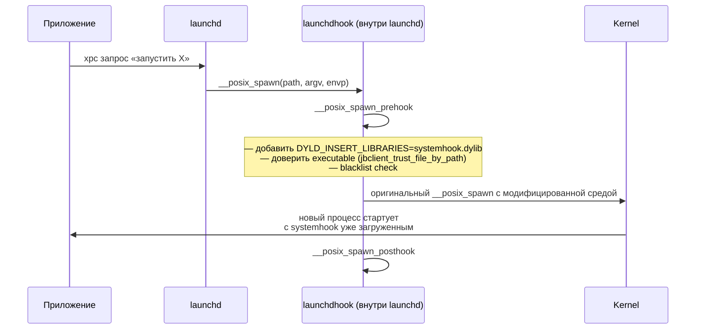

# Глава III.4. BaseBin/launchdhook — вход в userland

`launchdhook.dylib` — одна из самых необычных dylib'ов в проекте. Она **живёт в launchd** (процессе PID 1), и именно её загрузка в launchd даёт Dopamine возможность инжектировать `systemhook` во все новые процессы системы. В этой главе разберём, как она попадает в launchd, что делает в нём, и как в ней живёт серверная часть jbserver.

## 1. Как launchdhook оказывается в launchd

Launchd — процесс с PID 1, запускаемый ядром при старте пользовательского пространства. На обычной iOS в него не инжектируется ничего постороннего. На jailbroken-устройстве `launchdhook.dylib` попадает туда через механизм, зависящий от уровня эксплойта:

- на устройствах с полным jailbreak (как Dopamine 3) — через подмену одной из dylib, которые launchd загружает штатно, либо через PT (page table) manipulation, подкладывая код «поверх» существующих;
- конкретные детали зависят от эксплойта (DarkSword/ClearSword на A13+iOS 26) и обсуждаются в разделе Deep-dive об эксплойтах.

Главный факт для нашей главы: **к моменту первого вызова `main()` в launchd `launchdhook.dylib` уже загружен** и выполнил свой `__attribute__((constructor))`.

## 2. Что импортирует main.m

Из `BaseBin/launchdhook/src/main.m:1–35`:

```objc
#import <libjailbreak/libjailbreak.h>
#import <libjailbreak/util.h>
#import <libjailbreak/kernel.h>
#import <libjailbreak/display.h>
...
#import <substrate.h>
#import <litehook.h>
#import "../systemhook/src/common/common.h"
#import "../systemhook/src/common/hookd_external.h"
#import "spawn_hook.h"
#import "xpc_hook.h"
#import "daemon_hook.h"
#import "ipc_hook.h"
#import "jetsam_hook.h"
#import "crashreporter.h"
#import "boomerang.h"
#import "update.h"
#import "jbserver/jbserver_local.h"
#import "asl.h"
```

Это обзор на один импорт: launchdhook ставит хуки на **spawn**, **xpc**, **daemon management**, **ipc**, **jetsam** и работает с **jbserver** и **asl** (unified logging).

Есть и уровень pre/post init:

```objc
void roothide_launchd_preinit();
void roothide_launchd_postinit(bool firstLoad);
```

Эти функции разделяют работу `launchdhook` на две фазы: до и после полной инициализации launchd. Это важно, потому что launchd сложный — не все хуки можно поставить сразу.

## 3. Главный хук — spawn_hook

Файл `BaseBin/launchdhook/src/spawn_hook.c` реализует **самое важное**: перехват `__posix_spawn`. Схема:



Ключевые ссылки из `spawn_hook.c`:

```c
extern int roothide_launchd_trust_executable(const char* path);
extern int roothide_launchd___posix_spawn_prehook(pid_t *restrict pidp,
    const char *restrict path, struct _posix_spawn_args_desc *desc,
    char *const argv[restrict], char *const envp[restrict]);
extern int roothide_launchd___posix_spawn_posthook(pid_t *restrict pidp, ...);

extern int systemwide_trust_file_by_path(const char *path);
```

Что происходит в prehook (упрощённо):

1. Получить путь исполняемого файла.
2. Проверить, что он доверен (`trust_executable` → если не доверен — добавить cdhash в trust cache).
3. По blacklist (из `libroothider`) решить: инжектировать `systemhook.dylib` или нет.
4. Если да — модифицировать `envp`, добавить `DYLD_INSERT_LIBRARIES=.../systemhook.dylib`.
5. Если это особое приложение (jailbreak-aware), также подложить дополнительные переменные.

**Это** — главный «многоплечевой» механизм Dopamine. Все остальные хуки `systemhook` работают именно потому, что `launchdhook` вставил нужные переменные среды.

Для автора твика это важное наблюдение: твик начинает работать **в момент старта процесса**, не в момент установки .deb. Если ваш твик только что установлен, пользователь должен открыть/перезапустить целевое приложение — тогда новый instance получит `systemhook` → `systemhook` загрузит ваш твик по filter plist.

## 4. jetsam_hook — не дай launchd убить себя

Файл `jetsam_hook.c`:

```c
int (*memorystatus_control_orig)(uint32_t command, int32_t pid, uint32_t flags,
                                  void *buffer, size_t buffersize);

int memorystatus_control_hook(uint32_t command, int32_t pid, uint32_t flags,
                               void *buffer, size_t buffersize)
{
    if (command == MEMORYSTATUS_CMD_SET_JETSAM_TASK_LIMIT) {
        return 0;
    }
    return memorystatus_control_orig(command, pid, flags, buffer, buffersize);
}
```

Комментарий в коде объясняет, зачем:

> Allocated page tables (done by physrw handoff) count towards the physical memory footprint of the process that created them. Unfortunately that means jetsam kills us if we do it too often. For launchd, we therefore prevent it from enabling jetsam using this hook.

Иначе говоря: сам launchd не должен быть **убит системой jetsam** за превышение памяти, потому что внутри него Dopamine делает физическую запись (`physrw`), которая учитывается ядром как рост памяти процесса. Хук перехватывает попытку поставить jetsam-limit и возвращает «ok, done» без фактической установки.

Для автора твика это даёт понимание: launchd на jailbroken устройстве «застрахован» от jetsam, и его стабильность — ещё одна забота jailbreak.

## 5. jbserver_local — серверная часть jbserver

Содержимое `BaseBin/launchdhook/src/jbserver/`:

```
jbdomain_dopamine.c
jbdomain_platform.c
jbdomain_root.c
jbdomain_roothide.c
jbdomain_systemwide.c
jbdomain_watchdog.c
jbserver_global.c
jbserver_global.h
jbserver_local.c
jbserver_local.h
jbserver_mach.c
jbsettings.c
jbsettings.h
```

Что это: **серверная реализация доменов jbserver**. Каждый `jbdomain_*.c` обрабатывает запросы соответствующего домена:

- `jbdomain_systemwide.c` — все sysywide запросы (`GET_JBROOT`, `GET_BOOT_UUID`, `TRUST_FILE`, `CS_REVALIDATE`, …). Это самая используемая часть.
- `jbdomain_platform.c` — операции, требующие CS_PLATFORMIZED (запись настроек, обновление jailbreak).
- `jbdomain_root.c` — операции, требующие root (`physrw`, `trustcache info`).
- `jbdomain_roothide.c` — специфика RootHide (отдельные операции над randomized jbroot).
- `jbdomain_watchdog.c` — обработка интерсептов userspace-panic.
- `jbdomain_dopamine.c` — операции для самого Dopamine.app (например, установка обновления).

Регистрация обработчиков происходит в `jbserver_global.c` при старте `launchdhook`. Сервер слушает mach port, получает XPC-сообщения, диспатчит по домену и action'у.

Для автора твика это даёт понимание: когда ваш твик вызывает `jbclient_cs_revalidate()`, сообщение проходит XPC через launchd (в котором живёт сервер), попадает в `jbdomain_systemwide.c` → в обработчик `JBS_SYSTEMWIDE_CS_REVALIDATE`, который делает нужную магию и возвращает ответ.

## 6. xpc_hook, ipc_hook, daemon_hook

Три дополнительных хука:

- `xpc_hook.{c,h}` — вмешивается в XPC-инфраструктуру launchd для корректной работы `jbserver_mach` + XPC-транспортных слоёв.
- `ipc_hook.{c,h}` — хуки на внутренний IPC launchd для перехвата сообщений, которые launchd рассылает демонам.
- `daemon_hook.{h,m}` — хуки на механизм загрузки launchd-демонов, нужно для правильной работы `WantsSelfRestoration`-демонов и подобных.

Это внутренние вещи; автор твика ими напрямую не пользуется, но знать, что они есть, полезно.

## 7. crashreporter + boot_logo

Два вспомогательных куска:

- `crashreporter.{h,m}` — специфический crash reporter для компонентов, живущих в launchd. Если launchd падает — важно сохранить логи.
- Код `draw_boot_logo(...)` в `main.m` — отрисовка jailbreak-логотипа при userspace reboot. Декоративно, но без него reboot был бы «чёрным».

## 8. boomerang и update

- `boomerang.{c,h}` — механизм «вернуть процесс обратно, если он аварийно упал» для определённых компонентов.
- `update.{h,m}` — API для обновления basebin «на лету», без переустановки через Dopamine.app. Используется `jbctl update basebin`.

## 9. Что доступно твикам из launchdhook

**Практически ничего напрямую.** `launchdhook.dylib` живёт только в launchd и не загружается в приложения. Все API, которые нужны твику, предоставляются через XPC к jbserver (т. е. через `jbclient_*` функции).

Исключение: сам `jbserver_local_start()` (из `jbserver_local.h`) позволяет **в special-случаях** (например, в `jbctl` на этапе ранней загрузки) поднять локальный XPC-сервер в текущем процессе. Автор стороннего твика это **не делает**.

## 10. Таблица «что это даёт твику»

| Что launchdhook делает | Что получает твик |
|---|---|
| Хук `__posix_spawn` | `systemhook` в каждом процессе |
| `jetsam_hook` | launchd не падает | 
| `jbserver_systemwide` | работает `jbclient_get_jbroot`, `jbclient_cs_revalidate`, … |
| `jbserver_platform` | работают `jbsettings_set` для platformised процессов |
| `fork_fix` | дочерний процесс после `fork()` корректно инструментован |
| `boot_logo` | reboot не чёрный |
| `crashreporter` | падение внутренних компонентов не теряется |

## 11. Что подтверждено

- **Подтверждено исходниками**: все перечисленные хуки существуют в `BaseBin/launchdhook/src/`. jetsam_hook — цитата из комментария и логики `memorystatus_control_hook`.
- **Подтверждено Makefile**: `launchdhook.dylib` собирается с линковкой `libjailbreak`.
- **Требует проверки на устройстве**: конкретная логика ранней фазы (pre/post init) может отличаться между версиями Dopamine.
- **Не подтверждено**: внешние (не из `BaseBin`) гарантии безопасности launchd после инъекции `launchdhook` — это неизбежно privilege escalation.

## 12. Выводы

Главный тезис: `launchdhook.dylib` — это **источник инструментовки для всей системы**. Без него не было бы `systemhook` в приложениях, не было бы jbserver для `jbclient_*` функций, не было бы корректной работы jailbreak между userspace-reboot'ами. С точки зрения автора твика эта глава полезна тем, что объясняет: ваш твик работает не потому, что «iOS его загрузила», а потому что `launchdhook` в launchd вставил `DYLD_INSERT_LIBRARIES=systemhook` в среду запускаемых процессов, а `systemhook` уже загрузил ваш twik по filter plist.

Если ваш твик не загружается — цепочку надо проверять именно в этом порядке: launchdhook работает? systemhook загружен в целевой процесс? filter plist соответствует? Детали диагностики — в главе VII.1.

## 13. Что дальше

- `systemhook` — главный «клиент» launchdhook, живёт в каждом процессе — глава III.5.
- `jailbreakd` — демон, который по сути берёт часть работы launchdhook для процессов, требующих root — глава III.8.
- `hookd` — API, которое Frida и подобные используют — глава III.7.
- Полный разбор доменов jbserver — шпаргалка `cheatsheets/07-jbserver-domains.md`.
