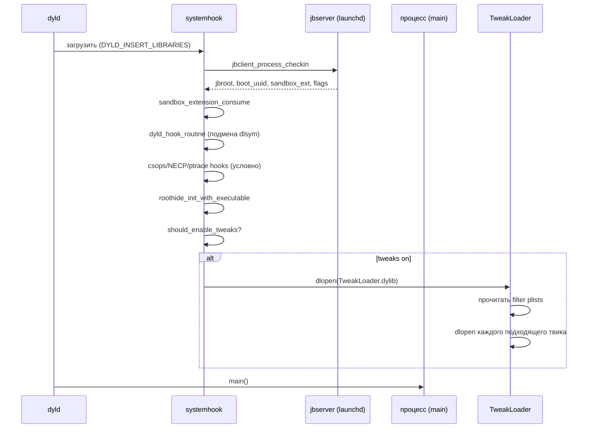

# Глава III.5. BaseBin/systemhook — hook каждого процесса

`systemhook.dylib` — главная «рабочая лошадь» jailbreak в юзерспейсе. Она загружается через `DYLD_INSERT_LIBRARIES` в **каждый** инструментируемый процесс и выполняет несколько задач: валидация подписи процесса (NECP/csops), регистрация в jbserver, загрузка твиков. В этой главе разберём её устройство и, что особенно важно для автора твика, — где конкретно загружается ваш `.dylib`.

## 1. Как systemhook оказывается в процессе

Цепочка:

1. `launchd` вызывает `__posix_spawn(path, argv, envp)`.
2. `launchdhook` в launchd перехватывает (глава III.4) и добавляет `DYLD_INSERT_LIBRARIES=<jbroot>/basebin/systemhook.dylib` в `envp` (если процесс не в blacklist).
3. Ядро запускает процесс; `dyld` при инициализации загружает `systemhook.dylib` до `main()` процесса.
4. `__attribute__((constructor))` в `systemhook` отрабатывает первым.

Это означает: **`systemhook` выполняется ДО того, как любой `main()` или `+load` любого класса приложения отработает**. Это важная особенность для диагностики: если что-то ломается в приложении сразу после установки jailbreak — проверяйте, не поломал ли `systemhook` среду.

## 2. Что systemhook делает в `main.c`

Файл `BaseBin/systemhook/src/main.c` — главный. Его работа, по фазам:

### 2.1. Инициализация

- `load_executable_path()` — через `_NSGetExecutablePath` + `realpath` получает каноничный путь текущего бинарника. Хранится в `gExecutablePath`.
- `jbclient_process_checkin(...)` — вызов к серверу jbserver (внутри launchd): получает jbroot-путь, boot UUID, список sandbox extensions, флаги `fullyDebugged`/`forceCSAdhoc`.
- `JB_RootPath` и `JB_BootUUID` сохраняются глобально, `get_jbroot()` возвращает `JB_RootPath`.
- Sandbox extensions «consumed» через `sandbox_extension_consume` — это даёт процессу расширенные права чтения/записи в jbroot-пути.

### 2.2. Условная установка хуков

На A13 (arm64, не arm64e) ставятся дополнительные хуки — целый блок `#ifndef __arm64e__`. Эти хуки нужны, потому что на arm64 запись в executable pages снимает флаг `CS_VALID` с процесса (комментарий из `main.c:510`:

```c
// On arm64, writing to executable pages removes CS_VALID from the csflags of the process
// These hooks are neccessary to get the system to behave with this
// (since multiple system APIs check for CS_VALID and produce failures if it's not set)
```

Ставятся два важных хука:

#### csops / csops_audittoken

Код из `main.c:163–195`:

```c
int csops_hook(pid_t pid, unsigned int ops, void *useraddr, size_t usersize)
{
    int rv = syscall(SYS_csops, pid, ops, useraddr, usersize);
    if (rv != 0) return rv;
    if (ops == CS_OPS_STATUS) {
        if (useraddr && usersize == sizeof(uint32_t)) {
            uint32_t* csflag = (uint32_t *)useraddr;
            *csflag |= CS_VALID;
            *csflag &= ~CS_DEBUGGED;
            if (pid == getpid() && gFullyDebugged) {
                *csflag |= CS_DEBUGGED;
            }
        }
    }
    return rv;
}
```

Разбор:

- `csops` — syscall «получить информацию о codesigning процесса».
- Хук вызывает оригинал через `syscall(SYS_csops, ...)` (не через функцию `csops`, иначе — рекурсия в собственный хук).
- Если ответ успешен и запрошен `CS_OPS_STATUS` (флаги кода-подписи), **принудительно** добавляется `CS_VALID` и убирается `CS_DEBUGGED` — чтобы для любого запрашивающего процесс выглядел как «валидно подписанный, не отлаживаемый».
- Исключение: если процесс сам себя спрашивает (`pid == getpid()`) и `gFullyDebugged == true`, то `CS_DEBUGGED` оставляется.

Это то, что обманывает проверки `csops`-based детекторов jailbreak.

#### NECP (пять функций)

Разбирали в главе II.9. Коротко — `main.c:128–156` плюс регистрация в `main.c:515–521`:

```c
if (__builtin_available(iOS 16.0, *)) {
    litehook_hook_function(necp_match_policy, necp_match_policy_hook);
    litehook_hook_function(necp_open, necp_open_hook);
    litehook_hook_function(necp_client_action, necp_client_action_hook);
    litehook_hook_function(necp_session_open, necp_session_open_hook);
    litehook_hook_function(necp_session_action, necp_session_action_hook);
}
```

Это гарантирует, что сетевой стек работает (NECP проверяет `CS_VALID`, который на arm64 после patch'а снят, и `jbclient_cs_revalidate` возвращает его).

### 2.3. Хук `dlsym` и его смысл

Код из `main.c:85–108` реализует `dyld_dlsym_hook`:

```c
void *(*dyld_dlsym_orig)(void *dyld, void *handle, const char *name);
void *dyld_dlsym_hook(void *dyld, void *handle, const char *name)
{
    if (handle == gLibSandboxHandle && !strcmp(name, "sandbox_apply")) {
        return sandbox_apply_hook;
    }
    __attribute__((musttail)) return dyld_dlsym_orig(dyld, handle, name);
}
```

Что происходит:

- При загрузке `libsystem_sandbox.dylib`, он вызывает `dlsym(..., "sandbox_apply")` для получения указателя на эту функцию.
- Dopamine перехватывает этот вызов и возвращает **свою** функцию `sandbox_apply_hook` вместо настоящего `sandbox_apply`.
- Таким образом, не нужно никаких инструкций-патчей — просто подмена указателя при его получении.

Это один из красивых трюков: **chainable** через PAC и указатель-функций в dyld (`dyld_hook_routine` в `main.c:66–84`).

### 2.4. debugserver

Отдельная ветка для `debugserver`:

```c
if (string_has_suffix(gExecutablePath, "/debugserver")) {
    litehook_hook_function(ptrace, ptrace_hook);
}
```

Хук `ptrace` ставится только в процессе `debugserver`. `ptrace_hook` (`main.c:112–123`) после успешного `PT_ATTACH` / `PT_ATTACHEXC` обновляет флаг `platform_set_process_debugged` для attach'аемого процесса — чтобы отладка работала даже на целях, где `get-task-allow` entitlement выключен.

### 2.5. Загрузка твиков

Самое интересное для автора книги — финал `main.c`:

```c
if (should_enable_tweaks()) {
    const char *tweakLoaderPath = JBROOT_PATH("/usr/lib/TweakLoader.dylib");
    if (access(tweakLoaderPath, F_OK) == 0) {
        void *tweakLoaderHandle = dlopen(tweakLoaderPath, RTLD_NOW);
        if (tweakLoaderHandle != NULL) {
            dlclose(tweakLoaderHandle);
        }
    }
}
```

Что происходит:

1. `should_enable_tweaks()` решает, грузить ли tweaks в этот процесс.
2. Путь к `TweakLoader.dylib` строится через `JBROOT_PATH` — он знает про rootless/roothide.
3. `dlopen(tweakLoaderPath, RTLD_NOW)` подгружает TweakLoader.
4. `TweakLoader.dylib` — часть установленного menagemenet (Ellekit, Substitute или подобное). Он сам читает filter plists всех твиков и загружает те, которые подходят текущему процессу.
5. `dlclose` после не выгружает загруженные твики (все инициализаторы уже отработали), только снимает один retain-count с хэндла — twikы остаются в памяти.

Это и есть **ответ на вопрос «как загружается мой твик»**:

- Ваш `.dylib` лежит на диске в `<jbroot>/Library/MobileSubstrate/DynamicLibraries/<name>.dylib`.
- Рядом — ваш `<name>.plist` filter.
- `TweakLoader.dylib` читает все filters, для текущего процесса находит подходящие, делает `dlopen` каждого.
- Ваш `%ctor` отрабатывает.

### 2.6. should_enable_tweaks — условия отключения

Это критически важный раздел `main.c:201–245` — что отключает загрузку твиков:

1. **`<jbroot>/basebin/.safe_mode`** — файл-маркер «safe mode». Если есть — твики не грузятся. Для автора твика это способ временно выключить всё без удаления .deb.
2. **`DISABLE_TWEAKS=1`** в среде — переменная окружения.
3. **`jbclient_dopamine_is_jailbroken(NULL)`** — если это сам Dopamine.app — твики выключены (чтобы детектор не мешал приложению-установщику).
4. **RootHide specific**: `_SafeMode=1` или `_MSSafeMode=1` — для совместимости с MobileSafety и подобными режимами.
5. **xpcproxy**: `/usr/libexec/xpcproxy` всегда — тонкий прокси между процессами, твикам там нечего делать.
6. **iOS 16+ problem list**: `logd`, `notifyd`, `usermanagerd` — комментарий «dyld gets stuck in a weird way when opening TweakLoader» — в этих процессах загрузка твиков вызывает deadlock. На iOS 26 это ограничение, скорее всего, актуально.

Таблица «куда твик НЕ загрузится»:

| Условие | Эффект |
|---|---|
| Существует `<jbroot>/basebin/.safe_mode` | Твики выключены **во всех** процессах |
| `DISABLE_TWEAKS=1` в среде | Твики выключены в текущем процессе |
| Текущий процесс — Dopamine.app | Твики выключены |
| `_SafeMode=1` / `_MSSafeMode=1` | Твики выключены |
| Процесс — `xpcproxy` | Всегда выключены |
| Процесс — `logd`/`notifyd`/`usermanagerd` на iOS 16+ | Всегда выключены |

## 3. roothide_* — специфичная часть

Файлы `BaseBin/systemhook/src/roothider.h`, `roothider_main.c`, `roothider_common.c`, `roothider_inline.x` — слой RootHide поверх базового systemhook. Что делает:

- Добавляет свои хуки для подмены путей (`/var/jb/...` → реальный randomized путь).
- Поддерживает дополнительные blacklist'ы и правила.
- Внутренний inline-блок (`roothider_inline.x`) собирается в отдельный .o без зависимостей — специфический формат нужен для корректной работы без линковки с libSystem.

Автор стороннего твика сюда не ходит. Но знать про эти файлы полезно для диагностики: если ваш твик видит разные пути в разных местах, roothide-слой — вероятный виновник.

## 4. Фаза инициализации systemhook — хронология



Для автора твика это гарантирует: к моменту вашего `%ctor` **все** эти шаги уже сделаны. Среда настроена, песочница расширена, пути jbroot известны.

## 5. Что доступно твикам из systemhook

Строго говоря, `systemhook.dylib` **не предоставляет API для твиков**. Он — для среды. Но:

- `get_jbroot()` — экспортированный символ, можно вызвать (но лучше звать `jbclient_get_jbroot` из `libjailbreak`).
- `sandbox_apply_hook`, `csops_hook` — внутренние.
- `ptrace_hook` — внутренний, активен только в debugserver.

Для автора твика главное практическое правило: **systemhook уже сделал всю инфраструктурную работу**. Не нужно писать своих NECP-хуков, своих csops-хуков, своих sandbox-расширений. Твой `%ctor` стартует в уже-настроенной среде.

## 6. Таблица «что уже сделано за меня»

| Задача | Статус в твике |
|---|---|
| Расширить sandbox для доступа к jbroot | Готово (`sandbox_extension_consume`) |
| Пройти проверку `csops CS_VALID` | Готово (`csops_hook`) |
| Пройти проверку NECP CS_VALID на arm64 | Готово (`necp_*_hook` на A13+iOS 26) |
| Знать jbroot-путь | Готово (`get_jbroot()`, `jbclient_get_jbroot`) |
| Расширить ptrace для debugserver | Готово в debugserver |
| Загрузить твики из filter plist | Готово (`TweakLoader.dylib`) |

Это огромное преимущество: автор твика пишет только ту логику, которая **уникальна** для его задачи. Всё остальное уже обеспечено.

## 7. Что подтверждено

- **Подтверждено исходниками**:
  - `csops_hook`, `csops_audittoken_hook` на arm64 — `main.c:163–195`.
  - NECP хуки — `main.c:128–156`, регистрация `main.c:515–521`.
  - `dyld_dlsym_hook` → `sandbox_apply_hook` — `main.c:95–108`.
  - `ptrace_hook` в debugserver — `main.c:504–506`.
  - Загрузка TweakLoader — `main.c:530–540`.
  - `should_enable_tweaks` — `main.c:201–252`.
- **Подтверждено Makefile**: `systemhook.dylib` собирается универсальным (`-arch arm64 -arch arm64e`).
- **Требует проверки на устройстве**: конкретный путь `TweakLoader.dylib` — зависит от установленного менеджера твиков (Ellekit / Substitute); проверяется `ls <jbroot>/usr/lib/TweakLoader.dylib`.
- **Не подтверждено**: что набор "problem binaries" (`logd`, `notifyd`, `usermanagerd`) актуален для iOS 26 — комментарий в коде говорит «iOS 16+»; на iOS 26 это нужно проверять отдельно.

## 8. Выводы

Главный тезис: **`systemhook.dylib` — это универсальный пассивный хост**. Он не «добавляет возможности», он **убирает препятствия**, которые jailbreak-кодекс создаёт сам себе (снятый CS_VALID из-за записи в executable pages). Для автора твика это означает: не воспроизводите эту работу — просто пишите свой `%ctor`, и всё остальное уже сделано.

Ещё одна важная мысль: твик загружается через **TweakLoader**, который `systemhook` `dlopen`-ит. Если TweakLoader не установлен (нет `<jbroot>/usr/lib/TweakLoader.dylib`), ни один twik не загрузится. Это первая проверка при диагностике «ни один твик не работает».

## 9. Что дальше

- `dyldhook` — хуки на уровне dyld — глава III.6.
- `hookd` — внешние хуки через mach — глава III.7.
- `jailbreakd` — демон-координатор — глава III.8.
- Для диагностики «твик не загружается» — глава VII.1.
- Для разбора filter plist — глава IV.2 и шпаргалка.
