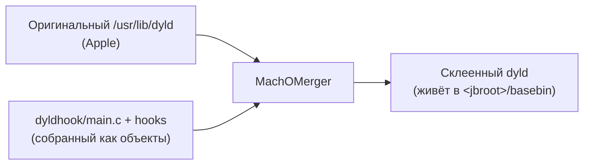
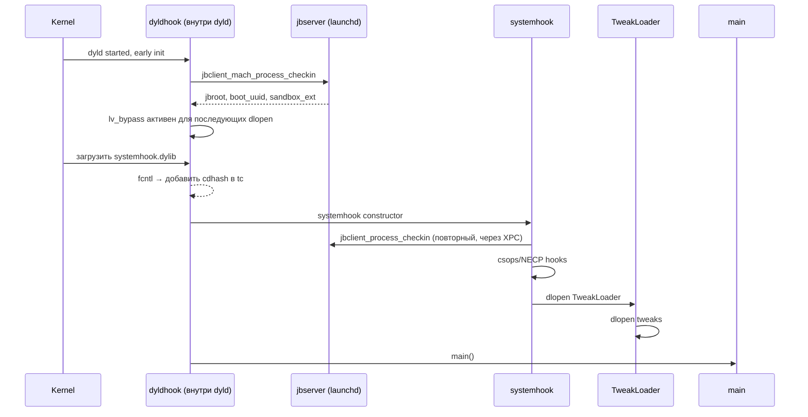

# Глава III.6. BaseBin/dyldhook — патч dyld на уровне процесса

`dyldhook` — редкий зверь: это **встроенная внутрь самого dyld** dylib, которая работает **до** любого юзерского кода. Она служит двум задачам: library-validation bypass и fakelib redirect. Эта глава объяснит, зачем она нужна и чем отличается от обычных dylib'ов.

## 1. Что такое «hook на уровне dyld»

Обычная dylib загружается dyld'ом в процесс. `dyldhook` — другая: это Mach-O, который **встраивается в сам бинарник dyld** через `MachOMerger` (ещё один компонент BaseBin). После merge dyld становится «суперdyld»: его собственный код плюс код dyldhook.



Как это заменяет настоящий dyld — вопрос эксплойта и trust cache; с точки зрения кода `dyldhook` важно другое: **он выполняется до `main()` любого процесса и даже до загрузки других dylibs в процесс**.

Файл `BaseBin/dyldhook/src/main.c:14` создаёт специальную секцию `__DATA,__jbinfo`:

```c
__attribute__((section("__DATA,__jbinfo"))) static char jbinfoSection[0x4000];
#define jbInfo ((struct dyld_jbinfo *)&jbinfoSection[0])
```

Это 16 KB структура, в которой dyldhook хранит состояние: `jbRootPath`, `bootUUID`, `sandboxExtensions`, флаги `fullyDebugged`/`forceCSAdhoc`. По сути — глобальный буфер, который все остальные хуки dyldhook могут читать.

## 2. Процедура check-in

Из `main.c:52–75`:

```c
void dyldhook_perform_checkin(void)
{
    struct jbserver_mach_msg_checkin_reply *replyPtr;
    char *jbRootPathPtr = &jbInfo->data[0];
    char *bootUUIDPtr = &jbInfo->data[sizeof(replyPtr->jbRootPath)];
    char *sandboxExtensionsPtr = &jbInfo->data[sizeof(replyPtr->jbRootPath)
                                               + sizeof(replyPtr->bootUUID)];

    if (jbclient_mach_process_checkin(jbRootPathPtr, bootUUIDPtr, sandboxExtensionsPtr,
                                      &jbInfo->fullyDebugged, &jbInfo->forceCSAdhoc) == 0) {
        consume_tokenized_sandbox_extensions(sandboxExtensionsPtr);
        jbInfo->jbRootPath = jbRootPathPtr;
        jbInfo->bootUUID = bootUUIDPtr;
        jbInfo->sandboxExtensions = sandboxExtensionsPtr;
        jbInfo->state = DYLD_STATE_CHECKED_IN;
    }
}
```

Разбор:

- `jbclient_mach_process_checkin` — mach-транспортный вариант XPC-клиента (не через XPC, а напрямую через mach-port). Используется потому, что в точке запуска dyld полноценная XPC-инфраструктура ещё не готова.
- Три указателя (`jbRootPathPtr`, `bootUUIDPtr`, `sandboxExtensionsPtr`) ссылаются в один и тот же буфер `jbInfo->data`, с разными офсетами. Это аллокация без malloc'а — критично для dyld, который не может звать malloc до собственной инициализации.
- Комментарий в коде: «This will, amongst other things, disable page validation, which allows instruction hooks to be applied later» — после check-in сам dyld (в лице launchd) снимает проверку страниц, что делает возможными хуки в `systemhook` и твиках.

## 3. Хуки dyldhook

### 3.1. `fakelib_redirect` — путь, когда jailbreak «спрятан»

Файл `BaseBin/dyldhook/src/fakelib_redirect.c` обёрнут в `#if 0` в текущем состоянии, но содержит архиважную идею, которую автор твика должен понимать.

Из комментария в файле:

> When hiding the jailbreak in Dopamine settings, a lot of processes will crash due to the /usr/lib mount disappearing. Anything that has libraries inside /usr/lib that are not in the shared cache (e.g. libobjc_trampolines.dylib) mapped in will crash. We solve this here by redirecting dlopen calls for files in /usr/lib to /var/jb/basebin/.fakelib (if the latter is accessible). This way the vnode will not be on /usr/lib mount and the /usr/lib mount therefore can be unmounted without making stuff crash.

Что это значит для автора твика:

- Dopamine может «скрыть» себя через `/usr/lib`-overlay. Пока это сделано — все dlopen'ы `/usr/lib/*` редиректятся на `<jbroot>/basebin/.fakelib/*`, где лежат копии нужных дылиб.
- Код этого редиректа сейчас выключен (`#if 0`) — т.е. в текущем Dopamine 3.0.12 он не активен. Но инфраструктура есть, и в будущих версиях может включиться.

Пока функция не активна, запомни: не используй в твике хардкодные `/usr/lib/*` — если redirect включится, твои пути сломаются. Используй `libroot_get_jbroot_prefix() + "/basebin/.fakelib/..."` или просто доверяй стандартному dlopen.

### 3.2. `lv_bypass` — обход library validation

Файл `BaseBin/dyldhook/src/lv_bypass.c` — активный. Комментарий:

> Dyld will call fcntl to attach a code signature to a dylib before mapping it in. So we hook fcntl to ensure the code signature to be attached is added to trustcache.

Иначе говоря: когда dyld хочет загрузить `.dylib`, он сначала вызывает `fcntl(fd, F_ADDFILESIGS_RETURN, ...)` чтобы прикрепить его codesign. `dyldhook` перехватывает этот `fcntl` и перед выполнением:

- Проверяет, есть ли уже cdhash этой библиотеки в trust cache.
- Если нет — вызывает `jbclient_mach_trust_file(fd, ...)` для добавления.
- Пропускает оригинальный `fcntl`.

Результат: любая `.dylib`, которую пытается загрузить процесс, получает валидную подпись в глазах AMFI, даже если формально она ad-hoc.

Это и есть **фундамент загрузки твиков**: без `lv_bypass` ни один `.dylib`, кроме Apple-подписанных, не загрузился бы.

### 3.3. `spinlock_fix` — исправление дедлока в dyld

Файл `BaseBin/dyldhook/src/spinlock_fix.c` — фикс для специфичного дедлока в dyld, возникающего из-за того, что при внедрении кода меняется поведение внутренних spinlock'ов. Детали — внутренняя магия; автор твика с этим не взаимодействует.

### 3.4. `machomerger_hook` и `roothider`

Эти два файла — вспомогательные:

- `machomerger_hook.h` — макросы `HOOK(symbol)` / `ORIG(symbol)` для перехвата функций dyld. Используется в стиле `extern void *ORIG(_ZN5dyld44APIs11dlopen_fromEPKciPv)(...)` — где длинное имя — mangled C++ символ метода `dyld4::APIs::dlopen_from`.
- `roothider.S` + `roothider.c` — слой, специфичный для randomized jbroot. Обрабатывает path translation для `/var/jb/*` и производных.

### 3.5. `reimpl.c` — переимплементация системных функций

Этот файл содержит минимальные реализации функций, которые нельзя звать в dyld-контексте (`memcpy`, `strlen`, `strcmp`, etc.). Нужно, потому что dyld до инициализации libSystem не имеет доступа к стандартной библиотеке.

Автор твика с этим не работает — это чисто внутренняя кухня.

## 4. jbinfo — глобальная структура состояния

`BaseBin/dyldhook/src/dyld_jbinfo.h` описывает `struct dyld_jbinfo`:

- `state` (`DYLD_STATE_CHECKED_IN` и др.) — текущий статус.
- `jbRootPath` — путь jbroot.
- `bootUUID`.
- `sandboxExtensions`.
- `fullyDebugged`, `forceCSAdhoc` — флаги.
- `data[]` — буфер под строки.

Эта структура доступна остальному коду dyldhook через указатель `jbInfo`. Другие dylibs в процессе её не видят — она «внутренняя» для склеенного dyld.

Для автора твика это невидимая часть, но знать её удобно для понимания: когда ваш `%ctor` отрабатывает, этот checkin уже сделан, и `get_jbroot()` в `systemhook` возвращает значение из `jbInfo->jbRootPath` (переданное из dyldhook через processCheckin).

## 5. Как dyldhook отличается от systemhook

| Аспект | dyldhook | systemhook |
|---|---|---|
| Где живёт | внутри dyld (слит через MachOMerger) | отдельная dylib, инжектится через `DYLD_INSERT_LIBRARIES` |
| Когда работает | до самого dyld main — ultra-early | после dyld, в constructor |
| Что делает | checkin, library validation bypass, path redirects | тwикам и NECP/csops hooks |
| Виден твикам | через `jbInfo` — нет, но результат виден (jbRootPath и т.п.) | косвенно через `get_jbroot()` и `jbclient_*` |

Два хука — две фазы работы:



Важный факт: `jbclient_process_checkin` вызывается **дважды** — первый раз из dyldhook через mach-port транспорт, второй раз из systemhook через XPC. Это ожидаемо: разные транспорты, разные фазы, но оба работают корректно.

## 6. Что доступно твикам из dyldhook

Напрямую — **ничего**. `jbInfo` — внутренний, в твик не экспортирован. Все API, которые нужны твику, идут через `libjailbreak`/`systemhook`/`libroot`.

Но два следствия работы dyldhook, которые автор твика может ощущать:

1. **Ваш `.dylib` можно загружать через `dlopen`.** Без `lv_bypass` это бы не работало.
2. **Пути jbroot корректны для всего процесса.** Все обращения через libroot работают, даже из тех мест кода, которые были инициализированы до вашего `%ctor`.

## 7. Что подтверждено

- **Подтверждено исходниками**: наличие `fakelib_redirect.c` (пока в `#if 0`), `lv_bypass.c` (активен), `spinlock_fix.c`, структуры `jbInfo` и `dyld_jbinfo.h`, функции `dyldhook_perform_checkin` в `main.c:52`.
- **Подтверждено архитектурой проекта**: MachOMerger (`BaseBin/MachOMerger/`) существует и собирается — цитата из `BaseBin/Makefile`.
- **Требует проверки на устройстве**: активен ли `fakelib_redirect` в текущей сборке Dopamine 3.0.12 — комментарий `#if 0` намекает, что выключен, но на устройстве это проверяется через факт существования `<jbroot>/basebin/.fakelib/`.
- **Не подтверждено**: конкретный момент слияния dyld + dyldhook — это часть bootstrap-процесса (см. главу III.11).

## 8. Выводы

Главный тезис: `dyldhook` — это **самый ранний** jailbreak-код в процессе. Он делает невидимую, но критически важную работу: обходит library validation и даёт possibility грузить произвольные `.dylib`. Без него никакой tweak-инъекции бы не было.

Для автора твика эта глава полезна тем, что показывает: **загрузка `.dylib` на jailbroken-устройстве «просто работает» не потому, что iOS добрее, а потому, что `dyldhook` в самом dyld тихо патчит validation**. Если ваш твик вдруг отказывается грузиться с ошибкой «invalid signature», проверять в первую очередь — работает ли jailbreak вообще (т.е. грузится ли dyldhook), и есть ли ваш cdhash в trust cache (через `jbctl trustcache show`).

## 9. Что дальше

- `MachOMerger` — Deep-dive 15 (как создаётся «склеенный» dyld).
- `hookd` — глава III.7 (внешние хуки через mach).
- `jailbreakd` — глава III.8.
- `trustcache` в деталях — Deep-dive 05 (как cdhash попадает в trust cache через `fcntl` hook).
- `bootstrap` — глава III.11 (как dyld вообще заменяется).
