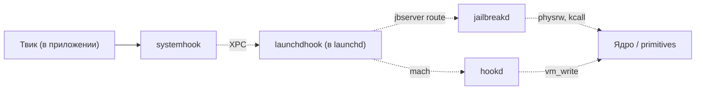

# Глава III.8. BaseBin/jailbreakd — демон-координатор

`jailbreakd` — отдельный привилегированный демон, который держит **полный набор** jailbreak-примитивов и предоставляет их по XPC другим компонентам. Если `hookd` — узкоспециализирован (писать в чужую память), то `jailbreakd` — универсальный «процесс с правами», который обслуживает запросы, требующие root/kernel-операций. В этой главе — его роль и API.

## 1. Назначение

Коротко: `jailbreakd` — это **«вторая половина»** `launchdhook`.

- `launchdhook` живёт в launchd (PID 1), держит jbserver для все процессов, но ограничен в возможностях (не всё можно делать из launchd).
- `jailbreakd` живёт как отдельный процесс, выполняет те операции, которые launchd делать опасно/невозможно: spinlock fix для только что форкнутых процессов, patch dyld у ребёнка, физическое чтение/запись памяти с полной инициализацией primitives.

Это разделение сделано осознанно: launchd — критически важный процесс (его падение = kernel panic или userspace reboot), поэтому в нём держат **минимум** кода. Основная работа выносится в `jailbreakd`.

## 2. Entitlements

Из `BaseBin/jailbreakd/entitlements.plist`:

```xml
<key>platform-application</key><true/>
<key>task_for_pid-allow</key><true/>
<key>com.apple.private.cs.debugger</key><true/>
<key>com.apple.system-task-ports</key><true/>
<key>com.apple.system-task-ports.control</key><true/>
<key>com.apple.private.thread-set-state</key><true/>
<key>com.apple.private.set-exception-port</key><true/>
<key>com.apple.private.security.no-sandbox</key><true/>
<key>com.apple.private.security.storage.AppBundles</key><true/>
<key>com.apple.private.security.storage.AppDataContainers</key><true/>
```

Разбор:

- `platform-application`, `task_for_pid-allow`, `cs.debugger` — набор, аналогичный `hookd`, но расширенный.
- `system-task-ports` и `system-task-ports.control` — доступ к task-портам системных процессов. Это уже уровень полноценного ядерного дебаггера.
- `thread-set-state`, `set-exception-port` — модификация потоков и обработчиков исключений в чужих процессах.
- `no-sandbox` — без песочницы вообще.
- `storage.AppBundles`, `storage.AppDataContainers` — доступ к содержимому любого bundle и data container установленных приложений.

Это самые широкие entitlements среди всех компонентов Dopamine. `jailbreakd` — по сути привилегия root + debugger.

## 3. Инициализация — `main.m`

Из `BaseBin/jailbreakd/src/main.m:28–115`, ключевые шаги:

1. **Crash reporter** — `crashreporter_start()`, чтобы любой краш демона сохранялся.
2. **Jetsam limit** — `setJetsamLimit(50, false)` — ставит high-water-mark на 50 MB. Это high-water-mark, не fatal — jetsam не убьёт за превышение, только пометит для возможного последующего убийства, если памяти станет совсем мало.
3. **Lookup registered ports** — через `mach_ports_lookup` достаёт список портов, зарегистрированных для процесса при его spawn'е. Port index 2 — bootstrap-порт для связи с jbserver.
4. **Инициализация primitives** — `jbclient_initialize_primitives()`. Этот вызов инициализирует внутренние ядерные примитивы (physrw, kernel RW) через XPC к серверу.
5. **Respawn logic** — если `RESPAWN_REQUIRED=1` в среде, демон запускает **себя же** через `posix_spawn` с суспенд-флагом, применяет `unrestrict(pid, proc_patch_dyld, false)` для патча dyld у ребёнка и либо продолжает его работу, либо убивает.
6. **Checkin и server loop** — через `jbclient_jailbreakd_checkin()` получает mach-порт для входящих сообщений, создаёт `dispatch_source_t` для обработки.

Respawn-логика — тонкий момент: `jailbreakd` при запуске может потребовать «очистить» себя (unrestrict + patch dyld у ребёнка), чтобы работать с нужной инструментовкой. Это те же трюки, что `launchdhook`+`spawn_hook`.

## 4. Серверный цикл — `server.m`

Из `BaseBin/jailbreakd/src/server.m:21–65`. Главный метод `jailbreakd_received_message(mach_port_t port)`:

1. `xpc_pipe_receive(port, &message)` — получить сообщение.
2. `xpc_dictionary_get_audit_token(message, &auditToken)` → `audit_token_to_pid(auditToken)` → узнать PID клиента.
3. `JBD_MESSAGE_ID msgId = xpc_dictionary_get_uint64(message, "id")` — тип запроса.
4. switch по msgId — диспатчить к обработчику.

Два основных обработчика, которые видны в коде:

### 4.1. `JBD_MSG_SPINLOCK_FIX_ONLY`

Применяется, когда родительский процесс (`clientPid`) только что сделал `fork()` + `exec()`, и дочерний нуждается в patch'е spinlock-primitives в dyld.

```objc
case JBD_MSG_SPINLOCK_FIX_ONLY: {
    pid_t pid = xpc_dictionary_get_int64(message, "pid");
    bool resume = xpc_dictionary_get_bool(message, "resume");
    pid_t ppid = proc_get_ppid(pid);
    if (ppid == clientPid) {
        if (ppid == 1 && resume == false) {
            // Frida -f edge case
            result = proc_patch_csflags(pid);
        } else if (proc_fix_spinlock(pid) == 0) {
            if (resume) kill(pid, SIGCONT);
        }
    }
    ...
}
```

Проверка `ppid == clientPid` — защитное правило: клиент может «ремонтировать» только **своего же** дочернего процесса, не любой. Это предотвращает «мне нужно patched x = любой чужой процесс по моему выбору».

### 4.2. `JBD_MSG_SPAWN_PATCH_CHILD`

Аналогичная логика, но для полного patch (не только spinlock, а dyld + child):

```objc
case JBD_MSG_SPAWN_PATCH_CHILD: {
    pid_t pid = xpc_dictionary_get_int64(message, "pid");
    bool resume = xpc_dictionary_get_bool(message, "resume");
    pid_t ppid = proc_get_ppid(pid);
    if (ppid == clientPid) {
        if (ppid == 1 && resume == false) {
            result = proc_patch_csflags(pid);
        } else if (roothide_patch_proc(pid) == 0) {
            ...
        }
    }
}
```

`roothide_patch_proc(pid)` — делает полный patch для только что сrespawn'нутого процесса: cs flags, dyld, инструментовка.

## 5. Какой слой API доступен твикам

Из `BaseBin/libjailbreak/src/jbclient_xpc.h` ранее мы видели набор `jbclient_root_*` функций:

```c
int jbclient_root_get_physrw(bool singlePTE, uint64_t *singlePTEAsidPtr);
int jbclient_root_sign_thread(mach_port_t threadPort);
int jbclient_root_get_sysinfo(xpc_object_t *sysInfoOut);
int jbclient_root_steal_ucred(uint64_t ucredToSteal, uint64_t *orgUcred);
int jbclient_root_set_mac_label(uint64_t slot, uint64_t label, uint64_t *orgLabel);
int jbclient_root_trustcache_info(xpc_object_t *infoOut);
```

Эти функции предназначены для **процессов с правами root** (`JBS_DOMAIN_ROOT`). Автор стороннего твика, работающего в приложении (не-root), к ним **не достанется** — jbserver просто отбросит запрос по проверке auditToken.

Что остаётся доступным обычным твикам из операций, фактически делегируемых `jailbreakd`:

- Косвенно — через `jbclient_cs_revalidate()` (обычный SystemWide домен), которая внутри использует примитивы, предоставляемые jailbreakd.
- Косвенно — через `jbclient_trust_file_by_path()`.

Прямое обращение к `jailbreakd` из обычного твика невозможно и не нужно.

## 6. Связь между компонентами



Иерархия обязанностей:

- **launchdhook** — mediator. Все запросы от твиков идут через него.
- **jailbreakd** — ответственный за операции, требующие полных ядерных примитивов.
- **hookd** — узкоспециализированный: только `vm_write`/`vm_protect` в чужой процесс.

Для автора твика это даёт понимание: когда ваш твик делает любой вызов `jbclient_*`, запрос идёт через mach в launchd, launchd (точнее `launchdhook`) обрабатывает его внутри себя или перенаправляет к `jailbreakd`/`hookd` в зависимости от домена/действия.

## 7. Что подтверждено

- **Подтверждено исходниками**:
  - Entitlements демона — `BaseBin/jailbreakd/entitlements.plist`.
  - Инициализация и respawn — `BaseBin/jailbreakd/src/main.m:28–115`.
  - Обработчики сообщений `JBD_MSG_SPINLOCK_FIX_ONLY` и `JBD_MSG_SPAWN_PATCH_CHILD` — `BaseBin/jailbreakd/src/server.m:47–85`.
  - Защитное правило `ppid == clientPid` — тот же файл.
  - `jetsam_limit=50MB` — `setJetsamLimit(50, false)` в `main.m`.
- **Подтверждено архитектурно**: разделение «launchd хранит минимум, остальное выносится в jailbreakd» — стандартная практика рисковой инженерии.
- **Требует проверки на устройстве**: конкретные случаи, когда `JBD_MSG_SPAWN_PATCH_CHILD` оказывается полезным — обычно для специализированных инструментов (например, Frida с `frida -f`).
- **Не подтверждено**: полный набор `JBD_MSG_*` ID — файл `server.m` длинный, в показанном выше фрагменте — только два; полный перечень смотрите в заголовочном файле `jailbreakd.h` в `libroothider/src/`.

## 8. Выводы

Главный тезис: `jailbreakd` — это **выделенный привилегированный процесс для операций, которые опасно/невозможно делать внутри launchd**. Для автора стороннего твика важно знать:

- Что все операции над «процессами и ядром», которые делает Dopamine, — проходят через цепочку launchd → jailbreakd/hookd, а не напрямую из вашего твика.
- Прямое обращение к jailbreakd из обычного твика не предполагается — не пытайтесь его организовывать.
- Если ваш твик (например, инжектор Frida) хочет интегрироваться с jailbreakd — это должна быть осознанная работа через `jbclient_root_*` API с подтверждением entitlements вашего process.

## 9. Что дальше

- `rootlesshooks` и `roothidehooks` — хуки в системных процессах — глава III.9.
- `libroot` — публичный API путей — глава III.10.
- `basebin` build и bootstrap — глава III.11.
- Для деталей architecture jbserver — шпаргалка `cheatsheets/07-jbserver-domains.md`.
