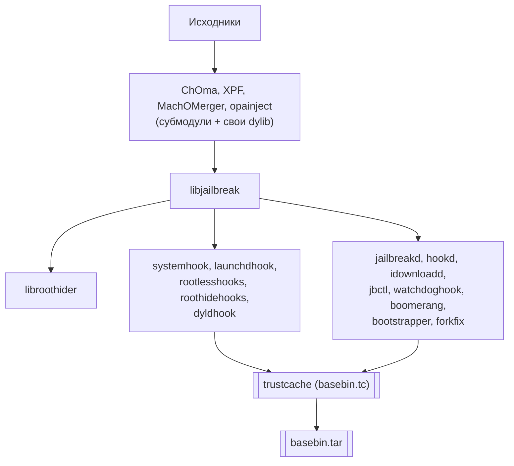

# Глава III.11. Как собирается basebin и как разворачивается bootstrap

Эта глава — финальный технический разбор того, как «миниатюрный userland Dopamine» (`basebin`) переходит из набора исходников в работающий jailbreak на устройстве. Она отвечает на вопросы, которые часто остаются непрояснёнными: что именно собирается, как это упаковывается, что делает `bootstrapper`, в каком порядке всё разворачивается.

## 1. Сборка — верхнеуровневый поток



Ключевой тезис: **всё в `basebin.tar` — ad-hoc подписано**. Валидность для AMFI обеспечивается тем, что cdhash каждого бинарника добавлен в `basebin.tc` — static trustcache, который загружается ядром при разворачивании jailbreak.

## 2. `BaseBin/Makefile` — главная сборочная цель

Из `BaseBin/Makefile:12–15`:

```make
subprojects: ChOma XPF MachOMerger opainject libjailbreak systemhook forkfix \
             launchdhook hookd boomerang jbctl idownloadd watchdoghook \
             rootlesshooks dopamine
subprojects: roothidehooks libroothider jailbreakd bootstrapper
```

Это весь набор. Разбор:

- **ChOma** (`BaseBin/ChOma/`) — Mach-O библиотека, submodule. Используется другими для чтения/модификации Mach-O.
- **XPF** (`BaseBin/XPF/`) — eXtensible Patchfinder, submodule. Находит offsets в ядре.
- **MachOMerger** — склеивает dyldhook с настоящим dyld.
- **opainject** — инжектор в живой процесс (альтернатива DYLD_INSERT).
- **libjailbreak**, **libroothider** — библиотеки (главы III.2, III.3).
- **systemhook**, **launchdhook**, **dyldhook**, **rootlesshooks**, **roothidehooks** — хуки (главы III.4–III.6, III.9).
- **hookd**, **jailbreakd**, **idownloadd**, **jbctl**, **watchdoghook**, **boomerang**, **bootstrapper**, **forkfix** — демоны и утилиты.

Все цели по очереди собираются, бинарники копируются в `BaseBin/.build/`.

## 3. Trust cache сборки — `basebin.tc`

Из `BaseBin/Makefile:102–105`:

```make
basebin.tc: subprojects
    trustcache create .build/basebin.tc .build
    cp .build/basebin.tc basebin.tc
```

Утилита `trustcache` (вероятно из ChOma или собственная) ходит по `.build/`, вычисляет cdhash каждого бинарника/dylib, записывает в `basebin.tc` файл.

Структура trustcache подробно разбирается в Deep-dive 05. Коротко — это бинарный формат, который ядро через AMFI умеет читать: «вот список cdhash'ей, которые считаются валидно подписанными».

## 4. Trusting dyldhook отдельно

Из `BaseBin/Makefile:109–110`:

```make
# dyldhook dylibs do not need to be added to the basebin trustcache
dyldhook: basebin.tc
    $(MAKE) -C dyldhook
    @cp dyldhook/*.dylib .build
```

Комментарий критичен: `dyldhook` **не нужен** в trust cache. Это потому, что dyldhook — не отдельная dylib, которую dyld загружает нормально; это код, встраиваемый в сам dyld через MachOMerger. Соответственно его cdhash уходит в trust cache через **модифицированный dyld**, а не как отдельная запись.

## 5. Упаковка — `basebin.tar`

Из `BaseBin/Makefile:113–115`:

```make
basebin.tar: basebin.tc dyldhook
    @find ./.build -name ".DS_Store" -delete
    @DYLD_FALLBACK_LIBRARY_PATH="." ./tar \
        --transform "s/^.build/basebin/" -cvf "basebin.tar" ".build" \
        --owner=0 --group=0
```

Три детали:

- `.DS_Store` файлы удаляются (macOS-мусор).
- Используется **локальный `./tar`** (а не системный) — потому что системный macOS `tar` может иметь иной формат, а Dopamine хочет контролируемый artifact.
- `--transform "s/^.build/basebin/"` — внутри tar'а всё переименовано: `.build/libjailbreak.dylib` становится `basebin/libjailbreak.dylib`.

Результат — `BaseBin/basebin.tar`. Это **самое важное артефакт**: он содержит весь юзерский jailbreak, упакованный, готовый к развёртыванию.

## 6. Что внутри `basebin.tar`

Если распаковать (`tar tvf basebin.tar | head`), увидим примерно:

```
basebin/.version
basebin/.version-roothide
basebin/libjailbreak.dylib
basebin/libroothider.dylib
basebin/libchoma.dylib
basebin/libxpf.dylib
basebin/systemhook.dylib
basebin/launchdhook.dylib
basebin/rootlesshooks.dylib
basebin/roothidehooks.dylib
basebin/dyldhook.dylib         (из dyldhook.c)
basebin/dyldhook_data.dylib    (данные для MachOMerger)
basebin/forkfix.dylib
basebin/watchdoghook.dylib
basebin/jailbreakd
basebin/hookd
basebin/jbctl
basebin/idownloadd
basebin/boomerang
basebin/bootstrapper
basebin/opainject
basebin/MachOMerger
basebin/basebin.tc              (trustcache)
basebin/prebuilt/*              (prebuilt binaries из _external/)
```

Это всё, что живёт в `<jbroot>/basebin/` на устройстве.

## 7. `BaseBin/_external/basebin/.version`

Из `BaseBin/_external/basebin/.version`:

```
3.0.12
```

Это декларируемая версия сборки. При обновлении (через `jbctl update basebin`) сравнивается именно это значение.

Файл `.version-roothide`:

```
28
```

Отдельная версия RootHide-слоя. Разные компоненты могут иметь свои счётчики версий.

## 8. Что делает `DOBootstrapper.m` при установке

Из `Application/Dopamine/Jailbreak/DOBootstrapper.m`:

### 8.1. Bundled packages

```objc
#define LIBKRW_DOPAMINE_BUNDLED_VERSION @"2.0.3"
#define LIBROOT_DOPAMINE_BUNDLED_VERSION @"1.0.1"
#define BASEBIN_LINK_BUNDLED_VERSION @"1.0.0"
#define LAUNCHCTL_BUNDLED_VERSION @"1:1.2.0"

static NSDictionary *gBundledPackages = @{
    @"libkrw0-dopamine" : LIBKRW_DOPAMINE_BUNDLED_VERSION,
    @"libroot-dopamine" : LIBROOT_DOPAMINE_BUNDLED_VERSION,
    @"dopamine-basebin-link" : BASEBIN_LINK_BUNDLED_VERSION,
    @"launchctl" : LAUNCHCTL_BUNDLED_VERSION,
};
```

Это **packages, которые Dopamine ставит из коробки**. Для автора твика важно знать:

- `libroot-dopamine` **1.0.1** — именно та версия, что обсуждалась в главе III.10.
- `libkrw0-dopamine` **2.0.3** — libkrw (kernel read/write) провайдер.
- `dopamine-basebin-link` **1.0.0** — пакет-симлинк `/basebin → <jbroot>/basebin`.
- `launchctl` **1.2.0** — модифицированная версия launchctl для jailbreak-окружения.

Все четыре устанавливаются автоматически при первой загрузке bootstrap.

### 8.2. Распаковка tar

```objc
- (NSError *)extractTar:(NSString *)tarPath toPath:(NSString *)destinationPath
{
    int r = libarchive_unarchive(tarPath.fileSystemRepresentation,
                                 destinationPath.fileSystemRepresentation);
    if (r != 0) {
        return [NSError errorWithDomain:bootstrapErrorDomain
                                   code:BootstrapErrorCodeFailedExtracting
                               userInfo:@{NSLocalizedDescriptionKey :
                                   [NSString stringWithFormat:@"libarchive returned %d", r]}];
    }
    return nil;
}
```

Через `libarchive` (не системный `tar`) распаковывается `basebin.tar` в целевую директорию (под префиксом jbroot).

### 8.3. hfs_mount_args

В `DOBootstrapper.m:35–47` объявлена структура `hfs_mount_args` — для вызова `mount(2)` с типом HFS. Это нужно для монтирования overlay/overlay-like файловых систем в rootless-варианте.

## 9. `bootstrapper` — на устройстве

Файл `BaseBin/bootstrapper/src/main.m`:

```c
#include <stdio.h>

int main(int argc, char* argv[])
{
    //To Do: if the jailbreak app is installed with a certificate signature, 
    //      it may not have sufficient entitlements to write files to 
    //      /var/containers/Bundle/Applicaton/(.jbroot-XXXXXXXXXXXXXXXX)
    return 0;
}
```

Разбор:

- Текущая реализация — **заглушка**: `return 0`.
- Комментарий говорит, что ещё предстоит добавить обработку случая, когда Dopamine установлен через сертификат (а не TrollStore) и не имеет достаточных entitlements для записи в `/var/containers/Bundle/Application/.jbroot-...`.

То есть `bootstrapper` как отдельный demon-инструмент в данный момент не делает ничего — основная работа происходит в Dopamine.app (через `DOBootstrapper.m`) и после запуска launchd (через `launchdhook`).

## 10. Общий пайплайн на устройстве

```mermaid
sequenceDiagram
    participant User as Пользователь
    participant App as Dopamine.app
    participant Expl as Эксплойт (DarkSword/ClearSword)
    participant Kernel as Ядро
    participant TC as Trust cache
    participant LD as launchd
    participant FS as Файловая система
    User->>App: кнопка "Jailbreak"
    App->>Expl: запустить
    Expl->>Kernel: kernel RW primitives
    App->>FS: распаковать basebin.tar в &lt;jbroot&gt;/basebin
    App->>TC: загрузить basebin.tc (static trustcache)
    App->>LD: вкатить launchdhook.dylib
    LD->>LD: launchdhook constructor
    LD->>LD: start jbserver
    LD->>LD: spawn jailbreakd, hookd
    App->>App: уведомить пользователя "jailbreak успешен"
```

Для автора твика это даёт понимание: **первая загрузка твика** произойдёт только после того, как:

1. Эксплойт отработал.
2. `basebin.tar` развёрнут.
3. `launchdhook.dylib` в launchd.
4. Пользователь запустил приложение, в которое ваш твик нацелен.
5. `systemhook` в приложении загрузил `TweakLoader`.
6. `TweakLoader` нашёл ваш filter plist и `dlopen`-ул вашу dylib.

## 11. `jbctl` — утилита управления

Из `Makefile` в корне проекта:

```make
update: all
    ssh $(DEVICE) "rm -rf /var/mobile/Documents/Dopamine.tipa"
    scp -C ./Application/Dopamine.tipa "$(DEVICE):/var/mobile/Documents/Dopamine.tipa"
    ssh $(DEVICE) "/basebin/jbctl update tipa \$$(jbroot)/var/mobile/Documents/Dopamine.tipa"

update-basebin: all
    ssh $(DEVICE) "rm -rf /var/mobile/Documents/basebin.tar"
    scp -C ./BaseBin/basebin.tar "$(DEVICE):/var/mobile/Documents/basebin.tar"
    ssh $(DEVICE) "/basebin/jbctl update basebin \$$(jbroot)/var/mobile/Documents/basebin.tar"
```

`jbctl` — утилита в `BaseBin/jbctl/`, позволяет обновлять basebin **без переустановки Dopamine.app**. Это удобно для разработчиков jailbreak-кода.

Два полезных подкоманды:

- `jbctl update basebin <tar>` — заменить `basebin.tar` на свежий, перезагрузить компоненты (userspace reboot).
- `jbctl update tipa <tipa>` — обновить само Dopamine.app.

Для автора твика эти команды редко применимы напрямую, но полезно знать: если ваш твик модифицирует внутренние dylib Dopamine (патч самого jailbreak — глава V.1), именно `jbctl update basebin` — путь выкатить patch на устройство.

## 12. Что подтверждено

- **Подтверждено исходниками**:
  - Все цели `BaseBin/Makefile`.
  - Trust cache сборка — `BaseBin/Makefile:102–105`.
  - Упаковка в tar — `BaseBin/Makefile:113–115`.
  - Bundled packages — `DOBootstrapper.m:21–30`.
  - Версия basebin — `BaseBin/_external/basebin/.version` = «3.0.12».
  - `bootstrapper` main.m — пустая заглушка.
- **Подтверждено Makefile**: `jbctl update basebin` в корневом `Makefile`.
- **Требует проверки на устройстве**: конкретный путь jbroot на новой установке — вычисляется случайно.
- **Не подтверждено**: детали, как trust cache загружается в ядро на A13+iOS 26.0 — это часть эксплойта (DarkSword/ClearSword), обсуждается в Deep-dive о exploits.

## 13. Выводы

Главный тезис: `basebin.tar` — это **артефакт сборки**, в который упаковано всё, что составляет userland Dopamine. Процесс сборки — цепочка `make -C BaseBin` → собираются субмодули (ChOma, XPF) → библиотеки → хуки → демоны → trustcache → tar. Процесс развёртывания — эксплойт даёт kernel RW, Dopamine.app распаковывает tar, запускает launchd с инжекцией launchdhook, launchdhook поднимает jbserver и всё остальное.

Для автора твика важно знать:

- Ваш твик живёт параллельно `basebin.tar`, не внутри. Вы устанавливаете .deb в `<jbroot>/Library/MobileSubstrate/DynamicLibraries/`.
- Все API, которые вы вызываете (libroot, libjailbreak), — обеспечиваются компонентами из basebin.
- Если нужно модифицировать сам jailbreak (патч исходников), процедура — пересобрать basebin и выкатить через `jbctl update basebin`.

## 14. Что дальше

- Сводная таблица задач — глава III.12 (финал Части III).
- Для подробностей trust cache — Deep-dive 05.
- Для подробностей эксплойтов — Deep-dive 10 (когда будет написан).
- Для сборки своего .deb — глава IV.10 (сборка, инспекция, упаковка).
