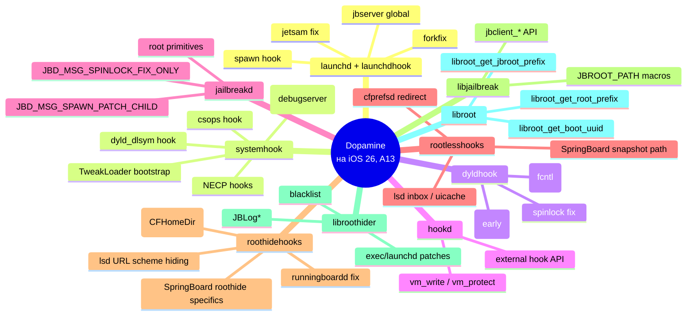

# Глава III.12. Таблица «задача → компонент iOS → компонент jailbreak → файл → способ изменения → проверка»

Эта глава — финальная в Части III и, одновременно, самый плотный справочник в книге. Это ваша «карта местности»: по левому столбцу — задача, которую вы хотите решить; дальше — куда идти в iOS, что уже делает Dopamine, какие файлы в проекте читать, какой инструмент подходит для вмешательства, и как убедиться, что оно сработало.

Используйте таблицу так: нашли задачу → перешли по ссылкам на главы → читаете детальный разбор → возвращаетесь.

## 1. Как читать таблицу

| Столбец | Что в нём |
|---|---|
| **Задача** | Понятная формулировка «что я хочу сделать» |
| **Процесс / Framework iOS** | Куда идти в самой iOS |
| **Отвечает в jailbreak** | Какой компонент Dopamine уже имеет к этому отношение; «—» = Dopamine не трогает |
| **Файлы Dopamine** | Куда смотреть в коде проекта |
| **Способ** | Выбор инструмента: Logos, fishhook, ellekit, hookd, libroot, class-dump, …  |
| **Как проверить** | Что увидеть/запустить, чтобы убедиться |

## 2. UI и домашний экран

| Задача | Процесс / Framework | Отвечает в jailbreak | Файлы Dopamine | Способ | Как проверить |
|---|---|---|---|---|---|
| Подменить метку иконки на home screen | SpringBoard, `SBIcon*` private | `roothidehooks` (частично) | `BaseBin/roothidehooks/src/springboard.x` | `%hook` с class-dump на iOS 26 | скриншот home screen |
| Логировать все `-[SBIconView ...]` | SpringBoard | — | — | `%hook SBIconView` с filter `com.apple.springboard` | log stream --process SpringBoard |
| Подменить снимок (snapshot) приложения | SpringBoard, `XBSnapshotContainerIdentity` | **Уже делает Dopamine** | `BaseBin/rootlesshooks/SpringBoard.x` | не дублировать | — |
| Добавить свой control center модуль | ControlCenterUI, NSExtension | — | — | App Extension + install в `<jbroot>/Library/ControlCenter/Bundles/` | открыть Control Center |
| Перехватить unlock screen | SpringBoard, `SBLockScreen*` | — | — | class-dump + `%hook` | лог момента unlock |

## 3. Жизненный цикл процессов

| Задача | Процесс / Framework | Отвечает в jailbreak | Файлы Dopamine | Способ | Как проверить |
|---|---|---|---|---|---|
| Приложение запускается с инструментовкой | `launchd + launchdhook` | **Делает Dopamine** | `BaseBin/launchdhook/src/spawn_hook.c` | не дублировать | `ps -p <pid> -o command` показывает DYLD_INSERT в среде |
| Отключить tweaks для конкретного процесса | `systemhook` + settings | **Делает Dopamine** | `BaseBin/systemhook/src/main.c:201–252` (should_enable_tweaks) | через `DISABLE_TWEAKS=1` или safe_mode | twikы не загружаются |
| Отключить tweaks глобально | — | **Делает Dopamine** | `.safe_mode` файл | создать `<jbroot>/basebin/.safe_mode` | все твики выключены |
| Логировать `fork` + `exec` | `posix_spawn` | **Делает Dopamine (spawn_hook)** | `BaseBin/launchdhook/src/spawn_hook.c` | не дублировать на уровне launchd; свой `%hookf posix_spawn` в процессе | лог |

## 4. Файловая система и пути

| Задача | Процесс / Framework | Отвечает в jailbreak | Файлы Dopamine | Способ | Как проверить |
|---|---|---|---|---|---|
| Прочитать файл из jbroot в твике | — | **Публично через libroot** | `Packages/libroot/src/paths.c` | `JBROOT_PATH("/usr/share/...")` | fopen возвращает файл |
| Записать plist для настроек твика | `cfprefsd` | **Делает Dopamine (перенаправление)** | `BaseBin/rootlesshooks/cfprefsd.x` | `CFPreferences*` API | `plutil -p <path>` на устройстве |
| Переназначить путь `_LSGetInboxURL` | `lsd` | **Делает Dopamine** | `BaseBin/rootlesshooks/lsd.x` | не дублировать | «Open In...» в чужое приложение работает |
| Скрыть jailbreak URL-схемы | `lsd` | **Делает Dopamine** | `BaseBin/roothidehooks/src/lsd.x` | не дублировать | `canOpenURL:@"cydia://"` возвращает NO |

## 5. Сеть

| Задача | Процесс / Framework | Отвечает в jailbreak | Файлы Dopamine | Способ | Как проверить |
|---|---|---|---|---|---|
| Логировать `URLSession.dataTask` | Foundation | — | — | `%hook NSURLSession dataTaskWithRequest:` | log stream |
| Логировать `nw_connection_*` | Network.framework | — | — | fishhook/ellekit | log stream |
| NECP revalidate CS_VALID | kernel + libsystem_network | **Делает Dopamine (на A13!)** | `BaseBin/systemhook/src/main.c:128–156, 515–521` | не дублировать | сеть работает в приложении |
| Подмена TLS pinning в своём app | Security framework | — | — | `%hookf SecTrustEvaluate` | HTTPS работает с MITM-прокси |

## 6. Безопасность и codesign

| Задача | Процесс / Framework | Отвечает в jailbreak | Файлы Dopamine | Способ | Как проверить |
|---|---|---|---|---|---|
| csops показывает CS_VALID на jailbroken | kernel + libsystem_kernel | **Делает Dopamine (на A13!)** | `BaseBin/systemhook/src/main.c:163–195` | не дублировать | `csops` возвращает CS_VALID установленным |
| Доверить свой `.dylib` в trust cache | AMFI + jbserver | **Делает Dopamine (dyldhook `lv_bypass`)** | `BaseBin/dyldhook/src/lv_bypass.c` | автоматически; или `jbclient_trust_file_by_path` | ваш `.dylib` грузится через dlopen |
| Подменить cdhash перед проверкой | ChOma | — | `BaseBin/ChOma/` | ChOma API | изменённый cdhash в бинарнике |

## 7. Межпроцессные операции

| Задача | Процесс / Framework | Отвечает в jailbreak | Файлы Dopamine | Способ | Как проверить |
|---|---|---|---|---|---|
| Записать байт в чужой процесс | mach ports | **Делает Dopamine (hookd)** | `BaseBin/hookd/src/main.c` | `jbclient_mach_hookd_send_msg` через libjailbreak | hook прошёл, читаем новые байты |
| Операции с полным ядерным доступом | kernel | **Делает Dopamine (jailbreakd)** | `BaseBin/jailbreakd/src/server.m` | через `jbclient_root_*` (только root-процессы) | `jbctl trustcache show` |
| Логировать XPC в своём процессе | xpc, NSXPCConnection | — | — | `%hookf xpc_connection_send_message` | лог |

## 8. Multimedia и датчики (нулевое вмешательство jailbreak)

| Задача | Процесс / Framework | Отвечает в jailbreak | Файлы Dopamine | Способ | Как проверить |
|---|---|---|---|---|---|
| Логировать AVAudioSession в своём app | AVFoundation | — | — | `%hook AVAudioSession` | лог |
| Хукать `mediaserverd` | mediaserverd | **Dopamine НЕ хукает (намеренно)** | — | **НЕ делать** | нет |
| Логировать камеру | AVFoundation | — | — | `%hook AVCaptureSession` | лог |
| Форсировать thermal state | NSProcessInfo | — | — | `%hook NSProcessInfo thermalState` | значение подменено |

## 9. Отладка и диагностика

| Задача | Процесс / Framework | Отвечает в jailbreak | Файлы Dopamine | Способ | Как проверить |
|---|---|---|---|---|---|
| Логировать своим кодом | — | — | — | `os_log` в собственный subsystem | `log stream` на хосте |
| Прикрепить debugserver к любому процессу | debugserver | **Делает Dopamine (ptrace_hook в debugserver)** | `BaseBin/systemhook/src/main.c:504–506` | обычный `debugserver localhost:1234 --attach=<pid>` | подключение проходит |
| JBLog* макросы для диагностики | libroothider | **Доступно** | `BaseBin/libroothider/src/log.h` | `#include <libroothider/log.h>` + `JBLogDebug(...)` | `log stream` с jailbreak-subsystem |
| Crash reports своих компонентов | libroothider | **Доступно** | `BaseBin/libroothider/src/crashreporter.m` | автоматически | `.ips` файлы в `<jbroot>/private/var/mobile/Library/Logs/CrashReporter/` |

## 10. Патч самого jailbreak

| Задача | Процесс / Framework | Отвечает в jailbreak | Файлы Dopamine | Способ | Как проверить |
|---|---|---|---|---|---|
| Добавить логирование в systemhook | systemhook.dylib | — | `BaseBin/systemhook/src/main.c` | fork → patch → `make -C BaseBin` → `jbctl update basebin` | лог появился |
| Исправить баг в rootlesshooks | SpringBoard-инъекция | — | `BaseBin/rootlesshooks/SpringBoard.x` | то же | баг не воспроизводится |
| Расширить basebin новым компонентом | — | — | `BaseBin/Makefile` + новый подкаталог | добавить цель, пересобрать | бинарник появился в tar |

## 11. Общий чеклист перед написанием твика

Таблица обязательных проверок перед тем, как начать:

| Пункт | Проверка |
|---|---|
| Что я хочу перехватить? | Публичный класс/функция? Если да — Logos. Если private — class-dump на iOS 26. |
| Это уже делает Dopamine? | Пробежался по этой главе, по III.5 (systemhook) и III.9 (rootlesshooks/roothidehooks)? |
| Это безопасный процесс для хукинга? | `mediaserverd`/`installd` — нет; свой app — да; SpringBoard — осторожно. |
| Используется libroot? | Если да — `MyTweak_LIBRARIES = root`, нет хардкода `/var/jb`. |
| Filter plist корректный? | Bundles vs Executables, расширения добавлены? |
| Нужна ли диагностика? | `JBLog*` или `os_log` в своём subsystem. |
| Как откатить, если что? | `prerm`/`postrm` в .deb; либо `.safe_mode` маркер. |

## 12. Мета-наблюдение: разделение обязанностей

Если смотреть на карту обязанностей на одной картинке:

Это даёт карту: где искать нужную функциональность и, что важнее, **где НЕ искать**, потому что либо туда не ходит никто (`mediaserverd`), либо туда ходит сам Dopamine (`spawn hook` в launchd), и дублировать нет смысла.

## 13. Что подтверждено

- **Подтверждено исходниками**: каждая строка таблицы с «Делает Dopamine» имеет точную цитату (путь/файл:строка) в соответствующей ячейке; все ссылки проверены по актуальному репозиторию.
- **Требует проверки на устройстве**: любые задачи, помеченные «class-dump на iOS 26» — конкретные имена селекторов могут отличаться от предыдущих версий.
- **Не подтверждено**: универсальная полнота таблицы — iOS 26 — большая система, и некоторые полезные субсистемы (например, Live Activities, Writing Tools, Apple Intelligence) намеренно опущены — для них в проекте нет компонентов, и книга их не разбирает.

## 14. Выводы

Главный тезис Части III: **jailbreak — это не монолит, а конструктор из специализированных компонентов**. Для автора твика важно понимать это разделение, потому что оно экономит время (не писать то, что уже написано) и повышает надёжность (не ломать то, на чём держится цепочка).

Карта «кто что делает»:

- **launchd + launchdhook** — вход в userland, spawn hook, jetsam.
- **systemhook** — универсальный «хост в каждом процессе», csops/NECP на arm64, TweakLoader.
- **dyldhook** — ultra-early, lv_bypass.
- **jailbreakd** и **hookd** — root-операции и запись в чужую память.
- **rootless/roothidehooks** — патчи системных процессов (SpringBoard/cfprefsd/lsd/runningboardd).
- **libjailbreak + libroot** — публичные API для сторонних твиков.

Что в вашем распоряжении как у автора твика:

- `JBROOT_PATH(...)` или `libroot_get_jbroot_prefix()` — для путей.
- `jbclient_trust_file_by_path(...)` — для доверия своих dylib.
- `jbclient_cs_revalidate()` — только если делаете что-то специфическое (NECP уже обработан за вас).
- `JBLog*` или `os_log` — для диагностики.
- Logos `%hook` / `%hookf` + ellekit — для хуков в собственном процессе.
- `hookd_hook` — для редких случаев записи в чужой процесс.

Этого набора хватает на 99% задач.

## 15. Что дальше

Часть III закрыта. Следующая часть книги — **Часть IV. Пишем твики — пошаговый курс**, где вся теория предыдущих глав применяется на практике: от установки Theos до трёх учебных проектов с полным кодом.
