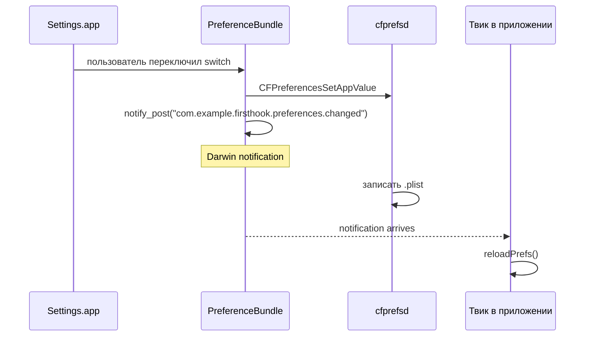

# Глава IV.8. Настройки твика и ресурсы

Хороший твик обычно имеет страницу настроек в Settings.app и, возможно, свои ресурсы (PNG иконки, строки, plist-данные). В этой главе — как это сделать правильно на RootHide Dopamine, с учётом randomized jbroot и `cfprefsd`-перенаправления.

## 1. Два способа настроек

**Способ A — простой: `.plist` в известном месте + `NSUserDefaults`/`CFPreferences`**. Пользователь редактирует через iFile/Filza или через свой UI. Для «я один пользователь, не делаю для публики» — достаточно.

**Способ B — настоящий PreferenceBundle в Settings.app**. Пользователь видит ваш твик в Settings → <TweakName>, может кликать переключатели. Это требует отдельного .appex-like бандла с PSListController subclass.

Эта глава покрывает оба; главный акцент — на правильное использование путей через `libroot`.

## 2. Хранение preferences — где и как

### 2.1. `cfprefsd` + rootless-redirect

Напомним из главы III.9: `rootlesshooks/cfprefsd.x` перенаправляет пути для не-apple preferences в rootless-пространство. Это значит:

```objc
// В вашем твике или вспомогательном приложении
CFPreferencesSetAppValue(CFSTR("enabled"), kCFBooleanTrue, CFSTR("com.example.firsthook"));
CFPreferencesAppSynchronize(CFSTR("com.example.firsthook"));
```

- cfprefsd получит запрос на запись.
- Проверит `preferencePlistNeedsRedirection("com.example.firsthook.plist")` → true (не com.apple.*).
- Запишет в `/var/jb/<path>/com.example.firsthook.plist` (а на RootHide — реально в randomized jbroot).

**Для вас как разработчика**: пишите стандартный `CFPreferences*` код. Всё перенаправление делается за вас.

### 2.2. Чтение в хуке

Аналогично:

```objc
Boolean exists = false;
Boolean value = CFPreferencesGetAppBooleanValue(CFSTR("enabled"), CFSTR("com.example.firsthook"), &exists);
if (exists) {
    if (value) {
        // применить хук
    }
}
```

Параметр `exists` критичен: без него нельзя отличить «ключа нет» от «ключ есть, но false».

### 2.3. NSUserDefaults — подводный камень

```objc
NSUserDefaults *defaults = [[NSUserDefaults alloc] initWithSuiteName:@"com.example.firsthook"];
BOOL enabled = [defaults boolForKey:@"enabled"];
```

Внутри `NSUserDefaults` использует `CFPreferences`, так что перенаправление работает. Единственный нюанс — суффикс `.plist` подставляется автоматически.

Если ваш твик встроен в чужое приложение, **не используйте** `[NSUserDefaults standardUserDefaults]` — это читает `.plist` текущего приложения, в который вы можете случайно записать и сломать приложение. Используйте только `initWithSuiteName:` с явным domain вашего твика.

### 2.4. Полная функция чтения настройки

Шаблон, который безопасно использовать в хуке:

```objc
static dispatch_once_t gPrefsOnce;
static BOOL gEnabled;
static dispatch_queue_t gPrefsQueue;

static void reloadPrefs(void) {
    Boolean exists = false;
    Boolean value = CFPreferencesGetAppBooleanValue(CFSTR("enabled"),
                                                     CFSTR("com.example.firsthook"),
                                                     &exists);
    gEnabled = exists ? value : YES;   // default — YES
}

%ctor {
    gPrefsQueue = dispatch_queue_create("com.example.firsthook.prefs", DISPATCH_QUEUE_SERIAL);
    dispatch_sync(gPrefsQueue, ^{ reloadPrefs(); });

    // подписка на изменения через Darwin notifications
    CFNotificationCenterAddObserver(
        CFNotificationCenterGetDarwinNotifyCenter(),
        NULL,
        (CFNotificationCallback)^(CFNotificationCenterRef center, void *observer, CFNotificationName name, const void *object, CFDictionaryRef userInfo) {
            dispatch_async(gPrefsQueue, ^{ reloadPrefs(); });
        },
        CFSTR("com.example.firsthook.preferences.changed"),
        NULL,
        CFNotificationSuspensionBehaviorDeliverImmediately);
}
```

Разбор:

- Чтение префсов на старте — через serial queue, без гонок.
- Подписка на Darwin notification — чтобы при изменении настроек из Settings.app твик перечитал.
- `gEnabled` — глобальный флаг для хуков.

Соответственно в хуке:

```objc
%hook UIApplication
- (BOOL)application:(UIApplication *)app didFinishLaunchingWithOptions:(NSDictionary *)opts {
    if (!gEnabled) return %orig(app, opts);  // хук выключен
    NSLog(@"[FirstHook] launching...");
    return %orig(app, opts);
}
%end
```

Пользователь выключил через Settings → твик уведомлён → глобальный флаг изменён → хуки работают по-новому. Без respring.

## 3. PreferenceBundle в Settings.app

### 3.1. Что это такое

`PreferenceBundle` — это `.bundle` с принципалом-классом (subclass of `PSListController`), который Settings.app загружает и использует для создания страницы настроек. Пользователь кликает Settings → <TweakName> → страница рендерится из вашего `Root.plist` + custom code.

### 3.2. Структура файлов

```
FirstHookPrefs/
├── Makefile
├── FirstHookPrefsListController.m
├── FirstHookPrefsListController.h
├── Resources/
│   ├── Root.plist
│   └── Info.plist
└── entry.plist   — специальный файл для Settings.app
```

### 3.3. Makefile

```make
TARGET := iphone:clang:latest:15.0
ARCHS = arm64 arm64e
THEOS_PACKAGE_SCHEME = roothide

include $(THEOS)/makefiles/common.mk

BUNDLE_NAME = FirstHookPrefs

FirstHookPrefs_FILES = FirstHookPrefsListController.m
FirstHookPrefs_INSTALL_PATH = /Library/PreferenceBundles
FirstHookPrefs_FRAMEWORKS = UIKit Preferences
FirstHookPrefs_LIBRARIES = root
FirstHookPrefs_CFLAGS = -fobjc-arc

include $(THEOS_MAKE_PATH)/bundle.mk

internal-stage::
    $(ECHO_NOTHING)mkdir -p $(THEOS_STAGING_DIR)/Library/PreferenceLoader/Preferences$(ECHO_END)
    $(ECHO_NOTHING)cp entry.plist $(THEOS_STAGING_DIR)/Library/PreferenceLoader/Preferences/FirstHook.plist$(ECHO_END)
```

Разбор:

- `BUNDLE_NAME` вместо `TWEAK_NAME`.
- `bundle.mk` вместо `tweak.mk`.
- `INSTALL_PATH = /Library/PreferenceBundles` — где хранится бандл. На RootHide Theos сам префиксирует в jbroot.
- `internal-stage::` — хук сборочный, который кладёт `entry.plist` в `/Library/PreferenceLoader/Preferences/`.

### 3.4. FirstHookPrefsListController.h

```objc
#import <Preferences/PSListController.h>

@interface FirstHookPrefsListController : PSListController
@end
```

### 3.5. FirstHookPrefsListController.m

```objc
#import "FirstHookPrefsListController.h"

@implementation FirstHookPrefsListController

- (NSArray *)specifiers {
    if (!_specifiers) {
        _specifiers = [self loadSpecifiersFromPlistName:@"Root" target:self];
    }
    return _specifiers;
}

- (void)setPreferenceValue:(id)value specifier:(PSSpecifier *)specifier {
    NSString *key = [specifier propertyForKey:@"key"];
    NSString *defaults = [specifier propertyForKey:@"defaults"];

    CFPreferencesSetAppValue((__bridge CFStringRef)key,
                              (__bridge CFPropertyListRef)value,
                              (__bridge CFStringRef)defaults);
    CFPreferencesAppSynchronize((__bridge CFStringRef)defaults);

    // Darwin notification — для твика
    notify_post("com.example.firsthook.preferences.changed");
}

- (id)readPreferenceValue:(PSSpecifier *)specifier {
    NSString *key = [specifier propertyForKey:@"key"];
    NSString *defaults = [specifier propertyForKey:@"defaults"];
    id def = [specifier propertyForKey:@"default"];

    CFPropertyListRef value = CFPreferencesCopyAppValue((__bridge CFStringRef)key,
                                                        (__bridge CFStringRef)defaults);
    if (!value) return def;
    return (__bridge_transfer id)value;
}

@end
```

Разбор:

- `-specifiers` — загружает `Root.plist` при первом обращении.
- `-setPreferenceValue:specifier:` — вызывается при изменении значения. Пишем в CFPreferences + постим Darwin notification.
- `-readPreferenceValue:` — читает значение.
- `notify_post` требует `#include <notify.h>`.

### 3.6. Root.plist

```xml
<?xml version="1.0" encoding="UTF-8"?>
<!DOCTYPE plist PUBLIC "-//Apple//DTD PLIST 1.0//EN" "http://www.apple.com/DTDs/PropertyList-1.0.dtd">
<plist version="1.0">
<dict>
    <key>items</key>
    <array>
        <dict>
            <key>cell</key>
            <string>PSGroupCell</string>
            <key>label</key>
            <string>FirstHook settings</string>
        </dict>
        <dict>
            <key>cell</key>
            <string>PSSwitchCell</string>
            <key>label</key>
            <string>Enabled</string>
            <key>key</key>
            <string>enabled</string>
            <key>defaults</key>
            <string>com.example.firsthook</string>
            <key>default</key>
            <true/>
        </dict>
        <dict>
            <key>cell</key>
            <string>PSGroupCell</string>
        </dict>
    </array>
    <key>title</key>
    <string>FirstHook</string>
</dict>
</plist>
```

Разбор:

- `PSGroupCell` — заголовок/разделитель группы.
- `PSSwitchCell` — toggle. Поля `key`, `defaults`, `default` — что писать/читать.
- Пустой `PSGroupCell` в конце — визуальный разделитель.

Другие полезные типы cells:

- `PSSegmentCell` — segmented control.
- `PSSliderCell` — слайдер.
- `PSEditTextCell` — text field.
- `PSButtonCell` — кнопка (нужен action).
- `PSLinkCell` — переход на другой экран.

### 3.7. entry.plist

Файл, который Settings.app использует, чтобы знать «вот такой-то preference bundle есть»:

```xml
<?xml version="1.0" encoding="UTF-8"?>
<!DOCTYPE plist PUBLIC "-//Apple//DTD PLIST 1.0//EN" "http://www.apple.com/DTDs/PropertyList-1.0.dtd">
<plist version="1.0">
<dict>
    <key>entry</key>
    <dict>
        <key>bundle</key>
        <string>FirstHookPrefs</string>
        <key>cell</key>
        <string>PSLinkCell</string>
        <key>detail</key>
        <string>FirstHookPrefsListController</string>
        <key>icon</key>
        <string>icon.png</string>
        <key>isController</key>
        <true/>
        <key>label</key>
        <string>FirstHook</string>
    </dict>
</dict>
</plist>
```

Разбор:

- `bundle` — имя `.bundle` файла (без расширения).
- `detail` — имя principalClass внутри bundle.
- `icon` — опциональная иконка для Settings.app.

Для работы Preferences-loader'а на устройстве нужен пакет **PreferenceLoader** (`preferenceloader`) — ставится из того же репозитория, что Dopamine или вручную.

### 3.8. Build

```bash
make clean package THEOS_PACKAGE_SCHEME=roothide
```

Результат — .deb с и твиком, и PreferenceBundle. После установки Settings.app → FirstHook → увидите переключатель.

## 4. Ресурсы — иконки, строки, plist-данные

### 4.1. Где класть

Варианты:

- **Вместе с твиком** — через `*_INSTALL_PATH` в Makefile или через `internal-stage::`.
- **В бандле PreferenceBundle** — `Resources/` папка.
- **Отдельным sub-package** — через `*.sub` в Theos.

Проще всего — положить в `/Library/Application Support/<TweakName>/`:

```make
BUNDLE_NAME = FirstHook_resources
FirstHook_resources_INSTALL_PATH = /Library/Application Support/FirstHook
```

На RootHide Theos сам переназначит в jbroot.

### 4.2. Чтение из твика

```objc
#import <libroot.h>

NSString *resourcesPath = [NSString stringWithUTF8String:JBROOT_PATH("/Library/Application Support/FirstHook")];
NSBundle *bundle = [NSBundle bundleWithPath:resourcesPath];
UIImage *icon = [UIImage imageNamed:@"icon" inBundle:bundle compatibleWithTraitCollection:nil];
```

Разбор:

- `JBROOT_PATH("...")` — тот самый макрос из главы III.10.
- `NSBundle bundleWithPath:` — загружает бандл для доступа к ресурсам.
- `imageNamed:inBundle:` — ищет PNG/JPG в этом бандле (не в основном приложения).

### 4.3. Строки локализации

Структура:

```
Resources/
├── en.lproj/
│   └── Localizable.strings
├── ru.lproj/
│   └── Localizable.strings
└── de.lproj/
    └── Localizable.strings
```

`Localizable.strings`:

```
"HOOK_ENABLED" = "Hook enabled";
"HOOK_DISABLED" = "Hook disabled";
```

Использование:

```objc
NSString *bundlePath = [NSString stringWithUTF8String:JBROOT_PATH("/Library/Application Support/FirstHook")];
NSBundle *bundle = [NSBundle bundleWithPath:bundlePath];
NSString *str = NSLocalizedStringFromTableInBundle(@"HOOK_ENABLED", nil, bundle, @"");
```

Это даёт многоязычный твик без усилий.

## 5. Таблица «что где хранить»

| Что | Где | Как читать |
|---|---|---|
| Boolean/number настройка | `CFPreferences` под domain вашего пакета | `CFPreferencesCopyAppValue` |
| PNG иконка | `/Library/Application Support/<Tweak>/icon.png` | через `NSBundle` + `JBROOT_PATH` |
| JSON с данными | `/Library/Application Support/<Tweak>/data.json` | `NSJSONSerialization` + `JBROOT_PATH` |
| Строки локализации | `/Library/Application Support/<Tweak>/<lang>.lproj/Localizable.strings` | `NSLocalizedStringFromTableInBundle` |
| Полный PreferenceBundle (UI) | `/Library/PreferenceBundles/<Tweak>.bundle` | загружается Settings.app автоматически |
| entry.plist для Preferences | `/Library/PreferenceLoader/Preferences/<Tweak>.plist` | читается PreferenceLoader |
| Twic-dylib + filter | `/Library/MobileSubstrate/DynamicLibraries/` | загружается TweakLoader |

Все эти пути — префиксируются `/var/jb/` в rootless и randomized-jbroot в RootHide. **Theos делает это за вас при `THEOS_PACKAGE_SCHEME=roothide`.** Вам не нужно вручную ничего менять в `INSTALL_PATH`.

## 6. Darwin notifications — связь settings ↔ tweak

Схема:



Код `notify_post` — тот, что в разделе 3.5. Код подписки в твике — тот, что в разделе 2.4.

Это полный цикл: пользователь меняет → твик реагирует без respring. Это то, что отличает качественный твик от «после каждого изменения надо перезагружать».

## 7. Что подтверждено

- **Подтверждено Theos docs**: `BUNDLE_NAME`, `bundle.mk`, `_INSTALL_PATH`.
- **Подтверждено Apple API**: `CFPreferences*`, `PSListController`, `PSSpecifier`, `NSBundle`, `NSLocalizedStringFromTableInBundle`.
- **Подтверждено Dopamine исходниками**: cfprefsd redirect для не-apple плистов — `BaseBin/rootlesshooks/cfprefsd.x`.
- **Требует проверки на устройстве**: PreferenceLoader установлен — иначе PreferenceBundle не появится в Settings.app.
- **Не подтверждено**: что все `PSCellTypes` из iOS 15 работают идентично на iOS 26 — некоторые могли быть deprecated.

## 8. Выводы

Главный тезис: **настройки — это CFPreferences + Darwin notification + опциональный PreferenceBundle**. Пути через libroot (автоматически в Theos). Респринг не нужен — notification передаёт изменение в твик мгновенно.

Три ключевых правила:

1. Используйте `CFPreferences*` с явным domain своего пакета.
2. Подпишитесь на Darwin notification в `%ctor`.
3. Используйте `JBROOT_PATH(...)` для чтения ресурсов.

## 9. Что дальше

- Совместимость с RootHide — глава IV.9 (расширяет вопрос путей).
- Сборка и инспекция `.deb` — глава IV.10.
- Первый полный учебный проект с настройками — глава IV.11.
- Шпаргалка Logos — `cheatsheets/01-logos-syntax.md`.
