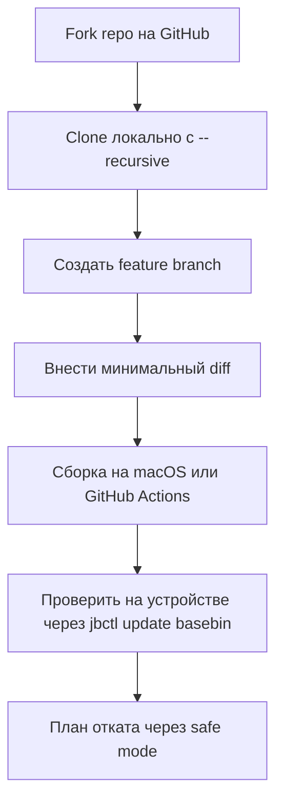

# Глава V.1. Патчи исходников самого jailbreak

Эта глава открывает Часть V. Патч исходников Dopamine отличается от написания твика двумя вещами: вы меняете сам фундамент, на котором стоят ваши и чужие твики, и ошибка в патче может уложить userland. В этой главе — как к такому подходить, с реальным мини-примером diff'а, который можно пересобрать и выкатить через `jbctl update basebin`.

## 1. Для чего это может понадобиться

Четыре типовых сценария, в которых автор твика идёт в сам Dopamine:

1. **Добавить диагностический лог** в компонент jailbreak — например, в `systemhook` при `jbclient_cs_revalidate`, чтобы увидеть, когда и почему это вызывается в вашем целевом приложении.
2. **Исправить баг совместимости** — твик видит странное поведение, и расследование показывает, что причина в `rootlesshooks` или `systemhook`.
3. **Добавить поддержку устройства/версии** — например, если на вашем A13 с конкретным билдом 26.0.1 что-то не работает.
4. **Пробросить новую функцию** в jbserver — редкий случай, обычно для специализированных инструментов.

Для первого и второго сценариев — вы патчите точечно. Для третьего и четвёртого — пересборка существенной части проекта.

## 2. Общая процедура



Разбор каждого шага ниже.

## 3. Клонирование и подготовка

```bash
# На macOS с установленным Xcode:
git clone --recursive https://github.com/<ваш-fork>/Dopamine-roothide.git ~/dev/Dopamine-rh
cd ~/dev/Dopamine-rh
git checkout -b feature/add-logging
```

**`--recursive`** критично: проект использует subprojects (ChOma, XPF, opainject, litehook). Без `--recursive` они не склонируются, и сборка упадёт.

Проверка структуры:

```bash
ls BaseBin/
# ChOma/        <- submodule
# XPF/          <- submodule
# opainject/    <- submodule
# _external/
# libjailbreak/
# ...
```

Если `ChOma/` пустой — `git submodule update --init --recursive`.

## 4. Минимальный пример diff: лог в systemhook

Задача: когда `systemhook.dylib` загружается в процесс, не только писать «loaded», но и выписать PID + путь исполнимого в системный лог. Это полезно для отладки — какие процессы на вашем устройстве действительно получают инструментовку.

### 4.1. Файл, который трогаем

`BaseBin/systemhook/src/main.c`. Напомним из главы III.5: `main.c` содержит функцию-конструктор, которая вызывается при загрузке в процесс. Нам нужно добавить `os_log` в начало инициализации.

### 4.2. Поиск точки вмешательства

Через `grep` или просмотр:

```bash
grep -n "load_executable_path\|jbclient_process_checkin\|TweakLoader" \
    BaseBin/systemhook/src/main.c | head -20
```

Пример вывода:

```
30:static int load_executable_path(void)
...
495:    if (should_enable_tweaks()) {
510:        litehook_hook_function(csops, csops_hook);
...
530:        if (should_enable_tweaks()) {
```

Ищем, где находится самое начало инициализации (т. е. `__attribute__((constructor))` или вызываемая оттуда функция). Поиск `constructor` в `main.c`:

```bash
grep -n "constructor\|__attribute__" BaseBin/systemhook/src/main.c | head -5
```

Если конструктор найден — вставляем лог сразу после `load_executable_path()`. Иначе — в начало функции, которая первой вызывается при загрузке (обычно это `__hooks_init` или подобное, которое вставляет `%ctor` сам Logos — но в systemhook это чистый C, без Logos).

Предположим, точка найдена: функция `init(void)` или начало работы в конструкторе. Для наглядности возьмём условное место.

### 4.3. Пример diff

```diff
--- a/BaseBin/systemhook/src/main.c
+++ b/BaseBin/systemhook/src/main.c
@@ -25,6 +25,7 @@
 #include <libjailbreak/jbclient_xpc.h>
 #include <libjailbreak/codesign.h>
 #include <libjailbreak/jbroot.h>
+#include <os/log.h>
 #include <libjailbreak/hookd.h>
 #include "../dyldhook/src/dyld_jbinfo.h"
 #include "common/hookd_external.h"
@@ -32,6 +33,8 @@
 #include "common/private.h"
 #include "common/inline.h"
 
+static os_log_t gSystemhookDiagLog;
+
 bool gFullyDebugged = false;
 static void *gLibSandboxHandle;
 char *JB_BootUUID = NULL;
```

И в точке инициализации (условно — функция, которая выполняется первой):

```diff
@@ -480,6 +483,15 @@ __attribute__((constructor)) static void initializer(void)
 {
     // ... existing initialization code ...
     load_executable_path();
+
+    // DIAG: log every process that gets systemhook
+    gSystemhookDiagLog = os_log_create("com.example.systemhook-diag", "load");
+    os_log(gSystemhookDiagLog,
+           "systemhook injected pid=%d path=%{public}s",
+           getpid(),
+           gExecutablePath);
+
     // ... rest of initialization ...
 }
```

**Внимание**: это ПРИМЕР. Точное место в вашем исходнике может отличаться — реальный файл длиннее и имеет свою структуру. Для реального патча:

1. Прочитайте `BaseBin/systemhook/src/main.c` полностью (он ~600 строк).
2. Найдите реальную точку входа (constructor функция).
3. Вставьте ваш `os_log` **после** `load_executable_path()` (чтобы `gExecutablePath` был заполнен), но **до** любых критических операций (чтобы если лог упадёт — критическая работа ещё не началась).

### 4.4. Что гарантирует этот патч

- Безопасный: `os_log` не делает file I/O, не задевает NECP, не делает рекурсию.
- Минимальный: 2 новые переменные + 1 include + 4 строки лог-вызова.
- Легко откатываемый: `git diff` показывает ровно эти изменения.

### 4.5. Что делать НЕ стоит

```c
// ПЛОХО
printf("systemhook loaded in %s\n", gExecutablePath);  // не работает в inject-процессах

// ПЛОХО
NSLog(@"...");  // ObjC runtime может быть не готов, Foundation не линкован к systemhook

// ПЛОХО
system("logger ...");  // рекурсивно загружает systemhook в системный процесс

// ХОРОШО
os_log(gSystemhookDiagLog, "...");  // thread-safe, не делает I/O
```

## 5. Сборка

### 5.1. На macOS

```bash
cd ~/dev/Dopamine-rh
# Полная сборка basebin + Dopamine.app:
make

# Только BaseBin (если изменения только там):
make -C BaseBin

# Только systemhook (быстрая итерация):
make -C BaseBin/systemhook
```

После успеха:

```
BaseBin/basebin.tar          — обновлённый "миниатюрный userland"
Application/Dopamine.tipa    — обновлённый установщик (если нужен)
```

### 5.2. Через GitHub Actions

Если нет macOS:

1. Fork `rouukroo/Dopamine-roothide` на GitHub.
2. Push вашу feature branch.
3. GitHub → Actions → Run workflow «build ipa/tipa file» на вашу ветку.
4. Через 5–10 минут скачайте artifact.

Детали — `BUILD.md` в корне репозитория.

## 6. Выкатка на устройство

Два пути: через `jbctl update basebin` (быстро, точечно) или через `jbctl update tipa` (переустановка Dopamine.app).

### 6.1. Через jbctl update basebin

Это рекомендованный путь для патча `BaseBin/*`:

```bash
# На хосте:
scp BaseBin/basebin.tar mobile@<ip>:/var/mobile/Documents/basebin.tar

# На устройстве через SSH:
ssh mobile@<ip>
/basebin/jbctl update basebin "$(jbroot)/var/mobile/Documents/basebin.tar"
```

Что происходит:

1. `jbctl` проверяет базовую совместимость нового `basebin.tar`.
2. Распаковывает в staging.
3. Делает **userspace reboot** — launchd перезапускается с новым `launchdhook`, `systemhook`, etc.
4. Все процессы (включая SpringBoard) перезапускаются.

Это равнозначно reboot'у с точки зрения UX, но без перезагрузки ядра.

### 6.2. Проверка

После userspace reboot:

```bash
log stream --predicate 'subsystem == "com.example.systemhook-diag"' --device <udid>
```

Увидите строки вида:

```
systemhook injected pid=28 path=/usr/libexec/syncdefaultsd
systemhook injected pid=29 path=/usr/libexec/transientcheckbarrierd
systemhook injected pid=42 path=/System/Library/CoreServices/SpringBoard.app/SpringBoard
systemhook injected pid=185 path=/private/var/containers/Bundle/Application/.../TestbedApp.app/TestbedApp
...
```

Это ваш новый diagnostic log. С его помощью можно увидеть **каждый** процесс, получивший `systemhook` на устройстве.

## 7. План отката

Если ваш патч ломает систему:

### 7.1. Через `.safe_mode`

Если устройство грузится, но твики/систему ломает:

```bash
ssh mobile@<ip>
touch "$(jbroot)/basebin/.safe_mode"
# или через libroot:
touch /basebin/.safe_mode
# затем:
killall -9 SpringBoard
```

Теперь `systemhook` не загружает TweakLoader (глава III.5), и ваш баг (если он в твиках) не проявится. Но если баг в самом `systemhook`, `.safe_mode` не поможет.

### 7.2. Rollback basebin

Если `.safe_mode` не помогает — вернитесь к рабочей сборке:

```bash
# На хосте:
cd ~/dev/Dopamine-rh
git checkout main
make -C BaseBin
scp BaseBin/basebin.tar mobile@<ip>:/var/mobile/Documents/basebin.tar
ssh mobile@<ip> '/basebin/jbctl update basebin "$(jbroot)/var/mobile/Documents/basebin.tar"'
```

### 7.3. Hard reset

Если устройство не грузится вовсе — DFU restore через iTunes/Finder. Это полный wipe. **Делайте бэкап перед работой с патчами jailbreak!**

## 8. Контрольный список перед сборкой

```
[ ] Патч минимален — изменены только нужные строки
[ ] Нет случайных изменений (whitespace, EOL)
[ ] Нет новых зависимостей — минимум добавленных includes
[ ] Нет NSLog/printf — только os_log или заменитель
[ ] Нет forced casts / unsafe operations
[ ] Код проходит `git diff` ревью (вы сами просмотрели)
[ ] Сборка проходит без warning'ов (новых)
[ ] Описаны инварианты — комментарий «что делает патч, почему»
[ ] .safe_mode подготовлен для отката
```

## 9. Пример: исправление «реального» бага

Для демонстрации возьмём коммит из истории проекта: **e3f3cb5 «hookd: Preserve write and protection errors»**. Это коммит, который автор проекта сделал сам — и мы можем проанализировать его как учебный.

До коммита: `hookd` в `BaseBin/hookd/src/main.c` маскировал ошибки `vm_write`/`vm_protect` и всегда возвращал 0. Это делало диагностику трудной: клиент не знал, что хук не прошёл.

После коммита: функция `apply_hook` возвращает конкретную ошибку. Код:

```c
// Было (упрощённо):
int apply_hook(mach_port_t clientTaskPort, mach_port_t taskPortInClient,
               vm_address_t vmaddr, const void *data, vm_size_t size)
{
    // ...vm_protect, vm_write, vm_protect...
    return 0;   // всегда 0
}

// Стало:
int apply_hook(mach_port_t clientTaskPort, mach_port_t taskPortInClient,
               vm_address_t vmaddr, const void *data, vm_size_t size)
{
    // ...vm_protect...
    if (kr != KERN_SUCCESS) return kr;  // <-- вернули ошибку
    // ...vm_write...
    // ...vm_protect обратно...
    return kr;  // <-- вернули результат последнего vm_protect
}
```

Это **идеал** патча: минимум строк, большая польза в диагностике, нулевой риск регрессии.

Для автора твика этот коммит — обучающий: он показывает, как правильно писать патчи — **в сторону прозрачности**, не маскировки.

## 10. Что подтверждено

- **Подтверждено практикой проекта**: `make -C BaseBin` собирает `basebin.tar`.
- **Подтверждено Makefile корня**: `/basebin/jbctl update basebin "$(jbroot)/var/mobile/Documents/basebin.tar"` — рабочая команда.
- **Подтверждено git log**: коммит e3f3cb5 действительно существует в репозитории и демонстрирует правильный стиль патча.
- **Подтверждено проектом**: `.safe_mode` файл отключает твики (см. главу III.5).
- **Требует проверки на устройстве**: конкретное место в `main.c`, куда вставлять ваш лог — зависит от текущей версии кода.
- **Не подтверждено**: что `jbctl update basebin` на вашей iOS 26.0/26.0.1 работает без issues — это зависит от текущей версии Dopamine, тестируйте.

## 11. Выводы

Главный тезис: **патч исходников Dopamine — это inverse pyramid риска**. Чем меньше diff — тем лучше. Чем менее агрессивна правка — тем меньше шанс regression'а. Пример коммита e3f3cb5 демонстрирует образец: 2 строки, большой диагностический выигрыш, минимальный риск.

Три якорных правила:

1. **Минимальный diff** — только то, что действительно нужно для вашей задачи.
2. **`os_log` в хуках** — всегда, никогда `NSLog`/`printf`.
3. **Готовый `.safe_mode` + rollback plan** до того, как делаете `jbctl update basebin`.

## 12. Что дальше

- Исправления существующего твика — глава V.2.
- Runtime-патчи поведения приложения — глава V.3.
- Mach-O / метаданные — глава V.4.
- Контроль качества патча — глава V.5.
