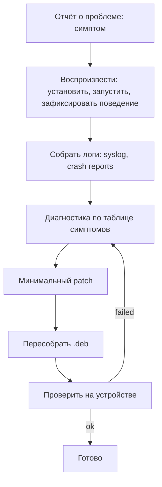

# Глава V.2. Исправления существующего твика

Эта глава — о работе ремонтника. Вам достаётся чужой твик (open-source) или ваш собственный годичной давности. Он падает на iOS 26, не работает на RootHide, или виснет SpringBoard. В этой главе — систематический подход к починке с реальными примерами.

## 1. Два частых случая

**Случай А — несовместимость с RootHide**. Твик хардкодит `/var/jb/...`. На RootHide-установке файлы по этому пути отсутствуют, и твик падает/не работает.

**Случай Б — несовместимость с iOS 26**. Твик написан для iOS 15/16, использует private селекторы, которые на 26 переименованы или удалены.

Эти два случая покрывают 90% заявок «мой любимый твик больше не работает после обновления Dopamine».

## 2. Общая процедура ремонта



## 3. Диагностика по симптомам

Таблица «симптом → вероятная причина»:

| Симптом | Диагноз |
|---|---|
| Твик не загружается вовсе (нет никакого лога) | Filter plist не ловит; dylib не на месте; `TweakLoader` не стартует |
| Загружается, но ничего не делает | Хук на класс, которого больше нет (iOS 26 переименовала) |
| SpringBoard уходит в respring loop | Хук возвращает `nil` где не должен; крах в `%ctor` |
| Падает только своё приложение (не SpringBoard) | Крах в хуке, но filter plist достаточно узкий |
| Твик работает на rootless, но не на RootHide | Хардкод `/var/jb/*` в коде |
| `fopen` возвращает NULL для твикового ресурса | Хардкод пути — тот же случай |
| cfprefsd «не видит» настроек | Пишете .plist напрямую, минуя `CFPreferences*` |
| Twic не работает в iOS 26, работал на 18 | iOS 26 добавила/изменила что-то — class-dump на 26 обязателен |

## 4. Случай А: несовместимость с RootHide

### 4.1. Пример: твик с хардкодом

Представим такой код в чужом Tweak.xm:

```objc
%hook SBApplicationController
- (void)applicationShouldInstallAtPath:(NSString *)path {
    NSString *configPath = @"/var/jb/Library/Application Support/MyTweak/config.plist";
    NSDictionary *cfg = [NSDictionary dictionaryWithContentsOfFile:configPath];
    // ...
    %orig(path);
}
%end
```

На RootHide-установке:

- Твик устанавливается в randomized `/var/<rand>/<rand>/.jbroot/Library/Application Support/MyTweak/config.plist`.
- Код пытается читать `/var/jb/.../config.plist` — файла по этому пути нет.
- `cfg` будет `nil`, логика ломается.

### 4.2. Фикс

Используем `libroot`:

```objc
#import <libroot.h>

%hook SBApplicationController
- (void)applicationShouldInstallAtPath:(NSString *)path {
    NSString *configPath = @(JBROOT_PATH("/Library/Application Support/MyTweak/config.plist"));
    NSDictionary *cfg = [NSDictionary dictionaryWithContentsOfFile:configPath];
    // ...
    %orig(path);
}
%end
```

Также обновляем Makefile:

```make
# Было:
# TweakName_LIBRARIES = ... (без root)
# Стало:
TweakName_LIBRARIES = root
```

И `control`:

```
# Было:
# Depends: mobilesubstrate
# Стало:
Depends: mobilesubstrate | ellekit | substitute, libroot-dopamine
```

И Makefile:

```make
# Добавить:
THEOS_PACKAGE_SCHEME = roothide
```

### 4.3. Шаги в diff-формате

```diff
--- a/Makefile
+++ b/Makefile
@@ -1,6 +1,7 @@
 TARGET := iphone:clang:latest:14.0
+ARCHS = arm64 arm64e
 INSTALL_TARGET_PROCESSES = SpringBoard
+THEOS_PACKAGE_SCHEME = roothide

 include $(THEOS)/makefiles/common.mk

@@ -8,5 +9,6 @@ TWEAK_NAME = MyTweak

 MyTweak_FILES = Tweak.xm
 MyTweak_CFLAGS = -fobjc-arc
+MyTweak_LIBRARIES = root

 include $(THEOS_MAKE_PATH)/tweak.mk
```

```diff
--- a/control
+++ b/control
@@ -4,4 +4,4 @@ Version: 1.0.0
 Architecture: iphoneos-arm
 Description: My tweak
 Section: Tweaks
-Depends: mobilesubstrate
+Depends: mobilesubstrate | ellekit | substitute, libroot-dopamine
```

```diff
--- a/Tweak.xm
+++ b/Tweak.xm
@@ -1,8 +1,9 @@
 #import <Foundation/Foundation.h>
+#import <libroot.h>

 %hook SBApplicationController
 - (void)applicationShouldInstallAtPath:(NSString *)path {
-    NSString *configPath = @"/var/jb/Library/Application Support/MyTweak/config.plist";
+    NSString *configPath = @(JBROOT_PATH("/Library/Application Support/MyTweak/config.plist"));
     NSDictionary *cfg = [NSDictionary dictionaryWithContentsOfFile:configPath];
     ...
```

Всего 5 изменённых мест. Минимальный diff — красивый diff.

### 4.4. Как найти **все** хардкоды в чужом твике

```bash
# В каталоге с исходниками твика:
grep -rn '/var/jb' *.x *.xm *.m *.c *.h 2>/dev/null
grep -rn 'JBROOT\|/basebin\|dopamine' *.x *.xm *.m *.c *.h 2>/dev/null | grep -v 'JBROOT_PATH'
```

Это даст список всех мест, где нужны правки.

Проверка собранного:

```bash
strings .theos/obj/MyTweak.dylib | grep /var/jb
```

Если пусто — хардкода не осталось.

## 5. Случай Б: несовместимость с iOS 26

### 5.1. Как проявляется

Твик загружается (видно в логе `[MyTweak] loaded in ...`), но хуки не работают. Диагностика:

```bash
log stream --predicate 'subsystem == "com.example.mytweak"'
# Пусто — хуки не срабатывают
```

Или:

```
[MyTweak] loaded in Target.app
# И после этого — ничего. Хотя Target.app делает кучу действий, которые должны триггерить хуки.
```

**Причина**: `%hook SomeClass` — класс `SomeClass` на iOS 26 не существует (переименован, удалён, или был private и исчез).

### 5.2. Как найти правильное имя

Два пути.

**Путь 1 — class-dump на устройстве**:

```bash
ssh mobile@<ip>
# Если установлен class-dump-dyld:
class-dump-dyld -o /tmp/dump /System/Library/.../Target.framework/Target
grep -r "OldClassName\|similar_keyword" /tmp/dump
```

**Путь 2 — runtime probe в своём твике**:

```objc
%ctor {
    unsigned int count = 0;
    Class *classes = objc_copyClassList(&count);
    for (unsigned int i = 0; i < count; i++) {
        const char *name = class_getName(classes[i]);
        // Ищем все классы, начинающиеся с нужного префикса
        if (strncmp(name, "SB", 2) == 0 && strstr(name, "Status") != NULL) {
            os_log(gLog, "found: %{public}s", name);
        }
    }
    free(classes);
}
```

Запускаете на устройстве — получаете список классов, которые есть на iOS 26.

Расширенная версия probe'а — дополнительно печатать методы:

```objc
Class cls = classes[i];
unsigned int methodCount = 0;
Method *methods = class_copyMethodList(cls, &methodCount);
for (unsigned int j = 0; j < methodCount; j++) {
    SEL sel = method_getName(methods[j]);
    const char *selName = sel_getName(sel);
    if (strstr(selName, "status")) {
        os_log(gLog, "  method: %{public}s", selName);
    }
}
free(methods);
```

### 5.3. Пример: твик `MyStatusTweak` для iOS 15, упавший на 26

Старое содержимое:

```objc
%hook SBStatusBarWiFiSignalView

- (void)updateImageViewForStyle:(long long)style {
    %orig(style);
    self.hidden = YES;  // Скрыть индикатор WiFi
}

%end
```

На iOS 26 класс `SBStatusBarWiFiSignalView` может называться по-другому (например, `_SBUIStatusBarWiFiView` или `SBFLSStatusBarWiFiSignalView`). Хук не ловит ничего.

Фикс через probe:

```objc
#import <objc/runtime.h>

static Class gWiFiClass = Nil;

%ctor {
    unsigned int count = 0;
    Class *classes = objc_copyClassList(&count);
    for (unsigned int i = 0; i < count; i++) {
        const char *name = class_getName(classes[i]);
        if (strstr(name, "StatusBar") && strstr(name, "WiFi")) {
            os_log(OS_LOG_DEFAULT, "candidate: %s", name);
            if (!gWiFiClass) gWiFiClass = classes[i];
        }
    }
    free(classes);

    if (gWiFiClass) {
        %init(WiFiView = gWiFiClass);
    }
}

%hook WiFiView

- (void)updateImageViewForStyle:(long long)style {
    %orig(style);
    [(UIView *)self setHidden:YES];
}

%end
```

Это переносимый вариант — работает на любой iOS, где есть класс с «StatusBar» и «WiFi» в имени.

### 5.4. Шаги применения

1. Запустить твик с probe (без `%hook`-кода, только логирование).
2. Из лога узнать точное имя класса на вашей iOS 26.
3. Переписать `%hook` с `NSClassFromString(@"ActualName")` + `%init`.
4. Если на разных версиях iOS классы разные — делать fallback-поиск (как в примере выше).

## 6. Диагностика при крэше SpringBoard

Если твик крэшит SpringBoard:

### 6.1. Прочитать .ips crash report

```bash
ssh mobile@<ip>
ls -t "$(jbroot)/private/var/mobile/Library/Logs/CrashReporter/" | head
# Увидите SpringBoard-....ips
cat "$(jbroot)/private/var/mobile/Library/Logs/CrashReporter/SpringBoard-...ips" | head -60
```

Или:

```bash
# Если jbroot недоступен через симлинк:
find /private/var/mobile/Library/Logs/CrashReporter/ -name "SpringBoard-*.ips" | head -3
```

### 6.2. Как читать .ips

`.ips` — JSON (хоть и выглядит как многострочный текст). Главные поля:

- **`bug_type`** — тип краша (309 = user crash, 210 = kernel panic, etc.).
- **`timestamp`** — когда.
- **`procName`** — упавший процесс (`SpringBoard`).
- **`crashReporterKey`** — hash устройства.
- **`os_version`** — iOS версия.
- **`faultingThread`** — номер треда.
- **`threads[].frames[]`** — stack trace. Каждый frame — `imageIndex` + `imageOffset`.
- **`usedImages[]`** — список загруженных dylib + их addresses.

Ищем в `threads[0].frames[]` фреймы с `imageIndex`, указывающим на вашу dylib (её `name` в `usedImages[]` — `MyTweak.dylib`).

Пример:

```
"faultingThread":0,
"threads":[{
  "frames":[
    {"imageOffset":4100,"symbol":"-[UIView setHidden:]","symbolLocation":16,"imageIndex":1},
    {"imageOffset":1024,"symbol":"","imageIndex":42}   // <-- ваш dylib
  ]
}]
```

`imageIndex:42` → смотрим `usedImages[42].name` → `MyTweak.dylib`. Значит крэш в вашем коде.

### 6.3. Символизация

Чтобы узнать, какая строка кода соответствует `imageOffset:1024` вашей dylib:

```bash
# На хосте, где собиралась dylib:
atos -o .theos/obj/MyTweak.dylib -arch arm64 -l 0x100000000 0x100000400
# Или проще:
otool -tV .theos/obj/MyTweak.dylib | grep -B2 -A2 '0x400'
```

atos вернёт функцию и строку. Это ваше место для фикса.

### 6.4. Типичные причины SpringBoard-крашей от твиков

| Причина | Фикс |
|---|---|
| Возврат `nil` где ожидается не-nil | Защищайте `return result ?: @"";` |
| Вызов `[super viewDidLoad]` руками (а не `%orig`) | Используйте `%orig` |
| Хук на private класс, который имеет другой layout | Переделайте в terms of публичного API |
| Крах в `%ctor` | Отложите тяжёлую работу в `dispatch_once` в первом событии |
| Многопоточный доступ без синхронизации | Serial queue или `@synchronized` |

## 7. Пример: починка твика «иконки с радиусом»

Чисто учебный пример. Старый твик:

```objc
// Был на iOS 15, скругляет иконки на home screen
%hook SBIconView

- (void)setHighlighted:(BOOL)highlighted {
    %orig(highlighted);
    self.layer.cornerRadius = 20.0;
    self.layer.masksToBounds = YES;
}

%end
```

Проблемы на iOS 26:

1. `SBIconView` может быть переименован или его layout изменён.
2. На экране блокировки `self.layer` может быть `nil` в определённые моменты.
3. `masksToBounds=YES` на iOS 26 с новой анимацией может артефачить.

Фикс:

```objc
#import <objc/runtime.h>
#import <QuartzCore/QuartzCore.h>

static Class gIconViewClass = Nil;

%ctor {
    // Пробуем две возможные имена класса
    gIconViewClass = NSClassFromString(@"SBIconView")
                  ?: NSClassFromString(@"_SBIconView")
                  ?: NSClassFromString(@"SBFLSIconView");
    if (gIconViewClass) {
        %init(IconView = gIconViewClass);
    }
}

%hook IconView

- (void)setHighlighted:(BOOL)highlighted {
    %orig(highlighted);
    CALayer *layer = self.layer;
    if (!layer) return;
    layer.cornerRadius = 20.0;
    layer.masksToBounds = YES;
}

%end
```

Разбор:

- `NSClassFromString` с fallback-chain — пробуем все возможные имена.
- Защита от `nil layer`.
- Остальной код — тот же.

Это пример «починки с запасом»: работает и на старых iOS, и на новых; если имя класса в будущем изменится — поиск продолжается в probe-коде.

## 8. Что проверять после патча

Чеклист:

```
[ ] `grep /var/jb` в исходниках и в собранной dylib — пусто
[ ] `strings MyTweak.dylib | grep /var/jb` — пусто
[ ] `otool -L MyTweak.dylib` — есть `@rpath/libroot.dylib`
[ ] Хуки используют `NSClassFromString` или защищены `%c(...)` для private классов
[ ] Return-value проверен (нет `nil` в `BOOL`-методах)
[ ] `%orig` вызывается ровно один раз (для каждого вызова хука)
[ ] Нет NSLog/stdlib call в hot-path хуках
[ ] Нет синхронной сети на main thread
[ ] Твик имеет план отключения (safe mode / dpkg -r)
```

## 9. Что подтверждено

- **Подтверждено**: `.ips` — JSON формат, Apple ipccrash reporter.
- **Подтверждено**: `objc_copyClassList`/`class_copyMethodList` — публичные Objective-C runtime API.
- **Подтверждено**: `NSClassFromString` — safe-способ получить класс в рантайме.
- **Подтверждено практикой проекта**: `JBROOT_PATH`, `libroot_get_jbroot_prefix` — рекомендованный способ (см. главы III.10, IV.9).
- **Требует проверки на устройстве**: имена private классов на iOS 26.0/26.0.1 — probe-метод.

## 10. Выводы

Главный тезис: **починка твика — это переход от «предполагаемого» к «проверенному»**. Каждое имя класса — проверить. Каждый путь — через libroot. Каждый возврат — проверить на nil.

Три якорных правила:

1. **Хардкоды `/var/jb/*`** — через `JBROOT_PATH` или `libroot_get_jbroot_prefix`.
2. **Private классы** — через `NSClassFromString` + `%init(... = cls)`.
3. **Return-value** — защищайте от nil, особенно в SpringBoard-хуках.

## 11. Что дальше

- Runtime-патчи поведения приложения — глава V.3.
- Mach-O / метаданные (binary patching) — глава V.4.
- Контроль качества патча — глава V.5.
- Для диагностики — глава VII.1 про «не загружается».
